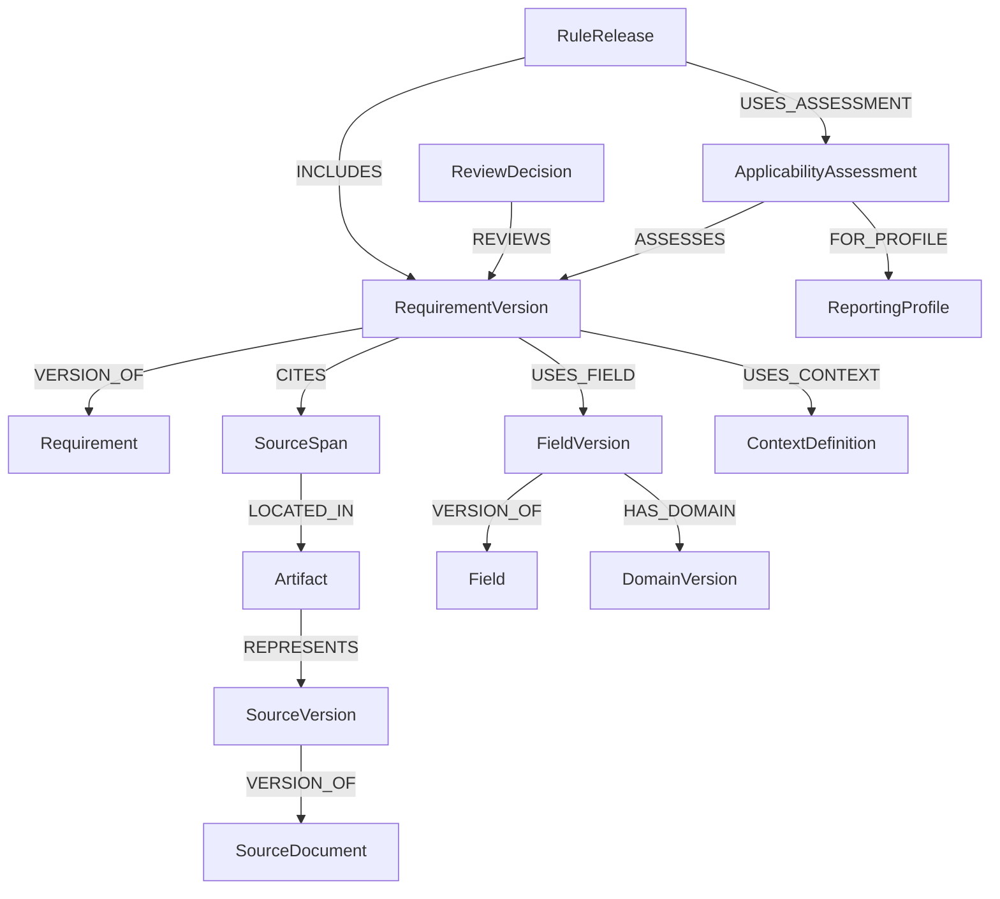

# SFTR validation knowledge graph: ontology and schema

**Schema version:** 0.1.0  
**Decision date:** 21 October 2026  
**Status:** design baseline for the extraction pilot; not an implemented or validated schema  
**Purpose:** preserve evidence and meaning while converting source documents into reviewable, eventually executable validation requirements.

## Contents

1. [Design decisions](#1-design-decisions)
2. [What the graph represents](#2-what-the-graph-represents)
3. [Identifiers, versions, and common properties](#3-identifiers-versions-and-common-properties)
4. [Node definitions](#4-node-definitions)
5. [Relationship definitions](#5-relationship-definitions)
6. [Requirement expression language](#6-requirement-expression-language)
7. [Scope, exceptions, missing values, and outcomes](#7-scope-exceptions-missing-values-and-outcomes)
8. [Lifecycle and cross-record requirements](#8-lifecycle-and-cross-record-requirements)
9. [Worked example](#9-worked-example)
10. [Review, applicability, and release](#10-review-applicability-and-release)
11. [Integrity constraints](#11-integrity-constraints)
12. [Physical storage and extraction interface](#12-physical-storage-and-extraction-interface)
13. [Queries the schema must support](#13-queries-the-schema-must-support)
14. [Pilot acceptance checks](#14-pilot-acceptance-checks)
15. [Explicit boundaries](#15-explicit-boundaries)

## 1. Design decisions

| Question | Decision |
|---|---|
| What is the main knowledge object? | A requirement, with immutable versions of its interpretation and evidence links. |
| What graph model? | A directed property graph with a controlled set of node and edge types. RDF/OWL is not required for the pilot. |
| Where is the actual logic? | In a typed JSON expression tree inside a `RequirementVersion`. Graph edges index its dependencies. |
| Are field-to-field connections rules? | No. A rule is represented by a requirement node connecting all its operands, conditions, context, and evidence. |
| How are examples treated? | As evidence with an explicit `example` role; example values do not automatically become constraints. |
| How are unknowns treated? | Explicit unresolved slots and issues. Extraction may produce a partial requirement. |
| What determines UK applicability? | A separate, reviewed assessment for a reporting profile and time interval. Publisher identity alone does not establish applicability. |
| What is executable? | Only a released requirement version with complete supported expressions, resolved dependencies, and applicable review decisions. |
| How are derived rules treated? | Separately labelled logical consequences with identified premises and derivation evidence. |
| Initial persistence? | SQLite with JSON payloads, relational integrity checks, and JSONL import/export. A graph database can be added later without changing the ontology. |

The flow is:

```text
Source artifacts
    -> located evidence spans
    -> candidate requirement versions
    -> reviewed meaning and applicability
    -> reproducible rule release
    -> executable validations
```

The graph is available during extraction and review. It does not need to wait for rules to be approved.

## 2. What the graph represents

The ontology has five areas:

| Area | Node types |
|---|---|
| Source and provenance | `SourceDocument`, `SourceVersion`, `Artifact`, `SourceSpan` |
| Reporting vocabulary | `ReportingProfile`, `Field`, `FieldVersion`, `DomainVersion`, `ContextDefinition` |
| Requirements | `Requirement`, `RequirementVersion` |
| Governance and processing | `ApplicabilityAssessment`, `ExtractionRun`, `ReviewDecision`, `Issue` |
| Release | `RuleRelease` |

This gives **16 node types**. Values such as action codes are entries in a domain, not individual graph nodes by default. Operators and comparisons remain in the expression tree.



**A requirement is the centre of an n-ary relationship:** its conditions and assertion can jointly involve any number of fields. No all-pairs expansion is needed.

For example, a five-field condition remains one expression attached to one requirement. Its five dependency edges support retrieval; they do not replace the expression.

## 3. Identifiers, versions, and common properties

### 3.1 Node envelope

Every node uses this envelope:

```json
{
  "id": "requirement-version:example-r1-v1",
  "type": "RequirementVersion",
  "schema_version": "0.1.0",
  "recorded_at": "2026-10-21T12:00:00Z",
  "created_by": "run:example-extraction",
  "properties": {}
}
```

The timestamp and identifiers above are illustrative. Actual ingestion generates them.

- `id`: globally unique, immutable string. Use UUID-based IDs except where a stable field key is appropriate. Never use a mutable title as identity.
- `type`: one of the 16 allowed node types.
- `schema_version`: schema used to interpret the payload.
- `recorded_at`: UTC ingestion time; not publication date or regulatory effective date.
- `created_by`: extraction run ID or attributable human/system actor ID.
- `properties`: the typed payload defined below. Unknown properties are rejected unless placed in a namespaced `extensions` object; extensions cannot alter execution semantics.

Edges also have immutable IDs, `type`, `from_id`, `to_id`, `recorded_at`, `created_by`, and typed `properties`.

### 3.2 Stable identity versus interpretation version

- `Field` identifies a reporting-table position, for example `field:sftr:2:6`.
- `FieldVersion` identifies a particular definition of that field under a particular profile/version.
- `Requirement` groups revisions of one interpreted obligation.
- `RequirementVersion` contains one immutable interpretation. Changing its condition, exception, assertion, scope, or bindings creates another version.
- `SourceDocument` identifies a publication series or logical document.
- `SourceVersion` identifies a particular issued version. If its identity cannot yet be established, mark it `provisional`; do not infer it from retrieval time.

The example field key is a shared conceptual identifier, not a claim that UK and EU definitions are identical. Their `FieldVersion` records can differ. A change that repurposes a table position must be reviewed before reusing the same logical field identity.

### 3.3 Four different times

Keep these separate:

1. Source publication or issuance date.
2. Retrieval/recording time.
3. Regulatory applicability interval for a reporting profile.
4. Transaction/event/reporting time used by a validation.

An applicability boundary is one of:

```json
{"kind": "date", "value": "2024-11-25"}
```

```json
{"kind": "unknown"}
```

```json
{"kind": "unbounded"}
```

Intervals are `[from, to)`. `unknown` is not equivalent to an unbounded interval. A temporal assessment must also specify its date basis, such as submission date or event date.

### 3.4 Immutability

Evidence artifacts, spans, definition versions, requirement versions, assessments, and decisions are append-only. Corrections create new records and explicit revision links. Review status can be cached for querying, but is derived from decisions rather than silently edited into historical content.

## 4. Node definitions

In this section, listed payload fields are required unless marked optional. Required information may use an explicitly defined unknown/unresolved representation where allowed. A fabricated value is never a substitute for missing information.

### 4.1 Source and provenance

| Node | Required payload | Important constraints |
|---|---|---|
| `SourceDocument` | `title`, `publisher`, `document_kind`, `canonical_uri` | Kind: legislation, amendment, guidance, Q&A, validation specification, schema, repository specification, or index. Publisher is descriptive metadata, not an automatic authority rank. |
| `SourceVersion` | `version_label`, `identity_status`, `publication_date`, `jurisdiction_labels`, `language` | Exactly one parent document. Unknown label/date allowed explicitly. Optional declared effective dates are source claims, not reviewed applicability decisions. |
| `Artifact` | `artifact_class`, `representation`, `media_type`, `location`, `sha256`, `acquired_at`, `completeness`, `quality_flags` | Class: source material or generated analysis. Source material represents exactly one source version. Generated analysis identifies its producing run/actor and does not masquerade as a source version. A hash of extracted text is never called the original PDF hash. |
| `SourceSpan` | `locator`, `content`, `content_sha256`, `span_kind`, `quality_flags` | Exactly one artifact. Locator must resolve inside that exact artifact. Span kind: prose, heading, table region, footnote, example, definition, or mixed. |

`SourceSpan.locator` is a tagged structure supporting:

- `text_lines`: start/end inclusive, plus `line_namespace` such as `web_extraction` or `file_lines`.
- `pdf_region`: zero-based page and bounding box.
- `spreadsheet_range`: sheet name and cell range.
- `xml_path`: XPath plus namespace mapping.
- `html_path`: element locator with a captured text anchor.

For the existing corpus, use `text_lines` with `line_namespace: web_extraction`. A marker such as `L4332` is not a physical editor line number. Store the exact text captured, without silently repairing its wording.

Small spans may overlap: one sentence can be part of a larger evidence packet. Context links preserve headings, footnotes, and referenced passages. Visual extraction issues stay attached to their spans.

Source representations include original binary, HTML snapshot, extracted text, page image, and structured extraction. Generated-analysis representations include model response, derivation report, validation report, and release manifest. A source-text extraction remains source material with extraction lineage; an LLM's interpretation is generated analysis. Generated analysis can support an audit or derivation, but cannot supply normative source authority.

### 4.2 Reporting vocabulary

| Node | Required payload | Important constraints |
|---|---|---|
| `ReportingProfile` | `regime`, `jurisdiction`, `regulator`, `specification_label`, `repository`, `definition_status` | Repository can be explicitly unspecified for research. The profile identifies a target configuration, not all possible UK reporting forever. |
| `Field` | `namespace`, `table_id`, `field_number`, `display_name` | Unique logical key `(namespace, table_id, field_number)`. Names can be aliases; bare field numbers are never globally unique. |
| `FieldVersion` | `definition_text`, `value_type`, `record_family`, `cardinality`, `units`, `nullability`, `aliases`, `definition_status` | Exactly one parent field and one profile; at most one composite domain. Unknown definition attributes must be explicit. XML bindings are optional until verified. |
| `DomainVersion` | `value_type`, `representation`, `constraints`, `completeness`, `version_label` | Representation: enum, numeric bounds, text pattern, date/time, taxonomy, reference dataset, or composite. No universal valid-value list is inferred from a few examples. |
| `ContextDefinition` | `name`, `description`, `value_type`, `scope`, `acquisition_contract`, `availability_status` | Describes information outside the report: clearing model, calendars, instrument reference data, accepted report history, settlement status, or other business facts. |

Field cardinality is `{min, max}` with a defined unbounded maximum where appropriate. Distinguish field repetition from repetition of its enclosing collateral component or message.

`DomainVersion.constraints` supports parent-child taxonomy mappings. Two individually valid codes may be invalid together. External domains identify dataset version and lookup date; current reference data must not silently validate a historical record.

`ContextDefinition.scope` is one of `record`, `transaction`, `position`, `portfolio`, `entity`, `submission_history`, `reference_dataset`, or `calendar`.

The acquisition contract identifies the required provider, lookup key, as-of time, and completeness guarantees. These may initially be unresolved. Model guesses about business context are not admissible runtime values.

### 4.3 Requirements

| Node | Required payload | Important constraints |
|---|---|---|
| `Requirement` | `title`, `requirement_family` | Stable logical grouping. A title is not a deduplication key. |
| `RequirementVersion` | `origin`, `normativity`, `requirement_kind`, `interpretation`, `bindings`, `evaluation_scope`, `when`, `unless`, `assertion`, `definition_state`, `open_questions` | Exactly one parent requirement. Expression slots may be unresolved during extraction. Evidence and dependency edges are described below. |

Allowed `origin` values:

- `source_extracted`: interpretation of source material.
- `derived`: logical consequence of identified requirement versions.
- `local_policy`: an organisation's own check. Never present it as a regulatory requirement.

Allowed `normativity` values: `obligation`, `prohibition`, `permission`, `definition`, `example_only`, `informative`, `unresolved`.

An example can be retained as a candidate hypothesis, but its normativity remains `example_only` until independent normative evidence justifies a different version.

Allowed `requirement_kind` values:

| Kind | Examples of what must be representable |
|---|---|
| `presence` | Conditional presence or absence of a value |
| `domain` | Allowed values, length, type, or bounds |
| `comparison` | Equality or ordering between fields/context values |
| `calculation` | Arithmetic identity with explicit units and rounding |
| `temporal` | Date relationships or business-day deadlines |
| `history` | Restrictions dependent on earlier accepted events |
| `cross_record` | Relationships between records, counterparties, or report families |
| `aggregate` | Totals or other calculations over a specified collection |
| `reporting_obligation` | Whether a report/event is required or prohibited |
| `composite` | An inseparable combination of the above |

`definition_state` is `partial` or `complete`. Complete means the interpretation has no unresolved structural slots; it does not mean reviewed or applicable.

### 4.4 Processing, review, and release

| Node | Required payload | Important constraints |
|---|---|---|
| `ApplicabilityAssessment` | `conclusion`, `validity_interval`, `date_basis`, `reasoning`, `open_questions` | Exactly one requirement version and one profile. Conclusion: applicable, not applicable, or unresolved. Requires attributable review before release. |
| `ExtractionRun` | `task_kind`, `model_or_tool`, `prompt_or_config_hash`, `started_at`, `finished_at`, `run_status`, `usage` | Inputs, outputs, model/config version, raw response artifacts, and failure details must be traceable. Usage may be explicitly unavailable. |
| `ReviewDecision` | `dimension`, `decision`, `reviewer`, `reason`, `decided_at` | Targets a node or an edge. Dimension: extraction fidelity, meaning, applicability, equivalence, derivation, or release. AI review is distinguished from accountable human review. |
| `Issue` | `issue_kind`, `description`, `blocking_scope`, `resolution_state` | Links to affected objects. Kinds include ambiguous meaning, missing reference, unknown field, extraction damage, conflicting requirements, missing context, or unsupported expression. |
| `RuleRelease` | `release_label`, `built_at`, `manifest_sha256`, `compiler_version`, `evaluation_semantics_version`, `validation_evidence`, `release_state` | Exactly one profile. Pins requirement/definition/context versions and accepted assessments; never selects dynamically by “latest”. |

Review decisions use `accept`, `reject`, or `request_changes`. `request_changes` is not acceptance. Replacing a decision requires an explicit superseding decision; conflicting current decisions block the affected release scope.

## 5. Relationship definitions

Cardinality is measured from the left-hand node unless stated otherwise. `0..n` is allowed during collection; release gates can impose stricter requirements.

| Edge | Allowed endpoints | Cardinality / properties |
|---|---|---|
| `VERSION_OF` | SourceVersion → SourceDocument; FieldVersion → Field; RequirementVersion → Requirement | Exactly 1 per version; no cross-type pairing. |
| `REPRESENTS` | Artifact → SourceVersion | Exactly 1 for source-material artifacts; 0 for generated-analysis artifacts. |
| `DERIVED_FROM_ARTIFACT` | Artifact → Artifact | 0..n; conversion/extraction method and run ID. No cycles. |
| `LOCATED_IN` | SourceSpan → Artifact | Exactly 1. |
| `HAS_CONTEXT` | SourceSpan → SourceSpan | 0..n; role: heading, footnote, definition, neighbouring passage, or resolved reference. |
| `MENTIONS_FIELD` | SourceSpan → Field | 0..n; text location, explicit/inferred match, ambiguity status. This is not a regulatory dependency. |
| `FOR_PROFILE` | FieldVersion, ApplicabilityAssessment, RuleRelease → ReportingProfile | Exactly 1 for each of these nodes. |
| `HAS_DOMAIN` | FieldVersion → DomainVersion | 0..1; one composite domain can express multiple constraints. |
| `CITES` | RequirementVersion, FieldVersion, DomainVersion, ContextDefinition, ApplicabilityAssessment, ReviewDecision → SourceSpan | 0..n; role, claim paths, and proposed interpretation of support. |
| `USES_FIELD` | RequirementVersion → FieldVersion | 0..n; derived from bindings/expressions, with all occurrence paths and roles. |
| `USES_CONTEXT` | RequirementVersion → ContextDefinition | 0..n; derived from bindings/expressions, with occurrence paths and roles. |
| `PRODUCED` | ExtractionRun → candidate/definition/evidence/issue nodes or Artifact | 0..n; provenance, not approval. |
| `READ` | ExtractionRun → SourceSpan, Artifact, RequirementVersion, FieldVersion, DomainVersion, ContextDefinition | 0..n; actual inputs. |
| `ASSESSES` | ApplicabilityAssessment → RequirementVersion | Exactly 1. |
| `REVIEWS` | ReviewDecision → node or edge ID | Exactly 1 target; see storage representation below. |
| `AFFECTS` | Issue → node or edge ID | 1..n. |
| `RELATES_TO` | RequirementVersion → RequirementVersion | 0..n; relation kind and review status described below. |
| `SUPERSEDES_DECISION` | ReviewDecision → ReviewDecision | 0..n; scoped to compatible review targets/dimensions. No cycles. |
| `INCLUDES` | RuleRelease → RequirementVersion | 1..n. |
| `USES_ASSESSMENT` | RuleRelease → ApplicabilityAssessment | 1..n; each included requirement must have a matching applicable assessment. |
| `PINS_DEPENDENCY` | RuleRelease → FieldVersion, DomainVersion, ContextDefinition, Artifact | All dependencies required to reproduce interpretation and execution. |

For a pure property-graph backend, an edge that must be reviewed can be reified as a relationship record. The canonical storage still identifies it by its edge ID; no meaning is lost in that conversion.

`CITES.properties`:

```json
{
  "role": "supports",
  "claim_paths": ["/when", "/assertion"],
  "support_basis": "explicit_text"
}
```

Allowed roles: `supports`, `qualifies`, `defines`, `example`, `context`, `contradicts`. Allowed support bases: `explicit_text`, `interpretation`, `example_only`.

`CITES` records an asserted evidence relationship. Its existence does not prove support. Review can accept or reject the edge and can identify an unsupported condition even when the rest of a requirement is supported.

Dependency roles: `condition`, `exception`, `assertion`, `comparison_operand`, `join_key`, `group_key`, `history_key`, `time_basis`, `aggregation_input`. A field can have several roles in one requirement.

`RELATES_TO.properties.kind` is one of:

- `possible_duplicate`
- `equivalent`
- `refines`
- `conflicts_with`
- `supersedes`
- `derived_from`

Every such edge has `assessment_state: proposed | accepted | rejected`, reasoning, and provenance. The state is a derived review view. Similar wording can propose a duplicate; it cannot establish equivalence. `supersedes` must specify affected scope/interval. `derived_from` identifies exact premise versions and a derivation artifact; derived requirements cannot cite themselves through a chain.

These relationships do not propagate automatically. For example, a proposed conflict does not invalidate either requirement, and a supersession in one reporting profile does not remove the old rule from all profiles.

## 6. Requirement expression language

### 6.1 Typed expressions

The expression tree is authoritative for logic; dependency edges are generated from it. Never reconstruct an expression from field co-occurrence edges.

The structural forms are:

```text
Expr := Literal | Reference | Operation | Unresolved

Literal    := { "literal": { "type": Type, "value": Value } }
Reference  := { "ref": BindingName }
Operation  := { "op": Operator, "args": [Expr, ...] }
Unresolved := { "unresolved": { "reason": Text, "issue_id": ID } }
```

Types: `boolean`, `integer`, `decimal`, `string`, `date`, `timestamp`, `duration`, `code`, `identifier`, and typed `collection`. Decimal values are serialized as strings. Booleans are not integers. Codes identify their domain. Units/currencies are carried by bindings or values where relevant.

No Python, SQL, shell commands, executable templates, or arbitrary function names are accepted as expressions.

### 6.2 Initial executable operator set

| Operator | Meaning / restriction |
|---|---|
| `and`, `or` | At least two Boolean expressions; three-valued semantics. |
| `not` | Exactly one Boolean expression. |
| `eq`, `ne`, `lt`, `le`, `gt`, `ge` | Two type-compatible operands; unit and timezone compatibility checked. |
| `in` | Value and explicit finite set or pinned domain reference. |
| `between` | Value, lower bound, upper bound; explicit inclusive/exclusive flags required. |
| `is_present`, `is_absent`, `is_valid` | Presence/type validity checks with the state distinctions below. |
| `add`, `subtract`, `multiply`, `divide` | Numeric operands with defined units, scale, rounding, and zero-division handling. |

This is the first compiler subset. It is intentionally smaller than the representation needed to capture all requirements.

### 6.3 Reserved structured operators

The ontology also reserves these forms so extraction can preserve complex requirements without flattening them:

- `exists`, `for_all`: quantified predicates over an explicitly bound collection.
- `count`, `sum`, `min`, `max`: aggregate operators with collection, grouping, and empty-set behaviour.
- `lookup`: versioned reference-data lookup with explicit key and as-of date.
- `business_day_add`: calendar, timezone, offset, and cutoff contract.
- `history_matches`: declared history selection and state/pattern specification.
- `obligation_satisfied`: expected event/report, subject key, due time, observation window, and completeness contract.

Each requires a versioned signature before it can be compiled. In schema 0.1.0, a requirement using an unimplemented reserved operator is stored with an `unsupported_expression` issue and cannot enter an executable release. An unknown operation is rejected, not interpreted as free-form executable logic.

### 6.4 Bindings

Each reference resolves to an entry in `RequirementVersion.bindings`:

```json
{
  "clearing_time": {
    "kind": "field",
    "field_version_id": "field-version:example-2-6",
    "record_alias": "current",
    "value_type": "timestamp"
  },
  "clearing_model": {
    "kind": "context",
    "context_definition_id": "context:example-clearing-model",
    "subject_alias": "transaction",
    "value_type": "code"
  }
}
```

Bindings can also identify a scoped collection or a pinned domain. References must not silently default to the current record when their record alias is missing.

During extraction, an unresolved field name may be retained in an unresolved binding with an issue. Such a candidate is not compilable. Once bound, every `USES_FIELD` or `USES_CONTEXT` edge must agree with the expression and binding paths.

## 7. Scope, exceptions, missing values, and outcomes

### 7.1 Applicability has two levels

1. **Knowledge applicability:** is this requirement approved for the reporting profile and applicable date? This is controlled by assessments and release selection.
2. **Record applicability:** do the runtime subject, conditions, and exceptions match this record/history? This is expressed by `evaluation_scope`, `when`, and `unless`.

`evaluation_scope` declares the record family, subject kind, aliases, identity key, time basis, and any collection/history selection contract. Record family is one of `transaction`, `margin`, or `reuse`, or an explicitly defined cross-family scope. It does not use Table 2's action field as the action field for every report family.

The runtime guard is:

```text
scope_matches AND when AND NOT unless
```

An explicitly unconditional requirement uses Boolean literal `true` for `when`. A reviewed absence of exceptions uses literal `false` for `unless`. An unexamined or unresolved condition/exception must remain `unresolved`; it must not receive these defaults automatically.

An exception to one requirement does not invalidate a record or exempt it from every other requirement. Shared exceptions can be represented in multiple expressions with common evidence; equivalent exceptions may be factored only after review.

### 7.2 Value states

| State | Meaning |
|---|---|
| `present_valid` | Value exists and has the expected representation/type. |
| `present_invalid` | Value exists but fails parsing/type/domain prerequisites. |
| `absent` | The complete inspected record confirms the value is absent. |
| `unavailable` | Required data or context was not supplied, retrieved, or known to be complete. |

Empty string, explicit null, omitted element, and domain-specific “not available” codes are normalized according to the specific field/schema binding. They are not collapsed globally.

`is_present` is true for both present states, false for absent, and unknown for unavailable. `is_absent` reverses those results. `is_valid` is true for present-valid, false for present-invalid or absent, and unknown for unavailable. Rules can combine presence and validity checks where needed.

Ordinary comparisons involving absent, unavailable, or invalid operands return `unknown` with a reason. A known presence requirement can still fail on absence. A separate type/domain rule can fail on present-invalid data; a dependent comparison need not produce an additional misleading failure.

### 7.3 Three-valued Boolean logic

Use `true`, `false`, and `unknown`:

- `false AND unknown = false`
- `true AND unknown = unknown`
- `true OR unknown = true`
- `false OR unknown = unknown`
- `NOT unknown = unknown`

No unknown result is silently converted into false.

### 7.4 Runtime outcomes

| Guard | Assertion | Outcome |
|---|---|---|
| False | Any | `NOT_APPLICABLE` |
| Unknown | Any | `NOT_EVALUATED` with unresolved guard causes |
| True | True | `PASS` |
| True | False | `FAIL` |
| True | Unknown | `NOT_EVALUATED` with missing/invalid operand causes |

Requirements blocked before release have a **knowledge status**, not a runtime failure. Do not count blocked rules or unavailable context as successful validations.

## 8. Lifecycle and cross-record requirements

### 8.1 Lifecycle history

A history-dependent requirement must declare:

| Attribute | Why it is required |
|---|---|
| Subject key | Identifies the transaction/position/report family in the correct counterparty and repository context. |
| Included submissions | Distinguishes accepted reports, rejected reports, pending reports, and proposed new submissions. |
| Ordering basis | Submission order and business event date are different orderings. |
| Persistent state | Earlier events can constrain behaviour even after intervening corrections. |
| Effective-time treatment | Defines treatment of late or historical events and current state. |
| History completeness | An empty result is not proof that no earlier event exists. |

The key is declared per requirement; UTI alone is not assumed to be globally sufficient. The schema permits state predicates or explicit history patterns. A state-machine implementation must retain any earlier state that affects permitted behaviour.

### 8.2 Cross-record and aggregate requirements

Collection bindings must declare:

- Dataset and record family.
- Join keys and their namespaces.
- Subject/counterparty perspective.
- As-of time or time window.
- Inclusion/exclusion predicate.
- Grouping keys.
- Duplicate handling and ordering where relevant.
- Completeness contract and empty-set semantics.

For example, an aggregation over collateral components must identify its enclosing trade/netting set and currencies. A sum over unrelated rows that share a field name is not a meaningful validation.

Missing joined data produces unknown unless completeness proves the absence. This distinction is necessary for rules about missing reports: one submitted record cannot establish that an expected event was never reported.

## 9. Worked example

### 9.1 Evidence and scope

The collected ESMA guidance describes the timestamp relationship for open-offer clearing in section 5.3.2.1 and a different relationship for novation in section 5.3.2.2. See [the original source](https://www.esma.europa.eu/sites/default/files/library/esma70-151-2838_guidelines_on_reporting_under_sftr.pdf) and [local D06](documents/D06_esma_sftr_guidelines.txt), source lines L4325-L4334 and L4394-L4405.

The following is a **partial candidate interpretation for schema illustration**, not a current UK rule. The complete perspective/report applicability still requires review. The code `open_offer` is an internal business-context label, not an asserted SFTR reporting code.

### 9.2 RequirementVersion payload

This example shows the `properties` portion of a node. Referenced IDs are illustrative and must be replaced by stored objects during ingestion.

```json
{
  "origin": "source_extracted",
  "normativity": "obligation",
  "requirement_kind": "comparison",
  "interpretation": "For the described open-offer scenario, compare clearing and execution timestamps for equality.",
  "bindings": {
    "model": {
      "kind": "context",
      "context_definition_id": "context:example-clearing-model",
      "subject_alias": "transaction",
      "value_type": "code"
    },
    "clearing_time": {
      "kind": "field",
      "field_version_id": "field-version:example-2-6",
      "record_alias": "current",
      "value_type": "timestamp"
    },
    "execution_time": {
      "kind": "field",
      "field_version_id": "field-version:example-2-12",
      "record_alias": "current",
      "value_type": "timestamp"
    }
  },
  "evaluation_scope": {
    "record_family": "transaction",
    "subject_kind": "transaction",
    "aliases": ["current", "transaction"],
    "identity_key": {
      "unresolved": {
        "reason": "Bind the transaction identity and reporting perspective.",
        "issue_id": "issue:example-scope"
      }
    },
    "time_basis": {
      "unresolved": {
        "reason": "Establish the applicable report and time scope.",
        "issue_id": "issue:example-scope"
      }
    }
  },
  "when": {
    "op": "eq",
    "args": [
      {"ref": "model"},
      {"literal": {"type": "code", "value": "open_offer", "domain_id": "domain:example-clearing-model"}}
    ]
  },
  "unless": {
    "unresolved": {
      "reason": "Complete review of qualifications and cross-references.",
      "issue_id": "issue:example-qualifications"
    }
  },
  "assertion": {
    "op": "eq",
    "args": [
      {"ref": "clearing_time"},
      {"ref": "execution_time"}
    ]
  },
  "definition_state": "partial",
  "open_questions": [
    "Confirm reporting-perspective and report-type applicability.",
    "Resolve UK applicability for the target profile."
  ]
}
```

### 9.3 Edges generated or proposed

| From | Edge | To | Properties / purpose |
|---|---|---|---|
| Candidate version | `VERSION_OF` | Logical requirement | Stable grouping |
| Candidate version | `CITES` | D06 span L4325-L4334 | Proposed support for condition and assertion |
| Candidate version | `USES_FIELD` | FieldVersion 2.6 | Assertion/comparison operand; expression path retained |
| Candidate version | `USES_FIELD` | FieldVersion 2.12 | Assertion/comparison operand; expression path retained |
| Candidate version | `USES_CONTEXT` | Clearing model | Condition |
| UK assessment | `ASSESSES` | Candidate version | Conclusion unresolved |
| UK assessment | `FOR_PROFILE` | UK research profile | Target profile |
| Scope/qualification issues | `AFFECTS` | Candidate version | Blocks compilation/release |

Field 2.5 occurs in the surrounding passage and can have a `MENTIONS_FIELD` edge. It does not automatically become a condition in this timestamp requirement. Its own obligation can be represented by another candidate with the same context and evidence.

A novation candidate can connect to the same timestamp fields with a different condition and operator. Shared field dependencies alone do not imply a conflict. A conflict analysis must consider whether applicability conditions overlap.

### 9.4 Random-field control

If an extra passage mentions field 2.10, retain its evidence and any genuine requirement independently. Do not add a 2.10 predicate to the timestamp expression merely because both fields occur in the same example. A new dependency must have an evidenced claim path and pass review.

## 10. Review, applicability, and release

### 10.1 Separate approval dimensions

Track these independently:

1. **Extraction fidelity:** correct passage, complete context, trustworthy layout.
2. **Interpretation:** conditions, outcomes, exceptions, direction, quantifiers, units, and scope match the evidence.
3. **Applicability:** relevant to the target regime/profile and time interval.
4. **Executable readiness:** all bindings/operators/data contracts are implemented and resolved.
5. **Validation evidence:** independent expected outcomes and appropriate tests exist.

A requirement can be correctly interpreted but inapplicable to the UK profile. It can be applicable but currently impossible to evaluate because required business data is unavailable. Neither case should be collapsed into a single confidence score.

### 10.2 Derived review states

For display, compute `unreviewed`, `changes_requested`, `accepted`, `rejected`, or `conflicted` per dimension from the decision history. Do not equate model confidence with acceptance.

### 10.3 Release gate

A `RuleRelease` may include a requirement only when:

- The requirement version and relevant field/domain/context versions are pinned.
- Meaning and evidence fidelity have accepted decisions from the configured accountable reviewer role.
- A matching applicable assessment has accepted review and known applicability for the release's intended interval/date basis.
- No blocking issues or conflicting current decisions remain.
- Expressions type-check and use supported operator signatures.
- Runtime context/data contracts are defined.
- Validation evidence is linked and accepted under the project's release policy.

Absence of an assessment is not approval. Existing EU text is not silently reassigned to a UK field definition. An unknown effective boundary blocks selection where that boundary matters.

### 10.4 Change handling

A new source artifact does not immediately replace every old rule. Identify affected spans and their citing requirements, create candidate revisions, reassess meaning/applicability, and build a new release. Old releases retain their full dependency closure.

## 11. Integrity constraints

The ingestion/validation layer must enforce:

1. All IDs resolve and all edge endpoint types are allowed.
2. Required cardinalities hold for the record's processing stage.
3. Artifact and span hashes match stored content; locators resolve to that content.
4. Every released source-extracted requirement has accepted supporting evidence for its normative logic. Example-only citations cannot be its sole support.
5. Every expression reference is bound; every binding has compatible type, unit, record alias, and profile.
6. Derived dependency edges exactly match the expression and declared data contracts. Co-occurrence edges cannot satisfy this constraint.
7. Every condition, exception, and outcome can be traced to evidence or an explicitly reviewed derivation. Unsupported additions remain blocked.
8. Partial/unresolved expressions cannot be compiled.
9. Different versions can coexist; ingestion never overwrites older interpretations.
10. Duplicate/equivalence merging requires review, preserves all evidence, and considers scope and time.
11. Derivation, artifact lineage, and supersession chains cannot contain cycles.
12. Review of an edge points to its immutable version/ID, not a mutable relationship description.
13. A release cannot contain unresolved overlapping approvals or conflicting active versions of the same requirement for the same scope.
14. Original source text and locally authored notes remain distinguishable.
15. Processed text with no extracted requirement has an audit record. An unprocessed passage cannot be counted as reviewed coverage.
16. Normative source citations resolve to spans in source-material artifacts. A model response or generated derivation report cannot be promoted to regulatory source material by adding a citation edge.

Some checks are structural and deterministic. Semantic support, equivalence, and regulatory applicability require reviewed judgments; a database constraint cannot establish them.

## 12. Physical storage and extraction interface

### 12.1 Pilot storage

Use these logical SQLite tables:

| Table | Purpose |
|---|---|
| `objects` | Global IDs and object kind (`node` or `edge`), enabling reviews/issues to target either. |
| `nodes` | ID, node type, schema version, creation metadata, JSON payload. |
| `edges` | ID, edge type, endpoint IDs, creation metadata, JSON properties. |
| `artifacts` | Indexed artifact location/hash and optional content storage. Large binaries may remain on disk. |
| `span_text` | Source-span text and full-text search index. |
| `run_outputs` | Raw responses, input/config hashes, processing outcomes, and usage. |
| `block_processing` | Source span, run, processing status, extracted IDs, and no-requirement/unresolved reason. |
| `review_state_cache` | Rebuildable query view of current decisions. Not authoritative history. |

Use foreign keys for object identity and structural checks for JSON/edge payloads. Enforce node-type and edge-type signatures in the application validator. JSON columns alone do not enforce this ontology.

Keep source text and raw model responses accessible, but do not place long copies on every edge. Immutable IDs and hashes provide references.

### 12.2 Extraction output boundary

An extraction task receives packet IDs and the permitted field/context vocabulary. It returns candidate payloads, evidence references, proposed citation roles, unresolved references, and a processing disposition.

The model must not:

- Create an approved assessment or release.
- Invent source IDs, locators, authority, effective dates, or field identifiers.
- Assert a missing cross-reference was inspected.
- Execute code or create arbitrary graph relationship types.
- Replace an unresolved condition with unconditional applicability.

The ingestion service assigns IDs, validates cited spans, stores the raw response, resolves bindings where possible, creates issues where needed, and computes dependency edges. A separate field-oriented audit proposes additional candidates or issues; it does not silently mutate accepted versions.

### 12.3 JSONL exports

Export `nodes.jsonl` and `edges.jsonl` using the envelopes above, plus a manifest identifying schema version and artifact hashes. Preserve stable IDs on import. Canonical hashing must specify UTF-8, newline handling, property ordering, and numeric encoding; file-byte hashes and normalized-content hashes are separately labelled.

## 13. Queries the schema must support

| Question | Graph/query path |
|---|---|
| What requirements constrain field 2.6? | Field → its FieldVersions ← USES_FIELD ← RequirementVersions; filter roles and approved target profile. |
| Where was field 2.6 mentioned without a captured requirement? | SourceSpans mentioning the field, processing dispositions, and candidate/evidence links. This identifies review targets, not proof of omissions. |
| What evidence supports this particular condition? | RequirementVersion → CITES filtered by `claim_paths`. |
| Which requirements need external business data? | RequirementVersion → USES_CONTEXT → ContextDefinition. |
| Why is this rule blocked? | AFFECTS issues, review decisions, partial expressions, and applicability assessments. |
| Which rules might interact? | Shared fields/context/collections plus scope/time overlap. Connectivity only generates candidates for deeper analysis. |
| What changes if a source paragraph changes? | SourceSpan ← CITES ← affected versions, including downstream derived requirements and releases. |
| Does a rule apply to this UK submission date? | Release/profile plus accepted assessment interval and declared date basis. |
| Was this rule extracted or derived? | Requirement origin, premise relationships, evidence, and derivation artifact. |
| Did extra random-field passages introduce unsupported conditions? | Compare requirement versions, expression paths, and their evidence links across controlled extraction runs. |

## 14. Pilot acceptance checks

Before scaling extraction, verify that the representation can preserve:

| Check | Expected schema behaviour |
|---|---|
| Two scenarios use the same fields with different conditions. | Separate requirement versions/identities as appropriate; no automatic conflict or merge. |
| One requirement needs five fields simultaneously. | One n-ary requirement expression, with all operand roles retained. |
| A condition needs a business fact absent from the report. | Explicit ContextDefinition and acquisition contract; no guessed field substitution. |
| A rule depends on an earlier event despite an intervening correction. | History/state contract preserves the relevant earlier restriction. |
| An exception is found in a footnote. | Context and citation links support the exception expression. |
| A taxonomy table is flattened. | Extraction-quality issue blocks approval of unverified parent-child mappings. |
| A passage is only an example. | Example evidence remains distinct from a normative obligation. |
| A random field is mentioned nearby. | Mention edge can exist without a dependency edge. |
| A needed dataset is incomplete. | Unknown evaluation; absence cannot be inferred. |
| A requirement is meaningful in EU material but UK applicability is unresolved. | Retained candidate; no UK executable release membership. |
| A newer source supersedes only part of an old rule's scope. | Both versions retained with scoped assessments/supersession. |
| An audit finds no additional requirement. | Search/processing outcome recorded without claiming global completeness. |

These are acceptance criteria for the future implementation. They have not been executed as ontology or validator tests by creating this document.

## 15. Explicit boundaries

- The pilot models regulatory knowledge and references to runtime data. It does not ingest all live trades as graph nodes.
- It does not enumerate every possible field/value combination.
- It does not assume all 52 selected fields are mutually related or that random fields have no legitimate dependencies.
- It does not treat the collected corpus as a complete current UK rulebook. The FCA workbook/schema packages and visual source checks remain outstanding as described in [the collection README](README.md).
- It does not introduce a graph database, RDF reasoner, agent framework, or solver dependency merely to store the ontology.
- It does not claim a completed compiler for reserved lifecycle, temporal, aggregation, or reporting-obligation operators.

The first implementation should instantiate source artifacts/spans, field/context definitions, candidate requirement versions, evidence links, processing records, and issues. Review and applicability objects must be available from the start, even if no requirement is ready for release.
