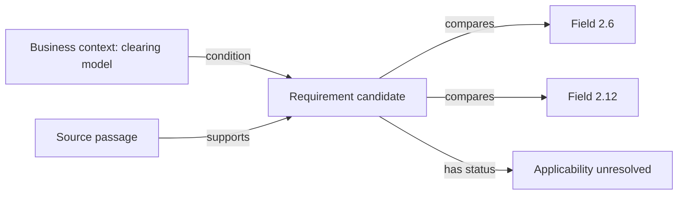

# Codex conversation

## User

I have to build a tool that can use AI and AI agents harnesses and the objective of this tool is to build a validation library for sftr FCA. I do not have example but somthing like if field A has value  and field B has value Y then field C should be Z or in the range of 2 to 23 lie this.
The problem is there are abouut one hundred and fifty fields and total possible combinations of fields alone are so many and then the combinatiosn of correct domains would be huge as well but using AI and right techniques I think even ig 99% of all the possible validations that should bbe applied on data before sending to the regulator then it will be good.

I have zero idea of SFTR and I dont kknow how to design this system. I want tyou think of different approaches to do this and divide them into achievable segments and how to build/test and validate those segments to ensure entire system can be built. In terms of resources assume access to relevant SFTR realted documents, access to an LLM like Qwen 3.8 27B and GPT-6 Astra  and other GPT models and the system to be build in python.
But thin in detail to come up with a right and robust approach.

## Assistant

I’ll look at the FCA’s SFTR requirements, then work through practical architectures, how AI can help derive rules, and how to test whether the resulting library is reliable and sufficiently complete.

## Activity

    Searched the web for site.fca.org.uk UK SFTR validation rules reporting instructions, site.bankofengland.co.uk SFTR validation rules FCA 155 fields

## Activity

    Opened https://www.fca.org.uk/markets/sftr/sftr-reporting-obligation

## Activity

    Searched the web for site.hypothesis.readthedocs.io stateful testing, site.z3prover.github.io guide satisfiability, site.nist.gov combinatorial testing covering arrays interactions

## Assistant

The FCA already publishes SFTR validation rules and XML schemas, so there is a concrete starting point. The main challenge is translating those requirements faithfully, finding additional dependencies in the supporting documents, and measuring what remains unverified. I’d use AI to propose and review rules, with an approved, deterministic Python library doing the actual validation.

## Assistant

**This is achievable, but I would define the goal as building a traceable library of SFTR requirements, supported by AI-assisted discovery and rigorous testing.** Trying to enumerate every combination of 150 fields would consume enormous resources without telling you which combinations have regulatory meaning.

The difficult part is establishing that you have found the applicable requirements and translated them correctly. Executing rules such as “if A=X and B=Y, then C must be between 2 and 23” is comparatively straightforward.

Below is the approach I would take, including alternatives, architecture, testing, and achievable delivery stages.

**1. Start with the actual SFTR reporting process**

SFTR concerns reporting securities financing transactions. For this project, the important distinction is that firms generally submit reports to a registered or recognised **trade repository (TR)**, which makes data available to the authorities. Your validator should therefore target UK regulatory requirements **and the submission requirements of the chosen repository**. [FCA reporting requirements](https://www.fca.org.uk/markets/sftr/sftr-reporting-obligation)

There is already a substantial starting point: the FCA publishes **UK SFTR validation rules and XML schemas**, with the linked versions applicable from 25 November 2024. Its SFTR library also points to the underlying technical standards and other supporting materials. You should ingest these rather than ask a model to reconstruct SFTR from general knowledge. [FCA validation resources](https://www.fca.org.uk/markets/sftr/sftr-reporting-obligation), [FCA SFTR library](https://www.fca.org.uk/markets/sftr/sftr-library)

Before implementation, establish a scope contract:

| Decision | Why it matters |
|---|---|
| UK SFTR jurisdiction | EU documents cannot automatically be treated as current UK requirements. |
| Reporting date and applicable versions | Rules change; historical submissions may require historical rules. |
| Transaction types supported | Different products may require different fields and conditions. |
| Reporting entities and roles | Applicability depends on who is reporting and in what capacity. |
| Report and lifecycle actions supported | A new report and an update may require different checks. |
| Target trade repository | Repository interfaces and feedback must be tested separately. |
| Available context | Some checks require history, reference data, or external records. |

You can learn enough SFTR to build the infrastructure as you go. However, someone with SFTR reporting expertise needs to approve interpretations and independently label test cases. Access to documents and strong models does not replace that role.

**2. Treat this as several validation problems**

A flat collection of field conditions will eventually become difficult to maintain. Separate the following layers:

| Layer | Illustrative check | Required information |
|---|---|---|
| Structure | Correct XML elements, ordering, and cardinality | Submission and schema |
| Field domain | Allowed code, format, precision, or date representation | Individual field |
| Conditional presence | Field required or prohibited under a condition | Related fields |
| Cross-field consistency | Two dates or amounts satisfy a defined relationship | One report |
| Repeating-group consistency | A rule applies to every collateral item or a defined aggregate | Nested report data |
| Lifecycle consistency | An action is allowed given previous accepted reports | Transaction history |
| Reference-data consistency | An identifier or classification matches an applicable reference source | Versioned reference data |
| Population completeness | A reportable source transaction has no corresponding report | Source books and reporting population |
| Economic plausibility | A value looks unusual relative to comparable transactions | Historical data |

These are categories for the proposed system, not assertions that a particular illustrative check is an SFTR rule.

The distinction prevents a dangerous misunderstanding: **a well-formed report can still be inaccurate, and a validator cannot find a transaction that was never supplied to it.**

**3. Compare the main approaches**

| Approach | Benefits | Main weakness | Recommended role |
|---|---|---|---|
| Experts manually write Python rules | Clear control and familiar tooling | Slow extraction; rules and evidence can drift apart | Benchmark and difficult cases |
| Ask an LLM to generate the entire validator | Fast initial demonstration | Invented rules, missed exceptions, weak completeness evidence | Disposable prototype |
| Retrieve documents and ask an LLM to validate each report | Flexible explanations | Variable decisions; difficult reproducibility and auditing | Investigation assistant |
| Extract requirements into a structured rule language, then execute deterministically | Traceability, repeatability, systematic testing | Requires an initial rule model and compiler/interpreter | **Core architecture** |
| Learn rules from historical reports and rejection data | Finds operational patterns and possible omissions | Accepted data can contain errors; correlations are not obligations | Supplementary discovery |
| Use a constraint solver to analyse rules | Finds contradictions and generates examples | Only reasons about what has already been encoded | Verification tool |

**I recommend the structured-rule approach, supplemented by expert review, constraint analysis, and operational feedback.**

AI should help create and maintain the library. It should not decide report validity afresh on each production run.

**4. Replace exhaustive combinations with requirement-driven discovery**

For 150 fields, there are approximately \(2^{150}\) subsets before considering field values. Most subsets have no useful regulatory meaning.

Instead, build a dependency map from evidence:

- Which fields does each published rule reference?
- Which conditions determine whether that rule applies?
- Which definitions, exceptions, footnotes, or external tables does it depend on?
- Does it apply to one record, a repeating item, an aggregate, or a lifecycle sequence?

Your example becomes one small constraint:

```text
IF A = X AND B = Y
THEN C must be present and 2 <= C <= 23
```

Only three fields participate. There is no need to combine them with all other fields unless another requirement introduces that dependency.

Use two complementary discovery passes:

1. **Document-led:** process every source section and account for every normative requirement.
2. **Field-led:** inspect each field and ask what determines its presence, domain, relationships, exceptions, and lifecycle behaviour.

A scenario-led pass then asks whether entire reporting situations are missing.

This is stronger than simply asking multiple models to “find more rules,” because each pass has an explicit inventory to work through.

**5. Build an evidence registry before building agents**

Every source should have:

```text
document_id
publisher
jurisdiction
publication_date
effective_dates
status: draft / final / superseded
source_url
content_hash
local_snapshot
```

Preserve source structure:

- Spreadsheet sheet, row, column, and cell.
- PDF page, paragraph, table, and footnote.
- XML schema component and namespace.
- Cross-references and definitions.

Do not flatten a validation workbook into unstructured text and lose its headings or product-specific columns.

For every source unit, record a disposition:

```text
contains requirements
definition or context
duplicate
superseded
out of scope, with reason
unresolved
```

That gives you a way to distinguish “we found no rule here” from “we never examined this section.”

Use retrieval to assemble context for interpretation. Do not rely on retrieval alone to prove completeness: a search can silently fail to retrieve a requirement.

**6. Define a small, explicit rule language**

Do not let the model produce arbitrary executable Python as the primary rule artifact. Let it produce structured rules using an allowlist of operators.

For your hypothetical example:

```yaml
id: EXAMPLE-001
status: proposed
classification: illustrative
scope: record

when:
  all:
    - eq: [{field: A}, {literal: X}]
    - eq: [{field: B}, {literal: Y}]

assert:
  all:
    - present: {field: C}
    - between:
        value: {field: C}
        lower: 2
        upper: 23
        inclusive: true

evidence:
  source_id: example-only
  locator: user-example
```

For genuine rules, add:

- Official rule identifier, where available.
- Jurisdiction and applicability.
- Rule version and effective-date policy.
- Exact evidence location.
- Dependencies and exceptions.
- Severity and enforcement policy.
- Reviewer and approval record.
- Linked test cases.

Start with a small operator set: equality, membership, presence, Boolean conditions, comparisons, ranges, date relationships, and explicitly supported group operations. Extend it when actual requirements demand more.

The semantics need careful definition:

- Missing, empty, zero, and false must remain distinct.
- Monetary and rate calculations need explicit decimal precision and rounding.
- Dates, timestamps, and time zones need explicit treatment.
- Repeating groups need explicit “every,” “any,” or aggregate semantics.
- Input mapping must preserve the relationship between canonical fields and submission paths.

A field identifier should include its table or reporting context; a bare number such as “54” is insufficient.

**7. Give validation more than two outcomes**

Each rule evaluation should return:

| Result | Meaning |
|---|---|
| PASS | Applicable and satisfied |
| FAIL | Applicable and violated |
| NOT_APPLICABLE | Its condition is definitively false |
| NOT_EVALUATED | Applicability or assertion cannot be determined |

Also distinguish an execution error from a business validation failure.

For example, if A is unavailable, the engine may not know whether your conditional rule applies. It must not silently treat that as success. A separate rule may also establish that A is mandatory.

The overall submission policy can block unresolved critical checks, but that should be an explicit policy decision.

Each finding should explain:

```text
rule and version
affected field or item
observed value
expected condition
evaluation result
source evidence
missing dependency, if any
```

This makes the library operationally useful, rather than just returning `False`.

**8. Use agents as a controlled authoring workflow**

An agent harness is useful when it coordinates bounded tasks and retains their artifacts.

I would use these roles:

| Role | Task | Output |
|---|---|---|
| Source processor | Extract source structure and references | Evidence units |
| Requirement extractor | Identify atomic obligations and exceptions | Requirement records |
| Rule translator | Express requirements in the rule language | Proposed rules |
| Independent challenger | Look for unsupported interpretations and omissions | Objections and alternative readings |
| Test designer | Construct cases from source requirements | Cases with expected outcomes |
| Coverage auditor | Reconcile sources, requirements, rules, and tests | Gap report |
| Human reviewer | Resolve interpretations and approve promotion | Approval or rejection |

The workflow should be a durable state machine:

```text
extracted → interpreted → formalised → challenged
          → tested → reviewed → released
```

Include resumability, schema validation, bounded retries, tool-call logs, model and prompt versions, and an unresolved-issue queue. Agents should be able to abstain rather than manufacture an answer.

For your available models, use the smaller/local model for routine classification and extraction **if it performs well on your benchmark**. Route difficult interpretations, disagreements, and adversarial review to the stronger model. Choose routing from measured performance, latency, and cost.

Multiple models agreeing is useful evidence, but it is not proof: they can share the same misconception.

**9. Test three separate things**

You need evidence for three distinct claims:

1. **Extraction:** did we identify the requirement?
2. **Interpretation:** did we formalise its meaning correctly?
3. **Execution:** does the engine implement that meaning correctly?

A perfectly tested engine can faithfully execute an incorrectly interpreted rule.

Use the following testing methods together.

**Independent reference cases.** Have an SFTR specialist label examples from the source requirements, including applicability and expected failures. Keep a held-out set away from extraction prompts and tuning.

**Boundary and decision tests.** For your example, test C at 1, 2, 23, and 24, plus missing and malformed values. Also test A and B conditions being false, individually missing, and jointly true. This catches a rule that incorrectly fires on every record.

**Property-based tests.** Generate many variations of relevant inputs and check defined properties. Examples include deterministic results and unchanged outcomes when an unrelated field changes.

**Stateful tests.** Test sequences of reports and acknowledgements, including rejection, correction, replay, and out-of-order arrival. Hypothesis supports generating action sequences through stateful testing. [Hypothesis documentation](https://hypothesis.readthedocs.io/en/latest/stateful.html)

**Mutation tests.** Deliberately change `<=` to `<`, remove a condition, invert a comparison, or omit a rule. The test suite should detect these changes. This helps establish whether tests are sensitive to meaningful errors.

**Repository comparison.** When a TR test environment is available, compare outcomes on agreed cases and investigate differences. Repository acceptance is evidence of acceptance by that interface, not proof that the reported economics are correct.

Crucially, do not let the same model generate both a rule and its entire expected-answer test suite without independent checks. That produces convincing circular validation.

**10. Use combinatorial testing and solvers selectively**

Combinatorial testing belongs in your test strategy, rather than your rule-discovery strategy.

Partition domains into meaningful classes—for example, missing/present, allowed/disallowed codes, or below/at/above a boundary. Then use constrained pairwise or higher-order combinations across related fields.

Choose interaction strength according to the requirement. A five-condition rule needs explicit tests for that conjunction even if a pairwise suite exists. NIST describes covering arrays and the limits of relying on pairwise interactions. [NIST combinatorial testing](https://csrc.nist.gov/projects/automated-combinatorial-testing-for-software/combinatorial-methods-in-testing/interactions-involved-in-software-failures)

A solver such as Z3 can provide additional checks:

- Can a rule’s trigger ever be true?
- Can applicable rules be satisfied together?
- Are two rules equivalent or redundant?
- Can we generate a record that violates one rule while satisfying the others?

For rule \(R_i\), the last question is approximately:

\[
\text{domain constraints}
\land \text{trigger}_i
\land \neg\text{assertion}_i
\land \bigwedge_{j\ne i}R_j
\]

Only compare rules under compatible jurisdiction, product, date, and lifecycle scopes. Otherwise legitimate differences can appear contradictory. Solver results also require handling timeouts or “unknown.” [Programming Z3](https://z3prover.github.io/papers/programmingz3.html)

A solver proves properties of the encoded model. It cannot prove that your interpretation of a document is correct or discover requirements absent from that model.

**11. Make “99%” measurable**

“99% of all possible validations” has no known denominator. You cannot substantiate it simply by generating a large rule library.

Use a coverage ledger:

```text
source unit → requirement → approved rule → test evidence → release
```

Track separate measures:

| Measure | What it establishes |
|---|---|
| Source accounting | Whether every in-scope source unit has been examined |
| Requirement implementation | Whether identified obligations have approved implementations |
| Interpretation accuracy | Performance against independently adjudicated requirements |
| Defect detection | Detection of known-invalid cases, by severity and scenario |
| False rejection rate | How often valid cases are incorrectly blocked |
| Evaluation completeness | How many applicable checks actually ran |
| Scenario coverage | Which products, actions, exceptions, and histories were tested |
| Operational escapes | Defects discovered after validation |

For example, “99% recall on an independently labelled test set” is a meaningful, bounded claim. “99% of all SFTR rules discovered” is much harder to justify.

Report uncertainty and subgroup results. A high aggregate score can hide complete failure on an uncommon but important reporting scenario.

All explicit, in-scope published validation requirements should be accounted for, including any that remain unresolved or unsupported. Do not let a percentage conceal a critical omission.

**12. Deliver it through gated segments**

The timings below are planning estimates for a small experienced team with regular SFTR specialist access.

| Segment | Deliverable | Evidence required before expansion |
|---|---|---|
| 1. Scope and evidence inventory: 1–2 weeks | Versioned source register, terminology, reporting scenarios | Expert agrees scope and source applicability |
| 2. Representative pilot: 2–3 weeks | About 30–50 requirements covering simple, conditional, nested, and historical checks | Independent review exposes and resolves interpretation errors |
| 3. Rule engine: 2–4 weeks | Rule schema, evaluator, diagnostics, input mapping | Boundary, missing-data, nested-data, and mutation checks pass |
| 4. AI authoring workflow: 2–4 weeks | Extraction, challenge, review, and coverage pipeline | Measured performance on held-out requirements |
| 5. Full scope expansion: 4–8+ weeks | Accounted-for requirements across agreed scope | No unexplained gaps; critical ambiguities resolved |
| 6. Operational validation: 3–6+ weeks | Historical replay, TR comparison, shadow execution | Acceptable false rejections, escapes, and throughput |
| 7. Maintenance: ongoing | Change detection and versioned releases | Each release carries impact analysis and regression evidence |

Some work can overlap. Corpus quality, repository access, and unresolved interpretations will dominate the schedule more than the number of fields.

For the pilot, deliberately include hard cases. A demonstration containing only mandatory fields and enum checks will not establish that the full system is feasible.

**13. Keep the Python architecture modest**

A practical package structure would be:

```text
sftr_validation/
    sources/
    requirements/
    fields/
    rules/
    engine/
    reference_data/
    lifecycle/
    authoring/
    coverage/
    tests/
```

Start with:

- A canonical reporting model and explicit input adapters.
- Structured rule files and an allowlisted interpreter.
- A source and requirement registry.
- A deterministic validation API and CLI.
- An authoring workflow that writes proposals into a review queue.
- Versioned test fixtures and release manifests.

A production API could look like:

```python
result = validator.validate(
    report=report,
    context=context,
    ruleset=approved_ruleset,
    reference_snapshot=reference_snapshot,
    history_snapshot=history_snapshot,
)
```

No model call is necessary in that execution path.

Capture enough information to reproduce an outcome: input identifier or hash, ruleset, engine version, selected applicability context, and reference/history snapshots. Keep proposed reports separate from acknowledged repository state; submitting a report does not establish that it was accepted.

When documents change, compare source versions, identify affected requirements, regenerate candidate changes, rerun relevant tests, and release a reviewed ruleset. Preserve older versions for reproducibility.

**My recommendation is to fund the first milestone as a feasibility experiment: 30–50 representative requirements taken through evidence extraction, formalisation, independent review, execution, and testing.** Measure missed requirements, incorrect interpretations, expert review effort, and false rejections.

If that experiment succeeds, expansion becomes a controlled engineering process. If it fails, you will know whether the obstacle is source quality, model capability, the rule language, or missing domain expertise—before investing in a large agent system.

## User

no I think youu should think in more detail and go deeper, uunderstand the nuances, realise how much resources/time and effficiency of each segment of approach would be before simply coming up with an approach. think of all ways a segment of an approach can go wrong and how to handle it to make a robust pipeline.

## Assistant

I’ll go deeper into the parts that determine whether this is viable: what the source documents actually contain, where interpretation can fail, how to measure completeness, and the human and compute effort each stage needs. I’ll also examine where extra agents or testing would add cost without improving confidence.

## Activity

    $ Get-Location
        rg --files -g AGENTS.md -g '*sftr*' -g '*SFTR*' -g pyproject.toml -g requirements.txt -g '!node_modules' -g '!.git'
    
    requirements.txt
    Path
    ----
    C:\Users\vaibh\Downloads\WhatsApp-Python-Exporter2
    
    
    ✓ • 779ms

## Activity

    Opened https://www.fca.org.uk/markets/sftr/sftr-reporting-obligation

## Activity

    $ $sftrPage = Invoke-WebRequest -Uri 'https://www.fca.org.uk/markets/sftr/sftr-reporting-obligation' -UseBasicParsing
        $sftrPage.Links | Where-Object { $_.href -match '\.(xlsx|zip)' } | Select-Object href
        python --version
    Invoke-WebRequest : Unable to connect to the remote server
    At line:2 char:13
    + $sftrPage = Invoke-WebRequest -Uri 'https://www.fca.org.uk/markets/sf ...
    +             ~~~~~~~~~~~~~~~~~~~~~~~~~~~~~~~~~~~~~~~~~~~~~~~~~~~~~~~~~
        + CategoryInfo          : InvalidOperation: (System.Net.HttpWebRequest:HttpWebRequest) [Invoke-WebRequest], WebExc
       eption
        + FullyQualifiedErrorId : WebCmdletWebResponseException,Microsoft.PowerShell.Commands.InvokeWebRequestCommand
    
    Python 3.12.0
    ✓ • 643ms

## Activity

    Searched the web for site.esma.europa.eu SFTR reporting guidelines 155 fields collateral reuse margin portfolio validation rules, site.fca.org.uk SFTR reporting data quality errors omissions 2025 2026, site.dtcc.com UK SFTR validation lifecycle reconciliation reporting user guide

## Activity

    Opened https://www.esma.europa.eu/sites/default/files/library/esma70-151-2838_guidelines_on_reporting_under_sftr.pdf

## Assistant

The guidance shows why “150 fields” understates the work: it includes action sequences, collateral groups, margins, reuse calculations, and checks that need information beyond a single report. I’m treating source interpretation, data availability, and execution correctness as separate failure points. A field validator can pass its tests while still missing whole classes of reporting errors.

## Activity

    Searched the web for site.fca.org.uk "sftr" "validation" filetype:xlsx, site.bankofengland.co.uk "sftr" "xlsx" "2024"

## Activity

    Opened https://www.fca.org.uk/publication/documents/reporting-securities-financing-transactions-under-uk-sftr-after-transition-period.pdf

## Activity

    Searched the web for site.itl.nist.gov binomial zero failures confidence upper bound, site.lxml.de validation XMLSchema XML Schema 1.0, site.fca.org.uk SFTR "October 2022" "prioritise"

## Activity

    $ @'
        from math import comb, log, ceil
        print('Field subsets:', {k: comb(150,k) for k in (2,3,4)})
        print('3-field assignments at ten classes each:', comb(150,3)*10**3)
        print('Six stages at 99% conditional success:', 0.99**6)
        print('Zero-error trials for 95% one-sided bounds:', {p:ceil(log(0.05)/log(1-p)) for p in (0.01,0.001,0.0001)})
        print('Requirement review hours:', (680*8+120*45)/60)
        print('800 manual rules at 30 minutes:', 800*30/60)
        print('Local decode hours at 20/50/100 aggregate tokens per second:', [round(1_500_000/r/3600,2) for r in (20,50,100)])
        print('Inference input/output tokens:', {'extract':(3000*4000,3000*500), 'review':(800*6000,800*800), 'deep_review':(160*12000,160*1500)})
        print('24h, 1m records, 300 rule checks = checks/sec:', 1_000_000*300/86400)
        print('1h, 1m records, 300 rule checks = checks/sec:', 1_000_000*300/3600)
        print('Base-rate precision:', (0.001*0.99)/(0.001*0.99+0.999*0.001))
        '@ | python -
    Field subsets: {2: 11175, 3: 551300, 4: 20260275}
    3-field assignments at ten classes each: 551300000
    Six stages at 99% conditional success: 0.941480149401
    Zero-error trials for 95% one-sided bounds: {0.01: 299, 0.001: 2995, 0.0001: 29956}
    Requirement review hours: 180.66666666666666
    800 manual rules at 30 minutes: 400.0
    Local decode hours at 20/50/100 aggregate tokens per second: [20.83, 8.33, 4.17]
    Inference input/output tokens: {'extract': (12000000, 1500000), 'review': (4800000, 640000), 'deep_review': (1920000, 240000)}
    24h, 1m records, 300 rule checks = checks/sec: 3472.222222222222
    1h, 1m records, 300 rule checks = checks/sec: 83333.33333333333
    Base-rate precision: 0.49773755656108587
    ✓ • 376ms

## Activity

    Searched the web

## Activity

    Searched the web

## Assistant

I found a concrete interpretation trap: the guidance’s action-sequence tables look like ordinary state-transition tables, but the following text says they describe actions permitted at any later point, not just the immediate next action. That changes both the implementation and its tests. I also found supervisory wording that must be kept separate from a reporting obligation. These are the kinds of errors that extra model votes alone would not reliably catch.

## Activity

    Searched the web for site.nist.gov AI generative model evaluation correlated errors human oversight, site.anthropic.com engineering building effective agents workflows cost latency

## Assistant

The resource model points to expert review and data integration as the likely bottlenecks. In an illustrative 800-requirement corpus, reviewing 680 routine cases for eight minutes each and 120 difficult cases for 45 minutes each already takes about 181 expert hours, before independent tests and dispute resolution. The pilot therefore needs to measure review effort and missed requirements, alongside model cost and speed.

## Assistant

My earlier answer selected an architecture before establishing the size of the problem, the cost of verification, or the conditions under which the approach would fail. Those need to drive the design.

**The central engineering question is: can AI reduce the effort needed to produce a demonstrably correct rule library, while keeping omissions and unsupported interpretations visible?** Generating more rules is easy. Establishing that those rules are necessary, correctly scoped, and complete enough is the expensive part.

I examined the FCA publications and targeted sections of the SFTR guidance more closely. I have not completed a full audit of the validation workbook or benchmarked your models, so the workload estimates below are explicit planning assumptions—not measured SFTR rule counts.

Here is how I would reason through the project.

**First, distinguish the three outcomes you could build.**

| Outcome | What it can establish | What it cannot establish by itself |
|---|---|---|
| Submission validator | A report satisfies implemented schema and acceptance checks | The report accurately describes the underlying transaction |
| Reporting quality validator | Fields, calculations, history, and source records agree with applicable requirements | Every reportable transaction was included, unless it receives the complete source population |
| Reporting control system | Expected reports exist, submissions are tracked, errors are resolved, and reporting state is reconciled | Correctness of unavailable or unreliable upstream information |

Your original objective could mean any combination of these. Their resource requirements differ substantially.

For example, suppose a report contains a valid identifier, valid currency, and internally consistent amounts, but belongs to the wrong counterparty. Every field-level rule might pass. Detecting that error requires comparison with an independent source.

Likewise, no combination of rules over submitted records can detect a transaction that was omitted entirely unless the validator also receives the population of transactions that should have been reported.

Therefore, each rule needs an explicit **information requirement**:

```text
This check requires:
    the current report
    and possibly transaction history
    and possibly reference data
    and possibly source-system records
    and possibly information from another party
```

Missing information is a limitation of what can be established. A stronger LLM cannot remove it.

**The actual documents contain traps that materially change the design.**

Three examples demonstrate why this needs more than document extraction:

- The ESMA guidance’s action-sequence tables describe actions permitted at a later point, rather than merely the immediately following action. Translating them directly into a conventional next-state matrix could produce incorrect rejections.
- Collateral reuse availability concerns contractual entitlement; it is distinct from whether reuse actually happened.
- The guidance’s zero-collateral treatment includes a product exception. A model extracting the general instruction while missing that exception would create an overbroad rule.

These are examples of interpretation hazards from the guidance, not a determination that every provision in that document applies unchanged to a current UK implementation. [ESMA reporting guidance, sections 4.8.3, 5.4.4 and 5.4.5.3](https://www.esma.europa.eu/sites/default/files/library/esma70-151-2838_guidelines_on_reporting_under_sftr.pdf)

UK applicability itself requires care. The FCA’s transition guidance describes continued use of relevant EU non-legislative material implemented before the transition ended. That is more nuanced than either importing all current ESMA material or excluding it all. [FCA transition guidance](https://www.fca.org.uk/publication/documents/reporting-securities-financing-transactions-under-uk-sftr-after-transition-period.pdf)

There is another distinction: the FCA has published supervisory prioritisation wording concerning third-country issuer LEIs. A system must distinguish that from the underlying reporting requirement and from technical acceptance behaviour. An LLM could otherwise turn “we will not prioritise supervisory action” into “the field is optional.” [FCA SFTR news](https://www.fca.org.uk/markets/sftr/news)

These examples determine where the pipeline needs independent checks.

**The combinatorial problem should be controlled, but not dismissed.**

For 150 fields, there are:

| Field combinations | Count |
|---|---:|
| Pairs | 11,175 |
| Triples | 551,300 |
| Groups of four | 20,260,275 |

Even asking one LLM question per triple creates over half a million calls before considering values.

However, the important distinction is between:

- Discovering requirements.
- Discovering consequences of requirements.
- Testing an implementation.
- Discovering suspicious patterns in data.

Each needs a different method.

A source-backed rule involving seven fields must retain all seven fields. You must not impose a “maximum three-field interaction” limit just because pairwise or three-way testing is convenient.

Conversely, if approved rules establish `A → B` and `B → C` under the same scope, then `A → C` may follow automatically. Materialising every such consequence would inflate the rule count without necessarily improving detection.

The target should be a **sufficient, nonredundant set of requirements**, with their dependencies and consequences available for analysis.

I would build the project through eight segments, each with an explicit failure boundary.

1. **Establish an authoritative, versioned source collection.**

   The output is a source register and applicability decisions. It should cover the underlying UK requirements, FCA validation materials, applicable guidance, and the selected trade repository’s specifications.

   The FCA publishes validation rules and incoming/outgoing XML schemas, providing an existing foundation. [FCA reporting resources](https://www.fca.org.uk/markets/sftr/sftr-reporting-obligation)

   The main failure modes are:

   | Failure | Why it is dangerous | Required handling |
   |---|---|---|
   | Missing document or amendment | The pipeline never encounters an obligation | Reconcile the register against official publication indexes and cross-references |
   | Draft treated as effective | Correctly extracts a requirement that does not apply | Explicit document status and effective dates |
   | EU/UK requirements mixed | Produces plausible rules for the wrong regime | Applicability recorded per requirement |
   | Newer publication assumed to override everything | Specific older provisions can still apply | Explicit supersession or reviewed conflict resolution |
   | Supervisory policy confused with obligation | Removes or weakens a requirement incorrectly | Separate obligation, technical acceptance, and enforcement-policy records |
   | Source changes at the same URL | A past decision becomes unreproducible | Retain snapshots and content hashes |

   There are several different dates: publication date, effective date, transaction/event date, submission date, and when your system learned of a change. Selecting rules using one generic `as_of_date` is insufficient.

   A historical correction submitted today may involve both historical business facts and current submission requirements. The version-selection policy must come from applicable requirements, rather than a convenient software convention.

   **Completion condition:** every included source has an owner, provenance, status, applicable scope, and retained version. Conflicts are recorded rather than silently resolved by model preference.

   **Efficiency:** this is mostly one-time analytical work followed by change monitoring. More agents will not help much if the source authority policy remains undefined.

2. **Extract documents without losing their structure.**

   This segment produces evidence units: cells, rows, paragraphs, tables, definitions, footnotes, and links between them.

   A normal PDF-to-text pipeline can silently change meaning. Examples include:

   - A table heading becoming detached from its rows.
   - Merged spreadsheet cells losing their scope.
   - A footnote becoming an unrelated paragraph.
   - A minus sign or comparison operator being misread.
   - A multi-page table being split into contradictory fragments.
   - An example value being mistaken for an allowed value.
   - Colour or formatting conveying amendments that plain text loses.

   Use native spreadsheet and XML parsing where possible. Use layout-aware PDF extraction, with visual checking of difficult tables. Preserve original coordinates so a reviewer can inspect the source.

   Do not make a single extraction method the unquestioned source of truth. For high-risk tables, compare extracted structure with the rendered document or a second extraction path.

   Every source unit needs a disposition:

   ```text
   requirement-bearing
   definition
   example
   contextual material
   duplicate
   superseded
   out of scope
   unresolved
   ```

   However, **100% disposition coverage is not proof of completeness**. An extractor could classify every obligation as “context.” Audit discarded and supposedly non-normative material, including random samples and all high-risk sections.

   **Completion condition:** deliberately damaged fixtures—missing footnotes, shifted columns, truncated pages—cause visible ingestion failures or review tasks.

   **Efficiency:** document parsing should be deterministic where possible. Sending every spreadsheet cell to a vision model wastes resources and can reduce accuracy.

3. **Build a reporting data model and an information-availability contract.**

   The model should represent the reporting concepts, including repeating groups and report scope. Treating everything as one row containing 150 columns will create problems later.

   At minimum, distinguish:

   - Report envelope and reporting context.
   - Counterparty roles.
   - Transaction or position information.
   - Collateral components.
   - Portfolio or aggregate information.
   - Lifecycle events and acknowledgements.
   - Reference-data observations.

   For every field, record its identity, type, units, scope, cardinality, source mapping, and applicable version. Preserve the distinction between absent, empty, zero, false, and unavailable.

   Some particularly expensive failures arise here:

   | Failure | Example consequence | Handling |
   |---|---|---|
   | Incorrect upstream mapping | A correct rule checks the wrong value | Independently reviewed mapping fixtures and source-to-report comparisons |
   | Wrong units | A percentage is interpreted as a fraction | Explicit units and conversion contracts |
   | Repeating items flattened incorrectly | One collateral component satisfies another component’s requirement | Item-scoped evaluation and adversarial multi-item fixtures |
   | Wrong join key | History or reference data belongs to another entity | Reviewed key definitions and collision tests |
   | Missing data converted to defaults | A missing amount becomes zero and passes | Preserve missingness; validate transformations explicitly |
   | Applicability depends only on a possibly wrong report field | An incorrect product code disables relevant checks | Compare applicability drivers with independent business context where available |

   The final point is especially important. A validator can be “bypassed” accidentally when a wrong field changes which rules execute.

   **Completion condition:** the system can state which checks are possible with available inputs and which require additional data.

   **Efficiency:** this segment often becomes the integration bottleneck. AI can suggest mappings, but mapping correctness needs real examples and source-system knowledge.

4. **Extract atomic requirements and formalise their meaning.**

   Separate two artifacts:

   ```text
   Requirement:
       what the source requires, including scope and exceptions

   Executable rule:
       how the software evaluates that requirement
   ```

   Keeping both makes it possible to identify whether a defect came from interpretation or implementation.

   An atomic requirement should record:

   ```text
   subject and reporting scope
   triggering conditions
   required or prohibited outcome
   exceptions
   quantification: every / any / aggregate
   time semantics
   required external information
   supporting and conflicting evidence
   unresolved questions
   ```

   Common semantic failures include:

   - Turning “if A then B” into “B only if A.”
   - Treating optional as prohibited.
   - Losing an exception while splitting a paragraph.
   - Applying a condition to the wrong product or report action.
   - Applying “every collateral component” as “at least one component.”
   - Using a reconciliation tolerance as a general accuracy allowance.
   - Inventing a numerical limit because it appears financially plausible.
   - Treating an illustrative example as a universal rule.

   A precise rule format helps expose these mistakes, but it does not prevent them automatically.

   For your example, the rule must answer questions such as:

   - Is C an integer or decimal?
   - Are the bounds inclusive?
   - Must C be present?
   - What happens when A is unavailable?
   - Is the rule evaluated per transaction or per repeated item?
   - Are there action types where it does not apply?

   If the source does not answer a necessary question, the output should be an unresolved interpretation, not a guessed default.

   Use an allowlisted rule language with explicit semantics. Start with Boolean conditions, comparisons, presence, membership, ranges, and scoped collection operations. Add date arithmetic, aggregates, or historical predicates when actual requirements justify them.

   Retain reviewed Python extensions for genuinely complex calculations. Forcing every operation into an increasingly elaborate custom language can create more risk than a small, explicit extension interface.

   **Completion condition:** each released rule has reviewed evidence, explicit scope, defined missing-data behaviour, and independent examples.

   **Efficiency:** template extraction works well for recurring forms. Complex narrative interpretation should receive more attention than repeated enum or length checks.

5. **Use AI workflows to improve extraction and challenge interpretations.**

   I would initially compare three configurations:

   | Configuration | Expected advantage | Principal risk |
   |---|---|---|
   | One strong model with structured output | Simple workflow; fewer coordination errors | Missed requirements or self-consistent misinterpretation |
   | Smaller model followed by targeted strong-model review | Potentially lower cost | The router may send difficult cases down the cheap path |
   | Independent extraction/review passes | Can expose different interpretations and omissions | Correlated errors and increased review workload |

   The third option is valuable only when it finds additional real defects. “Three agents agreed” is not a reliability metric.

   For the initial workflow:

   - One task extracts requirements from a bounded evidence packet.
   - Another translates them into rules.
   - An independent reviewer reads the evidence and attempts to find exceptions, scope errors, or unsupported claims.
   - A deterministic checker verifies types, citations, identifiers, and supported syntax.
   - Unresolved disagreements enter a human review queue.

   Give the independent reviewer a chance to interpret the source before seeing the author’s conclusion; otherwise it may simply follow the author’s framing.

   Each evidence packet should include the relevant definition, surrounding text, headings, footnotes, and referenced requirements. Retrieval should help assemble that packet, while a source inventory ensures every required section is processed.

   The harness itself needs failure handling:

   | Harness failure | Required behaviour |
   |---|---|
   | Truncated response | Detect incomplete output and retry or escalate |
   | Valid JSON with missing requirements | Compare against source accounting and independent extraction |
   | Invented citation | Verify exact source locator and retained content |
   | Real citation that does not support the claim | Semantic review; citation existence alone is insufficient |
   | Repeated agent disagreement | Stop after a bounded number of attempts and escalate |
   | Duplicate jobs | Idempotent processing and candidate deduplication |
   | Model or prompt change | Version outputs and rerun the relevant benchmark |
   | Instructions embedded in source material | Treat source text as evidence, not executable instructions |
   | Reviewer queue grows faster than it clears | Apply backpressure; avoid generating unlimited candidates |

   Measure **expert minutes per accepted requirement**, unsupported-rule rate, missed requirements, and total cost. Token cost alone is a poor optimisation target.

   A smaller model that saves money but doubles expert correction time can be the more expensive option.

6. **Discover gaps without manufacturing new obligations.**

   This segment requires several complementary searches.

   **Document-led search** asks whether every applicable requirement has been implemented.

   **Field-led search** asks whether each field’s presence, absence, domain, dependencies, calculations, and exceptions are accounted for.

   **Scenario-led search** asks whether complete situations are represented: product, action, party roles, collateral structure, reporting level, history, and exceptional events.

   **Data-led search** uses historical submissions, corrections, and rejections to discover suspicious patterns and missing controls.

   These searches should produce different classes of candidate:

   | Candidate class | Promotion requirement |
   |---|---|
   | Explicit obligation | Applicable source evidence |
   | Logical consequence | Derivation from approved rules under compatible scopes |
   | Business-data reconciliation | Agreed source-of-truth and mapping |
   | Statistical anomaly | Operational evidence and a warning policy |
   | Unsupported hypothesis | Remains an investigation item |

   A correlation such as “field C was always positive in historical accepted reports” does not establish that negative values are prohibited.

   Rejection data also has selection bias. It shows what a repository rejected, while accepted records may still contain reporting inaccuracies. Some repositories may return only a subset of errors, so missing rejection codes are not proof that other checks passed.

   Use a dependency graph to focus exploration, but allow the search to propose missing edges. Otherwise the graph can preserve the omissions it was built from.

   Avoid generating all logical consequences. Check whether a proposed rule catches any case that existing approved rules do not already catch. A redundant rule may help explanation, but it should not inflate coverage.

   **Completion condition:** every candidate has an evidence class and disposition. Additional search rounds are judged by verified new findings per unit of review effort.

   **Efficiency:** stop unproductive agent loops when they yield only duplicates or unsupported hypotheses. That stopping condition saves cost; it does not establish completeness.

7. **Validate the rules, the engine, and the information pipeline independently.**

   There are several different test targets:

   | Target | What must be tested |
   |---|---|
   | Source extraction | Did text, tables, definitions, and exceptions survive? |
   | Interpretation | Does the requirement match the source meaning? |
   | Rule implementation | Does the executable rule match the approved interpretation? |
   | Input mapping | Is it evaluating the intended data? |
   | Lifecycle/reference context | Is the relevant information complete and correctly dated? |
   | Operational decision | Does the system block, warn, or escalate appropriately? |

   Tests derived entirely from the same generated rule cannot validate interpretation. They can only show that the implementation behaves consistently with itself.

   Build an independent benchmark from source requirements and adjudicated examples. Split it by requirement family or scenario, rather than placing nearly identical variants in both development and evaluation sets.

   For each conditional rule, cover:

   - A valid applicable case.
   - A violating applicable case.
   - Each condition independently preventing applicability.
   - Exceptions.
   - Missing and malformed dependencies.
   - Boundaries.
   - Multiple repeated items.
   - Relevant historical sequences.

   For example, when `A=X AND B=Y` triggers a range check, an unavailable A does not always produce an unknown result. If B is definitively not Y, the conjunction is false. The engine needs defined three-valued logic rather than ad hoc handling of nulls.

   Also test empty groups. Python’s `all([])` is true; that does not establish that a required collateral group exists. Presence/cardinality and item-level validity are separate requirements.

   Use mutation testing to establish sensitivity: remove an exception, change `<` to `<=`, invert a condition, replace “every” with “any,” or omit a rule. Surviving mutations need investigation; some are equivalent or unreachable, and should not distort the score.

   Use constrained combinatorial testing across meaningful value classes, with explicit higher-order tests for higher-order conditions. Pairwise coverage cannot establish correctness of every multi-condition rule. [NIST combinatorial testing](https://csrc.nist.gov/projects/automated-combinatorial-testing-for-software/combinatorial-methods-in-testing/interactions-involved-in-software-failures)

   Use a solver selectively to find contradictions, unreachable triggers, redundant rules, and counterexamples. Preserve decimal, scope, and date semantics when translating to the solver. A timeout or “unknown” result must remain unresolved. [Programming Z3](https://z3prover.github.io/papers/programmingz3.html)

   One subtle trap: if the test generator uses the rule being tested to constrain generated data, it may exclude the very invalid cases you need. Generate violations intentionally, and distinguish constraints defining a valid scenario from the assertion under test.

   For historical behaviour, generate action sequences and acknowledgements, including rejected submissions, delayed events, duplicates, and corrections. Hypothesis provides stateful testing support for this kind of sequence generation. [Hypothesis stateful testing](https://hypothesis.readthedocs.io/en/latest/stateful.html)

   **Completion condition:** each released requirement has evidence of interpretation review and implementation tests, with unsupported checks explicitly identified.

8. **Run deterministically and maintain compatibility over time.**

   Production validation should use an approved rule package and pinned context. Model calls belong in authoring, investigation, and maintenance.

   The execution path should resemble:

   ```text
   Input and source context
       → structural validation
       → canonical mapping
       → applicability selection
       → field and relationship checks
       → historical/reference checks
       → findings and evaluation-completeness report
       → operational submission decision
   ```

   Distinguish:

   ```text
   PASS
   FAIL
   NOT_APPLICABLE
   NOT_EVALUATED
   EXECUTION_ERROR
   ```

   A reference-data outage must not become “identifier invalid.” An incomplete history must not become “previous transaction does not exist.”

   Operational policy then decides how to handle each result. Blocking every unknown may create missed reporting deadlines; passing every unknown creates silent gaps. Define the response by check criticality, available fallback, retry window, and escalation route.

   Historical validation needs particular care:

   - Submitted reports are not automatically accepted reports.
   - A rejected update must not silently advance accepted state.
   - Reports for the same transaction may require ordered processing.
   - Pending dependent reports need explicit treatment.
   - A late correction may alter historical state without representing a new present-day event.
   - Reference data can be revised after the original validation.

   Retain both business-effective time and observation time where needed. That allows you to distinguish “what was believed at submission” from “what is known now.”

   For changes, compare source versions, identify affected requirements, produce reviewed rule changes, and rerun regression tests. A dependency graph helps prioritise work, but a shared definition change may have broad effects that the graph missed.

   Rollback must use a compatible ruleset. Reverting to an old package after its regulatory effective period ends may restore software behaviour while introducing reporting errors.

**The architecture should remain small until these boundaries are proven.**

A Python package, a relational registry, retained source files, a job queue, and a review interface are sufficient for the initial system. A graph database, large agent platform, or fine-tuning pipeline should earn its place through measured benefit.

The source-to-rule relationships can initially be ordinary database tables. The runtime can begin as a clear reference interpreter. Optimised execution can be added later and compared against that interpreter.

For XML validation, use an established validator against the pinned official schema set, with explicit dependency resolution and compatibility testing. Libraries such as lxml provide schema validation facilities. [lxml validation documentation](https://lxml.de/dev/validation.html)

**Resource estimates should be calculated from workload, rather than from the number of fields.**

Consider this deliberately hypothetical authoring workload:

- 3,000 evidence units.
- 800 atomic requirements after interpretation and deduplication.
- 20% of requirements need deeper model review.

These are sizing assumptions, not counts extracted from the FCA documents.

| Operation | Jobs | Average input tokens | Average output tokens | Total input/output |
|---|---:|---:|---:|---:|
| Initial extraction | 3,000 | 4,000 | 500 | 12.0M / 1.50M |
| Rule review | 800 | 6,000 | 800 | 4.8M / 0.64M |
| Deeper review | 160 | 12,000 | 1,500 | 1.92M / 0.24M |
| **Total** | **3,960** | | | **18.72M / 2.38M** |

Actual budgets must include billable reasoning tokens, retries, retrieval expansion, and repeated experiments. Visible answer length can substantially understate inference cost.

If extraction runs locally and the other two stages use a hosted model, the illustrative hosted cost is:

\[
6.72 \times \text{input price per million}
+
0.88 \times \text{output price per million}
\]

Then add local compute and any extra reasoning or retries.

For 1.5 million locally generated output tokens:

| Measured aggregate output throughput | Decode time alone |
|---|---:|
| 20 tokens/second | 20.8 hours |
| 50 tokens/second | 8.3 hours |
| 100 tokens/second | 4.2 hours |

These are arithmetic scenarios, not performance claims for your Qwen model. Input processing, batching, context length, and memory pressure add to the time. Measure aggregate server throughput rather than multiplying a single-request speed by arbitrary concurrency.

For a 27-billion-parameter model, raw weights alone require approximately 54 GB at 16 bits or 13.5 GB at 4 bits. Actual memory includes quantisation metadata, runtime buffers, and the context cache. Hardware selection therefore needs a benchmark with your intended evidence packets.

The more consequential cost is review.

Suppose:

- 680 routine requirements need eight minutes each.
- 120 difficult requirements need 45 minutes each.

That is approximately **181 expert hours**, or 23 eight-hour days, before building the independent benchmark, resolving broader source conflicts, or performing second review.

A wholly manual process averaging 30 minutes across 800 requirements would take 400 hours. The hypothetical AI process could save substantial time—but only if its review times and omission rates hold in practice.

At two expert days per week, the 181 review hours alone occupy over eleven calendar weeks. A fast extraction pipeline can therefore create a queue that takes months to clear.

**Runtime cost has a different shape.**

One million reports with an average of 300 applicable checks creates 300 million evaluations. Completing that in one hour requires roughly 83,000 evaluations per second, before accounting for nested items, XML processing, joins, or diagnostics.

That does not establish whether a particular implementation is fast enough. It identifies what to benchmark.

The main efficiency measures are:

- Parse once.
- Select applicable rule families before evaluating them.
- Batch reference lookups.
- Cache against explicit data versions.
- Avoid a database or network call per predicate.
- Process different transactions concurrently while preserving necessary ordering within a transaction.
- Measure repeated-group sizes and worst-case reports.
- Validate any optimised engine against the simpler reference implementation.

**A credible schedule includes domain and integration work explicitly.**

For one UK regime version, one repository integration, and a defined reporting scope:

| Segment | Engineering effort, person-weeks | Main uncertainty |
|---|---:|---|
| Scope and source authority | 1–2 | Conflicts and unclear applicability |
| Extraction and evidence registry | 2–4 | Spreadsheet/PDF complexity |
| Data model and rule execution | 3–5 | Nested and historical semantics |
| AI workflow and benchmark tooling | 3–5 | Actual model error patterns |
| Rule population and reconciliation | 3–6 | Requirement count and ambiguity |
| History/reference/source adapters | 4–8 | Data availability and mapping quality |
| Integration and performance validation | 4–8 | Repository behaviour and operational edge cases |
| Change management and reproducibility | 2–4 | Versioning and release requirements |
| **Total engineering effort** | **22–42** | |

This is an initial planning range, not a delivery commitment. Work can overlap, but dependencies prevent simply dividing every task by team size.

With two engineers, part-time independent test support, and an SFTR specialist available consistently, **roughly four to seven months** is a reasonable starting planning envelope for a defined, usable implementation. Broad historical remediation, several source systems, or population-completeness controls can push beyond that.

A document-to-rule prototype can be much quicker. Its speed should not be extrapolated to the integrated system.

The expert review model above suggests reserving approximately **25–45 specialist days**, depending on corpus size and ambiguity, plus independent review capacity. The pilot should replace these assumptions with observed figures.

**The 99% objective needs both a denominator and an operational error budget.**

There are at least four different claims:

1. We extracted 99% of independently identified requirements.
2. We interpreted 99% of benchmark requirements correctly.
3. We detected 99% of known-invalid test cases.
4. We correctly accepted 99% of valid reports.

Those claims are not interchangeable.

A pipeline can lose quality at several stages. If six necessary stages each succeed with 99% probability conditional on the preceding stages succeeding, overall success is only approximately 94.1%.

False positives also matter enormously. Consider one million reports where 0.1% are invalid:

- At 99% sensitivity, the validator detects 990 invalid reports.
- At 99.9% specificity, it incorrectly flags approximately 999 valid reports.

Only about half its alerts would be correct. “99% accurate” can therefore describe a system that overwhelms operations.

Set targets separately for:

- Requirement omissions.
- Unsupported blocking rules.
- Missed critical errors.
- False rejections per million valid reports.
- Checks not evaluated because information was missing.
- Human investigation capacity.

Statistical evidence also needs restraint. With zero failures in independent, representative trials, about 299 trials are needed for a one-sided 95% bound below a 1% failure probability. The corresponding counts are about 2,995 for 0.1%, and 29,956 for 0.01%. These follow the exact binomial zero-failure calculation. [NIST exact binomial confidence limits](https://itl.nist.gov/div898/software/dataplot/refman2/auxillar/exacbino.htm)

Thousands of generated variants of one requirement are not thousands of independent tests of requirement discovery. They also say little about an omitted product family.

For a finite rulebook, reviewing every identified requirement may be more useful than making an elaborate statistical claim about correctness. The remaining challenge is independently checking that the inventory itself is complete.

**I would make the first four to six weeks an experiment with explicit decisions at the end.**

| Period | Work | What it resolves |
|---|---|---|
| Week 1 | Establish source scope; inspect representative tables and difficult prose; identify required external data | Whether the proposed scope is actually observable |
| Week 2 | Independently annotate roughly 100 representative requirements, including exceptions, groups, and history | A benchmark and an initial ambiguity rate |
| Weeks 3–4 | Compare manual work, one strong model, and a smaller-model cascade; implement a minimal evaluator | Review effort, omissions, unsupported rules, and execution feasibility |
| Weeks 5–6 | Run held-out evaluation, adversarial cases, and a small real-data or repository comparison where available | Whether the approach remains useful beyond curated examples |

One hundred requirements are sufficient to expose systematic problems and compare workflows. They are insufficient to substantiate a universal 99% claim.

Before the experiment, set decision rules such as:

- The AI-assisted workflow must reduce total expert effort at an agreed quality level; a 30% reduction could be an initial hypothesis to test.
- Every missed exception or unsupported blocking condition is investigated by failure category.
- Scope-dependent and historical requirements must be represented correctly; success on simple enums is insufficient.
- Missing dependencies must remain visible.
- The held-out evaluation must include requirement families absent from prompt examples.
- The measured review queue must fit available expert capacity.
- Expensive agent stages remain only if they find additional verified defects or reduce human work.

If the smaller model performs poorly on interpretation but well on evidence classification, narrow its role. If independent agent review mostly repeats the author, change its context and task or remove it. If reference data is unavailable, reduce the supported scope explicitly. If AI produces no net saving after review, retain it for retrieval and change analysis while implementing rules more directly.

**The first deliverable should therefore be a measured feasibility report and a small, independently validated rule package.** That establishes which parts can be automated economically, which require domain judgement, and which depend on information you do not yet have. The full pipeline should grow from those measurements.

## User

wrote entire approach in a readme for easy reading.

## Assistant

I’ll put the full approach into a readable Markdown document, preserving the existing project README.

## Activity

    $ Get-ChildItem -Force -Name
        rg --files -g AGENTS.md -g '*README*' -g '*readme*' -g '!node_modules' -g '!.git'
    chrome-extension
    my-chats.work
    reports
    tests
    wa-browser-profile
    __pycache__
    command.txt
    commands.txt
    core.py
    debug.log
    my-chats.zip
    native_import.py
    README.md
    requirements.txt
    web_scan.py
    WhatsApp-Chrome-Extension-v0.2.zip
    WhatsApp-Chrome-Extension-v0.3.1.zip
    WhatsApp-Chrome-Extension-v0.3.2.zip
    WhatsApp-Chrome-Extension-v0.3.zip
    WhatsApp-Chrome-Extension-v0.4.1.zip
    WhatsApp-Chrome-Extension-v0.4.zip
    WhatsApp-Python-Exporter-source-only.zip
    whatsapp_export.py
    README.md
    chrome-extension\README.md
    wa-browser-profile\Default\README
    ✓ • 459ms

## Activity

    $ git status --short
        Get-Content -LiteralPath 'README.md' -TotalCount 80 -ErrorAction SilentlyContinue
    fatal: not a git repository (or any of the parent directories): .git
    # WhatsApp Period Exporter — Python edition
    
    A **local** program that creates one ZIP containing a TXT per chat that has messages in a selected inclusive date period, plus `EXPORT_REPORT.txt`.
    
    There are **two distinct modes**:
    
    | Mode | Automatic discovery/opening of chats | Extraction reliability |
    | --- | --- | --- |
    | `web` | Yes, automates WhatsApp Web via Playwright and sidebar search | **Best effort only**; WhatsApp's changing DOM and virtualized history can hide messages |
    | `native` | No; you manually export chats using WhatsApp's own Export Chat function | Much more reliable **for the content actually present in those exported TXT files** |
    
    **There is no official supported Python API to bulk retrieve all historical personal WhatsApp conversations.** This is not a guaranteed full-backup tool. A browser scraper or even WhatsApp Web automation cannot promise completeness. Keep your existing chat backups; never rely on this tool as your only backup.
    
    ## Chrome extension alternative
    
    For a browser-only workflow with chat selection, date filters, transactional checkpoints and resumable TXT/JSON exports, see [the Chrome extension](chrome-extension/README.md). Load the `chrome-extension` folder from `chrome://extensions` and refresh WhatsApp Web. Browser extraction remains subject to WhatsApp Web history availability.
    
    ## Partial retries, logs, and separate accounts
    
    Every partial result prints the chat title, matching message count, stop reason,
    and individual warnings/errors. A final summary lists all remaining partial chats.
    The work folder contains:
    
    - `run.log`: timestamped UTF-8 console output, appended across runs.
    - `partials.json`: the current partial-chat list and reasons, refreshed when reports are built.
    - `partials.jsonl`: append-only history of newly saved partial results, created on the first such result. Resolved chats remain in this history but disappear from the current list.
    
    For the existing export, retry **only** partial checkpoints:
    
    ```powershell
    python whatsapp_export.py web --connect-cdp --start 2026-10-01 --end 2026-10-19 --output my-chats.zip --retry-partials
    ```
    
    `--retry-partials` no longer starts unscanned chats. Add `--retry-failures` to also
    select failed checkpoints. Complete/older chats are reused, and the ZIP is rebuilt
    from all saved records, including earlier successes. A shorter or failed retry
    retains earlier messages and remains partial. If no matching retries remain, the
    program rebuilds reports without opening or attaching to a browser.
    
    In partial-only mode, `--max-chats N` limits retry attempts, regardless of sidebar
    position. Ordinary runs retain their existing indexed-position cap. To continue
    unscanned chats, run without `--retry-partials`; use `--retry-failures` as needed.
    `--rescan-complete` explicitly overrides partial-only selection and restores the
    normal scan/resume behavior while also revalidating complete/older checkpoints.
    Keep the same date range, date order, output and work folder when retrying.
    
    For a **different account**, choose a stable label and a distinct output:
    
    ```powershell
    python whatsapp_export.py web --account second-account --start 2026-10-01 --end 2026-10-19 --output second-account.zip
    ```
    
    The account label creates separate work and persistent-browser-profile namespaces
    under their configured base directories (`accounts/<safe-label-and-hash>/`). Use
    the same label on every resume for that account. Mismatched labels in a saved
    index are rejected. Existing unlabelled work folders remain compatible: omit
    `--account` when retrying the current legacy export. Adding a label starts a
    separate namespace; it does not migrate legacy checkpoints.
    
    The account label is **not authentication** and does not select a logged-in CDP
    account. With `--connect-cdp`, connect to the intended browser/account; multiple
    loaded WhatsApp tabs are rejected instead of selecting one silently. Choose a
    distinct output ZIP per account as well, since `--output` remains the exact path
    you requested. Never reuse the same unlabelled work folder across accounts.
    
    Runtime paths are relative/configurable and chat titles are discovered from the
    UI; there are no personal usernames, phone numbers, or conversation names in the
    runtime matching code. Tests use example conversations and fictional numbers.
    UI selectors currently expect English WhatsApp labels; use `--date-order mdy`
    where appropriate, and retain the documented DOM/history-loading limitations.
    
    ## v3 navigation fixes (October 2026)
    
    This update addresses the failure pattern where the log says `Opening: साकेत😊` but
    shows `visible header='साकेत'`, and subsequent chats fail to open. Specifically:
    
    - The chat finder matches the **parsed sidebar title**, not an exact
      `span[title]` attribute (which may include `2 unread messages ...`).
    - Header verification handles emoji-only display differences **only when no other
      indexed chat has the same simplified title**. It refuses ambiguous matches.
    ✓ • 641ms

## Activity

    $ $sftrAncestorFiles = @('C:\AGENTS.md', 'C:\Users\AGENTS.md', 'C:\Users\vaibh\AGENTS.md', 'C:\Users\vaibh\Downloads\AGENTS.md', 'C:\Users\vaibh\Downloads\WhatsApp-Python-Exporter2\AGENTS.md')
        foreach ($sftrInstructionPath in $sftrAncestorFiles) {
            if (Test-Path -LiteralPath $sftrInstructionPath) {
                Write-Output $sftrInstructionPath
                Get-Content -LiteralPath $sftrInstructionPath
            }
        }
        Test-Path -LiteralPath 'sftr-validation'
    False
    ✓ • 218ms

## Activity

    file changes: Completed · 1 changes
    Add: C:\Users\vaibh\Downloads\WhatsApp-Python-Exporter2\sftr-validation\README.md
    # AI-assisted UK SFTR validation library
    
    A design, feasibility, implementation, and assurance plan for a Python system that uses language models and agent workflows to build and maintain a UK SFTR validation library.
    
    **Status:** Design document. This is not an implemented validator, an approved interpretation of SFTR, or a completed inventory of applicable requirements.
    
    **Research basis:** FCA publications and targeted SFTR guidance sections were reviewed during the design discussion. The FCA validation workbook has not been fully audited, and the proposed models have not been benchmarked. Requirement counts, token volumes, review times, and delivery estimates below are explicit planning assumptions.
    
    **Working assumptions:** Access to relevant SFTR documents, a local model of approximately 27 billion parameters such as the model described as Qwen 3.8 27B, a stronger hosted model such as GPT-6 Astra or another GPT model, and Python engineering resources. The design does not assume a particular model's measured accuracy, availability, price, or serving speed.
    
    ## Contents
    
    1. [Purpose and recommended direction](#1-purpose-and-recommended-direction)
    2. [What the system can establish](#2-what-the-system-can-establish)
    3. [SFTR nuances that affect the architecture](#3-sftr-nuances-that-affect-the-architecture)
    4. [Why exhaustive combinations are the wrong workload](#4-why-exhaustive-combinations-are-the-wrong-workload)
    5. [Approaches and trade-offs](#5-approaches-and-trade-offs)
    6. [Architecture and core artifacts](#6-architecture-and-core-artifacts)
    7. [Eight delivery segments](#7-eight-delivery-segments)
    8. [Rule semantics and evaluation outcomes](#8-rule-semantics-and-evaluation-outcomes)
    9. [Testing and independent validation](#9-testing-and-independent-validation)
    10. [Completeness and the 99 percent objective](#10-completeness-and-the-99-percent-objective)
    11. [Compute cost and model efficiency](#11-compute-cost-and-model-efficiency)
    12. [Human effort and delivery schedule](#12-human-effort-and-delivery-schedule)
    13. [Production performance and operational controls](#13-production-performance-and-operational-controls)
    14. [Four-to-six-week feasibility experiment](#14-four-to-six-week-feasibility-experiment)
    15. [Suggested Python package structure](#15-suggested-python-package-structure)
    16. [Release gates and ongoing maintenance](#16-release-gates-and-ongoing-maintenance)
    17. [Questions to resolve during discovery](#17-questions-to-resolve-during-discovery)
    18. [Sources](#18-sources)
    
    ## 1. Purpose and recommended direction
    
    The objective is to build a library of validations applied before SFTR reports are submitted. A simple illustrative validation is:
    
    ```text
    IF A = X AND B = Y
    THEN C must be present and between 2 and 23, inclusive.
    ```
    
    The difficult work is finding applicable requirements, interpreting them faithfully, obtaining the information needed to evaluate them, and establishing what remains uncovered. Executing a correctly specified conditional check is comparatively straightforward.
    
    The central engineering question is:
    
    > Can AI reduce the effort required to produce a demonstrably correct rule library while keeping omissions and unsupported interpretations visible?
    
    The recommended design uses AI to extract, formalise, challenge, and maintain proposed rules. A versioned, reviewed, deterministic Python library performs production validation.
    
    The first deliverable should be a measured feasibility report and a small, independently validated rule package. Expansion should depend on observed interpretation quality, review effort, information availability, and operational performance.
    
    ### Principles
    
    - Requirements come from applicable evidence; plausible model suggestions remain hypotheses until supported.
    - Every released rule has explicit applicability, provenance, semantics, and test evidence.
    - Missing information remains visible and is never silently treated as success.
    - Rule interpretation and executable implementation are separate artifacts.
    - Independent checks are needed because a rule and tests generated from the same misunderstanding can agree perfectly.
    - Model selection and agent complexity are determined by measured benefit.
    - Coverage claims identify their scope, denominator, limitations, and unresolved gaps.
    - Expert review is planned as a resource, rather than added informally at the end.
    
    ## 2. What the system can establish
    
    Three possible outcomes have substantially different effort and information requirements.
    
    | Outcome | What it can establish | What it cannot establish by itself |
    | --- | --- | --- |
    | Submission validator | A report satisfies implemented schema and acceptance checks | The report accurately describes the underlying transaction |
    | Reporting quality validator | Fields, calculations, history, and source records agree with applicable requirements | Every reportable transaction was included, unless the complete source population is available |
    | Reporting control system | Expected reports exist, submissions are tracked, errors are resolved, and reporting state is reconciled | Correctness of unavailable or unreliable upstream information |
    
    A report can contain a valid identifier, valid currency, and internally consistent amounts while identifying the wrong counterparty. Detecting that error requires an independent source of business truth.
    
    Similarly, a validator examining submitted reports cannot detect an omitted transaction unless it also receives the population of transactions that should have been reported.
    
    Each rule therefore needs an explicit information requirement:
    
    ```text
    Current report
        + transaction history, if required
        + reference data, if required
        + source-system records, if required
        + portfolio or population information, if required
        + another party's information, if required
    ```
    
    Missing information limits what can be established. Additional reasoning cannot recover facts that are absent from all available inputs.
    
    ### Validation layers
    
    The following are design categories. Their examples are illustrative rather than assertions of specific SFTR requirements.
    
    | Layer | Illustrative check | Required information |
    | --- | --- | --- |
    | Structure | Elements, ordering, namespaces, and cardinality conform | Submission and schema |
    | Field domain | Code, format, precision, or date representation is permitted | Individual field and domain definition |
    | Conditional presence | A field is required or prohibited under a condition | Related fields and applicability context |
    | Cross-field consistency | Dates or amounts satisfy a defined relationship | One report |
    | Repeating-group consistency | Every component or a specified aggregate satisfies a rule | Nested report data |
    | Lifecycle consistency | An action is allowed given the relevant history | Events and accepted reporting state |
    | Reference consistency | Identifier or classification agrees with the applicable reference source | Versioned reference data |
    | Source-data accuracy | Reported values match the underlying business records | Independent source records and mappings |
    | Population completeness | An expected report has no corresponding submission | Source population and reporting population |
    | Economic plausibility | A value differs unusually from comparable observations | Historical data and an explicit warning policy |
    
    ### Scope contract
    
    Before implementation, define jurisdiction, effective versions, supported products, reporting entities and roles, report actions, reporting levels, repository, input systems, historical depth, and available reference data.
    
    Support should be expressible as a matrix of scenarios. Avoid a broad claim such as "supports SFTR" when only a subset of products, actions, or information dependencies is implemented.
    
    ## 3. SFTR nuances that affect the architecture
    
    Firms generally submit reports to a registered or recognised trade repository, which makes data available to authorities. The target includes both applicable UK requirements and the chosen repository's submission requirements. The FCA publishes validation rules and XML schemas that provide an existing foundation. [FCA reporting resources](https://www.fca.org.uk/markets/sftr/sftr-reporting-obligation)
    
    Three examples from the ESMA reporting guidance show why simple extraction can fail:
    
    - The action-sequence tables describe actions permitted at a later point, rather than merely the immediately following action. A conventional next-state matrix could therefore misrepresent them.
    - Collateral reuse availability concerns contractual entitlement and differs from whether reuse actually happened.
    - Zero-collateral treatment includes a product exception. Extracting the general instruction while omitting the exception creates an overbroad rule.
    
    These examples demonstrate interpretation hazards; they do not establish that every provision applies unchanged to a current UK implementation. [ESMA guidance, sections 4.8.3, 5.4.4, and 5.4.5.3](https://www.esma.europa.eu/sites/default/files/library/esma70-151-2838_guidelines_on_reporting_under_sftr.pdf)
    
    UK applicability requires specific analysis. The FCA's transition guidance describes continued use of relevant EU non-legislative material implemented before the transition ended. Importing all current ESMA material or excluding all of it would both be overly broad policies. [FCA transition guidance](https://www.fca.org.uk/publication/documents/reporting-securities-financing-transactions-under-uk-sftr-after-transition-period.pdf)
    
    The FCA has also published supervisory prioritisation wording concerning third-country issuer LEIs. The system must distinguish that wording from the underlying reporting obligation and technical acceptance behaviour. Otherwise, a model could incorrectly turn a supervisory statement into an optional-field rule. [FCA SFTR news](https://www.fca.org.uk/markets/sftr/news)
    
    The resulting design needs separate records for:
    
    1. Applicable reporting obligations.
    2. Technical submission and acceptance requirements.
    3. Supervisory policies or statements.
    4. Internal business controls and anomaly warnings.
    
    ## 4. Why exhaustive combinations are the wrong workload
    
    For 150 fields, the number of field subsets grows quickly:
    
    | Combination size | Number of combinations |
    | --- | ---: |
    | Pairs | 11,175 |
    | Triples | 551,300 |
    | Groups of four | 20,260,275 |
    
    Asking one model question per triple already requires over half a million calls. Ten value classes for each field would create 551.3 million triple assignments before accounting for larger interactions.
    
    Most combinations do not correspond to meaningful requirements. However, this does not justify ignoring higher-order interactions that the sources actually require.
    
    Separate four activities:
    
    | Activity | Appropriate method |
    | --- | --- |
    | Discover requirements | Source accounting, interpretation, and complementary coverage reviews |
    | Discover logical consequences | Scoped symbolic analysis of approved constraints |
    | Test implementation | Boundary, decision, property, combinatorial, and sequence testing |
    | Discover suspicious data patterns | Historical analysis and candidate investigation |
    
    A source-backed seven-field rule must retain all seven fields. Pairwise testing convenience must not become a limit on rule complexity.
    
    If approved rules establish `A -> B` and `B -> C` under compatible scope, time, units, and quantification, then `A -> C` may follow. Materialising every consequence can inflate the rule count without adding detection capability.
    
    The target is a sufficient, nonredundant set of requirements with traceable dependencies. Build a dependency map from evidence, use it to focus search, and allow additional discovery passes to propose missing dependencies.
    
    ## 5. Approaches and trade-offs
    
    | Approach | Benefit | Principal weakness | Recommended use |
    | --- | --- | --- | --- |
    | Experts manually write rules | Direct control; useful baseline | Slow interpretation and maintenance; evidence can drift from code | Benchmark and difficult cases |
    | Model generates an entire validator | Rapid demonstration | Invented conditions, missed exceptions, and poor completeness evidence | Limited feasibility comparison |
    | Retrieval plus model validation for each report | Flexible explanations | Variable decisions, cost per report, and difficult reproducibility | Investigation support |
    | Structured requirements and deterministic rules | Traceability, repeatability, and systematic tests | Requires explicit semantics and initial tooling | Core implementation |
    | Historical rule mining | Finds patterns and operational gaps | Accepted data may be wrong; correlation does not establish obligation | Supplementary discovery |
    | Constraint solving | Finds contradictions, unreachable triggers, and counterexamples | Only reasons about encoded assumptions | Selective verification |
    | Fine-tuning | May improve recurring structured tasks after enough reviewed examples exist | Can encode outdated interpretations and adds training/evaluation work | Consider only after a measured baseline |
    | Multiple independent agent passes | Can reveal omissions or conflicting interpretations | Correlated errors, coordination overhead, and extra review load | Keep when measured benefit justifies cost |
    
    Start with the simplest workflow that can be evaluated. Compare a strong single-model pipeline with a smaller-model cascade and independent review. Do not assume that more agents improve quality.
    
    ## 6. Architecture and core artifacts
    
    ### Authoring and release
    
    ```mermaid
    flowchart TD
        A[Versioned source collection] --> B[Structured evidence units]
        B --> C[Requirements and applicability]
        C --> D[Proposed executable rules]
        D --> E[Independent challenge and tests]
        E --> F[Expert review]
        F --> G[Versioned approved rule package]
        B --> H[Coverage and unresolved-issue registry]
        C --> H
        D --> H
        E --> H
        H --> F
    ```
    
    ### Production validation
    
    ```mermaid
    flowchart LR
        A[Report and source context] --> B[Structure and mapping]
        B --> C[Applicability selection]
        C --> D[Deterministic evaluation]
        E[Approved rule package] --> C
        E --> D
        F[Versioned history and reference data] --> D
        D --> G[Findings and evaluation completeness]
        G --> H[Submission or escalation policy]
    ```
    
    ### Core artifacts
    
    | Artifact | Purpose |
    | --- | --- |
    | Source snapshot | Preserves the original evidence and document version |
    | Evidence unit | Identifies exact cells, paragraphs, tables, or schema components |
    | Requirement record | Captures meaning, scope, exceptions, and information dependencies |
    | Field registry | Defines canonical identity, units, cardinality, and source mappings |
    | Rule record | Expresses executable logic and links it to approved requirements |
    | Interpretation decision | Records a reviewed resolution and its rationale |
    | Test record | Defines the scenario, expected outcome, and independent basis |
    | Coverage record | Links sources, requirements, rules, tests, and releases |
    | Validation result | Records findings, unevaluated checks, and exact execution context |
    | Release manifest | Pins engine, rules, applicability policy, and relevant schema versions |
    
    Maintain this traceability chain:
    
    ```text
    Source unit -> requirement -> approved rule -> test evidence -> release
    ```
    
    A source unit can contain several requirements, and a requirement can require several executable checks. Preserve these relationships rather than forcing a one-to-one mapping.
    
    ## 7. Eight delivery segments
    
    ### Segment 1: Establish the authoritative source collection
    
    **Output:** A source register, retained snapshots, and applicability decisions.
    
    Include applicable UK legislation and technical requirements, FCA validation materials, relevant guidance, and the chosen repository's specifications. The [FCA SFTR library](https://www.fca.org.uk/markets/sftr/sftr-library) is a starting point rather than a completeness guarantee.
    
    Each source should record publisher, jurisdiction, publication date, effective dates, status, URL, content hash, retained snapshot, and known supersession relationships.
    
    | Failure | Consequence | Handling |
    | --- | --- | --- |
    | Missing document or amendment | An obligation is never encountered | Reconcile official indexes, publication feeds, and cross-references |
    | Draft treated as effective | A requirement is applied prematurely | Explicit draft/final/superseded status |
    | UK and EU scope mixed | Plausible rules target the wrong regime | Applicability decisions per requirement |
    | Newer document assumed to override everything | Older applicable provisions disappear | Explicit supersession or reviewed conflict resolution |
    | Supervisory statement treated as an obligation change | A required field becomes incorrectly optional | Separate policy and requirement records |
    | Content changes at the same URL | Past interpretations cannot be reproduced | Retain snapshots and hashes |
    
    Distinguish publication time, effective time, business event time, submission time, and when the system learned of a change. A single generic `as_of_date` is insufficient.
    
    Historical corrections may combine historical business facts with current submission requirements. Version-selection behaviour must be derived and reviewed explicitly.
    
    **Completion condition:** Sources have owners, provenance, status, scope, and retained versions. Unresolved conflicts remain visible.
    
    **Efficiency:** More agents provide limited benefit while source authority and applicability remain undefined. Establish the policy first.
    
    ### Segment 2: Extract evidence without losing structure
    
    **Output:** Evidence units preserving document structure and exact source locations.
    
    Use native spreadsheet and XML parsing where possible. Use layout-aware PDF extraction and visual review for difficult tables. Preserve sheet names, cells, row/column headings, merged-cell scope, paragraph numbers, page coordinates, footnotes, and cross-references.
    
    Typical extraction failures include detached headings, missing minus signs, incorrect comparison symbols, lost footnotes, split multi-page tables, and example values mistaken for allowed domains. Formatting can also convey amendments that plain text loses.
    
    Compare high-risk extracted tables with the rendered source or a second extraction path. Count and reconcile source units, while recognising that text-count agreement alone does not establish semantic fidelity.
    
    Every source unit receives a disposition:
    
    ```text
    requirement-bearing | definition | example | context | duplicate
    superseded | out-of-scope-with-reason | unresolved
    ```
    
    **Important:** A disposition for every unit does not prove completeness. Incorrectly labelling obligations as context produces superficially perfect accounting. Audit discarded material and negative classifications, including random samples and all high-risk sections.
    
    **Completion condition:** Missing footnotes, shifted columns, and truncated documents are detected in deliberately damaged fixtures, or create explicit review work.
    
    **Efficiency:** Use deterministic extraction for structured documents. Reserve expensive visual or model processing for material that needs it.
    
    ### Segment 3: Define the reporting data model and information contract
    
    **Output:** Canonical data definitions, source mappings, scope keys, and a matrix of available information.
    
    Represent reporting context, counterparty roles, transactions or positions, repeating collateral components, portfolio aggregates, events, acknowledgements, and reference observations. Avoid assuming that all concepts belong in a single flat record.
    
    For every field, record identity, type, units, scope, cardinality, source mapping, and applicable version. Include its table or reporting context in the identifier.
    
    | Failure | Consequence | Handling |
    | --- | --- | --- |
    | Incorrect source mapping | Correct rule evaluates the wrong value | Independent mapping review and source-to-report fixtures |
    | Incorrect units | Percentage treated as fraction | Explicit unit and conversion contracts |
    | Repeating groups flattened | One item's data satisfies another item's requirement | Item-scoped evaluation and multi-item adversarial tests |
    | Incorrect join keys | Wrong entity or transaction history is used | Reviewed key definitions and collision cases |
    | Missing values defaulted | Absence becomes zero or false and passes | Preserve missingness through transformations |
    | Wrong applicability driver | Incorrect product code disables relevant rules | Compare drivers with independent business context when available |
    
    Keep submitted, accepted, and pending states distinct. Define keys for each reporting scope rather than assuming one transaction identifier is sufficient for every report family.
    
    **Completion condition:** The system identifies which checks are feasible with current inputs and which need additional information.
    
    **Efficiency:** This often becomes an integration bottleneck. AI can suggest mappings; source-system knowledge and representative records establish whether they are correct.
    
    ### Segment 4: Extract requirements and formalise meaning
    
    **Output:** Atomic requirements and proposed rules with separate interpretation records.
    
    Each requirement records subject, scope, trigger, required or prohibited outcome, exceptions, quantification, time semantics, information dependencies, supporting/conflicting evidence, and unresolved questions.
    
    | Semantic failure | Example |
    | --- | --- |
    | Reversing implication | `if A then B` becomes `B only if A` |
    | Confusing optional and prohibited | An optional field is rejected when present |
    | Losing an exception | General rule applies to an excluded product |
    | Wrong quantification | "Every component" becomes "at least one component" |
    | Wrong scope | A transaction rule is applied to a portfolio aggregate |
    | Misusing tolerance | A matching tolerance becomes a general accuracy allowance |
    | Inventing domain limits | A plausible economic range becomes a mandatory constraint |
    | Overgeneralising examples | An example value becomes a universal required value |
    
    The rule language should initially support Boolean conditions, presence, membership, comparisons, ranges, and explicit collection operations. Extend it when actual requirements justify date arithmetic, aggregates, historical predicates, or other operations.
    
    Allow narrowly defined, reviewed Python extensions for complex calculations. An excessively general custom language can become a second programming language that is harder to verify than the original problem.
    
    If necessary semantics are absent from the source, create an unresolved interpretation rather than inventing a default.
    
    **Completion condition:** Released rules have reviewed evidence, applicability, missing-data behaviour, and independently grounded examples.
    
    **Efficiency:** Use templates for recurring forms; spend specialist attention on ambiguous prose and exceptions.
    
    ### Segment 5: Operate bounded AI authoring and review workflows
    
    **Output:** Candidate rules, challenge findings, and review-ready evidence packets.
    
    Compare a strong single-model workflow, a smaller-model cascade, and independent extraction/review. Retain extra stages only when they find verified defects or reduce total human effort.
    
    Suggested responsibilities:
    
    | Responsibility | Input | Output |
    | --- | --- | --- |
    | Extract requirements | Bounded evidence packet | Atomic requirements and unresolved points |
    | Translate rules | Requirements and field definitions | Structured rule candidates |
    | Challenge interpretation | Source evidence and independent reading | Exceptions, scope errors, and alternative interpretations |
    | Check mechanically | Candidate and source registry | Type, identifier, citation, and syntax findings |
    | Audit coverage | Sources, requirements, rules, scenarios | Missing or unsupported coverage |
    | Review and approve | Evidence, tests, and challenges | Approval, rejection, or adjudication task |
    
    Give independent reviewers a chance to interpret evidence before seeing the author's conclusion. This reduces anchoring, although it does not eliminate correlated errors.
    
    Evidence packets should include headings, definitions, surrounding text, footnotes, and necessary references. Retrieval assembles context; the source inventory ensures exhaustive processing of the agreed corpus.
    
    | Harness failure | Required behaviour |
    | --- | --- |
    | Truncated response | Detect incompleteness; bounded retry or escalation |
    | Valid JSON omits requirements | Independent extraction and source accounting |
    | Invented citation | Verify locator against retained content |
    | Real citation does not support the claim | Semantic review |
    | Repeated disagreement | Bounded attempts followed by adjudication |
    | Duplicate jobs | Idempotent processing and deduplication |
    | Model or prompt changes | Version outputs and rerun relevant benchmarks |
    | Source text contains instructions | Treat it as evidence, not workflow instructions |
    | Review backlog grows | Apply backpressure rather than generating unlimited candidates |
    
    Persist job inputs, outputs, model/prompt/schema versions, retries, and status. Agents must be able to abstain. They should not promote their own unresolved proposals into production.
    
    **Completion condition:** The workflow is resumable, reviewable, bounded, and measured on independent requirements.
    
    **Efficiency:** Optimise expert minutes per accepted requirement alongside cost, latency, omissions, and unsupported-rule rate. Lower token cost can be outweighed by greater correction effort.
    
    ### Segment 6: Discover gaps without manufacturing obligations
    
    **Output:** Evidence-classified candidates and a coverage gap register.
    
    Use complementary passes:
    
    - **Document-led:** Account for every applicable requirement in the source collection.
    - **Field-led:** Inspect presence, absence, domains, dependencies, calculations, and exceptions for each field.
    - **Scenario-led:** Check products, actions, roles, reporting levels, collateral structures, and historical situations.
    - **Data-led:** Investigate historical corrections, repository rejections, and unusual patterns.
    
    | Candidate class | Promotion requirement |
    | --- | --- |
    | Explicit obligation | Applicable source evidence |
    | Logical consequence | Derivation from approved requirements under compatible scopes |
    | Business-data reconciliation | Agreed source of truth and mappings |
    | Statistical anomaly | Operational evidence and warning policy |
    | Unsupported hypothesis | Remains an investigation item |
    
    Historical acceptance does not establish economic correctness. Rejection data has selection bias and may contain only the errors the repository chose to return. Absence of a rejection code does not prove that all other checks passed.
    
    Use dependency graphs to focus exploration, while permitting candidate missing edges. Check whether a proposed rule catches a case not already covered. Preserve explanation value separately from additional detection value.
    
    **Completion condition:** Candidates have evidence classes and dispositions. New search rounds are measured by verified findings per unit of review effort.
    
    **Efficiency:** Stop rounds that produce duplicates and unsupported hypotheses. Diminishing novelty saves resources but is not proof that the library is complete.
    
    ### Segment 7: Validate interpretation, implementation, and context independently
    
    **Output:** Independent benchmark cases, implementation tests, failure analysis, and coverage evidence.
    
    Test source extraction, interpretation, executable semantics, input mapping, historical/reference context, and operational decisions as separate targets.
    
    Construct expected answers from source requirements and expert adjudication. Split development and evaluation by requirement family or scenario. Nearly identical variants in both sets create misleading confidence.
    
    Every conditional requirement needs applicable valid and invalid cases, independent trigger changes, exceptions, missing dependencies, boundaries, repeated-item cases, and relevant histories.
    
    Use mutation tests, constrained combinatorial cases, solver analysis where supported, and stateful tests. Detailed methods and limitations are in [Section 9](#9-testing-and-independent-validation).
    
    **Completion condition:** Every released requirement has interpretation review and implementation evidence. Unsupported or unevaluated checks remain explicit.
    
    **Efficiency:** Cheap deterministic regression runs can be broad. Expensive expert adjudication and model review should target novel semantics, difficult exceptions, and uncovered scenarios.
    
    ### Segment 8: Execute deterministically and maintain compatibility
    
    **Output:** A reproducible validation library, operational result policy, and controlled release process.
    
    Production evaluation uses approved packages and pinned context. Model calls support authoring, investigation, and maintenance.
    
    Distinguish `PASS`, `FAIL`, `NOT_APPLICABLE`, `NOT_EVALUATED`, and `EXECUTION_ERROR`. A reference outage must not become an invalid-identifier finding. Incomplete history must not become proof that a previous transaction does not exist.
    
    Operational policy decides whether to block, warn, retry, or escalate. Blocking every unknown can delay reporting; accepting every unknown hides gaps. Define responses by check criticality, fallback availability, deadlines, and escalation routes.
    
    Historical handling must distinguish submitted, accepted, rejected, and pending reports. Rejected updates do not automatically advance accepted state. Late corrections and reference-data revisions require explicit temporal handling.
    
    Retain business-effective time and observation time when needed to reproduce what was known at the original submission and what is known now.
    
    **Completion condition:** Results can be replayed from retained inputs, rules, mappings, engine versions, and context snapshots. Changes produce reviewed releases and impact reports.
    
    **Efficiency:** Use incremental authoring for changed requirements, while rerunning broad deterministic regression tests. Roll back only to a compatible package; an expired ruleset is not a safe fallback merely because its software behaviour is familiar.
    
    ## 8. Rule semantics and evaluation outcomes
    
    ### Illustrative structured rule
    
    This is the user's hypothetical example, not an SFTR rule.
    
    ```yaml
    id: EXAMPLE-001
    status: proposed
    classification: illustrative
    scope: record
    
    when:
      all:
        - eq: [{field: A}, {literal: X}]
        - eq: [{field: B}, {literal: Y}]
    
    assert:
      all:
        - present: {field: C}
        - between:
            value: {field: C}
            lower: 2
            upper: 23
            inclusive: true
    
    evidence:
      source_id: example-only
      locator: user-example
    ```
    
    Real rules also need official identifiers where available, jurisdiction, product/action applicability, versions, effective-date policy, dependencies, severity policy, review records, and test references.
    
    ### Semantics to define explicitly
    
    - Missing, empty, unavailable, zero, and false remain distinct.
    - Decimal precision and rounding are explicit; invalid numeric forms are handled deliberately.
    - Dates, timestamps, time zones, and any applicable calendars have defined behaviour.
    - Repeating groups use explicit `every`, `any`, and aggregation scopes.
    - An unknown condition is not automatically false.
    - A condition that is definitively false can settle an `AND` expression even when another part is unknown.
    - Empty-group behaviour is separate from required-presence and cardinality rules.
    - Units and source mappings are part of correctness, not just input convenience.
    
    For example, if A is unavailable but B is definitely not Y, `A=X AND B=Y` is false. If A is unavailable and B is Y, applicability may remain unknown.
    
    ### Outcomes
    
    | Outcome | Meaning |
    | --- | --- |
    | PASS | Applicable and satisfied |
    | FAIL | Applicable and violated |
    | NOT_APPLICABLE | Applicability condition is definitively false |
    | NOT_EVALUATED | Applicability or assertion cannot be determined with available information |
    | EXECUTION_ERROR | Evaluation failed for a software or operational reason |
    
    Every finding should identify rule and version, affected field or component, observed value, expected condition, evidence, and any missing dependency. A report-level result must also describe evaluation completeness, rather than only list failures.
    

## Assistant

The README now covers the architecture, eight delivery segments, failure modes, and rule semantics. I’m adding the testing strategy, coverage measures, resource estimates, and feasibility plan, with a linked contents page for navigation.

## Activity

    file changes: Completed · 1 changes
    Update { move_path: None }: C:\Users\vaibh\Downloads\WhatsApp-Python-Exporter2\sftr-validation\README.md
    @@ -492 +492,533 @@
     
    +## 9. Testing and independent validation
    +
    +### Separate the claims being tested
    +
    +| Target | Question |
    +| --- | --- |
    +| Source extraction | Did text, tables, definitions, and exceptions survive ingestion? |
    +| Requirement discovery | Were applicable obligations identified? |
    +| Interpretation | Does the formal requirement match the source meaning? |
    +| Implementation | Does executable behaviour match the approved requirement? |
    +| Input mapping | Is the rule evaluating the intended data? |
    +| Context | Are history and reference data complete, correctly scoped, and correctly dated? |
    +| Operational policy | Does the system block, warn, or escalate appropriately? |
    +
    +A correct engine can execute an incorrect interpretation perfectly. Tests generated only from the executable rule cannot establish whether the interpretation is valid.
    +
    +### Independent reference cases
    +
    +Have an SFTR specialist label requirements and representative examples from the sources. Record expected applicability, failures, information dependencies, and unresolved ambiguity.
    +
    +Keep a held-out set away from prompt tuning and workflow changes. Split by requirement family or scenario to limit leakage from similar examples. Investigate reviewer disagreements rather than treating either the expert or model as an infallible oracle.
    +
    +For difficult cases, use a second reviewer or an explicit adjudication process. Preserve the final decision and supporting evidence.
    +
    +### Boundary and decision tests
    +
    +For the hypothetical range requirement, test C at 1, 2, 23, and 24, as well as missing and malformed C. Test both triggering conditions together and each condition independently preventing applicability.
    +
    +Include cases where an applicability driver is malformed, where it disagrees with independent business context, and where an exception overrides the general condition.
    +
    +Numeric testing should reflect the actual type. Integer and decimal domains can require different boundary cases and precision checks.
    +
    +### Property-based and metamorphic tests
    +
    +Generate many variations around defined properties. Examples include:
    +
    +- Repeating the same validation with the same pinned inputs produces the same result.
    +- Changing an unrelated field does not change a rule's outcome.
    +- Reordering an order-insensitive group preserves the outcome.
    +- Adding one invalid component to an otherwise valid group causes an `every` constraint to fail.
    +- Equivalent supported representations map consistently without losing source information.
    +
    +Each property needs a justified scope. For example, reordering lifecycle events is generally not equivalent to reordering collateral components.
    +
    +### Stateful tests
    +
    +Generate sequences containing business actions, submissions, acknowledgements, rejections, duplicates, delayed events, and corrections. Assert both findings and resulting reporting state.
    +
    +Test that rejected submissions do not silently alter accepted state, that duplicate processing is idempotent where intended, and that late information is handled according to the explicit temporal policy.
    +
    +[Hypothesis supports stateful testing](https://hypothesis.readthedocs.io/en/latest/stateful.html), including generated sequences of actions.
    +
    +### Mutation tests
    +
    +Deliberately alter meaningful semantics:
    +
    +- Replace `<` with `<=`.
    +- Remove a condition or exception.
    +- Invert a comparison.
    +- Replace `every` with `any`.
    +- Change a scope or referenced field.
    +- Omit a rule.
    +
    +The relevant tests should detect the change. Investigate surviving mutations: some are equivalent or unreachable, and should not be treated as ordinary missed defects. Track the explanation rather than optimising a mutation score blindly.
    +
    +### Combinatorial tests
    +
    +Partition domains into meaningful classes, such as absent/present, valid/invalid enum values, and below/at/above a boundary. Use constrained pairwise or higher-order coverage across related fields.
    +
    +Explicitly test every higher-order requirement's full triggering conjunction. Pairwise coverage cannot establish that all multi-condition rules are correct. [NIST combinatorial testing](https://csrc.nist.gov/projects/automated-combinatorial-testing-for-software/combinatorial-methods-in-testing/interactions-involved-in-software-failures)
    +
    +Do not let the rule under test constrain away all its invalid examples. Distinguish scenario/domain constraints from the assertion whose violation is being generated.
    +
    +### Constraint-solver checks
    +
    +A solver such as Z3 can help answer:
    +
    +- Can the trigger ever be true?
    +- Can compatible rules be satisfied together?
    +- Is a proposed rule redundant?
    +- Can a case violate one assertion while satisfying the remaining applicable rules?
    +
    +For rule i, the last query is approximately:
    +
    +```text
    +Domain constraints
    +AND trigger_i
    +AND NOT assertion_i
    +AND all other applicable rules
    +```
    +
    +Use compatible jurisdiction, product, time, and scope assumptions. Preserve decimal and collection semantics when encoding rules. Some operations may remain outside the supported solver fragment.
    +
    +A solver proves properties of the encoding, not the correctness of the regulatory interpretation. Handle timeout and `unknown` explicitly. If an isolated violation is impossible, investigate redundancy or coupling rather than inventing a test outcome. [Programming Z3](https://z3prover.github.io/papers/programmingz3.html)
    +
    +### Repository comparison and historical replay
    +
    +Where a repository test environment is available, compare outcomes on agreed cases and investigate differences. Test the actual serialised submission as well as canonical internal data.
    +
    +Repository acceptance is evidence of acceptance by that interface. It does not establish economic accuracy or complete reporting. Historical accepted data is useful for replay, but cannot automatically serve as a fully labelled valid-data benchmark.
    +
    +For any optimised implementation, compare results with a simpler reference evaluator. Differences should be explained before adopting the optimisation.
    +
    +## 10. Completeness and the 99 percent objective
    +
    +### Define the denominator
    +
    +The following claims are different:
    +
    +1. Extracted 99% of independently identified requirements.
    +2. Correctly interpreted 99% of benchmark requirements.
    +3. Detected 99% of known-invalid test cases.
    +4. Correctly accepted 99% of valid reports.
    +
    +"99% of all possible validations" has no established denominator. Generating more candidates, including redundant consequences, does not establish greater coverage.
    +
    +### Maintain several coverage measures
    +
    +| Measure | What it establishes |
    +| --- | --- |
    +| Source accounting | Every agreed source unit has been examined and classified |
    +| Negative-classification audit | Material dismissed as context or out of scope has been independently checked |
    +| Requirement implementation | Identified applicable obligations have approved implementations or explicit unresolved status |
    +| Interpretation accuracy | Performance against independently adjudicated requirements |
    +| Defect detection | Detection of labelled invalid cases, by severity and scenario |
    +| False rejection rate | Valid reports incorrectly blocked |
    +| Evaluation completeness | Applicable checks actually evaluated with sufficient information |
    +| Scenario coverage | Products, actions, roles, exceptions, reporting levels, and histories represented |
    +| Operational escapes | Defects found after validation |
    +
    +Do not use the model's own extracted requirement list as the sole ground truth for its completeness. Independently inspect source coverage and omissions.
    +
    +All explicit, in-scope published requirements should be accounted for. An unsupported or unresolved critical requirement must remain visible rather than disappear inside a percentage.
    +
    +### Errors can compound across stages
    +
    +If six necessary stages each succeed with probability 99%, conditional on preceding stages succeeding, end-to-end success is:
    +
    +```text
    +0.99^6 = 0.94148, approximately 94.1%
    +```
    +
    +This is an illustrative conditional-probability model, not a measured error rate for the proposed system. It shows why extraction quality alone is insufficient.
    +
    +### False positives can dominate operational work
    +
    +Consider one million reports, of which 0.1% are invalid:
    +
    +| Quantity | Illustrative result |
    +| --- | ---: |
    +| Invalid reports | 1,000 |
    +| Invalid reports detected at 99% sensitivity | 990 |
    +| Valid reports | 999,000 |
    +| Valid reports incorrectly flagged at 99.9% specificity | 999 |
    +| Proportion of alerts that are correct | Approximately 49.8% |
    +
    +Set separate error budgets for missed critical defects, unsupported blocking rules, false rejections per million valid reports, unavailable checks, and human investigation capacity.
    +
    +### Statistical claims need representative trials
    +
    +With zero observed failures in independent, representative trials, the number needed for a one-sided 95% upper bound below failure probability p is approximately:
    +
    +```text
    +n >= log(0.05) / log(1 - p)
    +```
    +
    +| Target failure probability | Required zero-failure trials, rounded up |
    +| --- | ---: |
    +| 1% | 299 |
    +| 0.1% | 2,995 |
    +| 0.01% | 29,956 |
    +
    +These calculations use the exact binomial zero-failure relationship. They apply to the sampled population under the assumptions, not to all possible requirements. [NIST exact binomial confidence limits](https://itl.nist.gov/div898/software/dataplot/refman2/auxillar/exacbino.htm)
    +
    +Thousands of generated variants of one requirement do not constitute thousands of independent tests of requirement discovery. Aggregate results can also conceal an entirely unsupported product family.
    +
    +For a finite rulebook, reviewing all identified requirements can be more useful than making a broad statistical claim. Independently checking the inventory itself remains essential.
    +
    +## 11. Compute cost and model efficiency
    +
    +### Illustrative workload
    +
    +The following figures are planning inputs, not an audited SFTR inventory:
    +
    +- 3,000 evidence units.
    +- 800 atomic requirements after interpretation and deduplication.
    +- 20% of requirements need deeper model review.
    +
    +| Operation | Jobs | Average input tokens | Average output tokens | Total input | Total output |
    +| --- | ---: | ---: | ---: | ---: | ---: |
    +| Initial extraction | 3,000 | 4,000 | 500 | 12.00M | 1.50M |
    +| Rule review | 800 | 6,000 | 800 | 4.80M | 0.64M |
    +| Deeper review | 160 | 12,000 | 1,500 | 1.92M | 0.24M |
    +| **Total** | **3,960** | | | **18.72M** | **2.38M** |
    +
    +Budget actual billable reasoning tokens, retries, context expansion, repeated experiments, and verification calls. Visible answer length can understate cost substantially.
    +
    +If extraction is local and the two review stages are hosted:
    +
    +```text
    +Hosted cost =
    +    6.72 * input price per million tokens
    +    + 0.88 * output price per million tokens
    +```
    +
    +Add local compute, extra reasoning, retries, storage, and any other stages. Use measured usage and current contracted rates; no specific model prices are assumed here.
    +
    +### Local inference time
    +
    +For 1.5 million generated output tokens:
    +
    +| Measured aggregate output throughput | Decode time alone |
    +| --- | ---: |
    +| 20 tokens/second | 20.8 hours |
    +| 50 tokens/second | 8.3 hours |
    +| 100 tokens/second | 4.2 hours |
    +
    +These are arithmetic scenarios, not performance claims for the proposed Qwen model. Input processing, batching, context length, and memory pressure add time. Measure aggregate throughput on the actual server instead of multiplying a single-request rate by arbitrary concurrency.
    +
    +For 27 billion parameters, raw weights require approximately 54 GB at 16 bits or 13.5 GB at 4 bits, using decimal GB. Actual memory also includes quantisation metadata, runtime buffers, and context caches. Test the intended evidence-packet sizes before choosing hardware or concurrency.
    +
    +### Model routing
    +
    +Benchmark the exact weights, quantisation, prompts, structured-output settings, and serving configuration used in production authoring.
    +
    +Possible allocation after measurement:
    +
    +| Task | Candidate allocation | Acceptance measure |
    +| --- | --- | --- |
    +| Document classification | Smaller/local model | Classification errors and missed requirement-bearing material |
    +| Routine template extraction | Smaller/local model | Correct structured extraction and expert correction time |
    +| Difficult prose interpretation | Stronger model | Independent interpretation accuracy |
    +| Counterexample and exception search | Stronger or independent model | Additional verified defects found |
    +| Syntax and type validation | Deterministic code | Correct rejection of malformed candidates |
    +| Production report validation | Approved deterministic engine | Correctness, completeness of evaluation, and throughput |
    +
    +Do not route solely on self-reported model confidence. Use observable complexity, known error patterns, benchmark performance, and sampled audits of the supposedly easy path.
    +
    +### Efficiency measures
    +
    +- Cost per accepted requirement, including review and rework.
    +- Expert minutes per accepted requirement.
    +- Missed requirements and unsupported rules by category.
    +- Additional verified findings from each extra agent stage.
    +- Retry, truncation, and escalation rates.
    +- Context size, token use, queue time, and aggregate throughput.
    +- Review backlog and time to resolve difficult cases.
    +
    +Reuse extraction artifacts and reviewed templates. Cache against source, prompt, schema, and model versions. Reprocess affected evidence when something changes, while retaining periodic broader coverage audits.
    +
    +## 12. Human effort and delivery schedule
    +
    +### Review effort can dominate compute
    +
    +For the hypothetical 800-requirement library:
    +
    +| Review class | Requirements | Minutes each | Total hours |
    +| --- | ---: | ---: | ---: |
    +| Routine | 680 | 8 | 90.7 |
    +| Difficult | 120 | 45 | 90.0 |
    +| **Total** | **800** | | **180.7** |
    +
    +This is approximately 23 eight-hour expert days, before creating the independent benchmark, resolving broad source conflicts, or performing second review.
    +
    +A manual process averaging 30 minutes per requirement would take 400 hours. The illustrative AI workflow could save time if the assumed review times and omission rates are supported by measurement.
    +
    +At two expert days per week, 181 review hours alone take over eleven calendar weeks. A fast extraction system can therefore produce a queue that takes months to clear.
    +
    +Reviewer availability, onboarding, and disagreement resolution must be included in the schedule. Review interfaces should show original evidence, scope, exceptions, and tests rather than only model-generated summaries.
    +
    +### Initial engineering estimate
    +
    +Assume one UK regime version, one repository integration, and a defined reporting scope.
    +
    +| Segment | Engineering effort in person-weeks | Main uncertainty |
    +| --- | ---: | --- |
    +| Scope and source authority | 1-2 | Conflicts and unclear applicability |
    +| Extraction and evidence registry | 2-4 | Spreadsheet and PDF complexity |
    +| Data model and rule execution | 3-5 | Nested and historical semantics |
    +| AI workflow and benchmark tooling | 3-5 | Actual model error patterns |
    +| Rule population and reconciliation | 3-6 | Requirement count and ambiguity |
    +| History, reference, and source adapters | 4-8 | Data availability and mapping quality |
    +| Integration and performance validation | 4-8 | Repository behaviour and operational edge cases |
    +| Change management and reproducibility | 2-4 | Versioning and release requirements |
    +| **Total** | **22-42** | |
    +
    +This is a planning range, not a commitment. Tasks overlap, but dependencies prevent simply dividing all effort by team size. The feasibility experiment contributes to this work; it is not automatically an entirely separate additional project.
    +
    +With two engineers, part-time independent test support, and consistent SFTR specialist access, approximately **four to seven months** is an initial planning envelope for a defined, usable implementation. Broad historical remediation, several input systems, or population-completeness controls can extend it.
    +
    +Reserve approximately **25-45 specialist days**, subject to measured corpus size and ambiguity, plus independent review capacity. This allowance includes more than the illustrative initial rule review and should be replaced by observed effort after the pilot.
    +
    +A document-to-rule demonstration can be delivered much faster. Its speed does not predict the cost of historical integration, source-data accuracy, or operational acceptance.
    +
    +### Critical dependencies
    +
    +```text
    +Source applicability
    +    -> representative benchmark
    +    -> measured model/workflow choice
    +
    +Data definitions and mappings
    +    -> rule semantics
    +    -> implementation and contextual tests
    +
    +Repository and reference access
    +    -> integrated validation
    +    -> operational acceptance
    +
    +Expert review capacity
    +    -> approved rules
    +    -> supported release scope
    +```
    +
    +Increasing extraction concurrency does not accelerate a project constrained by expert review or missing source data.
    +
    +## 13. Production performance and operational controls
    +
    +### Runtime workload
    +
    +One million reports with an average of 300 applicable checks produce 300 million evaluations. Completing them in one hour requires approximately 83,000 evaluations per second.
    +
    +This estimate excludes additional repeated-item expansion, XML processing, joins, and diagnostic generation. It is a benchmark target calculation, not a claim that a particular Python implementation meets it.
    +
    +Measure average and worst-case report sizes, group sizes, applicable rule counts, reference lookups, history depth, latency, throughput, and memory.
    +
    +### Optimisation sequence
    +
    +1. Parse once and reuse canonical values.
    +2. Select applicable rule families before evaluation.
    +3. Batch reference and history lookups.
    +4. Cache against explicit entity, scope, date, and data-version keys.
    +5. Avoid network or database calls per predicate.
    +6. Parallelise independent transactions while preserving required ordering within a transaction.
    +7. Profile real workloads before adding vectorised or compiled execution.
    +8. Compare optimised results against the reference evaluator.
    +
    +### Operational failure handling
    +
    +| Failure | Behaviour to define and verify |
    +| --- | --- |
    +| Reference source unavailable | Return unavailable dependency; apply an explicit retry/fallback policy |
    +| Stale reference data | Record freshness and applicability rather than assume validity |
    +| Incomplete transaction history | Mark affected checks unevaluated |
    +| Duplicate message | Apply explicit idempotency semantics |
    +| Concurrent dependent messages | Preserve transaction ordering or isolate state updates |
    +| Repository rejection | Keep accepted state separate from rejected proposal |
    +| Pending predecessor | Track dependency rather than assume acceptance |
    +| Late correction | Apply reviewed effective-time and observation-time behaviour |
    +| Large or malformed report | Enforce resource limits and provide a visible execution result |
    +| Engine exception | Record an execution error, not a business pass or fail |
    +| Many cascading findings | Preserve root causes and affected dependants without hiding untested checks |
    +| New rule causes a surge of alerts | Investigate through shadow results and reviewed rollout decisions |
    +
    +### Reproducibility
    +
    +Retain or identify:
    +
    +- Original input and its hash.
    +- Canonical mapping version.
    +- Rule package and engine version.
    +- Applicability context and version-selection policy.
    +- Schema version.
    +- Reference and history snapshots or reproducible identifiers.
    +- Evaluation outcomes and missing dependencies.
    +- Operational decision and any override record.
    +
    +Monitor both detected failures and the proportion of checks not evaluated. A declining failure count is not necessarily improvement if the engine has stopped evaluating a difficult rule family.
    +
    +## 14. Four-to-six-week feasibility experiment
    +
    +The experiment establishes whether AI improves the economics and quality of the work before committing to full-scale automation.
    +
    +| Period | Work | Question resolved |
    +| --- | --- | --- |
    +| Week 1 | Establish scope; inspect representative tables and difficult prose; identify external information needs | Is the proposed scope observable and are the sources usable? |
    +| Week 2 | Independently annotate roughly 100 representative requirements, including exceptions, groups, and history | What is the initial ambiguity rate and benchmark? |
    +| Weeks 3-4 | Compare manual work, a strong model, and a smaller-model cascade; build a minimal evaluator | What are review effort, omissions, unsupported rules, and semantic limitations? |
    +| Weeks 5-6 | Run held-out evaluation, adversarial cases, and a small data or repository comparison where available | Does the approach work beyond curated examples? |
    +
    +Approximately 100 requirements are enough to expose recurring failure patterns and compare approaches. They are insufficient to justify a universal 99% claim.
    +
    +### Select a representative pilot
    +
    +Include simple field domains, conditional presence and prohibition, multi-condition rules, exceptions, repeated groups, reference dependencies, time-sensitive interpretation, and historical behaviour.
    +
    +Do not select only easy mandatory fields or enums. If difficult cases are postponed, the pilot cannot establish feasibility of the full system.
    +
    +### Record comparable measurements
    +
    +For every method, capture elapsed time, expert effort, errors, unresolved cases, token use, compute cost, and final accepted output. Use the same independently defined quality criteria.
    +
    +Record errors by category: source omission, extraction damage, applicability, exception loss, quantification, unit mismatch, invented requirement, implementation defect, missing context, or incorrect operational handling.
    +
    +### Decision rules to agree before the experiment
    +
    +- AI assistance must reduce total expert effort at the agreed quality level. A 30% reduction could be an initial hypothesis to test, not a promised outcome.
    +- Investigate every missed exception and unsupported blocking condition.
    +- Correctly represent scope-dependent and historical requirements; simple enum success is insufficient.
    +- Keep missing dependencies and unresolved interpretations visible.
    +- Include held-out requirement families outside prompt examples.
    +- Ensure the measured review queue fits available expert capacity.
    +- Retain expensive agent stages only if they find additional verified defects or reduce human effort.
    +- Avoid promoting a model's unsupported confidence score into an approval criterion.
    +
    +### Adaptation paths
    +
    +| Pilot result | Adaptation |
    +| --- | --- |
    +| Smaller model classifies evidence well but interprets poorly | Limit it to classification or routine extraction |
    +| Independent reviewer repeats the author | Change the task/context or remove the stage |
    +| Many requirements depend on unavailable data | Narrow supported scope or prioritise data acquisition |
    +| Custom rule language struggles with a few calculations | Use reviewed, narrow Python extensions |
    +| AI saves no time after review | Retain retrieval/change support and use more direct rule implementation |
    +| Source ambiguity dominates | Invest in adjudication and evidence quality before more inference |
    +| High false rejection rate | Refine interpretation, scope, mappings, and enforcement policy before rollout |
    +
    +### Pilot deliverables
    +
    +- Source and applicability register.
    +- Independently labelled representative benchmark.
    +- Small executable rule package with evidence and tests.
    +- Failure taxonomy and unresolved-issue register.
    +- Measured model/workflow comparison.
    +- Review-capacity and cost model.
    +- Revised implementation schedule and supported-scope proposal.
    +
    +## 15. Suggested Python package structure
    +
    +This is a proposed structure. These modules have not been implemented as part of this README.
    +
    +```text
    +sftr_validation/
    +    sources/          # Snapshots, metadata, extraction, and source locators
    +    requirements/     # Atomic requirements and interpretation decisions
    +    fields/           # Canonical definitions, units, scopes, and mappings
    +    rules/            # Structured rules and reviewed extension interfaces
    +    engine/           # Applicability, semantics, evaluation, and diagnostics
    +    reference_data/   # Versioned snapshots and lookup interfaces
    +    lifecycle/        # Events, accepted/pending state, and historical context
    +    authoring/        # Model adapters, evidence packets, jobs, and review queue
    +    coverage/         # Source-to-release traceability and gap reports
    +    tests/            # Independent cases, regression, mutations, and sequences
    +```
    +
    +Start with retained files, a relational registry, a job queue, a review interface, and a deterministic library/CLI. Add a graph database or larger orchestration platform only when its benefit is demonstrated.
    +
    +An illustrative runtime interface:
    +
    +```python
    +result = validator.validate(
    +    report=report,
    +    context=context,
    +    ruleset=approved_ruleset,
    +    reference_snapshot=reference_snapshot,
    +    history_snapshot=history_snapshot,
    +)
    +```
    +
    +Model calls are unnecessary in this production evaluation path. Proposed model-generated artifacts enter the authoring and review workflow.
    +
    +## 16. Release gates and ongoing maintenance
    +
    +### Release gates
    +
    +| Gate | Evidence needed |
    +| --- | --- |
    +| Scope | Supported products, actions, roles, versions, and information requirements are explicit |
    +| Sources | Provenance, applicability, and conflicts are accounted for |
    +| Interpretation | Requirements and exceptions have reviewed meanings |
    +| Implementation | Supported operators, mappings, and extension behaviour are verified |
    +| Tests | Independent cases and relevant regression, boundary, mutation, and sequence checks pass |
    +| Completeness | Gaps, unsupported checks, and unresolved critical issues are visible |
    +| Operations | Blocking, warning, retry, escalation, and state-update policies are exercised |
    +| Performance | Agreed workload and resource targets are met |
    +| Reproducibility | Exact inputs, rules, versions, and context can be identified or replayed |
    +
    +An affected scenario should not be presented as fully supported while a critical requirement for it remains unresolved.
    +
    +### Controlled changes
    +
    +1. Detect and retain changed source versions.
    +2. Identify changed requirements, definitions, and applicability.
    +3. Generate proposed changes with evidence.
    +4. Review conflicts and semantic impact.
    +5. Regenerate or update independent test cases where necessary.
    +6. Run affected tests and broader deterministic regression.
    +7. Compare behaviour on representative historical data.
    +8. Release a versioned package with effective-date and compatibility information.
    +9. Monitor new findings, unevaluated checks, and operational escapes.
    +
    +A dependency map supports impact analysis but can itself be incomplete. Shared definitions and scope changes justify broader review. Keep periodic independent coverage audits alongside incremental updates.
    +
    +Preserve historical rule packages for reproducibility. Operational rollback must respect applicability; returning to an expired regulatory ruleset may be inappropriate even if it fixes a software regression.
    +
    +## 17. Questions to resolve during discovery
    +
    +These are project inputs to establish during discovery, not prerequisites for reading or evaluating this design.
    +
    +- Which products, report actions, reporting levels, and legal entities are in the initial scope?
    +- Is the first release a submission validator, a source-data quality validator, or a broader reporting control system?
    +- Which repository specifications and test environments are available?
    +- Which document versions and historical periods must be supported?
    +- Which source systems provide independent business facts?
    +- Are accepted, rejected, and pending submissions available as separate history?
    +- Which reference data sources, dated snapshots, and freshness guarantees are available?
    +- What volume, processing window, repeated-group size, and history depth must be handled?
    +- How much SFTR specialist and independent reviewer capacity is committed?
    +- What operational false rejection and missed-defect budgets are acceptable?
    +- Which missing dependencies require blocking, retrying, warnings, or escalation?
    +- What exact model, quantisation, context, hardware, and hosted pricing arrangements will be benchmarked?
    +
    +The feasibility report should answer these questions far enough to produce a measured plan. Unknowns should become named risks or scope limits, rather than disappear into optimistic estimates.
    +
    +## 18. Sources
    +
    +These links supported the design discussion. Recheck effective versions before implementing or releasing rules. The technical sources explain testing and implementation techniques; they do not establish regulatory correctness.
    +
    +| Source | Use in this design |
    +| --- | --- |
    +| [FCA UK SFTR reporting obligation](https://www.fca.org.uk/markets/sftr/sftr-reporting-obligation) | Reporting route and published validation/schema resources |
    +| [FCA UK SFTR library](https://www.fca.org.uk/markets/sftr/sftr-library) | Entry point to applicable legislation, standards, and guidance |
    +| [FCA UK SFTR news](https://www.fca.org.uk/markets/sftr/news) | Changes and supervisory statements |
    +| [FCA transition guidance](https://www.fca.org.uk/publication/documents/reporting-securities-financing-transactions-under-uk-sftr-after-transition-period.pdf) | UK treatment of relevant pre-transition non-legislative material |
    +| [ESMA reporting guidance](https://www.esma.europa.eu/sites/default/files/library/esma70-151-2838_guidelines_on_reporting_under_sftr.pdf) | Examples of interpretation hazards; UK applicability requires review |
    +| [Hypothesis stateful testing](https://hypothesis.readthedocs.io/en/latest/stateful.html) | Generated action-sequence testing |
    +| [Programming Z3](https://z3prover.github.io/papers/programmingz3.html) | Constraint analysis and counterexample generation |
    +| [NIST combinatorial testing](https://csrc.nist.gov/projects/automated-combinatorial-testing-for-software/combinatorial-methods-in-testing/interactions-involved-in-software-failures) | Interaction coverage and limits of pairwise testing |
    +| [NIST exact binomial confidence limits](https://itl.nist.gov/div898/software/dataplot/refman2/auxillar/exacbino.htm) | Statistical confidence calculations |
    +| [lxml validation documentation](https://lxml.de/dev/validation.html) | Established XML schema-validation facilities |
    +
    +

## Activity

    $ @'
        from pathlib import Path
        import re
        
        path = Path('sftr-validation/README.md')
        text = path.read_text(encoding='utf-8')
        headings = re.findall(r'^#{1,6} (.+)$', text, flags=re.MULTILINE)
        anchors = {
            re.sub(r'[^\w\- ]', '', heading.lower()).replace(' ', '-')
            for heading in headings
        }
        internal_links = re.findall(r'\]\(#([^)]*)\)', text)
        missing = [anchor for anchor in internal_links if anchor not in anchors]
        fences = re.findall(r'^```.*$', text, flags=re.MULTILINE)
        sections = re.findall(r'^## (\d+)\.', text, flags=re.MULTILINE)
        issues = []
        if missing:
            issues.append(f'Unresolved internal links: {missing}')
        if len(fences) % 2:
            issues.append('Unbalanced fenced code blocks')
        if sections != [str(i) for i in range(1, 19)]:
            issues.append(f'Unexpected section sequence: {sections}')
        if '\ufffd' in text:
            issues.append('Unexpected replacement characters')
        for index, line in enumerate(text.splitlines()):
            if re.match(r'^#{1,6} ', line) and index + 1 < len(text.splitlines()):
                if text.splitlines()[index + 1].strip():
                    issues.append(f'Missing blank line after heading at line {index + 1}')
        print(f'Created: {path.resolve()}')
        print(f'Words: {len(text.split()):,}; lines: {len(text.splitlines()):,}; numbered sections: {len(sections)}')
        print(f'Internal links checked: {len(internal_links)}; fenced blocks: {len(fences)//2}')
        print('Document checks: ' + ('; '.join(issues) if issues else 'passed'))
        if issues:
            raise SystemExit(1)
        '@ | python -
    Created: C:\Users\vaibh\Downloads\WhatsApp-Python-Exporter2\sftr-validation\README.md
    Words: 8,549; lines: 1,024; numbered sections: 18
    Internal links checked: 19; fenced blocks: 14
    Document checks: passed
    ✓ • 463ms

## Assistant

Created the [SFTR approach README](C:/Users/vaibh/Downloads/WhatsApp-Python-Exporter2/sftr-validation/README.md).

Includes linked contents, architecture, failure modes, testing, coverage measures, resource estimates, delivery stages, and the feasibility plan.

## User

this is all talk but not a working approach. when I think of a solutions. I would have thought ok which sources contain this infromation and get list of those sources then from those sources mine the infformation in the format that can be used. then may be run constraints programs to build conditions. Thi is just an eample and you should think and approach lie that.

## Assistant

You’re right: the README described controls around a system without specifying how it would turn documents into rules. I’ll work through that transformation concretely: identify the source files, define what to extract from each, and trace an example through structured facts, constraint construction, and executable validation.

## Activity

    $ Get-Content -LiteralPath 'sftr-validation\README.md' -TotalCount 55
        Get-Content -LiteralPath 'requirements.txt'
        python -c "import importlib.util; print({m: importlib.util.find_spec(m) is not None for m in ['z3', 'openpyxl', 'lxml', 'yaml', 'pytest']})"
    # AI-assisted UK SFTR validation library
    
    A design, feasibility, implementation, and assurance plan for a Python system that uses language models and agent workflows to build and maintain a UK SFTR validation library.
    
    **Status:** Design document. This is not an implemented validator, an approved interpretation of SFTR, or a completed inventory of applicable requirements.
    
    **Research basis:** FCA publications and targeted SFTR guidance sections were reviewed during the design discussion. The FCA validation workbook has not been fully audited, and the proposed models have not been benchmarked. Requirement counts, token volumes, review times, and delivery estimates below are explicit planning assumptions.
    
    **Working assumptions:** Access to relevant SFTR documents, a local model of approximately 27 billion parameters such as the model described as Qwen 3.8 27B, a stronger hosted model such as GPT-6 Astra or another GPT model, and Python engineering resources. The design does not assume a particular model's measured accuracy, availability, price, or serving speed.
    
    ## Contents
    
    1. [Purpose and recommended direction](#1-purpose-and-recommended-direction)
    2. [What the system can establish](#2-what-the-system-can-establish)
    3. [SFTR nuances that affect the architecture](#3-sftr-nuances-that-affect-the-architecture)
    4. [Why exhaustive combinations are the wrong workload](#4-why-exhaustive-combinations-are-the-wrong-workload)
    5. [Approaches and trade-offs](#5-approaches-and-trade-offs)
    6. [Architecture and core artifacts](#6-architecture-and-core-artifacts)
    7. [Eight delivery segments](#7-eight-delivery-segments)
    8. [Rule semantics and evaluation outcomes](#8-rule-semantics-and-evaluation-outcomes)
    9. [Testing and independent validation](#9-testing-and-independent-validation)
    10. [Completeness and the 99 percent objective](#10-completeness-and-the-99-percent-objective)
    11. [Compute cost and model efficiency](#11-compute-cost-and-model-efficiency)
    12. [Human effort and delivery schedule](#12-human-effort-and-delivery-schedule)
    13. [Production performance and operational controls](#13-production-performance-and-operational-controls)
    14. [Four-to-six-week feasibility experiment](#14-four-to-six-week-feasibility-experiment)
    15. [Suggested Python package structure](#15-suggested-python-package-structure)
    16. [Release gates and ongoing maintenance](#16-release-gates-and-ongoing-maintenance)
    17. [Questions to resolve during discovery](#17-questions-to-resolve-during-discovery)
    18. [Sources](#18-sources)
    
    ## 1. Purpose and recommended direction
    
    The objective is to build a library of validations applied before SFTR reports are submitted. A simple illustrative validation is:
    
    ```text
    IF A = X AND B = Y
    THEN C must be present and between 2 and 23, inclusive.
    ```
    
    The difficult work is finding applicable requirements, interpreting them faithfully, obtaining the information needed to evaluate them, and establishing what remains uncovered. Executing a correctly specified conditional check is comparatively straightforward.
    
    The central engineering question is:
    
    > Can AI reduce the effort required to produce a demonstrably correct rule library while keeping omissions and unsupported interpretations visible?
    
    The recommended design uses AI to extract, formalise, challenge, and maintain proposed rules. A versioned, reviewed, deterministic Python library performs production validation.
    
    The first deliverable should be a measured feasibility report and a small, independently validated rule package. Expansion should depend on observed interpretation quality, review effort, information availability, and operational performance.
    
    ### Principles
    
    - Requirements come from applicable evidence; plausible model suggestions remain hypotheses until supported.
    - Every released rule has explicit applicability, provenance, semantics, and test evidence.
    - Missing information remains visible and is never silently treated as success.
    playwright>=1.55,<2
    {'z3': False, 'openpyxl': False, 'lxml': False, 'yaml': True, 'pytest': True}
    ✓ • 306ms

## Activity

    Opened https://www.fca.org.uk/markets/sftr/sftr-reporting-obligation

## Activity

    Searched the web

## Activity

    Opened https://www.legislation.gov.uk/eur/2019/363/annex

## Activity

    Searched the web for site.dtcc.com UK SFTR reporting technical specifications, site.openpyxl.readthedocs.io tutorial read worksheet iter_rows, site.pymupdf.readthedocs.io Page find_tables

## Assistant

I now have the exact FCA workbook and schema URLs. The pipeline can start with their structured content, then use the LLM to translate prose into a fixed constraint format. The constraint program has a precise job: find allowed values under a condition, prove proposed rules, and produce counterexamples when they do not follow. I’m making a small runnable demonstration of that step and replacing the README’s opening approach with concrete inputs and outputs.

## Activity

    $ @'
        import urllib.request
        urls = [
            'https://www.fca.org.uk/publication/fca/uk-sftr-validation-rules-v1.0.xlsx',
            'https://www.fca.org.uk/publication/fca/sftr-incoming-messages-v1.0.zip',
        ]
        for url in urls:
            try:
                with urllib.request.urlopen(url, timeout=8) as response:
                    print(url, response.status, response.headers.get('Content-Type'))
            except Exception as exc:
                print(url, type(exc).__name__, str(exc)[:200])
        '@ | python -
    https://www.fca.org.uk/publication/fca/uk-sftr-validation-rules-v1.0.xlsx URLError <urlopen error [WinError 10013] An attempt was made to access a socket in a way forbidden by its access permissions>
    https://www.fca.org.uk/publication/fca/sftr-incoming-messages-v1.0.zip URLError <urlopen error [WinError 10013] An attempt was made to access a socket in a way forbidden by its access permissions>
    ✓ • 911ms

## Activity

    Opened https://z3prover.github.io/papers/programmingz3.html

## Activity

    file changes: Completed · 3 changes
    Add: C:\Users\vaibh\Downloads\WhatsApp-Python-Exporter2\sftr-validation\prompts\extract_requirements.md
    # Requirement extraction contract
    
    This prompt is an implementation input. It has not been executed against an LLM in this prototype.
    
    ## Input packet
    
    Supply one normative paragraph or one complete validation row, plus:
    
    - Source ID, retained-content hash, and exact locator.
    - Table/section headings and footnotes.
    - Relevant definitions and explicitly resolved cross-references.
    - Candidate field IDs, aliases, types, units, and reporting scopes.
    - Known jurisdiction/version classification; unresolved classification remains unresolved.
    
    Do not send isolated sentences whose headings or exceptions have been discarded.
    
    ## Task
    
    Extract the obligations stated in this packet. Return structured data only.
    
    For each obligation, return:
    
    ```json
    {
      "source_id": "from-input",
      "locator": "from-input",
      "field_ids": [],
      "scope": {"record_type": null, "product": null, "action": null, "item_scope": null},
      "when": {},
      "assert": {},
      "exceptions": [],
      "external_dependencies": [],
      "unresolved_references": [],
      "unresolved_interpretations": [],
      "classification": "explicit_requirement",
      "supporting_spans": []
    }
    ```
    
    Use the supplied field IDs. Do not invent field mappings. Expressions use explicit field/literal nodes and allowlisted operators. Preserve one-way implication: do not infer a converse. Preserve units, inclusivity, quantifiers, and exceptions. Distinguish a definition or example from an obligation.
    
    If a statement cannot be represented by the supported language, describe the unsupported operation in `unresolved_interpretations`. Do not approximate it with a stronger or weaker rule. If applicability is unknown, leave it unresolved.
    
    Account for each supplied normative span as an extracted obligation or an explicitly unresolved item. Return separate lists for definitions, examples, and contextual material.
    
    ## Deterministic checks after extraction
    
    1. Validate JSON shape and supported operators.
    2. Resolve every field ID and type-check operands.
    3. Verify evidence locations and supporting spans against retained source text.
    4. Preserve unresolved references as build blockers for the affected requirement.
    5. Compare with an independent source interpretation for exceptions and scope.
    6. Admit only the appropriate reviewed scope into constraint analysis or release.
    
    Citation existence verifies provenance, not entailment. The source-to-rule interpretation remains a separate test target.
    Add: C:\Users\vaibh\Downloads\WhatsApp-Python-Exporter2\sftr-validation\prototype\models.json
    {
      "status": "Manually normalised demonstration inputs. No LLM or bulk document extractor has run.",
      "models": [
        {
          "id": "synthetic",
          "scope": "synthetic_user_example",
          "description": "User's A/B/C example plus an explicitly invented D=2*C equation to demonstrate derived constraints. Finite integer domains are demo assumptions.",
          "fields": {
            "A": {"type": "string", "values": ["X", "OTHER"]},
            "B": {"type": "string", "values": ["Y", "OTHER"]},
            "C": {"type": "integer", "min": 0, "max": 25},
            "D": {"type": "integer", "min": 0, "max": 50}
          },
          "rules": [
            {
              "id": "SYN-RANGE",
              "scope": "synthetic_user_example",
              "when": {"op": "and", "args": [{"op": "eq", "args": [{"field": "A"}, {"literal": "X"}]}, {"op": "eq", "args": [{"field": "B"}, {"literal": "Y"}]}]},
              "assert": {"op": "between", "args": [{"field": "C"}, {"literal": 2}, {"literal": 23}]},
              "evidence": {"source_id": "USER-EXAMPLE", "locator": "conversation", "kind": "hypothetical", "paraphrase": "When A is X and B is Y, the inclusive bounds for C are 2 and 23."}
            },
            {
              "id": "SYN-EQUATION",
              "scope": "synthetic_user_example",
              "when": {"literal": true},
              "assert": {"op": "eq", "args": [{"field": "D"}, {"op": "mul", "args": [{"literal": 2}, {"field": "C"}]}]},
              "evidence": {"source_id": "DEMO-ASSUMPTION", "locator": "synthetic equation", "kind": "invented_for_demonstration", "paraphrase": "For this artificial example only, D equals twice C."}
            }
          ]
        },
        {
          "id": "reuse",
          "scope": "esma_guidance_demonstration_only",
          "description": "One manually normalised guidance implication, with UK applicability unresolved. OTHER_ABSTRACT is a modelling placeholder, not an SFTR reporting code. Report/component applicability is deliberately outside this small slice.",
          "fields": {
            "2.20": {"type": "string", "values": ["TTCA", "SIUR", "OTHER_ABSTRACT"]},
            "2.95": {"type": "boolean", "values": [false, true]}
          },
          "rules": [
            {
              "id": "GUIDANCE-REUSE-DEMO",
              "scope": "esma_guidance_demonstration_only",
              "when": {"op": "in", "args": [{"field": "2.20"}, {"literal": ["TTCA", "SIUR"]}]},
              "assert": {"op": "eq", "args": [{"field": "2.95"}, {"literal": true}]},
              "evidence": {
                "source_id": "ESMA-GUIDELINES",
                "url": "https://www.esma.europa.eu/sites/default/files/library/esma70-151-2838_guidelines_on_reporting_under_sftr.pdf",
                "locator": "section 5.4.5.3, printed page 126",
                "kind": "manually_normalised_source_paraphrase",
                "paraphrase": "A TTCA or SIUR method entails a true collateral-reuse availability indicator; this concerns contractual entitlement, independently of actual reuse.",
                "uk_applicability": "unresolved_not_for_production"
              }
            }
          ]
        }
      ]
    }
    Add: C:\Users\vaibh\Downloads\WhatsApp-Python-Exporter2\sftr-validation\source_catalogue.json
    {
      "status": "Seed catalogue, not a complete regulatory inventory",
      "binary_access": "Exact FCA workbook and incoming schema links were resolved. Browser tooling cannot parse these binary formats; local download attempts were blocked by socket permissions. Neither file has been ingested.",
      "sources": [
        {
          "id": "FCA-VR",
          "title": "UK SFTR validation rules, linked as applicable from 25 November 2024",
          "url": "https://www.fca.org.uk/publication/fca/uk-sftr-validation-rules-v1.0.xlsx",
          "discovery_url": "https://www.fca.org.uk/markets/sftr/sftr-reporting-obligation",
          "format": "xlsx",
          "mine": ["official rule identifiers", "field references", "validation text", "applicability columns", "notes", "change history"],
          "extractor": "Inspect actual workbook layout; preserve cells and merged headings; configure a versioned sheet/column mapping. Do not guess sheet names.",
          "access_status": "link_resolved_binary_not_ingested",
          "uk_usage": "Primary UK technical validation input; pin effective version"
        },
        {
          "id": "FCA-XSD-IN",
          "title": "UK SFTR incoming messages",
          "url": "https://www.fca.org.uk/publication/fca/sftr-incoming-messages-v1.0.zip",
          "discovery_url": "https://www.fca.org.uk/markets/sftr/sftr-reporting-obligation",
          "format": "zip/xsd",
          "mine": ["schema components", "field types", "enumerations", "lexical restrictions", "occurrence bounds", "choice branches", "message variants"],
          "extractor": "Resolve schema includes/imports and type references; retain ancestor branch conditions. Use the official XSD for XML validation.",
          "access_status": "link_resolved_binary_not_ingested",
          "uk_usage": "Primary UK submission schema input; pin namespace and version"
        },
        {
          "id": "FCA-XSD-OUT",
          "title": "UK SFTR outgoing messages",
          "url": null,
          "discovery_url": "https://www.fca.org.uk/markets/sftr/sftr-reporting-obligation",
          "link_label": "Outgoing messages",
          "format": "zip/xsd",
          "mine": ["acknowledgement structure", "feedback fields", "rejection message structure"],
          "extractor": "Resolve the download from the official page and parse the schema set.",
          "access_status": "listed_download_target_not_resolved",
          "uk_usage": "Repository feedback processing; not automatically submission assertions"
        },
        {
          "id": "RTS-2019-356-BASE",
          "title": "Commission Delegated Regulation 2019/356: reporting field definitions",
          "url": "https://eur-lex.europa.eu/eli/reg_del/2019/356/oj",
          "discovery_url": "https://www.fca.org.uk/markets/sftr/sftr-library",
          "format": "legislation/html/pdf",
          "mine": ["table and field IDs", "definitions", "product applicability", "repetition scope"],
          "extractor": "Extract annex tables and reconcile with applicable UK amendments.",
          "access_status": "official_link_resolved_full_content_not_ingested",
          "uk_usage": "Base text requires UK amendment reconciliation"
        },
        {
          "id": "ITS-2019-363-BASE",
          "title": "Commission Implementing Regulation 2019/363: reporting formats",
          "url": "https://eur-lex.europa.eu/legal-content/EN/TXT/?toc=OJ:L:2019:081:TOC&uri=uriserv:OJ.L_.2019.081.01.0085.01.ENG",
          "discovery_url": "https://www.fca.org.uk/markets/sftr/sftr-library",
          "format": "legislation/html/pdf",
          "mine": ["code lists", "formats", "units", "reporting frequency", "field domains"],
          "extractor": "Extract annex formats and reconcile with applicable UK amendments and schemas.",
          "access_status": "official_link_resolved_full_content_not_ingested",
          "uk_usage": "Base text requires UK amendment reconciliation"
        },
        {
          "id": "FCA-2020-52",
          "title": "Technical Standards SFTR EU Exit No 2 Instrument 2020",
          "url": "https://www.handbook.fca.org.uk/instrument/2020/FCA_2020_52.pdf",
          "format": "pdf/amendment",
          "mine": ["UK changes to reporting definitions and formats", "amended applicability"],
          "extractor": "Preserve deletion/insertion formatting; apply amendments to identified base provisions. This file is not the full consolidated specification.",
          "access_status": "text_inspected_not_fully_consolidated",
          "uk_usage": "UK amendment input; check subsequent amendments"
        },
        {
          "id": "ESMA-GUIDELINES",
          "title": "ESMA70-151-2838 Guidelines on reporting under SFTR",
          "url": "https://www.esma.europa.eu/sites/default/files/library/esma70-151-2838_guidelines_on_reporting_under_sftr.pdf",
          "format": "pdf",
          "mine": ["cross-field obligations", "exceptions", "calculations", "action semantics", "examples", "external information dependencies"],
          "extractor": "Paragraph/table evidence packets with definitions and cross-references; constrained LLM extraction to the rule IR.",
          "access_status": "targeted_sections_inspected_one_paraphrase_seeded_in_demo",
          "uk_usage": "Requirement-level UK relevance and effective-version review required; demo is not an approved UK rule pack"
        },
        {
          "id": "ESMA-QA",
          "title": "ESMA74-362-893 Q&As on SFTR data reporting",
          "url": "https://www.esma.europa.eu/sites/default/files/library/esma74-362-893_qas_on_sftr_data_reporting.pdf",
          "format": "pdf",
          "mine": ["clarifications", "exceptions", "calculation context", "links to affected fields and guidance"],
          "extractor": "Extract one question and answer with its date and references; classify UK applicability before activation.",
          "access_status": "document_resolved_not_fully_mined",
          "uk_usage": "Do not automatically activate later EU answers in a UK rule set"
        },
        {
          "id": "FCA-NEWS",
          "title": "UK SFTR news and reporting updates",
          "url": "https://www.fca.org.uk/markets/sftr/news",
          "format": "html",
          "mine": ["effective-date changes", "amendments", "supervisory statements"],
          "extractor": "Dated sections with explicit statement type; do not equate supervisory prioritisation with removal of a requirement.",
          "access_status": "targeted_sections_inspected",
          "uk_usage": "UK update and policy context"
        },
        {
          "id": "TR-SPEC",
          "title": "Selected repository technical specifications and feedback rules",
          "url": "https://dtcclearning.com/products-and-services/repository-services/eu-uk-sftr.html",
          "format": "provider_documents",
          "mine": ["submission interface", "repository-specific validations", "feedback codes", "operational state rules"],
          "extractor": "Obtain the version used by the selected UK service; extract separately from regulatory obligations.",
          "access_status": "full_technical_specification_not_obtained",
          "uk_usage": "Separate repository scope and version"
        }
      ]
    }

## Activity

    file changes: Completed · 2 changes
    Add: C:\Users\vaibh\Downloads\WhatsApp-Python-Exporter2\sftr-validation\prototype\constraint_demo.py
    """Finite-domain reference demo, not an SFTR validator or an LLM extractor.
    
    Reads manually normalised constraints, derives conditional domains, checks
    candidate implications, returns counterexamples, and isolates contradictions.
    Proofs are exhaustive ONLY inside the explicitly declared small finite models.
    Use an SMT backend and reviewed encodings for the proposed full pipeline.
    """
    
    from __future__ import annotations
    
    import argparse
    import itertools
    import json
    import math
    from pathlib import Path
    
    
    UNKNOWN = object()
    TRUE = {"literal": True}
    
    
    def field(name):
        return {"field": name}
    
    
    def literal(value):
        return {"literal": value}
    
    
    def op(name, *args):
        return {"op": name, "args": list(args)}
    
    
    def value_type(value):
        if type(value) is bool:
            return "boolean"
        if type(value) is int:
            return "integer"
        if type(value) is str:
            return "string"
        if type(value) is list and value:
            kinds = {value_type(item) for item in value}
            if len(kinds) == 1 and next(iter(kinds)) in {"boolean", "integer", "string"}:
                return "list:" + kinds.pop()
        raise ValueError(f"Unsupported literal: {value!r}")
    
    
    def expression_type(node, fields):
        if not isinstance(node, dict):
            raise ValueError("Expressions must be objects")
        if set(node) == {"field"}:
            if node["field"] not in fields:
                raise ValueError(f"Unknown field: {node['field']}")
            return fields[node["field"]]["type"]
        if set(node) == {"literal"}:
            return value_type(node["literal"])
        if set(node) != {"op", "args"} or not isinstance(node["args"], list):
            raise ValueError("Invalid expression shape")
        name = node["op"]
        types = [expression_type(arg, fields) for arg in node["args"]]
        if name in {"and", "or"} and types and all(t == "boolean" for t in types):
            return "boolean"
        if name == "not" and types == ["boolean"]:
            return "boolean"
        if name == "eq" and len(types) == 2 and types[0] == types[1] and not types[0].startswith("list:"):
            return "boolean"
        if name == "in" and len(types) == 2 and types[1] == "list:" + types[0]:
            return "boolean"
        if name in {"ge", "le"} and types == ["integer", "integer"]:
            return "boolean"
        if name == "between" and types == ["integer"] * 3:
            return "boolean"
        if name == "mul" and types == ["integer", "integer"]:
            return "integer"
        raise ValueError(f"Unsupported or ill-typed expression: {name} {types}")
    
    
    def evaluate(node, record):
        if "field" in node:
            return record.get(node["field"], UNKNOWN)
        if "literal" in node:
            return node["literal"]
        name = node["op"]
        values = [evaluate(arg, record) for arg in node["args"]]
        if name == "and":
            if any(value is False for value in values):
                return False
            return UNKNOWN if any(value is UNKNOWN for value in values) else True
        if name == "or":
            if any(value is True for value in values):
                return True
            return UNKNOWN if any(value is UNKNOWN for value in values) else False
        if any(value is UNKNOWN for value in values):
            return UNKNOWN
        if name == "not":
            return not values[0]
        if name == "eq":
            return values[0] == values[1]
        if name == "in":
            return values[0] in values[1]
        if name == "ge":
            return values[0] >= values[1]
        if name == "le":
            return values[0] <= values[1]
        if name == "between":
            return values[1] <= values[0] <= values[2]
        if name == "mul":
            return values[0] * values[1]
        raise ValueError(f"Unsupported operator: {name}")
    
    
    def rule_result(rule, record):
        guard = evaluate(rule["when"], record)
        if guard is False:
            return "NOT_APPLICABLE"
        if guard is UNKNOWN:
            return "NOT_EVALUATED"
        result = evaluate(rule["assert"], record)
        if result is UNKNOWN:
            return "NOT_EVALUATED"
        return "PASS" if result else "FAIL"
    
    
    class FiniteModel:
        def __init__(self, model, max_states=100_000):
            self.model = model
            self.fields = model["fields"]
            self.rules = model["rules"]
            self.domains = {}
            for name, spec in self.fields.items():
                if "values" in spec:
                    values = tuple(spec["values"])
                    if not values or any(value_type(v) != spec["type"] for v in values):
                        raise ValueError(f"Invalid domain for {name}")
                    if len(values) != len(set(values)):
                        raise ValueError(f"Duplicate domain values for {name}")
                elif spec["type"] == "integer" and type(spec.get("min")) is int and type(spec.get("max")) is int:
                    if spec["min"] > spec["max"]:
                        raise ValueError(f"Empty domain for {name}")
                    values = range(spec["min"], spec["max"] + 1)
                else:
                    raise ValueError(f"Unsupported domain for {name}")
                self.domains[name] = values
            self.state_count = math.prod(len(values) for values in self.domains.values())
            if self.state_count > max_states:
                raise ValueError("Finite demo state limit exceeded; use the proposed SMT backend")
            identifiers = [rule["id"] for rule in self.rules]
            if len(identifiers) != len(set(identifiers)):
                raise ValueError("Duplicate rule IDs")
            for rule in self.rules:
                if rule["scope"] != model["scope"]:
                    raise ValueError("Cannot merge rules with different scopes")
                if not rule.get("evidence", {}).get("source_id"):
                    raise ValueError("Missing source reference")
                for key in ("when", "assert"):
                    if expression_type(rule[key], self.fields) != "boolean":
                        raise ValueError(f"Rule {key} must be Boolean")
    
        def states(self):
            names = tuple(self.domains)
            for values in itertools.product(*(self.domains[name] for name in names)):
                yield dict(zip(names, values))
    
        def satisfying(self, condition=TRUE, rules=None):
            if expression_type(condition, self.fields) != "boolean":
                raise ValueError("Query must be Boolean")
            selected = self.rules if rules is None else rules
            for state in self.states():
                if evaluate(condition, state) is True and all(
                    rule_result(rule, state) in {"PASS", "NOT_APPLICABLE"} for rule in selected
                ):
                    yield state
    
        def witness(self, condition=TRUE, rules=None):
            return next(self.satisfying(condition, rules), None)
    
        def minimal_conflict(self, condition=TRUE):
            """Deletion-minimal core relative to fixed domain and query assumptions."""
            core = list(self.rules)
            if self.witness(condition, core) is not None:
                return []
            for rule in list(core):
                trial = [item for item in core if item["id"] != rule["id"]]
                if self.witness(condition, trial) is None:
                    core = trial
            return [rule["id"] for rule in core]
    
        def prove(self, when, assertion):
            for expression in (when, assertion):
                if expression_type(expression, self.fields) != "boolean":
                    raise ValueError("Candidate trigger/assertion must be Boolean")
            if self.witness() is None:
                return {"status": "INCONSISTENT_BASE", "core": self.minimal_conflict()}
            if self.witness(when) is None:
                return {"status": "UNREACHABLE_TRIGGER", "core": self.minimal_conflict(when)}
            violation = op("and", when, op("not", assertion))
            counterexample = self.witness(violation)
            if counterexample is not None:
                return {"status": "NOT_ENTAILED", "counterexample": counterexample}
            return {
                "status": "ENTAILED_IN_FINITE_MODEL",
                "supporting_rule_ids": self.minimal_conflict(violation),
                "assumptions": "Declared finite domains, selected scope, and candidate trigger",
            }
    
        def project(self, when, target):
            if target not in self.fields:
                raise ValueError(f"Unknown projection target: {target}")
            if self.witness() is None:
                return {"status": "INCONSISTENT_BASE"}
            values = {state[target] for state in self.satisfying(when)}
            if not values:
                return {"status": "UNREACHABLE_TRIGGER", "allowed_values": []}
            return {"status": "SAT", "allowed_values": sorted(values)}
    
        def validate_record(self, record):
            for name, value in record.items():
                if name not in self.fields:
                    raise ValueError(f"Unknown input field: {name}")
                if value_type(value) != self.fields[name]["type"] or value not in self.domains[name]:
                    raise ValueError(f"Input outside declared demo domain: {name}={value!r}")
            return {rule["id"]: rule_result(rule, record) for rule in self.rules}
    
    
    def load_models(path=None):
        path = Path(path) if path else Path(__file__).with_name("models.json")
        return {model["id"]: model for model in json.loads(path.read_text(encoding="utf-8"))["models"]}
    
    
    def demonstration(models):
        synthetic = FiniteModel(models["synthetic"])
        guard = synthetic.rules[0]["when"]
        bounds = op("between", field("D"), literal(4), literal(46))
        unsupported = op("ge", field("C"), literal(10))
        conflict_rule = {
            "id": "SYN-CONFLICT",
            "scope": models["synthetic"]["scope"],
            "when": guard,
            "assert": op("ge", field("C"), literal(24)),
            "evidence": {"source_id": "DELIBERATE-FAULT"},
        }
        conflict = FiniteModel({**models["synthetic"], "rules": synthetic.rules + [conflict_rule]})
        reuse = FiniteModel(models["reuse"])
        reuse_true = op("eq", field("2.95"), literal(True))
        method_ttca = op("eq", field("2.20"), literal("TTCA"))
        return {
            "status": "Runnable finite-domain demonstration; manually normalised inputs; no bulk mining, LLM call, or approved UK rule pack",
            "synthetic": {
                "scope": synthetic.model["scope"],
                "states_in_declared_domain": synthetic.state_count,
                "base_consistent": synthetic.witness() is not None,
                "C_when_A_X_and_B_Y": synthetic.project(guard, "C"),
                "D_when_A_X_and_B_Y": synthetic.project(guard, "D"),
                "derived_D_bounds": synthetic.prove(guard, bounds),
                "unsupported_C_at_least_10": synthetic.prove(guard, unsupported),
                "deliberate_conflict": {
                    "base_still_has_other_valid_scenarios": conflict.witness() is not None,
                    "trigger_possible": conflict.witness(guard) is not None,
                    "conflicting_rules_under_trigger": conflict.minimal_conflict(guard),
                    "candidate_result": conflict.prove(guard, bounds),
                },
                "records": [
                    {"input": record, "results": synthetic.validate_record(record)}
                    for record in [
                        {"A": "X", "B": "Y", "C": 2, "D": 4},
                        {"A": "X", "B": "Y", "C": 24, "D": 48},
                        {"A": "X", "B": "Y", "D": 4},
                    ]
                ],
            },
            "guidance_slice": {
                "scope": reuse.model["scope"],
                "activation": "DEMO_ONLY_UK_APPLICABILITY_UNRESOLVED",
                "evidence": reuse.rules[0]["evidence"],
                "TTCA_implies_reuse_true": reuse.prove(method_ttca, reuse_true),
                "wrong_converse_reuse_true_implies_TTCA": reuse.prove(reuse_true, method_ttca),
            },
        }
    
    
    def main():
        parser = argparse.ArgumentParser(description=__doc__)
        parser.add_argument("--models", type=Path)
        parser.add_argument("--output", type=Path, help="Optional JSON result file")
        args = parser.parse_args()
        result = demonstration(load_models(args.models))
        rendered = json.dumps(result, indent=2)
        if args.output:
            args.output.write_text(rendered + "\n", encoding="utf-8")
        print(rendered)
    
    
    if __name__ == "__main__":
        main()
    Add: C:\Users\vaibh\Downloads\WhatsApp-Python-Exporter2\sftr-validation\prototype\test_constraint_demo.py
    import copy
    import unittest
    
    from constraint_demo import FiniteModel, TRUE, field, literal, load_models, op
    
    
    class ConstraintDemoTests(unittest.TestCase):
        def setUp(self):
            self.models = load_models()
            self.model = FiniteModel(self.models["synthetic"])
            self.guard = self.model.rules[0]["when"]
    
        def test_projection_preserves_gaps(self):
            self.assertEqual(self.model.project(self.guard, "C")["allowed_values"], list(range(2, 24)))
            self.assertEqual(self.model.project(self.guard, "D")["allowed_values"], list(range(4, 47, 2)))
    
        def test_derivation_needs_both_source_constraints(self):
            result = self.model.prove(self.guard, op("between", field("D"), literal(4), literal(46)))
            self.assertEqual(result["status"], "ENTAILED_IN_FINITE_MODEL")
            self.assertEqual(set(result["supporting_rule_ids"]), {"SYN-RANGE", "SYN-EQUATION"})
    
        def test_counterexample_satisfies_base_and_violates_candidate(self):
            result = self.model.prove(self.guard, op("ge", field("C"), literal(10)))
            self.assertEqual(result["status"], "NOT_ENTAILED")
            example = result["counterexample"]
            self.assertEqual((example["A"], example["B"]), ("X", "Y"))
            self.assertLess(example["C"], 10)
            self.assertTrue(all(value == "PASS" for value in self.model.validate_record(example).values()))
    
        def test_conditional_conflict_does_not_make_every_context_inconsistent(self):
            model = copy.deepcopy(self.models["synthetic"])
            model["rules"].append({
                "id": "CONFLICT", "scope": model["scope"], "when": self.guard,
                "assert": op("ge", field("C"), literal(24)),
                "evidence": {"source_id": "TEST"},
            })
            theory = FiniteModel(model)
            self.assertIsNotNone(theory.witness())
            self.assertEqual(set(theory.minimal_conflict(self.guard)), {"SYN-RANGE", "CONFLICT"})
            self.assertEqual(theory.prove(self.guard, TRUE)["status"], "UNREACHABLE_TRIGGER")
    
        def test_inconsistent_base_does_not_prove_everything(self):
            model = copy.deepcopy(self.models["synthetic"])
            model["rules"].append({
                "id": "FALSE", "scope": model["scope"], "when": TRUE,
                "assert": literal(False), "evidence": {"source_id": "TEST"},
            })
            self.assertEqual(FiniteModel(model).prove(TRUE, TRUE)["status"], "INCONSISTENT_BASE")
    
        def test_boundaries(self):
            for value, expected in [(1, "FAIL"), (2, "PASS"), (23, "PASS"), (24, "FAIL")]:
                with self.subTest(value=value):
                    result = self.model.validate_record({"A": "X", "B": "Y", "C": value, "D": value * 2})
                    self.assertEqual(result["SYN-RANGE"], expected)
    
        def test_unknown_and_false_guard_are_distinct(self):
            self.assertEqual(self.model.validate_record({"B": "Y"})["SYN-RANGE"], "NOT_EVALUATED")
            self.assertEqual(self.model.validate_record({"B": "OTHER"})["SYN-RANGE"], "NOT_APPLICABLE")
            self.assertEqual(self.model.validate_record({"A": "X", "B": "Y"})["SYN-RANGE"], "NOT_EVALUATED")
    
        def test_source_implication_does_not_establish_converse(self):
            model = FiniteModel(self.models["reuse"])
            trigger = op("eq", field("2.20"), literal("TTCA"))
            outcome = op("eq", field("2.95"), literal(True))
            self.assertEqual(model.prove(trigger, outcome)["status"], "ENTAILED_IN_FINITE_MODEL")
            result = model.prove(outcome, trigger)
            self.assertEqual(result["status"], "NOT_ENTAILED")
            self.assertEqual(result["counterexample"], {"2.20": "SIUR", "2.95": True})
    
        def test_mixed_scopes_are_rejected(self):
            model = copy.deepcopy(self.models["synthetic"])
            model["rules"][0]["scope"] = "another_scope"
            with self.assertRaises(ValueError):
                FiniteModel(model)
    
        def test_unknown_fields_and_operators_are_rejected(self):
            with self.assertRaises(ValueError):
                self.model.prove(TRUE, op("eq", field("absent"), literal(1)))
            with self.assertRaises(ValueError):
                self.model.prove(TRUE, op("execute", literal("code")))
    
        def test_boolean_is_not_accepted_as_integer(self):
            with self.assertRaises(ValueError):
                self.model.validate_record({"C": True})
            with self.assertRaises(ValueError):
                self.model.prove(TRUE, op("eq", field("C"), literal(True)))
    
        def test_state_budget_prevents_accidental_full_enumeration(self):
            with self.assertRaises(ValueError):
                FiniteModel(self.models["synthetic"], max_states=10)
    
    
    if __name__ == "__main__":
        unittest.main()

## Activity

    $ python sftr-validation/prototype/constraint_demo.py --output sftr-validation/prototype/example_output.json
    {
      "status": "Runnable finite-domain demonstration; manually normalised inputs; no bulk mining, LLM call, or approved UK rule pack",
      "synthetic": {
        "scope": "synthetic_user_example",
        "states_in_declared_domain": 5304,
        "base_consistent": true,
        "C_when_A_X_and_B_Y": {
          "status": "SAT",
          "allowed_values": [
            2,
            3,
            4,
            5,
            6,
            7,
            8,
            9,
            10,
            11,
            12,
            13,
            14,
            15,
            16,
            17,
            18,
            19,
            20,
            21,
            22,
            23
          ]
        },
        "D_when_A_X_and_B_Y": {
          "status": "SAT",
          "allowed_values": [
            4,
            6,
            8,
            10,
            12,
            14,
            16,
            18,
            20,
            22,
            24,
            26,
            28,
            30,
            32,
            34,
            36,
            38,
            40,
            42,
            44,
            46
          ]
        },
        "derived_D_bounds": {
          "status": "ENTAILED_IN_FINITE_MODEL",
          "supporting_rule_ids": [
            "SYN-RANGE",
            "SYN-EQUATION"
          ],
          "assumptions": "Declared finite domains, selected scope, and candidate trigger"
        },
        "unsupported_C_at_least_10": {
          "status": "NOT_ENTAILED",
          "counterexample": {
            "A": "X",
            "B": "Y",
            "C": 2,
            "D": 4
          }
        },
        "deliberate_conflict": {
          "base_still_has_other_valid_scenarios": true,
          "trigger_possible": false,
          "conflicting_rules_under_trigger": [
            "SYN-RANGE",
            "SYN-CONFLICT"
          ],
          "candidate_result": {
            "status": "UNREACHABLE_TRIGGER",
            "core": [
              "SYN-RANGE",
              "SYN-CONFLICT"
            ]
          }
        },
        "records": [
          {
            "input": {
              "A": "X",
              "B": "Y",
              "C": 2,
              "D": 4
            },
            "results": {
              "SYN-RANGE": "PASS",
              "SYN-EQUATION": "PASS"
            }
          },
          {
            "input": {
              "A": "X",
              "B": "Y",
              "C": 24,
              "D": 48
            },
            "results": {
              "SYN-RANGE": "FAIL",
              "SYN-EQUATION": "PASS"
            }
          },
          {
            "input": {
              "A": "X",
              "B": "Y",
              "D": 4
            },
            "results": {
              "SYN-RANGE": "NOT_EVALUATED",
              "SYN-EQUATION": "NOT_EVALUATED"
            }
          }
        ]
      },
      "guidance_slice": {
        "scope": "esma_guidance_demonstration_only",
        "activation": "DEMO_ONLY_UK_APPLICABILITY_UNRESOLVED",
        "evidence": {
          "source_id": "ESMA-GUIDELINES",
          "url": "https://www.esma.europa.eu/sites/default/files/library/esma70-151-2838_guidelines_on_reporting_under_sftr.pdf",
          "locator": "section 5.4.5.3, printed page 126",
          "kind": "manually_normalised_source_paraphrase",
          "paraphrase": "A TTCA or SIUR method entails a true collateral-reuse availability indicator; this concerns contractual entitlement, independently of actual reuse.",
          "uk_applicability": "unresolved_not_for_production"
        },
        "TTCA_implies_reuse_true": {
          "status": "ENTAILED_IN_FINITE_MODEL",
          "supporting_rule_ids": [
            "GUIDANCE-REUSE-DEMO"
          ],
          "assumptions": "Declared finite domains, selected scope, and candidate trigger"
        },
        "wrong_converse_reuse_true_implies_TTCA": {
          "status": "NOT_ENTAILED",
          "counterexample": {
            "2.20": "SIUR",
            "2.95": true
          }
        }
      }
    }
    ✓ • 1.17s

## Activity

    $ python -m unittest discover -s sftr-validation/prototype -p 'test_*.py' -v
    test_boolean_is_not_accepted_as_integer (test_constraint_demo.ConstraintDemoTests.test_boolean_is_not_accepted_as_integer) ... ok
    test_boundaries (test_constraint_demo.ConstraintDemoTests.test_boundaries) ... ok
    test_conditional_conflict_does_not_make_every_context_inconsistent (test_constraint_demo.ConstraintDemoTests.test_conditional_conflict_does_not_make_every_context_inconsistent) ... ok
    test_counterexample_satisfies_base_and_violates_candidate (test_constraint_demo.ConstraintDemoTests.test_counterexample_satisfies_base_and_violates_candidate) ... ok
    test_derivation_needs_both_source_constraints (test_constraint_demo.ConstraintDemoTests.test_derivation_needs_both_source_constraints) ... ok
    test_inconsistent_base_does_not_prove_everything (test_constraint_demo.ConstraintDemoTests.test_inconsistent_base_does_not_prove_everything) ... ok
    test_mixed_scopes_are_rejected (test_constraint_demo.ConstraintDemoTests.test_mixed_scopes_are_rejected) ... ok
    test_projection_preserves_gaps (test_constraint_demo.ConstraintDemoTests.test_projection_preserves_gaps) ... ok
    test_source_implication_does_not_establish_converse (test_constraint_demo.ConstraintDemoTests.test_source_implication_does_not_establish_converse) ... ok
    test_state_budget_prevents_accidental_full_enumeration (test_constraint_demo.ConstraintDemoTests.test_state_budget_prevents_accidental_full_enumeration) ... ok
    test_unknown_and_false_guard_are_distinct (test_constraint_demo.ConstraintDemoTests.test_unknown_and_false_guard_are_distinct) ... ok
    test_unknown_fields_and_operators_are_rejected (test_constraint_demo.ConstraintDemoTests.test_unknown_fields_and_operators_are_rejected) ... ok
    
    ----------------------------------------------------------------------
    Ran 12 tests in 0.884s
    
    OK
    ✓ • 1.40s

## Activity

    file changes: Completed · 1 changes
    Update { move_path: Some("C:\\Users\\vaibh\\Downloads\\WhatsApp-Python-Exporter2\\sftr-validation\\DESIGN_BACKGROUND.md") }: C:\Users\vaibh\Downloads\WhatsApp-Python-Exporter2\sftr-validation\README.md
    @@ -1,2 +1,4 @@
    -# AI-assisted UK SFTR validation library
    +# Background: assurance and delivery considerations
    +
    +The implementation-oriented approach is now in [README.md](README.md). This document preserves the earlier, broader discussion of failure modes, testing, costs, and delivery controls.
     
    
    
    Moved to: C:\Users\vaibh\Downloads\WhatsApp-Python-Exporter2\sftr-validation\DESIGN_BACKGROUND.md

## Assistant

The demonstration runs successfully. It derives the allowed values of C and D from two constraints, returns a counterexample to an unsupported rule, and identifies two rules that conflict only under a particular condition. All 12 tests pass. The inputs are manually normalised examples; the FCA binary files could not be downloaded in this environment, so I’m recording that gap explicitly rather than claiming document mining has run.

## Activity

    file changes: Completed · 1 changes
    Add: C:\Users\vaibh\Downloads\WhatsApp-Python-Exporter2\sftr-validation\README.md
    # UK SFTR: from source documents to executable constraints
    
    The proposed tool is a **source-to-constraint compiler**. It collects identified source files, extracts fields and requirements into structured records, joins related requirements, uses constraint queries to derive and challenge conditions, and exports executable validations with evidence.
    
    ```text
    Source catalogue
        -> retained XLSX / XSD / PDF / HTML files
        -> fields + domains + evidence packets
        -> typed requirements with scope and provenance
        -> constraint model for each supported reporting context
        -> consistency / projection / implication / counterexample queries
        -> reviewed rule package + generated test cases
        -> deterministic report validation
    ```
    
    **What exists here now:** a concrete source catalogue, a prose-extraction prompt contract, manually normalised example inputs, a runnable finite-domain constraint demonstration, tests, and generated example output.
    
    **What has not run:** full FCA document ingestion, LLM mining, UK applicability adjudication, an SMT backend, or production SFTR validation. Exact FCA binary URLs were identified, but local downloads were blocked by socket permissions and the browser tool could not parse those binary formats. The demonstration isolates the constraint-building step so it can be tested independently of extraction.
    
    The earlier discussion of assurance, failure modes, costs, and delivery controls is retained in [DESIGN_BACKGROUND.md](DESIGN_BACKGROUND.md).
    
    ## Contents
    
    1. [Run the working constraint demonstration](#1-run-the-working-constraint-demonstration)
    2. [Collect these sources first](#2-collect-these-sources-first)
    3. [Mine each format into a specific output](#3-mine-each-format-into-a-specific-output)
    4. [Use one intermediate representation](#4-use-one-intermediate-representation)
    5. [Join requirements and construct the constraint model](#5-join-requirements-and-construct-the-constraint-model)
    6. [Derive conditions with explicit solver queries](#6-derive-conditions-with-explicit-solver-queries)
    7. [Worked example of a newly derived condition](#7-worked-example-of-a-newly-derived-condition)
    8. [A real guidance statement through the same process](#8-a-real-guidance-statement-through-the-same-process)
    9. [Find missing requirements using counterexamples](#9-find-missing-requirements-using-counterexamples)
    10. [Compile and test the validation library](#10-compile-and-test-the-validation-library)
    11. [Build the remaining pipeline in runnable increments](#11-build-the-remaining-pipeline-in-runnable-increments)
    12. [Keep the workload bounded](#12-keep-the-workload-bounded)
    
    ## 1. Run the working constraint demonstration
    
    From the workspace root, using Python 3.10 or newer:
    
    ```powershell
    python sftr-validation/prototype/constraint_demo.py
    python -m unittest discover -s sftr-validation/prototype -p "test_*.py" -v
    ```
    
    Only the Python standard library is required. To regenerate the retained output:
    
    ```powershell
    python sftr-validation/prototype/constraint_demo.py --output sftr-validation/prototype/example_output.json
    ```
    
    Files:
    
    | File | Purpose |
    | --- | --- |
    | [source_catalogue.json](source_catalogue.json) | Concrete source URLs, extraction targets, and actual access status |
    | [prompts/extract_requirements.md](prompts/extract_requirements.md) | Input/output contract for prose mining; not yet executed against a model |
    | [prototype/models.json](prototype/models.json) | Manually normalised constraints and explicit finite domains |
    | [prototype/constraint_demo.py](prototype/constraint_demo.py) | Type checking, finite solving, projection, implication, conflict isolation, and record evaluation |
    | [prototype/test_constraint_demo.py](prototype/test_constraint_demo.py) | Independent checks of boundaries, counterexamples, scope, missing data, and contradictions |
    | [prototype/example_output.json](prototype/example_output.json) | Output generated by the demonstration |
    
    The demonstration successfully runs 12 tests. Its synthetic model has 5,304 possible complete assignments. It computes exact answers within that small declared domain, with a state limit preventing accidental use for a large field space.
    
    For the full pipeline, use an SMT solver such as Z3 for the supported symbolic fragment. Finite enumeration here is an inspectable reference implementation, not the proposed scaling technique for 150 fields.
    
    ## 2. Collect these sources first
    
    Start with the validation workbook and incoming schema. They contain directly usable technical information and establish the field/type skeleton before prose interpretation.
    
    | ID | Concrete source | Information to mine | Current access |
    | --- | --- | --- | --- |
    | FCA-VR | [UK SFTR validation workbook](https://www.fca.org.uk/publication/fca/uk-sftr-validation-rules-v1.0.xlsx) | Rule IDs, field references, validation conditions, applicability, notes, amendments | Exact link resolved; binary not ingested |
    | FCA-XSD-IN | [Incoming message schema ZIP](https://www.fca.org.uk/publication/fca/sftr-incoming-messages-v1.0.zip) | Types, enums, lexical constraints, element occurrences, branch choices, message variants | Exact link resolved; binary not ingested |
    | FCA-XSD-OUT | Outgoing messages linked on the [FCA reporting page](https://www.fca.org.uk/markets/sftr/sftr-reporting-obligation) | Feedback and acknowledgement structures | Listed; download target not resolved |
    | RTS base | [Delegated Regulation 2019/356](https://eur-lex.europa.eu/eli/reg_del/2019/356/oj) | Field identities, definitions, product applicability, repetition scope | Official base link resolved; UK consolidation required |
    | ITS base | Implementing Regulation 2019/363, linked from the [FCA library](https://www.fca.org.uk/markets/sftr/sftr-library) | Formats, domains, units, codes, reporting frequency | Official base link resolved; UK consolidation required |
    | UK amendments | [FCA 2020/52](https://www.handbook.fca.org.uk/instrument/2020/FCA_2020_52.pdf), plus applicable later amendments | UK changes to base requirements | Text inspected; not fully consolidated |
    | Guidance | [ESMA70-151-2838 reporting guidance](https://www.esma.europa.eu/sites/default/files/library/esma70-151-2838_guidelines_on_reporting_under_sftr.pdf) | Cross-field relationships, exceptions, calculations, scenario semantics | Targeted sections inspected |
    | Q&A | [ESMA74-362-893](https://www.esma.europa.eu/sites/default/files/library/esma74-362-893_qas_on_sftr_data_reporting.pdf) | Clarifications and exceptional cases | Document resolved; not fully mined |
    | UK updates | [FCA SFTR news](https://www.fca.org.uk/markets/sftr/news) | Effective dates, amendments, supervisory statements | Targeted material inspected |
    | Repository | [Selected provider's technical specifications](https://dtcclearning.com/products-and-services/repository-services/eu-uk-sftr.html) | Provider validations, interface rules, feedback codes | Full specification not obtained |
    
    The FCA reporting page identifies the linked workbook/schema package as applicable from 25 November 2024. Verify the version used at implementation time. A filename containing `v1.0` is not enough to establish identity; retain bytes, hashes, and the referring publication.
    
    This is a seed catalogue, not a complete legal inventory. Base EU legislation, UK amendments, and later EU Q&As must remain distinguishable. An amendment PDF is not a full consolidated rulebook, and its deleted text must not be mined as active requirements.
    
    ### Collector output
    
    Implement a collector that writes:
    
    ```text
    raw/<source_id>/<content_hash>/<original_filename>
    manifest.jsonl
    ```
    
    Each manifest entry records URL, download time, content hash, format, publication/effective metadata, and access result. If a download fails, record the failure; do not substitute remembered content or a different jurisdiction's file.
    
    ## 3. Mine each format into a specific output
    
    ### 3.1 XSD -> types, domains, and conditional structure
    
    Resolve includes/imports, named types, element references, restrictions, and containing branches. Use an XML schema library for actual submission validation. Extract additional metadata for rule authoring and linking.
    
    Produce `schema_components.jsonl` records such as:
    
    ```json
    {
      "component_id": "namespace-qualified-schema-component",
      "message_variant": "identified-from-schema",
      "path": "actual-path-from-schema",
      "base_type": "resolved-type",
      "facets": {},
      "min_occurs": 0,
      "max_occurs": 1,
      "ancestor_conditions": [],
      "source_locator": "schema-file-and-component"
    }
    ```
    
    These are output-shape examples, not extracted FCA values.
    
    Crucial transformation: `minOccurs=1` inside an optional parent does not make the child globally mandatory. Generate `parent_present -> child_present`; preserve ancestor choice/occurrence conditions.
    
    An XSD enum supplies a field domain. A choice branch supplies mutually exclusive structural alternatives. Neither should require an LLM to rediscover it. Regex facets remain schema checks where their exact semantics cannot safely be translated into the solver.
    
    ### 3.2 XLSX -> located validation rows
    
    Use [openpyxl](https://openpyxl.readthedocs.io/en/stable/tutorial.html) to inspect the real workbook's sheets, cells, merged headings, and notes. Save an inventory first. Configure sheet/column mappings only after inspecting that inventory.
    
    Produce `validation_rows.jsonl` containing the official rule ID where present, table/field references, validation text, applicability columns, inherited headings, notes, and exact cell locators.
    
    Do not claim particular worksheet names or column mappings until the downloaded workbook has been inspected.
    
    Split compound validation text into atomic obligations while retaining the shared applicability and exceptions. Repeated template forms can use deterministic parsing after their patterns have been verified; route other prose through the extraction prompt.
    
    ### 3.3 Field tables -> field dictionary
    
    Join the RTS field definitions and ITS formats by table/field identity, then reconcile applicable UK changes. Link schema paths explicitly; use model suggestions for ambiguous aliases only as proposals.
    
    Produce `fields.jsonl`:
    
    ```text
    field_id, name, aliases, definition, type, unit,
    report_scope, product_applicability, repetition_scope,
    schema_components, source_references, unresolved_mappings
    ```
    
    This dictionary is the vocabulary supplied to the LLM. Without it, the model can map similar names to different fields or invent new field names.
    
    ### 3.4 PDF/HTML prose -> evidence packets -> typed requirements
    
    Use text/layout extraction for paragraphs and tables; [PyMuPDF](https://pymupdf.readthedocs.io/en/latest/the-basics.html) is one implementation option. Retain page coordinates and inspect tables that do not extract cleanly.
    
    Build one packet from a requirement-bearing paragraph or complete row, plus its heading, definitions, footnotes, and resolved cross-references. Include candidate field IDs and types from the dictionary.
    
    Send the packet to the [extraction contract](prompts/extract_requirements.md). The model returns conditions, assertions, exceptions, scope, evidence spans, and unresolved dependencies. It does not produce arbitrary executable Python.
    
    Account for every input unit. Classifications such as `example`, `context`, and `no requirement found` remain auditable, because missing obligations are often hidden in discarded text.
    
    ### Concrete stage outputs
    
    | Stage | Input | Program output |
    | --- | --- | --- |
    | Collect | Source catalogue | Retained files and download manifest |
    | Parse | Native files | Located cells, schema components, paragraphs, tables |
    | Define fields | RTS/ITS/schema material | Field dictionary and mapping conflicts |
    | Mine prose | Evidence packets and field dictionary | Typed requirement candidates |
    | Normalise | Candidates and schema constraints | Scoped constraint records and unresolved queue |
    | Analyse | Compatible constraints | Conditional domains, implications, counterexamples, conflicts |
    | Compile | Reviewed constraints | Executable rules and diagnostic templates |
    | Validate | Reports and required context | Findings and explicit unevaluated checks |
    
    ## 4. Use one intermediate representation
    
    Every miner targets the same typed expression language. The existing [models.json](prototype/models.json) demonstrates the executable subset.
    
    ```json
    {
      "id": "SYN-RANGE",
      "scope": "synthetic_user_example",
      "when": {
        "op": "and",
        "args": [
          {"op": "eq", "args": [{"field": "A"}, {"literal": "X"}]},
          {"op": "eq", "args": [{"field": "B"}, {"literal": "Y"}]}
        ]
      },
      "assert": {
        "op": "between",
        "args": [{"field": "C"}, {"literal": 2}, {"literal": 23}]
      },
      "evidence": {"source_id": "USER-EXAMPLE", "locator": "conversation"}
    }
    ```
    
    This represents an inclusive range. The compiler type-checks field references, operands, operators, and scopes before evaluation. Unsupported operations or unresolved mappings are build issues, not opportunities to guess.
    
    For the full model, add explicit presence variables, units, quantifiers, action/product conditions, effective-version selectors, and external dependencies. Model an optional numeric field as presence plus value; do not encode absence as zero.
    
    The first demo handles complete finite assignments during solving and distinguishes missing inputs during record evaluation. It does not implement nested groups, external data, or the complete optional-field semantics needed for production.
    
    ## 5. Join requirements and construct the constraint model
    
    Create a field-to-rule index:
    
    ```text
    A -> [R1]
    B -> [R1]
    C -> [R1, R2]
    D -> [R2]
    ```
    
    Rules R1 and R2 are connected through C, so they can produce consequences involving A, B, and D. This is how the system discovers useful multi-field conditions without asking an LLM about every arbitrary field subset.
    
    Before joining, select a compatible jurisdiction, effective version, product, report type, action, and item scope. Two rules mentioning the same field at different reporting levels are not automatically composable.
    
    Compile each requirement as:
    
    ```text
    applicability AND trigger -> assertion
    ```
    
    Let K be the domain assumptions and all compatible compiled requirements. For a requested condition H and target field, include the relevant dependency component. Keep all required domain and shared-context constraints; omitting a connected dependency can weaken the result.
    
    Global connectivity through common fields can make a component large. Start from a scoped family, use incremental solving, and record any deliberately limited analysis. Do not label a heuristic subset as exhaustive proof over the full library.
    
    ## 6. Derive conditions with explicit solver queries
    
    Use a solver to answer defined questions. It cannot invent an absent regulatory obligation.
    
    | Operation | Query | Result |
    | --- | --- | --- |
    | Base consistency | Is K satisfiable? | A valid assignment or a conflict |
    | Scenario feasibility | Is K AND H satisfiable? | A possible scenario or an unreachable condition |
    | Conditional allowed value | Is K AND H AND C=v satisfiable? | Whether v remains possible under H |
    | Implication | Is K AND H AND NOT Q satisfiable? | A counterexample, or proof that H implies Q within K |
    | Redundancy | Is K without rule r AND NOT r satisfiable? | Whether r adds a restriction |
    | Isolated negative case | Is K without r AND trigger_r AND NOT assertion_r satisfiable? | A record violating r while satisfying the other rules |
    
    For a finite enum, test each value to derive the allowed subset. For numeric domains, derive bounds using the solver's supported arithmetic/optimisation, then verify the proposed bound as an implication.
    
    Bounds alone do not describe holes, unions, or parity restrictions. For example, an integer target may allow only even values from 4 to 46. Preserve the exact relation or prove a richer condition; do not replace it with a plain interval and claim equivalence.
    
    Check base and scenario satisfiability before claiming implication. An impossible trigger makes every conclusion vacuously true. The demo explicitly returns `UNREACHABLE_TRIGGER` instead of presenting such a result as a useful rule.
    
    Use named assertions to retain source IDs and obtain conflict/support sets. A deletion-minimal conflict set is not necessarily the smallest possible set. Domain assumptions and the query condition remain part of the explanation.
    
    [Z3's programming guide](https://z3prover.github.io/papers/programmingz3.html) documents the supported Python solver operations, incremental queries, models, and unsatisfiable cores. Timeout or unknown outcomes remain unresolved.
    
    ## 7. Worked example of a newly derived condition
    
    The following is synthetic. R1 is the user's illustrative shape; R2 is deliberately invented to show composition.
    
    ```text
    R1: A=X AND B=Y -> 2 <= C <= 23
    R2: D = 2*C
    ```
    
    Declared demo domains are A in `{X, OTHER}`, B in `{Y, OTHER}`, integer C from 0 to 25, and integer D from 0 to 50.
    
    Ask for the allowed D values when A=X and B=Y. The executed demonstration returns:
    
    ```text
    C: 2, 3, 4, ..., 23
    D: 4, 6, 8, ..., 46
    ```
    
    The resulting bounds are supported by both R1 and R2. The even-number restriction follows from the integer equation and is preserved in the exact projected values.
    
    Now propose an unsupported candidate:
    
    ```text
    A=X AND B=Y -> C >= 10
    ```
    
    The program returns a counterexample:
    
    ```json
    {"A": "X", "B": "Y", "C": 2, "D": 4}
    ```
    
    It satisfies the source model and violates the candidate, so the candidate cannot be promoted as a logical consequence.
    
    Finally, deliberately add:
    
    ```text
    R3: A=X AND B=Y -> C >= 24
    ```
    
    The entire model still has valid assignments outside that trigger. However, A=X and B=Y is now impossible. The program identifies R1 and R3 as the conflicting rules under that condition.
    
    This distinction matters: checking only whether the whole rulebook is satisfiable can miss contradictions that eliminate a specific reporting scenario.
    
    ## 8. A real guidance statement through the same process
    
    The included guidance slice paraphrases a statement in section 5.4.5.3: method codes TTCA or SIUR entail a true collateral-reuse availability indicator. [Source, printed page 126](https://www.esma.europa.eu/sites/default/files/library/esma70-151-2838_guidelines_on_reporting_under_sftr.pdf)
    
    The manually normalised implication is:
    
    ```text
    field 2.20 in {TTCA, SIUR} -> field 2.95 = true
    ```
    
    The program proves the TTCA case within the declared demonstration model. It rejects the converse that a true indicator requires TTCA, producing SIUR with a true indicator as a counterexample.
    
    The source slice is marked `DEMO_ONLY_UK_APPLICABILITY_UNRESOLVED`. It is not a released UK requirement. `OTHER_ABSTRACT` in the sample domain is a modelling placeholder, not a valid reporting code. Full report/component applicability is outside this small example.
    
    ## 9. Find missing requirements using counterexamples
    
    There are two different discovery tasks:
    
    1. **Derive a consequence already contained in K.** A solver can prove it. Such a consequence may improve explanations or simplify a validation path without adding regulatory coverage.
    2. **Find a requirement missing from K.** This needs additional source evidence. The solver can expose the gap once that evidence has been translated into a candidate Q.
    
    A concrete gap loop is:
    
    ```text
    Take an unrepresented source clause or a field/scenario coverage gap.
    Retrieve its definitions, exceptions, and cross-references.
    Mine a candidate requirement Q with evidence.
    Find a counterexample satisfying current K but violating Q.
    Check the counterexample against the source:
        source prohibits it -> K may be missing a requirement;
        source permits it -> Q is overbroad or incorrect;
        source/context is incomplete -> keep unresolved.
    Add the reviewed requirement and retain the counterexample as a regression case.
    ```
    
    An accepted model of K does not prove that the underlying report is acceptable under every unencoded requirement. Conversely, a plausible LLM objection to that model does not become an obligation without supporting evidence.
    
    Generate candidate triggers from actual source predicates, enum branches, exceptions, and dependency paths. Simplify a proposed trigger by dropping a conjunct and rechecking implication. Retain the narrower scope when the broader implication fails.
    
    Do not use a global maximum of two or three fields for extracted rules. Limit speculative search budgets, while preserving every condition stated in an explicit higher-order requirement.
    
    ## 10. Compile and test the validation library
    
    The same typed rule records should feed two backends:
    
    - A solver backend for analysis and case generation.
    - A deterministic Python evaluator for individual reports or batches.
    
    Compare both backends on supported complete cases. Keep schema validation with the official schema engine, and explicitly mark operations outside the solver's supported fragment.
    
    Generate a positive and negative witness for each condition, boundary cases, exception cases, and cases that independently switch trigger predicates. For repeated groups, test different items satisfying different parts of a condition to catch incorrect cross-item joins.
    
    For solver-generated negative cases, remove the assertion under test from the assumed valid model. Otherwise the solver is being asked to satisfy and violate the same rule simultaneously.
    
    Tests produced from K validate the encoding and implementation. Independently interpreted source examples are still needed to detect a wrong translation into K.
    
    Each exported validation includes:
    
    ```text
    rule ID + scope + trigger + assertion + dependencies
    source references + effective version + error message
    test references + review state
    ```
    
    Missing reference data or history produces an explicit unevaluated result. Record-level guards may use unknown logic; required-field absence needs its own presence semantics. Arbitrary model-generated Python is never executed as a rule.
    
    ## 11. Build the remaining pipeline in runnable increments
    
    The commands below are proposed implementation milestones, not commands already present in this repository. The demonstration commands in Section 1 are implemented.
    
    | Increment | Implement | Tangible output | Pass/fail check |
    | --- | --- | --- | --- |
    | A | Source collector and native-file inventory | Retained workbook/schema and manifest | Every selected file opens; hashes and failure records exist |
    | B | XSD and field-table mining | Field dictionary, enum domains, schema branch conditions | Compare selected extracted components against original files |
    | C | Workbook row extraction | Located validation rows with inherited context | No selected row or note silently disappears |
    | D | Prose-to-IR mining for 20-30 related clauses | Candidate JSON rules, unresolved references | Independently labelled clauses match the extracted conditions and exceptions |
    | E | Z3 backend for the agreed operator subset | Consistency results, allowed-value queries, counterexamples | Compare with finite reference cases and independent expectations |
    | F | Rule-package compiler and Python evaluator | Executable package and diagnostic output | Boundary/exception tests and solver/evaluator agreement |
    | G | Source-guided gap loop | New supported rules and regression counterexamples | Newly added rules have evidence and explain the discovered gap |
    | H | Historical, group, and external-data extensions | Additional supported reporting scenarios | Context-specific fixtures and repository comparison where available |
    
    Begin with one connected rule family, one schema variant, and a small set of real source clauses. This yields an end-to-end slice that can be inspected before expanding the corpus.
    
    An agent harness has three concrete jobs in this pipeline: assemble evidence packets, translate supported prose into IR, and challenge translations against the sources. Parsing, type checking, constraint solving, and evaluation are ordinary programs.
    
    ## 12. Keep the workload bounded
    
    Measure work by extracted rows/clauses and connected rule families rather than all field combinations.
    
    ```text
    Model work ~= evidence packets * extraction/review passes
    Solver work ~= selected contexts * candidate predicates * query cost
    Human work ~= unresolved interpretations + sampled/required independent review
    ```
    
    First benchmark 20-30 connected requirements. Record extraction errors, unsupported operators, unresolved mappings, model tokens, solver time, and review minutes. Extrapolate only after identifying the expensive categories.
    
    For each scalar finite-domain target, the simple projection method needs one feasibility query per candidate value. Numeric targets use supported symbolic bounds and implication checks instead of enumerating every possible amount. Reuse incremental solver state for related queries.
    
    Use template parsers for repeated workbook patterns, cache unchanged evidence packets, and escalate difficult prose to the stronger model. Retain source-level coverage accounting so skipping expensive material does not look like completion.
    
    The immediate next implementation target is **downloaded FCA workbook/schema -> inspected native structure -> field dictionary and 20-30 source-backed constraints -> the same proven query operations shown by the runnable demo**. That produces a measurable result at each step and makes failures local enough to diagnose.

## Activity

    file changes: Completed · 3 changes
    Update { move_path: None }: C:\Users\vaibh\Downloads\WhatsApp-Python-Exporter2\sftr-validation\README.md
    @@ -62,3 +62,3 @@
     
    -The demonstration successfully runs 12 tests. Its synthetic model has 5,304 possible complete assignments. It computes exact answers within that small declared domain, with a state limit preventing accidental use for a large field space.
    +The demonstration has 13 tests. Its synthetic model has 5,304 possible complete assignments. It computes exact answers within that small declared domain, with a state limit preventing accidental use for a large field space.
     
    @@ -268,3 +268,3 @@
     
    -The resulting bounds are supported by both R1 and R2. The even-number restriction follows from the integer equation and is preserved in the exact projected values.
    +The program automatically builds a range assertion for C and a set-membership assertion for D from those projections, then checks the generated assertions. Both source rules support the result. The even-number restriction follows from the integer equation and is preserved instead of being lost in a plain minimum/maximum interval.
     
    Update { move_path: None }: C:\Users\vaibh\Downloads\WhatsApp-Python-Exporter2\sftr-validation\prototype\constraint_demo.py
    @@ -215,2 +215,22 @@
     
    +    def derive(self, when, target):
    +        """Build a conditional assertion from the exact finite projection."""
    +        projection = self.project(when, target)
    +        if projection["status"] != "SAT":
    +            return projection
    +        values = projection["allowed_values"]
    +        if len(values) == 1:
    +            assertion = op("eq", field(target), literal(values[0]))
    +        elif self.fields[target]["type"] == "integer" and values == list(range(values[0], values[-1] + 1)):
    +            assertion = op("between", field(target), literal(values[0]), literal(values[-1]))
    +        else:
    +            assertion = op("in", field(target), literal(values))
    +        return {
    +            "status": "DERIVED_IN_FINITE_MODEL",
    +            "scope": self.model["scope"],
    +            "when": when,
    +            "assert": assertion,
    +            "proof": self.prove(when, assertion),
    +        }
    +
         def validate_record(self, record):
    @@ -232,3 +252,4 @@
         guard = synthetic.rules[0]["when"]
    -    bounds = op("between", field("D"), literal(4), literal(46))
    +    allowed_d = synthetic.project(guard, "D")["allowed_values"]
    +    bounds = op("between", field("D"), literal(min(allowed_d)), literal(max(allowed_d)))
         unsupported = op("ge", field("C"), literal(10))
    @@ -253,2 +274,4 @@
                 "D_when_A_X_and_B_Y": synthetic.project(guard, "D"),
    +            "automatically_constructed_C_rule": synthetic.derive(guard, "C"),
    +            "automatically_constructed_D_rule": synthetic.derive(guard, "D"),
                 "derived_D_bounds": synthetic.prove(guard, bounds),
    Update { move_path: None }: C:\Users\vaibh\Downloads\WhatsApp-Python-Exporter2\sftr-validation\prototype\test_constraint_demo.py
    @@ -3,3 +3,3 @@
     
    -from constraint_demo import FiniteModel, TRUE, field, literal, load_models, op
    +from constraint_demo import FiniteModel, TRUE, evaluate, field, literal, load_models, op
     
    @@ -21,2 +21,12 @@
     
    +    def test_automatic_rule_construction_preserves_noncontiguous_values(self):
    +        c_rule = self.model.derive(self.guard, "C")
    +        d_rule = self.model.derive(self.guard, "D")
    +        self.assertEqual(c_rule["assert"]["op"], "between")
    +        self.assertEqual(d_rule["proof"]["status"], "ENTAILED_IN_FINITE_MODEL")
    +        self.assertEqual(set(d_rule["proof"]["supporting_rule_ids"]), {"SYN-RANGE", "SYN-EQUATION"})
    +        for value in range(51):
    +            with self.subTest(value=value):
    +                self.assertEqual(evaluate(d_rule["assert"], {"D": value}), 4 <= value <= 46 and value % 2 == 0)
    +
         def test_counterexample_satisfies_base_and_violates_candidate(self):

## Activity

    $ python sftr-validation/prototype/constraint_demo.py --output sftr-validation/prototype/example_output.json | Out-Null
        if ($LASTEXITCODE -ne 0) { exit $LASTEXITCODE }
        @'
        from pathlib import Path
        import json
        import re
        root = Path('sftr-validation')
        problems = []
        for path in root.rglob('*.md'):
            text = path.read_text(encoding='utf-8')
            headings = re.findall(r'^#{1,6} (.+)$', text, re.M)
            anchors = {re.sub(r'[^\w\- ]', '', h.lower()).replace(' ', '-') for h in headings}
            if len(re.findall(r'^```', text, re.M)) % 2:
                problems.append(f'{path}: unbalanced fences')
            for target in re.findall(r'\[[^\]]+\]\(([^)]+)\)', text):
                if target.startswith('#') and target[1:] not in anchors:
                    problems.append(f'{path}: missing anchor {target}')
                elif not target.startswith(('https://', 'http://', '#')) and not (path.parent / target).exists():
                    problems.append(f'{path}: missing file {target}')
        for path in root.rglob('*.json'):
            json.loads(path.read_text(encoding='utf-8'))
        result = json.loads((root / 'prototype/example_output.json').read_text(encoding='utf-8'))
        print('Source records:', len(json.loads((root/'source_catalogue.json').read_text())['sources']))
        print('Generated C assertion:', result['synthetic']['automatically_constructed_C_rule']['assert'])
        print('Generated D assertion:', result['synthetic']['automatically_constructed_D_rule']['assert'])
        print('Unsupported candidate counterexample:', result['synthetic']['unsupported_C_at_least_10']['counterexample'])
        print('Documentation and JSON checks:', 'passed' if not problems else problems)
        if problems:
            raise SystemExit(1)
        '@ | python -
    Source records: 10
    Generated C assertion: {'op': 'between', 'args': [{'field': 'C'}, {'literal': 2}, {'literal': 23}]}
    Generated D assertion: {'op': 'in', 'args': [{'field': 'D'}, {'literal': [4, 6, 8, 10, 12, 14, 16, 18, 20, 22, 24, 26, 28, 30, 32, 34, 36, 38, 40, 42, 44, 46]}]}
    Unsupported candidate counterexample: {'A': 'X', 'B': 'Y', 'C': 2, 'D': 4}
    Documentation and JSON checks: passed
    ✓ • 1.94s

## Activity

    $ python -m unittest discover -s sftr-validation/prototype -p 'test_*.py' -v
    test_automatic_rule_construction_preserves_noncontiguous_values (test_constraint_demo.ConstraintDemoTests.test_automatic_rule_construction_preserves_noncontiguous_values) ... ok
    test_boolean_is_not_accepted_as_integer (test_constraint_demo.ConstraintDemoTests.test_boolean_is_not_accepted_as_integer) ... ok
    test_boundaries (test_constraint_demo.ConstraintDemoTests.test_boundaries) ... ok
    test_conditional_conflict_does_not_make_every_context_inconsistent (test_constraint_demo.ConstraintDemoTests.test_conditional_conflict_does_not_make_every_context_inconsistent) ... ok
    test_counterexample_satisfies_base_and_violates_candidate (test_constraint_demo.ConstraintDemoTests.test_counterexample_satisfies_base_and_violates_candidate) ... ok
    test_derivation_needs_both_source_constraints (test_constraint_demo.ConstraintDemoTests.test_derivation_needs_both_source_constraints) ... ok
    test_inconsistent_base_does_not_prove_everything (test_constraint_demo.ConstraintDemoTests.test_inconsistent_base_does_not_prove_everything) ... ok
    test_mixed_scopes_are_rejected (test_constraint_demo.ConstraintDemoTests.test_mixed_scopes_are_rejected) ... ok
    test_projection_preserves_gaps (test_constraint_demo.ConstraintDemoTests.test_projection_preserves_gaps) ... ok
    test_source_implication_does_not_establish_converse (test_constraint_demo.ConstraintDemoTests.test_source_implication_does_not_establish_converse) ... ok
    test_state_budget_prevents_accidental_full_enumeration (test_constraint_demo.ConstraintDemoTests.test_state_budget_prevents_accidental_full_enumeration) ... ok
    test_unknown_and_false_guard_are_distinct (test_constraint_demo.ConstraintDemoTests.test_unknown_and_false_guard_are_distinct) ... ok
    test_unknown_fields_and_operators_are_rejected (test_constraint_demo.ConstraintDemoTests.test_unknown_fields_and_operators_are_rejected) ... ok
    
    ----------------------------------------------------------------------
    Ran 13 tests in 1.487s
    
    OK
    ✓ • 2.01s

## Assistant

**The approach should be a document-to-constraint compiler.** Each step must produce something the next program can consume.

I’ve rewritten the [README](C:/Users/vaibh/Downloads/WhatsApp-Python-Exporter2/sftr-validation/README.md) around that approach and added a runnable demonstration of condition construction.

The concrete pipeline is:

```text
Identified source files
    ↓
Fields, domains, definitions, and located requirement text
    ↓
Structured conditions and assertions
    ↓
A constraint model for a particular reporting context
    ↓
Derived conditions, counterexamples, and conflicts
    ↓
Executable Python validations
```

**1. Collect specific documents, starting with the most structured sources.**

| Source | What the program extracts |
|---|---|
| [FCA validation workbook](https://www.fca.org.uk/publication/fca/uk-sftr-validation-rules-v1.0.xlsx) | Existing validation conditions, field references, applicability and exceptions |
| [FCA incoming XML schemas](https://www.fca.org.uk/publication/fca/sftr-incoming-messages-v1.0.zip) | Types, permitted codes, occurrence restrictions and alternative message structures |
| Reporting definitions and formats linked through the [FCA library](https://www.fca.org.uk/markets/sftr/sftr-library) | Field meanings, units, product applicability and UK amendments |
| [SFTR reporting guidance](https://www.esma.europa.eu/sites/default/files/library/esma70-151-2838_guidelines_on_reporting_under_sftr.pdf) | Relationships, calculations and exceptions expressed in prose |
| Applicable Q&As and repository specifications | Clarifications and additional submission requirements |

I created a [catalogue of ten source entries](C:/Users/vaibh/Downloads/WhatsApp-Python-Exporter2/sftr-validation/source_catalogue.json), including their extraction targets and access status.

**2. Convert each source into structured information using an appropriate parser.**

For the workbook, preserve individual validation rows with their headings, field IDs, notes and cell locations.

For XSD, extract types, enumerations and structural conditions directly. For example:

```text
An enum restriction:
    field C belongs to {value1, value2, value3}

A required child inside an optional parent:
    parent exists → child must exist
```

That second case must retain its parent condition. Flattening it into “child is always mandatory” would generate the wrong validation.

For prose, give the LLM the paragraph, relevant definitions, exceptions and a field dictionary. Require output such as:

```json
{
  "when": {
    "all": [
      {"field": "A", "equals": "X"},
      {"field": "B", "equals": "Y"}
    ]
  },
  "assert": {
    "field": "C",
    "between_inclusive": [2, 23]
  },
  "source": {
    "document": "source-id",
    "location": "paragraph-or-cell"
  }
}
```

The model translates language into structured expressions. A program checks field IDs, operand types, supported operators and evidence locations. I added a concrete [extraction prompt contract](C:/Users/vaibh/Downloads/WhatsApp-Python-Exporter2/sftr-validation/prompts/extract_requirements.md).

**3. Join related requirements through shared fields.**

Suppose two extracted requirements are:

```text
R1: A=X AND B=Y → 2 ≤ C ≤ 23
R2: D = 2 × C
```

These examples are synthetic; R2 is an invented equation to demonstrate the method.

The field index identifies their connection:

```text
A → R1
B → R1
C → R1, R2
D → R2
```

The system now knows that the condition involving A and B can restrict D through C. It did not need to examine every arbitrary combination of 150 fields.

Only combine requirements with compatible product, reporting level, action, jurisdiction and effective version.

**4. Ask the constraint program precise questions.**

Let `K` mean the applicable domains and requirements.

To determine whether a value of D is possible under a condition:

```text
Is K AND A=X AND B=Y AND D=value satisfiable?
```

For integer C and D in the demonstration, the program derives:

```text
A=X AND B=Y
    → C belongs to {2, 3, ..., 23}
    → D belongs to {4, 6, 8, ..., 46}
```

It then constructs executable assertions from those results.

Notice that **D is restricted to even values**. Returning only “between 4 and 46” would lose information.

The original relationship `D=2×C` must also remain: independently allowed field values do not capture every relationship between fields.

For a full implementation, Z3 can perform symbolic constraint queries rather than enumerate every number. Its Python interface supports satisfiability checks, counterexamples and conflict analysis. [Z3 programming guide](https://z3prover.github.io/papers/programmingz3.html)

**5. Challenge proposed validations by searching for counterexamples.**

Suppose an agent suggests:

```text
A=X AND B=Y → C≥10
```

Ask:

```text
Can K hold while A=X, B=Y and C<10?
```

The working demonstration returns:

```json
{"A": "X", "B": "Y", "C": 2, "D": 4}
```

That record satisfies the original requirements and violates the proposed validation. Therefore, the proposed validation does not follow from the existing model.

Likewise, adding:

```text
A=X AND B=Y → C≥24
```

creates a conflict with R1 under that condition. The program identifies the conflicting rules.

This is useful for detecting incorrect LLM translations before they become validations.

**6. Use source evidence to discover requirements missing from the model.**

A solver can derive consequences of what it has been given. Finding an omitted obligation requires another source clause.

The discovery loop is:

```text
Find an unrepresented source clause.
    ↓
Translate it into candidate requirement Q.
    ↓
Find a record that satisfies existing K but violates Q.
    ↓
Check that record against the source.
    ↓
If the source prohibits it, add the missing requirement.
If the source permits it, reject or correct Q.
    ↓
Keep the record as a regression test.
```

This gives an agent a bounded investigation task with a concrete output: a proposed requirement, evidence, and a distinguishing example.

**What now works**

The [Python demonstration](C:/Users/vaibh/Downloads/WhatsApp-Python-Exporter2/sftr-validation/prototype/constraint_demo.py) reads structured constraints and:

- Automatically constructs conditional range and allowed-value rules.
- Finds counterexamples to unsupported conditions.
- Identifies conflicts within a particular scenario.
- Preserves missing-input outcomes.
- Exercises a manually normalised SFTR guidance implication separately from the synthetic example.

**All 13 tests pass.** Run it with:

```powershell
python sftr-validation/prototype/constraint_demo.py
```

The demonstration uses small finite domains and manually normalised inputs. Full document mining and the Z3 backend are still implementation steps. The FCA binary downloads were blocked in this environment, so I have explicitly recorded them as not ingested.

The next runnable increment is therefore specific: **ingest the FCA workbook and schema, extract their actual structure, and translate 20–30 connected source requirements into the same constraint format already exercised by the demonstration.**

## User

No this is still wrong  approach, thinking at superficial level. forget the document and the way you build approch. Lets work my way. The way I envision it should be as follows:

## Assistant

Go ahead—lay out your approach. We’ll work through it step by step, examining the mechanics and challenges of each part.

## Activity

    • Context compacted

## User

So first thing to do is come up with just stages they can be granuular snd define the role and other attribuute of each stage, youu can also take an eample to see how intermediate data transforms to get to the output.

## Assistant

Let’s define each stage as a **transformation with a clear responsibility, input, output, and completion check**. That makes it possible to build and evaluate each part separately.

The main object moving through the system should be a **requirement with its evidence**, gradually becoming an executable validation. A field combination alone is not evidence that a validation should exist.

The example below is invented to illustrate the process; it is not an SFTR requirement.

**Stages for finding and extracting requirements**

| Stage | Role | Input → output | Who does the work? | Completion check |
|---|---|---|---|---|
| **1. Define the target** | Establish which reporting regime, version, report types, dates, and repository the library must support. | Project requirements → **scope specification** | Developer with domain reviewer | Applicability can be decided explicitly; unresolved scope is recorded. |
| **2. Build the source inventory** | Identify which sources can supply field definitions, validation rules, exceptions, examples, and operational requirements. | Scope → **source catalogue** | Research agent, verified by reviewer | Each source has an owner, purpose, authority, version, and acquisition status. Missing sources remain visible. |
| **3. Acquire and freeze sources** | Obtain reproducible copies and preserve their identity. | Source catalogue → **versioned source collection** | Deterministic acquisition tools | Every acquired file has a hash, retrieval date, original location, and version metadata. Failed downloads are recorded. |
| **4. Recover document structure** | Extract tables, paragraphs, footnotes, headings, formulas, and references while preserving their relationships. | Source files → **structured document blocks** | Parsers; visual/OCR assistance where needed | Blocks retain exact source locations. Unreadable cells, broken tables, and uncertain ordering are flagged. |
| **5. Build the field dictionary** | Establish stable identities for fields and their meanings. | Definitions, schemas, and tables → **field registry** | Structured extraction plus AI for ambiguous mappings | Every field has its namespace, identifier, type, allowed values, units, cardinality, and applicability where available. Ambiguous aliases are unresolved, not guessed. |
| **6. Find requirement-bearing material** | Identify passages that express requirements, prohibitions, exceptions, dependencies, or definitions that affect validation. | Document blocks → **candidate evidence units** | Explicit-rule importers plus an LLM extraction pass | Every block has a processing status. Excluded blocks have reasons; a sample is independently checked for missed requirements. |
| **7. Assemble complete evidence packets** | Attach the context needed to interpret each candidate correctly. | Candidate units + document links → **evidence packets** | Reference resolver plus an agent for difficult references | Relevant headings, table headers, definitions, footnotes, exceptions, and referenced passages are attached—or explicitly missing. |

Stages 6 and 7 are separate because identifying a sentence is different from understanding its complete scope. “Field C must be populated” may be misleading without the heading “For transaction type X only.”

**Stages for converting evidence into executable rules**

| Stage | Role | Input → output | Who does the work? | Completion check |
|---|---|---|---|---|
| **8. Extract atomic requirements** | Express each independently testable obligation without losing its conditions or exceptions. | Evidence packets → **structured requirement records** | LLM, with deterministic schema checks | Each record identifies applicability, condition, required outcome, exceptions, and supporting evidence. Missing information is marked explicitly. |
| **9. Bind terms to fields and values** | Replace textual references with exact field identifiers and typed values. | Requirement records + field registry → **bound requirements** | Deterministic matching; AI proposes uncertain mappings | Every referenced field, code, unit, and date concept resolves uniquely. Unresolved mappings block compilation. |
| **10. Reconcile overlapping requirements** | Identify duplicates, amendments, contradictions, and requirements that apply to different contexts. | Bound requirements + source metadata → **reconciled requirement set** | Comparison tools plus targeted domain review | Conflicts have an explicit resolution or remain blocked. Similar wording alone does not justify merging. |
| **11. Formalise the logic** | Translate requirements into a restricted, executable rule language. | Reconciled requirements → **typed rule expressions** | Compiler; LLM can propose expressions | Expressions use supported operators and define missing-value, repeated-record, time, and applicability semantics. |
| **12. Analyse constraints** | Detect impossible conditions, incompatible rules, redundant rules, and useful logical consequences. | Rule expressions + field domains → **analysis findings and derived candidates** | Constraint solver and static analysis | Findings identify the exact assumptions and supporting rules. Derived candidates remain separate from source requirements. |
| **13. Adjudicate unresolved issues** | Resolve ambiguities that automation cannot safely settle. | Ambiguities, conflicts, counterexamples → **decisions or blocked rules** | Domain reviewer, assisted by evidence retrieval | Each decision records its rationale and evidence. An AI confidence score does not resolve a regulatory ambiguity. |

Stage 12 cannot discover an obligation absent from the evidence. It can discover that existing obligations imply another condition, or reveal a gap requiring further source investigation.

**Stages for testing, releasing, and maintaining the library**

| Stage | Role | Input → output | Who does the work? | Completion check |
|---|---|---|---|---|
| **14. Construct independent test expectations** | Establish what correct behaviour should be, using source examples, reviewed interpretations, and relevant reporting feedback where available. | Evidence + reviewed requirements → **reference cases with expected outcomes** | Independent reviewer or separate extraction process | Expected outcomes are traceable to evidence rather than generated solely from the executable rule. |
| **15. Generate challenging cases and test** | Exercise boundaries, exceptions, missing values, interacting rules, repeated records, and lifecycle scenarios. | Rules + reference cases → **test cases and results** | Test generators, solver, Python test runner | Reference cases pass; failures are triaged; mutation tests show that meaningful rule mistakes are detected. |
| **16. Assess coverage and package a release** | Decide exactly what the library supports and publish a reproducible version. | Rules + evidence + tests + unresolved items → **versioned validation package and coverage report** | Automated release checks with accountable review | Supported scope, omitted requirements, blocked rules, dependencies, and test evidence are explicit. |
| **17. Validate reporting data** | Apply the released rules to records and required external context. | Reporting data + rule package + reference/state data → **validation results** | Deterministic Python runtime | Each result identifies the rule, affected data, evidence, and outcome: pass, fail, not applicable, or not evaluated. |
| **18. Process changes and feedback** | Update only the affected parts when sources, schemas, reference data, or reporting behaviour change. | New versions + operational feedback → **change-impact tasks** | Change detector plus targeted agents/review | Changed dependencies trigger re-extraction and retesting. Previous releases remain reproducible. |

The stages form a pipeline with explicit return paths. For example, an unbound field in stage 9 returns to stage 5; a contradiction in stage 12 may return to stage 7 to recover a missing exception.

**An example moving through the stages**

Assume a fictional source says:

> For NEW reports, if A is X and B is Y, C must be an integer from 2 through 23 inclusive. This requirement does not apply when E is EXEMPT.

**After stages 3–4: source evidence**

```json
{
  "source_id": "example-manual-v1",
  "location": "section 4, paragraph 12",
  "text": "For NEW reports, if A is X ..."
}
```

This object preserves what the source says. It does not yet contain our interpretation.

**After stage 5: field definitions**

```text
report_type: enumeration
A: enumeration containing X
B: enumeration containing Y
C: optional integer
E: enumeration containing EXEMPT
```

“Optional integer” means the underlying data structure permits absence. A conditional rule can still require it.

**After stages 7–9: bound requirement**

```json
{
  "requirement_id": "REQ-001",
  "scope": {"report_type": "NEW"},
  "when": [
    {"field": "A", "equals": "X"},
    {"field": "B", "equals": "Y"}
  ],
  "unless": {"field": "E", "equals": "EXEMPT"},
  "must": {
    "field": "C",
    "present": true,
    "type": "integer",
    "minimum": 2,
    "maximum": 23,
    "bounds": "inclusive"
  },
  "evidence": ["example-manual-v1:section-4:paragraph-12"]
}
```

The evidence supports all four important details: report scope, trigger, exception, and required outcome.

**After stage 11: executable meaning**

```text
applicable =
    report_type == NEW
    AND A == X
    AND B == Y
    AND E != EXEMPT

required =
    C is present
    AND C is an integer
    AND 2 <= C <= 23

rule =
    applicable IMPLIES required
```

Missing inputs require explicit semantics. If `E` is absent, the system cannot automatically interpret that as “not exempt.” Applicability may be unknown, producing `NOT_EVALUATED`; a separate completeness rule may also report the missing field.

**At stage 12: constraint analysis**

Suppose another fictional requirement says:

```text
Under the same applicability conditions, D = 2 × C.
```

The solver can derive:

```text
D belongs to {4, 6, 8, ..., 46}.
```

Merely deriving `4 ≤ D ≤ 46` loses the even-number restriction.

The derived condition must retain links to both supporting requirements. It is a consequence of those requirements, not a newly discovered regulatory obligation.

**At stages 14–15: test expectations**

With the trigger satisfied and the exception absent:

| Input variation | Expected result |
|---|---|
| `C = 2` or `C = 23` | Pass |
| `C = 1` or `C = 24` | Fail |
| `C` missing | Fail |
| `C = 2.5` | Fail |
| `E = EXEMPT` | Not applicable |
| `E` missing | Not evaluated |
| `A` has a known value other than `X` | Not applicable |

Testing should also deliberately remove the exception or change `<= 23` to `< 23`. The tests should catch both mistakes.

**Attributes every stage should have**

Beyond its role and input/output, each stage needs the same operational contract:

- **Dependencies:** which source versions and upstream artifacts it used.
- **Failure behaviour:** retry, request missing evidence, send for review, or block downstream work.
- **Uncertainty:** recorded against the specific extraction or interpretation.
- **Reprocessing unit:** one document block, field, requirement, or dependency group.
- **Measurements:** processing time, model tokens, review minutes, failure rate, and independently measured error rate.
- **Completion evidence:** the checks that justify accepting its output.

This lets us measure where the work actually becomes expensive or unreliable before choosing models, agent harnesses, or implementation techniques.

## User

can youu write into another readme for easy to reading.

## Assistant

I’ll put these stages and the worked example in a separate README, leaving the existing documents unchanged.

## Activity

    $ Get-Location; rg --files -g AGENTS.md -g '*README*' -g '*readme*' -g 'DESIGN_BACKGROUND.md'
    
    README.md
    chrome-extension\README.md
    sftr-validation\README.md
    sftr-validation\DESIGN_BACKGROUND.md
    wa-browser-profile\Default\README
    Path
    ----
    C:\Users\vaibh\Downloads\WhatsApp-Python-Exporter2
    
    
    ✓ • 582ms

## Activity

    file changes: Completed · 1 changes
    Add: C:\Users\vaibh\Downloads\WhatsApp-Python-Exporter2\sftr-validation\STAGES_README.md
    # SFTR validation library: stages and data transformations
    
    This document defines the stages of building a validation library: what each stage does, what it consumes, what it produces, and how its output is checked. It does not yet choose specific models, agent frameworks, or implementation tools.
    
    The main object moving through the system is a **requirement with its evidence**, gradually becoming an executable validation. A field combination alone is not evidence that a validation should exist.
    
    The worked example is fictional. It illustrates the pipeline and is **not an SFTR requirement**.
    
    ## Contents
    
    - [1. Find and extract requirements](#1-find-and-extract-requirements)
    - [2. Convert evidence into executable rules](#2-convert-evidence-into-executable-rules)
    - [3. Test, release, and maintain the library](#3-test-release-and-maintain-the-library)
    - [4. Worked example: intermediate data transformations](#4-worked-example-intermediate-data-transformations)
    - [5. Attributes required for every stage](#5-attributes-required-for-every-stage)
    - [6. Feedback paths between stages](#6-feedback-paths-between-stages)
    
    ## 1. Find and extract requirements
    
    | Stage | Role | Input → output | Who does the work? | Completion check |
    |---|---|---|---|---|
    | **1. Define the target** | Establish which reporting regime, version, report types, dates, and repository the library must support. | Project requirements → **scope specification** | Developer with domain reviewer | Applicability can be decided explicitly; unresolved scope is recorded. |
    | **2. Build the source inventory** | Identify which sources can supply field definitions, validation rules, exceptions, examples, and operational requirements. | Scope → **source catalogue** | Research agent, verified by reviewer | Each source has an owner, purpose, authority, version, and acquisition status. Missing sources remain visible. |
    | **3. Acquire and freeze sources** | Obtain reproducible copies and preserve their identity. | Source catalogue → **versioned source collection** | Deterministic acquisition tools | Every acquired file has a hash, retrieval date, original location, and version metadata. Failed downloads are recorded. |
    | **4. Recover document structure** | Extract tables, paragraphs, footnotes, headings, formulas, and references while preserving their relationships. | Source files → **structured document blocks** | Parsers; visual/OCR assistance where needed | Blocks retain exact source locations. Unreadable cells, broken tables, and uncertain ordering are flagged. |
    | **5. Build the field dictionary** | Establish stable identities for fields and their meanings. | Definitions, schemas, and tables → **field registry** | Structured extraction plus AI for ambiguous mappings | Every field has its namespace, identifier, type, allowed values, units, cardinality, and applicability where available. Ambiguous aliases are unresolved, not guessed. |
    | **6. Find requirement-bearing material** | Identify passages that express requirements, prohibitions, exceptions, dependencies, or definitions that affect validation. | Document blocks → **candidate evidence units** | Explicit-rule importers plus an LLM extraction pass | Every block has a processing status. Excluded blocks have reasons; a sample is independently checked for missed requirements. |
    | **7. Assemble complete evidence packets** | Attach the context needed to interpret each candidate correctly. | Candidate units + document links → **evidence packets** | Reference resolver plus an agent for difficult references | Relevant headings, table headers, definitions, footnotes, exceptions, and referenced passages are attached—or explicitly missing. |
    
    Stages 6 and 7 are separate because identifying a sentence is different from understanding its complete scope. “Field C must be populated” may be misleading without the heading “For transaction type X only.”
    
    ## 2. Convert evidence into executable rules
    
    | Stage | Role | Input → output | Who does the work? | Completion check |
    |---|---|---|---|---|
    | **8. Extract atomic requirements** | Express each independently testable obligation without losing its conditions or exceptions. | Evidence packets → **structured requirement records** | LLM, with deterministic schema checks | Each record identifies applicability, condition, required outcome, exceptions, and supporting evidence. Missing information is marked explicitly. |
    | **9. Bind terms to fields and values** | Replace textual references with exact field identifiers and typed values. | Requirement records + field registry → **bound requirements** | Deterministic matching; AI proposes uncertain mappings | Every referenced field, code, unit, and date concept resolves uniquely. Unresolved mappings block compilation. |
    | **10. Reconcile overlapping requirements** | Identify duplicates, amendments, contradictions, and requirements that apply to different contexts. | Bound requirements + source metadata → **reconciled requirement set** | Comparison tools plus targeted domain review | Conflicts have an explicit resolution or remain blocked. Similar wording alone does not justify merging. |
    | **11. Formalise the logic** | Translate requirements into a restricted, executable rule language. | Reconciled requirements → **typed rule expressions** | Compiler; LLM can propose expressions | Expressions use supported operators and define missing-value, repeated-record, time, and applicability semantics. |
    | **12. Analyse constraints** | Detect impossible conditions, incompatible rules, redundant rules, and useful logical consequences. | Rule expressions + field domains → **analysis findings and derived candidates** | Constraint solver and static analysis | Findings identify the exact assumptions and supporting rules. Derived candidates remain separate from source requirements. |
    | **13. Adjudicate unresolved issues** | Resolve ambiguities that automation cannot safely settle. | Ambiguities, conflicts, counterexamples → **decisions or blocked rules** | Domain reviewer, assisted by evidence retrieval | Each decision records its rationale and evidence. An AI confidence score does not resolve a regulatory ambiguity. |
    
    Stage 12 cannot discover an obligation absent from the evidence. It can discover that existing obligations imply another condition, or reveal a gap requiring further source investigation.
    
    ## 3. Test, release, and maintain the library
    
    | Stage | Role | Input → output | Who does the work? | Completion check |
    |---|---|---|---|---|
    | **14. Construct independent test expectations** | Establish what correct behaviour should be, using source examples, reviewed interpretations, and relevant reporting feedback where available. | Evidence + reviewed requirements → **reference cases with expected outcomes** | Independent reviewer or separate extraction process | Expected outcomes are traceable to evidence rather than generated solely from the executable rule. |
    | **15. Generate challenging cases and test** | Exercise boundaries, exceptions, missing values, interacting rules, repeated records, and lifecycle scenarios. | Rules + reference cases → **test cases and results** | Test generators, solver, Python test runner | Reference cases pass; failures are triaged; mutation tests show that meaningful rule mistakes are detected. |
    | **16. Assess coverage and package a release** | Decide exactly what the library supports and publish a reproducible version. | Rules + evidence + tests + unresolved items → **versioned validation package and coverage report** | Automated release checks with accountable review | Supported scope, omitted requirements, blocked rules, dependencies, and test evidence are explicit. |
    | **17. Validate reporting data** | Apply the released rules to records and required external context. | Reporting data + rule package + reference/state data → **validation results** | Deterministic Python runtime | Each result identifies the rule, affected data, evidence, and outcome: pass, fail, not applicable, or not evaluated. |
    | **18. Process changes and feedback** | Update only the affected parts when sources, schemas, reference data, or reporting behaviour change. | New versions + operational feedback → **change-impact tasks** | Change detector plus targeted agents/review | Changed dependencies trigger re-extraction and retesting. Previous releases remain reproducible. |
    
    The stages form a pipeline with explicit return paths. An unbound field in stage 9 returns to stage 5. A contradiction in stage 12 may return to stage 7 to recover a missing exception.
    
    ## 4. Worked example: intermediate data transformations
    
    ### Starting point: a fictional source requirement
    
    > For NEW reports, if A is X and B is Y, C must be an integer from 2 through 23 inclusive. This requirement does not apply when E is EXEMPT.
    
    ### After stages 3–4: preserved source evidence
    
    ```json
    {
      "source_id": "example-manual-v1",
      "location": "section 4, paragraph 12",
      "text": "For NEW reports, if A is X and B is Y, C must be an integer from 2 through 23 inclusive. This requirement does not apply when E is EXEMPT."
    }
    ```
    
    This object preserves what the source says. It does not yet contain our interpretation. Source identity, location, and text travel with subsequent artifacts so that a reviewer can trace a validation back to its evidence.
    
    ### After stage 5: field definitions
    
    ```text
    report_type: enumeration containing NEW
    A: enumeration containing X
    B: enumeration containing Y
    C: optional integer
    E: enumeration containing EXEMPT
    ```
    
    “Optional integer” means the underlying data structure permits absence. A conditional rule can still require it. These abbreviated definitions are illustrative; a real registry also records exact identifiers, domains, units, versions, and evidence.
    
    ### After stages 7–9: a bound requirement
    
    ```json
    {
      "requirement_id": "REQ-001",
      "scope": {"report_type": "NEW"},
      "when": [
        {"field": "A", "equals": "X"},
        {"field": "B", "equals": "Y"}
      ],
      "unless": {"field": "E", "equals": "EXEMPT"},
      "must": {
        "field": "C",
        "present": true,
        "type": "integer",
        "minimum": 2,
        "maximum": 23,
        "bounds": "inclusive"
      },
      "evidence": ["example-manual-v1:section-4:paragraph-12"]
    }
    ```
    
    The evidence supports four details: report scope, trigger, exception, and required outcome. The `when` conditions are conjunctive in this illustrative format.
    
    ### After stage 11: executable meaning
    
    ```text
    applicable =
        report_type == NEW
        AND A == X
        AND B == Y
        AND E != EXEMPT
    
    required =
        C is present
        AND C is an integer
        AND 2 <= C <= 23
    
    rule =
        applicable IMPLIES required
    ```
    
    This is explanatory notation, not Python code. The runtime must implement the specified missing-value and type semantics instead of inheriting accidental behaviour from the programming language.
    
    For this example:
    
    - If applicability is true, a missing, non-integer, or out-of-range C fails the rule.
    - If applicability is false, the rule is not applicable.
    - If applicability cannot be determined, the rule is not evaluated.
    
    If E is absent while the other trigger conditions are true, the system cannot automatically interpret that as “not exempt.” Applicability is unknown, producing `NOT_EVALUATED`. A separate completeness rule may also report the missing field.
    
    ### At stage 12: constraint analysis
    
    Suppose another fictional requirement says:
    
    ```text
    Under the same applicability conditions, D = 2 × C.
    ```
    
    The solver can derive:
    
    ```text
    Under those applicability conditions:
    D belongs to {4, 6, 8, ..., 46}.
    ```
    
    Merely deriving `4 <= D <= 46` loses the even-number restriction.
    
    The derived condition must retain links to both supporting requirements. It is a consequence of those requirements, not a newly discovered regulatory obligation. Its applicability conditions must also be retained.
    
    ### At stages 14–15: test expectations
    
    Unless a row overrides them, assume `report_type = NEW`, `A = X`, `B = Y`, and E has a known, valid, non-exempt value.
    
    | Input variation | Expected result for REQ-001 |
    |---|---|
    | `C = 2` or `C = 23` | Pass |
    | `C = 1` or `C = 24` | Fail |
    | C missing | Fail |
    | `C = 2.5` | Fail |
    | `E = EXEMPT` | Not applicable |
    | E missing | Not evaluated |
    | A has a known, valid value other than X | Not applicable |
    
    These are outcomes for this rule, not a declaration that the whole report is valid.
    
    Testing should also deliberately remove the exception or change `<= 23` to `< 23`. The tests should catch both mistakes. This checks whether the tests can detect meaningful defects, rather than merely execute the code.
    
    ## 5. Attributes required for every stage
    
    Each stage needs an operational contract in addition to its role and input/output.
    
    | Attribute | What it records | Why it matters |
    |---|---|---|
    | **Dependencies** | Source versions and upstream artifacts used. | Allows reproducibility and targeted updates. |
    | **Failure behaviour** | Whether to retry, request missing evidence, send for review, or block downstream work. | Prevents silent failures and unsupported rules reaching release. |
    | **Uncertainty** | The specific extraction, mapping, or interpretation that remains uncertain. | Makes review actionable instead of relying on one overall confidence score. |
    | **Reprocessing unit** | One document block, field, requirement, or dependency group. | Avoids repeating the entire pipeline after a small change. |
    | **Measurements** | Processing time, model tokens, review minutes, failure rate, and independently measured error rate. | Reveals actual cost, efficiency, and quality bottlenecks. |
    | **Completion evidence** | The checks that justify accepting the output. | Gives downstream stages a clear acceptance contract. |
    
    These measurements allow resource estimates to be based on a pilot rather than assumed model performance. Quality measurements must state their denominator and how the reference answers were established.
    
    ## 6. Feedback paths between stages
    
    The stage numbers show the main flow, but unresolved findings return to the stage that can repair them.
    
    | Finding | Return to | Required action |
    |---|---|---|
    | A required source is unavailable. | Stage 2 or 3 | Record the coverage gap and acquire the source when possible. |
    | A table header or footnote is missing. | Stage 4 or 7 | Repair extraction or attach the missing context. |
    | A field name maps to multiple identifiers. | Stage 5 or 9 | Resolve the identity using definitions and applicability. |
    | Two requirements appear to contradict each other. | Stage 7, 10, or 13 | Check scope, exceptions, amendments, and source authority before resolving. |
    | A rule trigger is impossible. | Stage 9, 11, or 13 | Check field binding and translation; determine whether the source requirement is genuinely unreachable. |
    | A reference test disagrees with the compiled rule. | Stage 8, 11, or 14 | Inspect both the interpretation and the expected result against source evidence. |
    | A source changes. | Stage 18, then affected stages | Follow recorded dependencies, rebuild affected artifacts, and rerun relevant tests. |
    
    This document defines the stage boundaries. Detailed source selection, algorithms, model assignments, implementation choices, and measured resource estimates can be developed within those boundaries.

## Activity

    $ Get-Item -LiteralPath 'sftr-validation/STAGES_README.md' | Select-Object FullName, Length; Get-Content -LiteralPath 'sftr-validation/STAGES_README.md' -TotalCount 9
    
    FullName                                                                            Length
    --------                                                                            ------
    C:\Users\vaibh\Downloads\WhatsApp-Python-Exporter2\sftr-validation\STAGES_README.md  15402
    # SFTR validation library: stages and data transformations
    
    This document defines the stages of building a validation library: what each stage does, what it consumes, what it produces, and how its output is checked. It does not yet choose specific models, agent frameworks, or implementation tools.
    
    The main object moving through the system is a **requirement with its evidence**, gradually becoming an executable validation. A field combination alone is not evidence that a validation should exist.
    
    The worked example is fictional. It illustrates the pipeline and is **not an SFTR requirement**.
    
    ## Contents
    
    
    ✓ • 284ms

## Assistant

Created [STAGES_README.md](/C:/Users/vaibh/Downloads/WhatsApp-Python-Exporter2/sftr-validation/STAGES_README.md) with all 18 stages, their roles and checks, the worked example, and feedback paths.

Existing documents remain unchanged.

## User

ok on paper this looks good but I have questions and lets take a real example of SFTR FCA -> Take real documents about cerrtain fields and smething that talks about interdependence. get enought different tets so we can do this for lifecycle and other events types and fields realted lets say 3,5,6 etc. BBut nothing simple or easy something more expert like that requires business analysts to look at data and figure out. so in the first stage get such information . along with this get also other information which is just increasing document length to ensure llm would workk properly.  save these documents in a new ffolder called workkaround

## Assistant

I’ll gather real source documents with enough surrounding material to test difficult dependencies, lifecycle actions, and event-specific rules. I’ll save them in a new `workkaround` folder and distinguish UK FCA material from ESMA material whose UK applicability needs checking.

## Activity

    $ Get-ChildItem -Force | Select-Object Name, Mode; rg --files -g AGENTS.md -g '*source*catalogue*' -g '*sftr*'
    
    sftr-validation\source_catalogue.json
    Name                                     Mode
    ----                                     ----
    chrome-extension                         d-----
    my-chats.work                            d-----
    reports                                  d-----
    sftr-validation                          d-----
    tests                                    d-----
    wa-browser-profile                       d-----
    __pycache__                              d-----
    command.txt                              -a----
    commands.txt                             -a----
    core.py                                  -a----
    debug.log                                -a----
    my-chats.zip                             -a----
    native_import.py                         -a----
    README.md                                -a----
    requirements.txt                         -a----
    web_scan.py                              -a----
    WhatsApp-Chrome-Extension-v0.2.zip       -a----
    WhatsApp-Chrome-Extension-v0.3.1.zip     -a----
    WhatsApp-Chrome-Extension-v0.3.2.zip     -a----
    WhatsApp-Chrome-Extension-v0.3.zip       -a----
    WhatsApp-Chrome-Extension-v0.4.1.zip     -a----
    WhatsApp-Chrome-Extension-v0.4.zip       -a----
    WhatsApp-Python-Exporter-source-only.zip -a----
    whatsapp_export.py                       -a----
    
    
    ✓ • 409ms

## Activity

    $ @'
        import urllib.request
        from pathlib import Path
        u='https://www.fca.org.uk/markets/sftr/sftr-reporting-obligation'
        try:
            with urllib.request.urlopen(u, timeout=25) as r:
                data=r.read()
                print('HTTP',r.status,'bytes',len(data),'type',r.headers.get('Content-Type'))
                p=Path('workkaround/originals'); p.mkdir(parents=True, exist_ok=True)
                (p/'fca_sftr_reporting_obligation.html').write_bytes(data)
        except Exception as e:
            print(type(e).__name__+': '+str(e))
        '@ | python -
    URLError: <urlopen error [WinError 10013] An attempt was made to access a socket in a way forbidden by its access permissions>
    ✓ • 561ms

## Activity

    Opened https://www.fca.org.uk/markets/sftr/sftr-reporting-obligation

## Activity

    Opened https://www.fca.org.uk/publication/documents/reporting-securities-financing-transactions-under-uk-sftr-after-transition-period.pdf

## Activity

    Searched the web for site.esma.europa.eu legal notice reproduction authorised source acknowledged, site.fca.org.uk copyright notice reproduce personal use

## Assistant

I found substantial material on out-of-order lifecycle reports, failed settlements, changes from trade-level to net-exposure collateral, and rate changes. These require transaction history and business context, not just field checks.

Direct file downloads are blocked in this workspace. I’m checking what the web tool can preserve as source text, and I’ll clearly identify any original PDFs, spreadsheets, or schema files that I cannot save.

## Activity

    Opened https://www.esma.europa.eu/about-esma/legal-notice-and-data-protection

## Activity

    Searched the web for site.esma.europa.eu "Reproduction" "acknowledged" "Copyright", site.esma.europa.eu "legal-notice" "Reproduction", "2019/356" "pdf" site.legislation.gov.uk

## Activity

    Opened https://www.legislation.gov.uk/eur/2019/356/pdfs/eur_20190356_adopted_en.pdf

## Activity

    Opened https://www.esma.europa.eu/sites/default/files/library/esma74-362-893_qas_on_sftr_data_reporting.pdf

## Activity

    Opened https://www.fca.org.uk/markets/sftr/sftr-reporting-obligation

## Activity

    Opened https://www.legislation.gov.uk/eur/2019/356/pdfs/eur_20190356_adopted_en.pdf

## Activity

    Opened https://www.handbook.fca.org.uk/instrument/2020/FCA_2020_52.pdf

## Activity

    Opened https://www.legislation.gov.uk/eur/2019/356/pdfs/eur_20190356_adopted_en.pdf

## Activity

    Opened https://www.handbook.fca.org.uk/instrument/2020/FCA_2020_52.pdf

## Activity

    Opened https://www.fca.org.uk/publication/documents/reporting-securities-financing-transactions-under-uk-sftr-after-transition-period.pdf

## Activity

    Opened https://www.fca.org.uk/markets/sftr/sftr-reporting-obligation

## Activity

    Opened https://www.legislation.gov.uk/eur/2019/356/pdfs/eur_20190356_adopted_en.pdf

## Activity

    Opened https://eur-lex.europa.eu/legal-content/EN/TXT/PDF/?uri=CELEX:32019R0363

## Activity

    Opened https://eur-lex.europa.eu/legal-content/EN/TXT/PDF/?uri=CELEX:32019R0363

## Activity

    Opened https://www.esma.europa.eu/sites/default/files/library/esma74-362-893_qas_on_sftr_data_reporting.pdf

## Activity

    Opened https://eur-lex.europa.eu/legal-content/EN/TXT/PDF/?uri=CELEX:32019R0363

## Activity

    Opened https://eur-lex.europa.eu/legal-content/EN/TXT/PDF/?uri=CELEX:32019R0363

## Activity

    Opened https://eur-lex.europa.eu/legal-content/EN/TXT/PDF/?uri=CELEX:32019R0363

## Activity

    Opened https://eur-lex.europa.eu/legal-content/EN/TXT/PDF/?uri=CELEX:32019R0363

## Activity

    Opened https://eur-lex.europa.eu/legal-content/EN/TXT/PDF/?uri=CELEX:32019R0363

## Activity

    Opened https://www.esma.europa.eu/sites/default/files/library/esma74-362-893_qas_on_sftr_data_reporting.pdf

## Activity

    Opened https://www.fca.org.uk/markets/sftr/sftr-library

## Activity

    Opened https://www.fca.org.uk/markets/sftr/sftr-library

## Activity

    Opened https://www.esma.europa.eu/sites/default/files/library/esma70-151-2838_guidelines_on_reporting_under_sftr.pdf

## Activity

    Opened https://www.esma.europa.eu/sites/default/files/library/esma70-151-2838_guidelines_on_reporting_under_sftr.pdf

## Activity

    Opened https://www.esma.europa.eu/sites/default/files/library/esma70-151-2838_guidelines_on_reporting_under_sftr.pdf

## Activity

    Opened https://www.esma.europa.eu/sites/default/files/library/esma70-151-2838_guidelines_on_reporting_under_sftr.pdf

## Activity

    Opened https://www.esma.europa.eu/sites/default/files/library/esma70-151-2838_guidelines_on_reporting_under_sftr.pdf

## Activity

    Opened https://www.esma.europa.eu/sites/default/files/library/esma70-151-2838_guidelines_on_reporting_under_sftr.pdf

## Activity

    Opened https://www.esma.europa.eu/sites/default/files/library/esma70-151-2838_guidelines_on_reporting_under_sftr.pdf

## Activity

    Opened https://www.esma.europa.eu/sites/default/files/library/esma70-151-2838_guidelines_on_reporting_under_sftr.pdf

## Activity

    Opened https://www.esma.europa.eu/sites/default/files/library/esma70-151-2838_guidelines_on_reporting_under_sftr.pdf

## Activity

    Opened https://www.esma.europa.eu/sites/default/files/library/esma70-151-2838_guidelines_on_reporting_under_sftr.pdf

## Activity

    Opened https://www.esma.europa.eu/sites/default/files/library/esma70-151-2838_guidelines_on_reporting_under_sftr.pdf

## Activity

    Opened https://www.esma.europa.eu/sites/default/files/library/esma70-151-2838_guidelines_on_reporting_under_sftr.pdf

## Activity

    Opened https://www.esma.europa.eu/sites/default/files/library/esma70-151-2838_guidelines_on_reporting_under_sftr.pdf

## Activity

    Opened https://www.esma.europa.eu/sites/default/files/library/esma70-151-2838_guidelines_on_reporting_under_sftr.pdf

## Activity

    Opened https://www.esma.europa.eu/sites/default/files/library/esma70-151-2838_guidelines_on_reporting_under_sftr.pdf

## Activity

    Opened https://www.esma.europa.eu/sites/default/files/library/esma70-151-2838_guidelines_on_reporting_under_sftr.pdf

## Activity

    Opened https://www.esma.europa.eu/sites/default/files/library/esma70-151-2838_guidelines_on_reporting_under_sftr.pdf

## Activity

    Opened https://www.esma.europa.eu/sites/default/files/library/esma70-151-2838_guidelines_on_reporting_under_sftr.pdf

## Assistant

The source text is accessible, including the 216-page ESMA guidance, its 27-page Q&A archive, the original field-definition and format regulations, and FCA amendments. I’m preserving whole documents so the later LLM test includes surrounding material as well as relevant passages.

I’ll also add a separate index of difficult scenarios. Keeping that index outside the source folder will let us test whether the LLM finds the dependencies itself.

## Activity

    Opened https://www.esma.europa.eu/sites/default/files/library/esma70-151-2838_guidelines_on_reporting_under_sftr.pdf

## Activity

    Opened https://www.esma.europa.eu/sites/default/files/library/esma70-151-2838_guidelines_on_reporting_under_sftr.pdf

## Activity

    Opened https://www.esma.europa.eu/sites/default/files/library/esma70-151-2838_guidelines_on_reporting_under_sftr.pdf

## Activity

    Opened https://www.esma.europa.eu/sites/default/files/library/esma70-151-2838_guidelines_on_reporting_under_sftr.pdf

## Activity

    Opened https://www.esma.europa.eu/sites/default/files/library/esma70-151-2838_guidelines_on_reporting_under_sftr.pdf

## Activity

    Opened https://www.esma.europa.eu/sites/default/files/library/esma70-151-2838_guidelines_on_reporting_under_sftr.pdf

## Activity

    Opened https://www.esma.europa.eu/sites/default/files/library/esma70-151-2838_guidelines_on_reporting_under_sftr.pdf

## Activity

    Opened https://www.esma.europa.eu/sites/default/files/library/esma70-151-2838_guidelines_on_reporting_under_sftr.pdf

## Activity

    Opened https://www.esma.europa.eu/sites/default/files/library/esma70-151-2838_guidelines_on_reporting_under_sftr.pdf

## Activity

    Opened https://www.esma.europa.eu/sites/default/files/library/esma70-151-2838_guidelines_on_reporting_under_sftr.pdf

## Activity

    Opened https://www.esma.europa.eu/sites/default/files/library/esma70-151-2838_guidelines_on_reporting_under_sftr.pdf

## Activity

    Opened https://www.esma.europa.eu/sites/default/files/library/esma70-151-2838_guidelines_on_reporting_under_sftr.pdf

## Activity

    Opened https://www.esma.europa.eu/sites/default/files/library/esma70-151-2838_guidelines_on_reporting_under_sftr.pdf

## Activity

    Opened https://www.esma.europa.eu/sites/default/files/library/esma70-151-2838_guidelines_on_reporting_under_sftr.pdf

## Activity

    Opened https://www.esma.europa.eu/sites/default/files/library/esma70-151-2838_guidelines_on_reporting_under_sftr.pdf

## Activity

    Opened https://www.esma.europa.eu/sites/default/files/library/esma70-151-2838_guidelines_on_reporting_under_sftr.pdf

## Activity

    Opened https://www.esma.europa.eu/sites/default/files/library/esma70-151-2838_guidelines_on_reporting_under_sftr.pdf

## Activity

    Opened https://www.esma.europa.eu/sites/default/files/library/esma70-151-2838_guidelines_on_reporting_under_sftr.pdf

## Activity

    Opened https://www.esma.europa.eu/sites/default/files/library/esma70-151-2838_guidelines_on_reporting_under_sftr.pdf

## Activity

    Opened https://www.esma.europa.eu/sites/default/files/library/esma70-151-2838_guidelines_on_reporting_under_sftr.pdf

## Activity

    Opened https://www.esma.europa.eu/sites/default/files/library/esma70-151-2838_guidelines_on_reporting_under_sftr.pdf

## Activity

    Opened https://www.esma.europa.eu/sites/default/files/library/esma70-151-2838_guidelines_on_reporting_under_sftr.pdf

## Activity

    Opened https://www.esma.europa.eu/sites/default/files/library/esma70-151-2838_guidelines_on_reporting_under_sftr.pdf

## Activity

    Opened https://www.esma.europa.eu/sites/default/files/library/esma70-151-2838_guidelines_on_reporting_under_sftr.pdf

## Activity

    Opened https://www.esma.europa.eu/sites/default/files/library/esma70-151-2838_guidelines_on_reporting_under_sftr.pdf

## Activity

    Opened https://www.esma.europa.eu/sites/default/files/library/esma70-151-2838_guidelines_on_reporting_under_sftr.pdf

## Activity

    file changes: Completed · 1 changes
    Add: C:\Users\vaibh\Downloads\WhatsApp-Python-Exporter2\workkaround\documents\D01_fca_reporting_obligation.txt
    SOURCE TEXT SNAPSHOT — D01
    Title: UK SFTR reporting obligation
    Publisher: FCA
    Source URL: https://www.fca.org.uk/markets/sftr/sftr-reporting-obligation
    Scope: UK
    Retrieved: 2026-10-21
    Representation: Web-tool text extraction; NOT the original PDF/HTML bytes.
    Coverage: All 431 numbered lines returned by the web extraction are present.
    Limitations: Text extraction may flatten tables, omit images, lose redline formatting, and join text across pages. Complete line coverage does not prove complete or faithful PDF extraction.
    Attribution: Source content belongs to the publisher identified above. Locally prepared wrapper and ordering; no regulatory endorsement.
    Line markers: L = web-extraction line; P = zero-based PDF page index. A P range marks a line spanning pages.
    
    --- BEGIN SOURCE TEXT ---
    L0: cite0†iframe†www.googletagmanager.com
    L1:
    L2: Search [Input]
    L3:
    L4: [Input][Input]
    L5:
    L6: Main navigation
    L7:
    L8:   * cite1†About us
    L9:
    L10: ### Contact us
    L11:
    L12: Get in touch by phone, via our online form, or by post:
    L13:
    L14:
    L15:
    L16: Financial Conduct Authority
    L17: 12 Endeavour Square
    L18: London E20 1JN
    L19:
    L20:
    L21:
    L22: cite2†Contact us
    L23:
    L24: #### What we do
    L25:
    L26:     * cite3†About the FCA
    L27:     * cite4†Enhancing market integrity
    L28:     * cite5†Promoting competition
    L29:     * cite6†Protecting consumers
    L30: #### How we regulate
    L31:
    L32:     * cite7†Authorisation
    L33:     * cite8†Enforcement
    L34:     * cite9†Handbook of rules and guidance
    L35:     * cite10†International standards and regulations
    L36:     * cite11†Supervision
    L37:
    L38: #### How we operate
    L39:
    L40:     * cite12†Complain about us, the PRA or the Bank of England (the regulators)
    L41:     * cite13†Corporate responsibility
    L42:     * cite14†Diversity, equity and inclusion: our progress
    L43:     * cite15†Environmental sustainability
    L44:     * cite16†Who we work with
    L45: #### Who we are
    L46:
    L47:     * cite17†Chair
    L48:     * cite18†Chief Executive
    L49:     * cite19†Committees
    L50:     * cite20†Executive committees
    L51:     * cite21†FCA Board
    L52:
    L53: #### Join us
    L54:
    L55:     * cite22†Careers home
    L56:     * cite23†Early careers
    L57:
    L58: cite24†Image: Our Strategy 2025 to 2030
    L59:
    L60: Our strategy 2025 to 2030
    L61:
    L62: Our vision and priorities for the next 5 years.
    L63:
    L64: cite25†How we work
    L65:
    L66:   * cite26†Firms
    L67:
    L68: ### Firms overview
    L69:
    L70: Go to our dedicated section to see support for firms and our latest policy updates.
    L71:
    L72:
    L73:
    L74: cite26†Find out more
    L75: #### cite27†Firm authorisation
    L76:
    L77:     * cite27†Authorisation
    L78:     * cite28†Cancelling an authorisation or registration
    L79:     * cite29†Check if a firm is authorised
    L80:     * cite30†How to apply for authorisation or registration
    L81:
    L82: #### Regulated firms
    L83:
    L84:     * cite26†All firms
    L85:     * cite31†Claims management companies
    L86:     * cite32†Consumer credit firms
    L87:     * cite33†Electronic money and payment institutions
    L88:     * cite34†Funeral plan providers and intermediaries
    L89:     * cite35†Innovation Hub
    L90:     * cite36†Mutual societies
    L91: #### cite37†Tasks for firms
    L92:
    L93:     * cite37†Approved persons
    L94:     * cite38†Change in control
    L95:     * cite39†Fees and levies
    L96:     * cite40†Keeping your firm's information up to date
    L97:     * cite41†Principals and appointed representatives
    L98: #### cite42†Focus areas
    L99:
    L100:     * cite43†AI: artificial intelligence in financial services
    L101:     * cite42†Consumer Duty
    L102:     * cite44†Cryptoassets
    L103:     * cite45†FCA support services for firms
    L104:     * cite46†Financial crime
    L105:     * cite47†Open banking and open finance
    L106:     * cite48†Senior Managers and Certification Regime
    L107:
    L108: cite49†Image: Regulatory priorities reports banner image
    L109:
    L110: Regulatory Priorities reports
    L111:
    L112: Our annual Regulatory Priorities reports provide specific key priorities for each sector.
    L113:
    L114: cite50†Find out more
    L115:
    L116:   * cite51†Markets
    L117: #### Primary markets
    L118:
    L119:     * cite52†Forms and checklists
    L120:     * cite53†Knowledge Base
    L121:     * cite54†Listing applications, amendments, suspensions and cancellations
    L122:     * cite55†Regulatory Disclosures
    L123:     * cite56†The sponsor regime
    L124:
    L125: #### Markets policy
    L126:
    L127:     * cite57†About LIBOR transition
    L128:     * cite58†Data reporting services providers
    L129:     * cite59†Securitisation
    L130:     * cite60†UK EMIR
    L131:     * cite61†UK Securities Financing Transactions Regulation (UK SFTR)
    L132: #### Regulated markets
    L133:
    L134:     * cite62†Benchmarks
    L135:     * cite63†Central securities depositories
    L136:
    L137: #### Market abuse
    L138:
    L139:     * cite64†How to report suspected market abuse as a firm or trading venue
    L140:     * cite65†How to report suspected market abuse as an individual
    L141:     * cite66†Market Abuse Regulation
    L142:
    L143: #### Short selling
    L144:
    L145:     * cite67†Exemptions from short-selling requirements
    L146:     * cite68†Notification and disclosure of net short positions
    L147:     * cite69†Short selling
    L148: #### Transaction reporting
    L149:
    L150:     * cite70†Instrument reference data
    L151:     * cite71†Transaction reporting
    L152:
    L153:   * cite72†Consumers
    L154:
    L155: ### Our Consumer section
    L156:
    L157: cite73†Image: Photo of a father pushing his daughter on a scooter
    L158:
    L159: See our dedicated section to help you stay up-to-date with financial services in the UK.
    L160:
    L161:
    L162:
    L163: cite72†Find out more
    L164: #### Your rights
    L165:
    L166:     * cite74†Considering a defined benefit pension transfer
    L167:     * cite75†FCA Firm Checker
    L168:     * cite76†High risk investments
    L169:     * cite77†How to check a firm or individual is authorised
    L170:     * cite78†Information for victims of financial crime
    L171:     * cite79†Your rights with financial services
    L172:
    L173: #### Complaints
    L174:
    L175:     * cite80†Car finance claims
    L176:     * cite81†Complain about a regulator
    L177:     * cite82†How to claim compensation if a firm fails
    L178:     * cite83†How to complain
    L179:     * cite84†Using claims management companies
    L180: #### Scams
    L181:
    L182:     * cite85†Crypto investment scams
    L183:     * cite86†Fake FCA communications
    L184:     * cite87†Loan fee fraud
    L185:     * cite88†Pension scams
    L186:     * cite89†Protect yourself from scams
    L187: #### Report a firm
    L188:
    L189:     * cite90†Misleading financial promotions
    L190:     * cite91†Report a payment services or e-money firm
    L191:     * cite92†Report a scam
    L192:     * cite93†Unfair contracts
    L193:
    L194: cite94†Image: FCA Warning List
    L195:
    L196: FCA Warning List
    L197:
    L198: Find our most up-to-date warnings of firms and individuals running scams or operating without authorisation.
    L199:
    L200: cite95†Read more
    L201:
    L202:   * cite96†News
    L203:
    L204: ### Sign up to receive daily alerts on the warnings we issue
    L205:
    L206: Receive new and updated warnings in a daily email.
    L207:
    L208:
    L209:
    L210: cite97†Sign up
    L211: #### cite96†News
    L212:
    L213:     * cite98†News stories
    L214:     * cite99†Press releases
    L215:     * cite100†Statements
    L216:     * cite101†Warnings
    L217:
    L218: #### Insights
    L219:
    L220:     * cite102†Blogs
    L221:     * cite103†Speeches
    L222:
    L223: #### Media library
    L224:
    L225:     * cite104†Images
    L226:     * cite105†Infographics
    L227:     * cite106†Podcasts
    L228:     * cite107†Video
    L229:
    L230: cite108†Image: Annual Public Meeting 2026 promo
    L231:
    L232: Annual Public Meeting 2026
    L233:
    L234: Tuesday 6 October 2026, Edinburgh and online
    L235:
    L236: cite109†Watch the recording†webinars.fca.org.uk
    L237:
    L238:   * cite110†Publications
    L239:
    L240: #### cite111†Policy and guidance
    L241: #### cite112†Corporate documents
    L242:
    L243: #### cite113†Notices and decisions
    L244:
    L245: #### cite114†Data
    L246:
    L247: #### cite115†Research
    L248:
    L249: #### cite116†Forms
    L250:
    L251: cite117†Image
    L252:
    L253: Open consultations
    L254:
    L255: See our current open consultations and the deadlines for giving feedback.
    L256:
    L257: cite118†Respond to our consultations
    L258:
    L259: # UK SFTR reporting obligation
    L260:
    L261: First published: 11/03/2020 Last updated: 25/11/2024 cite119†See all updates
    L262:
    L263: We explain the UK Securities Financing Transactions Regulation (SFTR) reporting requirements and what they mean for your firm.
    L264: ## On this page cite120†Image
    L265:
    L266:   * cite121†Note on UK SFTR reporting requirements
    L267:   * cite122†Choosing a TR
    L268:   * cite123†Who needs to report to a TR
    L269:   * cite124†Details to be reported
    L270:   * cite125†How to fulfil the UK SFTR reporting obligation
    L271:   * cite126†Reporting LEI of the Issuer
    L272:   * cite127†UK SFTR validation rules
    L273:   * cite128†Suspension of the reporting requirements
    L274: All UK counterparties and their third country branches must report details of the securities financing transactions (SFTs) they have concluded, modified or terminated to an FCA-registered or recognised trade repository (TR) under the UK SFTR reporting requirements.
    L275: ## Amended UK SFTR Validation Rules and XML Schemas
    L276:
    L277: On 1 August 2023, we published draft amendments to the Validation Rules and XML schemas to support the ongoing reporting of securities financing transactions under the UK Securities Financing Transactions Regulation (UK SFTR). The amendments are in response to industry feedback and to address data quality issues.
    L278:
    L279: On 23 October 2023, we published final versions of these documents that will go-live on 25 November 2024.
    L280: cite129†UK SFTR Validation rules (applicable from 25 November 2024).
    L281:
    L282: XML Schemas under UK SFTR (applicable from 25 November 2024).
    L283:
    L284:   * cite130†Incoming messages
    L285:   * cite131†Outgoing messages
    L286: ## UK SFTR errors and omissions notification form
    L287:
    L288: cite132†UK SFTR errors and omissions notification form†www.onlinesurveys.fca.org.uk
    L289:
    L290: You can use this form to notify us about any errors or omissions in your reports under Art. 4 of UK SFTR.
    L291:
    L292: You should note the following when completing the form:
    L293:   * If you have provided date(s)/timeframe(s) by which you intend to complete remediation of the reported issues, back report the impacted transactions, and/or carry out improvements in your systems and controls, we request an update is sent to us by the stated date(s)/timeframe(s).
    L294:   * If you are taking a multi-stage approach to remediation and have provided any date(s)/timeframe(s) by which the individual stages are expected to be completed, we request periodic updates by the stated date(s)/timeframe(s).
    L295:   * If you have been unable to fully answer any of the questions in the form but have stated a date(s)/timeframe(s) by which a complete answer will be available, we request that further information is sent to us by the stated date(s)/timeframe(s).
    L296: ## Note on UK SFTR reporting requirements
    L297:
    L298: We have published a cite133†note highlighting our expectations of firms in relation to their UK SFTR reporting requirements following the end of the transition period.
    L299:
    L300: ## Choosing a TR
    L301:
    L302: UK SFTR trade reports may only be submitted to TRs registered or recognised by us. Visit our cite134†TR webpage .
    L303: ## Who needs to report to a TR
    L304:
    L305: UK SFTR counterparties that enter into SFTs that are in scope of the UK SFTR, must report details of those transactions to an FCA-registered or recognised TR.
    L306:
    L307: UK branches of third-country financial counterparties (including branches of firms from EU27 countries) are in scope of the UK SFTR reporting regime and must report under the UK SFTR.
    L308: Third-country (including EU27) branches of UK established financial counterparties are in scope of the UK SFTR reporting regime and must report details of their SFTs to an FCA-registered or recognised TR.
    L309:
    L310: On 23 June 2020, a cite135†Written ministerial statement†questions-statements.parliament.uk was presented to Parliament confirming the UK approach to onshoring the SFTR.
    L311: The statement confirmed that given that systemically important NFC trading activity will be captured sufficiently through the other reporting obligations due to apply to financial counterparties, the UK will not implement or onshore the SFTR reporting obligation for non-financial counterparties (NFCs), which did not apply before the end of the transition period.
    L312:
    L313: UK NFCs (including third country branches of NFCs located in the UK) aren’t in scope of the UK SFTR reporting regime.
    L314: Where a UCITS managed by a management company is the counterparty to SFTs, the management company is responsible for reporting on behalf of that UCITS.
    L315:
    L316: Where an AIF is the counterparty to SFTs, its AIFM is responsible for reporting on behalf of that AIF.
    L317: Third country (including EU 27) Alternative Investment Funds (non-UK AIFs) are not in scope of the UK SFTR reporting regime. This includes instances where a non-UK AIF is managed by an Alternative Investment Fund Manager that is authorised or registered under the UK Alternative Investment Fund Regulations.
    L318:
    L319: However, SFTs concluded in the course of the operations of a branch of a non-UK AIF, are in scope of the UK SFTR reporting obligation.
    L320: ## Details to be reported
    L321:
    L322: The details to be reported are set out in the UK SFTR reporting technical standards (see the cite136†SFTR library ).
    L323: ## How to fulfil the UK SFTR reporting obligation
    L324:
    L325: The UK SFTR reporting requirements leverage substantially key aspects of derivatives reporting under UK EMIR.
    L326:   * Both counterparties must report their side of the SFT unless one party can report on behalf of both counterparties, by prior arrangement. Where one report is made on behalf of both counterparties, the report shall indicate this.
    L327:   * The UK SFTR technical standards set out what information needs to be submitted for each of the counterparties, and what information shall be submitted only once.
    L328:   * Either counterparty to the SFT may delegate reporting to a third party (such as a third-party service provider).
    L329:   * Where one counterparty reports on behalf of another counterparty, or a third party reports an SFT on behalf of one or both counterparties, the information reported must include the full set of details that would have been reported had the contracts been reported separately by each counterparty.
    L330: ## Reporting LEI of the Issuer
    L331:
    L332: Counterparties must report the Legal Entity Identifier (LEI of the Issuer in Fields 54 and 93 of Table 2 in line with the Annex of the UK SFTR reporting standards.
    L333: We note the different levels of LEI coverage between EEA and UK jurisdictions, and other jurisdictions more widely. So, until 13 April 2021, we will not prioritise supervision of this element of the UK SFTR validation rules. This will allow counterparties time to source LEI by liaising with issuers located outside the EEA and the UK.
    L334: ## UK SFTR validation rules
    L335:
    L336: UK SFTR reporting counterparties and UK TRs should use the cite137†UK SFTR validation rules when submitting SFTs entered into from 11pm on 31 December 2020 onwards.
    L337: ## Suspension of the reporting requirements
    L338:
    L339: The UK SFTR SI introduces a new power for us to suspend the UK SFTR reporting obligation for a period of up to 1 year, with the agreement of the Treasury.
    L340:
    L341: The use of this suspension power is limited to the event that there are no FCA-registered or recognised TRs available for UK counterparties to report to.
    L342:
    L343: [Button: Page updates]
    L344:
    L345: 25/11/2024 : Link changed updated link to errors and omissions notification form
    L346: 21/08/2024 : Document update SFTR message files updated
    L347:
    L348: 23/10/2023 : Information added Amended UK SFTR Validation Rules and XML Schemas
    L349:
    L350: 10/01/2023 : Editorial amendment December 2022 updates and page layout amended
    L351:
    L352: 31/03/2022 : Information changed To reflect that our use of the TTP has ended
    L353:
    L354: 24/11/2020 : Information added UK SFTR validation rules
    L355:
    L356: Was this page useful?
    L357:
    L358: [Input]Yes
    L359:
    L360: [Input]No
    L361:
    L362: What can we do to improve pages like this?
    L363:
    L364: What did you find helpful?
    L365:
    L366: [Input][Input]
    L367: [Button: Submit Feedback]
    L368:
    L369: [Input][Input] [Input][Input][Input][Input]
    L370:
    L371: Leave this field blank [Input]
    L372: ## On this page cite120†Image
    L373:
    L374:   * cite121†Note on UK SFTR reporting requirements
    L375:   * cite122†Choosing a TR
    L376:   * cite123†Who needs to report to a TR
    L377:   * cite124†Details to be reported
    L378:   * cite125†How to fulfil the UK SFTR reporting obligation
    L379:   * cite126†Reporting LEI of the Issuer
    L380:   * cite127†UK SFTR validation rules
    L381:   * cite128†Suspension of the reporting requirements
    L382: ## cite61†UK Securities Financing Transactions Regulation (UK SFTR)
    L383:
    L384: cite138†UK SFTR library
    L385:
    L386: UK SFTR reporting obligation
    L387:
    L388: cite139†UK SFTR news
    L389:
    L390:   * cite140†Accessibility
    L391:   * cite12†Complain about us
    L392:   * cite141†Copyright notice
    L393:   * cite13†Corporate responsibility
    L394:   * cite142†Cymraeg
    L395:   * cite143†Freedom of information
    L396:   * cite144†Modern Slavery and Human Trafficking Statement
    L397:   * cite145†Privacy
    L398:   * cite146†Sitemap
    L399: ## Registers and Systems cite147†Registers and Systems
    L400:
    L401:   * cite148†My FCA
    L402:   * cite149†Financial Services Register
    L403:   * cite9†FCA Handbook
    L404:   * cite150†Connect
    L405:   * cite151†RegData
    L406:   * cite152†Online Invoicing System
    L407:
    L408: ## Careers cite153†Careers
    L409:
    L410:   * cite154†Careers home
    L411:   * cite23†Early careers
    L412: ## Contact cite155†Contact
    L413:
    L414: FCA Head Office
    L415:
    L416: 12 Endeavour Square
    L417:
    L418: London E20 1JN
    L419:
    L420: cite2†Contact us
    L421:
    L422: Copyright © 2026 Financial Conduct Authority (FCA)
    L423:
    L424: All rights reserved.
    L425:
    L426: cite156†Back to top
    L427:
    L428: Registered in England and Wales
    L429:
    L430: (Company No. 01920623)
    

## Activity

    file changes: Completed · 1 changes
    Add: C:\Users\vaibh\Downloads\WhatsApp-Python-Exporter2\workkaround\documents\D02_fca_transition_statement.txt
    SOURCE TEXT SNAPSHOT — D02
    Title: Reporting of securities financing transactions under UK SFTR after the transition period
    Publisher: FCA
    Source URL: https://www.fca.org.uk/publication/documents/reporting-securities-financing-transactions-under-uk-sftr-after-transition-period.pdf
    Scope: UK; transition-specific
    Retrieved: 2026-10-21
    Representation: Web-tool text extraction; NOT the original PDF/HTML bytes.
    Coverage: All 138 numbered lines returned by the web extraction are present.
    Original PDF page count reported by web tool: 4
    Limitations: Text extraction may flatten tables, omit images, lose redline formatting, and join text across pages. Complete line coverage does not prove complete or faithful PDF extraction.
    Attribution: Source content belongs to the publisher identified above. Locally prepared wrapper and ordering; no regulatory endorsement.
    Line markers: L = web-extraction line; P = zero-based PDF page index. A P range marks a line spanning pages.
    
    --- BEGIN SOURCE TEXT ---
    L0@P0: Reporting of securities financing transactions
    L1@P0: under UK SFTR after the transition period
    L2@P0: This statement explains what Trade Repositories (TRs), and UK counterparties that use
    L3@P0: them, should do to make sure they are compliant with UK Securities Financing
    L4@P0: Transactions Regulation (UK SFTR) reporting obligations from the end of the transition
    L5@P0: period.
    L6@P0: For the purposes of this statement, ‘UK SFTR counterparties’ refers to counterparties
    L7@P0: who will be subject to the UK SFTR reporting regime. This includes all financial
    L8@P0: counterparties established in the UK (including third-country branches as well as central
    L9@P0: securities depositories (CSDs)and central counterparties (CCPs)).
    L10@P0: Background
    L11@P0: The European Union (Withdrawal) Act 2018 (EUWA) will convert existing EU legislation
    L12@P0: which currently has direct effect in the UK into UK law at the end of the transition period
    L13@P0: and will preserve existing UK laws which implement EU obligations. The UK Government
    L14@P0: has been given powers to amend this retained EU legislation so that it works effectively
    L15@P0: when the UK leaves the EU. It has conferred on the FCA (and, where relevant, the Bank
    L16@P0: of England and the Prudential Regulation Authority) responsibility for amending and
    L17@P0: maintaining certain EU-binding technical standards which become UK law at the end of
    L18@P0: the transition period. We have also amended our Handbook to ensure it is consistent
    L19@P0: with these changes These amendments are not intended to make policy changes, other
    L20@P0: than where necessary to reflect the UK’s new position outside the EU.
    L21@P0: To ensure a smooth transition for UK counterparties fulfilling their SFTR reporting
    L22@P0: obligations and TRs who wish to continue to offer services in the UK, a number of
    L23@P0: Statutory Instruments, Binding Technical Standards and other publications have been
    L24@P0: made. A full list of the relevant materials can be found on the FCA’s SFTR webpage.
    L25@P0: What changes for UK counterparties?
    L26@P0: From the end of the transition period (11.00pm on 31 December 2020), all UK SFTR
    L27@P0: counterparties that enter into securities financing transactions that are in scope of UK
    L28@P0: SFTR are required to report details of those transactions to an FCA-registered, or
    L29@P0: recognised, TR.
    L30@P0: UK branches of third-country financial counterparties (including branches of firms
    L31@P0: from EU27 countries) are in scope of the SFTR reporting regime and are required to
    L32@P0: report under UK SFTR.
    L33@P0: Third-country (including EU27) branches of UK established financial
    L34@P0: counterparties are in scope of the SFTR reporting regime and must report details of
    L35@P0: their securities financing transactions to an FCA-registered, or recognised, TR.
    L36@P0: On 23 June 2020, a Written Ministerial Statement was presented to Parliament, further
    L37@P0: confirming the UK approach to onshoring the SFTR. The statement confirmed that the UK
    L38@P0: has not currently implemented the SFTR reporting obligation for nonfinancial
    L39@P0-1: counterparties (NFCs).UK NFCs (including third country branches of NFCs located in the UK) are not in scope
    L40@P1: of the UK SFTR reporting regime.
    L41@P1: Currently third-country (including EU27) Alternative Investment Funds (non-UKAIFs) are
    L42@P1: not in scope of the UK SFTR reporting regime. This includes instances where a non-UK
    L43@P1: AIF is managed by an Alternative Investment Fund Manager that is authorised or
    L44@P1: registered under the UK Alternative Investment Fund Managers Regulations. However,
    L45@P1: SFTs concluded in the course of the operations of a UK branch of a non-UK AIF are in
    L46@P1: scope of the UK SFTR reporting obligation.
    L47@P1: Regulation 11 of the Gibraltar (Miscellaneous Amendments) (EU Exit) Regulations 2019
    L48@P1: ensures that relevant matters in relation to Gibraltar can generally be treated as they
    L49@P1: were before the end of the transition period, with any necessary modifications to take
    L50@P1: into account the UK and Gibraltar’s exit from the EU. No action is required by UK TRs in
    L51@P1: relation to Gibraltar counterparties (unless it is requested by those parties). However,
    L52@P1: TRs should confirm their position with the Gibraltar FSC in relation to the obligations
    L53@P1: imposed by the law of Gibraltar.
    L54@P1: Reporting of new and outstanding trades under the SFTR
    L55@P1: reporting regime by UK counterparties
    L56@P1: All new securities financing transactions entered into by UK counterparties on or after
    L57@P1: 11:00pm on 31 December 2020 are in scope of the UK SFTR reporting regime and are
    L58@P1: required to be reported to an FCA-registered, or recognised, TR.
    L59@P1: All outstanding securities financing transactions entered into by UK SFTR counterparties
    L60@P1: prior to 11.00pm on 31 December 2020 need to be held in a FCA registered, or
    L61@P1: recognised TR.
    L62@P1: • For outstanding trades that need to be ported to a UK TR following the end of the
    L63@P1: transition period, TRs will be required to ensure the porting of the reports of all
    L64@P1: outstanding SFTs on behalf of UK counterparties to an FCA-registered, or
    L65@P1: recognised, TR in time for the end of the transition period. UK counterparties are
    L66@P1: encouraged to engage with their TRs to understand how the porting will be
    L67@P1: executed and to ensure all their relevant securities financing transactions are
    L68@P1: captured.
    L69@P1: • UK counterparties currently using EU27 based TRs are encouraged to engage with
    L70@P1: their TR to ensure all outstanding securities financing transactions are ported to a
    L71@P1: registered UK TR of their choice by the end of the transition period.
    L72@P1: UK SFTR validation rules
    L73@P1: Following the end of the transition period, UK reporting counterparties and UK TRs
    L74@P1: should use the UK SFTR validation rules when submitting securities financing
    L75@P1: transactions entered into, or amended, from the end of the transition period.
    L76@P1-2: EU non-legislative materialThe FCA has set out its approach to EU non-legislative material which applies prior to the
    L77@P2: end of the transition period. TRs and reporting counterparties should continue to follow
    L78@P2: EU non-legislative material (such as ESMA Q&As, guidelines, technical specification
    L79@P2: documents) that has been implemented before the end of the TP to the extent that the
    L80@P2: guidance is relevant under UK SFTR.
    L81@P2: What changes for TRs?
    L82@P2: We will become the UK authority responsible for the registration and supervision of TRs
    L83@P2: operating in the UK.
    L84@P2: TRs who want to offer services from the UK immediately following the end of the
    L85@P2: transition period are required to have a UK legal entity registered by us. The Securities
    L86@P2: Financing Transactions, Securitisation and Miscellaneous Amendments (EU Exit)
    L87@P2: Regulations 2020 provides both a conversion regime and a temporary registration
    L88@P2: regime to ensure TRs can be registered and operational from 11:00pm on 31 December
    L89@P2: 2020.
    L90@P2: Further details on the options available for TRs can be found on our TR webpage. UK
    L91@P2: counterparties are encouraged to engage with their TRs to understand the choices their
    L92@P2: TR has made and how this will affect them.
    L93@P2: A list of the TRs who intend to offer services in the UK is available on the TR webpage.
    L94@P2: Historic SFTR data
    L95@P2: UK-based TRs seeking conversion under the TR SI have been instructed to maintain a
    L96@P2: copy of historic SFTR data in relation to transactions reported under SFTR since 13 April
    L97@P2: 2020 to which we and Bank of England currently have access.
    L98@P2: EU27 based TRs that establish a new TR in the UK and seek temporary registration
    L99@P2: under the TR SI should hold a copy of the historic SFTR data in relation to trades
    L100@P2: reported since 13 April 2020 to which the FCA and Bank of England currently have
    L101@P2: access to in that UK TR group entity. This is to enable us and Bank of England to gain
    L102@P2: access to these data after the end of the transition period based on our current
    L103@P2: mandates under the SFTR regime.
    L104@P2: TRs are not expected to store data relating to historical SFTR rejection statistics or
    L105@P2: reconciliation statistics.
    L106@P2: Firms are encouraged to engage with their TR to ensure they continue to have the
    L107@P2: relevant access to their historic SFTR data after the end of the transition period, if
    L108@P2: required.
    L109@P2: Inter-TR Reconciliation under UK SFTR
    L110@P2: We recognise the importance of inter-TR reconciliation in enhancing data quality. We
    L111@P2: have communicated our expectations on this to TRs, taking into account the operational
    L112@P2-3: requirements required in order to achieve inter-TR reconciliation. Under UK SFTR, inter-TR reconciliation will only be required between FCA-registered, or
    L113@P3: recognised, TRs in relation to securities financing transactions submitted by UK
    L114@P3: counterparties. There is no requirement for inter-TR reconciliation to be performed
    L115@P3: between UK and EU TRs.
    L116@P3: Publication of TR Data
    L117@P3: TRs should publish public reports as listed in Commission Delegated Regulation (EU)
    L118@P3: 2019/358 of 13 December 2018 as amended by Annex B of the Technical Standards
    L119@P3: (Securities Financing Transactions Regulation) (EU Exit) (No 1) Instrument 2020 one
    L120@P3: week following implementation of the UK SFTR reporting regime on Monday 11 January
    L121@P3: 2021. The public reports should be published weekly thereafter.
    L122@P3: TRs may continue to use EUR as the currency, there is no requirement to change the
    L123@P3: rates to GBP.
    L124@P3: In addition, TRs may continue to use UTC as the universal time zone, there is no
    L125@P3: requirement to change to GMT.
    L126@P3: Suspension of the reporting requirements
    L127@P3: The SFTR SI introduces a new power for us to suspend the reporting obligation for a
    L128@P3: period of up to one year, with the agreement of the Treasury.
    L129@P3: The use of this suspension power is limited only to the event that there are no FCA
    L130@P3: registered, or recognised, TRs available for UK counterparties to report to.
    L131@P3: Ongoing developments
    L132@P3: The FCA maintains a webpage which gives updates on ongoing developments relating to
    L133@P3: the SFTR. The FCA will publish further updates on this webpage as appropriate.
    L134@P3: Firms are best placed to understand their own compliance with UK SFTR requirements.
    L135@P3: This note is not exhaustive of the circumstances in which actions will be needed. Each
    L136@P3: firm will need to consider whether, in the light of their own specific business model,
    L137@P3: there are actions they need to take.
    

## Activity

    file changes: Completed · 1 changes
    Add: C:\Users\vaibh\Downloads\WhatsApp-Python-Exporter2\workkaround\documents\D03_fca_2020_52_amendments.txt
    SOURCE TEXT SNAPSHOT — D03
    Title: FCA 2020/52: SFTR EU Exit No 2 Instrument 2020
    Publisher: FCA
    Source URL: https://www.handbook.fca.org.uk/instrument/2020/FCA_2020_52.pdf
    Scope: UK amendment instrument; redline formatting significant
    Retrieved: 2026-10-21
    Representation: Web-tool text extraction; NOT the original PDF/HTML bytes.
    Coverage: All 541 numbered lines returned by the web extraction are present.
    Original PDF page count reported by web tool: 12
    Limitations: Text extraction may flatten tables, omit images, lose redline formatting, and join text across pages. Complete line coverage does not prove complete or faithful PDF extraction.
    Attribution: Source content belongs to the publisher identified above. Locally prepared wrapper and ordering; no regulatory endorsement.
    Line markers: L = web-extraction line; P = zero-based PDF page index. A P range marks a line spanning pages.
    
    --- BEGIN SOURCE TEXT ---
    L0@P0: FCA 2020/52
    L1@P0: TECHNICAL STANDARDS (SECURITIES FINANCING TRANSACTIONS
    L2@P0: REGULATION) (EU EXIT) (No 2) INSTRUMENT 2020
    L3@P0: Powers exercised
    L4@P0: A. The Financial Conduct Authority (“the FCA”), being an appropriate regulator within
    L5@P0: the meaning of the Financial Regulators’ Powers (Technical Standards etc.)
    L6@P0: (Amendment etc.) (EU Exit) Regulations 2018 (“the Regulations”), with the approval
    L7@P0: of the Treasury, makes this instrument in exercise of the powers conferred by
    L8@P0: regulation 3 of the Regulations.
    L9@P0: Pre-conditions to making
    L10@P0: B. The FCA and the Bank of England are the appropriate regulators for the EU
    L11@P0: Regulations under European Markets Infrastructure Regulation and Securities
    L12@P0: Financing Transactions Regulation that are specified in Part 5 of the Schedule to the
    L13@P0: Regulations.
    L14@P0: C. The FCA has consulted the Prudential Regulation Authority and the Bank of England
    L15@P0: as appropriate in accordance with regulation 5 of the Regulations.
    L16@P0: D. In accordance with regulation 3(2)(b) of the Regulations, the Bank of England has
    L17@P0: given consent to the modifications in Annexes A and B of this instrument.
    L18@P0: E. A draft of this instrument has been approved by the Treasury, the Minister
    L19@P0: considering that it makes appropriate provision to prevent, remedy or mitigate any
    L20@P0: failure of retained EU law to operate effectively, or any other deficiency in retained
    L21@P0: EU law, arising from the withdrawal of the United Kingdom from the European
    L22@P0: Union.
    L23@P0: Interpretation
    L24@P0: F. Any reference in this instrument to any EU Regulation or EU tertiary legislation
    L25@P0: (within the meaning of section 20 of the European Union (Withdrawal) Act 2018) is,
    L26@P0: unless the contrary intention appears, to be treated as a reference to that EU regulation
    L27@P0: or EU tertiary legislation which is part of UK law by virtue of the European Union
    L28@P0: (Withdrawal) Act 2018.
    L29@P0: Modifications
    L30@P0: G. The FCA thereafter amends the following EU Regulations in accordance with
    L31@P0: Annexes A and B of this instrument.
    L32@P0: (1) (2)
    L33@P0: Commission Delegated Regulation (EU) 2019/356 of 13 December 2018
    L34@P0: supplementing Regulation (EU) 2015/2365 of the European Parliament
    L35@P0: and of the Council with regard to regulatory technical standards
    L36@P0-1: Annex A FCA 2020/52
    L37@P1: Page 2 of 12
    L38@P1: specifying the details of securities financing transactions (SFTs) to be
    L39@P1: reported to trade repositories
    L40@P1: Commission Implementing Regulation (EU) 2019/363 of 13 December
    L41@P1: 2018 laying down implementing technical standards with regard to the
    L42@P1: format and frequency of reports on the details of securities financing
    L43@P1: transactions (SFTs) to trade repositories in accordance with Regulation
    L44@P1: (EU) 2015/2365 of the European Parliament and of the Council and
    L45@P1: amending Commission Implementing Regulation (EU) No 1247/2012
    L46@P1: with regard to the use of reporting codes in the reporting of derivative
    L47@P1: contracts
    L48@P1: Annex B
    L49@P1: Commencement
    L50@P1: H. This instrument comes into force on IP completion day as defined in the European
    L51@P1: Union (Withdrawal Agreement) Act 2020.
    L52@P1: Citation
    L53@P1: I. This instrument may be cited as the Technical Standards (Securities Financing
    L54@P1: Transactions Regulation) (EU Exit) (No 2) Instrument 2020.
    L55@P1: By order of the Board
    L56@P1: 22 October 2020
    L57@P1-2:  FCA 2020/52
    L58@P2: Page 3 of 12
    L59@P2: In this instrument, underlining indicates new text and striking through indicates deleted text.
    L60@P2: Annex A
    L61@P2: COMMISSION DELEGATED REGULATION (EU) 2019/356 of 13 December 2018
    L62@P2: supplementing Regulation (EU) 2015/2365 of the European Parliament and of the
    L63@P2: Council with regard to regulatory technical standards specifying the details of securities
    L64@P2: financing transactions (SFTs) to be reported to trade repositories
    L65@P2: …
    L66@P2: (Text with EEA relevance)
    L67@P2: Article -1
    L68@P2: Interpretation
    L69@P2: Where a term is defined in Regulation 2015/2365/EU, as amended by The Transparency of
    L70@P2: Securities Financing Transactions and of Reuse (Amendment) (EU Exit) Regulations 2019,
    L71@P2: that definition shall apply for the purposes of this Regulation.
    L72@P2: “IP completion day” has the meaning given in section 39 of the European Union (Withdrawal
    L73@P2: Agreement) Act 2020.
    L74@P2: …
    L75@P2: Article 5
    L76@P2: Entry into force
    L77@P2: …
    L78@P2: This Regulation shall be binding in its entirety and directly applicable in all Member States.
    L79@P2: …
    L80@P2: ANNEX
    L81@P2: Table 1
    L82@P2: Counterparty data
    L83@P2: No Field Details to be reported Repo BSB SL ML
    L84@P2: 1 Reporting timestamp Date and time of submission of the report to the trade
    L85@P2: repository.
    L86@P2: Y Y Y Y
    L87@P2: 2 Report submitting entity Unique code identifying the entity which submits the
    L88@P2: report. Where the submission of the report has been
    L89@P2: delegated to a third party or to the other counterparty, a
    L90@P2: unique code identifying that entity.
    L91@P2: Y Y Y Y
    L92@P2-3: 3 Reporting counterparty Unique code identifying the reporting counterparty. Y Y Y Y FCA 2020/52
    L93@P3: Page 4 of 12
    L94@P3: 4 Nature of the reporting
    L95@P3: counterparty [text
    L96@P3: deleted]
    L97@P3: Indication of whether the reporting counterparty is a
    L98@P3: financial or non-financial counterparty
    L99@P3: Y Y Y Y
    L100@P3: 5 Sector of the reporting
    L101@P3: counterparty
    L102@P3: One or more codes that classify the nature of the
    L103@P3: reporting counterparty's business activities.
    L104@P3: Where the reporting counterparty is a financial
    L105@P3: counterparty, all relevant codes included in the
    L106@P3: taxonomy for financial counterparties and applying to
    L107@P3: that counterparty.
    L108@P3: Where the reporting counterparty is a non-financial
    L109@P3: counterparty, all relevant codes included in the
    L110@P3: taxonomy for non-financial counterparties and applying
    L111@P3: to that counterparty.
    L112@P3: Where more than one activity is reported, the codes shall
    L113@P3: be specified in order of the relative importance of the
    L114@P3: corresponding activities.
    L115@P3: Y Y Y Y
    L116@P3: 6 Additional sector
    L117@P3: classification
    L118@P3: Where the reporting counterparty is a UK UCITS
    L119@P3: (within the definition in section 237(3) of the FSMA), an
    L120@P3: Undertaking for Collective Investment in Transferable
    L121@P3: Securities (UCITS) or Alternative Investment Fund
    L122@P3: (AIF) (within the definition in regulation 3 of the
    L123@P3: Alternative Investment Fund Managers Regulations
    L124@P3: 2013), a code that determines whether it is an ExchangeTraded Fund (ETF) or a Money Market Fund (MMF)
    L125@P3: Where the reporting counterparty is an Alternative
    L126@P3: Investment Fund (AIF) or a non-financial counterparty
    L127@P3: undertaking financial and insurance activities or real
    L128@P3: estate activities, a code that determines whether it is a
    L129@P3: Real Estate Investment Trust (REIT)
    L130@P3: Y Y Y Y
    L131@P3: 7 Branch of the reporting
    L132@P3: counterparty
    L133@P3: Where the reporting counterparty concludes an SFT
    L134@P3: through a branch office, the code identifying the branch.
    L135@P3: Y Y Y Y
    L136@P3: 8 Branch of the other
    L137@P3: counterparty
    L138@P3: Where the other counterparty concludes an SFT through
    L139@P3: a branch office, the code identifying the branch.
    L140@P3: Y Y Y Y
    L141@P3: 9 Counterparty side Indication of whether the reporting counterparty is a
    L142@P3: collateral provider or a collateral taker in accordance
    L143@P3: with Article 4 of the Commission Implementing
    L144@P3: Regulation (EU) 2019/363
    L145@P3: Y Y Y Y
    L146@P3: 10 Entity responsible for
    L147@P3: the report
    L148@P3: Where a financial counterparty is responsible for
    L149@P3: reporting on behalf of the other counterparty in
    L150@P3: accordance with Article 4(3) of Regulation (EU) No
    L151@P3: 2365/2015 of the Parliament and of the Council, the
    L152@P3: unique code identifying that financial counterparty.
    L153@P3: Where a management company (within the definition in
    L154@P3: section 237(2) of the FSMA) is responsible for reporting
    L155@P3: on behalf of an Undertaking for Collective Investment in
    L156@P3: Transferable Securities (a UK UCITS) (within the
    L157@P3: definition in section 237(3) of the FSMA) in accordance
    L158@P3: with Article 4(3) of that Regulation the unique code
    L159@P3: identifying that management company.
    L160@P3: Where an Alternative Investment Fund Manager (AIFM)
    L161@P3: (within the definition in regulation 4 of the Alternative
    L162@P3: Investment Fund Managers Regulations 2013) is
    L163@P3: responsible for reporting on behalf of an Alternative
    L164@P3: Investment Fund (AIF) (within the definition in
    L165@P3: regulation 3 of those Regulations) in accordance with
    L166@P3: Article 4(3) of Regulation (EU) No 2365/2015, the
    L167@P3: unique code identifying that AIFM.
    L168@P3: Y Y Y Y
    L169@P3-4: … FCA 2020/52
    L170@P4: Page 5 of 12
    L171@P4: …
    L172@P4: Table 3
    L173@P4: Margin data
    L174@P4: No Field Details to be reported Repo BSB SL ML
    L175@P4: 1 Reporting timestamp Date and time of submission of the report to the trade
    L176@P4: repository.
    L177@P4: Y Y Y N
    L178@P4: 2 Event date Date on which the reportable event relating to the SFT
    L179@P4: and captured by the report took place. In the case of
    L180@P4: action types ‘Valuation update’, ‘Collateral update’,
    L181@P4: ‘Reuse update’, ‘Margin update’, the date for which the
    L182@P4: information contained in the report is provided.
    L183@P4: Y Y Y N
    L184@P4: 3 Report submitting
    L185@P4: entity
    L186@P4: Unique code identifying the entity which submits the
    L187@P4: report. In the case where the submission of the report has
    L188@P4: been delegated to a third party or to the other
    L189@P4: counterparty, the unique code identifying that entity.
    L190@P4: Y Y Y N
    L191@P4: 4 Reporting
    L192@P4: Counterparty
    L193@P4: Unique code identifying the reporting counterparty. Y Y Y N
    L194@P4: 5 Entity responsible for
    L195@P4: the report
    L196@P4: Where a financial counterparty is responsible for
    L197@P4: reporting on behalf of the other counterparty in
    L198@P4: accordance with Article 4(3) of Regulation (EU) No
    L199@P4: 2365/2015, the unique code identifying that financial
    L200@P4: counterparty.
    L201@P4: Where a management company (within the definition in
    L202@P4: section 237(2) of the FSMA) is responsible for reporting
    L203@P4: on behalf of an Undertaking for Collective Investment in
    L204@P4: Transferable Securities (a UK UCITS) (within the
    L205@P4: definition in section 237(3) of the FSMA) in accordance
    L206@P4: with Article 4(3) of Regulation (EU) No 2365/2015, the
    L207@P4: unique code identifying that management company.
    L208@P4: Where an Alternative Investment Fund Manager (AIFM)
    L209@P4: (within the definition in regulation 4 of the Alternative
    L210@P4: Investment Fund Managers Regulations 2013) is
    L211@P4: responsible for reporting on behalf of an Alternative
    L212@P4: Investment Fund (AIF) (within the definition in
    L213@P4: regulation 3 of those Regulations) in accordance with
    L214@P4: Article 4(3) of Regulation (EU) No 2365/2015, the
    L215@P4: unique code identifying that AIFM.
    L216@P4: Y Y Y Y
    L217@P4: …
    L218@P4: Table 4
    L219@P4: Re-use, cash reinvestment and funding sources data
    L220@P4-5: No Field Details to be reported Repo BSB SL ML FCA 2020/52
    L221@P5: Page 6 of 12
    L222@P5: 1 Reporting timestamp Date and time of submission of the report to the trade
    L223@P5: repository.
    L224@P5: Y Y Y Y
    L225@P5: 2 Event date Date on which the reportable event relating to the SFT
    L226@P5: and captured by the report took place. In the case of
    L227@P5: action types ‘Valuation update’, ‘Collateral update’,
    L228@P5: ‘Reuse update’, ‘Margin update’, the date for which the
    L229@P5: information contained in the report is provided.
    L230@P5: Y Y Y Y
    L231@P5: 3 Report submitting
    L232@P5: entity
    L233@P5: Unique code identifying the entity which submits the
    L234@P5: report. In the case where the submission of the report has
    L235@P5: been delegated to a third party or to the other
    L236@P5: counterparty, the unique code identifying that entity.
    L237@P5: Y Y Y Y
    L238@P5: 4 Reporting
    L239@P5: counterparty
    L240@P5: Unique code identifying the reporting counterparty. Y Y Y Y
    L241@P5: 5 Entity responsible for
    L242@P5: the report
    L243@P5: Where a financial counterparty is responsible for
    L244@P5: reporting on behalf of the other counterparty in
    L245@P5: accordance with Article 4(3) of Regulation (EU) No
    L246@P5: 2365/2015, the unique code identifying that financial
    L247@P5: counterparty.
    L248@P5: Where a management company (within the definition in
    L249@P5: section 237(2) of the FSMA) is responsible for reporting
    L250@P5: on behalf of an Undertaking for Collective Investment in
    L251@P5: Transferable Securities (a UK UCITS) (within the
    L252@P5: definition in section 237(3) of the FSMA) in accordance
    L253@P5: with Article 4(3) of Regulation (EU) No 2365/2015, the
    L254@P5: unique code identifying that management company.
    L255@P5: Where an Alternative Investment Fund Manager (AIFM)
    L256@P5: (within the definition in regulation 4 of the Alternative
    L257@P5: Investment Fund Managers Regulations 2013) is
    L258@P5: responsible for reporting on behalf of an Alternative
    L259@P5: Investment Fund (AIF) (within the definition in
    L260@P5: regulation 3 of those Regulations) in accordance with
    L261@P5: Article 4(3) of Regulation (EU) No 2365/2015, the
    L262@P5: unique code identifying that AIFM.
    L263@P5: Y Y Y Y
    L264@P5: Field 6 shall be repeated and completed for each collateral component.
    L265@P5: 6 Type of collateral
    L266@P5: component
    L267@P5: Indication of the type of collateral component. Y Y Y Y
    L268@P5: Fields 7, 8, 9 and 10 shall be repeated and completed for each security.
    L269@P5: 7
    L270@P5: Collateral
    L271@P5: component Identification of the security used as collateral. Y Y Y Y
    L272@P5: 8 Value of reused
    L273@P5: collateral
    L274@P5: Total value of the collateral reused when it can be
    L275@P5: calculated at SFT transaction level.
    L276@P5-6: Y Y Y Y FCA 2020/52
    L277@P6: Page 7 of 12
    L278@P6: 9 Estimated reuse of
    L279@P6: collateral
    L280@P6: When the actual value of reused collateral is unknown or
    L281@P6: cannot be calculated, an estimate of the value of reuse at
    L282@P6: individual financial instrument level shall be calculated
    L283@P6: as laid down in the FSB report ‘Transforming Shadow
    L284@P6: Banking into Resilient Market- based Finance, NonCash Collateral Re-Use: Measure and Metrics’ of 25
    L285@P6: January 2017.
    L286@P6: Y Y Y Y
    L287@P6: 10 Reused collateral
    L288@P6: currency
    L289@P6: Currency of the actual or estimated value of the collateral
    L290@P6: reused.
    L291@P6: Y Y Y Y
    L292@P6: 11 Reinvestment rate Average interest rate received from a cash collateral
    L293@P6: reinvestment made by the lender.
    L294@P6: N N Y N
    L295@P6: Fields 12, 13 and 14 shall be repeated and completed for each investment where cash collateral has been re-invested and in
    L296@P6: respect of each currency.
    L297@P6: 12 Type of re-invested
    L298@P6: cash investment
    L299@P6: Type of re-investment. N N Y N
    L300@P6: 13 Re-invested cash
    L301@P6: amount
    L302@P6: Amount of the re-invested cash in a given currency. N N Y N
    L303@P6: 14 Re-invested cash
    L304@P6: currency
    L305@P6: Currency of the re-invested cash. N N Y N
    L306@P6: In the case of margin lending transactions, the counterparty shall repeat and complete fields 15, 16 and 17 for each funding
    L307@P6: source and shall provide the information in these fields at entity level.
    L308@P6: 15 Funding sources Funding sources used to finance margin loans. N N N Y
    L309@P6: 16 Market value of the
    L310@P6: funding sources
    L311@P6: Market value of funding sources referred to in field 15. N N N Y
    L312@P6: 17 Funding sources
    L313@P6: currency
    L314@P6: Currency of the market value of the funding sources. N N N Y
    L315@P6: 18 Action type The report shall contain one of the following action
    L316@P6: types:
    L317@P6: (a) a new reuse balance shall be identified as
    L318@P6: ‘New’;
    L319@P6: (b) a modification of the details of the reuse shall
    L320@P6: be identified as ‘Reuse update’;
    L321@P6: (c) a cancellation of a wrongly submitted entire
    L322@P6: report shall be identified as ‘Error’;
    L323@P6: (d) a correction of data fields that were submitted
    L324@P6: incorrectly in a previous report shall be
    L325@P6: identified as ‘Correction’.
    L326@P6: Y Y Y Y
    L327@P6-7:  FCA 2020/52
    L328@P7: Page 8 of 12
    L329@P7: Annex B
    L330@P7: COMMISSION IMPLEMENTING REGULATION (EU) 2019/363 of 13 December 2018
    L331@P7: laying down implementing technical standards with regard to the format and frequency
    L332@P7: of reports on the details of securities financing transactions (SFTs) to trade repositories
    L333@P7: in accordance with Regulation (EU) 2015/2365 of the European Parliament and of the
    L334@P7: Council and amending Commission Implementing Regulation (EU) No 1247/2012 with
    L335@P7: regard to the use of reporting codes in the reporting of derivative contracts
    L336@P7: (Text with EEA relevance)
    L337@P7: …
    L338@P7: Article -1
    L339@P7: Interpretation
    L340@P7: Where a term is defined in Regulation 2015/2365/EU, as amended by The Transparency of
    L341@P7: Securities Financing Transactions and of Reuse (Amendment) (EU Exit) Regulations 2019,
    L342@P7: that definition shall apply for the purposes of this Regulation.
    L343@P7: Article 1
    L344@P7: Data standards and formats for SFT reports
    L345@P7: The details of an SFT in a report to be submitted pursuant to Article 4(1) of Regulation (EU)
    L346@P7: 2015/2365 shall be provided in accordance with the standards and formats specified in Tables
    L347@P7: 1 to 5 of Annex I. That report shall be provided in a common electronic and machine-readable
    L348@P7: form and in a common XML template in accordance with the ISO 20022 methodology.
    L349@P7: …
    L350@P7: Article 6
    L351@P7: Amendments to Implementing Regulation (EU) No 1247/2012
    L352@P7: Implementing Regulation (EU) No 1247/2012 is amended as follows:
    L353@P7: (1) Article 4 is amended as follows:
    L354@P7: (a) paragraph 7 is replaced by the following:
    L355@P7: ‘The derivative shall be classified in Field 4 of Table 2 of the Annex using an
    L356@P7: ISO 10692 Classification of Financial Instrument (CFI) code.’;
    L357@P7: (b) paragraphs 8 and 9 are deleted.
    L358@P7: (2) In Article 4a, paragraph 1 is replaced by the following:
    L359@P7: '1. A report shall be identified through a unique trade identifier agreed by the
    L360@P7: counterparties.’;
    L361@P7: (3) The Annex is replaced by the text set out in Annex II to this Regulation.
    L362@P7-8: Article 7 FCA 2020/52
    L363@P8: Page 9 of 12
    L364@P8: Entry into force
    L365@P8: …
    L366@P8: This Regulation shall be binding in its entirety and directly applicable in all Member States.
    L367@P8: …
    L368@P8: ANNEX I
    L369@P8: Formats to be used for reports on the details of securities financing transactions, as
    L370@P8: referred to in
    L371@P8: Article 4(1) and (5) of Regulation (EU) 2015/2365
    L372@P8: Table 1
    L373@P8: Counterparty Data
    L374@P8: No Field Format
    L375@P8: 1 Reporting timestamp ISO 8601 date in the format and Coordinated Universal Time (UTC) time format, i.e.
    L376@P8: YYYY-MM-DDThh:mm:ssZ
    L377@P8: 2 Report submitting entity ISO 17442 Legal Entity Identifier (LEI) 20 alphanumeric character code.
    L378@P8: 3 Reporting counterparty ISO 17442 Legal Entity Identifier (LEI) 20 alphanumeric character code.
    L379@P8: 4 Nature of the reporting
    L380@P8: counterparty [deleted]
    L381@P8: ‘F’ - Financial counterparty
    L382@P8: ‘N’ - Non-financial counterparty [deleted]
    L383@P8: 5 Sector of the reporting
    L384@P8: counterparty
    L385@P8: Taxonomy for Financial Counterparties:
    L386@P8: ‘CDTI’ - Credit institution authorised in accordance with Directive 2013/36/EU of the
    L387@P8: European Parliament and of the Council or Council Regulation (EU) No 1024/2013 or a
    L388@P8: third-country entity which would require authorisation or registration in accordance with
    L389@P8: that legislative act which is a CRR firm (within the definition in Article 4(1)(2A) of the
    L390@P8: Capital Requirements Regulation) or a third country entity that would be such an entity if
    L391@P8: its registered office or, if it has no registered office, its head office, were in the United
    L392@P8: Kingdom.
    L393@P8: ‘INVF’ - Investment firm authorized in accordance with Directive 2014/65/EU of the
    L394@P8: European Parliament and of the Council
    L395@P8: within the meaning given in Article 2(1A) of the MIFIR which:
    L396@P8: (i) has its registered office or head office in the United Kingdom;
    L397@P8: (ii) has permission under Part 4A of the FSMA to carry on regulated activities
    L398@P8: relating to investment services and activities (as defined in Article 2(1)(2) of
    L399@P8: the MIFIR) in the United Kingdom;
    L400@P8: (iii) would require authorisation under Directive 2014/65/EU (as it had effect
    L401@P8: immediately before IP completion day) if it had its registered office (or if it
    L402@P8: does not have a registered office, its head offices) in an EEA state;
    L403@P8: (iv) is not a firm which has permission under Part 4A of the FSMA to carry on
    L404@P8-9: regulated activities as an exempt investment firm, within the meaning of FCA 2020/52
    L405@P9: Page 10 of 12
    L406@P9: regulation 8 of the Financial Services and Markets Act 2000 (Markets in
    L407@P9: Financial Instruments) Regulations 2017;
    L408@P9: or a third-country entity which would require authorisation or registration in accordance
    L409@P9: with that legislative act that would be such an entity if its registered office or head office
    L410@P9: were in the United Kingdom.
    L411@P9: ‘INUN’ - Insurance undertaking authorized in accordance with Directive 2009/138/EC
    L412@P9: of the European Parliament and of the Council (Solvency II) as defined in section 417 of
    L413@P9: the FSMA, or a third-country entity which would require authorisation or registration in
    L414@P9: accordance with that legislative act that would be such an entity if it had its head office
    L415@P9: in the United Kingdom.
    L416@P9: ‘AIFD’ - AIF (within the definition in regulation 3 of the Alternative Investment Fund
    L417@P9: Managers Regulations 2013) managed by AIFMs (within the definition in regulation 4 of
    L418@P9: those Regulations) authorized or registered in accordance with Directive 2011/61/EU of
    L419@P9: the European Parliament and of the Council those Regulations, or a third- country entity
    L420@P9: which would require authorisation or registration in accordance with that legislative act
    L421@P9: but for the fact that it is a third country entity.
    L422@P9: ‘ORPI’ - Institution for occupational retirement provision authorized or registered in
    L423@P9: accordance with Directive 2003/41/EC of the European Parliament and of the Council or
    L424@P9: within the meaning of section 1(1) of the Pension Schemes Act 1993 or a third-country
    L425@P9: entity which would require authorisation or registration in accordance with that
    L426@P9: legislative act come within that definition if its main administration were in the United
    L427@P9: Kingdom.
    L428@P9: ‘CCPS’ - Central counterparty authorized in accordance with Regulation (EU) No
    L429@P9: 648/2012 of the European Parliament and of the Council or a third-country entity which
    L430@P9: would require authorisation or registration in accordance with that legislative act
    L431@P9: ‘REIN’ - Reinsurance undertaking as defined in section 417 of the FSMA authorized in
    L432@P9: accordance with Solvency II or a third-country entity which would require authorisation
    L433@P9: or registration in accordance with that legislative act come within that definition if it had
    L434@P9: its head office in the United Kingdom.
    L435@P9: ‘CSDS’ - Central securities depository authorized in accordance with Regulation (EU)
    L436@P9: No 909/2014 of the European Parliament and of the Council (8) or a third-country entity
    L437@P9: which would require authorisation or registration in accordance with that legislative act
    L438@P9: ‘UCIT’ – UK UCITS (within the definition in section 237(3) of the FSMA) and its
    L439@P9: management company (within the definition in section 237(2) of the FSMA), authorized
    L440@P9: in accordance with Directive 2009/65/EC of the European Parliament and of the Council
    L441@P9: or a third- country entity which would require authorisation or registration in accordance
    L442@P9: with that legislative act if its management company were established in the United
    L443@P9: Kingdom.
    L444@P9: Taxonomy for Non-Financial Counterparties. The categories below correspond to the
    L445@P9: main sections of NACE classification as defined in Regulation No 1893/2006 of the
    L446@P9: European Parliament and of the Council (10)
    L447@P9: ‘A’ - Agriculture, forestry and fishing
    L448@P9: ‘B’ - Mining and quarrying
    L449@P9: ‘C’ - Manufacturing
    L450@P9: ‘D’ - Electricity, gas, steam and air conditioning supply
    L451@P9: ‘E’ - Water supply, sewerage, waste management and remediation activities ‘F’ -
    L452@P9: Construction
    L453@P9: ‘G’ - Wholesale and retail trade, repair of motor vehicles and motorcycles
    L454@P9: ‘H’ - Transportation and storage
    L455@P9: ‘I’ - Accommodation and food service activities
    L456@P9: ‘J’ - Information and communication
    L457@P9: ‘K’ - Financial and insurance activities
    L458@P9-10: ‘L’ - Real estate activities FCA 2020/52
    L459@P10: Page 11 of 12
    L460@P10: ‘M’ - Professional, scientific and technical activities
    L461@P10: ‘N’ - Administrative and support service activities
    L462@P10: ‘O’ - Public administration and defence; compulsory social security ‘P’ - Education
    L463@P10: ‘Q’ - Human health and social work activities
    L464@P10: ‘R’ - Arts, entertainment and recreation
    L465@P10: ‘S’ - Other service activities
    L466@P10: ‘T’ - Activities of households as employers; undifferentiated goods – and services –
    L467@P10: producing activities of households for own use
    L468@P10: ‘U’ - Activities of extraterritorial organizations and bodies
    L469@P10: …
    L470@P10: …
    L471@P10: ANNEX II
    L472@P10: The Annex to Implementing Regulation (EU) No 1247/2012 is replaced by the text below.
    L473@P10: ANNEX
    L474@P10: Table 1
    L475@P10: Counterparty Data
    L476@P10:  Field Format
    L477@P10:  Parties to the contract
    L478@P10: 1 Reporting timestamp ISO 8601 date in the format and Coordinated Universal Time (UTC) time format
    L479@P10: YYYY-MM-DDThh:mm:ssZ
    L480@P10: 2 Reporting Counterparty ID ISO 17442 Legal Entity Identifier (LEI) 20 alphanumerical character code.
    L481@P10: 3 Type of ID of the other
    L482@P10: Counterparty
    L483@P10: ‘LEI’ for ISO 17442 Legal Entity Identifier (LEI)
    L484@P10: ‘CLC’ for Client code
    L485@P10: 4 ID of the other
    L486@P10: Counterparty
    L487@P10: ISO 17442 Legal Entity Identifier (LEI) 20 alphanumerical character code.
    L488@P10: Client code (up to 50 alphanumerical digits).
    L489@P10: 5 Country of the other
    L490@P10: Counterparty
    L491@P10-11: ISO 3166 – 2 character country code FCA 2020/52
    L492@P11: Page 12 of 12
    L493@P11: 6
    L494@P11: …
    L495@P11: Corporate sector of the
    L496@P11: reporting counterparty
    L497@P11: …
    L498@P11: Taxonomy for Financial Counterparties:
    L499@P11: A = Assurance undertaking authorised in accordance with Directive 2009/138/EC of the
    L500@P11: European Parliament and of the Council
    L501@P11: C = Credit institution which is a CRR firm (within the definition in Article 4(1)(2A) of
    L502@P11: the Capital Requirements Regulation) authorised in accordance with Directive
    L503@P11: 2013/36/EU of the European Parliament and of the Council
    L504@P11: F = Investment firm within the meaning given in Article 2(1A) of the MIFIR which:
    L505@P11: (v) has its registered office or head office in the United Kingdom;
    L506@P11: (vi) has permission under Part 4A of the FSMA to carry on regulated activities
    L507@P11: relating to investment services and activities (as defined in Article 2(1)(2) of the
    L508@P11: MIFIR) in the United Kingdom;
    L509@P11: (vii) would require authorisation under Directive 2014/65/EU (as it had effect
    L510@P11: immediately before IP completion day) if it had its registered office (or if it does
    L511@P11: not have a registered office, its head offices) in an EEA state; and
    L512@P11: (viii) is not a firm which has permission under Part 4A of the FSMA to carry on
    L513@P11: regulated activities as an exempt investment firm, within the meaning of
    L514@P11: regulation 8 of the Financial Services and Markets Act 2000 (Markets in
    L515@P11: Financial Instruments) Regulations 2017; authorised in accordance with
    L516@P11: Directive 2004/39/EC of the European Parliament and of the Council
    L517@P11: I = Insurance undertaking authorised in accordance with Directive 2009/138/EC as
    L518@P11: defined in section 417 of the FSMA
    L519@P11: L = AIF (within the definition in regulation 3 of the Alternative Investment Fund
    L520@P11: Managers Regulations 2013) Alternative investment fund managed by Alternative
    L521@P11: Investment Fund Managers (AIFMs) (within the definition in regulation 4 of those
    L522@P11: Regulations) authorised or registered in accordance with those Regulations
    L523@P11: O = Institution for occupational retirement provision within the meaning of section 1(1)
    L524@P11: of the Pensions Schemes Act 1993 within the meaning of Article 6(a) of Directive
    L525@P11: 2003/41/EC of the European Parliament and of the Council
    L526@P11: R = Reinsurance undertaking as defined in section 417 of the FSMA authorised in
    L527@P11: accordance with Directive 2009/138/EC
    L528@P11: U = Undertakings for the Collective Investment in Transferable Securities (UCITS) UK
    L529@P11: UCITS (within the definition in section 237(3) of the FSMA) and its management
    L530@P11: company (within the definition in section 237(2) of the FSMA), authorised in accordance
    L531@P11: with Directive 2009/65/EC of the European Parliament and of the Council
    L532@P11: Taxonomy for Non-Financial Counterparties. The following categories correspond to the
    L533@P11: main sections of Statistical classification of economic activities in the European
    L534@P11: Community (NACE) as defined in Regulation (EC) No 1893/2006 of the European
    L535@P11: Parliament and of the Council (as it had effect immediately before IP completion day)
    L536@P11: 1 = Agriculture, forestry and fishing
    L537@P11: 2 = Mining and quarrying
    L538@P11: 3 = Manufacturing
    L539@P11: 4 = Electricity, gas, steam and air conditioning supply
    L540@P11: …
    

## Activity

    file changes: Completed · 1 changes
    Add: C:\Users\vaibh\Downloads\WhatsApp-Python-Exporter2\workkaround\documents\D04_rts_2019_356_original.txt
    SOURCE TEXT SNAPSHOT — D04
    Title: Commission Delegated Regulation (EU) 2019/356, original adopted text
    Publisher: European Commission; legislation.gov.uk host
    Source URL: https://www.legislation.gov.uk/eur/2019/356/pdfs/eur_20190356_adopted_en.pdf
    Scope: EU original; read with UK amendments
    Retrieved: 2026-10-21
    Representation: Web-tool text extraction; NOT the original PDF/HTML bytes.
    Coverage: All 1017 numbered lines returned by the web extraction are present.
    Original PDF page count reported by web tool: 21
    Limitations: Text extraction may flatten tables, omit images, lose redline formatting, and join text across pages. Complete line coverage does not prove complete or faithful PDF extraction.
    Attribution: Source content belongs to the publisher identified above. Locally prepared wrapper and ordering; no regulatory endorsement.
    Line markers: L = web-extraction line; P = zero-based PDF page index. A P range marks a line spanning pages.
    
    --- BEGIN SOURCE TEXT ---
    L0@P0: II
    L1@P0: (Non-legislative acts)
    L2@P0: REGULATIONS
    L3@P0: COMMISSION DELEGATED REGULATION (EU) 2019/356
    L4@P0: of 13 December 2018
    L5@P0: supplementing Regulation (EU) 2015/2365 of the European Parliament and of the Council with
    L6@P0: regard to regulatory technical standards specifying the details of securities financing transactions
    L7@P0: (SFTs) to be reported to trade repositories
    L8@P0: (Text with EEA relevance)
    L9@P0: THE EUROPEAN COMMISSION,
    L10@P0: Having regard to the Treaty on the Functioning of the European Union,
    L11@P0: Having regard to Regulation (EU) 2015/2365 of the European Parliament and of the Council of 25 November 2015 on
    L12@P0: transparency of securities financing transactions and of reuse and amending Regulation (EU) No 648/2012 (
    L13@P0: 1
    L14@P0: ), and in
    L15@P0: particular Article 4(9) thereof,
    L16@P0: Whereas:
    L17@P0: (1) To increase efficiency and leverage similarities between the reporting of derivatives and the reporting of securities
    L18@P0: financing transactions (‘SFTs’), the obligation to report the details of SFTs to trade repositories pursuant to
    L19@P0: Article 4 of Regulation (EU) 2015/2365 should be aligned with the obligation to report derivative transactions to
    L20@P0: trade repositories pursuant to Article 9 of Regulation (EU) No 648/2012 of the European Parliament and of the
    L21@P0: Council (
    L22@P0: 2
    L23@P0: ). The reporting requirements that specify the details of SFTs should therefore be similar to the
    L24@P0: reporting requirements that specify the details of derivative contracts.
    L25@P0: (2) To ensure the efficiency and usefulness of reported information on SFTs, the specific details of the SFTs to be
    L26@P0: reported should be adapted to the different types of SFTs identified in Regulation (EU) 2015/2365. With regards
    L27@P0: to reporting margin lending transactions, the purpose of Regulation (EU) 2015/2365 is to capture transactions
    L28@P0: that serve the same purpose as repurchase transactions, buy-sell back transactions or securities lending
    L29@P0: transactions and therefore pose similar risks to financial stability by allowing the build-up of leverage, procyclicality and interconnectedness in financial markets or by contributing to liquidity and maturity transformation. While margin lending therefore includes transactions subject to margin agreements between financial
    L30@P0: institutions and their clients where financial institutions provide prime brokerage services to their clients, it does
    L31@P0: not include other loans such as loans for corporate restructuring purposes which, despite the possibility of
    L32@P0: involving securities, do not contribute to the systemic risks addressed by Regulation (EU) 2015/2365.
    L33@P0: (3) It is important that the details of any SFT cleared by a central counterparty are correctly reported and can be
    L34@P0: easily identified, irrespective of whether that SFT was cleared on the same date or on a later date than the date on
    L35@P0: which that SFT was concluded.
    L36@P0: (4) To ensure comprehensive reporting where specific details of the collateral are not known on the day of the trade,
    L37@P0: counterparties should update information on the collateral as soon as that information becomes available to the
    L38@P0: counterparties, and no later than the working day following the value date of that SFT.
    L39@P0: 22.3.2019 EN Official Journal of the European Union L 81/1
    L40@P0: (
    L41@P0: 1
    L42@P0: ) OJ L 337, 23.12.2015, p. 1.
    L43@P0: (
    L44@P0: 2
    L45@P0: ) Regulation (EU) No 648/2012 of the European Parliament and of the Council of 4 July 2012 on OTC derivatives, central counterparties
    L46@P0-1: and trade repositories (OJ L 201, 27.7.2012, p. 1). (5) To provide more useful information to the authorities that access the details of SFTs in trade repositories, counterparties should report to the trade repositories the International Securities Identification Number (‘ISIN’) of any
    L47@P1: collateral basket they use to provide collateral to an SFT, if that basket has an ISIN.
    L48@P1: (6) Where counterparties provide collateral on a net exposure basis, resulting from the offsetting of a number of
    L49@P1: SFTs between two counterparties, a specific allocation of collateral to an individual SFT is often not possible, and
    L50@P1: hence the collateral allocation may not be known. In those situations, counterparties should be able to report
    L51@P1: collateral independently of the underlying loan.
    L52@P1: (7) This Regulation is based on the draft regulatory technical standards submitted by the European Securities and
    L53@P1: Markets Authority (‘ESMA’) to the Commission pursuant to the procedure in Article 10 of Regulation (EU)
    L54@P1: No 1095/2010 of the European Parliament and of the Council (
    L55@P1: 3
    L56@P1: ).
    L57@P1: (8) ESMA has conducted open public consultations on these draft regulatory technical standards, analysed the
    L58@P1: potential related costs and benefits and requested the opinion of the ESMA Securities and Markets Stakeholder
    L59@P1: Group established in accordance with Article 37 of Regulation (EU) No 1095/2010,
    L60@P1: HAS ADOPTED THIS REGULATION:
    L61@P1: Article 1
    L62@P1: Details of SFTs to be reported
    L63@P1: 1. A report made pursuant to Article 4(1) of Regulation (EU) 2015/2365 shall include the complete and accurate
    L64@P1: details set out in Tables 1, 2, 3 and 4 of the Annex that pertain to the SFT concerned.
    L65@P1: 2. When reporting the conclusion of an SFT, a counterparty shall specify in its report the action type ‘New’ in
    L66@P1: Field 98 in Table 2 of the Annex to this Regulation. Any subsequent reports of the details of that SFT shall specify in
    L67@P1: Field 98 in Table 2 of the Annex to this Regulation the relevant action type that relates to that SFT.
    L68@P1: Article 2
    L69@P1: SFTs cleared by central counterparties
    L70@P1: 1. An SFT whose details have already been reported pursuant to Article 4(1) of Regulation (EU) 2015/2365 and
    L71@P1: which is subsequently cleared by a central counterparty, shall be reported, once cleared, as terminated by specifying in
    L72@P1: Field 98 of Table 2 of the Annex the action type ‘Termination/Early Termination’, and the new SFTs resulting from the
    L73@P1: clearing shall be reported.
    L74@P1: 2. An SFT that is concluded on a trading venue and that is cleared by a central counterparty on the same day shall
    L75@P1: only be reported after that SFT has been cleared.
    L76@P1: 3. A counterparty shall, for the margin posted or received for a cleared SFT, report the details set out in Table 3 of
    L77@P1: the Annex to this Regulation and specify the relevant action type laid down in Field 20 of that Table of the Annex.
    L78@P1: Article 3
    L79@P1: Collateral reporting
    L80@P1: 1. Counterparties to a securities or commodities lending or a securities or commodities borrowing transaction that
    L81@P1: agree that no collateral shall be provided, shall specify this in Field 72 of Table 2 of the Annex.
    L82@P1: 2. Where the collateral of an SFT is linked to an individual loan and the details of the collateral are known by the
    L83@P1: counterparty by the reporting deadline, the counterparty shall specify the complete and accurate details of all of the
    L84@P1: individual collateral components of that SFT in Fields 75 to 94 of Table 2 of the Annex when reporting this SFT for the
    L85@P1: first time with the action type ‘New’ in Field 98 of Table 2 of the Annex.
    L86@P1: L 81/2 EN Official Journal of the European Union 22.3.2019
    L87@P1: (
    L88@P1: 3
    L89@P1: ) Regulation (EU) No 1095/2010 of the European Parliament and of the Council of 24 November 2010 establishing a European
    L90@P1: Supervisory Authority (European Securities and Markets Authority), amending Decision No 716/2009/EC and repealing Commission
    L91@P1-2: Decision 2009/77/EC (OJ L 331, 15.12.2010, p. 84). 3. Where the collateral of an SFT is linked to an individual loan, but the details of the collateral are not known by the
    L92@P2: counterparty by the reporting deadline, the counterparty shall specify, with the action type ‘Collateral update’ in Field 98
    L93@P2: of Table 2 of the Annex, the complete and accurate details of all of the individual collateral components of that SFT in
    L94@P2: Fields 75 to 94 of Table 2 of the Annex as soon as they are known and no later than the working day following the
    L95@P2: value date specified in Field 13 of Table 2 of the Annex.
    L96@P2: 4. A counterparty collateralising one or more SFTs with a collateral basket that is identified by an International
    L97@P2: Securities Identification Number (‘ISIN’), shall specify the ISIN in Field 96 of Table 2 of the Annex when reporting it
    L98@P2: with the action type ‘New’ in Field 98 of Table 2 of the Annex.
    L99@P2: 5. A counterparty collateralising one or more SFTs with a collateral basket that is not identified by an ISIN, shall
    L100@P2: specify the code ‘NTAV’ in Field 96 of Table 2 of the Annex when reporting the SFT with the action type ‘New’ in
    L101@P2: Field 98 of Table 2 of the Annex.
    L102@P2: 6. For the purpose of paragraphs 4 and 5, the counterparty shall also specify, with the action type ‘Collateral update’
    L103@P2: in Field 98 of Table 2 of the Annex, the complete and accurate details of all the individual collateral components of that
    L104@P2: SFT in Fields 75 to 94 of Table 2 of the Annex as soon as those details are known and no later than the working day
    L105@P2: following the value date specified in Field 13 of Table 2 of the Annex.
    L106@P2: 7. A counterparty collateralising several SFTs on a net exposure basis shall specify the value ‘true’ in Field 73 of
    L107@P2: Table 2 of the Annex. That counterparty shall specify, with the action type ‘Collateral update’ in Field 98 of Table 2 of
    L108@P2: the Annex, the complete and accurate details of all of the individual collateral components of these SFTs in Fields 75
    L109@P2: to 94 of Table 2 of the Annex as soon as those details are known and no later than the working day following the value
    L110@P2: date specified in Field 13 of Table 2 of the Annex.
    L111@P2: Article 4
    L112@P2: Reporting of reuse of collateral
    L113@P2: 1. A counterparty receiving one or several financial instruments as collateral in a SFT shall specify the complete and
    L114@P2: accurate details of any reuse of each of those financial instruments in Fields 7, 8 and 9 of Table 4 of the Annex.
    L115@P2: 2. A counterparty receiving cash as collateral in a SFT shall specify the complete and accurate details of all cash
    L116@P2: collateral reinvestment for each currency in Fields 11, 12 and 13 of Table 4 of the Annex.
    L117@P2: Article 5
    L118@P2: Entry into force
    L119@P2: This Regulation shall enter into force on the twentieth day following that of its publication in the Official Journal of the
    L120@P2: European Union.
    L121@P2: This Regulation shall be binding in its entirety and directly applicable in all Member States.
    L122@P2: Done at Brussels, 13 December 2018.
    L123@P2: For the Commission
    L124@P2: The President
    L125@P2: Jean-Claude JUNCKER
    L126@P2-3: 22.3.2019 EN Official Journal of the European Union L 81/3 ANNEX
    L127@P3: Table 1
    L128@P3: Counterparty data
    L129@P3: No Field Details to be reported Repo BSB SL ML
    L130@P3: 1 Reporting timestamp Date and time of submission of the report to the
    L131@P3: trade repository.
    L132@P3: Y Y Y Y
    L133@P3: 2 Report submitting
    L134@P3: entity
    L135@P3: Unique code identifying the entity which submits the
    L136@P3: report. Where the submission of the report has been
    L137@P3: delegated to a third party or to the other counterparty, a unique code identifying that entity.
    L138@P3: Y Y Y Y
    L139@P3: 3 Reporting
    L140@P3: counterparty
    L141@P3: Unique code identifying the reporting counterparty. Y Y Y Y
    L142@P3: 4 Nature of the
    L143@P3: reporting
    L144@P3: counterparty
    L145@P3: Indication of whether the reporting counterparty is
    L146@P3: a financial or non-financial counterparty.
    L147@P3: Y Y Y Y
    L148@P3: 5 Sector of the
    L149@P3: reporting
    L150@P3: counterparty
    L151@P3: One or more codes that classify the nature of the reporting counterparty's business activities.
    L152@P3: Where the reporting counterparty is a financial counterparty, all relevant codes included in the taxonomy
    L153@P3: for financial counterparties and applying to that
    L154@P3: counterparty.
    L155@P3: Where the reporting counterparty is a non-financial
    L156@P3: counterparty, all relevant codes included in the taxonomy for non-financial counterparties and applying to
    L157@P3: that counterparty.
    L158@P3: Where more than one activity is reported, the codes
    L159@P3: shall be specified in order of the relative importance
    L160@P3: of the corresponding activities.
    L161@P3: Y Y Y Y
    L162@P3: 6 Additional sector
    L163@P3: classification
    L164@P3: Where the reporting counterparty is an Undertaking
    L165@P3: for Collective Investment in Transferable Securities
    L166@P3: (UCITS) or Alternative Investment Fund (AIF), a code
    L167@P3: that determines whether it is an Exchange-Traded
    L168@P3: Fund (ETF) or a Money Market Fund (MMF)
    L169@P3: Where the reporting counterparty is an Alternative
    L170@P3: Investment Fund (AIF) or a non-financial counterparty undertaking financial and insurance activities or
    L171@P3: real estate activities, a code that determines whether
    L172@P3: it is a Real Estate Investment Trust (REIT)
    L173@P3: Y Y Y Y
    L174@P3: 7 Branch of the
    L175@P3: reporting
    L176@P3: counterparty
    L177@P3: Where the reporting counterparty concludes an SFT
    L178@P3: through a branch office, the code identifying the
    L179@P3: branch.
    L180@P3: Y Y Y Y
    L181@P3: 8 Branch of the other
    L182@P3: counterparty
    L183@P3: Where the other counterparty concludes an SFT
    L184@P3: through a branch office, the code identifying the
    L185@P3: branch.
    L186@P3: Y Y Y Y
    L187@P3-4: L 81/4 EN Official Journal of the European Union 22.3.2019 No Field Details to be reported Repo BSB SL ML
    L188@P4: 9 Counterparty side Indication of whether the reporting counterparty is
    L189@P4: a collateral provider or a collateral taker in accordance with Article 4 of the Commission Implementing
    L190@P4: Regulation (EU) 2019/363 (
    L191@P4: 1
    L192@P4: )
    L193@P4: Y Y Y Y
    L194@P4: 10 Entity responsible
    L195@P4: for the report
    L196@P4: Where a financial counterparty is responsible for
    L197@P4: reporting on behalf of the other counterparty in
    L198@P4: accordance with Article 4(3) of Regulation (EU)
    L199@P4: No 2365/2015 of the Parliament and of the
    L200@P4: Council (
    L201@P4: 2
    L202@P4: ), the unique code identifying that financial
    L203@P4: counterparty.
    L204@P4: Where a management company is responsible for
    L205@P4: reporting on behalf of an Undertaking for Collective
    L206@P4: Investment in Transferable Securities (UCITS) in accordance with Article 4(3) of that Regulation the unique code identifying that management company.
    L207@P4: Where an Alternative Investment Fund Manager
    L208@P4: (AIFM) is responsible for reporting on behalf of an
    L209@P4: Alternative Investment Fund (AIF) in accordance with
    L210@P4: Article 4(3) of Regulation (EU) No 2365/2015, the
    L211@P4: unique code identifying that AIFM.
    L212@P4: Y Y Y Y
    L213@P4: 11 Other counterparty Unique code identifying the entity with which the reporting counterparty concluded the SFT. In case of
    L214@P4: a private individual, a client code shall be specified in
    L215@P4: a consistent manner.
    L216@P4: Y Y Y Y
    L217@P4: 12 Country of the other
    L218@P4: Counterparty
    L219@P4: Code of the country where the registered office of the
    L220@P4: other counterparty is located or code of the country
    L221@P4: of residence in case that the other counterparty is
    L222@P4: a natural person.
    L223@P4: Y Y Y Y
    L224@P4: 13 Beneficiary Where the beneficiary of the contract is not a counterparty to this contract, the reporting counterparty has
    L225@P4: to identify this beneficiary by specifying a unique
    L226@P4: code or, in case of a private individual, by specifying
    L227@P4: a client code used in a consistent manner as assigned
    L228@P4: by the legal entity used by that private individual.
    L229@P4: Y Y Y N
    L230@P4: 14 Tri-party agent Unique code identifying the third party to which the
    L231@P4: reporting counterparty has outsourced the post-trade
    L232@P4: processing of an SFT (if applicable).
    L233@P4: Y Y Y N
    L234@P4: 15 Broker Unique code of the entity that acts as intermediary
    L235@P4: for the reporting counterparty without becoming
    L236@P4: a counterparty to the SFT itself. For securities lending
    L237@P4: transactions, a broker does not include the agent
    L238@P4: lender.
    L239@P4: Y Y Y N
    L240@P4: 22.3.2019 EN Official Journal of the European Union L 81/5
    L241@P4: (
    L242@P4: 1
    L243@P4: ) Commission Implementing Regulation (EU) 2019/363 of 13 December 2018 laying down implementing technical standards with
    L244@P4: regard to the format and frequency of reports on the details of securities financing transactions (SFTs) to trade repositories in
    L245@P4: accordance with Regulation (EU) 2015/2365 of the European Parliament and of the Council and amending Implementing
    L246@P4: Regulation (EU) No 1247/2012 with regard to the use of reporting codes in the reporting of derivative contracts (See page 85 of
    L247@P4: this Official Journal).
    L248@P4: (
    L249@P4: 2
    L250@P4: ) Regulation (EU) 2015/2365 of the European Parliament and of the Council of 25 November 2015 on transparency of securities
    L251@P4-5: financing transactions and of reuse and amending Regulation (EU) No 648/2012 (OJ L 337, 23.12.2015, p. 1). No Field Details to be reported Repo BSB SL ML
    L252@P5: 16 Clearing member Where the trade is cleared, unique code identifying
    L253@P5: the responsible clearing member of the reporting
    L254@P5: counterparty.
    L255@P5: Y Y Y N
    L256@P5: 17 Central Securities
    L257@P5: Depository (‘CSD’)
    L258@P5: participant or
    L259@P5: indirect participant
    L260@P5: Unique code of the CSD participant or indirect participant of the reporting counterparty.
    L261@P5: Where both the CSD participant and indirect participant are involved in the transaction, the code of the
    L262@P5: indirect participant.
    L263@P5: This field is not applicable to commodities.
    L264@P5: Y Y Y N
    L265@P5: 18 Agent lender Unique code of the agent lender involved in the securities lending transaction. Y N Y N
    L266@P5: Table 2
    L267@P5: Loan and collateral data
    L268@P5: No Field Details to be reported Repo BSB SL ML
    L269@P5: 1 Unique Transaction
    L270@P5: Identifier (‘UTI’)
    L271@P5: Unique reference assigned to the SFT in order to identify the trade. Y Y Y Y
    L272@P5: 2 Report tracking
    L273@P5: number
    L274@P5: In the case of transactions resulting from clearing, the
    L275@P5: prior UTI, namely the UTI of the original bilateral
    L276@P5: transaction shall be reported. However, the prior UTI
    L277@P5: is not required to be reported by counterparties that
    L278@P5: are central counterparties (‘CCP's’) which have cleared
    L279@P5: the SFT.
    L280@P5: Where an SFT was executed on a trading venue and
    L281@P5: cleared on the same day, a number generated by the
    L282@P5: trading venue and unique to that execution.
    L283@P5: Y Y Y N
    L284@P5: 3 Event date Date on which the reportable event relating to the
    L285@P5: SFT and captured by the report took place. In the
    L286@P5: case of action types ‘Valuation update’, ‘Collateral update’, ‘Reuse update’, ‘Margin update’, the date for
    L287@P5: which the information contained in the report is
    L288@P5: provided.
    L289@P5: Y Y Y Y
    L290@P5: 4 Type of SFT Type of SFT transaction as defined in paragraphs (7)
    L291@P5: to (10) of Article 3 of Regulation (EU)
    L292@P5: No 2365/2015.
    L293@P5: Y Y Y Y
    L294@P5: 5 Cleared Indication of whether central clearing has taken place. Y Y Y N
    L295@P5: 6 Clearing timestamp Time and date when clearing took place. Y Y Y N
    L296@P5: 7 CCP Where a contract has been cleared, the unique code
    L297@P5: for the CCP that has cleared the contract.
    L298@P5: Y Y Y N
    L299@P5-6: L 81/6 EN Official Journal of the European Union 22.3.2019 No Field Details to be reported Repo BSB SL ML
    L300@P6: 8 Trading venue Unique code identifying the venue of execution of the
    L301@P6: SFT.
    L302@P6: Where the SFT was concluded over the counter and it
    L303@P6: is admitted to trading, the MIC code ‘XOFF’.
    L304@P6: Where the SFT was concluded over the counter and it
    L305@P6: is not admitted to trading, the MIC code ‘XXXX’.
    L306@P6: Y Y Y N
    L307@P6: 9 Master agreement
    L308@P6: type
    L309@P6: Reference to the master agreement type under which
    L310@P6: the counterparties concluded a SFT.
    L311@P6: Y Y Y N
    L312@P6: 10 Other master
    L313@P6: agreement type
    L314@P6: Name of the master agreement. This field shall only
    L315@P6: be completed where ‘OTHR’ is reported in field 9.
    L316@P6: Y Y Y N
    L317@P6: 11 Master agreement
    L318@P6: version
    L319@P6: Reference to the year of the master agreement relevant to the reported trade, if applicable. Y Y Y N
    L320@P6: 12 Execution timestamp Date and time when the SFT was executed. Y Y Y Y
    L321@P6: 13 Value date (Start
    L322@P6: date)
    L323@P6: Date contractually agreed between the counterparties
    L324@P6: for the exchange of cash, securities, or commodities
    L325@P6: versus collateral for the opening leg (spot leg) of the
    L326@P6: SFT.
    L327@P6: Y Y Y N
    L328@P6: 14 Maturity date (End
    L329@P6: date)
    L330@P6: Date contractually agreed between the counterparties
    L331@P6: for the exchange of cash, securities, or commodities
    L332@P6: versus collateral for the closing leg (forward leg) of
    L333@P6: the SFT. This information shall not be reported for
    L334@P6: open term repos.
    L335@P6: Y Y Y N
    L336@P6: 15 Termination date Termination date in the case of a full early termination of the SFT. Y Y Y Y
    L337@P6: 16 Minimum notice
    L338@P6: period
    L339@P6: Minimum number of business days that one of the
    L340@P6: counterparties has to inform the other counterparty
    L341@P6: of the termination of the transaction.
    L342@P6: Y N N N
    L343@P6: 17 Earliest call-back
    L344@P6: date
    L345@P6: Earliest date that the cash lender has the right to call
    L346@P6: back a portion of the funds or to terminate the transaction.
    L347@P6: Y N N N
    L348@P6: 18 General collateral
    L349@P6: Indicator
    L350@P6: Indication of whether the SFT is subject to a general
    L351@P6: collateral arrangement. In the case of a securities
    L352@P6: lending transaction, the field refers to securities provided as collateral, and not to the security provided
    L353@P6: on loan.
    L354@P6: Y Y Y N
    L355@P6-7: 22.3.2019 EN Official Journal of the European Union L 81/7 No Field Details to be reported Repo BSB SL ML
    L356@P7: The code ‘GENE’ shall be specified for an SFT which
    L357@P7: is subject to a general collateral arrangement. A general collateral arrangement specifies a collateral arrangement for a transaction in which the collateral
    L358@P7: giver may choose the security to be provided as collateral amongst a relatively wide range of securities
    L359@P7: satisfying predefined criteria.
    L360@P7: The code ‘SPEC’ shall be specified for an SFT which is
    L361@P7: subject to a specific collateral arrangement. A specific
    L362@P7: collateral arrangement specifies a collateral arrangement for a transaction in which the collateral taker
    L363@P7: requests a specific International Securities Identification Number (‘ISIN’) to be provided by the collateral
    L364@P7: provider.
    L365@P7: 19 Delivery By Value
    L366@P7: (‘DBV’) indicator
    L367@P7: Indication of whether the transaction was settled
    L368@P7: using the DBV mechanism.
    L369@P7: Y N Y N
    L370@P7: 20 Method used to
    L371@P7: provide collateral
    L372@P7: Indication of whether the collateral in the SFT is subject to a title transfer collateral arrangement, a security
    L373@P7: financial collateral arrangement, or a security financial collateral arrangement with a right of use.
    L374@P7: Where more than one method was used to provide
    L375@P7: collateral, the primary collateral arrangement shall be
    L376@P7: specified in this field.
    L377@P7: Y N Y Y
    L378@P7: 21 Open term Indication of whether the SFT is open term (which
    L379@P7: has no fixed maturity date) or fixed term with a contractually agreed maturity date.
    L380@P7: The code ‘True’ shall be specified for open term SFTs,
    L381@P7: and the code ‘False’ for fixed term SFTs.
    L382@P7: Y N Y N
    L383@P7: 22 Termination
    L384@P7: optionality
    L385@P7: Indication of whether the SFT is an evergreen or an
    L386@P7: extendable SFT.
    L387@P7: Y N Y N
    L388@P7: In the case of margin lending, fields 23 to 34 shall be repeated and completed for each currency used in the margin loan.
    L389@P7: 23 Fixed rate In the case of repos, the annualised interest rate on
    L390@P7: the principal amount of the repurchase transaction in
    L391@P7: accordance with the day count conventions.
    L392@P7: In the case of margin lending, the annualised interest
    L393@P7: rate on the loan value that the borrower pays to the
    L394@P7: lender.
    L395@P7: Y N N Y
    L396@P7-8: L 81/8 EN Official Journal of the European Union 22.3.2019 No Field Details to be reported Repo BSB SL ML
    L397@P8: 24 Day count
    L398@P8: convention
    L399@P8: Method of calculating the accrued interest on the
    L400@P8: principal amount for a rate.
    L401@P8: Y N N Y
    L402@P8: 25 Floating rate Indication of the reference interest rate used which is
    L403@P8: reset at predetermined intervals by reference to a market reference rate, if applicable.
    L404@P8: Y N N Y
    L405@P8: 26 Floating rate
    L406@P8: reference period —
    L407@P8: time period
    L408@P8: Time period describing the reference period of the
    L409@P8: floating rate.
    L410@P8: Y N N Y
    L411@P8: 27 Floating rate
    L412@P8: reference period —
    L413@P8: multiplier
    L414@P8: Multiplier for the time period describing the reference
    L415@P8: period of the floating rate specified in field 26.
    L416@P8: Y N N Y
    L417@P8: 28 Floating rate
    L418@P8: payment frequency
    L419@P8: — time period
    L420@P8: Time period describing the frequency of payments
    L421@P8: subject to the floating rate.
    L422@P8: Y N N Y
    L423@P8: 29 Floating rate
    L424@P8: payment frequency
    L425@P8: — multiplier
    L426@P8: Multiplier for the time period describing the payment
    L427@P8: frequency for the floating rate specified in field 28.
    L428@P8: Y N N Y
    L429@P8: 30 Floating rate reset
    L430@P8: frequency — time
    L431@P8: period
    L432@P8: Time period describing the frequency of the floating
    L433@P8: rate resets.
    L434@P8: Y N N Y
    L435@P8: 31 Floating rate reset
    L436@P8: frequency —
    L437@P8: multiplier
    L438@P8: Multiplier for the time period describing the frequency for the floating rate resets specified in field 30. Y N N Y
    L439@P8: 32 Spread Number of basis points to be added to or subtracted
    L440@P8: from the floating interest rate in order to determine
    L441@P8: the interest rate of the loan.
    L442@P8: Y N N Y
    L443@P8: 33 Margin lending
    L444@P8: currency amount
    L445@P8: Amount of a margin loan in a given currency. N N N Y
    L446@P8: 34 Margin lending
    L447@P8: currency
    L448@P8: Currency of the margin loan. N N N Y
    L449@P8: Fields 35 and 36 shall be repeated and completed for each floating rate adjustment.
    L450@P8: 35 Adjusted rate Rate as determined by the rate schedule. Y N N N
    L451@P8-9: 22.3.2019 EN Official Journal of the European Union L 81/9 No Field Details to be reported Repo BSB SL ML
    L452@P9: 36 Rate date Date from which the rate is effective. Y N N N
    L453@P9: 37 Principal amount on
    L454@P9: the value date
    L455@P9: Cash value to be settled as of the value date of the
    L456@P9: transaction.
    L457@P9: Y Y N N
    L458@P9: 38 Principal amount on
    L459@P9: the maturity date
    L460@P9: Cash value to be settled as of the maturity date of the
    L461@P9: transaction.
    L462@P9: Y Y N N
    L463@P9: 39 Principal amount
    L464@P9: currency
    L465@P9: Currency of the principal amount. Y Y N N
    L466@P9: 40 Type of asset Indication of the type of asset that is the subject of
    L467@P9: the SFT.
    L468@P9: N N Y N
    L469@P9: 41 Security identifier Identification of the security that is the subject of the
    L470@P9: SFT.
    L471@P9: This field is not applicable to commodities.
    L472@P9: N N Y N
    L473@P9: 42 Classification of
    L474@P9: a security
    L475@P9: Classification of Financial Instruments (‘CFI’) code of
    L476@P9: the security that is the subject of the SFT.
    L477@P9: This field is not applicable to commodities
    L478@P9: N N Y N
    L479@P9: Where a commodity was lent or borrowed, the classification of that commodity shall be specified in fields 43, 44 and 45.
    L480@P9: 43 Base product Base product as specified in the classification of commodities in Table 5 of Annex I of the Implementing
    L481@P9: Regulation (EU) 2019/363.
    L482@P9: N N Y N
    L483@P9: 44 Sub — product Sub — product as specified in the classification of
    L484@P9: commodities in Table 5 of Annex I of the Implementing Regulation (EU) 2019/363.
    L485@P9: This field requires a specific base product in field 43.
    L486@P9: N N Y N
    L487@P9: 45 Further sub —
    L488@P9: product
    L489@P9: Further sub product as specified in the classification
    L490@P9: of commodities table.
    L491@P9: This field requires a specific sub product in field 44.
    L492@P9: N N Y N
    L493@P9: 46 Quantity or nominal
    L494@P9: amount
    L495@P9: Quantity or nominal amount of the security or commodity subject of the SFT.
    L496@P9: In the case of a bond, the total nominal amount
    L497@P9: which means the number of bonds multiplied by
    L498@P9: their face value.
    L499@P9: In the case of other securities or commodities, their
    L500@P9: quantity.
    L501@P9: N N Y N
    L502@P9: 47 Unit of measure Unit of measure in which the quantity is expressed.
    L503@P9: This field is applicable to commodities.
    L504@P9: N N Y N
    L505@P9: 48 Currency of nominal
    L506@P9: amount
    L507@P9: In the case where the nominal amount is reported,
    L508@P9: the currency of the nominal amount.
    L509@P9: N N Y N
    L510@P9-10: L 81/10 EN Official Journal of the European Union 22.3.2019 No Field Details to be reported Repo BSB SL ML
    L511@P10: 49 Security or
    L512@P10: commodity price
    L513@P10: In the case of securities and commodities lending and
    L514@P10: borrowing, the price of the security or commodity
    L515@P10: used to calculate the loan value.
    L516@P10: In the case of a buy-sell back, the price of the security
    L517@P10: or commodity used to calculate the trade amount for
    L518@P10: the spot leg of the buy-sell back.
    L519@P10: N Y Y N
    L520@P10: 50 Price currency Currency in which the security or commodity price is
    L521@P10: denominated.
    L522@P10: N N Y N
    L523@P10: 51 Security quality Code that classifies the credit risk of the security. N N Y N
    L524@P10: 52 Maturity of the
    L525@P10: security
    L526@P10: Maturity of the security.
    L527@P10: This field is not applicable to commodities.
    L528@P10: N N Y N
    L529@P10: 53 Jurisdiction of the
    L530@P10: issuer
    L531@P10: Jurisdiction of the issuer of the security. In case of securities issued by a foreign subsidiary, the jurisdiction
    L532@P10: of the ultimate parent company or, if not known, the
    L533@P10: jurisdiction of the subsidiary.
    L534@P10: This field is not applicable to commodities.
    L535@P10: N N Y N
    L536@P10: 54 LEI of the issuer LEI of the issuer of the security.
    L537@P10: This field is not applicable to commodities.
    L538@P10: N N Y N
    L539@P10: 55 Security type Code that classifies the type of the security. N N Y N
    L540@P10: 56 Loan value Loan value, namely the quantity or nominal amount
    L541@P10: of the loan multiplied by the price contained in
    L542@P10: field 49.
    L543@P10: N N Y N
    L544@P10: 57 Market value Market value of the securities or commodities on
    L545@P10: loan or borrowed.
    L546@P10: N N Y N
    L547@P10: 58 Fixed rebate rate Fixed interest rate (rate agreed to be paid by the lender for the reinvestment of the cash collateral minus
    L548@P10: any lending fee) paid by the lender of the security or
    L549@P10: commodity to the borrower (positive rebate rate) or
    L550@P10: by the borrower to the lender (negative rebate rate)
    L551@P10: on the balance of the provided cash collateral.
    L552@P10: N N Y N
    L553@P10: 59 Floating rebate rate Indication of the reference interest rate used to calculate the rebate rate (rate agreed to be paid by the lender for the reinvestment of the cash collateral minus
    L554@P10: any lending fee) paid by the lender of the security or
    L555@P10: commodity to the borrower (positive rebate rate) or
    L556@P10: by the borrower to the lender (negative rebate rate)
    L557@P10: on the balance of the provided cash collateral.
    L558@P10: N N Y N
    L559@P10: 60 Floating rebate rate
    L560@P10: reference period —
    L561@P10: time period
    L562@P10: Time period describing the reference period of the
    L563@P10: floating rebate rate.
    L564@P10: N N Y N
    L565@P10-11: 22.3.2019 EN Official Journal of the European Union L 81/11 No Field Details to be reported Repo BSB SL ML
    L566@P11: 61 Floating rebate rate
    L567@P11: reference period —
    L568@P11: multiplier
    L569@P11: Multiplier for the time period describing the reference
    L570@P11: period for the floating rebate rate specified in field 60.
    L571@P11: N N Y N
    L572@P11: 62 Floating rebate rate
    L573@P11: payment frequency
    L574@P11: — time period
    L575@P11: Time period describing the frequency of the payments
    L576@P11: for the floating rebate rate.
    L577@P11: N N Y N
    L578@P11: 63 Floating rebate rate
    L579@P11: payment frequency
    L580@P11: — multiplier
    L581@P11: Multiplier for the time period describing the payment
    L582@P11: frequency for the floating rebate rate specified in
    L583@P11: field 62.
    L584@P11: N N Y N
    L585@P11: 64 Floating rebate rate
    L586@P11: reset frequency —
    L587@P11: time period
    L588@P11: Time period describing the frequency of the floating
    L589@P11: rebate rate resets.
    L590@P11: N N Y N
    L591@P11: 65 Floating rebate rate
    L592@P11: reset frequency —
    L593@P11: multiplier
    L594@P11: Multiplier for the time period describing the frequency of the floating rebate rate reset specified in
    L595@P11: field 64.
    L596@P11: N N Y N
    L597@P11: 66 Spread of the rebate
    L598@P11: rate
    L599@P11: Spread for the floating rebate rate expressed in basis
    L600@P11: points.
    L601@P11: N N Y N
    L602@P11: 67 Lending fee Fee that the borrower of the security or commodity
    L603@P11: pays to the lender.
    L604@P11: N N Y N
    L605@P11: 68 Exclusive
    L606@P11: arrangements
    L607@P11: In the case of securities borrowing and lending, an indication of whether the borrower has exclusive access
    L608@P11: to borrow from the lender's securities portfolio.
    L609@P11: This field is not applicable to commodities.
    L610@P11: N N Y N
    L611@P11: 69 Outstanding margin
    L612@P11: loan
    L613@P11: Total amount of margin loans, in the base currency. N N N Y
    L614@P11: 70 Base currency of
    L615@P11: outstanding margin
    L616@P11: loan
    L617@P11: Base currency of outstanding margin loans. N N N Y
    L618@P11: 71 Short market value Market value of the short position, in the base currency.
    L619@P11: N N N Y
    L620@P11-12: L 81/12 EN Official Journal of the European Union 22.3.2019 No Field Details to be reported Repo BSB SL ML
    L621@P12: Collateral data
    L622@P12: 72 Uncollateralised
    L623@P12: Securities Lending
    L624@P12: (‘SL’) flag
    L625@P12: Indication of whether the SL transaction is uncollateralised.
    L626@P12: This field shall not be used when the counterparties
    L627@P12: agree to collateralise the trade but the specific allocation of collateral is not yet known.
    L628@P12: N N Y N
    L629@P12: 73 Collateralisation of
    L630@P12: net exposure
    L631@P12: Indication of whether the collateral has been provided
    L632@P12: for a net exposure, rather than for a single transaction.
    L633@P12: Y Y Y N
    L634@P12: 74 Value date of the
    L635@P12: collateral
    L636@P12: Where trades have been collateralised on a net exposure basis, the latest value date contained in the netting set of SFTs, taking into consideration all of the
    L637@P12: transactions for which the collateral was provided.
    L638@P12: Y Y Y N
    L639@P12: Where specific collateral was used, fields 75 to 94 shall be repeated and completed for each component of the collateral, where applicable.
    L640@P12: 75 Type of collateral
    L641@P12: component
    L642@P12: Indication of the type of collateral component. Y Y Y Y
    L643@P12: Where cash was used as collateral, this shall be specified in fields 76 and 77.
    L644@P12: 76 Cash collateral
    L645@P12: amount
    L646@P12: Amount of funds provided as collateral for the borrowing of securities or commodities.
    L647@P12: Y Y Y N
    L648@P12: 77 Cash collateral
    L649@P12: currency
    L650@P12: Currency of the cash collateral. Y Y Y N
    L651@P12: 78 Identification of
    L652@P12: a security used as
    L653@P12: collateral
    L654@P12: Identification of the security used as collateral.
    L655@P12: This field is not applicable to commodities.
    L656@P12: Y Y Y Y
    L657@P12: 79 Classification of
    L658@P12: a security used as
    L659@P12: collateral
    L660@P12: CFI code of the security used as collateral.
    L661@P12: This field is not applicable to commodities.
    L662@P12: Y Y Y Y
    L663@P12: Where a commodity was used as collateral, the classification of that commodity shall be specified in fields 80, 81 and 82.
    L664@P12: 80 Base product Base product as specified in the classification of commodities in Table 5 of Annex I of the Implementing
    L665@P12: Regulation (EU) 2019/363.
    L666@P12: Y Y Y N
    L667@P12: 81 Sub — product Sub — product as specified in the classification of
    L668@P12: commodities in Table 5 of Annex I of the Implementing Regulation (EU) 2019/363. This field requires
    L669@P12: a specific base product in field 80.
    L670@P12: Y Y Y N
    L671@P12: 82 Further sub —
    L672@P12: product
    L673@P12: Further sub — product as specified in the classification of commodities in Table 5 of Annex I of the
    L674@P12: Implementing Regulation (EU) 2019/363. This field
    L675@P12: requires a specific sub — product in field 81.
    L676@P12: Y Y Y N
    L677@P12-13: 22.3.2019 EN Official Journal of the European Union L 81/13 No Field Details to be reported Repo BSB SL ML
    L678@P13: 83 Collateral quantity or
    L679@P13: nominal amount
    L680@P13: Quantity or nominal amount of the security or commodity used as collateral.
    L681@P13: In the case of a bond, the total nominal amount
    L682@P13: which means the number of bonds multiplied by the
    L683@P13: face value.
    L684@P13: In the case of other securities or commodities, their
    L685@P13: quantity.
    L686@P13: Y Y Y Y
    L687@P13: 84 Collateral unit of
    L688@P13: measure
    L689@P13: Unit of measure in which the collateral quantity is
    L690@P13: specified. This field is applicable to commodities.
    L691@P13: Y Y Y N
    L692@P13: 85 Currency of
    L693@P13: collateral nominal
    L694@P13: amount
    L695@P13: In the case where the collateral nominal amount is
    L696@P13: reported, the currency of the nominal amount.
    L697@P13: Y Y Y Y
    L698@P13: 86 Price currency Currency of the price of the collateral component. Y Y Y Y
    L699@P13: 87 Price per unit Price per unit in respect of the collateral component,
    L700@P13: including accrued interest for interest-bearing securities used to value the security or commodity.
    L701@P13: Y Y Y Y
    L702@P13: 88 Collateral market
    L703@P13: value
    L704@P13: Market value of the individual collateral component
    L705@P13: expressed in price currency.
    L706@P13: Y Y Y Y
    L707@P13: 89 Haircut or margin For repos and buy-sell backs, any collateral haircut
    L708@P13: shall be specified by reference to any risk control
    L709@P13: measure applied to the underlying collateral, at ISIN
    L710@P13: level, whereby the value of that underlying collateral
    L711@P13: is calculated as the market value of the assets reduced
    L712@P13: by a certain percentage.
    L713@P13: For securities lending, the percentage of any collateral
    L714@P13: haircut shall be specified by reference to any risk control measure applied to the underlying collateral,
    L715@P13: either at ISIN or portfolio-level, whereby the value of
    L716@P13: that underlying collateral is calculated as the market
    L717@P13: value of the assets reduced by a certain percentage.
    L718@P13: For margin lending, the percentage of the margin requirement applied to the entire collateral portfolio
    L719@P13: held in a client's prime brokerage account.
    L720@P13: Actual values, as opposed to estimated or default values shall be specified in this field.
    L721@P13: Y Y Y Y
    L722@P13: 90 Collateral quality Code that classifies the risk of the security used as
    L723@P13: collateral.
    L724@P13: Y Y Y Y
    L725@P13: 91 Maturity date of the
    L726@P13: security
    L727@P13: Maturity date of the security used as collateral.
    L728@P13: This field is not applicable to commodities.
    L729@P13: Y Y Y Y
    L730@P13-14: L 81/14 EN Official Journal of the European Union 22.3.2019 No Field Details to be reported Repo BSB SL ML
    L731@P14: 92 Jurisdiction of the
    L732@P14: issuer
    L733@P14: Jurisdiction of the issuer of the security used as collateral. In case of securities issued by a foreign subsidiary, the jurisdiction of the ultimate parent company
    L734@P14: shall be reported or, if not known, the jurisdiction of
    L735@P14: the subsidiary.
    L736@P14: This field is not applicable to commodities
    L737@P14: Y Y Y Y
    L738@P14: 93 LEI of the issuer LEI of the issuer of the security used as collateral.
    L739@P14: This field is not applicable to commodities.
    L740@P14: Y Y Y Y
    L741@P14: 94 Collateral type Code that classifies the type of the security used as
    L742@P14: collateral.
    L743@P14: 95 Availability for
    L744@P14: collateral reuse
    L745@P14: Indication of whether the collateral taker can reuse
    L746@P14: the securities provided as a collateral.
    L747@P14: Y Y Y Y
    L748@P14: Field 96 shall be specified in the case where a collateral basket was used. The detailed allocation of collateral for SFTs transacted
    L749@P14: against a collateral pool shall be specified in fields 75 to 94 when available.
    L750@P14: 96 Collateral basket
    L751@P14: identifier
    L752@P14: Where the collateral basket can be identified with an
    L753@P14: ISIN, the ISIN of the collateral basket.
    L754@P14: Where the collateral basket cannot be identified with
    L755@P14: an ISIN, this field shall be completed with the code
    L756@P14: ‘NTAV’.
    L757@P14: Y Y Y N
    L758@P14: 97 Portfolio code Where the transaction is cleared and is included in
    L759@P14: a portfolio of transactions for which margins are exchanged, the portfolio shall be identified by a unique
    L760@P14: code determined by the reporting counterparty.
    L761@P14: Where the portfolio of transactions also includes derivative contracts reportable under Regulation (EU)
    L762@P14: No 648/2012, the portfolio code shall be the same as
    L763@P14: that reported under Regulation (EU) No 648/2012.
    L764@P14: Y Y Y N
    L765@P14: 98 Action type The report shall contain one of the following action
    L766@P14: types:
    L767@P14: (a) a SFT reported for the first time shall be identified
    L768@P14: as ‘New’;
    L769@P14: (b) a modification of a previously reported SFT shall
    L770@P14: be identified as ‘Modification’. This includes an
    L771@P14: update to a previous report showing a position in
    L772@P14: order to reflect new trades included in that position;
    L773@P14: (c) a valuation of the security or commodity subject
    L774@P14: to a securities or commodities lending transaction
    L775@P14: shall be identified as ‘Valuation Update’;
    L776@P14: Y Y Y Y
    L777@P14-15: 22.3.2019 EN Official Journal of the European Union L 81/15 No Field Details to be reported Repo BSB SL ML
    L778@P15: (d) a modification of the details of collateral data, including its valuation, shall be identified as ‘Collateral update’;
    L779@P15: (e) a cancellation of a wrongly submitted entire report where the SFT never came into existence or
    L780@P15: was not subject to SFT reporting requirements
    L781@P15: but which was reported to a trade repository by
    L782@P15: mistake shall be identified as ‘Error’;
    L783@P15: (f) a correction of data fields that were submitted
    L784@P15: wrongly in a previous report shall be identified as
    L785@P15: ‘Correction’;
    L786@P15: (g) a termination of an open term SFT or an early termination of a fixed term SFT shall be identified as
    L787@P15: ‘Termination/Early termination’;
    L788@P15: (h) a SFT that is to be reported as a new trade and
    L789@P15: also included in a separate position report on the
    L790@P15: same day shall be identified as a ‘Position component’.
    L791@P15: 99 Level Indication of whether the report is done at trade or
    L792@P15: position level.
    L793@P15: Position level reporting can be used only as a supplement to trade level reporting to report post-trade
    L794@P15: events and only if the individual trades in fungible
    L795@P15: products have been replaced by the position.
    L796@P15: Y Y Y N
    L797@P15: Table 3
    L798@P15: Margin data
    L799@P15: No Field Details to be reported Repo BSB SL ML
    L800@P15: 1 Reporting timestamp Date and time of submission of the report to the
    L801@P15: trade repository.
    L802@P15: Y Y Y N
    L803@P15: 2 Event date Date on which the reportable event relating to the
    L804@P15: SFT and captured by the report took place. In the
    L805@P15: case of action types ‘Valuation update’, ‘Collateral update’, ‘Reuse update’, ‘Margin update’, the date for
    L806@P15: which the information contained in the report is provided.
    L807@P15: Y Y Y N
    L808@P15: 3 Report submitting
    L809@P15: entity
    L810@P15: Unique code identifying the entity which submits the
    L811@P15: report. In the case where the submission of the report
    L812@P15: has been delegated to a third party or to the other
    L813@P15: counterparty, the unique code identifying that entity.
    L814@P15: Y Y Y N
    L815@P15-16: L 81/16 EN Official Journal of the European Union 22.3.2019 No Field Details to be reported Repo BSB SL ML
    L816@P16: 4 Reporting
    L817@P16: Counterparty
    L818@P16: Unique code identifying the reporting counterparty. Y Y Y N
    L819@P16: 5 Entity responsible
    L820@P16: for the report
    L821@P16: Where a financial counterparty is responsible for
    L822@P16: reporting on behalf of the other counterparty in
    L823@P16: accordance with Article 4(3) of Regulation (EU)
    L824@P16: No 2365/2015, the unique code identifying that
    L825@P16: financial counterparty.
    L826@P16: Where a management company is responsible for
    L827@P16: reporting on behalf of an Undertaking for Collective
    L828@P16: Investment in Transferable Securities (UCITS) in
    L829@P16: accordance with Article 4(3) of Regulation (EU)
    L830@P16: No 2365/2015, the unique code identifying that
    L831@P16: management company.
    L832@P16: Where an Alternative Investment Fund Manager
    L833@P16: (AIFM) is responsible for reporting on behalf of an
    L834@P16: Alternative Investment Fund (AIF) in accordance with
    L835@P16: Article 4(3) of Regulation (EU) No 2365/2015, the
    L836@P16: unique code identifying that AIFM.
    L837@P16: Y Y Y Y
    L838@P16: 6 Other counterparty Unique code identifying the entity with whom the reporting counterparty concluded the SFT Y Y Y N
    L839@P16: 7 Portfolio code The portfolio of transactions for which margins are
    L840@P16: exchanged shall be identified by a unique code determined by the reporting counterparty.
    L841@P16: Where the portfolio of transactions also includes derivative contracts reportable under Regulation (EU)
    L842@P16: No 648/2012, the portfolio code shall be the same as
    L843@P16: that reported under Regulation (EU) No 648/2012.
    L844@P16: Y Y Y N
    L845@P16: 8 Initial margin posted Value of the initial margin posted by the reporting
    L846@P16: counterparty to the other counterparty.
    L847@P16: Where the initial margin is posted on a portfolio basis, this field shall specify the overall value of initial
    L848@P16: margin posted for the portfolio.
    L849@P16: Y Y Y N
    L850@P16: 9 Currency of the
    L851@P16: initial margin posted
    L852@P16: Currency of the initial margin posted. Y Y Y N
    L853@P16: 10 Variation margin
    L854@P16: posted
    L855@P16: Value of the variation margin posted, including the
    L856@P16: value of cash settled, by the reporting counterparty to
    L857@P16: the other counterparty.
    L858@P16: Where the variation margin is posted on a portfolio
    L859@P16: basis, this field shall specify the overall value of the
    L860@P16: variation margin posted for the portfolio.
    L861@P16: Y Y Y N
    L862@P16-17: 22.3.2019 EN Official Journal of the European Union L 81/17 No Field Details to be reported Repo BSB SL ML
    L863@P17: 11 Currency of the
    L864@P17: variation margin
    L865@P17: posted
    L866@P17: Currency of the variation margin posted. Y Y Y N
    L867@P17: 12 Initial margin
    L868@P17: received
    L869@P17: Value of the initial margin received by the reporting
    L870@P17: counterparty from the other counterparty.
    L871@P17: Where the initial margin is received on a portfolio
    L872@P17: basis, this field shall specify the overall value of the
    L873@P17: initial margin received for the portfolio.
    L874@P17: Y Y Y N
    L875@P17: 13 Currency of the
    L876@P17: initial margin
    L877@P17: received
    L878@P17: Currency of the initial margin received. Y Y Y N
    L879@P17: 14 Variation margin
    L880@P17: received
    L881@P17: Value of the variation margin received, including the
    L882@P17: value of cash settled, by the reporting counterparty
    L883@P17: from the other counterparty.
    L884@P17: Where the variation margin is received on a portfolio
    L885@P17: basis, this field shall specify the overall value of the
    L886@P17: variation margin received for the portfolio.
    L887@P17: Y Y Y N
    L888@P17: 15 Currency of the
    L889@P17: variation margin
    L890@P17: received
    L891@P17: Currency of the variation margin received. Y Y Y N
    L892@P17: 16 Excess collateral
    L893@P17: posted
    L894@P17: Value of collateral posted in excess of the required
    L895@P17: collateral.
    L896@P17: Y Y Y N
    L897@P17: 17 Currency of the
    L898@P17: excess collateral
    L899@P17: posted
    L900@P17: Currency of the excess collateral posted. Y Y Y N
    L901@P17: 18 Excess collateral
    L902@P17: received
    L903@P17: Value of collateral received in excess of the required
    L904@P17: collateral.
    L905@P17: Y Y Y N
    L906@P17: 19 Currency of the
    L907@P17: excess collateral
    L908@P17: received
    L909@P17: Currency of the excess collateral received. Y Y Y N
    L910@P17: 20 Action type The report shall contain one of the following action
    L911@P17: types:
    L912@P17: (a) a new margin balance shall be identified as ‘New’;
    L913@P17: (b) a modification of the details of the margins shall
    L914@P17: be identified as ‘Margin update’;
    L915@P17: Y Y Y N
    L916@P17-18: L 81/18 EN Official Journal of the European Union 22.3.2019 No Field Details to be reported Repo BSB SL ML
    L917@P18: (c) a cancellation of a wrongly submitted entire report shall be identified as ‘Error’;
    L918@P18: (d) a correction of data fields that were submitted incorrectly in a previous report shall be identified
    L919@P18: as ‘Correction’;
    L920@P18: Table 4
    L921@P18: Re-use, cash reinvestment and funding sources data
    L922@P18: No Field Details to be reported Repo BSB SL ML
    L923@P18: 1 Reporting timestamp Date and time of submission of the report to the
    L924@P18: trade repository.
    L925@P18: Y Y Y Y
    L926@P18: 2 Event date Date on which the reportable event relating to the
    L927@P18: SFT and captured by the report took place. In the
    L928@P18: case of action types ‘Valuation update’, ‘Collateral update’, ‘Reuse update’, ‘Margin update’, the date for
    L929@P18: which the information contained in the report is provided.
    L930@P18: Y Y Y Y
    L931@P18: 3 Report submitting
    L932@P18: entity
    L933@P18: Unique code identifying the entity which submits the
    L934@P18: report. In the case where the submission of the report
    L935@P18: has been delegated to a third party or to the other
    L936@P18: counterparty, the unique code identifying that entity.
    L937@P18: Y Y Y Y
    L938@P18: 4 Reporting
    L939@P18: counterparty
    L940@P18: Unique code identifying the reporting counterparty. Y Y Y Y
    L941@P18: 5 Entity responsible
    L942@P18: for the report
    L943@P18: Where a financial counterparty is responsible for
    L944@P18: reporting on behalf of the other counterparty in
    L945@P18: accordance with Article 4(3) of Regulation (EU)
    L946@P18: No 2365/2015, the unique code identifying that
    L947@P18: financial counterparty.
    L948@P18: Where a management company is responsible for
    L949@P18: reporting on behalf of an Undertaking for Collective
    L950@P18: Investment in Transferable Securities (UCITS) in
    L951@P18: accordance with Article 4(3) of Regulation (EU)
    L952@P18: No 2365/2015, the unique code identifying that
    L953@P18: management company.
    L954@P18: Where an Alternative Investment Fund Manager
    L955@P18: (AIFM) is responsible for reporting on behalf of an
    L956@P18: Alternative Investment Fund (AIF) in accordance with
    L957@P18: Article 4(3) of Regulation (EU) No 2365/2015, the
    L958@P18: unique code identifying that AIFM.
    L959@P18: Y Y Y Y
    L960@P18: Field 6 shall be repeated and completed for each collateral component.
    L961@P18: 6 Type of collateral
    L962@P18: component
    L963@P18: Indication of the type of collateral component. Y Y Y Y
    L964@P18-19: 22.3.2019 EN Official Journal of the European Union L 81/19 No Field Details to be reported Repo BSB SL ML
    L965@P19: Fields 7, 8, 9 and 10 shall be repeated and completed for each security.
    L966@P19: 7 Collateral
    L967@P19: component
    L968@P19: Identification of the security used as collateral. Y Y Y Y
    L969@P19: 8 Value of reused
    L970@P19: collateral
    L971@P19: Total value of the collateral reused when it can be calculated at SFT transaction level. Y Y Y Y
    L972@P19: 9 Estimated reuse of
    L973@P19: collateral
    L974@P19: When the actual value of reused collateral is unknown or cannot be calculated, an estimate of the
    L975@P19: value of reuse at individual financial instrument level
    L976@P19: shall be calculated as laid down in the FSB report
    L977@P19: ‘Transforming Shadow Banking into Resilient Marketbased Finance, Non-Cash Collateral Re-Use: Measure
    L978@P19: and Metrics’ of 25 January 2017.
    L979@P19: Y Y Y Y
    L980@P19: 10 Reused collateral
    L981@P19: currency
    L982@P19: Currency of the actual or estimated value of the collateral reused. Y Y Y Y
    L983@P19: 11 Reinvestment rate Average interest rate received from a cash collateral
    L984@P19: reinvestment made by the lender.
    L985@P19: N N Y N
    L986@P19: Fields 12, 13 and 14 shall be repeated and completed for each investment where cash collateral has been re-invested and in respect
    L987@P19: of each currency.
    L988@P19: 12 Type of re-invested
    L989@P19: cash investment
    L990@P19: Type of re-investment. N N Y N
    L991@P19: 13 Re-invested cash
    L992@P19: amount
    L993@P19: Amount of the re-invested cash in a given currency. N N Y N
    L994@P19: 14 Re-invested cash
    L995@P19: currency
    L996@P19: Currency of the re-invested cash. N N Y N
    L997@P19: In the case of margin lending transactions, the counterparty shall repeat and complete fields 15, 16 and 17 for each funding source
    L998@P19: and shall provide the information in these fields at entity level.
    L999@P19: 15 Funding sources Funding sources used to finance margin loans. N N N Y
    L1000@P19: 16 Market value of the
    L1001@P19: funding sources
    L1002@P19: Market value of funding sources referred to in field 15. N N N Y
    L1003@P19: 17 Funding sources
    L1004@P19: currency
    L1005@P19: Currency of the market value of the funding sources. N N N Y
    L1006@P19: 18 Action type The report shall contain one of the following action
    L1007@P19: types:
    L1008@P19: (a) a new reuse balance shall be identified as ‘New’;
    L1009@P19: Y Y Y Y
    L1010@P19-20: L 81/20 EN Official Journal of the European Union 22.3.2019 No Field Details to be reported Repo BSB SL ML
    L1011@P20: (b) a modification of the details of the reuse shall be
    L1012@P20: identified as ‘Reuse update’;
    L1013@P20: (c) a cancellation of a wrongly submitted entire report shall be identified as ‘Error’;
    L1014@P20: (d) a correction of data fields that were submitted incorrectly in a previous report shall be identified
    L1015@P20: as ‘Correction’.
    L1016@P20: 22.3.2019 EN Official Journal of the European Union L 81/21
    

## Activity

    file changes: Completed · 1 changes
    Add: C:\Users\vaibh\Downloads\WhatsApp-Python-Exporter2\workkaround\documents\D05_its_2019_363_original.txt
    SOURCE TEXT SNAPSHOT — D05
    Title: Commission Implementing Regulation (EU) 2019/363, original text
    Publisher: European Commission; EUR-Lex
    Source URL: https://eur-lex.europa.eu/legal-content/EN/TXT/PDF/?uri=CELEX:32019R0363
    Scope: EU original; read with UK amendments; Annex II concerns derivatives
    Retrieved: 2026-10-21
    Representation: Web-tool text extraction; NOT the original PDF/HTML bytes.
    Coverage: All 1861 numbered lines returned by the web extraction are present.
    Original PDF page count reported by web tool: 40
    Limitations: Text extraction may flatten tables, omit images, lose redline formatting, and join text across pages. Complete line coverage does not prove complete or faithful PDF extraction.
    Attribution: Source content belongs to the publisher identified above. Locally prepared wrapper and ordering; no regulatory endorsement.
    Line markers: L = web-extraction line; P = zero-based PDF page index. A P range marks a line spanning pages.
    
    --- BEGIN SOURCE TEXT ---
    L0@P0: URL: https://eur-lex.europa.eu/legal-content/EN/TXT/PDF/?uri=CELEX:32019R0363
    L1@P0: COMMISSION IMPLEMENTING REGULATION (EU) 2019/363
    L2@P0: of 13 December 2018
    L3@P0: laying down implementing technical standards with regard to the format and frequency of reports
    L4@P0: on the details of securities financing transactions (SFTs) to trade repositories in accordance with
    L5@P0: Regulation (EU) 2015/2365 of the European Parliament and of the Council and amending
    L6@P0: Commission Implementing Regulation (EU) No 1247/2012 with regard to the use of reporting
    L7@P0: codes in the reporting of derivative contracts
    L8@P0: (Text with EEA relevance)
    L9@P0: THE EUROPEAN COMMISSION,
    L10@P0: Having regard to Regulation (EU) 2015/2365 of the European Parliament and of the Council of 25 November 2015 on
    L11@P0: transparency of securities financing transactions and of reuse and amending Regulation (EU) No 648/2012 (
    L12@P0: 1
    L13@P0: ), and in
    L14@P0: particular Article 4(10) thereof,
    L15@P0: Having regard to Regulation (EU) No 648/2012 of the European Parliament and of the Council of 4 July 2012 on
    L16@P0: OTC derivatives, central counterparties and trade repositories (
    L17@P0: 2
    L18@P0: ) and in particular Article 9(6) thereof,
    L19@P0: Whereas:
    L20@P0: (1) The details reported by securities financing transaction (‘SFT’) counterparties to trade repositories or the European
    L21@P0: Securities and Markets Authority (‘ESMA’) should be submitted in a harmonised format in order to facilitate data
    L22@P0: collection, aggregation and comparison across trade repositories. To minimise costs for the reporting counterparties, the reporting format for SFTs should be consistent, to the extent feasible, with that prescribed for the
    L23@P0: reporting of derivatives contracts under Article 9 of Regulation (EU) No 648/2012 of the European Parliament
    L24@P0: and of the Council. This Regulation therefore prescribes the format for each of the fields to be reported and
    L25@P0: standardises a report by reference to an ISO standard that is widely used in the financial industry.
    L26@P0: (2) The global legal entity identifier (‘LEI’) system has now been fully implemented and each counterparty to an SFT
    L27@P0: should therefore only use that system to identify a legal entity in a report. For the counterparty's use of the
    L28@P0: LEI system to be effective, that counterparty should ensure that the reference data related to its LEI are renewed
    L29@P0: in accordance with the terms of an accredited LEI issuer (Local Operating Unit). An extension of the global
    L30@P0: LEI system to identify branches of legal entities is currently being developed. Until such time as that extension is
    L31@P0: finalised and considered suitable for the purposes of reporting SFTs, and this Regulation is amended accordingly,
    L32@P0: the ISO code of the country where the branch is located should be used to identify that branch where an SFT is
    L33@P0: concluded through a branch office of a counterparty.
    L34@P0: (3) A global unique trader identifier (‘UTI’) system for identifying SFTs is also being developed. Until such time as
    L35@P0: that global UTI system is finalised and considered suitable for the purposes of reporting SFTs, and this Regulation
    L36@P0: is amended accordingly, a UTI agreed by the counterparties should be used to identify a SFT.
    L37@P0: (4) Article 4a of Commission Implementing Regulation (EU) No 1247/2012 (
    L38@P0: 3
    L39@P0: ) contains a procedure to determine
    L40@P0: the entity responsible for generating a UTI in respect of the reporting of derivatives contracts for those situations
    L41@P0: where counterparties fail to agree on the entity responsible for generating the UTI. To ensure consistency between
    L42@P0: the reporting of derivatives contracts and of SFTs, a similar procedure should be set up for counterparties
    L43@P0: reporting SFTs.
    L44@P0: 22.3.2019 EN Official Journal of the European Union L 81/85
    L45@P0: (
    L46@P0: 1
    L47@P0: ) OJ L 337, 23.12.2015, p. 1.
    L48@P0: (
    L49@P0: 2
    L50@P0: ) OJ L 201, 27.7.2012, p. 1.
    L51@P0: (
    L52@P0: 3
    L53@P0: ) Commission Implementing Regulation (EU) No 1247/2012 of 19 December 2012 laying down implementing technical standards with
    L54@P0: regard to the format and frequency of trade reports to trade repositories according to Regulation (EU) No 648/2012 of the European
    L55@P0-1: Parliament and of the Council on OTC derivatives, central counterparties and trade repositories (OJ L 352, 21.12.2012, p. 20). (5) Currently, there is no common market practice for determining the counterparty side in an SFT. Therefore,
    L56@P1: specific rules should be established to ensure the accurate and consistent identification of the collateral provider
    L57@P1: and of the collateral taker in an SFT.
    L58@P1: (6) A number of reports may be submitted for a single SFT, for example if successive modifications are made to that
    L59@P1: SFT. In order to ensure that each report relating to an SFT, and each SFT as a whole, is properly understood,
    L60@P1: reports should be submitted in the chronological sequence in which the reported events occurred.
    L61@P1: (7) To lessen the burden of reporting the modification of certain values, and in particular the details of collateral
    L62@P1: value, of margin posted or received and of collateral reuse, those details should be reported as they stand at the
    L63@P1: end of each day only if they vary from previously reported details.
    L64@P1: (8) The details of an outstanding margin loan should be reported as they stand at the end of each day, where there is
    L65@P1: a net cash debit in base currency or where a counterparty's short market value is positive.
    L66@P1: (9) The market value of securities lent or borrowed should be reported as it stands at the end of each day. Similarly,
    L67@P1: when the counterparties report the market value of collateral, they should do so as it stands at the end of each
    L68@P1: day.
    L69@P1: (10) This Regulation is based on the draft implementing technical standards submitted by ESMA to the Commission,
    L70@P1: pursuant to the procedure in Article 15 of Regulation (EU) No 1095/2010 of the European Parliament and of the
    L71@P1: Council of 24 November 2010 establishing a European Supervisory Authority (European Securities and Markets
    L72@P1: Authority) (
    L73@P1: 4
    L74@P1: ).
    L75@P1: (11) ESMA has conducted open public consultations on these draft implementing technical standards, analysed the
    L76@P1: potential related costs and benefits and requested the opinion of the Securities and Markets Stakeholder Group
    L77@P1: established in accordance with Article 37 of Regulation (EU) No 1095/2010,
    L78@P1: (12) As it is the case for the reporting of SFTs, certain identifiers and codes to be used for the reporting of derivative
    L79@P1: contracts are still being developed. Until such time as those identifiers and codes are available, considered suitable
    L80@P1: for the purposes of reporting and Implementing Regulation (EU) No 1247/2012 has been amended accordingly,
    L81@P1: that Regulation provides for the use of an ISO 10692 CFI code to classify derivatives for which an ISO 6166
    L82@P1: ISIN code or an AII code are not available, and for the use of a unique trade identifier agreed by the counterparties to identify a derivative report. To ensure legal certainty as regards the appropriate procedure to amend the
    L83@P1: requirements applicable to the reporting of derivatives contracts, and the required degree of consistency between
    L84@P1: the reporting of derivatives and of SFTs, Implementing Regulation (EU) No 1247/2012 should only refer to the
    L85@P1: requirements currently applicable to that reporting.
    L86@P1: (13) Implementing Regulation (EU) No 1247/2012 should therefore be amended accordingly,
    L87@P1: HAS ADOPTED THIS REGULATION:
    L88@P1: Article 1
    L89@P1: Data standards and formats for SFT reports
    L90@P1: The details of an SFT in a report to be submitted pursuant to Article 4(1) of Regulation (EU) 2015/2365 shall be
    L91@P1: provided in accordance with the standards and formats specified in Tables 1 to 5 of Annex I. That report shall be
    L92@P1: provided in a common electronic and machine-readable form and in a common XML template in accordance with the
    L93@P1: ISO 20022 methodology.
    L94@P1: L 81/86 EN Official Journal of the European Union 22.3.2019
    L95@P1: (
    L96@P1: 4
    L97@P1-2: ) OJ L 331, 15.12.2010, p. 84. Article 2
    L98@P2: Identification of counterparties and other entities
    L99@P2: 1. The report referred to in Article 1 shall use an ISO 17442 legal entity identifier (‘LEI’) code to identify the
    L100@P2: following:
    L101@P2: (a) a beneficiary which is a legal entity;
    L102@P2: (b) a broking entity;
    L103@P2: (c) a central counterparty (‘CCP’) authorised in accordance with Regulation (EU) No 648/2012;
    L104@P2: (d) a clearing member;
    L105@P2: (e) an agent lender;
    L106@P2: (f) a central securities depository (‘CSD’) participant;
    L107@P2: (g) a counterparty which is a legal entity;
    L108@P2: (h) a tri-party agent;
    L109@P2: (i) a report submitting entity;
    L110@P2: (j) an issuer of a security which was lent, borrowed or provided as collateral in a SFT.
    L111@P2: 2. A counterparty to an SFT shall ensure that the reference data related to its ISO 17442 LEI code is renewed in
    L112@P2: accordance with the terms of any of the accredited Local Operating Units of the Global LEI System.
    L113@P2: 3. Where an SFT is concluded through a branch of a counterparty, the report referred to in Article 1 shall use the
    L114@P2: code specified in Field 7 and in Field 8 of Table 1 of Annex I to identify that branch of a counterparty.
    L115@P2: Article 3
    L116@P2: Unique Trade Identifier
    L117@P2: 1. A report shall be identified through a unique trade identifier (‘UTI’) agreed by the counterparties in accordance
    L118@P2: with the format specified in Field 1 of Table 2 of Annex I.
    L119@P2: 2. Where counterparties fail to agree on the entity responsible for generating UTI to be assigned to the report, the
    L120@P2: counterparties shall determine the entity responsible for generating a UTI in accordance with the following:
    L121@P2: (a) for centrally-executed and cleared SFTs, the UTI shall be generated at the point of clearing by the CCP for the
    L122@P2: clearing member. Another UTI shall be generated by the clearing member for its counterparty;
    L123@P2: (b) for centrally-executed but not centrally-cleared SFTs, the UTI shall be generated by the trading venue of execution for
    L124@P2: its member;
    L125@P2: (c) for centrally-confirmed and cleared SFTs, the UTI shall be generated by the CCP for the clearing member at the point
    L126@P2: of clearing. Another UTI shall be generated by the clearing member for its counterparty;
    L127@P2: (d) for SFTs that were centrally-confirmed by electronic means but were not centrally-cleared, the UTI shall be generated
    L128@P2: by the trade confirmation platform at the point of confirmation;
    L129@P2: (e) for all SFTs other than those referred to in points (a) to (d), the following shall apply:
    L130@P2: (i) where financial counterparties conclude an SFT with non-financial counterparties, the financial counterparties
    L131@P2: shall generate the UTI;
    L132@P2: (ii) for all securities lending or borrowing transactions other than those referred to in point (i), the collateral
    L133@P2: provider as referred to in Article 4 shall generate the UTI;
    L134@P2-3: 22.3.2019 EN Official Journal of the European Union L 81/87 (iii) for all SFTs other than those referred to in points (i) and (ii), the collateral taker as referred to in Article 4 shall
    L135@P3: generate the UTI.
    L136@P3: 3. The counterparty generating the UTI shall communicate that UTI to the other counterparty in a timely manner so
    L137@P3: that the latter is able to meet its reporting obligation.
    L138@P3: Article 4
    L139@P3: Counterparty side
    L140@P3: 1. The counterparty side to the SFT referred to in Field 9 of Table 1 of Annex I shall be identified in accordance with
    L141@P3: paragraphs 2 to 4.
    L142@P3: 2. In the case of repurchase transactions, buy-sell back transactions and sell-buy back transactions, the counterparty
    L143@P3: that buys securities, commodities, or guaranteed rights relating to title to securities or commodities in the opening or
    L144@P3: spot leg of the trade and agrees to sell them at a specified price on a future date in the closing or forward leg of the
    L145@P3: trade, shall be identified as the collateral taker in Field 9 of Table 1 of Annex I. The counterparty that sells those
    L146@P3: securities, commodities, or guaranteed rights shall be identified as the collateral provider in Field 9 of Table 1 of
    L147@P3: Annex I.
    L148@P3: 3. In the case of securities or commodities borrowing transactions and securities or commodities lending
    L149@P3: transactions, the counterparty that lends the securities or commodities on condition that the borrower will return
    L150@P3: equivalent securities or commodities on a future date or at the request of the transferor, shall be identified as the
    L151@P3: collateral taker in Field 9 of Table 1 of Annex I. The counterparty that borrows those securities or commodities shall be
    L152@P3: identified as the collateral provider in Field 9 of Table 1 of Annex I.
    L153@P3: 4. In the case of margin lending transactions, the borrower, that is the counterparty to which credit is extended in
    L154@P3: exchange for collateral, shall be identified as the collateral provider in Field 9 of Table 1 of Annex I. The lender, that is
    L155@P3: the counterparty that provides the credit in exchange for collateral, shall be identified as the collateral taker in Field 9 of
    L156@P3: Table 1 of Annex I.
    L157@P3: Article 5
    L158@P3: Frequency of SFT reports
    L159@P3: 1. All reports of the details of an SFT specified under Article 1(2) of Commission Delegated Regulation (EU)
    L160@P3: 2019/356 (
    L161@P3: 5
    L162@P3: ) be provided in the chronological order in which the reported events occurred.
    L163@P3: 2. A counterparty to a margin lending transaction shall report the details of the outstanding margin loan as they
    L164@P3: stand at the end of each day, where there is a net cash debit in base currency or where a counterparty's short market
    L165@P3: value is positive.
    L166@P3: 3. A counterparty to an outstanding SFT shall report any modification of the details relating to the collateral data in
    L167@P3: Fields 75 to 94 of Table 2 of Annex I with action type ‘Collateral update’. The counterparty shall report those modified
    L168@P3: details as they stand at the end of each day until it reports the termination of the SFT, or it reports the SFT with action
    L169@P3: type ‘Error’, or until the SFT reaches its maturity date, whichever is the earlier.
    L170@P3: 4. A counterparty to an outstanding SFT shall report any modification of the end-of-day market value of the
    L171@P3: securities lent or borrowed in Field 57 of Table 2 of Annex I with action type ‘Valuation update’. The counterparty shall
    L172@P3: report that modified market value as it stands at the end of each day until it reports the termination of the SFT, or it
    L173@P3: reports the SFT with action type ‘Error’, or until the SFT reaches its maturity date.
    L174@P3: L 81/88 EN Official Journal of the European Union 22.3.2019
    L175@P3: (
    L176@P3: 5
    L177@P3: ) Commission Delegated Regulation (EU) 2019/356 of 13 December 2018 supplementing Regulation (EU) 2015/2365 of the European
    L178@P3: Parliament and of the Council with regard to regulatory technical standards specifying the details of securities financing transactions
    L179@P3-4: (SFTs) to be reported to trade repositories (See page 1 of this Official Journal). 5. A counterparty shall report any modification of the total amount of margin posted or received for all cleared SFTs
    L180@P4: as it stands at the end of the day in Fields 8 to 19 of Table 3 of Annex I with action type ‘Margin update’ after it has
    L181@P4: first reported the total amount of margin posted or received with action type ‘New’.
    L182@P4: 6. A counterparty shall report any modification of the value of reused collateral, reinvested cash and the funding
    L183@P4: sources with action type ‘Reuse update’ as it stands at the end of the day in Fields 8 to 14 of Table 4 of Annex I after it
    L184@P4: has reported the relevant values with action type ‘New’.
    L185@P4: Article 6
    L186@P4: Amendments to Implementing Regulation (EU) No 1247/2012
    L187@P4: Implementing Regulation (EU) No 1247/2012 is amended as follows:
    L188@P4: (1) Article 4 is amended as follows:
    L189@P4: (a) paragraph 7 is replaced by the following:
    L190@P4: ‘The derivative shall be classified in Field 4 of Table 2 of the Annex using an ISO 10692 Classification of
    L191@P4: Financial Instrument (CFI) code.’;
    L192@P4: (b) paragraphs 8 and 9 are deleted.
    L193@P4: (2) In Article 4a, paragraph 1 is replaced by the following:
    L194@P4: ‘1. A report shall be identified through a unique trade identifier agreed by the counterparties.’;
    L195@P4: (3) The Annex is replaced by the text set out in Annex II to this Regulation.
    L196@P4: Article 7
    L197@P4: Entry into force
    L198@P4: This Regulation shall enter into force on the twentieth day following that of its publication in the Official Journal of the
    L199@P4: European Union.
    L200@P4: This Regulation shall be binding in its entirety and directly applicable in all Member States.
    L201@P4: Done at Brussels, 13 December 2018.
    L202@P4: For the Commission
    L203@P4: The President
    L204@P4: Jean-Claude JUNCKER
    L205@P4-5: 22.3.2019 EN Official Journal of the European Union L 81/89 ANNEX I
    L206@P5: Formats to be used for reports on the details of securities financing transactions, as referred to in
    L207@P5: Article 4(1) and (5) of Regulation (EU) 2015/2365
    L208@P5: Table 1
    L209@P5: Counterparty Data
    L210@P5: No Field Format
    L211@P5: 1 Reporting timestamp ISO 8601 date in the format and Coordinated Universal Time (UTC) time format,
    L212@P5: i.e. YYYY-MM-DDThh:mm:ssZ
    L213@P5: 2 Report submitting
    L214@P5: entity
    L215@P5: ISO 17442 Legal Entity Identifier (LEI) 20 alphanumeric character code.
    L216@P5: 3 Reporting counterparty ISO 17442 Legal Entity Identifier (LEI) 20 alphanumeric character code.
    L217@P5: 4 Nature of the reporting
    L218@P5: counterparty
    L219@P5: ‘F’ - Financial counterparty
    L220@P5: ‘N’ - Non-financial counterparty
    L221@P5: 5 Sector of the reporting
    L222@P5: counterparty
    L223@P5: Taxonomy for Financial Counterparties:
    L224@P5: ‘CDTI’ - Credit institution authorised in accordance with Directive 2013/36/EU of
    L225@P5: the European Parliament and of the Council (
    L226@P5: 1) or Council Regulation (EU)
    L227@P5: No 1024/2013 (
    L228@P5: 2) or a third-country entity which would require authorisation or
    L229@P5: registration in accordance with that legislative act
    L230@P5: ‘INVF’ - Investment firm authorized in accordance with Directive 2014/65/EU of the
    L231@P5: European Parliament and of the Council (
    L232@P5: 3) or a third-country entity which would
    L233@P5: require authorisation or registration in accordance with that legislative act
    L234@P5: ‘INUN’ - Insurance undertaking authorized in accordance with Directive
    L235@P5: 2009/138/EC of the European Parliament and of the Council (
    L236@P5: 4) (Solvency II) or
    L237@P5: a third-country entity which would require authorisation or registration in accordance with that legislative act
    L238@P5: ‘AIFD’ - AIF managed by AIFMs authorized or registered in accordance with
    L239@P5: Directive 2011/61/EU of the European Parliament and of the Council (
    L240@P5: 5) or a thirdcountry entity which would require authorisation or registration in accordance with
    L241@P5: that legislative act
    L242@P5: ‘ORPI’ - Institution for occupational retirement provision authorized or registered
    L243@P5: in accordance with Directive 2003/41/EC of the European Parliament and of the
    L244@P5: Council (
    L245@P5: 6) or a third-country entity which would require authorisation or registration in accordance with that legislative act
    L246@P5: ‘CCPS’ - Central counterparty authorized in accordance with Regulation (EU)
    L247@P5: No 648/2012 of the European Parliament and of the Council (
    L248@P5: 7) or a third-country
    L249@P5: entity which would require authorisation or registration in accordance with that
    L250@P5: legislative act
    L251@P5: ‘REIN’ - Reinsurance undertaking authorized in accordance with Solvency II or
    L252@P5: a third-country entity which would require authorisation or registration in accordance with that legislative act
    L253@P5: ‘CSDS’ - Central securities depository authorized in accordance with Regulation (EU)
    L254@P5: No 909/2014 of the European Parliament and of the Council (
    L255@P5: 8) or a third-country
    L256@P5: entity which would require authorisation or registration in accordance with that
    L257@P5: legislative act
    L258@P5: ‘UCIT’ - UCITS and its management company, authorized in accordance with
    L259@P5: Directive 2009/65/EC of the European Parliament and of the Council (
    L260@P5: 9) or a thirdcountry entity which would require authorisation or registration in accordance with
    L261@P5: that legislative act
    L262@P5-6: L 81/90 EN Official Journal of the European Union 22.3.2019 No Field Format
    L263@P6: Taxonomy for Non-Financial Counterparties. The categories below correspond to
    L264@P6: the main sections of NACE classification as defined in Regulation (EC)
    L265@P6: No 1893/2006 of the European Parliament and of the Council (
    L266@P6: 10)
    L267@P6: ‘A’ - Agriculture, forestry and fishing
    L268@P6: ‘B’ - Mining and quarrying
    L269@P6: ‘C’ - Manufacturing
    L270@P6: ‘D’ - Electricity, gas, steam and air conditioning supply
    L271@P6: ‘E’ - Water supply, sewerage, waste management and remediation activities
    L272@P6: ‘F’ - Construction
    L273@P6: ‘G’ - Wholesale and retail trade, repair of motor vehicles and motorcycles
    L274@P6: ‘H’ - Transportation and storage
    L275@P6: ‘I’ - Accommodation and food service activities
    L276@P6: ‘J’ - Information and communication
    L277@P6: ‘K’ - Financial and insurance activities
    L278@P6: ‘L’ - Real estate activities
    L279@P6: ‘M’ - Professional, scientific and technical activities
    L280@P6: ‘N’ - Administrative and support service activities
    L281@P6: ‘O’ - Public administration and defence; compulsory social security
    L282@P6: ‘P’ - Education
    L283@P6: ‘Q’ - Human health and social work activities
    L284@P6: ‘R’ - Arts, entertainment and recreation
    L285@P6: ‘S’ - Other service activities
    L286@P6: ‘T’ - Activities of households as employers; undifferentiated goods – and services –
    L287@P6: producing activities of households for own use
    L288@P6: ‘U’ - Activities of extraterritorial organizations and bodies
    L289@P6: 6 Additional sector
    L290@P6: classification
    L291@P6: ‘ETFT’ - ETF
    L292@P6: ‘MMFT’ - MMF
    L293@P6: ‘REIT’ - REIT
    L294@P6: ‘OTHR’ – Other
    L295@P6: 7 Branch of the reporting
    L296@P6: counterparty
    L297@P6: ISO 3166-1 alpha-2 country code 2 alphabetic characters.
    L298@P6: 8 Branch of the other
    L299@P6: counterparty
    L300@P6: ISO 3166-1 alpha-2 country code 2 alphabetic characters.
    L301@P6: 9 Counterparty side ‘TAKE’ - Collateral taker
    L302@P6: ‘GIVE’ - Collateral provider
    L303@P6: 10 Entity responsible for
    L304@P6: the report
    L305@P6: ISO 17442 Legal Entity Identifier (LEI) 20 alphanumeric character code.
    L306@P6: 11 Other counterparty ISO 17442 Legal Entity Identifier (LEI) 20 alphanumeric character code.
    L307@P6: Client code (up to 50 alphanumeric characters).
    L308@P6: 12 Country of the other
    L309@P6: Counterparty
    L310@P6: ISO 3166-1 alpha-2 country code 2 alphabetic characters.
    L311@P6-7: 22.3.2019 EN Official Journal of the European Union L 81/91 No Field Format
    L312@P7: 13 Beneficiary ISO 17442 Legal Entity Identifier (LEI) 20 alphanumeric character code.
    L313@P7: Client code (up to 50 alphanumeric characters).
    L314@P7: 14 Tri-party agent ISO 17442 Legal Entity Identifier (LEI) 20 alphanumeric character code.
    L315@P7: 15 Broker ISO 17442 Legal Entity Identifier (LEI) 20 alphanumeric character code.
    L316@P7: 16 Clearing member ISO 17442 Legal Entity Identifier (LEI) 20 alphanumeric character code.
    L317@P7: 17 Central Securities
    L318@P7: Depository (‘CSD’)
    L319@P7: participant or indirect
    L320@P7: participant
    L321@P7: ISO 17442 Legal Entity Identifier (LEI) 20 alphanumeric character code.
    L322@P7: 18 Agent lender ISO 17442 Legal Entity Identifier (LEI) 20 alphanumeric character code.
    L323@P7: (
    L324@P7: 1) Directive 2013/36/EU of the European Parliament and of the Council of 26 June 2013 on access to the activity of credit institutions and the prudential supervision of credit institutions and investment firms (OJ L 176, 27.6.2013, p. 338).
    L325@P7: (
    L326@P7: 2) Council Regulation (EU) No 1024/2013 of 15 October 2013 conferring specific tasks on the European Central Bank concerning
    L327@P7: policies relating to the prudential supervision of credit institutions (OJ L 287, 29.10.2013, p. 63).
    L328@P7: (
    L329@P7: 3) Directive 2014/65/EU of the European Parliament and of the Council of 15 May 2014 on markets in financial instruments
    L330@P7: (OJ L 173, 12.6.2014, p. 349).
    L331@P7: (
    L332@P7: 4) Directive 2009/138/EC of the European Parliament and of the Council of 25 November 2009 on the taking-up and pursuit of the
    L333@P7: business of Insurance and Reinsurance (Solvency II) (OJ L 335, 17.12.2009, p. 1).
    L334@P7: (
    L335@P7: 5) Directive 2011/61/EU of the European Parliament and of the Council of 8 June 2011 on Alternative Investment Fund Managers
    L336@P7: (OJ L 174, 1.7.2011, p. 1).
    L337@P7: (
    L338@P7: 6) Directive 2003/41/EC of the European Parliament and of the Council of 3 June 2003 on the activities and supervision of institutions for occupational retirement provision (OJ L 235, 23.9.2003, p. 10).
    L339@P7: (
    L340@P7: 7) Regulation (EU) No 648/2012 of the European Parliament and of the Council of 4 July 2012 on OTC derivatives, central counterparties and trade repositories (OJ L 201, 27.7.2012, p. 1).
    L341@P7: (
    L342@P7: 8) Regulation (EU) No 909/2014 of the European Parliament and of the Council of 23 July 2014 on improving securities settlement
    L343@P7: in the European Union and on central securities depositories (OJ L 257, 28.8.2014, p. 1).
    L344@P7: (
    L345@P7: 9) Directive 2009/65/EC of the European Parliament and of the Council of 13 July 2009 on the coordination of laws, regulations and
    L346@P7: administrative provisions relating to undertakings for collective investment in transferable securities (UCITS) (OJ L 302,
    L347@P7: 17.11.2009, p. 32)
    L348@P7: (
    L349@P7: 10) Regulation (EC) No 1893/2006 of the European Parliament and of the Council of 20 December 2006 establishing the statistical
    L350@P7: classification of economic activities NACE Revision 2 (OJ L 393, 30.12.2006, p. 1).
    L351@P7: Table 2
    L352@P7: Loan and Collateral Data
    L353@P7: No Field Format
    L354@P7: 1 Unique Trade Identifier
    L355@P7: (UTI)
    L356@P7: Up to 52 alphanumeric character code including four special characters:
    L357@P7: Only upper-case alphabetic characters A–Z and the digits 0–9, inclusive in both
    L358@P7: cases, are allowed.
    L359@P7: 2 Report tracking number Up to 52 alphanumeric character code including four special characters:
    L360@P7: Only upper-case alphabetic characters A–Z and the digits 0–9, inclusive in both
    L361@P7: cases, are allowed.
    L362@P7: 3 Event date ISO 8601 date in the format YYYY-MM-DD
    L363@P7: 4 Type of SFT ‘SLEB’ - securities or commodities lending or securities or commodities borrowing
    L364@P7: ‘SBSC’ - buy-sell back transaction or sell-buy back transaction
    L365@P7: ‘REPO’ - repurchase transaction
    L366@P7: ‘MGLD’ - margin lending transaction
    L367@P7-8: L 81/92 EN Official Journal of the European Union 22.3.2019 No Field Format
    L368@P8: 5 Cleared ‘true’
    L369@P8: ‘false’
    L370@P8: 6 Clearing timestamp ISO 8601 date in the format and Coordinated Universal Time (UTC) time format,
    L371@P8: i.e. YYYY-MM-DDThh:mm:ssZ
    L372@P8: 7 CCP ISO 17442 Legal Entity Identifier (LEI) 20 alphanumeric character code.
    L373@P8: 8 Trading venue ISO 10383 Market Identifier Code (MIC), 4 alphanumeric characters.
    L374@P8: Where segmental MICs exist for a trading venue, the segmental MIC shall be used.
    L375@P8: 9 Master agreement type ‘MRAA’ - MRA
    L376@P8: ‘GMRA’ – GMRA
    L377@P8: ‘MSLA’ - MSLA
    L378@P8: ‘GMSL’ - GMSLA
    L379@P8: ‘ISDA’ - ISDA
    L380@P8: ‘DERP’ - Deutscher Rahmenvertrag für Wertpapierpensionsgeschäfte
    L381@P8: ‘CNBR’ - China Bond Repurchase Master Agreement,
    L382@P8: ‘KRRA’ - Korea Financial Investment Association (KOFIA) Standard Repurchase
    L383@P8: Agreement
    L384@P8: ‘CARA’ - Investment Industry Regulatory Organization of Canada (IIROC) Repurchase/Reverse Repurchase Transaction Agreement
    L385@P8: ‘FRFB’ - Convention-Cadre Relative aux Operations de Pensions Livrees,
    L386@P8: ‘CHRA’ -Swiss Master Repurchase Agreement
    L387@P8: ‘DEMA’ - German Master Agreement
    L388@P8: ‘JPBR’ - Japanese Master Agreement on the Transaction with Repurchase Agreement
    L389@P8: of the Bonds
    L390@P8: ‘ESRA’ - Contrato Marco de compraventa y Reporto de valores
    L391@P8: ‘OSLA’ - Overseas Securities Lending Agreement (OSLA)
    L392@P8: ‘MEFI’ - Master Equity and Fixed Interest Stock Lending Agreement (MEFISLA)
    L393@P8: ‘GESL’ - Gilt Edged Stock Lending Agreement (GESLA)
    L394@P8: ‘KRSL’ - Korean Securities Lending Agreement (KOSLA)
    L395@P8: ‘DERD’ - Deutscher Rahmenvertrag für Wertpapierdarlehen
    L396@P8: ‘AUSL’ - Australian Masters Securities Lending Agreement (AMSLA)
    L397@P8: ‘JPBL’ - Japanese Master Agreement on Lending Transaction of Bonds
    L398@P8: ‘JPSL’ - Japanese Master Agreement on the Borrowing and Lending Transactions of
    L399@P8: Share Certificates
    L400@P8: ‘BIAG’ - bilateral agreement
    L401@P8: ‘CSDA’ - CSD bilateral agreement
    L402@P8: Or ‘OTHR’ if the master agreement type is not included in the above list
    L403@P8: 10 Other master agreement
    L404@P8: type
    L405@P8: Up to 50 alphanumeric characters.
    L406@P8: 11 Master agreement
    L407@P8: version
    L408@P8: ISO 8601 date in the format YYYY
    L409@P8: 12 Execution timestamp ISO 8601 date in the format and Coordinated Universal Time (UTC) time format,
    L410@P8: i.e. YYYY-MM-DDThh:mm:ssZ
    L411@P8: 13 Value date (Start date) ISO 8601 date in the format YYYY-MM-DD
    L412@P8-9: 22.3.2019 EN Official Journal of the European Union L 81/93 No Field Format
    L413@P9: 14 Maturity date (End date) ISO 8601 date in the format YYYY-MM-DD
    L414@P9: 15 Termination date ISO 8601 date in the format YYYY-MM-DD
    L415@P9: 16 Minimum notice period Integer field up to 3 digits.
    L416@P9: 17 Earliest call-back date ISO 8601 date in the format YYYY-MM-DD
    L417@P9: 18 General collateral
    L418@P9: Indicator
    L419@P9: ‘SPEC’ - specific collateral
    L420@P9: ‘GENE’ - general collateral
    L421@P9: 19 Delivery By Value
    L422@P9: (‘DBV’) indicator
    L423@P9: ‘true’
    L424@P9: ‘false’
    L425@P9: 20 Method used to provide
    L426@P9: collateral
    L427@P9: ‘TTCA’- title transfer collateral arrangement
    L428@P9: ‘SICA’- securities financial collateral arrangement
    L429@P9: ‘SIUR’- securities financial collateral arrangement with the right of use
    L430@P9: 21 Open term ‘true’
    L431@P9: ‘false’
    L432@P9: 22 Termination optionality ‘EGRN’ - evergreen
    L433@P9: ‘ETSB’ - extendable
    L434@P9: ‘NOAP’ - non applicable
    L435@P9: In the case of margin lending, the attributes listed in fields 23-34 shall be repeated and completed for each currency
    L436@P9: used in the margin loan.
    L437@P9: 23 Fixed rate Up to 11 numeric characters including up to 10 decimals expressed as percentage
    L438@P9: where 100 % is represented as ‘100’.
    L439@P9: The decimal mark is not counted as a numeric character. If populated, it shall be
    L440@P9: represented with a dot.
    L441@P9: 24 Day count convention The code representing day count convention:
    L442@P9: ‘A001’ - IC30360ISDAor30360AmericanBasicRule
    L443@P9: ‘A002’ - IC30365
    L444@P9: ‘A003’ - IC30Actual
    L445@P9: ‘A004’ - Actual360
    L446@P9: ‘A005’ - Actual365Fixed
    L447@P9: ‘A006’ - ActualActualICMA
    L448@P9: ‘A007’ - IC30E360orEuroBondBasismodel1
    L449@P9: ‘A008’ - ActualActualISDA
    L450@P9: ‘A009’ - Actual365LorActuActubasisRule
    L451@P9: ‘A010’ - ActualActualAFB
    L452@P9: ‘A011’ - IC30360ICMAor30360basicrule
    L453@P9: ‘A012’ - IC30E2360orEurobondbasismodel2
    L454@P9: ‘A013’ - IC30E3360orEurobondbasismodel3
    L455@P9: ‘A014’ - Actual365NL
    L456@P9: Or up to 35 alphanumeric characters if the day count convention is not included in
    L457@P9: the above list.
    L458@P9-10: L 81/94 EN Official Journal of the European Union 22.3.2019 No Field Format
    L459@P10: 25 Floating rate The code representing the floating rate index
    L460@P10: ‘EONA’ - EONIA
    L461@P10: ‘EONS’ - EONIA SWAP
    L462@P10: ‘EURI’ - EURIBOR
    L463@P10: ‘EUUS’ - EURODOLLAR
    L464@P10: ‘EUCH’ - EuroSwiss
    L465@P10: ‘GCFR’ - GCF REPO
    L466@P10: ‘ISDA’ - ISDAFIX
    L467@P10: ‘LIBI’ - LIBID
    L468@P10: ‘LIBO’ - LIBOR
    L469@P10: ‘MAAA’ - Muni AAA
    L470@P10: ‘PFAN’ - Pfandbriefe
    L471@P10: ‘TIBO’ - TIBOR
    L472@P10: ‘STBO’ - STIBOR
    L473@P10: ‘BBSW’ - BBSW
    L474@P10: ‘JIBA’ - JIBAR
    L475@P10: ‘BUBO’ - BUBOR
    L476@P10: ‘CDOR’ - CDOR
    L477@P10: ‘CIBO’ - CIBOR
    L478@P10: ‘MOSP’ - MOSPRIM
    L479@P10: ‘NIBO’ - NIBOR
    L480@P10: ‘PRBO’ - PRIBOR
    L481@P10: ‘TLBO’ - TELBOR
    L482@P10: ‘WIBO’ - WIBOR
    L483@P10: ‘TREA’ - Treasury
    L484@P10: ‘SWAP’ - SWAP
    L485@P10: ‘FUSW’ - Future SWAP
    L486@P10: Or up to 25 alphanumeric characters if the reference rate is not included in the
    L487@P10: above list.
    L488@P10: 26 Floating rate reference
    L489@P10: period — time period
    L490@P10: Time period describing reference period, whereby the following abbreviations apply:
    L491@P10: ‘YEAR’ - Year
    L492@P10: ‘MNTH’ - Month
    L493@P10: ‘WEEK’ - Week
    L494@P10: ‘DAYS’ - Day
    L495@P10: 27 Floating rate reference
    L496@P10: period — multiplier
    L497@P10: Integer multiplier of the time period describing reference period of the floating rate.
    L498@P10: Up to 3 numeric characters.
    L499@P10: 28 Floating rate payment
    L500@P10: frequency — time
    L501@P10: period
    L502@P10: Time period describing how often the counterparties exchange payments, whereby
    L503@P10: the following abbreviations apply:
    L504@P10: ‘YEAR’ - Year
    L505@P10: ‘MNTH’ - Month
    L506@P10: ‘WEEK’ - Week
    L507@P10: ‘DAYS’ - Day
    L508@P10: 29 Floating rate payment
    L509@P10: frequency — multiplier
    L510@P10: Integer multiplier of the time period describing how often the counterparties
    L511@P10: exchange payments.
    L512@P10: Up to 3 numeric characters.
    L513@P10-11: 22.3.2019 EN Official Journal of the European Union L 81/95 No Field Format
    L514@P11: 30 Floating rate reset
    L515@P11: frequency — time
    L516@P11: period
    L517@P11: Time period describing how often the counterparties reset the floating repo rate,
    L518@P11: whereby the following abbreviations apply:
    L519@P11: ‘YEAR’ - Year
    L520@P11: ‘MNTH’ - Month
    L521@P11: ‘WEEK’ - Week
    L522@P11: ‘DAYS’ - Day
    L523@P11: 31 Floating rate reset
    L524@P11: frequency — multiplier
    L525@P11: Integer multiplier of the time period describing how often the counterparties reset
    L526@P11: the floating repo rate.
    L527@P11: Up to 3 numeric characters.
    L528@P11: 32 Spread Up to 5 numeric characters.
    L529@P11: 33 Margin lending currency
    L530@P11: amount
    L531@P11: Up to 18 numeric characters including up to 5 decimals.
    L532@P11: The decimal mark is not counted as a numeric character. If populated, it shall be
    L533@P11: represented with a dot.
    L534@P11: 34 Margin lending currency ISO 4217 Currency Code, 3 alphabetic characters.
    L535@P11: Fields 35-36 shall be repeated and completed for each floating rate adjustment.
    L536@P11: 35 Adjusted rate Up to 11 numeric characters including up to 10 decimals expressed as percentage
    L537@P11: where 100 % is represented as ‘100’.
    L538@P11: The decimal mark is not counted as a numeric character. If populated, it shall be
    L539@P11: represented with a dot.
    L540@P11: 36 Rate date ISO 8601 date in the format YYYY-MM-DD
    L541@P11: 37 Principal amount on the
    L542@P11: value date
    L543@P11: Up to 18 numeric characters including up to 5 decimals.
    L544@P11: The decimal mark is not counted as a numeric character. If populated, it shall be
    L545@P11: represented with a dot.
    L546@P11: 38 Principal amount on the
    L547@P11: maturity date
    L548@P11: Up to 18 numeric characters including up to 5 decimals.
    L549@P11: The decimal mark is not counted as a numeric character. If populated, it shall be
    L550@P11: represented with a dot.
    L551@P11: 39 Principal amount
    L552@P11: currency
    L553@P11: ISO 4217 Currency Code, 3 alphabetic characters.
    L554@P11: 40 Type of asset ‘SECU’ - Securities
    L555@P11: ‘COMM’ - Commodities
    L556@P11: 41 Security identifier ISO 6166 ISIN 12 character alphanumeric code.
    L557@P11: 42 Classification of
    L558@P11: a security
    L559@P11: ISO 10692 CFI, 6 characters alphabetical code.
    L560@P11: Where a commodity was lent or borrowed, the classification of that commodity shall be specified in fields 43, 44
    L561@P11: and 45.
    L562@P11: 43 Base product Only values in the ‘Base product’ column of the classification of commodities derivatives table are allowed.
    L563@P11-12: L 81/96 EN Official Journal of the European Union 22.3.2019 No Field Format
    L564@P12: 44 Sub — product Only values in the ‘Sub — product’ column of the classification of commodities
    L565@P12: derivatives table are allowed.
    L566@P12: 45 Further sub — product Only values in the ‘Further sub — product’ of the classification of commodities
    L567@P12: derivatives table are allowed.
    L568@P12: 46 Quantity or nominal
    L569@P12: amount
    L570@P12: Up to 18 numeric characters including up to 5 decimals.
    L571@P12: The decimal mark is not counted as a numeric character. If populated, it shall be
    L572@P12: represented with a dot.
    L573@P12: 47 Unit of measure ‘KILO’ - Kilogram, ‘PIEC’ - Piece, ‘TONS’ - Ton, ‘METR’ - Metre, ‘INCH’ - Inch,
    L574@P12: ‘YARD’ - Yard, ‘GBGA’ - GBGallon, ‘GRAM’ - Gram, ‘CMET’ - Centimetre, ‘SMET’ -
    L575@P12: SquareMetre, ‘FOOT’ - Foot, ‘MILE’ - Mile, ‘SQIN’ - SquareInch, ‘SQFO’ - SquareFoot,
    L576@P12: ‘SQMI’ - SquareMile, ‘GBOU’ - GBOunce, ‘USOU’ - USOunce, ‘GBPI’ - GBPint, ‘USPI’ -
    L577@P12: USPint, ‘GBQA’ - GBQuart, ‘USQA’ - USQuart, ‘USGA’ - USGallon, ‘MMET’ - Millimetre, ‘KMET’ - Kilometre, ‘SQYA’ - SquareYard, ‘ACRE’ - Acre, ‘ARES’ - Are, ‘SMIL’ -
    L578@P12: SquareMillimetre, ‘SCMT’ - SquareCentimetre, ‘HECT’ - Hectare, ‘SQKI’ - SquareKilometre, ‘MILI’ - MilliLitre, ‘CELI’ - Centilitre, ‘LITR’ - Litre, ‘PUND’ - Pound, ‘ALOW’ -
    L579@P12: Allowances, ‘ACCY’ - AmountOfCurrency, ‘BARL’ - Barrels, ‘BCUF’ - BillionCubicFeet,
    L580@P12: ‘BDFT’ - BoardFeet, ‘BUSL’ - Bushels, ‘CEER’ - CertifiedEmissionsReduction, ‘CLRT’ -
    L581@P12: ClimateReserveTonnes, ‘CBME’ - CubicMeters, ‘DAYS’ - Days, ‘DMET’ - DryMetricTons, ‘ENVC’ - EnvironmentalCredit, ‘ENVO’ - EnvironmentalOffset, ‘HUWG’ -
    L582@P12: Hundredweight, ‘KWDC’ - KilowattDayCapacity, ‘KWHO’ - KilowattHours, ‘KWHC’ -
    L583@P12: KilowattHoursCapacity, ‘KMOC’ - KilowattMinuteCapacity, ‘KWMC’ - KilowattMonthCapacity, ‘KWYC’ - KilowattYearCapacity, ‘MWDC’ - MegawattDayCapacity, ‘MWHO’ -
    L584@P12: MegawattHours, ‘MWHC’ - MegawattHoursCapacity, ‘MWMC’ - MegawattMinuteCapacity, ‘MMOC’ - MegawattMonthCapacity, ‘MWYC’ - MegawattYearCapacity,
    L585@P12: ‘TONE’ - MetricTons, ‘MIBA’ - MillionBarrels, ‘MBTU’ - OneMillionBTU, ‘OZTR’ -
    L586@P12: TroyOunces, ‘UCWT’ - USHundredweight, ‘IPNT’ - IndexPoint, ‘PWRD’ - PrincipalWithRelationToDebtInstrument, ‘DGEU’ - DieselGallonEquivalent, ‘GGEU’ - GasolineGallonEquivalent, ‘TOCD’ - TonsOfCarbonDioxide.
    L587@P12: 48 Currency of nominal
    L588@P12: amount
    L589@P12: ISO 4217 Currency Code, 3 alphabetic characters.
    L590@P12: 49 Security or commodity
    L591@P12: price
    L592@P12: Up to 18 numeric characters including up to 5 decimals in case the price is
    L593@P12: expressed units.
    L594@P12: Up to 11 numeric characters including up to 10 decimals in case the price is
    L595@P12: expressed as percentage or yield.
    L596@P12: The decimal mark is not counted as a numeric character. If populated, it shall be
    L597@P12: represented with a dot.
    L598@P12: 50 Price currency ISO 4217 Currency Code, 3 alphabetic characters.
    L599@P12-13: 22.3.2019 EN Official Journal of the European Union L 81/97 No Field Format
    L600@P13: 51 Security quality ‘INVG’ - Investment grade
    L601@P13: ‘NIVG’ - Non-investment grade
    L602@P13: ‘NOTR’ - Non-rated
    L603@P13: ‘NOAP’ - Not applicable
    L604@P13: 52 Maturity of the security ISO 8601 date in the format YYYY-MM-DD
    L605@P13: 53 Jurisdiction of the issuer ISO 3166-1 alpha-2 country code, 2 alphabetic characters.
    L606@P13: 54 LEI of the issuer ISO 17442 Legal Entity Identifier (LEI) 20 alphanumeric character code.
    L607@P13: 55 Security type ‘GOVS’ - Government securities
    L608@P13: ‘SUNS’ - Supra-nationals and agencies securities
    L609@P13: ‘FIDE’ - Debt securities (including covered bonds) issued by banks and other financial institutions
    L610@P13: ‘NFID’ - Corporate debt securities (including covered bonds) issued by non-financial
    L611@P13: institutions
    L612@P13: ‘SEPR’ - Securitized products (including CDO, CMBS, ABCP)
    L613@P13: ‘MEQU’ - Main index equities (including convertible bonds)
    L614@P13: ‘OEQU’ - Other equities (including convertible bonds)
    L615@P13: ‘OTHR’- Other assets (including shares in mutual funds)
    L616@P13: 56 Loan value Up to 18 numeric characters including up to 5 decimals.
    L617@P13: The decimal mark is not counted as a numeric character. If populated, it shall be
    L618@P13: represented with a dot.
    L619@P13: 57 Market value Up to 18 numeric characters including up to 5 decimals.
    L620@P13: The decimal mark is not counted as a numeric character. If populated, it shall be
    L621@P13: represented with a dot.
    L622@P13: 58 Fixed rebate rate Up to 11 numeric characters including up to 10 decimals expressed as percentage
    L623@P13: where 100 % is represented as ‘100’.
    L624@P13: The negative symbol, if populated, shall not be counted as a numerical character.
    L625@P13: 59 Floating rebate rate The code representing the floating rate index
    L626@P13: ‘EONA’ - EONIA
    L627@P13: ‘EONS’ - EONIA SWAP
    L628@P13: ‘EURI’ - EURIBOR
    L629@P13: ‘EUUS’ - EURODOLLAR
    L630@P13: ‘EUCH’ - EuroSwiss
    L631@P13: ‘GCFR’ - GCF REPO
    L632@P13: ‘ISDA’ - ISDAFIX
    L633@P13: ‘LIBI’ - LIBID
    L634@P13: ‘LIBO’ - LIBOR
    L635@P13: ‘MAAA’ - Muni AAA
    L636@P13: ‘PFAN’ - Pfandbriefe
    L637@P13: ‘TIBO’ - TIBOR
    L638@P13: ‘STBO’ - STIBOR
    L639@P13: ‘BBSW’ - BBSW
    L640@P13-14: L 81/98 EN Official Journal of the European Union 22.3.2019 No Field Format
    L641@P14: ‘JIBA’ - JIBAR
    L642@P14: ‘BUBO’ - BUBOR
    L643@P14: ‘CDOR’ - CDOR
    L644@P14: ‘CIBO’ - CIBOR
    L645@P14: ‘MOSP’ - MOSPRIM
    L646@P14: ‘NIBO’ - NIBOR
    L647@P14: ‘PRBO’ - PRIBOR
    L648@P14: ‘TLBO’ - TELBOR
    L649@P14: ‘WIBO’ - WIBOR
    L650@P14: ‘TREA’ - Treasury
    L651@P14: ‘SWAP’ - SWAP
    L652@P14: ‘FUSW’ - Future SWAP
    L653@P14: Or up to 25 alphanumeric characters if the reference rate is not included in the
    L654@P14: above list
    L655@P14: 60 Floating rebate rate
    L656@P14: reference period — time
    L657@P14: period
    L658@P14: Time period describing reference period, whereby the following abbreviations apply:
    L659@P14: ‘YEAR’ - Year
    L660@P14: ‘MNTH’ - Month
    L661@P14: ‘WEEK’ - Week
    L662@P14: ‘DAYS’ - Day
    L663@P14: 61 Floating rebate rate
    L664@P14: reference period —
    L665@P14: multiplier
    L666@P14: Integer multiplier of the time period describing reference period of the floating
    L667@P14: rebate rate.
    L668@P14: Up to 3 numeric characters.
    L669@P14: 62 Floating rebate rate
    L670@P14: payment frequency —
    L671@P14: time period
    L672@P14: Time period describing how often the counterparties exchange payments, whereby
    L673@P14: the following abbreviations apply:
    L674@P14: ‘YEAR’ - Year
    L675@P14: ‘MNTH’ - Month
    L676@P14: ‘WEEK’ - Week
    L677@P14: ‘DAYS’ - Day
    L678@P14: 63 Floating rebate rate
    L679@P14: payment frequency —
    L680@P14: multiplier
    L681@P14: Integer multiplier of the time period describing how often the counterparties
    L682@P14: exchange payments.
    L683@P14: Up to 3 numeric characters.
    L684@P14: 64 Floating rebate rate reset
    L685@P14: frequency — time
    L686@P14: period
    L687@P14: Time period describing how often the counterparties reset the floating rebate rate,
    L688@P14: whereby the following abbreviations apply:
    L689@P14: ‘YEAR’ - Year
    L690@P14: ‘MNTH’ - Month
    L691@P14: ‘WEEK’ - Week
    L692@P14: ‘DAYS’ - Day
    L693@P14: 65 Floating rebate rate reset
    L694@P14: frequency — multiplier
    L695@P14: Integer multiplier of the time period describing how often the counterparties reset
    L696@P14: the floating rebate rate.
    L697@P14: Up to 3 numeric characters.
    L698@P14: 66 Spread of the rebate
    L699@P14: rate
    L700@P14: Up to 5 numeric characters.
    L701@P14: 67 Lending fee Up to 11 numeric characters including up to 10 decimals expressed as percentage
    L702@P14: where 100 % is represented as ‘100’.
    L703@P14-15: 22.3.2019 EN Official Journal of the European Union L 81/99 No Field Format
    L704@P15: 68 Exclusive arrangements ‘true’
    L705@P15: ‘false’
    L706@P15: 69 Outstanding margin
    L707@P15: loan
    L708@P15: Up to 18 numeric characters including up to 5 decimals.
    L709@P15: The decimal mark is not counted as a numeric character. If populated, it shall be
    L710@P15: represented with a dot.
    L711@P15: 70 Base currency of
    L712@P15: outstanding margin
    L713@P15: loan
    L714@P15: ISO 4217 Currency Code, 3 alphabetic characters.
    L715@P15: 71 Short market value Up to 18 numeric characters including up to 5 decimals.
    L716@P15: The decimal mark is not counted as a numeric character. If populated, it shall be
    L717@P15: represented with a dot.
    L718@P15: Collateral data
    L719@P15: 72 Uncollateralised
    L720@P15: Securities Lending (‘SL’)
    L721@P15: flag
    L722@P15: ‘true’
    L723@P15: ‘false’
    L724@P15: 73 Collateralisation of net
    L725@P15: exposure
    L726@P15: ‘true’
    L727@P15: ‘false’
    L728@P15: 74 Value date of the
    L729@P15: collateral
    L730@P15: ISO 8601 date in the format YYYY-MM-DD
    L731@P15: Where specific collateral was used, fields 75 to 94 shall be repeated and completed for each component of collateral,
    L732@P15: where applicable.
    L733@P15: 75 Type of collateral
    L734@P15: component
    L735@P15: ‘SECU’ - Securities
    L736@P15: ‘COMM’ - Commodities (only for repos, securities and commodities lending and
    L737@P15: borrowing and buy-sell backs)
    L738@P15: ‘CASH’ - Cash
    L739@P15: Where cash was used as collateral, this shall be specified in fields 76 and 77.
    L740@P15: 76 Cash collateral amount Up to 18 numeric characters including up to 5 decimals.
    L741@P15: The decimal mark is not counted as a numeric character. If populated, it shall be
    L742@P15: represented with a dot.
    L743@P15: 77 Cash collateral currency ISO 4217 Currency Code, 3 alphabetic characters.
    L744@P15: 78 Identification of
    L745@P15: a security used as
    L746@P15: collateral
    L747@P15: ISO 6166 ISIN 12 character alphanumeric code.
    L748@P15: 79 Classification of
    L749@P15: a security used as
    L750@P15: collateral
    L751@P15: ISO 10692 CFI, 6 characters alphabetical code.
    L752@P15-16: L 81/100 EN Official Journal of the European Union 22.3.2019 No Field Format
    L753@P16: Where a commodity was used as collateral, the classification of that commodity shall be specified in fields 80, 81
    L754@P16: and 82.
    L755@P16: 80 Base product Only values in the ‘Base product’ column of the classification of commodities derivatives table are allowed.
    L756@P16: 81 Sub — product Only values in the ‘Sub — product’ column of the classification of commodities
    L757@P16: derivatives table are allowed.
    L758@P16: 82 Further sub — product Only values in the ‘Further sub — product’ of the classification of commodities
    L759@P16: derivatives table are allowed.
    L760@P16: 83 Collateral quantity or
    L761@P16: nominal amount
    L762@P16: Up to 18 numeric characters including up to 5 decimals.
    L763@P16: The decimal mark is not counted as a numeric character. If populated, it shall be
    L764@P16: represented with a dot.
    L765@P16: 84 Collateral unit of
    L766@P16: measure
    L767@P16: ‘KILO’ - Kilogram, ‘PIEC’ - Piece, ‘TONS’ - Ton, ‘METR’ - Metre, ‘INCH’ - Inch,
    L768@P16: ‘YARD’ - Yard, ‘GBGA’ - GBGallon, ‘GRAM’ - Gram, ‘CMET’ - Centimetre, ‘SMET’ -
    L769@P16: SquareMetre, ‘FOOT’ - Foot, ‘MILE’ - Mile, ‘SQIN’ - SquareInch, ‘SQFO’ - SquareFoot,
    L770@P16: ‘SQMI’ - SquareMile, ‘GBOU’ - GBOunce, ‘USOU’ - USOunce, ‘GBPI’ - GBPint, ‘USPI’ -
    L771@P16: USPint, ‘GBQA’ - GBQuart, ‘USQA’ - USQuart, ‘USGA’ - USGallon, ‘MMET’ - Millimetre, ‘KMET’ - Kilometre, ‘SQYA’ - SquareYard, ‘ACRE’ - Acre, ‘ARES’ - Are, ‘SMIL’ -
    L772@P16: SquareMillimetre, ‘SCMT’ - SquareCentimetre, ‘HECT’ - Hectare, ‘SQKI’ - SquareKilometre, ‘MILI’ - MilliLitre, ‘CELI’ - Centilitre, ‘LITR’ - Litre, ‘PUND’ - Pound, ‘ALOW’ -
    L773@P16: Allowances, ‘ACCY’ - AmountOfCurrency, ‘BARL’ - Barrels, ‘BCUF’ - BillionCubicFeet,
    L774@P16: ‘BDFT’ - BoardFeet, ‘BUSL’ - Bushels, ‘CEER’ - CertifiedEmissionsReduction, ‘CLRT’ -
    L775@P16: ClimateReserveTonnes, ‘CBME’ - CubicMeters, ‘DAYS’ - Days, ‘DMET’ - DryMetricTons, ‘ENVC’ - EnvironmentalCredit, ‘ENVO’ - EnvironmentalOffset, ‘HUWG’ -
    L776@P16: Hundredweight, ‘KWDC’ - KilowattDayCapacity, ‘KWHO’ - KilowattHours, ‘KWHC’ -
    L777@P16: KilowattHoursCapacity, ‘KMOC’ - KilowattMinuteCapacity, ‘KWMC’ - KilowattMonthCapacity, ‘KWYC’ - KilowattYearCapacity, ‘MWDC’ - MegawattDayCapacity, ‘MWHO’ -
    L778@P16: MegawattHours, ‘MWHC’ - MegawattHoursCapacity, ‘MWMC’ - MegawattMinuteCapacity, ‘MMOC’ - MegawattMonthCapacity, ‘MWYC’ - MegawattYearCapacity, ‘TONE’ -
    L779@P16: MetricTons, ‘MIBA’ - MillionBarrels, ‘MBTU’ - OneMillionBTU, ‘OZTR’ - TroyOunces,
    L780@P16: ‘UCWT’ - USHundredweight, ‘IPNT’ - IndexPoint, ‘PWRD’ - PrincipalWithRelationToDebtInstrument, ‘DGEU’ - DieselGallonEquivalent, ‘GGEU’ - GasolineGallonEquivalent, ‘TOCD’ - TonsOfCarbonDioxide.
    L781@P16: 85 Currency of collateral
    L782@P16: nominal amount
    L783@P16: ISO 4217 Currency Code, 3 alphabetic characters.
    L784@P16: 86 Price currency ISO 4217 Currency Code, 3 alphabetic characters.
    L785@P16: 87 Price per unit Up to 18 numeric characters including up to 5 decimals in case the price is
    L786@P16: expressed in units.
    L787@P16: Up to 11 numeric characters including up to 10 decimals in case the price is
    L788@P16: expressed as percentage or yield.
    L789@P16: The decimal mark is not counted as a numeric character. If populated, it shall be
    L790@P16: represented with a dot.
    L791@P16-17: 22.3.2019 EN Official Journal of the European Union L 81/101 No Field Format
    L792@P17: 88 Collateral market value Up to 18 numeric characters including up to 5 decimals.
    L793@P17: The decimal mark is not counted as a numeric character. If populated, it shall be
    L794@P17: represented with a dot.
    L795@P17: 89 Haircut or margin Up to 11 numeric characters including up to 10 decimals expressed as percentage
    L796@P17: where 100 % is represented as ‘100’.
    L797@P17: The decimal mark is not counted as a numeric character. If populated, it shall be
    L798@P17: represented with a dot.
    L799@P17: 90 Collateral quality ‘INVG’ - Investment grade
    L800@P17: ‘NIVG’ - Non-investment grade
    L801@P17: ‘NOTR’ - Non-rated
    L802@P17: ‘NOAP’ - Not applicable
    L803@P17: 91 Maturity date of the
    L804@P17: security
    L805@P17: ISO 8601 date in the format YYYY-MM-DD
    L806@P17: 92 Jurisdiction of the issuer ISO 3166-1 alpha-2 country code, 2 alphabetic characters.
    L807@P17: 93 LEI of the issuer ISO 17442 Legal Entity Identifier (LEI) 20 alphanumeric character code.
    L808@P17: 94 Collateral type ‘GOVS’ - Government securities
    L809@P17: ‘SUNS’ - Supra-nationals and agencies securities
    L810@P17: ‘FIDE’ - Debt securities (including covered bonds) issued by banks and other financial institutions
    L811@P17: ‘NFID’ - Corporate debt securities (including covered bonds) issued by non-financial
    L812@P17: institutions
    L813@P17: ‘SEPR’ - Securitized products (including CDO, CMBS, ABCP)
    L814@P17: ‘MEQU’ - Main index equities (including convertible bonds)
    L815@P17: ‘OEQU’ - Other equities (including convertible bonds)
    L816@P17: ‘OTHR’- Other assets (including shares in mutual funds)
    L817@P17: 95 Availability for collateral
    L818@P17: reuse
    L819@P17: ‘true’
    L820@P17: ‘false’
    L821@P17: Field 96 shall be specified in the case where a collateral basket was used. The detailed allocation of collateral for SFTs
    L822@P17: transacted against a collateral pool shall be specified in fields 75 to 94 when available.
    L823@P17: 96 Collateral basket
    L824@P17: identifier
    L825@P17: ISO 6166 ISIN 12 character alphanumeric code, or
    L826@P17: ‘NTAV’
    L827@P17: 97 Portfolio code 52 alphanumeric character code including four special characters:
    L828@P17: .- _.
    L829@P17: Special characters are not allowed at the beginning and at the end of the code. No
    L830@P17: space allowed.
    L831@P17: 98 Action type ‘NEWT’ - New
    L832@P17: ‘MODI’ - Modification
    L833@P17: ‘VALU’ - Valuation
    L834@P17: ‘COLU’ - Collateral update
    L835@P17: ‘EROR’ - Error
    L836@P17: ‘CORR’ - Correction
    L837@P17-18: L 81/102 EN Official Journal of the European Union 22.3.2019 No Field Format
    L838@P18: ‘ETRM’ - Termination/Early Termination
    L839@P18: ‘POSC’ - Position component
    L840@P18: 99 Level ‘TCTN’ - Transaction
    L841@P18: ‘PSTN’ - Position
    L842@P18: Table 3
    L843@P18: Margin Data
    L844@P18: No Field Format
    L845@P18: 1 Reporting timestamp ISO 8601 date in the format and Coordinated Universal Time (UTC) time format,
    L846@P18: i.e. YYYY-MM-DDThh:mm:ssZ
    L847@P18: 2 Event date ISO 8601 date in the format YYYY-MM-DD
    L848@P18: 3 Report submitting
    L849@P18: entity
    L850@P18: ISO 17442 Legal Entity Identifier (LEI) 20 alphanumeric character code.
    L851@P18: 4 Reporting Counterparty ISO 17442 Legal Entity Identifier (LEI) 20 alphanumeric character code.
    L852@P18: 5 Entity responsible for
    L853@P18: the report
    L854@P18: ISO 17442 Legal Entity Identifier (LEI) 20 alphanumeric character code.
    L855@P18: 6 Other counterparty ISO 17442 Legal Entity Identifier (LEI) 20 alphanumeric character code.
    L856@P18: 7 Portfolio code 52 alphanumeric character code including four special characters:
    L857@P18: .- _.
    L858@P18: Special characters are not allowed at the beginning and at the end of the code. No
    L859@P18: space allowed.
    L860@P18: 8 Initial margin posted Up to 18 numeric characters including up to 5 decimals.
    L861@P18: The decimal mark is not counted as a numeric character. If populated, it shall be
    L862@P18: represented with a dot.
    L863@P18: 9 Currency of the initial
    L864@P18: margin posted
    L865@P18: ISO 4217 Currency Code, 3 alphabetic characters.
    L866@P18: 10 Variation margin posted Up to 18 numeric characters including up to 5 decimals.
    L867@P18: The decimal mark is not counted as a numeric character. If populated, it shall be
    L868@P18: represented with a dot.
    L869@P18: 11 Currency of the
    L870@P18: variation margin posted
    L871@P18: ISO 4217 Currency Code, 3 alphabetic characters.
    L872@P18: 12 Initial margin received Up to 18 numeric characters including up to 5 decimals.
    L873@P18: The decimal mark is not counted as a numeric character. If populated, it shall be
    L874@P18: represented with a dot.
    L875@P18: 13 Currency of the initial
    L876@P18: margin received
    L877@P18: ISO 4217 Currency Code, 3 alphabetic characters.
    L878@P18: 14 Variation margin
    L879@P18: received
    L880@P18: Up to 18 numeric characters including up to 5 decimals.
    L881@P18: The decimal mark is not counted as a numeric character. If populated, it shall be
    L882@P18: represented with a dot.
    L883@P18-19: 22.3.2019 EN Official Journal of the European Union L 81/103 No Field Format
    L884@P19: 15 Currency of the
    L885@P19: variation margin
    L886@P19: received
    L887@P19: ISO 4217 Currency Code, 3 alphabetic characters.
    L888@P19: 16 Excess collateral posted Up to 18 numeric characters including up to 5 decimals.
    L889@P19: The decimal mark is not counted as a numeric character. If populated, it shall be
    L890@P19: represented with a dot.
    L891@P19: 17 Currency of the excess
    L892@P19: collateral posted
    L893@P19: ISO 4217 Currency Code, 3 alphabetic characters.
    L894@P19: 18 Excess collateral
    L895@P19: received
    L896@P19: Up to 18 numeric characters including up to 5 decimals.
    L897@P19: The decimal mark is not counted as a numeric character. If populated, it shall be
    L898@P19: represented with a dot.
    L899@P19: 19 Currency of the excess
    L900@P19: collateral received
    L901@P19: ISO 4217 Currency Code, 3 alphabetic characters.
    L902@P19: 20 Action type ‘NEWT’ - New
    L903@P19: ‘MARU’ - Margin update
    L904@P19: ‘EROR’ - Error
    L905@P19: ‘CORR’ - Correction
    L906@P19: Table 4
    L907@P19: Re-use, Cash Reinvestment and Funding Sources Data
    L908@P19: No Field Format
    L909@P19: 1 Reporting timestamp ISO 8601 date in the format and UTC time format, i.e. YYYY-MM-DDThh:mm:ssZ
    L910@P19: 2 Event date ISO 8601 date in the format YYYY-MM-DD
    L911@P19: 3 Report submitting
    L912@P19: entity
    L913@P19: ISO 17442 Legal Entity Identifier (LEI) 20 alphanumeric character code.
    L914@P19: 4 Reporting counterparty ISO 17442 Legal Entity Identifier (LEI) 20 alphanumeric character code.
    L915@P19: 5 Entity responsible for
    L916@P19: the report
    L917@P19: ISO 17442 Legal Entity Identifier (LEI) 20 alphanumeric character code.
    L918@P19: Field 6 shall be repeated and completed for each collateral component.
    L919@P19: 6 Type of collateral
    L920@P19: component
    L921@P19: ‘SECU’ - Securities
    L922@P19: ‘CASH’ - Cash
    L923@P19: Fields 7, 8, 9 and 10 shall be repeated and completed for each security.
    L924@P19: 7 Collateral component ISO 6166 ISIN 12 character alphanumeric code.
    L925@P19: 8 Value of reused
    L926@P19: collateral
    L927@P19: Up to 18 numeric characters including up to 5 decimals.
    L928@P19: The decimal mark is not counted as a numeric character. If populated, it shall be
    L929@P19: represented with a dot.
    L930@P19: 9 Estimated reuse of
    L931@P19: collateral
    L932@P19: Up to 18 numeric characters including up to 5 decimals.
    L933@P19: The decimal mark is not counted as a numeric character. If populated, it shall be
    L934@P19: represented with a dot.
    L935@P19-20: L 81/104 EN Official Journal of the European Union 22.3.2019 No Field Format
    L936@P20: 10 Reused collateral
    L937@P20: currency
    L938@P20: ISO 4217 Currency Code, 3 alphabetic characters.
    L939@P20: 11 Reinvestment Rate Up to 11 numeric characters including up to 10 decimals expressed as percentage
    L940@P20: where 100 % is represented as ‘100’.
    L941@P20: Fields 12, 13 and 14 shall be repeated and completed for each investment where cash collateral has been re-invested
    L942@P20: and in respect of each currency.
    L943@P20: 12 Type of re-invested cash
    L944@P20: investment
    L945@P20: ‘MMFT’ - registered money market fund
    L946@P20: ‘OCMP’ - any other commingled pool
    L947@P20: ‘REPM’ - the repo market
    L948@P20: ‘SDPU’ - direct purchase of securities
    L949@P20: ‘OTHR’ - other
    L950@P20: 13 Re-invested cash
    L951@P20: amount
    L952@P20: Up to 18 numeric characters including up to 5 decimals.
    L953@P20: The decimal mark is not counted as a numeric character. If populated, it shall be
    L954@P20: represented with a dot.
    L955@P20: 14 Re-invested cash
    L956@P20: currency
    L957@P20: ISO 4217 Currency Code, 3 alphabetic characters.
    L958@P20: In the case of margin lending transactions, the counterparty shall repeat and complete fields 15, 16 and 17 for each
    L959@P20: funding source and shall provide the information in these fields at entity level.
    L960@P20: 15 Funding sources ‘REPO’ - repos or BSB
    L961@P20: ‘SECL’ - cash collateral from securities lending
    L962@P20: ‘FREE’ - free credits
    L963@P20: ‘CSHS’ - proceeds from customer short sales
    L964@P20: ‘BSHS’ - proceeds from broker short sales
    L965@P20: ‘UBOR’ - unsecured borrowing
    L966@P20: ‘OTHR’ - other
    L967@P20: 16 Market value of the
    L968@P20: funding sources
    L969@P20: Up to 18 numeric characters including up to 5 decimals.
    L970@P20: The decimal mark is not counted as a numeric character.
    L971@P20: If not possible, pro rata amount.
    L972@P20: 17 Funding sources
    L973@P20: currency
    L974@P20: ISO 4217 Currency Code, 3 alphabetic characters.
    L975@P20: 18 Action type ‘NEWT’ - New
    L976@P20: ‘REUU’ - reuse update
    L977@P20: ‘EROR’ - Error
    L978@P20: ‘CORR’ - Correction
    L979@P20: Table 5
    L980@P20: Classification of commodities
    L981@P20: Base product Sub — product Further sub — product
    L982@P20: ‘AGRI’ - Agricultural ‘GROS’ - Grains Oil Seeds ‘FWHT’ - Feed Wheat
    L983@P20: ‘SOYB’ - Soybeans
    L984@P20: ‘CORN’ - Maize
    L985@P20: ‘RPSD’ – Rapeseed
    L986@P20: ‘RICE’ - Rice
    L987@P20: ‘OTHR’ - Other
    L988@P20-21: 22.3.2019 EN Official Journal of the European Union L 81/105 Base product Sub — product Further sub — product
    L989@P21: ‘SOFT’ - Softs ‘CCOA’ - Cocoa
    L990@P21: ‘ROBU’ - Robusta Coffee
    L991@P21: ‘WHSG’ - White Sugar
    L992@P21: ‘BRWN’ - Raw Sugar
    L993@P21: ‘OTHR’ - Other
    L994@P21: ‘POTA’- Potato
    L995@P21: ‘OOLI’- Olive oil ‘LAMP’ – ‘Lampante’
    L996@P21: ‘OTHR’ - Other
    L997@P21: ‘DIRY’- Dairy
    L998@P21: ‘FRST’ - Forestry
    L999@P21: ‘SEAF’ - Seafood
    L1000@P21: ‘LSTK’ - Livestock
    L1001@P21: ‘GRIN’ - Grain ‘MWHT’ - Milling Wheat
    L1002@P21: ‘OTHR’ - Other
    L1003@P21: ‘OTHR’ - Other
    L1004@P21: ‘NRGY’ – ‘Energy ‘ELEC’ -Electricity ‘BSLD’ - Base load
    L1005@P21: ‘FITR’ - Financial Transmission Rights
    L1006@P21: ‘PKLD’ - Peak load
    L1007@P21: ‘OFFP’ - Off-peak
    L1008@P21: ‘OTHR’ - Other
    L1009@P21: ‘NGAS’ - Natural Gas ‘GASP’ - GASPOOL
    L1010@P21: ‘LNGG’ - LNG
    L1011@P21: ‘NBPG’ - NBP
    L1012@P21: ‘NCGG’ - NCG
    L1013@P21: ‘TTFG’ – TTF
    L1014@P21: ‘OTHR’ - Other
    L1015@P21: ‘OILP’ -Oil ‘BAKK’ - Bakken
    L1016@P21: ‘BDSL’ - Biodiesel
    L1017@P21: ‘BRNT’ - Brent
    L1018@P21: ‘BRNX’ - Brent NX
    L1019@P21: ‘CNDA’ - Canadian
    L1020@P21: ‘COND’ - Condensate
    L1021@P21: ‘DSEL’ - Diesel
    L1022@P21: ‘DUBA’ - Dubai
    L1023@P21: ‘ESPO’ - ESPO
    L1024@P21: ‘ETHA’ - Ethanol
    L1025@P21: ‘FUEL’ - Fuel
    L1026@P21: ‘FOIL’ - Fuel Oil
    L1027@P21: ‘GOIL’ - Gasoil
    L1028@P21-22: L 81/106 EN Official Journal of the European Union 22.3.2019 Base product Sub — product Further sub — product
    L1029@P22: ‘GSLN’ - Gasoline
    L1030@P22: ‘HEAT’ - Heating Oil
    L1031@P22: ‘JTFL’ - Jet Fuel
    L1032@P22: ‘KERO’ - Kerosene
    L1033@P22: ‘LLSO’ - Light Louisiana Sweet (LLS)
    L1034@P22: ‘MARS’ - Mars
    L1035@P22: ‘NAPH’ - Naptha
    L1036@P22: ‘NGLO’ - NGL
    L1037@P22: ‘TAPI’ - Tapis
    L1038@P22: ‘URAL’ - Urals
    L1039@P22: ‘WTIO’ – WTI
    L1040@P22: ‘OTHR’ - Other
    L1041@P22: ‘COAL’- Coal
    L1042@P22: ‘INRG’ - Inter Energy
    L1043@P22: ‘RNNG’ - Renewable energy
    L1044@P22: ‘LGHT’ - Light ends
    L1045@P22: ‘DIST’ – Distillates
    L1046@P22: ‘OTHR’ - Other
    L1047@P22: ‘ENVR’ - Environmental ‘EMIS’ - Emissions ‘CERE’ - CER
    L1048@P22: ‘ERUE’ - ERU
    L1049@P22: ‘EUAE’ - EUA
    L1050@P22: ‘EUAA’ – EUAA
    L1051@P22: ‘OTHR’-Other
    L1052@P22: ‘WTHR’ - Weather
    L1053@P22: ‘CRBR’ - Carbon related’
    L1054@P22: ‘OTHR’ - Other
    L1055@P22: ‘FRGT’ -‘Freight’ ‘WETF’ - Wet ‘TNKR’ –Tankers
    L1056@P22: ‘OTHR’ - Other
    L1057@P22: ‘DRYF’ - Dry ‘DBCR’ - Dry bulk carriers
    L1058@P22: ‘OTHR’ - Other
    L1059@P22: ‘CSHP’ - Containerships
    L1060@P22: ‘OTHR’ - Other
    L1061@P22: ‘FRTL’ -‘Fertilizer’ ‘AMMO’ - Ammonia
    L1062@P22: ‘DAPH’ - DAP (Diammonium Phosphate)
    L1063@P22: ‘PTSH’ - Potash
    L1064@P22: ‘SLPH’ - Sulphur
    L1065@P22: ‘UREA’ - Urea
    L1066@P22: ‘UAAN’ - UAN (urea and ammonium
    L1067@P22: nitrate)
    L1068@P22: ‘OTHR’ - Other
    L1069@P22-23: 22.3.2019 EN Official Journal of the European Union L 81/107 Base product Sub — product Further sub — product
    L1070@P23: ‘INDP’ - Industrial products’ ‘CSTR’ - Construction
    L1071@P23: ‘MFTG’ - Manufacturing
    L1072@P23: ‘METL’ - Metals’ ‘NPRM’ - Non Precious ‘ALUM’ - Aluminium
    L1073@P23: ‘ALUA’ - Aluminium Alloy
    L1074@P23: ‘CBLT’ - Cobalt
    L1075@P23: ‘COPR’ - Copper
    L1076@P23: ‘IRON’ - Iron ore
    L1077@P23: ‘LEAD’ - Lead
    L1078@P23: ‘MOLY’ - Molybdenum
    L1079@P23: ‘NASC’ - NASAAC
    L1080@P23: ‘NICK’ - Nickel
    L1081@P23: ‘STEL’ - Steel
    L1082@P23: ‘TINN’ - Tin
    L1083@P23: ‘ZINC’ - Zinc
    L1084@P23: ‘OTHR’ - Other
    L1085@P23: ‘PRME’ - Precious ‘GOLD’ - Gold
    L1086@P23: ‘SLVR’ - Silver
    L1087@P23: ‘PTNM’ - Platinum
    L1088@P23: ‘PLDM’ - Palladium
    L1089@P23: ‘OTHR’ - Other
    L1090@P23: ‘MCEX’ - Multi Commodity Exotic’
    L1091@P23: ‘PAPR’ - Paper’ ‘CBRD’ - Containerboard
    L1092@P23: ‘NSPT’ - Newsprint
    L1093@P23: ‘PULP’ - Pulp
    L1094@P23: ‘RCVP’ - Recovered paper
    L1095@P23: ‘OTHR’ - Other
    L1096@P23: ‘POLY’ - Polypropylene’ ‘PLST’ – Plastic
    L1097@P23: ‘OTHR’ - Other
    L1098@P23: ‘INFL’ - Inflation’
    L1099@P23: ‘OEST’ - Official economic statistics’
    L1100@P23: ‘OTHC’ - Other C10 ‘as defined in Table 10.1 Section 10 of Annex III to
    L1101@P23: Commission Delegated Regulation
    L1102@P23: (EU) 2017/583 (
    L1103@P23: 1)
    L1104@P23: ‘OTHR’ - Other
    L1105@P23: (
    L1106@P23: 1) Commission Delegated Regulation (EU) 2017/583 of 14 July 2016 supplementing Regulation (EU) No 600/2014 of the European
    L1107@P23: Parliament and of the Council on markets in financial instruments with regard to regulatory technical standards on transparency
    L1108@P23: requirements for trading venues and investment firms in respect of bonds, structured finance products, emission allowances and
    L1109@P23: derivatives (OJ L 87, 31.3.2017, p. 229)
    L1110@P23-24: L 81/108 EN Official Journal of the European Union 22.3.2019 ANNEX II
    L1111@P24: The Annex to Implementing Regulation (EU) No 1247/2012 is replaced by the text below.
    L1112@P24: ‘ANNEX
    L1113@P24: Table 1
    L1114@P24: Counterparty Data
    L1115@P24: Field Format
    L1116@P24: Parties to the contract
    L1117@P24: 1 Reporting timestamp ISO 8601 date in the format and Coordinated Universal Time (UTC) time format
    L1118@P24: YYYY-MM-DDThh:mm:ssZ
    L1119@P24: 2 Reporting Counterparty
    L1120@P24: ID
    L1121@P24: ISO 17442 Legal Entity Identifier (LEI) 20 alphanumerical character code.
    L1122@P24: 3 Type of ID of the other
    L1123@P24: Counterparty
    L1124@P24: ‘LEI’ for ISO 17442 Legal Entity Identifier (LEI)
    L1125@P24: ‘CLC’ for Client code
    L1126@P24: 4 ID of the other
    L1127@P24: Counterparty
    L1128@P24: ISO 17442 Legal Entity Identifier (LEI) 20 alphanumerical character code.
    L1129@P24: Client code (up to 50 alphanumerical digits).
    L1130@P24: 5 Country of the other
    L1131@P24: Counterparty
    L1132@P24: ISO 3166 – 2 character country code
    L1133@P24: 6 Corporate sector of the
    L1134@P24: reporting counterparty
    L1135@P24: Taxonomy for Financial Counterparties:
    L1136@P24: A = Assurance undertaking authorised in accordance with Directive 2009/138/EC
    L1137@P24: of the European Parliament and of the Council (1)
    L1138@P24: C = Credit institution authorised in accordance with Directive 2013/36/EU of the
    L1139@P24: European Parliament and of the Council (
    L1140@P24: 2)
    L1141@P24: F = Investment firm authorised in accordance with Directive 2004/39/EC of the
    L1142@P24: European Parliament and of the Council (
    L1143@P24: 3)
    L1144@P24: I = Insurance undertaking authorised in accordance with Directive 2009/138/EC
    L1145@P24: L = Alternative investment fund managed by Alternative Investment Fund Managers
    L1146@P24: (AIFMs) authorised or registered in accordance with Directive 2011/61/EU of the
    L1147@P24: European Parliament and of the Council (
    L1148@P24: 4)
    L1149@P24: O = Institution for occupational retirement provision within the meaning of
    L1150@P24: Article 6(a) of Directive 2003/41/EC of the European Parliament and of the
    L1151@P24: Council (
    L1152@P24: 5)
    L1153@P24: R = Reinsurance undertaking authorised in accordance with Directive 2009/138/EC
    L1154@P24: U = Undertakings for the Collective Investment in Transferable Securities (UCITS)
    L1155@P24: and its management company, authorised in accordance with Directive 2009/65/EC
    L1156@P24: of the European Parliament and of the Council (
    L1157@P24: 6)
    L1158@P24: Taxonomy for Non-Financial Counterparties. The following categories correspond to
    L1159@P24: the main sections of Statistical classification of economic activities in the European
    L1160@P24: Community (NACE) as defined in Regulation (EC) No 1893/2006 of the European
    L1161@P24: Parliament and of the Council (
    L1162@P24: 7)
    L1163@P24: 1 = Agriculture, forestry and fishing
    L1164@P24: 2 = Mining and quarrying
    L1165@P24: 3 = Manufacturing
    L1166@P24: 4 = Electricity, gas, steam and air conditioning supply
    L1167@P24-25: 22.3.2019 EN Official Journal of the European Union L 81/109 Field Format
    L1168@P25: 5 = Water supply, sewerage, waste management and remediation activities
    L1169@P25: 6 = Construction
    L1170@P25: 7 = Wholesale and retail trade, repair of motor vehicles and motorcycles
    L1171@P25: 8 = Transportation and storage
    L1172@P25: 9 = Accommodation and food service activities
    L1173@P25: 10 = Information and communication
    L1174@P25: 11 = Financial and insurance activities
    L1175@P25: 12 = Real estate activities
    L1176@P25: 13 = Professional, scientific and technical activities
    L1177@P25: 14 = Administrative and support service activities
    L1178@P25: 15 = Public administration and defence; compulsory social security
    L1179@P25: 16 = Education
    L1180@P25: 17 = Human health and social work activities
    L1181@P25: 18 = Arts, entertainment and recreation
    L1182@P25: 19 = Other service activities
    L1183@P25: 20 = Activities of households as employers; undifferentiated goods – and services –
    L1184@P25: producing activities of households for own use
    L1185@P25: 21 = Activities of extraterritorial organisations and bodies
    L1186@P25: Where more than one activity is reported, list the codes in order of the relative
    L1187@P25: importance of the corresponding activities, separating them with a ‘-’.
    L1188@P25: Leave blank in the case of CCPs and other type of counterparties in accordance with
    L1189@P25: Article 1(5) of Regulation (EU) No 648/2012.
    L1190@P25: 7 Nature of the reporting
    L1191@P25: counterparty
    L1192@P25: F = Financial Counterparty
    L1193@P25: N = Non-Financial Counterparty
    L1194@P25: C = Central Counterparty
    L1195@P25: O = Other
    L1196@P25: 8 Broker ID ISO 17442 Legal Entity Identifier (LEI) 20 alphanumerical character code.
    L1197@P25: 9 Report submitting
    L1198@P25: entity ID
    L1199@P25: ISO 17442 Legal Entity Identifier (LEI) 20 alphanumerical character code)
    L1200@P25: 10 Clearing member ID ISO 17442 Legal Entity Identifier (LEI) 20 alphanumerical character code
    L1201@P25: 11 Type of ID of the
    L1202@P25: Beneficiary
    L1203@P25: ‘LEI’ for ISO 17442 Legal Entity Identifier (LEI)
    L1204@P25: ‘CLC’ for Client code
    L1205@P25: 12 Beneficiary ID ISO 17442 Legal Entity Identifier (LEI) 20 alphanumerical character code or up to
    L1206@P25: 50 alphanumerical character client code in the case where the client is not eligible
    L1207@P25: for a Legal Entity Identifier
    L1208@P25: 13 Trading capacity P = Principal
    L1209@P25: A = Agent
    L1210@P25: 14 Counterparty side B = Buyer
    L1211@P25: S = Seller
    L1212@P25: Populated in accordance with Article 3a
    L1213@P25-26: L 81/110 EN Official Journal of the European Union 22.3.2019 Field Format
    L1214@P26: 15 Directly linked to
    L1215@P26: commercial activity or
    L1216@P26: treasury financing
    L1217@P26: Y = Yes
    L1218@P26: N = No
    L1219@P26: 16 Clearing threshold Y = Above the threshold
    L1220@P26: N = Below the threshold
    L1221@P26: 17 Value of contract Up to 20 numerical characters including decimals.
    L1222@P26: The decimal mark is not counted as a numerical character. If populated, it shall be
    L1223@P26: represented by a dot.
    L1224@P26: The negative symbol, if populated, is not counted as a numerical character.
    L1225@P26: 18 Currency of the value ISO 4217 Currency Code, 3 alphabetical characters
    L1226@P26: 19 Valuation timestamp ISO 8601 date in the UTC time format YYYY-MM-DDThh:mm:ssZ
    L1227@P26: 20 Valuation type M = Mark-to-market
    L1228@P26: O = Mark-to-model
    L1229@P26: C = CCP's valuation.
    L1230@P26: 21 Collateralisation U = uncollateralised
    L1231@P26: PC = partially collateralised
    L1232@P26: OC = one way collateralised
    L1233@P26: FC = fully collateralised
    L1234@P26: Populated in accordance with Article 3b
    L1235@P26: 22 Collateral portfolio Y = Yes
    L1236@P26: N = No
    L1237@P26: 23 Collateral portfolio code Up to 52 alphanumerical characters including four special characters: ‘. - _.’
    L1238@P26: Special characters are not allowed at the beginning and at the end of the code. No
    L1239@P26: space allowed.
    L1240@P26: 24 Initial margin posted Up to 20 numerical characters including decimals.
    L1241@P26: The decimal mark is not counted as a numerical character. If populated, it shall be
    L1242@P26: represented by a dot.
    L1243@P26: 25 Currency of the initial
    L1244@P26: margin posted
    L1245@P26: ISO 4217 Currency Code, 3 alphabetical characters
    L1246@P26: 26 Variation margin posted Up to 20 numerical characters including decimals.
    L1247@P26: The decimal mark is not counted as a numerical character. If populated, it shall be
    L1248@P26: represented by a dot.
    L1249@P26: 27 Currency of the
    L1250@P26: variation margins
    L1251@P26: posted
    L1252@P26: ISO 4217 Currency Code, 3 alphabetical characters
    L1253@P26: 28 Initial margin received Up to 20 numerical characters including decimals.
    L1254@P26: The decimal mark is not counted as a numerical character. If populated, it shall be
    L1255@P26: represented by a dot.
    L1256@P26: 29 Currency of the initial
    L1257@P26: margin received
    L1258@P26: ISO 4217 Currency Code, 3 alphabetical characters
    L1259@P26-27: 22.3.2019 EN Official Journal of the European Union L 81/111 Field Format
    L1260@P27: 30 Variation margin
    L1261@P27: received
    L1262@P27: Up to 20 numerical characters including decimals.
    L1263@P27: The decimal mark is not counted as a numerical character. If populated, it shall be
    L1264@P27: represented by a dot.
    L1265@P27: 31 Currency of the
    L1266@P27: variation margins
    L1267@P27: received
    L1268@P27: ISO 4217 Currency Code, 3 alphabetical characters
    L1269@P27: 32 Excess collateral posted Up to 20 numerical characters including decimals.
    L1270@P27: The decimal mark is not counted as a numerical character. If populated, it shall be
    L1271@P27: represented by a dot.
    L1272@P27: 33 Currency of the excess
    L1273@P27: collateral posted
    L1274@P27: ISO 4217 Currency Code, 3 alphabetical characters
    L1275@P27: 34 Excess collateral
    L1276@P27: received
    L1277@P27: Up to 20 numerical characters including decimals.
    L1278@P27: The decimal mark is not counted as a numerical character. If populated, it shall be
    L1279@P27: represented by a dot.
    L1280@P27: 35 Currency of the excess
    L1281@P27: collateral received
    L1282@P27: ISO 4217 Currency Code, 3 alphabetical characters
    L1283@P27: (
    L1284@P27: 1) Directive 2009/138/EC of the European Parliament and of the Council of 25 November 2009 on the taking-up and pursuit of the
    L1285@P27: business of Insurance and Reinsurance (Solvency II) (OJ L 335, 17.12.2009, p. 1).
    L1286@P27: (
    L1287@P27: 2) Directive 2013/36/EU of the European Parliament and of the Council of 26 June 2013 on access to the activity of credit institutions
    L1288@P27: and the prudential supervision of credit institutions and investment firms, amending Directive 2002/87/EC and repealing Directives
    L1289@P27: 2006/48/EC and 2006/49/EC (OJ L 176, 27.6.2013, p. 338).
    L1290@P27: (
    L1291@P27: 3) Directive 2004/39/EC of the European Parliament and of the Council of 21 April 2004 on markets in financial instruments amending Council Directives 85/611/EEC and 93/6/EEC and Directive 2000/12/EC of the European Parliament and of the Council and
    L1292@P27: repealing Council Directive 93/22/EEC (OJ L 145, 30.4.2004, p. 1).
    L1293@P27: (
    L1294@P27: 4) Directive 2011/61/EU of the European Parliament and of the Council of 8 June 2011 on Alternative Investment Fund Managers
    L1295@P27: and amending Directives 2003/41/EC and 2009/65/EC and Regulations (EC) No 1060/2009 and (EU) No 1095/2010 (OJ L 174,
    L1296@P27: 1.7.2011, p. 1).
    L1297@P27: (
    L1298@P27: 5) Directive 2003/41/EC of the European Parliament and of the Council of 3 June 2003 on the activities and supervision of institutions for occupational retirement provision (OJ L 235, 23.9.2003, p. 10).
    L1299@P27: (
    L1300@P27: 6) Directive 2009/65/EC of the European Parliament and of the Council of 13 July 2009 on the coordination of laws, regulations and
    L1301@P27: administrative provisions relating to undertakings for collective investment in transferable securities (UCITS) (OJ L 302,
    L1302@P27: 17.11.2009, p. 32).
    L1303@P27: (
    L1304@P27: 7) Regulation (EC) No 1893/2006 of the European Parliament and of the Council of 20 December 2006 establishing the statistical
    L1305@P27: classification of economic activities NACE Revision 2 and amending Council Regulation (EEC) No 3037/90 as well as certain EC
    L1306@P27: Regulations on specific statistical domains (OJ L 393, 30.12.2006, p. 1).
    L1307@P27: Table 2
    L1308@P27: Common Data
    L1309@P27: Field Format Applicable types of
    L1310@P27: derivative contracts
    L1311@P27: Section 2a – Contract
    L1312@P27: type
    L1313@P27: All contracts
    L1314@P27: 1 Contract type CD = Financial contracts for difference
    L1315@P27: FR = Forward rate agreements
    L1316@P27: FU = Futures
    L1317@P27: FW = Forwards
    L1318@P27: OP = Option
    L1319@P27: SB = Spreadbet
    L1320@P27: SW = Swap
    L1321@P27: ST = Swaption
    L1322@P27: OT = Other
    L1323@P27-28: L 81/112 EN Official Journal of the European Union 22.3.2019 Field Format Applicable types of
    L1324@P28: derivative contracts
    L1325@P28: 2 Asset class CO = Commodity and emission allowances
    L1326@P28: CR = Credit
    L1327@P28: CU = Currency
    L1328@P28: EQ = Equity
    L1329@P28: IR = Interest Rate
    L1330@P28: Section 2b – Contract
    L1331@P28: information
    L1332@P28: All contracts
    L1333@P28: 3 Product classification
    L1334@P28: type
    L1335@P28: C = CFI
    L1336@P28: 4 Product classification ISO 10692 CFI, 6 characters alphabetical code
    L1337@P28: 5 Product identification
    L1338@P28: type
    L1339@P28: Specify the applicable identification:
    L1340@P28: I = ISIN
    L1341@P28: A = AII
    L1342@P28: 6 Product identification For product identifier type I: ISO 6166 ISIN 12 character alphanumerical code
    L1343@P28: For product identifier type A: Complete AII code
    L1344@P28: 7 Underlying
    L1345@P28: identification type
    L1346@P28: I = ISIN
    L1347@P28: A = AII
    L1348@P28: B = Basket
    L1349@P28: X = Index
    L1350@P28: 8 Underlying
    L1351@P28: identification
    L1352@P28: For underlying identification type I: ISO 6166 ISIN 12 character alphanumerical code
    L1353@P28: For underlying identification type A: complete AII code
    L1354@P28: For underlying identification type B: all individual components
    L1355@P28: identification through ISO 6166 ISIN or complete AII code.
    L1356@P28: Identifiers of individual components shall be separated with
    L1357@P28: a dash ‘-’.
    L1358@P28: For underlying identification type X: ISO 6166 ISIN if available, otherwise full name of the index as assigned by the index
    L1359@P28: provider
    L1360@P28: 9 Notional currency 1 ISO 4217 Currency Code, 3 alphabetical characters
    L1361@P28: 10 Notional currency 2 ISO 4217 Currency Code, 3 alphabetical characters
    L1362@P28: 11 Deliverable currency ISO 4217 Currency Code, 3 alphabetical characters
    L1363@P28: Section 2c – Details
    L1364@P28: on the transaction
    L1365@P28: All contracts
    L1366@P28: 12 Trade ID Up to 52 alphanumerical character code including four special
    L1367@P28: characters:‘. - _.’
    L1368@P28: Special characters are not allowed at the beginning and at the
    L1369@P28: end of the code. No space allowed.
    L1370@P28-29: 22.3.2019 EN Official Journal of the European Union L 81/113 Field Format Applicable types of
    L1371@P29: derivative contracts
    L1372@P29: 13 Report tracking
    L1373@P29: number
    L1374@P29: An alphanumeric field up to 52 characters
    L1375@P29: 14 Complex trade
    L1376@P29: component ID
    L1377@P29: An alphanumeric field up to 35 characters
    L1378@P29: 15 Venue of execution ISO 10383 Market Identifier Code (MIC), 4 alphanumerical
    L1379@P29: characters, in accordance with Article 4(b).
    L1380@P29: 16 Compression Y = contract results from compression
    L1381@P29: N = contract does not result from compression
    L1382@P29: 17 Price/rate Up to 20 numerical characters including decimals.
    L1383@P29: The decimal mark is not counted as a numerical character. If
    L1384@P29: populated, it shall be represented by a dot.
    L1385@P29: The negative symbol, if populated, is not counted as a numerical character.
    L1386@P29: In case the price is reported in percent values, it should be
    L1387@P29: expressed as percentage where 100 % is represented as ‘100’
    L1388@P29: 18 Price notation U = Units
    L1389@P29: P = Percentage
    L1390@P29: Y = Yield
    L1391@P29: 19 Currency of price ISO 4217 Currency Code, 3 alphabetic characters
    L1392@P29: 20 Notional Up to 20 numerical characters including decimals.
    L1393@P29: The decimal mark is not counted as a numerical character. If
    L1394@P29: populated, it shall be represented by a dot.
    L1395@P29: The negative symbol, if populated, is not counted as a numerical character.
    L1396@P29: 21 Price multiplier Up to 20 numerical characters including decimals.
    L1397@P29: The decimal mark is not counted as a numerical character. If
    L1398@P29: populated, it shall be represented by a dot.
    L1399@P29: 22 Quantity Up to 20 numerical characters including decimals.
    L1400@P29: The decimal mark is not counted as a numerical character. If
    L1401@P29: populated, it shall be represented by a dot.
    L1402@P29: 23 Up-front payment Up to 20 numerical characters including decimals.
    L1403@P29: The negative symbol to be used to indicate that the payment
    L1404@P29: was made, not received.
    L1405@P29: The decimal mark is not counted as a numerical character. If
    L1406@P29: populated, it shall be represented by a dot.
    L1407@P29: The negative symbol, if populated, is not counted as a numerical character.
    L1408@P29-30: L 81/114 EN Official Journal of the European Union 22.3.2019 Field Format Applicable types of
    L1409@P30: derivative contracts
    L1410@P30: 24 Delivery type C = Cash
    L1411@P30: P = Physical
    L1412@P30: O = Optional for counterparty or when determined by a third
    L1413@P30: party
    L1414@P30: 25 Execution timestamp ISO 8601 date in the UTC time format YYYY-MM-DDThh:
    L1415@P30: mm:ssZ
    L1416@P30: 26 Effective date ISO 8601 date in the format YYYY-MM-DD
    L1417@P30: 27 Maturity date ISO 8601 date in the format YYYY-MM-DD
    L1418@P30: 28 Termination date ISO 8601 date in the format YYYY-MM-DD
    L1419@P30: 29 Settlement date ISO 8601 date in the format YYYY-MM-DD
    L1420@P30: 30 Master Agreement
    L1421@P30: type
    L1422@P30: Free Text, field of up to 50 characters, identifying the name of
    L1423@P30: the Master Agreement used, if any
    L1424@P30: 31 Master Agreement
    L1425@P30: version
    L1426@P30: ISO 8601 date in the format YYYY
    L1427@P30: Section 2d – Risk
    L1428@P30: mitigation/Reporting
    L1429@P30: All contracts
    L1430@P30: 32 Confirmation
    L1431@P30: timestamp
    L1432@P30: ISO 8601 date in the UTC time format YYYY-MM-DDThh:
    L1433@P30: mm:ssZ
    L1434@P30: 33 Confirmation means Y = Non-electronically confirmed
    L1435@P30: N = Non-confirmed
    L1436@P30: E = Electronically confirmed
    L1437@P30: Section 2e – Clearing All contracts
    L1438@P30: 34 Clearing obligation Y = Yes
    L1439@P30: N = No
    L1440@P30: 35 Cleared Y = Yes
    L1441@P30: N = No
    L1442@P30: 36 Clearing timestamp ISO 8601 date in the UTC time format YYYY-MM-DDThh:
    L1443@P30: mm:ssZ
    L1444@P30: 37 CCP ISO 17442 Legal Entity Identifier (LEI)
    L1445@P30: 20 alphanumerical character code
    L1446@P30: 38 Intragroup Y = Yes
    L1447@P30: N = No
    L1448@P30: Section 2f – Interest
    L1449@P30: Rates
    L1450@P30: Interest rate
    L1451@P30: derivatives
    L1452@P30: 39 Fixed rate of leg 1 Up to 10 numerical characters including decimals expressed as
    L1453@P30: percentage where 100 % is represented as ‘100’.
    L1454@P30-31: 22.3.2019 EN Official Journal of the European Union L 81/115 Field Format Applicable types of
    L1455@P31: derivative contracts
    L1456@P31: The decimal mark is not counted as a numerical character. If
    L1457@P31: populated, it shall be represented by a dot.
    L1458@P31: The negative symbol, if populated, is not counted as a numerical character.
    L1459@P31: 40 Fixed rate of leg 2 Up to 10 numerical characters including decimals expressed as
    L1460@P31: percentage where 100 % is represented as ‘100’.
    L1461@P31: The decimal mark is not counted as a numerical character. If
    L1462@P31: populated, it shall be represented by a dot.
    L1463@P31: The negative symbol, if populated, is not counted as a numerical character.
    L1464@P31: 41 Fixed rate day count
    L1465@P31: leg 1
    L1466@P31: Numerator/Denominator where both Numerator and Denominator are numerical characters or alphabetic expression
    L1467@P31: ‘Actual’, e.g. 30/360 or Actual/365
    L1468@P31: 42 Fixed rate day count
    L1469@P31: leg 2
    L1470@P31: Numerator/Denominator where both Numerator and Denominator are numerical characters or alphabetic expression
    L1471@P31: ‘Actual’, e.g. 30/360 or Actual/365
    L1472@P31: 43 Fixed rate payment
    L1473@P31: frequency leg 1 –time
    L1474@P31: period
    L1475@P31: Time period describing how often the counterparties exchange
    L1476@P31: payments, whereby the following abbreviations apply:
    L1477@P31: Y = Year
    L1478@P31: M = Month
    L1479@P31: W = Week
    L1480@P31: D = Day
    L1481@P31: 44 Fixed rate payment
    L1482@P31: frequency leg 1 –
    L1483@P31: multiplier
    L1484@P31: Integer multiplier of the time period describing how often the
    L1485@P31: counterparties exchange payments.
    L1486@P31: Up to 3 numerical characters.
    L1487@P31: 45 Fixed rate payment
    L1488@P31: frequency leg 2 – time
    L1489@P31: period
    L1490@P31: Time period describing how often the counterparties exchange
    L1491@P31: payments, whereby the following abbreviations apply:
    L1492@P31: Y = Year
    L1493@P31: M = Month
    L1494@P31: W = Week
    L1495@P31: D = Day
    L1496@P31: 46 Fixed rate payment
    L1497@P31: frequency leg 2 –
    L1498@P31: multiplier
    L1499@P31: Integer multiplier of the time period describing how often the
    L1500@P31: counterparties exchange payments.
    L1501@P31: Up to 3 numerical characters.
    L1502@P31: 47 Floating rate payment
    L1503@P31: frequency leg 1 – time
    L1504@P31: period
    L1505@P31: Time period describing how often the counterparties exchange
    L1506@P31: payments, whereby the following abbreviations apply:
    L1507@P31: Y = Year
    L1508@P31: M = Month
    L1509@P31: W = Week
    L1510@P31: D = Day
    L1511@P31: 48 Floating rate payment
    L1512@P31: frequency leg 1 –
    L1513@P31: multiplier
    L1514@P31: Integer multiplier of the time period describing how often the
    L1515@P31: counterparties exchange payments.
    L1516@P31: Up to 3 numerical characters.
    L1517@P31-32: L 81/116 EN Official Journal of the European Union 22.3.2019 Field Format Applicable types of
    L1518@P32: derivative contracts
    L1519@P32: 49 Floating rate payment
    L1520@P32: frequency leg 2 – time
    L1521@P32: period
    L1522@P32: Time period describing how often the counterparties exchange
    L1523@P32: payments, whereby the following abbreviations apply:
    L1524@P32: Y = Year
    L1525@P32: M = Month
    L1526@P32: W = Week
    L1527@P32: D = Day
    L1528@P32: 50 Floating rate payment
    L1529@P32: frequency leg 2 –
    L1530@P32: multiplier
    L1531@P32: Integer multiplier of the time period describing how often the
    L1532@P32: counterparties exchange payments.
    L1533@P32: Up to 3 numerical characters.
    L1534@P32: 51 Floating rate reset
    L1535@P32: frequency leg 1 – time
    L1536@P32: period
    L1537@P32: Time period describing how often the counterparties reset the
    L1538@P32: floating rate, whereby the following abbreviations apply:
    L1539@P32: Y = Year
    L1540@P32: M = Month
    L1541@P32: W = Week
    L1542@P32: D = Day
    L1543@P32: 52 Floating rate reset
    L1544@P32: frequency leg 1 –
    L1545@P32: multiplier
    L1546@P32: Integer multiplier of the time period describing how often the
    L1547@P32: counterparties reset the floating rate.
    L1548@P32: Up to 3 numerical characters.
    L1549@P32: 53 Floating rate reset
    L1550@P32: frequency leg 2 – time
    L1551@P32: period
    L1552@P32: Time period describing how often the counterparties reset the
    L1553@P32: floating rate, whereby the following abbreviations apply:
    L1554@P32: Y = Year
    L1555@P32: M = Month
    L1556@P32: W = Week
    L1557@P32: D = Day
    L1558@P32: 54 Floating rate reset
    L1559@P32: frequency leg 2 –
    L1560@P32: multiplier
    L1561@P32: Integer multiplier of the time period describing how often the
    L1562@P32: counterparties reset the floating rate.
    L1563@P32: Up to 3 numerical characters.
    L1564@P32: 55 Floating rate of leg 1 The name of the floating rate index
    L1565@P32: ‘EONA’ – EONIA
    L1566@P32: ‘EONS’ – EONIA SWAP
    L1567@P32: ‘EURI’ – EURIBOR
    L1568@P32: ‘EUUS’ – EURODOLLAR
    L1569@P32: ‘EUCH’ – EuroSwiss
    L1570@P32: ‘GCFR’ – GCF REPO
    L1571@P32: ‘ISDA’ – ISDAFIX
    L1572@P32: ‘LIBI’ – LIBID
    L1573@P32: ‘LIBO’ – LIBOR
    L1574@P32: ‘MAAA’ – Muni AAA
    L1575@P32: ‘PFAN’ – Pfandbriefe
    L1576@P32: ‘TIBO’ – TIBOR
    L1577@P32: ‘STBO’ – STIBOR
    L1578@P32: ‘BBSW’ – BBSW
    L1579@P32-33: 22.3.2019 EN Official Journal of the European Union L 81/117 Field Format Applicable types of
    L1580@P33: derivative contracts
    L1581@P33: ‘JIBA’ – JIBAR
    L1582@P33: ‘BUBO’ – BUBOR
    L1583@P33: ‘CDOR’ – CDOR
    L1584@P33: ‘CIBO’ – CIBOR
    L1585@P33: ‘MOSP’ – MOSPRIM
    L1586@P33: ‘NIBO’ – NIBOR
    L1587@P33: ‘PRBO’ – PRIBOR
    L1588@P33: ‘TLBO’ – TELBOR
    L1589@P33: ‘WIBO’ – WIBOR
    L1590@P33: ‘TREA’ – Treasury
    L1591@P33: ‘SWAP’ – SWAP
    L1592@P33: ‘FUSW’ – Future SWAP
    L1593@P33: Or up to 25 alphanumerical characters if the reference rate is
    L1594@P33: not included in the above list
    L1595@P33: 56 Floating rate reference
    L1596@P33: period leg 1 – time
    L1597@P33: period
    L1598@P33: Time period describing reference period, whereby the following abbreviations apply:
    L1599@P33: Y = Year
    L1600@P33: M = Month
    L1601@P33: W = Week
    L1602@P33: D = Day
    L1603@P33: 57 Floating rate reference
    L1604@P33: period leg 1 –
    L1605@P33: multiplier
    L1606@P33: Integer multiplier of the time period describing the reference
    L1607@P33: period.
    L1608@P33: Up to 3 numerical characters.
    L1609@P33: 58 Floating rate of leg 2 The name of the floating rate index
    L1610@P33: ‘EONA’ – EONIA
    L1611@P33: ‘EONS’ – EONIA SWAP
    L1612@P33: ‘EURI’ – EURIBOR
    L1613@P33: ‘EUUS’ – EURODOLLAR
    L1614@P33: ‘EUCH’ – EuroSwiss
    L1615@P33: ‘GCFR’ – GCF REPO
    L1616@P33: ‘ISDA’ – ISDAFIX
    L1617@P33: ‘LIBI’ – LIBID
    L1618@P33: ‘LIBO’ – LIBOR
    L1619@P33: ‘MAAA’ – Muni AAA
    L1620@P33: ‘PFAN’ – Pfandbriefe
    L1621@P33: ‘TIBO’ – TIBOR
    L1622@P33: ‘STBO’ – STIBOR
    L1623@P33: ‘BBSW’ – BBSW
    L1624@P33: ‘JIBA’ – JIBAR
    L1625@P33: ‘BUBO’ – BUBOR
    L1626@P33: ‘CDOR’ – CDOR
    L1627@P33: ‘CIBO’ – CIBOR
    L1628@P33: ‘MOSP’ – MOSPRIM
    L1629@P33: ‘NIBO’ – NIBOR
    L1630@P33: ‘PRBO’ – PRIBOR
    L1631@P33-34: L 81/118 EN Official Journal of the European Union 22.3.2019 Field Format Applicable types of
    L1632@P34: derivative contracts
    L1633@P34: ‘TLBO’ – TELBOR
    L1634@P34: ‘WIBO’ – WIBOR
    L1635@P34: ‘TREA’ – Treasury
    L1636@P34: ‘SWAP’ – SWAP
    L1637@P34: ‘FUSW’ – Future SWAP
    L1638@P34: Or up to 25 alphanumerical characters if the reference rate is
    L1639@P34: not included in the above list
    L1640@P34: 59 Floating rate reference
    L1641@P34: period leg 2 – time
    L1642@P34: period
    L1643@P34: Time period describing reference period, whereby the following abbreviations apply:
    L1644@P34: Y = Year
    L1645@P34: M = Month
    L1646@P34: W = Week
    L1647@P34: D = Day
    L1648@P34: 60 Floating rate reference
    L1649@P34: period leg 2 –
    L1650@P34: multiplier
    L1651@P34: Integer multiplier of the time period describing the reference
    L1652@P34: period.
    L1653@P34: Up to 3 numerical characters.
    L1654@P34: Section 2g – Foreign
    L1655@P34: Exchange
    L1656@P34: Currency derivatives
    L1657@P34: 61 Delivery currency 2 ISO 4217 Currency Code, 3 alphabetical character code
    L1658@P34: 62 Exchange rate 1 Up to 10 numerical digits including decimals.
    L1659@P34: The decimal mark is not counted as a numerical character. If
    L1660@P34: populated, it shall be represented by a dot.
    L1661@P34: The negative symbol, if populated, is not counted as a numerical character.
    L1662@P34: 63 Forward exchange rate Up to 10 numerical characters including decimals.
    L1663@P34: The decimal mark is not counted as a numerical character. If
    L1664@P34: populated, it shall be represented by a dot.
    L1665@P34: The negative symbol, if populated, is not counted as a numerical character.
    L1666@P34: 64 Exchange rate basis Two ISO 4217 currency codes separated by ‘/’. First currency
    L1667@P34: code shall indicate the base currency, and the second currency
    L1668@P34: code shall indicate the quote currency.
    L1669@P34: Section 2h –
    L1670@P34: Commodities and
    L1671@P34: emission allowances
    L1672@P34: Commodity and
    L1673@P34: emission allowance
    L1674@P34: derivatives
    L1675@P34: General
    L1676@P34: 65 Commodity base AG = Agricultural
    L1677@P34: EN = Energy
    L1678@P34-35: 22.3.2019 EN Official Journal of the European Union L 81/119 Field Format Applicable types of
    L1679@P35: derivative contracts
    L1680@P35: FR = Freights
    L1681@P35: ME = Metals
    L1682@P35: IN = Index
    L1683@P35: EV = Environmental
    L1684@P35: EX = Exotic
    L1685@P35: OT = Other
    L1686@P35: 66 Commodity details Agricultural
    L1687@P35: GO = Grains oilseeds
    L1688@P35: DA = Dairy
    L1689@P35: LI = Livestock
    L1690@P35: FO = Forestry
    L1691@P35: SO = Softs
    L1692@P35: SF = Seafood
    L1693@P35: OT = Other
    L1694@P35: Energy
    L1695@P35: OI = Oil
    L1696@P35: NG = Natural gas
    L1697@P35: CO = Coal
    L1698@P35: EL = Electricity
    L1699@P35: IE = Inter-energy
    L1700@P35: OT = Other
    L1701@P35: Freights
    L1702@P35: DR = Dry
    L1703@P35: WT = Wet
    L1704@P35: OT = Other
    L1705@P35: Metals
    L1706@P35: PR = Precious
    L1707@P35: NP = Non-precious
    L1708@P35: Environmental
    L1709@P35: WE = Weather
    L1710@P35: EM = Emissions
    L1711@P35: OT = Other
    L1712@P35: Energy
    L1713@P35: 67 Delivery point or zone EIC code, 16 character alphanumeric code
    L1714@P35: Repeatable field.
    L1715@P35: 68 Interconnection Point EIC code, 16 character alphanumeric code
    L1716@P35: 69 Load type BL = Base Load
    L1717@P35: PL = Peak Load
    L1718@P35: OP = Off-Peak
    L1719@P35: BH = Hour/Block Hours
    L1720@P35: SH = Shaped
    L1721@P35: GD = Gas Day
    L1722@P35: OT = Other
    L1723@P35-36: L 81/120 EN Official Journal of the European Union 22.3.2019 Field Format Applicable types of
    L1724@P36: derivative contracts
    L1725@P36: Repeatable section of
    L1726@P36: fields 70 – 77
    L1727@P36: 70 Load delivery intervals hh:mmZ
    L1728@P36: 71 Delivery start date and
    L1729@P36: time
    L1730@P36: ISO 8601 date in the UTC time format YYYY-MM-DDThh:
    L1731@P36: mm:ssZ
    L1732@P36: 72 Delivery end date and
    L1733@P36: time
    L1734@P36: ISO 8601 date in the UTC time format YYYY-MM-DDThh:
    L1735@P36: mm:ssZ
    L1736@P36: 73 Duration N = Minutes
    L1737@P36: H = Hour
    L1738@P36: D = Day
    L1739@P36: W = Week
    L1740@P36: M = Month
    L1741@P36: Q = Quarter
    L1742@P36: S = Season
    L1743@P36: Y = Annual
    L1744@P36: O = Other
    L1745@P36: 74 Days of the week WD = Weekdays
    L1746@P36: WN = Weekend
    L1747@P36: MO = Monday
    L1748@P36: TU = Tuesday
    L1749@P36: WE = Wednesday
    L1750@P36: TH = Thursday
    L1751@P36: FR = Friday
    L1752@P36: SA = Saturday
    L1753@P36: SU = Sunday
    L1754@P36: Multiple values separated by ‘/’ are permitted
    L1755@P36: 75 Delivery capacity Up to 20 numerical digits including decimals
    L1756@P36: The decimal mark is not counted as a numerical character. If
    L1757@P36: populated, it shall be represented by a dot.
    L1758@P36: The negative symbol, if populated, is not counted as a numerical character.
    L1759@P36: 76 Quantity Unit KW
    L1760@P36: KWh/h
    L1761@P36: KWh/d
    L1762@P36: MW
    L1763@P36: MWh/h
    L1764@P36: MWh/d
    L1765@P36: GW
    L1766@P36: GWh/h
    L1767@P36: GWh/d
    L1768@P36-37: 22.3.2019 EN Official Journal of the European Union L 81/121 Field Format Applicable types of
    L1769@P37: derivative contracts
    L1770@P37: Therm/d
    L1771@P37: KTherm/d
    L1772@P37: MTherm/d
    L1773@P37: cm/d
    L1774@P37: mcm/d
    L1775@P37: 77 Price/time interval
    L1776@P37: quantities
    L1777@P37: Up to 20 numerical characters including decimals.
    L1778@P37: The decimal mark is not counted as a numerical character. If
    L1779@P37: populated, it shall be represented by a dot.
    L1780@P37: The negative symbol, if populated, is not counted as a numerical character.
    L1781@P37: Section 2i – Options Contracts that
    L1782@P37: contain an option
    L1783@P37: 78 Option type P = Put
    L1784@P37: C = Call
    L1785@P37: O = where it cannot be determined whether it is a call or
    L1786@P37: a put
    L1787@P37: 79 Option exercise style A = American
    L1788@P37: B = Bermudan
    L1789@P37: E = European
    L1790@P37: S = Asian
    L1791@P37: More than one value is allowed
    L1792@P37: 80 Strike price (cap/floor
    L1793@P37: rate)
    L1794@P37: Up to 20 numerical characters including decimals.
    L1795@P37: The decimal mark is not counted as a numerical character. If
    L1796@P37: populated, it shall be represented by a dot.
    L1797@P37: The negative symbol, if populated, is not counted as a numerical character.
    L1798@P37: Where the strike price is reported in percent values, it should
    L1799@P37: be expressed as percentage where 100 % is represented as
    L1800@P37: ‘100’
    L1801@P37: 81 Strike price notation U = Units
    L1802@P37: P = Percentage
    L1803@P37: Y = Yield
    L1804@P37: 82 Maturity date of the
    L1805@P37: underlying
    L1806@P37: ISO 8601 date in the format YYYY-MM-DD
    L1807@P37: Section 2j – Credit
    L1808@P37: derivatives
    L1809@P37: 83 Seniority SNDB = Senior, such as Senior Unsecured Debt (Corporate/Financial), Foreign Currency Sovereign Debt (Government),
    L1810@P37-38: L 81/122 EN Official Journal of the European Union 22.3.2019 Field Format Applicable types of
    L1811@P38: derivative contracts
    L1812@P38: SBOD = Subordinated, such as Subordinated or Lower Tier 2
    L1813@P38: Debt (Banks), Junior Subordinated or Upper Tier 2 Debt
    L1814@P38: (Banks),
    L1815@P38: OTHR = Other, such as Preference Shares or Tier 1 Capital
    L1816@P38: (Banks) or other credit derivatives
    L1817@P38: 84 Reference entity ISO 3166 – 2 character country code
    L1818@P38: or
    L1819@P38: ISO 3166-2 – 2 character country code followed by dash ‘-’
    L1820@P38: and up to 3 alphanumeric character country subdivision code
    L1821@P38: or
    L1822@P38: ISO 17442 Legal Entity Identifier (LEI) 20 alphanumerical
    L1823@P38: character code
    L1824@P38: 85 Frequency of payment MNTH = Monthly
    L1825@P38: QURT = Quarterly
    L1826@P38: MIAN = Semi-annually
    L1827@P38: YEAR = Yearly
    L1828@P38: 86 The calculation basis Numerator/Denominator where both, Numerator and Denominator are numerical characters or alphabetic expression
    L1829@P38: ‘Actual’, e.g. 30/360 or Actual/365
    L1830@P38: 87 Series Integer field up to 5 characters
    L1831@P38: 88 Version Integer field up to 5 characters
    L1832@P38: 89 Index factor Up to 10 numerical characters including decimals.
    L1833@P38: The decimal mark is not counted as a numerical character. If
    L1834@P38: populated, it shall be represented by a dot.
    L1835@P38: 90 Tranche T = Tranched
    L1836@P38: U = Untranched
    L1837@P38: 91 Attachment point Up to 10 numerical characters including decimals expressed as
    L1838@P38: a decimal fraction between 0 and 1.
    L1839@P38: The decimal mark is not counted as a numerical character. If
    L1840@P38: populated, it shall be represented by a dot.
    L1841@P38: 92 Detachment point Up to 10 numerical characters including decimals expressed as
    L1842@P38: a decimal fraction between 0 and 1.
    L1843@P38: The decimal mark is not counted as a numerical character. If
    L1844@P38: populated, it shall be represented by a dot.
    L1845@P38: Section 2k –
    L1846@P38: Modifications to the
    L1847@P38: contract
    L1848@P38: 93 Action type N = New
    L1849@P38: M = Modify
    L1850@P38-39: 22.3.2019 EN Official Journal of the European Union L 81/123 Field Format Applicable types of
    L1851@P39: derivative contracts
    L1852@P39: E = Error
    L1853@P39: C = Early Termination
    L1854@P39: R = Correction
    L1855@P39: Z = Compression
    L1856@P39: V = Valuation update
    L1857@P39: P = Position component
    L1858@P39: 94 Level T = Trade
    L1859@P39: P = Position’
    L1860@P39: L 81/124 EN Official Journal of the European Union 22.3.2019
    

## Activity

    file changes: Completed · 1 changes
    Add: C:\Users\vaibh\Downloads\WhatsApp-Python-Exporter2\workkaround\documents\D06_esma_sftr_guidelines.txt
    SOURCE TEXT SNAPSHOT — D06
    Title: ESMA70-151-2838 Guidelines on reporting under SFTR
    Publisher: ESMA
    Source URL: https://www.esma.europa.eu/sites/default/files/library/esma70-151-2838_guidelines_on_reporting_under_sftr.pdf
    Scope: EU guidance; FCA library links it; paragraph-level UK relevance and version assessment required
    Retrieved: 2026-10-21
    Representation: Web-tool text extraction; NOT the original PDF/HTML bytes.
    Coverage: All 12756 numbered lines returned by the web extraction are present.
    Original PDF page count reported by web tool: 216
    Limitations: Text extraction may flatten tables, omit images, lose redline formatting, and join text across pages. Complete line coverage does not prove complete or faithful PDF extraction.
    Attribution: Source content belongs to the publisher identified above. Locally prepared wrapper and ordering; no regulatory endorsement.
    Line markers: L = web-extraction line; P = zero-based PDF page index. A P range marks a line spanning pages.
    
    --- BEGIN SOURCE TEXT ---
    L0@P0: 29/03/2021 | ESMA70-151-2838 EN
    L1@P0: Guidelines
    L2@P0-2: Reporting under Articles 4 and 12 SFTR12
    L3@P2: Table of Contents
    L4@P2: 1 Legislative references, abbreviations and definitions.........................................................6
    L5@P2: 2 Scope................................................................................................................................7
    L6@P2: 3 Purpose.............................................................................................................................8
    L7@P2: 4 General Principles .............................................................................................................8
    L8@P2: 4.1 Reporting start date....................................................................................................8
    L9@P2: 4.2 Determining the number of reportable SFTs...............................................................9
    L10@P2: Market transactions that do not fall under the definition of an SFT ......................9
    L11@P2: Aspects related to all types of SFTs ....................................................................9
    L12@P2: Aspects related to repos....................................................................................10
    L13@P2: Aspects related to BSB/SBB .............................................................................11
    L14@P2: Aspects related to securities lending and borrowing..........................................11
    L15@P2: Aspects related to SFTs involving commodities.................................................12
    L16@P2: Aspects related to margin lending .....................................................................13
    L17@P2: 4.3 Reporting of CCP-cleared SFTs...............................................................................14
    L18@P2: 4.4 Allocation of responsibility under Article 4(3) SFTR..................................................15
    L19@P2: General case.....................................................................................................15
    L20@P2: Third Country - Financial Counterparties (TC-FC).............................................15
    L21@P2: Funds................................................................................................................15
    L22@P2: 4.5 Voluntary delegation of reporting..............................................................................15
    L23@P2: 4.6 Application of SFTR reporting obligations to SFTs concluded by branches ..............16
    L24@P2: Application of SFTR reporting obligations to SFTs concluded by non-EU entities
    L25@P2: with EU branches ............................................................................................................16
    L26@P2: Determination of reportable SFTs when concluded by branches.......................16
    L27@P2: 4.7 Reporting by an NFC................................................................................................17
    L28@P2: 4.8 Action types..............................................................................................................18
    L29@P2: Applicable action types......................................................................................18
    L30@P2: Full snapshot versus partial reporting of amendments to SFTs .........................18
    L31@P2: Sequence between action types for the different types of messages.................19
    L32@P2: 4.9 Timely reporting of conclusion, modification and termination of an SFT ...................22
    L33@P2: Conclusion of an SFT........................................................................................22
    L34@P2: Modification and correction of an SFT...............................................................23
    L35@P2: Collateral updates .............................................................................................24
    L36@P2-3: Valuation, margin and reuse updates ................................................................243
    L37@P3: Termination of an SFT.......................................................................................25
    L38@P3: Overview of reporting timelines per type of report and action type.....................26
    L39@P3: 4.10 Mapping business events to action types and levels ................................................26
    L40@P3: 4.11 Identification of a CSD participant ............................................................................33
    L41@P3: 4.12 Determining counterparty side..................................................................................33
    L42@P3: General case.....................................................................................................33
    L43@P3: CCP-cleared SFTs ............................................................................................34
    L44@P3: Reporting of unsecured lending/borrowing of securities ....................................34
    L45@P3: Reporting of counterparty side in the case of net exposure collateralisation......34
    L46@P3: 4.13 Price and value fields ...............................................................................................34
    L47@P3: Timing of valuations ..........................................................................................34
    L48@P3: Calculation method for valuations......................................................................34
    L49@P3: 4.14 Reporting of CFI for a security used as collateral .....................................................35
    L50@P3: 4.15 Backloading..............................................................................................................35
    L51@P3: 4.16 UTI generation and structure....................................................................................36
    L52@P3: 4.17 Identifying and reporting on beneficiaries .................................................................38
    L53@P3: 4.18 Identification of issuer of securities and securities ....................................................38
    L54@P3: 4.19 Procedure when a counterparty undergoes a corporate action.................................39
    L55@P3: 4.20 Reporting in the phased-in period.............................................................................40
    L56@P3: 5 SFTR Tables of fields......................................................................................................40
    L57@P3: 5.1 Counterparty data ....................................................................................................42
    L58@P3: Non-cleared SFTs concluded by UCITS fund, and the UCITs management company
    L59@P3: delegates reporting to a third party ..................................................................................44
    L60@P3: Non-cleared SFTs concluded by AIF...............................................................................44
    L61@P3: Non-cleared SFTs where fund portfolio management is outsourced................................44
    L62@P3: Non-cleared bilateral SFTs between headquarters............................................44
    L63@P3: Non-cleared bilateral SFT between branches....................................................46
    L64@P3: Non-cleared bilateral SFT with beneficiaries .....................................................48
    L65@P3: Non-cleared SFT with brokers, settled with a custodian bank............................49
    L66@P3: Non-cleared SFT with broker, agent lender and tri-party agent .........................51
    L67@P3: Non-cleared SFT with broker, agent lender and tri-party agent, settled with a CSD
    L68@P3: participant different from any of the entities and voluntary delegation of reporting to a thirdparty. 53
    L69@P3-4: Cleared SFT with broker, agent lender, tri-party agent ......................................554
    L70@P4: Cleared SFT with broker, agent lender, tri-party agent settled with a CSD
    L71@P4: participant different from any of the entities and voluntary delegation of reporting to a third
    L72@P4: party 57
    L73@P4: Non-cleared SFTs concluded by UCITS fund....................................................59
    L74@P4: Non-cleared SFTs concluded by UCITS fund, and the UCITs management
    L75@P4: company delegates reporting to a third party...................................................................61
    L76@P4: Non-cleared SFTs concluded by AIF.................................................................63
    L77@P4: Non-cleared SFTs where fund portfolio management is outsourced..................64
    L78@P4: 5.2 Loan and Collateral Data..........................................................................................66
    L79@P4: Reporting of action types at transaction level and position level. .......................66
    L80@P4: 5.3 Loan Data ................................................................................................................78
    L81@P4: Reporting of event date.....................................................................................78
    L82@P4: Reporting of cleared / non-cleared SFT.............................................................78
    L83@P4: Trading venue ...................................................................................................85
    L84@P4: Master agreement section.................................................................................85
    L85@P4: Conclusion and start of the transaction .............................................................88
    L86@P4: Term of the SFT................................................................................................89
    L87@P4: Termination optionality ......................................................................................91
    L88@P4: General and Specific collateral arrangements ...................................................91
    L89@P4: Fixed or floating rates........................................................................................94
    L90@P4: Repo and BSB/SBB principal amounts..............................................................98
    L91@P4: Loan side in securities lending ..........................................................................98
    L92@P4: Securities ..........................................................................................................99
    L93@P4: SFTs involving commodities – commodities lending........................................104
    L94@P4: Cash rebate SLB.............................................................................................106
    L95@P4: Fee-based SLB: Non-cash collateral SLB, Cash pool SLB and Uncollateralised
    L96@P4: SLB 107
    L97@P4: Margin loan amount and short market value....................................................108
    L98@P4: 5.4 Collateral data........................................................................................................111
    L99@P4: Reporting of collateralisation of an SLB...........................................................111
    L100@P4: Collateralisation...............................................................................................112
    L101@P4: Cash collateral ................................................................................................119
    L102@P4: Reporting of zero collateral..............................................................................120
    L103@P4: Security collateral fields...................................................................................121
    L104@P4-5: Variation margining at transaction level for non-centrally cleared SFTs...........1315
    L105@P5: Variation margining for non-centrally cleared SFTs in the case of collateralisation
    L106@P5: on a net exposure basis ................................................................................................140
    L107@P5: Prepaid collateral for SLB................................................................................181
    L108@P5: Portfolio of cleared transactions ......................................................................183
    L109@P5: 5.5 Margin data ............................................................................................................183
    L110@P5: CCP interposing itself between the two counterparties that are clearing members
    L111@P5: 184
    L112@P5: CCP interposing itself between the two counterparties that are not clearing
    L113@P5: members .......................................................................................................................184
    L114@P5: Reporting of margin information ......................................................................184
    L115@P5: 5.6 Reuse data, cash reinvestment and funding sources .............................................186
    L116@P5: Collateral reuse...............................................................................................186
    L117@P5: Cash collateral reinvestment ...........................................................................193
    L118@P5: Zero non-cash collateral reuse and cash reinvestment....................................200
    L119@P5: Funding sources..............................................................................................201
    L120@P5: 6 Rejection feedback........................................................................................................202
    L121@P5: 7 Reconciliation feedback.................................................................................................204
    L122@P5: 8 Missing collateral feedback ...........................................................................................206
    L123@P5: 9 How to provide information to authorities.......................................................................207
    L124@P5: 9.1 Timelines to setting up data access........................................................................207
    L125@P5-6: 9.2 Operational arrangements for data access.............................................................2086
    L126@P6: 1 Legislative references, abbreviations and definitions
    L127@P6: Legislative references
    L128@P6: AIFMD Directive 2011/61/EU of the European Parliament and of the
    L129@P6: Council of 8 June 2011 on Alternative Investment Fund Managers
    L130@P6: (AIFMs)
    L131@P6: Collateral Directive Directive 2002/47/EC of the European Parliament and of the
    L132@P6: Council of 6 June 2002 on financial collateral arrangements
    L133@P6: Consumer Credit Directive Directive 2008/48/EC of the European Parliament and of the
    L134@P6: Council of 23 April 2008 on credit agreements for consumers and
    L135@P6: repealing Council Directive 87/102/EEC
    L136@P6: ITS on reporting Commission Implementing Regulation (EU) 2019/363 of 13
    L137@P6: December 2018 laying down implementing technical standards
    L138@P6: with regard to the format and frequency of reports on the details of
    L139@P6: securities financing transactions (SFTs) to trade repositories in
    L140@P6: accordance with Regulation (EU) 2015/2365 of the European
    L141@P6: Parliament and of the Council and amending Commission
    L142@P6: Implementing Regulation (EU) No 1247/2012 with regard to the
    L143@P6: use of reporting codes in the reporting of derivative contracts
    L144@P6: EMIR European Market Infrastructures Regulation – Regulation (EU)
    L145@P6: 648/2012 of the European Parliament and Council on OTC
    L146@P6: derivatives, central counterparties and trade repositories
    L147@P6: MAR Regulation (EU) No 596/2014 of the European Parliament and of
    L148@P6: the Council of 16 April 2014 on market abuse (market abuse
    L149@P6: regulation).
    L150@P6: MiFIR Regulation (EU) No 600/2014 of the European Parliament and of
    L151@P6: the Council on markets in financial instruments and amending
    L152@P6: Regulation (EU) No 648/2012
    L153@P6: MMSR Regulation (EU) No 1333/2014 concerning statistics on the money
    L154@P6: markets
    L155@P6: Mortgage Credit Directive Directive 2014/17/EU of the European Parliament and of the
    L156@P6: Council of 4 February 2014 on credit agreements for consumers
    L157@P6: relating to residential immovable property and amending
    L158@P6: Directives 2008/48/EC and 2013/36/EU and Regulation (EU)
    L159@P6: No 1093/2010
    L160@P6: REMIT Regulation (EU) No 1227/2011 of the European Parliament and of
    L161@P6: the Council of 25 October 2011 on wholesale energy market
    L162@P6-7: integrity and transparency7
    L163@P7: RTS on reporting Commission Delegated Regulation (EU) 2019/356 of 13
    L164@P7: December 2018 supplementing Regulation (EU) 2015/2365 of the
    L165@P7: European Parliament and of the Council with regard to regulatory
    L166@P7: technical standards specifying the details of securities financing
    L167@P7: transactions (SFTs) to be reported to trade repositories
    L168@P7: RTS on data access Commission Delegated Regulation (EU) 2019/357 of 13
    L169@P7: December 2018 supplementing Regulation (EU) 2015/2365 of the
    L170@P7: European Parliament and of the Council with regard to regulatory
    L171@P7: technical standards on access to details of securities financing
    L172@P7: transactions (SFTs) held in trade repositories
    L173@P7: RTS on data verification Commission Delegated Regulation (EU) 2019/358 of 13
    L174@P7: December 2018 supplementing Regulation (EU) 2015/2365 of the
    L175@P7: European Parliament and of the Council with regard to regulatory
    L176@P7: technical standards on the collection, verification, aggregation,
    L177@P7: comparison and publication of data on securities financing
    L178@P7: transactions (SFTs) by trade repositories
    L179@P7: SFTR Regulation (EU) 2015/2365 of the European Parliament and of the
    L180@P7: Council of 25 November 2015 on transparency of securities
    L181@P7: financing transactions and of reuse and amending Regulation (EU)
    L182@P7: No 648/2012 – also referred to as the regulation
    L183@P7: TS RTS on reporting (Commission Delegated Regulation (EU)
    L184@P7: 2019/356) and ITS on reporting (Commission Implementing
    L185@P7: Regulation (EU) 2019/363)
    L186@P7: UCITS Directive 2009/65/EC of the European Parliament and of the
    L187@P7: Council of 13 July 2009, on the coordination of laws, regulations
    L188@P7: and administrative provisions relating to undertakings for collective
    L189@P7: investment in transferable securities (UCITS)
    L190@P7: 2 Scope
    L191@P7: Who?
    L192@P7: These guidelines apply to counterparties to SFTs as defined in Article 3(2) SFTR, the trade
    L193@P7: repositories as defined in Article 3(1) SFTR and competent authorities.
    L194@P7: What?
    L195@P7: These guidelines apply in relation to the SFT reporting obligation as provided in Article 4
    L196@P7: SFTR, the TR obligations under Articles 5(7) and 12 SFTR, as well as the reporting start
    L197@P7: date as determined in Article 33(2) SFTR
    L198@P7-8: When?8
    L199@P8: These guidelines apply from the day following their publication on ESMA website or from
    L200@P8: the date on which the relevant provisions to the entities as determined by Article 33(2)
    L201@P8: SFTR apply, whichever date is later.
    L202@P8: The counterparties, entities responsible for reporting and the report submitting entities are
    L203@P8: encouraged to use them starting from the first day on which the relevant reporting
    L204@P8: obligation in accordance with Article 33(2)(a) SFTR becomes applicable.
    L205@P8: 3 Purpose
    L206@P8: These Guidelines are based on Article 16(1) of ESMA’s Regulation. These guidelines aim
    L207@P8: to clarify a number of provisions of SFTR and to provide practical guidance on the
    L208@P8: implementation of some of those provisions. The Guidelines will contribute to the reduction
    L209@P8: of costs along the complete reporting chain - the counterparties that report the data, the
    L210@P8: TRs which put in place the procedures to verify the completeness and correctness of data,
    L211@P8: and the authorities, defined in Article 12(2) SFTR, which use the data to supervise risks to
    L212@P8: financial stability. The guidelines provide clarity as to the following aspects:
    L213@P8: a. the reporting start date when it falls on a non-working day.
    L214@P8: b. the number of reportable SFTs;
    L215@P8: c. the population of reporting fields for different types of SFTs;
    L216@P8: d. the approach used to link SFT collateral with SFT loans;
    L217@P8: e. the population of reporting fields for margin data;
    L218@P8: f. the population of reporting fields for reuse, reinvestment and funding sources data;
    L219@P8: g. the generation of feedback by TRs and its subsequent management by
    L220@P8: counterparties, namely in the case of (i) rejection of reported data and (ii)
    L221@P8: reconciliation breaks; and
    L222@P8: h. the provision of access to data to authorities by TRs.
    L223@P8: 4 General Principles
    L224@P8: 4.1 Reporting start date
    L225@P8: The reporting obligation under Article 4(1) SFTR applies according to the relevant date of
    L226@P8: the application specified in Article 33(2)(a)(i) SFTR. The first phase of the obligation
    L227@P8: becomes applicable on 11 April 2020, which is Saturday. Pursuant to Article 4(1) SFTR
    L228@P8: the counterparties should comply with their reporting obligation no later than the working
    L229@P8: day following the conclusion, modification or termination of the transaction.
    L230@P8: The entities referred under Article 33(2)(a)(i) SFTR, established in EU member states
    L231@P8: where 13 April is not a public holiday, i.e. it is a working day, should start reporting by 13
    L232@P8-9: April 2020 the SFTs concluded on or after 11 April 2020. 9
    L233@P9: The entities referred under Article 33(2)(a)(i) SFTR, established in EU member states
    L234@P9: where 13 April is a public holiday, i.e. it is not a working day, should start reporting by 14
    L235@P9: April 2020 the SFTs concluded on or after 11 April 2020.
    L236@P9: The same approach should be followed for the rest of the dates of application of the
    L237@P9: reporting obligation.
    L238@P9: 4.2 Determining the number of reportable SFTs
    L239@P9: Pursuant to Article 1(1) ITS on reporting, counterparties should submit their SFT reports
    L240@P9: in a common electronic and machine-readable form and in a common XML template in
    L241@P9: accordance with the ISO 20022 methodology. To facilitate this, these Guidelines include
    L242@P9: the relevant XSD component applicable to the different use cases.
    L243@P9: Market transactions that do not fall under the definition of an SFT
    L244@P9: The following transactions should not fall under the definition of an SFT and should not be
    L245@P9: reported under SFTR:
    L246@P9: a. Retail client lending governed by consumer credit legislation
    L247@P9: b. Private banking loans and Lombard loans not related to securities financing
    L248@P9: c. Syndicated lending and other corporate lending for commercial purposes
    L249@P9: d. Overdraft facilities of custodians and CCP daylight lending facilities
    L250@P9: e. Fails-curing intraday credit / overdraft
    L251@P9: f. Central bank auto-collateralisation
    L252@P9: g. Give-ups and take-ups in the execution and clearing chain
    L253@P9: h. Commodities transactions entered into for operational and/or industrial purposes
    L254@P9: i. Transactions involving emission allowances
    L255@P9: Aspects related to all types of SFTs
    L256@P9: A party to an SFT that acts on a principal basis, by transacting on its own account, should
    L257@P9: be referred to as a counterparty of an SFT.
    L258@P9: An entity that facilitates, arranges or otherwise participates, but not on a principal basis
    L259@P9: nor on its own account, in the conclusion of an SFT, either on the loan or on the collateral
    L260@P9: side, and acts on behalf of a client, should not be defined as a counterparty but as either
    L261@P9: broker, agent lender, tri-party agent or CSD participant, as applicable. One entity might
    L262@P9: have several roles in an SFT. The specific population of the counterparty data is detailed
    L263@P9: in Section 5.1.
    L264@P9: Therefore, it is the obligation of the counterparties to identify which type of SFT they have
    L265@P9: concluded. Similarly, as detailed in Annex 1 of the RTS on reporting and in Section 5.2 of
    L266@P9: this document, not all the fields are applicable to all SFTs, hence the counterparties should
    L267@P9-10: undoubtedly agree on the type of SFT concluded. 10
    L268@P10: An SFT is reportable when there are two counterparties to it, or where one of the parties
    L269@P10: to the SFT is an individual that is not an undertaking and the other is a counterparty as
    L270@P10: defined in SFTR. There is no SFT with more than a pair of counterparties. In the case of
    L271@P10: an allocation of loans between two or more collateral takers and two or more collateral
    L272@P10: providers, an SFT is defined as each collateralized loan of securities, cash or commodities,
    L273@P10: between two counterparties.
    L274@P10: In case the conditions in paragraph 12 are fulfilled, regardless of their legal nature,
    L275@P10: investment funds are deemed to be counterparties to an SFT. Specifically, in the case of
    L276@P10: sub-funds, similarly to what is done under EMIR, sub-funds usually have LEI. In that case
    L277@P10: it should be reported as counterparty on a standalone basis. The relevant loan and
    L278@P10: collateral information should refer to the SFTs concluded by that sub-fund. In case the
    L279@P10: sub-fund is not a party to the SFT, please refer to Section 4.17.
    L280@P10: In the case of cleared SFTs, each of the SFTs between the CCP, its clearing members
    L281@P10: and the clients of those, and so on, constitutes a separate SFT and should be reported
    L282@P10: with a different UTI. Where the SFT is concluded on a trading venue and cleared on the
    L283@P10: same day, as provided in Article 2(2) of the RTS on reporting, it shall be reported after it
    L284@P10: has been cleared, i.e. the intermediate give-ups and take-ups should not be reported. For
    L285@P10: detailed information on reporting of cleared SFTs, please refer to Section 4.3.
    L286@P10: Furthermore, in the case of fails-curing SFT, the CSD should report as its counterparties
    L287@P10: the relevant CSD participants and not the clients of those. This is applicable also when
    L288@P10: the SFT is executed against an omnibus account,
    L289@P10: Therefore, except for the transactions included in Article 2(3) of SFTR and those referred
    L290@P10: to in Section 4.2.1, all other SFTs should be reported as detailed in the subsequent section
    L291@P10: of these Guidelines.
    L292@P10: It is worth noting that the SFTs referred to under Article 2(3) are reportable under
    L293@P10: Regulation 600/2014.
    L294@P10: Aspects related to repos
    L295@P10: In the case of collateralised loans in more than one currency, those constitute separate
    L296@P10: SFTs and should be reported with separate UTIs. The reporting of each repo should be
    L297@P10: made in accordance with the general principles for reporting of a repo transaction:
    L298@P10: a. Report the applicable principal amounts and UTI and the individual collateral
    L299@P10: components, if such exist, for each separate currency; and
    L300@P10: b. Report the relevant collateral on a net exposure basis, i.e. the one that covers the
    L301@P10: repos, but it is not specifically allocated to any of them and ensure that it could be
    L302@P10: linked through the relevant fields.
    L303@P10: When the repurchase price is expressed in a currency different from the one in which the
    L304@P10: purchase price is expressed, but still relates to the same repo, then the currency for the
    L305@P10: far leg should be converted to the currency of the near one for the purpose of reporting
    L306@P10: the relevant information on price and principal amounts. Please refer to the guideline on
    L307@P10: the use of FX rates when reporting market values in Section 4.13.1 to ensure that a
    L308@P10-11: consistent figure is submitted for this field.11
    L309@P11: Where the collateral of repo is taking a different form of transfer, which is still part of the
    L310@P11: collateral arrangements that are defined under the Collateral Directive, the counterparties
    L311@P11: should still report it as repo. Repos concluded under rules of other jursdictions, such as
    L312@P11: Gentan repos, should be reported accordingly and by providing complete and accurate
    L313@P11: details in accordance with the TS on reporting.
    L314@P11: Repos and reverse repos concluded by CCPs to invest (i) own assets for the purpose of
    L315@P11: liquidity maintenance, or (ii) clearing members’ assets provided as margin, are covered by
    L316@P11: the reporting obligation under Article 4 of SFTR.
    L317@P11: Repos and reverse repos should be reported by using the ISO 20022 XML template
    L318@P11: applicable to repo.
    L319@P11: Aspects related to BSB/SBB
    L320@P11: Certain BSB/SBB are governed by bilateral or master agreements. However, the specific
    L321@P11: annexes covering these SFTs are different from those pertaining to repos and reverse
    L322@P11: repos. Undoubtedly, the type of SFT concluded is BSB/SBB.
    L323@P11: Where the BSB/SBB is governed by a bilateral or master agreement or an annex to a
    L324@P11: master agreement, this agreement should be reported in the relevant fields, namely fields
    L325@P11: 9-11 of Table 2 on Loan and collateral data.
    L326@P11: Counterparties should strive to report the master agreements that are not included in the
    L327@P11: ITS on reporting in exactly the same way. Also relating to the master agreement, the field
    L328@P11: Master agreement version should be reported with the version applicable to the SFT that
    L329@P11: is being concluded.
    L330@P11: When counterparties find that certain types of BSB/SBBs are better reported by using the
    L331@P11: repo template, in case both counterparties agree, the counterparties should use the repo
    L332@P11: template to report those SFTs.
    L333@P11: BSB/SBB should be reported by using the ISO 20022 XML template applicable to
    L334@P11: BSB/SBB.
    L335@P11: Aspects related to securities lending and borrowing
    L336@P11: Following on the definition, the conclusion of an SLB is connected to the transfer of
    L337@P11: securities from the lender to the borrower. An SLB cannot have more than one ISIN
    L338@P11: transferred. If in the process of allocation by third-party entities, such as agent lenders,
    L339@P11: there is more than one ISIN to be transferred between a given pair of counterparties, then
    L340@P11: a different SFT for each ISIN should be reported.
    L341@P11: Given that Article 4(1) of SFTR requires the reporting of conclusions, modification and
    L342@P11: termination of SFTs no later than the following working day, all SFTs that have been
    L343@P11: concluded should be reported. This includes all SFTs that were generated even though
    L344@P11: they might not be settled.
    L345@P11: Some types of asset managers were not considered in the different scenarios presented.
    L346@P11: This includes funds that aggregate securities in an asset pool and can lend them. These
    L347@P11-12: funds trade through a broker that will act as an agent and lend a security for a given 12
    L348@P12: quantity out of the pool of assets of the funds. A direct transaction will be confirmed
    L349@P12: between the counterparty and the pool. At the end of the day the final allocation is made,
    L350@P12: and individual confirmations are sent to each fund participating in the pool. The details are
    L351@P12: also sent to the counterparty and settlement takes place through one single transfer out
    L352@P12: of the common depositary of all the concerned funds. In this particular case, and following
    L353@P12: the general principle included in paragraph 15, a separate SFT for each pair of
    L354@P12: counterparties and ISIN should be reported to the TRs by the counterparties.
    L355@P12: In the case of securities lending in a CCP setup with an asset pool it is not possible to
    L356@P12: report intraday lifecycle activity where only net new loan positions are allocated to
    L357@P12: borrower and lender end of day. Therefore, in a CCP setup, intraday loans should be
    L358@P12: reported, although there might not be necessary a collateral allocated to those. Collateral
    L359@P12: should be reported for all other SLBs, where the Field (2.72) “Uncollateralised SL flag” is
    L360@P12: polulated with “false”, including the settled net new loan needs to be reported in the trade
    L361@P12: report (on S+1).
    L362@P12: SLB should be reported by using the ISO 20022 XML template applicable to SLB.
    L363@P12: Cash-driven SLBs, also known as “reverse securities loans”, have to be reported as a
    L364@P12: repo. Where a cash-driven SLB is reported using the repo fields, it should be noted that
    L365@P12: the Master agreement type should reflect the relevant underlying agreement, e.g. GMSLA.
    L366@P12: Aspects related to SFTs involving commodities
    L367@P12: The execution of the SFT should be structured in such a way that the beneficial owner
    L368@P12: neither loses its economic ownership of the commodities, nor takes on new market risk in
    L369@P12: the commodity.
    L370@P12: Repo/reverse repo transactions involving commodities are characterised by the presence
    L371@P12: of a (repurchase) agreement. The commodities can be transferred by way of outright title
    L372@P12: transfer or pledge.
    L373@P12: However, when adhering to the scope of SFTs involving commodities, when the sale and
    L374@P12: repurchase does not qualify as a repo, it shoud be a BSB instead.
    L375@P12: In a commodities lending and borrowing (SLB) transaction, the collateral taker is the party
    L376@P12: that lends the commodities and the collateral giver borrows the commodities. Unlike
    L377@P12: repo/reverse repo and BSB/SBB where the commodity is deemed to be the collateral in
    L378@P12: the transaction.
    L379@P12: When reporting SFTs involving commodities, further to the relevant master agreements,
    L380@P12: the counterparties should assess the extent to which the type of SFT involving
    L381@P12: commodities that they are reporting could fit into the fields applicable to that SFT. This
    L382@P12: should help determine whether the transaction needs to be reported as a commodities
    L383@P12: lending or borrowing transaction, or as a repo/SBB or reverse repo/BSB collateralized with
    L384@P12: commodities.
    L385@P12: Furthermore, all SFTs as defined in Articles 3(7) to 3(10) SFTR, except margin lending,
    L386@P12: include a reference to the possible use of commodities as part of the SFT. BSB/SBB limits
    L387@P12: the use of commodities to purchases and subsequent sales between the two
    L388@P12-13: counterparties (without market intermediary), whereas the commodities lending and 13
    L389@P13: borrowing transactions and repos allow for both title transfer and pledge arrangements.
    L390@P13: Therefore, the counterparties should populate the type of collateral arrangement in Field
    L391@P13: 2.20 Method used to provide collateral, as appropriate.
    L392@P13: SFTs involving commodities may sometimes be part of more complex structures that may
    L393@P13: include derivatives, such as futures and options. Only the parts of the overall structure that
    L394@P13: is the SFT should be reported. Derivatives used in such structures may be reportable
    L395@P13: under EMIR and/or MIFID and/or REMIT.
    L396@P13: Regarding the meaning of equivalent commodities and substituted commodities, ESMA
    L397@P13: clarifies the following:
    L398@P13: a. equivalent commodities are the same type of commodities with similar characteristics
    L399@P13: and/or specifications that can replace the original commodities in the return leg as
    L400@P13: contractually agreed upon.
    L401@P13: b. substituted commodities are commodities that are pledged as collateral as
    L402@P13: substitution for the commodities that were originally pledged as collateral under the
    L403@P13: same transaction.
    L404@P13: 4.2.6.1 SFTs involving energy
    L405@P13: A transaction (e.g. buy – sell-back of gas across zones with (alternative) financing
    L406@P13: objectives) can be a a REMIT reportable transaction with T+30 reporting timeframe and,
    L407@P13: at the same time, an SFT reportable by T+1.
    L408@P13: Therefore, where these types of transactions are sufficiently clear for unambiguous
    L409@P13: classification as SFTs used to finance commodities they are reportable as per the relevant
    L410@P13: reporting template.
    L411@P13: Aspects related to margin lending
    L412@P13: It is expected that one and only one margin lending transaction exists between each pair
    L413@P13: of counterparties at a given point in time, except where the entities agreed contractually
    L414@P13: to have more than one base currency and the margin loans are determined in relation to
    L415@P13: each of them, in which case there should be a margin lending transaction per each base
    L416@P13: currency. This SFT will relate to any margin loan or a short market value in the base
    L417@P13: currency.
    L418@P13: UTIs for margin lending should only be generated when the facility has been drawn from
    L419@P13: at least once. In cases where a prime brokerage agreement has been signed but the
    L420@P13: facility has not been drawn yet, no report is required since there is no SFT yet.
    L421@P13: If at any point time both the margin loan and the short market value fall to zero, i.e. no
    L422@P13: credit in cash or securities is being extended, the client collateral held by the prime broker
    L423@P13: is no longer collateralising SFT exposure. It is being held for other non-SFT liabilities. The
    L424@P13: prime broker and the client should (i) report the cash collateral at zero to denote that there
    L425@P13: is no collateral and (ii) cease to report collateral until such time as a margin loan or SMV
    L426@P13-14: exposure again exists.14
    L427@P14: The transaction should not be reported with Action type “ETRM”, but rather with action
    L428@P14: type “MODI”. In this case, a collateral update message (COLU) indicating zero as a value
    L429@P14: for cash collateral is also expected to be received so as to avoid any misrepresentation of
    L430@P14: the collateral being used. For reporting of zero collateral, please refer to section 5.4.4.
    L431@P14: In the case of margin loans, counterparties should not report collateral components that
    L432@P14: are different from securities and cash.
    L433@P14: The reporting of client’s short market value should not be based on the recognition in
    L434@P14: accounting (that is either trade date or settlement date accounting) by the prime broker
    L435@P14: (IAS 39.38 Financial Instruments: Recognition and Measurement). The reporting of short
    L436@P14: market value should be made in the same way in which the settlement of the loan and
    L437@P14: collateral is reported. Thus, the counterparties should calculate the short market value on
    L438@P14: the basis of the intended settlement date and securities that are expected to be delivered.
    L439@P14: Moreover, when the portfolio of the prime brokerage client does not involve securities
    L440@P14: trading, then the reporting of credit extension to these clients has no value from SFTR
    L441@P14: perspective and should be avoided in order to prevent the collection of large amounts of
    L442@P14: irrelevant information.
    L443@P14: 4.3 Reporting of CCP-cleared SFTs
    L444@P14: The reporting at position level is applicable to CCP-cleared SFTs and is optional and
    L445@P14: complementary to the transaction-level reporting. Reports at position level can be
    L446@P14: submitted when certain conditions are met1.
    L447@P14: a. The legal arrangement is such that the risk is at position level, the trade reports all
    L448@P14: relate to products that are fungible with each other, and the individual trades have
    L449@P14: been replaced by the position. This is the case when novation takes place after
    L450@P14: netting of individual trades, the netted position results in a new contract, and a new
    L451@P14: UTI is generated for it. This could be the case, for example, between a clearing
    L452@P14: member and a CCP.
    L453@P14: b. The original trades, i.e. at transaction level, have been correctly reported. It is not
    L454@P14: permissible to report only positions.
    L455@P14: c. Other events that affect the common fields in the report of the position are separately
    L456@P14: reported.
    L457@P14: d. The original trade reports (point b above) and reports relating to other events (point
    L458@P14: c above), where applicable, have reached a suitable “end of life state”. This should
    L459@P14: be achieved by sending early termination messages and then reporting the net
    L460@P14: position either as a new position or as an update to the existing position.
    L461@P14: e. The report of the position is made correctly filling in all the applicable fields in the
    L462@P14: counterparty-specific and transaction data, and, as appropriate, margin and collateral
    L463@P14: reuse table of fields.
    L464@P14-15: 1 Please refer to Paragraph 84 of the CP on Guidelines on reporting under SFTR15
    L465@P15: If these conditions are fulfilled, then the reporting of subsequent updates, including
    L466@P15: valuation updates, collateral updates and other modifications and lifecycle events can be
    L467@P15: applied to the report of the position (as modifications etc., and keeping the same value of
    L468@P15: the UTI on the CCP cleared position) and not to reports of the original trades/events.
    L469@P15: The position-level report should be identified with its own UTI, which is a persistent
    L470@P15: identifier of that position, i.e. it does not change following any modifications of the position.
    L471@P15: It is reinstated that for the position-level reporting to take place, the cleared SFTs should
    L472@P15: first be reported at transaction level with Action Type “POSC” (even if cleared on the same
    L473@P15: day), and only subsequently the lifecycle events can be reported at position level. Please
    L474@P15: refer to Section 5.2.1 for the scenario illustrating the required steps to report at position
    L475@P15: level.
    L476@P15: 4.4 Allocation of responsibility under Article 4(3) SFTR
    L477@P15: General case
    L478@P15: NFC should communicate with FC whether they qualify as small NFC or not, as well as
    L479@P15: update the FC on any potential changes in their status.
    L480@P15: Third Country - Financial Counterparties (TC-FC)
    L481@P15: Once the equivalence of a given TC is declared by the EC, in the case of SFT concluded
    L482@P15: between a TC-FC, with a branch in the Union, and a SME-NFC, where the TC-FC and the
    L483@P15: SME-NFC have fulfilled the reporting obligations of that third country, neither the TC-FC
    L484@P15: nor the SME-NFC should report the SFT under SFTR.
    L485@P15: Regarding SFTs concluded between an TC-FC outside the scope of application of SFTR
    L486@P15: (i.e. not covered by Article 2(1)(a)(ii) of SFTR) and an SME NFC, such SFTs should either
    L487@P15: be reported directly by the SME NFC to a TR, or otherwise make use of the possibility for
    L488@P15: delegation included in Article 4(2).
    L489@P15: Funds
    L490@P15: Where the allocation of responsibility under Article 4(3) SFTR is not applicable to the
    L491@P15: AIFM, i.e. the AIFM is not subject to SFTR, the responsibility to report SFTs to a TR
    L492@P15: remains with the fund.
    L493@P15: 4.5 Voluntary delegation of reporting
    L494@P15: In cases of delegation of reporting the delegating counterparty (caught by the reporting
    L495@P15: obligation) should provide the report submitting entity with all the details of the SFT in a
    L496@P15: timely manner, and the counterparty is responsible for ensuring that those details are
    L497@P15: correct. At the same time, the report submitting entity should ensure that the reporting
    L498@P15: counterparties are informed about the data reported on their behalf, the relevant TR data
    L499@P15-16: processing results and relevant reporting or data quality issues if any arise.16
    L500@P16: 4.6 Application of SFTR reporting obligations to SFTs concluded by
    L501@P16: branches
    L502@P16: Application of SFTR reporting obligations to SFTs concluded by non-EU entities
    L503@P16: with EU branches
    L504@P16: In line with the purpose of SFTR and in consistency with EMIR, ESMA considers that the
    L505@P16: term conclusion is to be understood as related to the counterparty to the transaction, i.e.
    L506@P16: the counterparty where the SFT is booked.
    L507@P16: Determination of reportable SFTs when concluded by branches
    L508@P16: Table 1 explains what should be reported with reference to branches of reporting
    L509@P16: counterparties.
    L510@P16: The final column entitled “Reportable under SFTR” refers to whether the transaction is
    L511@P16: subject to the reporting obligation under the SFTR. If not reportable, the transaction should
    L512@P16: not be reported, regardless of the location of the counterparties/branches. The rows of
    L513@P16: Table 1 that are red show scenarios that are never reportable under the SFTR.
    L514@P16: It is important to understand that for certain scenarios, the reporting obligation’s existence
    L515@P16: for the counterparty does not mean that the SFT must be reported, and vice versa, as
    L516@P16: explained in Table 1. For example, transactions concluded between two branches of the
    L517@P16: same legal entity, even when the counterparty (identified with LEI 1) is subject to the
    L518@P16: reporting obligation, are not reportable, as set out in the final column. The reason for this
    L519@P16: is that there are no two counterparties, but rather two extensions of the same one.
    L520@P16: Even when a branch has a LEI, Fields 1.3 “Reporting counterparty” and 1.11 “Other
    L521@P16: counterparty” should be populated with the LEI of the relevant headquarters, whereas the
    L522@P16: information of the relevant branch should be reported in Fields 1.17 “Branch of the
    L523@P16: reporting counterparty” and 1.8 “Branch of the other counterparty”. Field 1.12 “Country of
    L524@P16: the other counterparty” should be populated with the country code of the headquarters,
    L525@P16: not of the branch.
    L526@P16: Table 1 - Reporting by branches
    L527@P16: Reporting
    L528@P16: Counterparty
    L529@P16: Country of
    L530@P16: the reporting
    L531@P16: counterparty
    L532@P16: Country of
    L533@P16: the branch of
    L534@P16: the reporting
    L535@P16: counterparty
    L536@P16: Reporting
    L537@P16: obligation
    L538@P16: Other
    L539@P16: Counterparty
    L540@P16: Country of
    L541@P16: the other
    L542@P16: counterparty
    L543@P16: Country of
    L544@P16: the branch of
    L545@P16: the other
    L546@P16: counterparty
    L547@P16: Reporting
    L548@P16: obligation
    L549@P16: Reportabl
    L550@P16: e under
    L551@P16: SFTR
    L552@P16: SFT1 LEI1 EU YES LEI1 EU AT YES NO
    L553@P16: SFT2 LEI1 EU YES LEI1 EU US YES NO
    L554@P16: SFT3 LEI1 EU BE YES LEI1 EU AT YES NO
    L555@P16: SFT4 LEI1 EU BE YES LEI1 EU US YES NO
    L556@P16: SFT5 LEI1 EU CH YES LEI1 EU US YES NO
    L557@P16: SFT6 LEI1 EU YES LEI2 EU YES YES
    L558@P16: SFT7 LEI1 EU YES LEI2 EU AT YES YES
    L559@P16-17: SFT8 LEI1 EU YES LEI2 EU US YES YES17
    L560@P17: Table 1 - Reporting by branches
    L561@P17: Reporting
    L562@P17: Counterparty
    L563@P17: Country of
    L564@P17: the reporting
    L565@P17: counterparty
    L566@P17: Country of
    L567@P17: the branch of
    L568@P17: the reporting
    L569@P17: counterparty
    L570@P17: Reporting
    L571@P17: obligation
    L572@P17: Other
    L573@P17: Counterparty
    L574@P17: Country of
    L575@P17: the other
    L576@P17: counterparty
    L577@P17: Country of
    L578@P17: the branch of
    L579@P17: the other
    L580@P17: counterparty
    L581@P17: Reporting
    L582@P17: obligation
    L583@P17: Reportabl
    L584@P17: e under
    L585@P17: SFTR
    L586@P17: SFT9 LEI1 EU BE YES LEI2 EU YES YES
    L587@P17: SFT10 LEI1 EU BE YES LEI2 EU AT YES YES
    L588@P17: SFT11 LEI1 EU BE YES LEI2 EU US YES YES
    L589@P17: SFT12 LEI1 EU US YES LEI2 EU YES YES
    L590@P17: SFT13 LEI1 EU US YES LEI2 EU AT YES YES
    L591@P17: SFT14 LEI1 EU US YES LEI2 EU US YES YES
    L592@P17: SFT15 LEI1 EU YES LEI3 US NO YES
    L593@P17: SFT16 LEI1 EU YES LEI3 US CH NO YES
    L594@P17: SFT17 LEI1 EU YES LEI3 US AT YES YES
    L595@P17: SFT18 LEI1 EU BE YES LEI3 US NO YES
    L596@P17: SFT19 LEI1 EU BE YES LEI3 US CH NO YES
    L597@P17: SFT20 LEI1 EU BE YES LEI3 US AT YES YES
    L598@P17: SFT21 LEI1 EU US YES LEI3 US NO YES
    L599@P17: SFT22 LEI1 EU US YES LEI3 US CH NO YES
    L600@P17: SFT23 LEI1 EU US YES LEI3 US AT YES YES
    L601@P17: SFT24 LEI4 US NO LEI3 US NO NO
    L602@P17: SFT25 LEI4 US AT YES LEI3 US NO YES
    L603@P17: SFT26 LEI4 US CH NO LEI3 US NO NO
    L604@P17: SFT27 LEI4 US NO LEI3 US AT YES YES
    L605@P17: SFT28 LEI4 US AT YES LEI3 US AT YES YES
    L606@P17: SFT29 LEI4 US CH NO LEI3 US AT YES YES
    L607@P17: SFT30 LEI4 US NO LEI3 US CH NO NO
    L608@P17: SFT31 LEI4 US AT YES LEI3 US CH NO YES
    L609@P17: SFT32 LEI4 US CH NO LEI3 US CH NO NO
    L610@P17: Note: AT and BE are ISO 3166-1 Alpha-2 codes for EU member states, US and CH are ISO 3166-1 Alpha-2 codes for non-EU member states.
    L611@P17: All codes are included for illustrative purposes.
    L612@P17: If the country of the branch is not provided, it should be interpreted that the SFT was concluded by the headquarters.
    L613@P17: The reporting of the data elements in italics might not be required.
    L614@P17: 4.7 Reporting by an NFC
    L615@P17: ESMA recognises that a LEI may be unavailable in some scenarios; however, this
    L616@P17: scenario does not apply to NFC, established in the EU. All entities subject to SFTR should
    L617@P17: use LEI for the identification of the entities referred to in the relevant data fields.
    L618@P17: When the SFT is concluded between two NFCs, both of them should report it to a TR,
    L619@P17: though they can make use of the possibility to delegate the reporting under Article 4(2) to
    L620@P17-18: one of them or to a third party. 18
    L621@P18: 4.8 Action types
    L622@P18: Applicable action types
    L623@P18: Counterparties to an SFT should report the conclusion, modification and termination of an
    L624@P18: SFT. In case none of the details of the SFT, as expressed in the data fields, have changed,
    L625@P18: the counterparties should not report again details of the SFT.
    L626@P18: Valuation updates should be reported only when there is a change in the value of the
    L627@P18: securities on loan or used as collateral.
    L628@P18: In the case of collateral reporting, the counterparties should not report any intraday
    L629@P18: changes in the collateral, but only the end of day state.
    L630@P18: Action types are mutually exclusive. The reporting with each different action type bears
    L631@P18: different information for authorities both from business and data management
    L632@P18: perspectives. Therefore, the counterparties should strive to report the correct action type.
    L633@P18: Full snapshot versus partial reporting of amendments to SFTs
    L634@P18: In the case of amendments pertaining to the SFTs, both lifecycle events and corrections,
    L635@P18: counterparties should submit messages containing all applicable fields, including those
    L636@P18: which have not altered, still allowing for separate reporting between loan and collateral
    L637@P18: data.
    L638@P18: Additionally, it should be noted that valuation, collateral, margin and reuse updates are
    L639@P18: daily snapshot reports, in which case all relevant fields are required. Furthermore, given
    L640@P18: the daily reporting, it is expected that each of these snapshot reports will reflect the state
    L641@P18: at the end of the day, taking into consideration all relevant amendments that occurred
    L642@P18: during that day. Consequently, and having in mind T+1 reporting deadline, a counterparty
    L643@P18: is not expected to submit a correction report for collateral, valuation, margin or reuse for
    L644@P18: the current day or the previous working day. On the contrary, the corrections of the
    L645@P18: collateral, valuation, margin or reuse should be submitted only for the historical data in the
    L646@P18: case where a mistake in the reported information has been identified after the reporting
    L647@P18: deadline.
    L648@P18: In the case of the information concerning the loan side of the transaction, each
    L649@P18: modification should be reported as such and separately from the corrections of the loan
    L650@P18: data. In the case of various modifications occurring on the same day, they can be reported
    L651@P18: in a single report to the extent that this report will accurately reflect all changes
    L652@P18: The exact fields that are required for each type of report are specified in the validation
    L653@P18: rules.
    L654@P18: With respect to certain fields that should not be modified (e.g. Execution timestamp), the
    L655@P18: TRs are not expected to verify that the content of these fields is not amended when
    L656@P18: reported with Action Type “MODI” unless specified otherwise in the validation rules for a
    L657@P18-19: given field.19
    L658@P19: Sequence between action types for the different types of messages
    L659@P19: Table 2, Table 3 and Table 4 provide information on the different combinations of the
    L660@P19: sequence of action types that are not prohibited by the validation rules2. The information
    L661@P19: presented in Table 2 applies to trade and position3level reporting, whereas Table 3 and
    L662@P19: Table 4 are specifically related to the reporting of margins for CCP-cleared SFTs and the
    L663@P19: reporting of reuse.
    L664@P19: Table 2 - Counterparty, Loan and Collateral data
    L665@P19: Following Steps
    L666@P19: New
    L667@P19: Error
    L668@P19: Termination
    L669@P19: Modification
    L670@P19: Valuation
    L671@P19: Collateral
    L672@P19: Correction
    L673@P19: Position
    L674@P19: Component
    L675@P19: Previous steps
    L676@P19: New
    L677@P19: x x x x x x
    L678@P19: Error
    L679@P19: Termination x x x x x
    L680@P19: Modification x x x x x x
    L681@P19: Valuation x x x x x x
    L682@P19: Collateral x x x x x x
    L683@P19: Correction x x x x x x
    L684@P19: Position
    L685@P19: Component x x
    L686@P19: 2 Future changes in the definition of the validation rules may impact the content of the table.
    L687@P19-20: 3 Position component does not apply for reporting of the position level reporting20
    L688@P20: Table 3 - Margin update
    L689@P20: Following step
    L690@P20: New
    L691@P20: Error
    L692@P20: Margin update
    L693@P20: Correction
    L694@P20: Previous step
    L695@P20: New x x x
    L696@P20: Error
    L697@P20: Margin update x x x
    L698@P20: Correction x x x
    L699@P20: Table 4 - Reuse, Cash Reinvestment and Funding Sources Data
    L700@P20: Following step
    L701@P20: New
    L702@P20: Error
    L703@P20: Reuse update
    L704@P20: Correction
    L705@P20: Previous step
    L706@P20: New x x x
    L707@P20: Error
    L708@P20: Reuse update x x x
    L709@P20: Correction x x x
    L710@P20: When applying Table 2, Table 3 and Table 4, it is important to understand that they
    L711@P20: represent action types that can be reported at any point in time once another action type
    L712@P20: was submitted, rather than just the allowable immediate next step. To give an example,
    L713@P20: after sending a report with action type “Position component” it is allowed to send only a
    L714@P20: “Correction” or “Error”. However, after sending a “Correction”, any other type of report is
    L715@P20: allowed. A question may arise if an entity that has sent a report with action type “Position
    L716@P20-21: component” and subsequently sent a “Correction” for the same UTI as to whether the 21
    L717@P21: entity can continue to send reports with other action types. The response is no. The action
    L718@P21: type “Correction” does not cancel/disapply the logical restrictions triggered by the previous
    L719@P21: submission of the report with action type “Position component”. Therefore, that entity can
    L720@P21: still submit only an “Error” or another “Correction” for the same action type. Similarly, it is
    L721@P21: not necessary to terminate the SFT with action type “Termination/early termination” again
    L722@P21: after submitting a correction for a previously terminated SFT (as the “Correction” does not
    L723@P21: impact the non-outstanding status of the trade).
    L724@P21: The reason why “Error” and “Correction” are the only acceptable action types after
    L725@P21: reporting with action type “Position component”, is that once an SFT is included in the
    L726@P21: position, all subsequent reports (incl. collateral updates) should be done at position level.
    L727@P21: Therefore, reports should be submitted with a different UTI (the one of the position), and
    L728@P21: the correct sequencing of these reports for that position should also be validated.
    L729@P21: The SFT reports should be sent in a chronological sequence in which the events occurred,
    L730@P21: in line with the requirements set out in the ITS. However, it is recognised that in the cases
    L731@P21: where an entity fails to report on time or become aware of the past submission of incorrect
    L732@P21: information, the entity should send the reports with past event dates thus breaking the
    L733@P21: chronological order.
    L734@P21: However, the TRs should review the “Event date” only to the extent that they verify that it
    L735@P21: is not a future date (this is captured explicitly in the validation rules) and:
    L736@P21: a. in the case of “past” event dates (i.e. less than reporting date -1), these events do
    L737@P21: not alter the transactions after their maturity or termination, i.e. the reported event
    L738@P21: date is earlier than the maturity date and, if populated, the termination date (this is
    L739@P21: also reflected in the validation rules. TRs should also verify that the modifications
    L740@P21: sent with a past event date do not alter the previously reported maturity date.
    L741@P21: Furthermore, the TRs should not apply the reported change to the current Trade
    L742@P21: State Report (if the transaction is still outstanding) nor the past Trade State Report
    L743@P21: of the date for which the event was reported.
    L744@P21: b. in the case of event dates equal to the reporting date or the day preceding the
    L745@P21: reporting date, the TR should apply changes to the Trade State Report based on the
    L746@P21: sequence of submissions.
    L747@P21: The TRs should provide all accepted trade activity reports to the authorities, irrespective
    L748@P21: of the event date.
    L749@P21: The TRs should validate the correct sequence of reports based on the order of their
    L750@P21: submission, irrespectively of the content of the Field “Event date”.
    L751@P21: Given that some past events may be reported for the trades that matured or have been
    L752@P21: terminated, it is allowed to send “Modification”, “Valuation update” or “Collateral update”
    L753@P21: after the “Termination / early termination” (as long as the event date is prior or equal to the
    L754@P21: maturity/termination date) which is reflected in the Table 2.
    L755@P21: It should be noted that collateral substitutions after the termination event are not expected
    L756@P21: to be reported (unless the termination is cancelled). Therefore, the termination should not
    L757@P21: be reported before the effective date of the termination (please refer to Section 4.9.5) for
    L758@P21-22: more details on reporting of the terminations. 22
    L759@P22: In the case where multiple past submissions were rejected by a TR, the counterparty
    L760@P22: should correct and resend them as soon as possible and maintaining the chronological
    L761@P22: order of the events. In the case where these previous reports concern events that occurred
    L762@P22: on the reporting date or day before and therefore would be considered by the TR for the
    L763@P22: purpose of providing Trade State Report (in line with the paragraph 83 above), the
    L764@P22: counterparty may also need to resubmit last report(s) to bring the record of the transaction
    L765@P22: to the most up-to-date state.
    L766@P22: With respect to action type “Error” it is important to note that once reported, it cannot be
    L767@P22: cancelled or otherwise “undone”. Therefore, if one of the two counterparties sends a report
    L768@P22: with this action type by mistake, the counterparties should take the following steps to
    L769@P22: continue reporting correctly:
    L770@P22: a. The other counterparty should also send a report with action type “Error” for the same
    L771@P22: UTI. It will not be possible to use this UTI again.
    L772@P22: b. Both counterparties should agree on a new UTI for this transaction, report it with the
    L773@P22: action type “New” and the agreed new UTI and continue reporting of any subsequent
    L774@P22: lifecycle events using this UTI.
    L775@P22: One exception where submission of the action type “Error” may not require cancelling of
    L776@P22: the transaction by the other counterparty is a potential scenario in which one of the
    L777@P22: counterparties reports the transaction by mistake twice to two different TRs and wants to
    L778@P22: cancel only one, redundant submission. In this case, this counterparty should send a
    L779@P22: report with action type “Error” to one TR, while the same transaction remains open in the
    L780@P22: other TR and both counterparties can continue report with the same UTI.
    L781@P22: It should also be noted that this restriction is not applicable to the reporting of margins and
    L782@P22: reuse. For example, a counterparty may report reuse by mistake (when no reuse has taken
    L783@P22: place) in which case it should submit a reuse report with Action Type “Error”. This should
    L784@P22: however not prevent this counterparty from reporting reuse at a later stage if needed.
    L785@P22: 4.9 Timely reporting of conclusion, modification and termination of
    L786@P22: an SFT
    L787@P22: Conclusion of an SFT
    L788@P22: If an SFT that is concluded is subsequently terminated (incl. when it is terminated due to
    L789@P22: a settlement failure), then the counterparties after reporting it with Action type “New”,
    L790@P22: should report it with Action Type “Termination/Early Termination). If the original SFT was
    L791@P22: reported with the Action Type “Position Component” and is subsequently terminated, the
    L792@P22: counterparties should not send a report with Action Type “Termination/Early Termination”
    L793@P22: for the original SFT, however the counterparties should send a report with Action Type
    L794@P22: “Modification” for the position in which the original SFT was included in order to remove
    L795@P22: this SFT from the position.
    L796@P22: Action type “Error” should only be used to cancel the transactions that never came into
    L797@P22: existence or that are out of the scope of the reporting obligation under SFTR. In the specific
    L798@P22-23: scenario where the counterparties agree to conclude a transaction which is conditional 23
    L799@P23: upon registration with the CCP and the CCP rejects that transaction, the counterparties
    L800@P23: should terminate the SFT with Action Type “Error” because the agreed condition for the
    L801@P23: transaction to take place was not fulfilled, therefore the transaction never came into
    L802@P23: existence.
    L803@P23: Furthermore, it should be noted that a temporary settlement failure, that does not result in
    L804@P23: a termination of the SFT, should not be reported.
    L805@P23: In the specific case of margin lending, the conclusion of the SFT should be reported when
    L806@P23: there is short market value or net cash debit balance (from the client’s perspective) for the
    L807@P23: first time, and the execution timestamp should be populated accordingly.
    L808@P23: Modification and correction of an SFT
    L809@P23: A modification to an SFT comprises the reporting of the following action types:
    L810@P23: “Modification” and “Correction”. The timeline for reporting is the same as for the conclusion
    L811@P23: of a trade, meaning that from the point in time when a modification is effective, it becomes
    L812@P23: reportable. Where applicable, e.g. for the changes on the loan side of SLB, this should be
    L813@P23: understood as the intended settlement date.
    L814@P23: Counterparties should report only the modifications that have taken place, i.e. they should
    L815@P23: not report modifications that were agreed but will become effective in the future. To give
    L816@P23: an example, if the counterparties agree to re-rate a repo on a future date, the re-rating
    L817@P23: should be reported only once the agreed date (the effective date of re-rating) is reached.
    L818@P23: Similar to the reporting of conclusions, the temporary settlement fails are not reportable
    L819@P23: as such unless they result in an amendment to the transaction, which then should be
    L820@P23: reported accordingly with the action type “Modification”. For example, if a partial return of
    L821@P23: the SFT was reported as a modification and subsequently it is cancelled due to a
    L822@P23: settlement failure, the counterparties should report another modification for this SFT in
    L823@P23: order to revert the changes stemming from the partial return.
    L824@P23: In the case of back-dated modifications to an SFT (e.g. when the counterparties to an SFT
    L825@P23: bilaterally agree to re-rate a transaction with an effective date in the past) the
    L826@P23: counterparties are not expected to resubmit reports for all subsequent activities from the
    L827@P23: effective date of the back-dated modification. It should be noted that the report with the
    L828@P23: back-dated modification should be reported with the correct past event date (reflecting the
    L829@P23: effective date of the modification). In this case, the TRs should not apply the modified data
    L830@P23: to the trade state report4.
    L831@P23: With respect to correction, these should be reported as soon as the incorrectly reported
    L832@P23: data is identified. It is not necessary to send a correction report if, following a modification
    L833@P23: of an SFT, a counterparty has introduced incorrect information only in its own internal
    L834@P23: systems – in such cases the firm should only send the modification report containing final,
    L835@P23: correct data.
    L836@P23: 4 Please refer to the section 4.8.3 for further details concerning the impact of the Event date on the treatment of the reports by the
    L837@P23-24: TRs.24
    L838@P24: Collateral updates
    L839@P24: The collateral update should be reported as relating to the date when it becomes effective,
    L840@P24: i.e. on the expected settlement date. However, some updates might be agreed between
    L841@P24: the counterparties, but due to reasons attributable to the counterparties or to third parties,
    L842@P24: such as CCPs or CSDs, might not be finalised. This would mean that a given collateral
    L843@P24: update report should be resubmitted with the final correct data. The temporary settlement
    L844@P24: failures, not impacting the collateral agreed to be provided, should not be reported.
    L845@P24: In some other instances, the entities would have agreed already on some changes to the
    L846@P24: collateral but would have not yet carried them out. Counterparties should report only the
    L847@P24: collateral updates that have taken place, meaning that they should not report the collateral
    L848@P24: with the expected settlement date in the future.
    L849@P24: Collateral updates are daily snapshot reports that should reflect the state of the collateral
    L850@P24: at the close of a given day. The intraday changes to the collateral should not be reported.
    L851@P24: In the specific case of the intraday transactions for which the collateral is provided only
    L852@P24: intraday and goes to zero at the end of the day, the counterparties should report zero
    L853@P24: collateral.
    L854@P24: In the case of CCP-cleared on-venue transactions that are included in the position and
    L855@P24: reported with action type “Position component”, the collateral updates should be sent for
    L856@P24: the position in which these transactions were included, rather than for the original
    L857@P24: transactions.
    L858@P24: Finally, it should be noted that the last collateral update is expected to be submitted for
    L859@P24: the last day on which the corresponding SFT(s) is outstanding, and it should be submitted
    L860@P24: by the end of the following day. After submitting a report with action type “Early
    L861@P24: Termination” for the SFT(s) or after reaching the maturity date by the term SFT(s), the
    L862@P24: collateral updates should not be submitted for that SFT(s) (except for the missing late
    L863@P24: reports).
    L864@P24: In the specific case of margin lending, the collateral updates should be only sent where
    L865@P24: there is a short market value or net debit balance (from the client’s perspective). In the
    L866@P24: cases where the margin loan has not yet been drawn by the client, the counterparties
    L867@P24: should report neither an SFT transaction nor the corresponding collateral. There may also
    L868@P24: be scenarios where the margin loan has been drawn by the client (hence, the margin
    L869@P24: lending transaction and corresponding collateral were reported), and subsequently, the
    L870@P24: margin loan goes to zero. In these cases, if the counterparties do not decide to close the
    L871@P24: SFT, they should submit a “zero” collateral report for the first day on which the margin loan
    L872@P24: value is zero. Once the margin loan is used again by the client, the actual values of the
    L873@P24: collateral should be reported for this SFT.
    L874@P24: Valuation, margin and reuse updates
    L875@P24: In the case of valuation updates, the counterparties should send daily valuations by the
    L876@P24: end of the working day following the date of the valuation and populating this date in the
    L877@P24-25: field “Event date”. 25
    L878@P25: Margin updates should be reported when they become effective, i.e. on the expected
    L879@P25: settlement date, without considering temporary settlement failures.
    L880@P25: In the specific case of margins pre-paid to a CCP in advance of a portfolio of cleared
    L881@P25: trades, these should be reported on T+1 of the first applicable SFT in the related portfolio
    L882@P25: (linked by a portfolio code), rather than on the day following the date on which it was
    L883@P25: lodged.
    L884@P25: With respect to reporting of reuse, it is settlement-driven, meaning that counterparties
    L885@P25: should report only the value of reused collateral settled at the end of a given date. This
    L886@P25: settlement date should be reported as Event date in the reuse reports, which should be
    L887@P25: submitted by the end of the following day (i.e. settlement date + 1). The reuse reports are
    L888@P25: EOD snapshot reports, meaning that they should represent the reused collateral at the
    L889@P25: end of the day, rather than a change from the previously reported values (“delta report”).
    L890@P25: Termination of an SFT
    L891@P25: Counterparties should not send a report with Action Type “Termination/Early termination”
    L892@P25: when a fixed-term SFT reaches its maturity date and therefore is no longer outstanding.
    L893@P25: If the counterparties agree to terminate a fixed-term SFT prior to the maturity date or to
    L894@P25: terminate the open term SFT, they should either:
    L895@P25: a. Submit a report with Action Type “Termination/early termination” where the expected
    L896@P25: settlement of the termination is for the same day as the notice of termination, or
    L897@P25: b. Submit a report with Action Type “Modification” where the expected settlement of the
    L898@P25: termination is the following day or later. In this case, the counterparties should modify
    L899@P25: the maturity date accordingly.
    L900@P25: Given that under the reporting logic envisaged in SFTR RTS/ITS (and consistent with the
    L901@P25: current reporting logic under EMIR), there is no possibility to “reopen” a transaction once
    L902@P25: it is terminated, the counterparties should not report the termination if it does not take
    L903@P25: place due to a settlement failure.
    L904@P25: In practice, if on the day following the agreed date of early termination, the counterparties
    L905@P25: become aware that the termination has not been settled on the expected settlement date
    L906@P25: they should not send the report with the action type “Termination/Early termination” until
    L907@P25: the termination is settled. If the termination is cancelled due to the settlement failure, the
    L908@P25: counterparties should not send the report with the Action Type “Termination/Early
    L909@P25: termination” as the SFT continues to be outstanding.
    L910@P25: Similarly, in the case of SFTs that approach their maturity date (either the original
    L911@P25: contractually agreed Maturity date (Field 2.14) or the Maturity date amended to report an
    L912@P25: early termination that was agreed in advance), if on the day following the maturity date the
    L913@P25: counterparties become aware that the back leg of the SFT has not been settled, they
    L914@P25: should send a modification report to amend the maturity date to a next day or other future
    L915@P25: day on which it is expected to settle. It should be noted that such amendment of the
    L916@P25: Maturity date would be possible only until the day following the maturity date, as from this
    L917@P25: date the SFT will no longer be outstanding and it will not be possible to “reopen” it. When
    L918@P25-26: the return settles successfully, the counterparties should not send additional reports, as 26
    L919@P26: the SFT will be treated as non-outstanding starting from the day following the Maturity
    L920@P26: date.
    L921@P26: Overview of reporting timelines per type of report and action type
    L922@P26: Table 5 specifies what should be reported as “Event date” for each type of report and
    L923@P26: action type. The event date, by definition, also indicates what is a trigger for reporting, e.g.
    L924@P26: the expected settlement date in the case of collateral updates or the valuation date in the
    L925@P26: case of valuation updates. The actual reports should be submitted by the end of the
    L926@P26: working day following the event date.
    L927@P26: Table 5 – Event date
    L928@P26: Table Action type Event date
    L929@P26: 1&2 NEWT Date of conclusion of the contract ("trade date")
    L930@P26: 1&2 MODI Effective date of modification or, where applicable, the expected settlement
    L931@P26: date
    L932@P26: 1&2 CORR Date from which the correction should apply (typically the date for which
    L933@P26: previous incorrect data was reported)
    L934@P26: 1&2 ETRM Expected settlement date of the termination
    L935@P26: 1&2 EROR NA
    L936@P26: 1&2 COLU Expected settlement date
    L937@P26: 1&2 VALU Valuation date
    L938@P26: 3 NEWT Expected settlement date
    L939@P26: 3 MARU Expected settlement date
    L940@P26: 3 CORR Date from which the correction should apply (typically the date for which
    L941@P26: previous incorrect data was reported)
    L942@P26: 3 EROR NA
    L943@P26: 4 NEWT Actual settlement date
    L944@P26: 4 REUU Actual settlement date
    L945@P26: 4 CORR Date from which the correction should apply (typically the date for which
    L946@P26: previous incorrect data was reported)
    L947@P26: 4 EROR NA
    L948@P26: 4.10Mapping business events to action types and levels
    L949@P26: Table 6 shows the mapping between the business events that take place through the
    L950@P26: lifecycle of an SFT and the action types that are defined in the TS on reporting.
    L951@P26: Where the counterparties agree to early terminate and to replace an SFT, this should be
    L952@P26: reported accordingly. In such cases, the counterparties should first terminate the original
    L953@P26: SFT (by sending either “Termination/early termination” or “Modification” with amended
    L954@P26: maturity date) and then submit the report of the new transaction (with action type “New”).
    L955@P26: Similarly, to simplify the table, all events that result in a termination of an SFT are mapped
    L956@P26: to action type “Termination/early termination”, except for the event 44 that deals
    L957@P26-27: specifically with the reporting of the terminations. However, it is recognised that where the 27
    L958@P27: termination of a transaction is agreed for another date in the future, it should generally be
    L959@P27: reported as a modification of the maturity date (with action type “Modification”), whereas
    L960@P27: termination on the same day should be reported with action type “Termination/early
    L961@P27: termination”.
    L962@P27: No additional action types can be included in the TS on reporting, therefore, the ones
    L963@P27: included in the TS should be used by counterparties when they report SFTs and the
    L964@P27: relevant business events pertaining to those.
    L965@P27: Business lifecycle events for the different types of SFTs should be reported with the
    L966@P27: following Action Types (Field 2.98) and relevant Levels (Field 2.99)5.
    L967@P27: Table 6 - Mapping business events to action types and levels
    L968@P27: New
    L969@P27: Event
    L970@P27: #
    L971@P27: Business / Trade
    L972@P27: Event
    L973@P27: Type of
    L974@P27: SFT
    L975@P27: Applicable
    L976@P27: XML
    L977@P27: Message6
    L978@P27: Acti
    L979@P27: on
    L980@P27: Type
    L981@P27: Level Comments/examples
    L982@P27: 1 Backloading All Table 1 and
    L983@P27: Table 2
    L984@P27: NEW
    L985@P27: T
    L986@P27: TCTN
    L987@P27: /
    L988@P27: PSTN
    L989@P27: 2 Conclusion All Table 1 and
    L990@P27: Table 2
    L991@P27: NEW
    L992@P27: T or
    L993@P27: POS
    L994@P27: C
    L995@P27: TCTN
    L996@P27: /
    L997@P27: PSTN
    L998@P27: This includes block/pooled/bulk
    L999@P27: transaction by agent for allocation to
    L1000@P27: clients.
    L1001@P27: This also includes any reportable
    L1002@P27: transactions that are concluded for the
    L1003@P27: purpose of settlement (autocollateralisation by (I)CSD, other credit
    L1004@P27: facilities, intra-day autoborrowing of
    L1005@P27: securities from (I)CSD).
    L1006@P27: The settlement of the opening leg,
    L1007@P27: including a delayed settlement that
    L1008@P27: does not result in a termination or
    L1009@P27: other changes to the SFT, should not
    L1010@P27: be reported separately.
    L1011@P27: In the case of margin lending, the
    L1012@P27: conclusion should be reported when
    L1013@P27: the credit is extended for the first time.
    L1014@P27: 3
    L1015@P27: Roll-over into new
    L1016@P27: identical transaction REPO Table 1 and Table 2
    L1017@P27: NEW
    L1018@P27: T
    L1019@P27: TCTN
    L1020@P27: 4 Extension REPO,
    L1021@P27: SLB
    L1022@P27: Table 1 and
    L1023@P27: Table 2
    L1024@P27: MOD
    L1025@P27: I
    L1026@P27: TCTN
    L1027@P27: This includes, e.g., extension of an
    L1028@P27: extendible repo, ad hoc agreement to
    L1029@P27: change the repurchase date of fixedterm repo or an agreement to defer the
    L1030@P27: repurchase date as part of fails
    L1031@P27: management process
    L1032@P27: 5
    L1033@P27: Automatic change of
    L1034@P27: purchase and
    L1035@P27: repurchase dates of
    L1036@P27: an evergreen SFT at
    L1037@P27: the end of each
    L1038@P27: business day until
    L1039@P27: termination or
    L1040@P27: maturity
    L1041@P27: REPO,
    L1042@P27: SLB
    L1043@P27: Table 1 and
    L1044@P27: Table 2
    L1045@P27: MOD
    L1046@P27: I
    L1047@P27: TCTN
    L1048@P27: 5 The list of business events is not exhaustive
    L1049@P27-28: 6 The references are to the tables of the RTS and ITS on reporting28
    L1050@P28: Table 6 - Mapping business events to action types and levels
    L1051@P28: New
    L1052@P28: Event
    L1053@P28: #
    L1054@P28: Business / Trade
    L1055@P28: Event
    L1056@P28: Type of
    L1057@P28: SFT
    L1058@P28: Applicable
    L1059@P28: XML
    L1060@P28: Message6
    L1061@P28: Acti
    L1062@P28: on
    L1063@P28: Type
    L1064@P28: Level Comments/examples
    L1065@P28: 6
    L1066@P28: Cancellation of
    L1067@P28: disputed transaction
    L1068@P28: (after external
    L1069@P28: reporting)
    L1070@P28: All Table 1 and
    L1071@P28: Table 2
    L1072@P28: ERO
    L1073@P28: R
    L1074@P28: -
    L1075@P28: 7
    L1076@P28: New allocation of the
    L1077@P28: SFTs All Table 1 and Table 2
    L1078@P28: NEW
    L1079@P28: T
    L1080@P28: TCTN
    L1081@P28: E.g. disclosure of underlying principals
    L1082@P28: by agent to other party in a "pooled"
    L1083@P28: agency repo
    L1084@P28: 8
    L1085@P28: Full reallocation with
    L1086@P28: a new UTI All Table 1 and Table 2
    L1087@P28: ETR
    L1088@P28: M +
    L1089@P28: NEW
    L1090@P28: T
    L1091@P28: TCTN
    L1092@P28: This also includes the scenario where
    L1093@P28: the reallocation takes place before the
    L1094@P28: settlement of the opening leg of the
    L1095@P28: original transaction.
    L1096@P28: 9
    L1097@P28: Full reallocation to an
    L1098@P28: existing UTI All Table 1 and Table 2
    L1099@P28: ETR
    L1100@P28: M +
    L1101@P28: MOD
    L1102@P28: I
    L1103@P28: TCTN
    L1104@P28: This also includes the scenario where
    L1105@P28: the reallocation takes place before the
    L1106@P28: settlement of the opening leg of the
    L1107@P28: original transaction.
    L1108@P28: 10 Partial reallocation to
    L1109@P28: a new UTI All Table 1 and Table 2
    L1110@P28: MOD
    L1111@P28: I +
    L1112@P28: NEW
    L1113@P28: T
    L1114@P28: TCTN
    L1115@P28: This also includes the scenario where
    L1116@P28: the reallocation takes place before the
    L1117@P28: settlement of the opening leg of the
    L1118@P28: original transaction.
    L1119@P28: 11 Partial reallocation to
    L1120@P28: an existing UTI All Table 1 and Table 2
    L1121@P28: MOD
    L1122@P28: I +
    L1123@P28: MOD
    L1124@P28: I
    L1125@P28: TCTN
    L1126@P28: This also includes the scenario where
    L1127@P28: the reallocation takes place before the
    L1128@P28: settlement of the opening leg of the
    L1129@P28: original transaction.
    L1130@P28: 12
    L1131@P28: Increase or reduce
    L1132@P28: size of a repo by
    L1133@P28: modifying the terms
    L1134@P28: of the contract (same
    L1135@P28: UTI, no settlement
    L1136@P28: instructions issued)
    L1137@P28: REPO Table 1 and
    L1138@P28: Table 2
    L1139@P28: MOD
    L1140@P28: I TCTN
    L1141@P28: 13
    L1142@P28: Agreement to accept
    L1143@P28: the partial delivery of
    L1144@P28: the collateral as final
    L1145@P28: implemented by a
    L1146@P28: change in contractual
    L1147@P28: terms
    L1148@P28: REPO Table 1 and
    L1149@P28: Table 2
    L1150@P28: MOD
    L1151@P28: I TCTN
    L1152@P28: 14 Partial termination
    L1153@P28: REPO,
    L1154@P28: BSB,
    L1155@P28: ML
    L1156@P28: Table 1 and
    L1157@P28: Table 2
    L1158@P28: MOD
    L1159@P28: I
    L1160@P28: TCTN
    L1161@P28: /
    L1162@P28: PSTN
    L1163@P28: 15 Partial return All Table 1 and
    L1164@P28: Table 2
    L1165@P28: MOD
    L1166@P28: I
    L1167@P28: TCTN
    L1168@P28: /
    L1169@P28: PSTN
    L1170@P28: The settlement of the partial return,
    L1171@P28: including a delayed settlement that
    L1172@P28: does not result in a cancellation of the
    L1173@P28: partial return, should not be reported
    L1174@P28: separately.
    L1175@P28: 16
    L1176@P28: Cancellation or
    L1177@P28: failure of the partial
    L1178@P28: return
    L1179@P28: SBL Table 1 and
    L1180@P28: Table 2
    L1181@P28: MOD
    L1182@P28: I
    L1183@P28: TCTN
    L1184@P28: /
    L1185@P28: PSTN
    L1186@P28: A delayed settlement that does not
    L1187@P28: result in a cancellation of the partial
    L1188@P28: return, should not be reported
    L1189@P28: 17
    L1190@P28: Re-rating (fixed rate,
    L1191@P28: spread or rebate
    L1192@P28: rate)
    L1193@P28: REPO,
    L1194@P28: BSB,
    L1195@P28: SLB
    L1196@P28: Table 1 and
    L1197@P28: Table 2
    L1198@P28: MOD
    L1199@P28: I
    L1200@P28: TCTN
    L1201@P28: 18
    L1202@P28: Agreed cancellation
    L1203@P28: of the re-rate, hence
    L1204@P28: reverting to the
    L1205@P28: previous rate
    L1206@P28: REPO,
    L1207@P28: BSB,
    L1208@P28: SLB
    L1209@P28: Table 1 and
    L1210@P28: Table 2
    L1211@P28: MOD
    L1212@P28: I
    L1213@P28: TCTN
    L1214@P28: If the re-rating was not agreed but was
    L1215@P28: reported unilaterally by mistake, the
    L1216@P28: change to the previous rate should be
    L1217@P28-29: reported with “CORR”29
    L1218@P29: Table 6 - Mapping business events to action types and levels
    L1219@P29: New
    L1220@P29: Event
    L1221@P29: #
    L1222@P29: Business / Trade
    L1223@P29: Event
    L1224@P29: Type of
    L1225@P29: SFT
    L1226@P29: Applicable
    L1227@P29: XML
    L1228@P29: Message6
    L1229@P29: Acti
    L1230@P29: on
    L1231@P29: Type
    L1232@P29: Level Comments/examples
    L1233@P29: 19 Change in floating
    L1234@P29: repo rate REPO Table 1 and Table 2
    L1235@P29: MOD
    L1236@P29: I
    L1237@P29: TCTN
    L1238@P29: 20
    L1239@P29: Scheduled change in
    L1240@P29: rate on floating-rate
    L1241@P29: collateral or index on
    L1242@P29: index-linked collateral
    L1243@P29: in a BSB
    L1244@P29: BSB Table 1 and
    L1245@P29: Table 2
    L1246@P29: MOD
    L1247@P29: I
    L1248@P29: TCTN
    L1249@P29: This event would result in the report of
    L1250@P29: the modification of the repurchase
    L1251@P29: price.
    L1252@P29: 21 Events impacting the
    L1253@P29: collateral value
    L1254@P29: REPO,
    L1255@P29: BSB
    L1256@P29: Table 1 and
    L1257@P29: Table 2
    L1258@P29: COL
    L1259@P29: U
    L1260@P29: -
    L1261@P29: E.g. Collateral income payment (repo,
    L1262@P29: BSB), manufactured payment (repo,
    L1263@P29: BSB), scheduled change in rate on
    L1264@P29: floating-rate collateral or index on
    L1265@P29: index-linked collateral in any type of
    L1266@P29: repo
    L1267@P29: 22 Cash mark SBL Table 1 and
    L1268@P29: Table 2
    L1269@P29: MOD
    L1270@P29: I
    L1271@P29: TCTN
    L1272@P29: /
    L1273@P29: PSTN
    L1274@P29: 23 Fee mark SBL Table 1 and
    L1275@P29: Table 2
    L1276@P29: MOD
    L1277@P29: I
    L1278@P29: TCTN
    L1279@P29: /
    L1280@P29: PSTN
    L1281@P29: 24 Valuation of
    L1282@P29: securities on loan SLB Table 1 and Table 2
    L1283@P29: VAL
    L1284@P29: U
    L1285@P29: -
    L1286@P29: 25
    L1287@P29: Flat margin loan
    L1288@P29: and/or short market
    L1289@P29: value
    L1290@P29: ML Table 1 and
    L1291@P29: Table 2
    L1292@P29: MOD
    L1293@P29: I
    L1294@P29: -
    L1295@P29: 26
    L1296@P29: Change in
    L1297@P29: outstanding margin
    L1298@P29: loan or short market
    L1299@P29: value
    L1300@P29: ML Table 1 and
    L1301@P29: Table 2
    L1302@P29: MOD
    L1303@P29: I
    L1304@P29: -
    L1305@P29: 27
    L1306@P29: Change of base
    L1307@P29: currency used for
    L1308@P29: margin loan
    L1309@P29: ML Table 1 and
    L1310@P29: Table 2
    L1311@P29: MOD
    L1312@P29: I
    L1313@P29: -
    L1314@P29: 28
    L1315@P29: Additional base
    L1316@P29: currency used for
    L1317@P29: margin loan
    L1318@P29: ML Table 1 and
    L1319@P29: Table 2
    L1320@P29: NEW
    L1321@P29: T
    L1322@P29: -
    L1323@P29: There is only one base currency per
    L1324@P29: margin loan, therefore additional base
    L1325@P29: currency should be reported as a new
    L1326@P29: margin loan with a new UTI
    L1327@P29: 29
    L1328@P29: Valuation of
    L1329@P29: securities used as
    L1330@P29: collateral
    L1331@P29: All Table 1 and
    L1332@P29: Table 2
    L1333@P29: COL
    L1334@P29: U
    L1335@P29: -
    L1336@P29: 30
    L1337@P29: First allocation of
    L1338@P29: collateral on the day
    L1339@P29: of trade
    L1340@P29: REPO Table 1 and
    L1341@P29: Table 2
    L1342@P29: NEW
    L1343@P29: T or
    L1344@P29: COL
    L1345@P29: U
    L1346@P29: TCTN
    L1347@P29: Action type NEWT is used when
    L1348@P29: collateral details are reported with
    L1349@P29: other SFT details in the report of new
    L1350@P29: transaction.
    L1351@P29: This could be for example a scenario
    L1352@P29: of a seller's allocation of collateral for a
    L1353@P29: new GC repo or triparty agent's first
    L1354@P29: allocation of collateral on the day of
    L1355@P29: trade
    L1356@P29: 31
    L1357@P29: First allocation of
    L1358@P29: collateral after the
    L1359@P29: day of trade
    L1360@P29: REPO Table 1 and
    L1361@P29: Table 2
    L1362@P29: COL
    L1363@P29: U
    L1364@P29: TCTN
    L1365@P29: This could be for example a scenario
    L1366@P29: of a seller's allocation of collateral for a
    L1367@P29: new GC repo or triparty agent's first
    L1368@P29: allocation of collateral after the day of
    L1369@P29-30: trade30
    L1370@P30: Table 6 - Mapping business events to action types and levels
    L1371@P30: New
    L1372@P30: Event
    L1373@P30: #
    L1374@P30: Business / Trade
    L1375@P30: Event
    L1376@P30: Type of
    L1377@P30: SFT
    L1378@P30: Applicable
    L1379@P30: XML
    L1380@P30: Message6
    L1381@P30: Acti
    L1382@P30: on
    L1383@P30: Type
    L1384@P30: Level Comments/examples
    L1385@P30: 32 Substitution of
    L1386@P30: Collateral All Table 1 and Table 2
    L1387@P30: COL
    L1388@P30: U
    L1389@P30: -
    L1390@P30: This includes, e.g., temporary
    L1391@P30: substitution of securities with cash
    L1392@P30: (typically by triparty agent) in the event
    L1393@P30: of shortage of eligible collateral in
    L1394@P30: seller's account, substitution of
    L1395@P30: temporary cash collateral with
    L1396@P30: securities collateral, temporary cash
    L1397@P30: collateralization of delay in return of
    L1398@P30: securities in response to variation
    L1399@P30: margin call under GMRA 6(h)
    L1400@P30: This also includes any changes to the
    L1401@P30: collateral due to the corporate events
    L1402@P30: 33 Change in collateral
    L1403@P30: quality All Table 1 and Table 2
    L1404@P30: COL
    L1405@P30: U
    L1406@P30: -
    L1407@P30: 34
    L1408@P30: Change in cash
    L1409@P30: collateral amount or
    L1410@P30: currency
    L1411@P30: REPO,
    L1412@P30: SLB
    L1413@P30: Table 1 and
    L1414@P30: Table 2
    L1415@P30: COL
    L1416@P30: U
    L1417@P30: -
    L1418@P30: 35
    L1419@P30: Buy-in where
    L1420@P30: required by
    L1421@P30: regulation (e.g.
    L1422@P30: CSDR) or market
    L1423@P30: convention (not
    L1424@P30: under GMRA)
    L1425@P30: All Table 1 and
    L1426@P30: Table 2
    L1427@P30: COL
    L1428@P30: U
    L1429@P30: -
    L1430@P30: 36
    L1431@P30: Cash compensation
    L1432@P30: where required by
    L1433@P30: regulation (e.g.
    L1434@P30: CSDR) or market
    L1435@P30: convention (not
    L1436@P30: under GMRA)
    L1437@P30: All Table 1 and
    L1438@P30: Table 2
    L1439@P30: COL
    L1440@P30: U
    L1441@P30: -
    L1442@P30: 37 Default of the
    L1443@P30: collateral issuer All ALL
    L1444@P30: COL
    L1445@P30: U or
    L1446@P30: ETR
    L1447@P30: M
    L1448@P30: TCTN
    L1449@P30: /
    L1450@P30: PSTN
    L1451@P30: ETRM should only be reported when
    L1452@P30: SFT is terminated following to the
    L1453@P30: default of the collateral issuer.
    L1454@P30: Otherwise, the collateral substitution
    L1455@P30: should be reported with COLU
    L1456@P30: 38 Variation margining
    L1457@P30: REPO,
    L1458@P30: SLB,
    L1459@P30: BSB
    L1460@P30: Table 1 and
    L1461@P30: Table 2
    L1462@P30: COL
    L1463@P30: U
    L1464@P30: -
    L1465@P30: It's a separate COLU report for net
    L1466@P30: exposure
    L1467@P30: 39 Change in haircut or
    L1468@P30: margins
    L1469@P30: REPO,
    L1470@P30: SLB
    L1471@P30: Table 1 and
    L1472@P30: Table 2
    L1473@P30: COL
    L1474@P30: U
    L1475@P30: TCTN
    L1476@P30: /
    L1477@P30: PSTN
    L1478@P30: 40 Clearing off-venue All Table 1 and
    L1479@P30: Table 2
    L1480@P30: ETR
    L1481@P30: M +
    L1482@P30: NEW
    L1483@P30: T
    L1484@P30: TCTN
    L1485@P30: /
    L1486@P30: PSTN
    L1487@P30: This includes OTC transactions
    L1488@P30: cleared on same day or after
    L1489@P30: 41
    L1490@P30: Post-trade clearing of
    L1491@P30: a transaction
    L1492@P30: executed on a trading
    L1493@P30: venue
    L1494@P30: All Table 1 and
    L1495@P30: Table 2
    L1496@P30: ETR
    L1497@P30: M +
    L1498@P30: NEW
    L1499@P30: T
    L1500@P30: TCTN
    L1501@P30: /
    L1502@P30: PSTN
    L1503@P30: This includes transactions executed on
    L1504@P30: a trading venue cleared after the day
    L1505@P30: of trade
    L1506@P30: 42
    L1507@P30: Same-day clearing of
    L1508@P30: a transaction
    L1509@P30: executed on a trading
    L1510@P30: venue
    L1511@P30: All Table 1 and
    L1512@P30: Table 2
    L1513@P30: NEW
    L1514@P30: T
    L1515@P30: TCTN
    L1516@P30: /
    L1517@P30: PSTN
    L1518@P30: This includes transactions executed on
    L1519@P30: a trading venue cleared by open offer
    L1520@P30-31: model and by same-day novation31
    L1521@P31: Table 6 - Mapping business events to action types and levels
    L1522@P31: New
    L1523@P31: Event
    L1524@P31: #
    L1525@P31: Business / Trade
    L1526@P31: Event
    L1527@P31: Type of
    L1528@P31: SFT
    L1529@P31: Applicable
    L1530@P31: XML
    L1531@P31: Message6
    L1532@P31: Acti
    L1533@P31: on
    L1534@P31: Type
    L1535@P31: Level Comments/examples
    L1536@P31: 43
    L1537@P31: CCP rejects
    L1538@P31: transaction which is
    L1539@P31: conditional upon
    L1540@P31: registration with the
    L1541@P31: CCP
    L1542@P31: All Table 1 and
    L1543@P31: Table 2
    L1544@P31: ERO
    L1545@P31: R
    L1546@P31: -
    L1547@P31: 44
    L1548@P31: Termination of an
    L1549@P31: open SFT or
    L1550@P31: termination of a term
    L1551@P31: repo (by agreement
    L1552@P31: or unilaterally)
    L1553@P31: REPO,
    L1554@P31: SLB
    L1555@P31: Table 1 and
    L1556@P31: Table 2
    L1557@P31: MOD
    L1558@P31: I or
    L1559@P31: ETR
    L1560@P31: M
    L1561@P31: TCTN
    L1562@P31: ETRM should be reported for the
    L1563@P31: termination on the same day, whereas
    L1564@P31: MODI should be used to report a
    L1565@P31: termination on a future date (by
    L1566@P31: amending the maturity date)
    L1567@P31: 45
    L1568@P31: Termination of an
    L1569@P31: evergreen or puttable
    L1570@P31: SFT
    L1571@P31: REPO,
    L1572@P31: SLB
    L1573@P31: Table 1 and
    L1574@P31: Table 2
    L1575@P31: MOD
    L1576@P31: I
    L1577@P31: TCTN This includes elimination of termination
    L1578@P31: optionality
    L1579@P31: 46 Maturity/Expiration All Table 1 and
    L1580@P31: Table 2
    L1581@P31: no
    L1582@P31: repor
    L1583@P31: t
    L1584@P31: -
    L1585@P31: Temporary settlement failure of the
    L1586@P31: expiring SFT should not be reported
    L1587@P31: separately
    L1588@P31: 47
    L1589@P31: Full return of a term
    L1590@P31: SLB prior to the
    L1591@P31: maturity date or of an
    L1592@P31: open term SLB
    L1593@P31: SBL Table 1 and
    L1594@P31: Table 2
    L1595@P31: ETR
    L1596@P31: M
    L1597@P31: -
    L1598@P31: The settlement of the full return,
    L1599@P31: including a delayed settlement that
    L1600@P31: does not result in a cancellation of the
    L1601@P31: full return, should not be reported
    L1602@P31: separately.
    L1603@P31: 48
    L1604@P31: Cancellation or
    L1605@P31: failure of the full
    L1606@P31: return
    L1607@P31: SBL Table 1 and
    L1608@P31: Table 2
    L1609@P31: no
    L1610@P31: repor
    L1611@P31: t or
    L1612@P31: NEW
    L1613@P31: T
    L1614@P31: TCTN
    L1615@P31: Full return should not be reported if it
    L1616@P31: does not settle, therefore if the full
    L1617@P31: return is cancelled, no additional report
    L1618@P31: is expected. However, if the full return
    L1619@P31: had been reported as ETRM and
    L1620@P31: subsequently the full return is
    L1621@P31: cancelled, the transaction should be
    L1622@P31: re-reported with action type NEWT and
    L1623@P31: new UTI
    L1624@P31: 49
    L1625@P31: Closure of an SFT
    L1626@P31: due to counterparty
    L1627@P31: default
    L1628@P31: All Table 1 and
    L1629@P31: Table 2
    L1630@P31: ETR
    L1631@P31: M
    L1632@P31: -
    L1633@P31: This includes e.g. placing counterparty
    L1634@P31: into default provided this default option
    L1635@P31: has been agreed under GMRA
    L1636@P31: 10(a)(ii)
    L1637@P31: 50
    L1638@P31: Termination of
    L1639@P31: transaction under
    L1640@P31: specific GMRA
    L1641@P31: provisions
    L1642@P31: REPO,
    L1643@P31: BSB
    L1644@P31: Table 1 and
    L1645@P31: Table 2
    L1646@P31: ETR
    L1647@P31: M
    L1648@P31: -
    L1649@P31: This includes:
    L1650@P31: Termination of transaction under 2000
    L1651@P31: provision 10(g) or GMRA 2011
    L1652@P31: provision 10(h)
    L1653@P31: "Mini close-out" under GMRA 2000
    L1654@P31: 10(h) or GMRA 2011 10(i)
    L1655@P31: Repricing or Adjustment under GMRA
    L1656@P31: 2000 4(i)-(k) or GMRA 2011 4(j)-(l)
    L1657@P31: 51
    L1658@P31: Terminating the
    L1659@P31: relationship between
    L1660@P31: prime broker and the
    L1661@P31: client
    L1662@P31: ML Table 1 and
    L1663@P31: Table 2
    L1664@P31: ETR
    L1665@P31: M
    L1666@P31: -
    L1667@P31: 52 Amend trade -
    L1668@P31: bilateral All Table 1 and Table 2
    L1669@P31: MOD
    L1670@P31: I
    L1671@P31: TCTN
    L1672@P31: /
    L1673@P31: PSTN
    L1674@P31: Counterparties agree to amend a
    L1675@P31: transaction attribute. This is a catch all
    L1676@P31: event for any modifications not listed
    L1677@P31: separately
    L1678@P31: 53 Amend trade -
    L1679@P31: unilateral All Table 1 and Table 2
    L1680@P31: COR
    L1681@P31: R
    L1682@P31: TCTN
    L1683@P31: /
    L1684@P31: PSTN
    L1685@P31: One counterparty corrects a
    L1686@P31-32: transaction attribute32
    L1687@P32: Table 6 - Mapping business events to action types and levels
    L1688@P32: New
    L1689@P32: Event
    L1690@P32: #
    L1691@P32: Business / Trade
    L1692@P32: Event
    L1693@P32: Type of
    L1694@P32: SFT
    L1695@P32: Applicable
    L1696@P32: XML
    L1697@P32: Message6
    L1698@P32: Acti
    L1699@P32: on
    L1700@P32: Type
    L1701@P32: Level Comments/examples
    L1702@P32: 54 Amend collateral -
    L1703@P32: bilateral All Table 1 and Table 2
    L1704@P32: COL
    L1705@P32: U
    L1706@P32: TCTN
    L1707@P32: /
    L1708@P32: PSTN
    L1709@P32: Counterparties agree to amend a
    L1710@P32: collateral attribute. This is a catch all
    L1711@P32: event for any modifications not listed
    L1712@P32: separately
    L1713@P32: 55 Amend collateral -
    L1714@P32: unilateral All Table 1 and Table 2
    L1715@P32: COR
    L1716@P32: R
    L1717@P32: TCTN
    L1718@P32: /
    L1719@P32: PSTN
    L1720@P32: One counterparty corrects a collateral
    L1721@P32: attribute
    L1722@P32: 56
    L1723@P32: Lifecycle event (e.g.
    L1724@P32: change in size or rerating of open repo)
    L1725@P32: incorrectly reported
    L1726@P32: All Table 1 and
    L1727@P32: Table 2
    L1728@P32: COR
    L1729@P32: R
    L1730@P32: TCTN
    L1731@P32: /
    L1732@P32: PSTN
    L1733@P32: It's not possible to correct the wrongly
    L1734@P32: reported early termination or error.
    L1735@P32: Once a report with these action types
    L1736@P32: is sent, there is no way to bring the
    L1737@P32: transaction back to outstanding status,
    L1738@P32: and therefore it is necessary to
    L1739@P32: rereport the transaction with action
    L1740@P32: type NEWT and new UTI.
    L1741@P32: 57
    L1742@P32: Transaction not
    L1743@P32: executed or out of
    L1744@P32: scope of SFTR but
    L1745@P32: reported to TR by
    L1746@P32: mistake
    L1747@P32: All Table 1 and
    L1748@P32: Table 2
    L1749@P32: ERO
    L1750@P32: R
    L1751@P32: -
    L1752@P32: 58
    L1753@P32: Initial posting of
    L1754@P32: margin to a CCP for
    L1755@P32: cleared SFTs
    L1756@P32: All Table 3 NEW
    L1757@P32: T
    L1758@P32: -
    L1759@P32: 59
    L1760@P32: Update of the initial
    L1761@P32: margin posted at the
    L1762@P32: CCP
    L1763@P32: All Table 3 MAR
    L1764@P32: U
    L1765@P32: -
    L1766@P32: 60
    L1767@P32: Posting variation
    L1768@P32: margin to a CCP for
    L1769@P32: cleared SFTs
    L1770@P32: All Table 3 MAR
    L1771@P32: U
    L1772@P32: -
    L1773@P32: 61
    L1774@P32: Correction of a
    L1775@P32: previous submitted
    L1776@P32: margin report
    L1777@P32: All Table 3 COR
    L1778@P32: R
    L1779@P32: -
    L1780@P32: 62
    L1781@P32: Cancellation of a
    L1782@P32: wrongly submitted
    L1783@P32: margin report
    L1784@P32: All Table 3 ERO
    L1785@P32: R
    L1786@P32: -
    L1787@P32: 63
    L1788@P32: First report of reuse
    L1789@P32: of collateral or
    L1790@P32: reinvestment of cash
    L1791@P32: collateral
    L1792@P32: All Table 4 NEW
    L1793@P32: T
    L1794@P32: -
    L1795@P32: 64
    L1796@P32: Change in the
    L1797@P32: securities reused or
    L1798@P32: update of the
    L1799@P32: estimated reuse or
    L1800@P32: value of reused
    L1801@P32: collateral
    L1802@P32: All Table 4 REU
    L1803@P32: U
    L1804@P32: -
    L1805@P32: 65
    L1806@P32: Change in cash
    L1807@P32: collateral
    L1808@P32: reinvestment type,
    L1809@P32: amount or currency
    L1810@P32: SLB Table 4 REU
    L1811@P32: U
    L1812@P32: -
    L1813@P32: 66
    L1814@P32: Correction of a
    L1815@P32: previously submitted
    L1816@P32: collateral reuse
    L1817@P32: All Table 4 COR
    L1818@P32: R
    L1819@P32-33: -33
    L1820@P33: Table 6 - Mapping business events to action types and levels
    L1821@P33: New
    L1822@P33: Event
    L1823@P33: #
    L1824@P33: Business / Trade
    L1825@P33: Event
    L1826@P33: Type of
    L1827@P33: SFT
    L1828@P33: Applicable
    L1829@P33: XML
    L1830@P33: Message6
    L1831@P33: Acti
    L1832@P33: on
    L1833@P33: Type
    L1834@P33: Level Comments/examples
    L1835@P33: report with incorrect
    L1836@P33: data
    L1837@P33: 67
    L1838@P33: Cancellation of a
    L1839@P33: wrongly submitted
    L1840@P33: collateral reuse
    L1841@P33: report (e.g. for an
    L1842@P33: entity not subject to
    L1843@P33: the reporting
    L1844@P33: obligation)
    L1845@P33: All Table 4 ERO
    L1846@P33: R
    L1847@P33: -
    L1848@P33: 4.11Identification of a CSD participant
    L1849@P33: Except for cases where margin lending is reported, or when a transaction involves
    L1850@P33: commodities, counterparties should always populate the Central Securities Depository
    L1851@P33: (CSD) participant or indirect participant field. The field should be reported even if the SFT
    L1852@P33: settles outside of a CSD. ESMA expects that the reporting counterparty should report this
    L1853@P33: field using the following logic:
    L1854@P33: a. Report its own LEI if it is settling directly at any CSD, i.e. it is a CSD participant;
    L1855@P33: b. Report its own LEI if it is settling securities at any of the two ICSDs even where the
    L1856@P33: ICSD is not the issuer CSD, i.e. it the counterparty is an ICSD participant;
    L1857@P33: c. Report the LEI of its custodian bank irrespective of whether the custodian is using
    L1858@P33: any sub-custodian or not. This includes scenarios when a counterparty uses an
    L1859@P33: Agent Lender.
    L1860@P33: The counterparty should not report the LEI of the CSD in which they are either direct or
    L1861@P33: indirect participants in the “CSD Participant” field.
    L1862@P33: 4.12Determining counterparty side
    L1863@P33: General case
    L1864@P33: In the case of repos or BSBs, the buyer is the collateral taker, while the seller is the
    L1865@P33: collateral provider.
    L1866@P33: In the case of SLB or SFTs involving commodities, the lender is the collateral taker, while
    L1867@P33: the borrower is the collateral provider.
    L1868@P33: In the case of margin loans, the lender is the collateral taker, while the borrower is the
    L1869@P33-34: collateral provider.34
    L1870@P34: CCP-cleared SFTs
    L1871@P34: In the case of CCP-cleared SFTs, the CCP interposes itself between the two
    L1872@P34: counterparties to the SFT. Therefore, it will be buyer to the seller, borrower to the lender,
    L1873@P34: seller to the buyer and lender to the borrower.
    L1874@P34: Reporting of unsecured lending/borrowing of securities
    L1875@P34: In the case of unsecured lending and borrowing of securities, the counterparty that lends
    L1876@P34: the securities should report itself as the collateral taker, and the counterparty that borrows
    L1877@P34: the securities should report itself in Field 1.9 as the collateral provider.
    L1878@P34: Reporting of counterparty side in the case of net exposure collateralisation
    L1879@P34: In the case of net exposure collateralisation, the counterparties should not report the Field
    L1880@P34: “Counterparty side” for the collateral that is used as variation margining. However, the
    L1881@P34: counterparties should, following the determination of whether they are net collateral
    L1882@P34: provider or net collateral taker, report the collateral pertaing to the variation margining as
    L1883@P34: detailed in section 5.4.7.
    L1884@P34: 4.13Price and value fields
    L1885@P34: Timing of valuations
    L1886@P34: When an SFT is cleared, information related to valuations sourced from the CCP should
    L1887@P34: be used for SFTR reporting.
    L1888@P34: The market value of the securities should be the one as at close of business of each
    L1889@P34: business day, and it should be reported no later than T+1, reflecting the valuation used for
    L1890@P34: collateral management purposes, e.g. to calculate daily variation margin.
    L1891@P34: Counterparties should report the market value of their SFTs using the market prices and
    L1892@P34: FX rates that those counterparties have used during the course of that business day for
    L1893@P34: exposure management purposes. For securities lending transactions, this would generally
    L1894@P34: mean that the market values reported as at close of business on any given day would be
    L1895@P34: the closing prices of the securities as of the previous business day and reported no later
    L1896@P34: than T+1.
    L1897@P34: If valuations for two different days are provided, the counterparties should populate Field
    L1898@P34: 2.3 “Event date” accordingly for each different day.
    L1899@P34: Calculation method for valuations
    L1900@P34: When reporting under SFTR, counterparties should use the value they use for collateral
    L1901@P34: management and exposure management purposes.
    L1902@P34: When there is no market value available, SFTR does not prescribe any specific method
    L1903@P34-35: for calculating these valuations. Nevertheless, the data reported under Fields 2.57 and 35
    L1904@P35: 2.88 is reconcilable data, therefore, the counterparties should agree and report values that
    L1905@P35: are within the accepted limits of tolerance difference, as detailed in the Annex to the RTS
    L1906@P35: on data collection.
    L1907@P35: The market value of the securities should be reported as at close of business of each
    L1908@P35: working day, reflecting the valuation used for collateral management purposes, e.g. to
    L1909@P35: calculate daily variation margin.
    L1910@P35: In the event a market price for the securities being valued is not available, the reporting
    L1911@P35: counterparty should use the most recent market price available as a fall-back option.
    L1912@P35: Counterparties should use as appropriate the currency XML tags for all the price fields to
    L1913@P35: correctly identify the relevant value and amount fields, more importantly, when they are in
    L1914@P35: a different currency. Please also refer to the example in Section 5.2.1.8.
    L1915@P35: When an FX rate has to be used by a counterparty to submit an accurate valuation, the
    L1916@P35: relevant ECB rate should be used. In the event an ECB FX rate does not exist for the
    L1917@P35: conversion, counterparties should agree between themselves which FX rate to use for
    L1918@P35: valuation and reporting purposes.
    L1919@P35: 4.14Reporting of CFI for a security used as collateral
    L1920@P35: When a security is used as collateral, the CFI code of that security should be reported in
    L1921@P35: fields 42 and 79 of the table on Loan and Collateral data. This field does not apply to
    L1922@P35: commodities.
    L1923@P35: Counterparties should always use official sources for the CFI. For this purpose, the data
    L1924@P35: issued by the relevant National Numbering Agency (NNA) should be used. Further
    L1925@P35: information is provided by ANNA in the following link http://www.annaweb.org/standards/about-identification-standards/, or by the relevant NNA of the security.
    L1926@P35: Counterparties should report only valid CFIs. If the CFI does not exist in the official
    L1927@P35: sources, then it should be agreed between the counterparties, as the CFI is a reconciliable
    L1928@P35: field.
    L1929@P35: 4.15Backloading
    L1930@P35: Counterparties that decide to report on a preceding RSD should report complete and
    L1931@P35: accurate details of the relevant backloaded transactions, including the daily update of the
    L1932@P35: collateral with action type “COLU”. If they report a portion of their SFTs, they should report
    L1933@P35: complete and accurate details of the margin and reuse data in Tables 3 and 4 of the Annex
    L1934@P35: to the TS on reporting.
    L1935@P35: In case both counterparties are covered by the relevant RSD, to minimise reconciliation
    L1936@P35: breaks, they should agree on which day they backload the SFTs. In any case, the reporting
    L1937@P35: of the backloading transactions should be done by RSD+190. If a reporting counterparty
    L1938@P35: for whom the RSD has not yet kicked in decides to report backloading transactions, it
    L1939@P35-36: should ensure that each SFT that is reported as per paragraph 146.36
    L1940@P36: Should the counterparties decide so, full reporting of backloaded SFTs, i.e. reporting of all
    L1941@P36: SFTs that are open at a given point in time after the first RSD before the aforementioned
    L1942@P36: deadline remains possible on a voluntary basis too.
    L1943@P36: The backloaded transaction should be reported with action type (Field 2.98) populated
    L1944@P36: with “NEWT”. The “Execution timestamp” (Field 2.12) should be populated with the original
    L1945@P36: execution timestamp. The “Value date (start date)” (Field 2.13) should be populated with
    L1946@P36: the original value date unless it has been amended due to settlement issues with regards
    L1947@P36: to the SFT. The rest of the data fields should contain the state at the time of reporting. The
    L1948@P36: previous lifecycle events should not be reported separately.
    L1949@P36: 4.16UTI generation and structure
    L1950@P36-37: The flowchart below illustrates the process for generating a UTI. 37
    L1951@P37: In the case of cleared SFTs, each of the SFTs between the CCP and its clearing members,
    L1952@P37: and between the clearing members and their clients, should be reported with different
    L1953@P37-38: UTIs. 38
    L1954@P38: It is worth noting that the agreement on the UTI between the counterparties is in practice
    L1955@P38: the fall-back option under the framework provided in the technical standards, as most of
    L1956@P38: the entities rely on the waterfall for UTI generation. Nevertheless, the parties may have
    L1957@P38: such an agreement, in which case they should abide by it in all the cases which are
    L1958@P38: covered by the agreement.
    L1959@P38: In the case of open term SFTs, the counterparties should retain the initially generated UTI
    L1960@P38: for that SFT and should not re-generate a new one on each renewal.
    L1961@P38: The non-generating counterparty should be able to ingest in its systems or in the systems
    L1962@P38: of the entity responsible for reporting or the report submitting entity the UTI communicated
    L1963@P38: by the counterparty that generated it.
    L1964@P38: The counterparties should put in place the relevant technical arrangements, adequate to
    L1965@P38: the volume of data to be exchanged, to ensure the timely communication and ingestion of
    L1966@P38: UTI. In case there is an issue with the generation or communication of the UTI, the
    L1967@P38: counterparties should ensure the timely solution of any issue related to the generation and
    L1968@P38: communication of the UTI and report by the timeline for reporting of the SFT.
    L1969@P38: If the UTI itself is wrong, the trade should be cancelled and reported as new with the
    L1970@P38: correct UTI.
    L1971@P38: On the UTI format, the counterparties to an SFT might consider using the CPMI-IOSCO
    L1972@P38: guidance recommending that new UTIs are structured as a concatenated combination of:
    L1973@P38: a. the LEI of the generating entity as it was valid at the moment of generation, and
    L1974@P38: b. a unique value created by that entity (where this value only needs to be unique within
    L1975@P38: the set of such values generated by that entity since the combination with the LEI will
    L1976@P38: guarantee global uniqueness).
    L1977@P38: 4.17Identifying and reporting on beneficiaries
    L1978@P38: A usual case, but there may be others, are the umbrella and sub-fund structures, where
    L1979@P38: the umbrella fund is the counterparty and the sub-fund or subfunds are the beneficiaries.
    L1980@P38: There may also be cases where the beneficiary is a ring-fenced pool; in such cases, the
    L1981@P38: LEI should be used to identify such ring-fenced pool7.
    L1982@P38: 4.18Identification of issuer of securities and securities
    L1983@P38: Counterparties should report the LEI of the issuer(s) of the securities lent or borrowed, the
    L1984@P38: LEI of the issuer(s) of the securities used as collateral, as well as the ISINs of the
    L1985@P38: securities.
    L1986@P38: 7 As referred into to the Recommendation n.8 of the 2012 FSB report “A Global Legal Entity Identifier for Financial Markets” asset
    L1987@P38: pools or other segregated parts of a legal entity may carry separate rights and obligations at a sufficient level of independence of
    L1988@P38-39: that legal entity and be eligible for an LEI. This is also in accordance with ISO standard 17442:2012 for a Legal Identifier.39
    L1989@P39: When reporting this information, the counterparties should ensure that there is a
    L1990@P39: correspondence between the ISIN and the LEI of issuer reported in accordance with the
    L1991@P39: validation rules.
    L1992@P39: 4.19Procedure when a counterparty undergoes a corporate action
    L1993@P39: The entity with the new LEI (e.g. merged or acquiring entity– further “new entity”) should
    L1994@P39: notify the TR(s) to which it reported its SFTs about the change and request an update of
    L1995@P39: the identifier in the outstanding SFTs as per paragraph 162 below. If the change of the
    L1996@P39: identifier results from a merger or acquisition, the merged or acquiring entity should also
    L1997@P39: duly update the LEI record of the acquired/merged entity. Where applicable, the
    L1998@P39: counterparty should also provide information about the change of country.
    L1999@P39: In the case of corporate restructuring events affecting all outstanding SFTs, the TR should
    L2000@P39: identify all the outstanding SFTs where the entity is identified with the old LEI in any of the
    L2001@P39: following fields: reporting counterparty ID, ID of the other counterparty, and replace the
    L2002@P39: old LEI with the new one.
    L2003@P39: Other corporate restructuring events, such as, but not limited to, partial acquisitions, spinoffs, may affect only a subset of outstanding SFTs, in which case the new entity should
    L2004@P39: accordingly provide the TR with the UTIs of the SFTs impacted by that event.
    L2005@P39: This is done through the following controlled process:
    L2006@P39: a. The new entity should submit written documentation to the TR(s) to which it reported
    L2007@P39: its SFTs and requests the change of the LEI due to a corporate event. In the
    L2008@P39: documentation, the following information should be clearly presented (i) the LEI(s) of
    L2009@P39: the entities participating in the merger, acquisition or other corporate event, (ii) the
    L2010@P39: LEI of the new entity, (iii) the date on which the change takes place and (iv) the UTIs
    L2011@P39: of the outstanding SFTs concerned.
    L2012@P39: In case of a merger or acquisition, the documentation should include evidence or
    L2013@P39: proof that the corporate event has taken or will take place and be duly signed. To
    L2014@P39: the extent possible, the entity should provide the required information in advance so
    L2015@P39: that the change is not done retrospectively, but as of the date specified in (iii). It
    L2016@P39: should be noted that failure to update the new LEI on time would result in rejection
    L2017@P39: of the reports submitted by the entity in case where it has been previously identified
    L2018@P39: with the old LEI with an appropriate status (i.e. “Issued”, “Pending transfer” or
    L2019@P39: “Pending archival”) and that status has subsequently been changed to “Merged”.
    L2020@P39: b. The TR should broadcast this information to all the other TRs through a specific file,
    L2021@P39: where the (i) old LEI(s), (ii) the new LEI(s) and (iii) the date as of which the change
    L2022@P39: should be done, are included. To the extent possible, the file should be broadcasted
    L2023@P39: in advance so that the change is not done retrospectively, but as of the date specified
    L2024@P39: in (iii).
    L2025@P39: c. Each of the counterparties to the SFTs, where any of the merged entities is identified,
    L2026@P39-40: should be informed of the modification by the TR to which they report.40
    L2027@P40: d. TR(s) should also notify the regulators who have access to the data relating to the
    L2028@P40: SFTs that have been updated.
    L2029@P40: e. Where applicable, the TR should update Field 1.12 “Country of the other
    L2030@P40: counterparty”.
    L2031@P40: f. The changes should be kept in the reporting log maintained by each of the TRs.
    L2032@P40: Subsequent reports should be validated against GLEIF as usual and rejected if the
    L2033@P40: validation fails.
    L2034@P40: Therefore, it is not expected that an entity submits a report as a result of a new LEI.
    L2035@P40: The aforementioned procedure should not be followed when counterparties identify
    L2036@P40: themselves wrongly. In that case, they should submit an SFT report with action type
    L2037@P40: “EROR”, agree on a new UTI with the other counterparty and report complete and accurate
    L2038@P40: details of the SFT.
    L2039@P40: 4.20Reporting in the phased-in period
    L2040@P40: The counterparties for which the reporting obligation has not yet started should provide to
    L2041@P40: the counterparty for which the reporting obligation has commenced with all the relevant
    L2042@P40: information in accordance with the TS on reporting. The information that should be
    L2043@P40: delivered to the reporting counterparty consists of 2 data fields. Those data fields are the
    L2044@P40: “Other counterparty”, “Branch of the other counterparty” and “Country of the other
    L2045@P40: counterparty”. For these data fields, the information should be delivered to the reporting
    L2046@P40: counterparty in a timely manner.
    L2047@P40: Should the counterparties, for which the reporting obligation has not started yet, find it
    L2048@P40: easier, they could start reporting in advance of the relevant reporting start date indicated
    L2049@P40: in Article 33(2)(a) SFTR. If a counterparty for which the reporting obligation has not yet
    L2050@P40: kicked in decides to report transactions, it should follow paragraph 144 in section 4.15 of
    L2051@P40: the Guidelines.
    L2052@P40: 5 SFTR Tables of fields
    L2053@P40: Article 1(1) RTS on reporting provides that “A report made pursuant to Article 4(1) of
    L2054@P40: Regulation (EU) 2015/2365 shall include the complete and accurate details set out in
    L2055@P40: Tables 1, 2, 3 and 4 of the Annex that pertain to the SFT concerned.” The use cases
    L2056@P40: included in Sections 5.1 to 5.6 do not necessarily include all the fields that pertain to the
    L2057@P40: SFT concerned, but they focus on specific sections of data fields in order to provide more
    L2058@P40: granular and detailed guidance on the reporting without any unnecessary repetition or
    L2059@P40: inclusion of other data elements.
    L2060@P40: The validation rules contain the complete guidance on applicable fields per SFT type,
    L2061@P40: Action type and Level, as well as the relevant dependencies.
    L2062@P40: The following sections include various scenarios and corresponding tables clarifying how
    L2063@P40: these scenarios should be reported. Each table shows the reporting fields under the SFTR
    L2064@P40-41: technical standards. The column “Field” shows each field name, and the column 41
    L2065@P41: “Example” provides an example of what would be included in that field. The final column
    L2066@P41: entitled “XML Message” shows the format of the XML message which should be submitted
    L2067@P41: in the trade report.
    L2068@P41: Unless otherwise stated in the specific scenario, the following background information
    L2069@P41: applies to all scenarios set out in Section 5:
    L2070@P41: Counterparty A is a financial counterparty identified with LEI 12345678901234500000
    L2071@P41: Counterparty B is a French financial counterparty identified with LEI ABCDEFGHIJKLMNOPQRST
    L2072@P41: Counterparty C is an SME-NFC identified with LEI 123456789ABCDEFGHIJK
    L2073@P41: Counterparty D identified with LEI 11223344556677889900
    L2074@P41: Broker E is identified with LEI 88888888888888888888
    L2075@P41: Agent lender F is identified with LEI BBBBBBBBBBBBBBBBBBBB
    L2076@P41: Triparty agent G is identified with LEI 77777777777777777777
    L2077@P41: Custodian bank H is identified with LEI AAAAAAAAAAAAAAAAAAAA
    L2078@P41: Third-party I offers reporting services and is identified with LEI 12345123451234512345
    L2079@P41: Counterparty J also acts as a clearing member and is identified with LEI
    L2080@P41: CCCCCCCCCCCCCCCCCCCC
    L2081@P41: UCITS fund K is identified with LEI UUUUUUUUUU1111111111, whereas UCITS management
    L2082@P41: company L is identified with LEI UUUUUUUUUU2222222222
    L2083@P41: AIF M is identified with LEI AAAAAAAAAA1111111111 whereas AIF management company N is
    L2084@P41: identified with LEI AAAAAAAAAA2222222222
    L2085@P41: CCP O is identified with LEI BBBBBBBBBB1111111111
    L2086@P41: The German securities issuer is identified with LEI NNNNNNNNNNNNNNNNNNNN
    L2087@P41: The Spanish securities issuer is identified with LEI EEEEEEEEEEEEEEEEEEEE
    L2088@P41: The French securities issuer is identified with LEI FFFFFFFFFFFFFFFFFFFF
    L2089@P41: The Dutch securities issuer is identified with LEI DDDDDDDDDDDDDDDDDDDD
    L2090@P41: The Italian securities issuer is identified with LEI IIIIIIIIIIIIIIIIIIII
    L2091@P41: A general securities issuer is identified with GGGGGGGGGGGGGGGGGGGG
    L2092@P41-42: The French main index equities issuer is identified with LEI 529900S21EQ1BO4ESM6842
    L2093@P42: Trading Venue P is identified with MIC XWAR
    L2094@P42: Securities are identified with the following ISINs:
    L2095@P42: a. German bonds (Vanilla): DE0010877643
    L2096@P42: b. Spanish perpetual bonds: ES0010877643
    L2097@P42: c. French bonds: FR0010877643
    L2098@P42: d. Dutch bonds: NL0010877643
    L2099@P42: e. French main index equities: FR0000120271
    L2100@P42: f. Other French securities: FR0010877000
    L2101@P42: g. Collateral basket: GB00BH4HKS39
    L2102@P42: h. Collateral component 1: IT00BH4HKS39
    L2103@P42: i. Collateral component 2: FR00BH4HKS39
    L2104@P42: Securities are classified with the following CFIs:
    L2105@P42: a. Government vanilla bond: DBFTFR
    L2106@P42: b. Government perpetual bond: DBFTPR
    L2107@P42: c. Equities: ESVUFN
    L2108@P42: Fields in the tables that are empty and grey-shaded are not applicable for those specific examples
    L2109@P42: but shown for clarification purpose.
    L2110@P42: The applicability of the use cases to the different types of SFTs is included. The actual reporting in
    L2111@P42: accordance with the ISO 20022 XML schemas is provided too.
    L2112@P42: 5.1 Counterparty data
    L2113@P42: When an SFT is cleared, each counterparty should report in the clearing member field its
    L2114@P42: clearing member.
    L2115@P42: When a voluntary delegation of reporting or allocation of responsibility exists, the report
    L2116@P42: submitting entity or entity responsible for reporting should submit the counterparty data
    L2117@P42: separately, and the loan and collateral data for each of the two sides reported.
    L2118@P42: When there are use cases that cover two or more of the use cases included below, the
    L2119@P42: reporting counterparties or the entities responsible for reporting should include all the
    L2120@P42-43: relevant details based on the below guidance.43
    L2121@P43: Table 7 – Use cases
    L2122@P43: Repo and
    L2123@P43: reverse
    L2124@P43: repo
    L2125@P43: BSB /
    L2126@P43: SBB
    L2127@P43: Securities and
    L2128@P43: commodities
    L2129@P43: lending
    L2130@P43: Margin
    L2131@P43: lending
    L2132@P43: Non-cleared bilateral SFT between
    L2133@P43: headquarters Y Y Y Y
    L2134@P43: Non-cleared bilateral SFT between
    L2135@P43: branches Y Y Y Y
    L2136@P43: Non-cleared bilateral SFT with
    L2137@P43: beneficiaries Y Y Y N
    L2138@P43: Non-cleared SFT with brokers, settled
    L2139@P43: with a custodian bank Y Y Y N
    L2140@P43: Non-cleared SFT with broker, agent
    L2141@P43: lender and tri-party agent Y Y Y N
    L2142@P43: Non-cleared SFT with broker, agent
    L2143@P43: lender and tri-party agent, settled with
    L2144@P43: a CSD participant different from any of
    L2145@P43: the entities and voluntary delegation of
    L2146@P43: reporting to a third party
    L2147@P43: Y Y Y N
    L2148@P43: Cleared SFT with broker, agent lender,
    L2149@P43: tri-party agent Y Y Y N
    L2150@P43: Cleared SFT with broker, agent lender,
    L2151@P43: tri-party agent settled with a CSD
    L2152@P43: participant different from any of the
    L2153@P43: entities and voluntary delegation of
    L2154@P43: reporting to a third party
    L2155@P43: Y Y Y N
    L2156@P43: Non-cleared SFTs concluded by
    L2157@P43-44: UCITS fund Y Y Y Y44
    L2158@P44: Table 7 – Use cases
    L2159@P44: Repo and
    L2160@P44: reverse
    L2161@P44: repo
    L2162@P44: BSB /
    L2163@P44: SBB
    L2164@P44: Securities and
    L2165@P44: commodities
    L2166@P44: lending
    L2167@P44: Margin
    L2168@P44: lending
    L2169@P44: Non-cleared SFTs concluded by
    L2170@P44: UCITS fund, and the UCITs
    L2171@P44: management company delegates
    L2172@P44: reporting to a third party
    L2173@P44: Y Y Y Y
    L2174@P44: Non-cleared SFTs concluded by AIF
    L2175@P44: Y Y Y Y
    L2176@P44: Non-cleared SFTs where fund portfolio
    L2177@P44: management is outsourced
    L2178@P44: Y Y Y Y
    L2179@P44: Non-cleared bilateral SFTs between headquarters
    L2180@P44: Table 8 shows which types of securities financing transactions can be conducted purely
    L2181@P44: bilaterally between two headquarters.
    L2182@P44: Table 8 – SFTs to which the use case applies
    L2183@P44: Repo and reverse
    L2184@P44: repo
    L2185@P44: Buy sell back/sell
    L2186@P44: buy-back
    L2187@P44: Securities and
    L2188@P44: commodities
    L2189@P44: lending
    L2190@P44: Margin lending
    L2191@P44: Y Y Y Y
    L2192@P44: Table 9 illustrates reporting for a bilateral transaction where the reporting counterparty
    L2193@P44: (counterparty A) is also submitting its reports (i.e. there is not a separate report submitting
    L2194@P44: entity). The counterparty A is also the beneficiary to this transaction and the CSD
    L2195@P44-45: participant.45
    L2196@P45: Table 9 - Non-cleared bilateral SFTs between headquarters
    L2197@P45: No Field Example XML Message
    L2198@P45: 1 Reporting timestamp
    L2199@P45: 2021-02-
    L2200@P45: 01T15:15:15
    L2201@P45: Z
    L2202@P45: <SctiesFincgRptgTxRpt>
    L2203@P45: <TradData>
    L2204@P45: <Rpt>
    L2205@P45: <New>
    L2206@P45:  ...
    L2207@P45: <CtrPtyData>
    L2208@P45:  <RptgDtTm>2020-01-
    L2209@P45: 01T15:15:15Z</RptgDtTm>
    L2210@P45: <RptSubmitgNtty>
    L2211@P45: <LEI>12345678901234500000</LEI>
    L2212@P45: </RptSubmitgNtty>
    L2213@P45: <CtrPtyData>
    L2214@P45: <RptgCtrPty>
    L2215@P45: <Id>
    L2216@P45: <LEI>12345678901234500000</LEI>
    L2217@P45: </Id>
    L2218@P45: <Ntr>
    L2219@P45: <FI>
    L2220@P45: <Clssfctn>CDTI</Clssfctn>
    L2221@P45: </FI>
    L2222@P45:  </Ntr>
    L2223@P45:  <Sd>GIVE</Sd>
    L2224@P45: </RptgCtrPty>
    L2225@P45: <OthrCtrPty>
    L2226@P45: <Id>
    L2227@P45: <LEI>ABCDEFGHIJKLMNOPQRST</LEI>
    L2228@P45: </Id>
    L2229@P45:  <CtryCd>FR</CtryCd>
    L2230@P45: </OthrCtrPty>
    L2231@P45: <NttyRspnsblForRpt>
    L2232@P45: <LEI>12345678901234500000</LEI>
    L2233@P45: </NttyRspnsblForRpt>
    L2234@P45: <OthrPtyData>
    L2235@P45: <SttlmPties>
    L2236@P45: <CntrlSctiesDpstryPtcpt>
    L2237@P45: <LEI>12345678901234500000</LEI>
    L2238@P45: </CntrlSctiesDpstryPtcpt>
    L2239@P45: </SttlmPties>
    L2240@P45: </OthrPtyData>
    L2241@P45:  </CtrPtyData>
    L2242@P45: </CtrPtyData>
    L2243@P45:  <LnData>
    L2244@P45:  ...
    L2245@P45: 2 Report submitting entity
    L2246@P45: {LEI} of
    L2247@P45: counterparty
    L2248@P45: A
    L2249@P45: 3 Reporting counterparty
    L2250@P45: {LEI} of
    L2251@P45: counterparty
    L2252@P45: A
    L2253@P45: 4
    L2254@P45: Nature of the reporting
    L2255@P45: counterparty F
    L2256@P45: 5
    L2257@P45: Sector of the reporting
    L2258@P45: counterparty CDTI
    L2259@P45: 6
    L2260@P45: Additional sector
    L2261@P45: classification
    L2262@P45: 7
    L2263@P45: Branch of the reporting
    L2264@P45: counterparty
    L2265@P45: 8
    L2266@P45: Branch of the other
    L2267@P45: counterparty
    L2268@P45: 9 Counterparty side GIVE
    L2269@P45: 10 Entity responsible for
    L2270@P45: the report
    L2271@P45: {LEI} of
    L2272@P45: counterparty
    L2273@P45: A
    L2274@P45: 11 Other counterparty
    L2275@P45: {LEI} of
    L2276@P45: counterparty
    L2277@P45: B
    L2278@P45: 12 Country of the other
    L2279@P45: Counterparty FR
    L2280@P45: 13 Beneficiary
    L2281@P45: 14 Tri-party agent
    L2282@P45: 15 Broker
    L2283@P45: 16 Clearing member
    L2284@P45: 17
    L2285@P45: Central Securities
    L2286@P45: Depository (‘CSD’)
    L2287@P45: participant or indirect
    L2288@P45: participant
    L2289@P45: {LEI} of
    L2290@P45: counterparty
    L2291@P45: A
    L2292@P45-46: 18 Agent lender46
    L2293@P46: Table 9 - Non-cleared bilateral SFTs between headquarters
    L2294@P46: No Field Example XML Message
    L2295@P46:  </LnData>
    L2296@P46:  <CollData>
    L2297@P46:  ...
    L2298@P46:  </CollData>
    L2299@P46: ...
    L2300@P46: </New>
    L2301@P46: </Rpt>
    L2302@P46:  </TradData>
    L2303@P46: </SctiesFincgRptgTxRpt>
    L2304@P46: Non-cleared bilateral SFT between branches
    L2305@P46: Table 10 – SFTs to which the use case applies
    L2306@P46: Repo and reverse
    L2307@P46: repo
    L2308@P46: Buy sell back/sell
    L2309@P46: buy-back
    L2310@P46: Securities and
    L2311@P46: commodities
    L2312@P46: lending
    L2313@P46: Margin lending
    L2314@P46: Y Y Y Y
    L2315@P46: Table 11 shows an example of reporting of a bilateral transaction concluded between
    L2316@P46: branches of two counterparties. The legal entities (headquarters) are identified with
    L2317@P46: respective LEIs, whereas the countries of the branches are identified with ISO country
    L2318@P46: codes. Counterparty A is also the CSD participant.
    L2319@P46: Table 11 - Non-cleared bilateral SFT between branches
    L2320@P46: No Field Example XML Message
    L2321@P46: 1 Reporting timestamp 2020-01-
    L2322@P46: 01T15:15:15Z <SctiesFincgRptgTxRpt>
    L2323@P46: <TradData>
    L2324@P46: <Rpt>
    L2325@P46: <New>
    L2326@P46:  ...
    L2327@P46: <CtrPtyData>
    L2328@P46:  <RptgDtTm>2020-01-
    L2329@P46: 01T15:15:15Z</RptgDtTm>
    L2330@P46: <RptSubmitgNtty>
    L2331@P46: <LEI>12345678901234500000</LEI>
    L2332@P46: </RptSubmitgNtty>
    L2333@P46: <CtrPtyData>
    L2334@P46: <RptgCtrPty>
    L2335@P46: <Id>
    L2336@P46: 2
    L2337@P46: Report submitting
    L2338@P46: entity
    L2339@P46: {LEI} of
    L2340@P46: counterparty
    L2341@P46: A
    L2342@P46: 3
    L2343@P46: Reporting
    L2344@P46: counterparty
    L2345@P46: {LEI} of
    L2346@P46: counterparty
    L2347@P46: A
    L2348@P46: 4
    L2349@P46: Nature of the
    L2350@P46: reporting counterparty F
    L2351@P46: 5
    L2352@P46: Sector of the
    L2353@P46: reporting counterparty CDTI
    L2354@P46: 6
    L2355@P46: Additional sector
    L2356@P46-47: classification47
    L2357@P47: Table 11 - Non-cleared bilateral SFT between branches
    L2358@P47: No Field Example XML Message
    L2359@P47: 7
    L2360@P47: Branch of the
    L2361@P47: reporting counterparty FR <LEI>12345678901234500000</LEI>
    L2362@P47: </Id>
    L2363@P47: <Ntr>
    L2364@P47: <FI>
    L2365@P47: <Clssfctn>CDTI</Clssfctn>
    L2366@P47: </FI>
    L2367@P47:  </Ntr>
    L2368@P47:  <Brnch>
    L2369@P47: <Ctry>FR</Ctry>
    L2370@P47: </Brnch>
    L2371@P47:  <Sd>GIVE</Sd>
    L2372@P47: </RptgCtrPty>
    L2373@P47: <OthrCtrPty>
    L2374@P47: <Id>
    L2375@P47: <LEI>ABCDEFGHIJKLMNOPQRST</LEI>
    L2376@P47: </Id>
    L2377@P47: <Brnch>
    L2378@P47: <Ctry>DE</Ctry>
    L2379@P47: </Brnch>
    L2380@P47:  <CtryCd>FR</CtryCd>
    L2381@P47: </OthrCtrPty>
    L2382@P47: <NttyRspnsblForRpt>
    L2383@P47: <LEI>12345678901234500000</LEI>
    L2384@P47: </NttyRspnsblForRpt>
    L2385@P47: <OthrPtyData>
    L2386@P47: <SttlmPties>
    L2387@P47: <CntrlSctiesDpstryPtcpt>
    L2388@P47: <LEI>12345678901234500000</LEI>
    L2389@P47: </CntrlSctiesDpstryPtcpt>
    L2390@P47: </SttlmPties>
    L2391@P47: </OthrPtyData>
    L2392@P47:  </CtrPtyData>
    L2393@P47: </CtrPtyData>
    L2394@P47:  <LnData>
    L2395@P47:  ...
    L2396@P47:  </LnData>
    L2397@P47:  <CollData>
    L2398@P47:  ...
    L2399@P47:  </CollData>
    L2400@P47: ...
    L2401@P47: </New>
    L2402@P47: </Rpt>
    L2403@P47:  </TradData>
    L2404@P47: </SctiesFincgRptgTxRpt>
    L2405@P47: 8
    L2406@P47: Branch of the other
    L2407@P47: counterparty DE
    L2408@P47: 9 Counterparty side GIVE
    L2409@P47: 10 Entity responsible for
    L2410@P47: the report
    L2411@P47: {LEI} of
    L2412@P47: counterparty
    L2413@P47: A
    L2414@P47: 11 Other counterparty
    L2415@P47: {LEI} of
    L2416@P47: counterparty
    L2417@P47: B
    L2418@P47: 12 Country of the other
    L2419@P47: Counterparty FR
    L2420@P47: 13 Beneficiary
    L2421@P47: 14 Tri-party agent
    L2422@P47: 15 Broker
    L2423@P47: 16 Clearing member
    L2424@P47: 17
    L2425@P47: Central Securities
    L2426@P47: Depository (‘CSD’)
    L2427@P47: participant or indirect
    L2428@P47: participant
    L2429@P47: {LEI} of
    L2430@P47: counterparty
    L2431@P47: A
    L2432@P47-48: 18 Agent lender48
    L2433@P48: Non-cleared bilateral SFT with beneficiaries
    L2434@P48: Table 12 – SFTs to which the use case applies
    L2435@P48: Repo and reverse
    L2436@P48: repo
    L2437@P48: Buy sell back/sell
    L2438@P48: buy-back
    L2439@P48: Securities and
    L2440@P48: commodities
    L2441@P48: lending
    L2442@P48: Margin lending
    L2443@P48: Y Y Y N
    L2444@P48: Table 13 shows an example of a bilateral non-cleared transaction where counterparty A
    L2445@P48: is not a beneficiary to the transaction. The beneficiary is the counterparty D. Counterparty
    L2446@P48: A is also the CSD participant.
    L2447@P48: Table 13 - Non-cleared bilateral SFT with beneficiaries
    L2448@P48: No Field Example XML Message
    L2449@P48: 1 Reporting timestamp
    L2450@P48: 2020-01-
    L2451@P48: 01T15:15:15
    L2452@P48: Z
    L2453@P48:  <SctiesFincgRptgTxRpt>
    L2454@P48: <TradData>
    L2455@P48: <Rpt>
    L2456@P48: <New>
    L2457@P48:  ...
    L2458@P48: <CtrPtyData>
    L2459@P48:  <RptgDtTm>2020-01-
    L2460@P48: 01T15:15:15Z</RptgDtTm>
    L2461@P48: <RptSubmitgNtty>
    L2462@P48: <LEI>12345678901234500000</LEI>
    L2463@P48: </RptSubmitgNtty>
    L2464@P48: <CtrPtyData>
    L2465@P48: <RptgCtrPty>
    L2466@P48: <Id>
    L2467@P48: <LEI>12345678901234500000</LEI>
    L2468@P48: </Id>
    L2469@P48: <Ntr>
    L2470@P48: <FI>
    L2471@P48: <Clssfctn>CDTI</Clssfctn>
    L2472@P48: </FI>
    L2473@P48:  </Ntr>
    L2474@P48:  <Sd>GIVE</Sd>
    L2475@P48: </RptgCtrPty>
    L2476@P48: <OthrCtrPty>
    L2477@P48: <Id>
    L2478@P48: <LEI>ABCDEFGHIJKLMNOPQRST</LEI>
    L2479@P48: </Id>
    L2480@P48: <CtryCd>FR</CtryCd>
    L2481@P48: 2 Report submitting entity
    L2482@P48: {LEI} of
    L2483@P48: counterparty
    L2484@P48: A
    L2485@P48: 3 Reporting counterparty
    L2486@P48: {LEI} of
    L2487@P48: counterparty
    L2488@P48: A
    L2489@P48: 4
    L2490@P48: Nature of the reporting
    L2491@P48: counterparty F
    L2492@P48: 5
    L2493@P48: Sector of the reporting
    L2494@P48: counterparty CDTI
    L2495@P48: 6
    L2496@P48: Additional sector
    L2497@P48: classification
    L2498@P48: 7
    L2499@P48: Branch of the reporting
    L2500@P48: counterparty
    L2501@P48: 8
    L2502@P48: Branch of the other
    L2503@P48: counterparty
    L2504@P48: 9 Counterparty side GIVE
    L2505@P48: 10 Entity responsible for
    L2506@P48: the report
    L2507@P48: {LEI} of
    L2508@P48: counterparty
    L2509@P48: A
    L2510@P48: 11 Other counterparty
    L2511@P48: {LEI} of
    L2512@P48: counterparty
    L2513@P48: B
    L2514@P48: 12 Country of the other
    L2515@P48-49: Counterparty FR49
    L2516@P49: Table 13 - Non-cleared bilateral SFT with beneficiaries
    L2517@P49: No Field Example XML Message
    L2518@P49: 13 Beneficiary
    L2519@P49: {LEI} of
    L2520@P49: counterparty
    L2521@P49: D
    L2522@P49: </OthrCtrPty>
    L2523@P49: <NttyRspnsblForRpt>
    L2524@P49: <LEI>12345678901234500000</LEI>
    L2525@P49: </NttyRspnsblForRpt>
    L2526@P49: <OthrPtyData>
    L2527@P49: <Bnfcry>
    L2528@P49: <LEI>11223344556677889900</LEI>
    L2529@P49: </Bnfcry>
    L2530@P49: <SttlmPties>
    L2531@P49: <CntrlSctiesDpstryPtcpt>
    L2532@P49: <LEI>12345678901234500000</LEI>
    L2533@P49: </CntrlSctiesDpstryPtcpt>
    L2534@P49: </SttlmPties>
    L2535@P49: </OthrPtyData>
    L2536@P49:  </CtrPtyData>
    L2537@P49: </CtrPtyData>
    L2538@P49:  <LnData>
    L2539@P49:  ...
    L2540@P49:  </LnData>
    L2541@P49:  <CollData>
    L2542@P49:  ...
    L2543@P49:  </CollData>
    L2544@P49: ...
    L2545@P49: </New>
    L2546@P49: </Rpt>
    L2547@P49:  </TradData>
    L2548@P49: </SctiesFincgRptgTxRpt>
    L2549@P49: 14 Tri-party agent
    L2550@P49: 15 Broker
    L2551@P49: 16 Clearing member
    L2552@P49: 17
    L2553@P49: Central Securities
    L2554@P49: Depository (‘CSD’)
    L2555@P49: participant or indirect
    L2556@P49: participant
    L2557@P49: {LEI} of
    L2558@P49: counterparty
    L2559@P49: A
    L2560@P49: 18 Agent lender
    L2561@P49: Non-cleared SFT with brokers, settled with a custodian bank
    L2562@P49: Table 14 – SFTs to which the use case applies
    L2563@P49: Repo and reverse
    L2564@P49: repo
    L2565@P49: Buy sell back/sell
    L2566@P49: buy-back
    L2567@P49: Securities and
    L2568@P49: commodities
    L2569@P49: lending
    L2570@P49: Margin lending
    L2571@P49: Y Y Y N
    L2572@P49: In the scenario illustrated by Table 15, the counterparty A enters a transaction with
    L2573@P49: counterparty B. Counterparty A uses a custodian bank H, which is therefore identified in
    L2574@P49-50: the Field 1.17. Furthermore, the counterparty A uses services of the broker E.50
    L2575@P50: Table 15 - Non-cleared SFT with brokers, settled with a custodian bank
    L2576@P50: No Field Example XML Message
    L2577@P50: 1 Reporting timestamp 2020-01-
    L2578@P50: 0115:15:15Z
    L2579@P50: <SctiesFincgRptgTxRpt>
    L2580@P50: <TradData>
    L2581@P50: <Rpt>
    L2582@P50: <New>
    L2583@P50:  ...
    L2584@P50: <CtrPtyData>
    L2585@P50:  <RptgDtTm>2020-01-
    L2586@P50: 01T15:15:15Z</RptgDtTm>
    L2587@P50: <RptSubmitgNtty>
    L2588@P50: <LEI>12345678901234500000</LEI>
    L2589@P50: </RptSubmitgNtty>
    L2590@P50: <CtrPtyData>
    L2591@P50: <RptgCtrPty>
    L2592@P50: <Id>
    L2593@P50: <LEI>12345678901234500000</LEI>
    L2594@P50: </Id>
    L2595@P50: <Ntr>
    L2596@P50: <FI>
    L2597@P50:  <Clssfctn>CDTI</Clssfctn>
    L2598@P50: </FI>
    L2599@P50: </Ntr>
    L2600@P50:  <Sd>GIVE</Sd>
    L2601@P50: </RptgCtrPty>
    L2602@P50: <OthrCtrPty>
    L2603@P50: <Id>
    L2604@P50: <LEI>ABCDEFGHIJKLMNOPQRST</LEI>
    L2605@P50: </Id>
    L2606@P50:  <CtryCd>FR</CtryCd>
    L2607@P50: </OthrCtrPty>
    L2608@P50: <NttyRspnsblForRpt>
    L2609@P50: <LEI>12345678901234500000</LEI>
    L2610@P50: </NttyRspnsblForRpt>
    L2611@P50: <OthrPtyData>
    L2612@P50: <Brkr>
    L2613@P50: <LEI>88888888888888888888</LEI>
    L2614@P50: </Brkr>
    L2615@P50: <SttlmPties>
    L2616@P50: <CntrlSctiesDpstryPtcpt>
    L2617@P50:  <LEI>
    L2618@P50: AAAAAAAAAAAAAAAAAAAA</LEI>
    L2619@P50: </CntrlSctiesDpstryPtcpt>
    L2620@P50: </SttlmPties>
    L2621@P50:  </OthrPtyData>
    L2622@P50: </CtrPtyData>
    L2623@P50: 2 Report submitting entity
    L2624@P50: {LEI} of
    L2625@P50: counterparty
    L2626@P50: A
    L2627@P50: 3 Reporting counterparty
    L2628@P50: {LEI} of
    L2629@P50: counterparty
    L2630@P50: A
    L2631@P50: 4
    L2632@P50: Nature of the reporting
    L2633@P50: counterparty F
    L2634@P50: 5
    L2635@P50: Sector of the reporting
    L2636@P50: counterparty CDTI
    L2637@P50: 6
    L2638@P50: Additional sector
    L2639@P50: classification
    L2640@P50: 7
    L2641@P50: Branch of the reporting
    L2642@P50: counterparty
    L2643@P50: 8
    L2644@P50: Branch of the other
    L2645@P50: counterparty
    L2646@P50: 9 Counterparty side GIVE
    L2647@P50: 10 Entity responsible for
    L2648@P50: the report
    L2649@P50: {LEI} of
    L2650@P50: counterparty
    L2651@P50: A
    L2652@P50: 11 Other counterparty
    L2653@P50: {LEI} of
    L2654@P50: counterparty
    L2655@P50: B
    L2656@P50: 12 Country of the other
    L2657@P50: Counterparty FR
    L2658@P50: 13 Beneficiary
    L2659@P50: 14 Tri-party agent
    L2660@P50: 15 Broker {LEI} of
    L2661@P50: broker E
    L2662@P50: 16 Clearing member
    L2663@P50: 17
    L2664@P50: Central Securities
    L2665@P50: Depository (‘CSD’)
    L2666@P50: participant or indirect
    L2667@P50: participant
    L2668@P50: {LEI} of
    L2669@P50: custodian
    L2670@P50: bank H
    L2671@P50-51: 18 Agent lender51
    L2672@P51: Table 15 - Non-cleared SFT with brokers, settled with a custodian bank
    L2673@P51: No Field Example XML Message
    L2674@P51: </CtrPtyData>
    L2675@P51:  <LnData>
    L2676@P51:  ...
    L2677@P51:  </LnData>
    L2678@P51:  <CollData>
    L2679@P51:  ...
    L2680@P51:  </CollData>
    L2681@P51: ...
    L2682@P51: </New>
    L2683@P51: </Rpt>
    L2684@P51:  </TradData>
    L2685@P51: </SctiesFincgRptgTxRpt>
    L2686@P51: Non-cleared SFT with broker, agent lender and tri-party agent
    L2687@P51: Table 16 – SFTs to which the use case applies
    L2688@P51: Repo and reverse
    L2689@P51: repo
    L2690@P51: Buy sell back/sell
    L2691@P51: buy-back
    L2692@P51: Securities and
    L2693@P51: commodities
    L2694@P51: lending
    L2695@P51: Margin lending
    L2696@P51: Y Y Y N
    L2697@P51: In the scenario illustrated by the Table 17, the counterparty A enters a transaction with
    L2698@P51: counterparty B. Counterparty A uses an agent lender F and tri-party agent G. Furthermore,
    L2699@P51: the counterparty A uses services of the broker E. Counterparty A is the CSD participant.
    L2700@P51: Table 17 - Non-cleared SFT with broker, agent lender and tri-party agent
    L2701@P51: No Field Example XML Message
    L2702@P51: 1 Reporting timestamp
    L2703@P51: 2020-01-
    L2704@P51: 01T15:15:15
    L2705@P51: Z
    L2706@P51: <SctiesFincgRptgTxRpt>
    L2707@P51: <TradData>
    L2708@P51: <Rpt>
    L2709@P51: <New>
    L2710@P51:  ...
    L2711@P51: <CtrPtyData>
    L2712@P51:  <RptgDtTm>2020-01-
    L2713@P51: 01T15:15:15Z</RptgDtTm>
    L2714@P51: <RptSubmitgNtty>
    L2715@P51: <LEI>12345678901234500000</LEI>
    L2716@P51: 2 Report submitting entity
    L2717@P51: {LEI} of
    L2718@P51: counterparty
    L2719@P51: A
    L2720@P51: 3 Reporting counterparty
    L2721@P51: {LEI} of
    L2722@P51: counterparty
    L2723@P51: A
    L2724@P51: 4
    L2725@P51: Nature of the reporting
    L2726@P51-52: counterparty F52
    L2727@P52: Table 17 - Non-cleared SFT with broker, agent lender and tri-party agent
    L2728@P52: No Field Example XML Message
    L2729@P52: 5
    L2730@P52: Sector of the reporting
    L2731@P52: counterparty CDTI
    L2732@P52: </RptSubmitgNtty>
    L2733@P52: <CtrPtyData>
    L2734@P52: <RptgCtrPty>
    L2735@P52: <Id>
    L2736@P52: <LEI>12345678901234500000</LEI>
    L2737@P52: </Id>
    L2738@P52: <Ntr>
    L2739@P52: <FI>
    L2740@P52:  <Clssfctn>CDTI</Clssfctn>
    L2741@P52: </FI>
    L2742@P52: </Ntr>
    L2743@P52:  <Sd>GIVE</Sd>
    L2744@P52: </RptgCtrPty>
    L2745@P52: <OthrCtrPty>
    L2746@P52: <Id>
    L2747@P52: <LEI>ABCDEFGHIJKLMNOPQRST</LEI>
    L2748@P52: </Id>
    L2749@P52:  <CtryCd>FR</CtryCd>
    L2750@P52: </OthrCtrPty>
    L2751@P52: <NttyRspnsblForRpt>
    L2752@P52: <LEI>12345678901234500000</LEI>
    L2753@P52: </NttyRspnsblForRpt>
    L2754@P52: <OthrPtyData>
    L2755@P52: <TrptyAgt>
    L2756@P52: <LEI>77777777777777777777</LEI>
    L2757@P52: </TrptyAgt>
    L2758@P52: <Brkr>
    L2759@P52: <LEI>88888888888888888888</LEI>
    L2760@P52: </Brkr>
    L2761@P52: <SttlmPties>
    L2762@P52: <CntrlSctiesDpstryPtcpt>
    L2763@P52: <LEI>12345678901234500000</LEI>
    L2764@P52:  </CntrlSctiesDpstryPtcpt>
    L2765@P52: </SttlmPties>
    L2766@P52: <AgtLndr>
    L2767@P52: <LEI>BBBBBBBBBBBBBBBBBBBB</LEI>
    L2768@P52: </AgtLndr>
    L2769@P52: </OthrPtyData>
    L2770@P52:  </CtrPtyData>
    L2771@P52: </CtrPtyData>
    L2772@P52:  <LnData>
    L2773@P52:  ...
    L2774@P52:  </LnData>
    L2775@P52: 6
    L2776@P52: Additional sector
    L2777@P52: classification
    L2778@P52: 7
    L2779@P52: Branch of the reporting
    L2780@P52: counterparty
    L2781@P52: 8
    L2782@P52: Branch of the other
    L2783@P52: counterparty
    L2784@P52: 9 Counterparty side GIVE
    L2785@P52: 10 Entity responsible for
    L2786@P52: the report
    L2787@P52: {LEI} of
    L2788@P52: counterparty
    L2789@P52: A
    L2790@P52: 11 Other counterparty
    L2791@P52: {LEI} of
    L2792@P52: counterparty
    L2793@P52: B
    L2794@P52: 12 Country of the other
    L2795@P52: counterparty FR
    L2796@P52: 13 Beneficiary
    L2797@P52: 14 Tri-party agent
    L2798@P52: {LEI} of triparty agent
    L2799@P52: G
    L2800@P52: 15 Broker {LEI} of
    L2801@P52: broker E
    L2802@P52: 16 Clearing member
    L2803@P52: 17
    L2804@P52: Central Securities
    L2805@P52: Depository (‘CSD’)
    L2806@P52: participant or indirect
    L2807@P52: participant
    L2808@P52: {LEI} of
    L2809@P52: counterparty
    L2810@P52: A
    L2811@P52: 18 Agent lender
    L2812@P52: {LEI} of
    L2813@P52: agent lender
    L2814@P52-53: F53
    L2815@P53: Table 17 - Non-cleared SFT with broker, agent lender and tri-party agent
    L2816@P53: No Field Example XML Message
    L2817@P53:  <CollData>
    L2818@P53:  ...
    L2819@P53:  </CollData>
    L2820@P53: ...
    L2821@P53: </New>
    L2822@P53: </Rpt>
    L2823@P53:  </TradData>
    L2824@P53: </SctiesFincgRptgTxRpt>
    L2825@P53: Non-cleared SFT with broker, agent lender and tri-party agent, settled with a CSD
    L2826@P53: participant different from any of the entities and voluntary delegation of reporting
    L2827@P53: to a third-party.
    L2828@P53: Table 18 – SFTs to which the use case applies
    L2829@P53: Repo and reverse
    L2830@P53: repo
    L2831@P53: Buy sell back/sell
    L2832@P53: buy-back
    L2833@P53: Securities and
    L2834@P53: commodities
    L2835@P53: lending
    L2836@P53: Margin lending
    L2837@P53: Y Y Y N
    L2838@P53: In the scenario illustrated by the Table 19, the counterparty A enters a transaction with
    L2839@P53: counterparty B. Counterparty A uses an agent lender F and tri-party agent G. Furthermore,
    L2840@P53: the counterparty A uses services of the broker E and custodian bank H. Finally,
    L2841@P53: Counterparty A delegates the reporting to a third-party I.
    L2842@P53: Table 19 - Non-cleared SFT with broker, agent lender and tri-party agent, settled with
    L2843@P53: a CSD participant different from any of the entities and voluntary delegation of
    L2844@P53: reporting to a third party
    L2845@P53: No Field Example XML Message
    L2846@P53: 1 Reporting timestamp 2020-01-
    L2847@P53: 0115:15:15Z
    L2848@P53: <SctiesFincgRptgTxRpt>
    L2849@P53: <TradData>
    L2850@P53: <Rpt>
    L2851@P53: <New>
    L2852@P53:  ...
    L2853@P53: <CtrPtyData>
    L2854@P53:  <RptgDtTm>2020-01-
    L2855@P53: 01T15:15:15Z</RptgDtTm>
    L2856@P53: <RptSubmitgNtty>
    L2857@P53: <LEI>12345123451234512345</LEI>
    L2858@P53: </RptSubmitgNtty>
    L2859@P53: 2 Report submitting entity {LEI} of third
    L2860@P53: party I
    L2861@P53: 3 Reporting counterparty
    L2862@P53: {LEI} of
    L2863@P53: counterparty
    L2864@P53: A
    L2865@P53: 4
    L2866@P53: Nature of the reporting
    L2867@P53: counterparty F
    L2868@P53: 5
    L2869@P53: Sector of the reporting
    L2870@P53-54: counterparty CDTI54
    L2871@P54: Table 19 - Non-cleared SFT with broker, agent lender and tri-party agent, settled with
    L2872@P54: a CSD participant different from any of the entities and voluntary delegation of
    L2873@P54: reporting to a third party
    L2874@P54: No Field Example XML Message
    L2875@P54: 6
    L2876@P54: Additional sector
    L2877@P54: classification
    L2878@P54: <CtrPtyData>
    L2879@P54: <RptgCtrPty>
    L2880@P54: <Id>
    L2881@P54: <LEI>12345678901234500000</LEI>
    L2882@P54: </Id>
    L2883@P54: <Ntr>
    L2884@P54: <FI>
    L2885@P54:  <Clssfctn>CDTI</Clssfctn>
    L2886@P54: </FI>
    L2887@P54: </Ntr>
    L2888@P54:  <Sd>GIVE</Sd>
    L2889@P54: </RptgCtrPty>
    L2890@P54: <OthrCtrPty>
    L2891@P54: <Id>
    L2892@P54: <LEI>ABCDEFGHIJKLMNOPQRST</LEI>
    L2893@P54: </Id>
    L2894@P54:  <CtryCd>FR</CtryCd>
    L2895@P54: </OthrCtrPty>
    L2896@P54: <NttyRspnsblForRpt>
    L2897@P54: <LEI>12345678901234500000</LEI>
    L2898@P54: </NttyRspnsblForRpt>
    L2899@P54: <OthrPtyData>
    L2900@P54: <TrptyAgt>
    L2901@P54: <LEI>77777777777777777777</LEI>
    L2902@P54: </TrptyAgt>
    L2903@P54: <Brkr>
    L2904@P54: <LEI>88888888888888888888</LEI>
    L2905@P54: </Brkr>
    L2906@P54: <SttlmPties>
    L2907@P54: <CntrlSctiesDpstryPtcpt>
    L2908@P54: <LEI>AAAAAAAAAAAAAAAAAAAA</LEI>
    L2909@P54:  </CntrlSctiesDpstryPtcpt>
    L2910@P54: </SttlmPties>
    L2911@P54: <AgtLndr>
    L2912@P54: <LEI>BBBBBBBBBBBBBBBBBBBB </LEI>
    L2913@P54: </AgtLndr>
    L2914@P54: </OthrPtyData>
    L2915@P54:  </CtrPtyData>
    L2916@P54: </CtrPtyData>
    L2917@P54:  <LnData>
    L2918@P54: 7
    L2919@P54: Branch of the reporting
    L2920@P54: counterparty
    L2921@P54: 8
    L2922@P54: Branch of the other
    L2923@P54: counterparty
    L2924@P54: 9 Counterparty side GIVE
    L2925@P54: 10 Entity responsible for
    L2926@P54: the report
    L2927@P54: {LEI} of
    L2928@P54: counterparty
    L2929@P54: A
    L2930@P54: 11 Other counterparty
    L2931@P54: {LEI} of
    L2932@P54: counterparty
    L2933@P54: B
    L2934@P54: 12 Country of the other
    L2935@P54: counterparty FR
    L2936@P54: 13 Beneficiary
    L2937@P54: 14 Tri-party agent
    L2938@P54: {LEI} of triparty agent
    L2939@P54: G
    L2940@P54: 15 Broker {LEI} of
    L2941@P54: Broker E
    L2942@P54: 16 Clearing member
    L2943@P54: 17
    L2944@P54: Central Securities
    L2945@P54: Depository (‘CSD’)
    L2946@P54: participant or indirect
    L2947@P54: participant
    L2948@P54: {LEI} of
    L2949@P54: custodian
    L2950@P54: bank H
    L2951@P54: 18 Agent lender
    L2952@P54: {LEI} of
    L2953@P54: agent lender
    L2954@P54-55: F 55
    L2955@P55: Table 19 - Non-cleared SFT with broker, agent lender and tri-party agent, settled with
    L2956@P55: a CSD participant different from any of the entities and voluntary delegation of
    L2957@P55: reporting to a third party
    L2958@P55: No Field Example XML Message
    L2959@P55:  ...
    L2960@P55:  </LnData>
    L2961@P55:  <CollData>
    L2962@P55:  ...
    L2963@P55:  </CollData>
    L2964@P55: ...
    L2965@P55: </New>
    L2966@P55: </Rpt>
    L2967@P55:  </TradData>
    L2968@P55: </SctiesFincgRptgTxRpt>
    L2969@P55: Cleared SFT with broker, agent lender, tri-party agent
    L2970@P55: Table 20 – SFTs to which the use case applies
    L2971@P55: Repo and reverse
    L2972@P55: repo
    L2973@P55: Buy sell back/sell
    L2974@P55: buy-back
    L2975@P55: Securities and
    L2976@P55: commodities
    L2977@P55: lending
    L2978@P55: Margin lending
    L2979@P55: Y Y Y N
    L2980@P55: Table 21 illustrates the population of the reporting fields in case of a cleared SFT. The
    L2981@P55: population of the fields is irrespective of the type of CCP access that the counterparty has.
    L2982@P55: It should always identify the entity acting as clearing member.
    L2983@P55: Counterparty A accesses the CCP via clearing member J. It also uses services of broker
    L2984@P55: E, agent lender F and tri-party agent G. Counterparty A is also the CSD participant.
    L2985@P55: It should be noted that CCP field pertains to Table 2 (Loan and collateral data), and hence
    L2986@P55: its population is covered in Section 5.2.
    L2987@P55: Table 21 - Cleared SFT with broker, agent lender, tri-party agent
    L2988@P55: No Field Example XML Message
    L2989@P55: 1 Reporting timestamp 2020-01-
    L2990@P55: 01T15:15:15Z <SctiesFincgRptgTxRpt>
    L2991@P55: <TradData>
    L2992@P55: <Rpt>
    L2993@P55: <New>
    L2994@P55:  ...
    L2995@P55: <CtrPtyData>
    L2996@P55:  <RptgDtTm>2020-01-
    L2997@P55: 01T15:15:15Z</RptgDtTm>
    L2998@P55: <RptSubmitgNtty>
    L2999@P55: 2
    L3000@P55: Report submitting
    L3001@P55: entity
    L3002@P55: {LEI} of
    L3003@P55: counterparty
    L3004@P55: A
    L3005@P55: 3
    L3006@P55: Reporting
    L3007@P55: counterparty
    L3008@P55: {LEI} of
    L3009@P55: counterparty
    L3010@P55: A
    L3011@P55: 4
    L3012@P55: Nature of the
    L3013@P55-56: reporting counterparty F56
    L3014@P56: Table 21 - Cleared SFT with broker, agent lender, tri-party agent
    L3015@P56: No Field Example XML Message
    L3016@P56: 5
    L3017@P56: Sector of the
    L3018@P56: reporting counterparty CDTI <LEI>12345678901234500000</LEI>
    L3019@P56: </RptSubmitgNtty>
    L3020@P56: <CtrPtyData>
    L3021@P56: <RptgCtrPty>
    L3022@P56: <Id>
    L3023@P56: <LEI>12345678901234500000</LEI>
    L3024@P56: </Id>
    L3025@P56: <Ntr>
    L3026@P56: <FI>
    L3027@P56:  <Clssfctn>CDTI</Clssfctn>
    L3028@P56: </FI>
    L3029@P56: </Ntr>
    L3030@P56:  <Sd>GIVE</Sd>
    L3031@P56: </RptgCtrPty>
    L3032@P56: <OthrCtrPty>
    L3033@P56: <Id>
    L3034@P56: <LEI>ABCDEFGHIJKLMNOPQRST</LEI>
    L3035@P56: </Id>
    L3036@P56:  <CtryCd>FR</CtryCd>
    L3037@P56: </OthrCtrPty>
    L3038@P56: <NttyRspnsblForRpt>
    L3039@P56: <LEI>12345678901234500000</LEI>
    L3040@P56: </NttyRspnsblForRpt>
    L3041@P56: <OthrPtyData>
    L3042@P56: <TrptyAgt>
    L3043@P56: <LEI>77777777777777777777</LEI>
    L3044@P56: </TrptyAgt>
    L3045@P56: <Brkr>
    L3046@P56: <LEI>88888888888888888888</LEI>
    L3047@P56: </Brkr>
    L3048@P56: <ClrMmb>
    L3049@P56: <LEI>CCCCCCCCCCCCCCCCCCCC
    L3050@P56: </LEI>
    L3051@P56: </ClrMmb>
    L3052@P56: <SttlmPties>
    L3053@P56: <CntrlSctiesDpstryPtcpt>
    L3054@P56: <LEI>12345678901234512345</LEI>
    L3055@P56:  </CntrlSctiesDpstryPtcpt>
    L3056@P56: </SttlmPties>
    L3057@P56: <AgtLndr>
    L3058@P56: 6
    L3059@P56: Additional sector
    L3060@P56: classification
    L3061@P56: 7
    L3062@P56: Branch of the
    L3063@P56: reporting counterparty
    L3064@P56: 8
    L3065@P56: Branch of the other
    L3066@P56: counterparty
    L3067@P56: 9 Counterparty side GIVE
    L3068@P56: 10 Entity responsible for
    L3069@P56: the report
    L3070@P56: {LEI} of
    L3071@P56: counterparty
    L3072@P56: A
    L3073@P56: 11 Other counterparty
    L3074@P56: {LEI} of
    L3075@P56: counterparty
    L3076@P56: B
    L3077@P56: 12 Country of the other
    L3078@P56: counterparty FR
    L3079@P56: 13 Beneficiary
    L3080@P56: 14 Tri-party agent {LEI} of triparty agent G
    L3081@P56: 15 Broker {LEI} of broker
    L3082@P56: E
    L3083@P56: 16 Clearing member {LEI} of
    L3084@P56: counterparty J
    L3085@P56: 17
    L3086@P56: Central Securities
    L3087@P56: Depository (‘CSD’)
    L3088@P56: participant or indirect
    L3089@P56: participant
    L3090@P56: {LEI} of
    L3091@P56: counterparty
    L3092@P56: A
    L3093@P56: 18 Agent lender {LEI} of agent
    L3094@P56-57: lender F57
    L3095@P57: Table 21 - Cleared SFT with broker, agent lender, tri-party agent
    L3096@P57: No Field Example XML Message
    L3097@P57: <LEI>BBBBBBBBBBBBBBBBBBBB </LEI>
    L3098@P57: </AgtLndr>
    L3099@P57: </OthrPtyData>
    L3100@P57:  </CtrPtyData>
    L3101@P57: </CtrPtyData>
    L3102@P57:  <LnData>
    L3103@P57:  ...
    L3104@P57:  </LnData>
    L3105@P57:  <CollData>
    L3106@P57:  ...
    L3107@P57:  </CollData>
    L3108@P57: ...
    L3109@P57: </New>
    L3110@P57: </Rpt>
    L3111@P57:  </TradData>
    L3112@P57: </SctiesFincgRptgTxRpt>
    L3113@P57: Cleared SFT with broker, agent lender, tri-party agent settled with a CSD
    L3114@P57: participant different from any of the entities and voluntary delegation of reporting
    L3115@P57: to a third party
    L3116@P57: Table 22 – SFTs to which the use case applies
    L3117@P57: Repo and reverse
    L3118@P57: repo
    L3119@P57: Buy sell back/sell
    L3120@P57: buy-back
    L3121@P57: Securities and
    L3122@P57: commodities
    L3123@P57: lending
    L3124@P57: Margin lending
    L3125@P57: Y Y Y N
    L3126@P57: Similarly to the previous example, Table 23 illustrates population of the reporting fields in
    L3127@P57: case of a cleared SFT and Counterparty A accesses the CCP via clearing member J. It
    L3128@P57: also uses services of broker E, agent lender F and tri-party agent G. Furthermore, in this
    L3129@P57: example the transaction is settled with an entity H different from any of the counterparties
    L3130@P57: and the reporting counterparty delegates the reporting to a third-party I.
    L3131@P57: It should be noted that the population of the fields is irrespective of the type of CCP access
    L3132@P57: that the counterparty has. It should always identify the entity acting as clearing member.
    L3133@P57: Table 23 - Cleared SFT with broker, agent lender, tri-party agent settled with a CSD
    L3134@P57: participant different from any of the entities and voluntary delegation of reporting to
    L3135@P57: a third party
    L3136@P57: No Field Example XML Message
    L3137@P57: 1 Reporting timestamp 2020-01-
    L3138@P57: 0115:15:15Z
    L3139@P57: <SctiesFincgRptgTxRpt>
    L3140@P57-58: <TradData>58
    L3141@P58: Table 23 - Cleared SFT with broker, agent lender, tri-party agent settled with a CSD
    L3142@P58: participant different from any of the entities and voluntary delegation of reporting to
    L3143@P58: a third party
    L3144@P58: No Field Example XML Message
    L3145@P58: 2 Report submitting entity {LEI} of third
    L3146@P58: party I
    L3147@P58: <Rpt>
    L3148@P58: <New>
    L3149@P58:  ...
    L3150@P58: <CtrPtyData>
    L3151@P58:  <RptgDtTm>2020-01-
    L3152@P58: 01T15:15:15Z</RptgDtTm>
    L3153@P58: <RptSubmitgNtty>
    L3154@P58: <LEI>12345123451234512345</LEI>
    L3155@P58: </RptSubmitgNtty>
    L3156@P58: <CtrPtyData>
    L3157@P58: <RptgCtrPty>
    L3158@P58: <Id>
    L3159@P58: <LEI>12345678901234500000</LEI>
    L3160@P58: </Id>
    L3161@P58: <Ntr>
    L3162@P58: <FI>
    L3163@P58:  <Clssfctn>CDTI</Clssfctn>
    L3164@P58: </FI>
    L3165@P58: </Ntr>
    L3166@P58:  <Sd>GIVE</Sd>
    L3167@P58: </RptgCtrPty>
    L3168@P58: <OthrCtrPty>
    L3169@P58: <Id>
    L3170@P58: <LEI>ABCDEFGHIJKLMNOPQRST</LEI>
    L3171@P58: </Id>
    L3172@P58:  <CtryCd>FR</CtryCd>
    L3173@P58: </OthrCtrPty>
    L3174@P58: <NttyRspnsblForRpt>
    L3175@P58: <LEI>12345678901234500000</LEI>
    L3176@P58: </NttyRspnsblForRpt>
    L3177@P58: <OthrPtyData>
    L3178@P58: <TrptyAgt>
    L3179@P58: <LEI>77777777777777777777</LEI>
    L3180@P58: </TrptyAgt>
    L3181@P58: <Brkr>
    L3182@P58: <LEI>88888888888888888888</LEI>
    L3183@P58: </Brkr>
    L3184@P58: <ClrMmb>
    L3185@P58: <LEI>CCCCCCCCCCCCCCCCCCCC
    L3186@P58: </LEI>
    L3187@P58: </ClrMmb>
    L3188@P58: 3 Reporting counterparty
    L3189@P58: {LEI} of
    L3190@P58: counterparty
    L3191@P58: A
    L3192@P58: 4
    L3193@P58: Nature of the reporting
    L3194@P58: counterparty F
    L3195@P58: 5
    L3196@P58: Sector of the reporting
    L3197@P58: counterparty CDTI
    L3198@P58: 6
    L3199@P58: Additional sector
    L3200@P58: classification
    L3201@P58: 7
    L3202@P58: Branch of the reporting
    L3203@P58: counterparty
    L3204@P58: 8
    L3205@P58: Branch of the other
    L3206@P58: counterparty
    L3207@P58: 9 Counterparty side GIVE
    L3208@P58: 10 Entity responsible for
    L3209@P58: the report
    L3210@P58: {LEI} of
    L3211@P58: counterparty
    L3212@P58: A
    L3213@P58: 11 Other counterparty
    L3214@P58: {LEI} of
    L3215@P58: counterparty
    L3216@P58: B
    L3217@P58: 12 Country of the other
    L3218@P58: counterparty FR
    L3219@P58: 13 Beneficiary
    L3220@P58: 14 Tri-party agent
    L3221@P58: {LEI} of triparty agent
    L3222@P58: G
    L3223@P58: 15 Broker {LEI} of
    L3224@P58: broker E
    L3225@P58: 16 Clearing member
    L3226@P58: {LEI} of
    L3227@P58: counterparty
    L3228@P58: J
    L3229@P58: 17
    L3230@P58: Central Securities
    L3231@P58: Depository (‘CSD’)
    L3232@P58: participant or indirect
    L3233@P58: participant
    L3234@P58: {LEI} of
    L3235@P58: custodian
    L3236@P58: bank H
    L3237@P58: 18 Agent lender
    L3238@P58: {LEI} of
    L3239@P58: agent lender
    L3240@P58-59: F59
    L3241@P59: Table 23 - Cleared SFT with broker, agent lender, tri-party agent settled with a CSD
    L3242@P59: participant different from any of the entities and voluntary delegation of reporting to
    L3243@P59: a third party
    L3244@P59: No Field Example XML Message
    L3245@P59: <SttlmPties>
    L3246@P59: <CntrlSctiesDpstryPtcpt>
    L3247@P59: <LEI>AAAAAAAAAAAAAAAAAAAA</LEI>
    L3248@P59:  </CntrlSctiesDpstryPtcpt>
    L3249@P59: </SttlmPties>
    L3250@P59: <AgtLndr>
    L3251@P59: <LEI>BBBBBBBBBBBBBBBBBBBB </LEI>
    L3252@P59: </AgtLndr>
    L3253@P59: </OthrPtyData>
    L3254@P59:  </CtrPtyData>
    L3255@P59: </CtrPtyData>
    L3256@P59:  <LnData>
    L3257@P59:  ...
    L3258@P59:  </LnData>
    L3259@P59:  <CollData>
    L3260@P59:  ...
    L3261@P59:  </CollData>
    L3262@P59: ...
    L3263@P59: </New>
    L3264@P59: </Rpt>
    L3265@P59:  </TradData>
    L3266@P59: </SctiesFincgRptgTxRpt>
    L3267@P59: Non-cleared SFTs concluded by UCITS fund
    L3268@P59: Table 24 – SFTs to which the use case applies
    L3269@P59: Repo and reverse
    L3270@P59: repo
    L3271@P59: Buy sell back/sell
    L3272@P59: buy-back
    L3273@P59: Securities and
    L3274@P59: commodities
    L3275@P59: lending
    L3276@P59: Margin lending
    L3277@P59: Y Y Y Y
    L3278@P59: Table 25 shows the reporting of an SFT concluded by UCITS fund K. In accordance with
    L3279@P59: the Article 4(3) of SFTR the UCITS management company L is responsible for reporting
    L3280@P59: on behalf of the UCITS, therefore it is identified in both fields “2.2” Report submitting entity
    L3281@P59: and “2.10” Entity responsible for reporting. The transaction is settled with custodian bank
    L3282@P59-60: H.60
    L3283@P60: Table 25 - Non-cleared SFTs concluded by UCITS fund
    L3284@P60: No Field Example XML Message
    L3285@P60: 1 Reporting timestamp
    L3286@P60: 2020-01-
    L3287@P60: 01T15:15:15
    L3288@P60: Z
    L3289@P60: <SctiesFincgRptgTxRpt>
    L3290@P60: <TradData>
    L3291@P60: <Rpt>
    L3292@P60: <New>
    L3293@P60:  ...
    L3294@P60: <CtrPtyData>
    L3295@P60:  <RptgDtTm>2020-01-
    L3296@P60: 01T15:15:15Z</RptgDtTm>
    L3297@P60: <RptSubmitgNtty>
    L3298@P60: <LEI>UUUUUUUUUU2222222222</LEI>
    L3299@P60: </RptSubmitgNtty>
    L3300@P60: <CtrPtyData>
    L3301@P60: <RptgCtrPty>
    L3302@P60: <Id>
    L3303@P60: <LEI>UUUUUUUUUU1111111111</LEI>
    L3304@P60: </Id>
    L3305@P60: <Ntr>
    L3306@P60: <FI>
    L3307@P60:  <Clssfctn>UCIT</Clssfctn>
    L3308@P60: </FI>
    L3309@P60: </Ntr>
    L3310@P60:  <Sd>GIVE</Sd>
    L3311@P60: </RptgCtrPty>
    L3312@P60: <OthrCtrPty>
    L3313@P60: <Id>
    L3314@P60: <LEI>ABCDEFGHIJKLMNOPQRST</LEI>
    L3315@P60: </Id>
    L3316@P60:  <CtryCd>FR</CtryCd>
    L3317@P60: </OthrCtrPty>
    L3318@P60: <NttyRspnsblForRpt>
    L3319@P60: <LEI>UUUUUUUUUU2222222222</LEI>
    L3320@P60: </NttyRspnsblForRpt>
    L3321@P60: <OthrPtyData>
    L3322@P60: <SttlmPties>
    L3323@P60: <CntrlSctiesDpstryPtcpt>
    L3324@P60: <LEI>AAAAAAAAAAAAAAAAAAAA</LEI>
    L3325@P60: </CntrlSctiesDpstryPtcpt>
    L3326@P60: </SttlmPties>
    L3327@P60: </OthrPtyData>
    L3328@P60:  </CtrPtyData>
    L3329@P60: </CtrPtyData>
    L3330@P60:  <LnData>
    L3331@P60:  ...
    L3332@P60:  </LnData>
    L3333@P60:  <CollData>
    L3334@P60: 2 Report submitting entity
    L3335@P60: {LEI} of
    L3336@P60: UCITS
    L3337@P60: managemen
    L3338@P60: t company L
    L3339@P60: 3 Reporting counterparty {LEI} of
    L3340@P60: UCITS K
    L3341@P60: 4
    L3342@P60: Nature of the reporting
    L3343@P60: counterparty F
    L3344@P60: 5
    L3345@P60: Sector of the reporting
    L3346@P60: counterparty UCIT
    L3347@P60: 6
    L3348@P60: Additional sector
    L3349@P60: classification
    L3350@P60: 7
    L3351@P60: Branch of the reporting
    L3352@P60: counterparty
    L3353@P60: 8
    L3354@P60: Branch of the other
    L3355@P60: counterparty
    L3356@P60: 9 Counterparty side GIVE
    L3357@P60: 10 Entity responsible for
    L3358@P60: the report
    L3359@P60: {LEI} of
    L3360@P60: UCITS
    L3361@P60: managemen
    L3362@P60: t company L
    L3363@P60: 11 Other counterparty
    L3364@P60: {LEI} of
    L3365@P60: counterparty
    L3366@P60: B
    L3367@P60: 12 Country of the other
    L3368@P60: counterparty FR
    L3369@P60: 13 Beneficiary
    L3370@P60: 14 Tri-party agent
    L3371@P60: 15 Broker
    L3372@P60: 16 Clearing member
    L3373@P60: 17
    L3374@P60: Central Securities
    L3375@P60: Depository (‘CSD’)
    L3376@P60: participant or indirect
    L3377@P60: participant
    L3378@P60: {LEI} of
    L3379@P60: custodian
    L3380@P60: bank H
    L3381@P60-61: 18 Agent lender61
    L3382@P61: Table 25 - Non-cleared SFTs concluded by UCITS fund
    L3383@P61: No Field Example XML Message
    L3384@P61:  ...
    L3385@P61:  </CollData>
    L3386@P61: ...
    L3387@P61: </New>
    L3388@P61: </Rpt>
    L3389@P61:  </TradData>
    L3390@P61: </SctiesFincgRptgTxRpt>
    L3391@P61: Non-cleared SFTs concluded by UCITS fund, and the UCITs management
    L3392@P61: company delegates reporting to a third party
    L3393@P61: Table 26 – SFTs to which the use case applies
    L3394@P61: Repo and reverse
    L3395@P61: repo
    L3396@P61: Buy sell back/sell
    L3397@P61: buy-back
    L3398@P61: Securities and
    L3399@P61: commodities
    L3400@P61: lending
    L3401@P61: Margin lending
    L3402@P61: Y Y Y Y
    L3403@P61: Table 27 shows the reporting of an SFT concluded by UCITS fund K. In accordance with
    L3404@P61: the article 4.3 of SFTR the UCITS management company L is responsible for reporting on
    L3405@P61: behalf of the UCITS, therefore, it is identified in Field 2.10 “Entity responsible for reporting”,
    L3406@P61: however, decides to delegate to the third party I which is included in Field 2.2 “Report
    L3407@P61: submitting entity”. The transaction is settled with custodian bank H.
    L3408@P61: Table 27 - Non-cleared SFTs concluded by UCITS fund
    L3409@P61: No Field Example XML Message
    L3410@P61: 1 Reporting timestamp
    L3411@P61: 2020-01-
    L3412@P61: 01T15:15:15
    L3413@P61: Z
    L3414@P61: <SctiesFincgRptgTxRpt>
    L3415@P61: <TradData>
    L3416@P61: <Rpt>
    L3417@P61: <New>
    L3418@P61:  ...
    L3419@P61: <CtrPtyData>
    L3420@P61:  <RptgDtTm>2020-01-
    L3421@P61: 01T15:15:15Z</RptgDtTm>
    L3422@P61: <RptSubmitgNtty>
    L3423@P61: <LEI>12345123451234512345</LEI>
    L3424@P61: </RptSubmitgNtty>
    L3425@P61: <CtrPtyData>
    L3426@P61: <RptgCtrPty>
    L3427@P61: <Id>
    L3428@P61: <LEI>UUUUUUUUUU1111111111</LEI>
    L3429@P61: 2 Report submitting entity {LEI} of third
    L3430@P61: party I
    L3431@P61: 3 Reporting counterparty {LEI} of
    L3432@P61: UCITS K
    L3433@P61: 4
    L3434@P61: Nature of the reporting
    L3435@P61: counterparty F
    L3436@P61: 5
    L3437@P61: Sector of the reporting
    L3438@P61: counterparty UCIT
    L3439@P61: 6
    L3440@P61: Additional sector
    L3441@P61: classification
    L3442@P61: 7
    L3443@P61: Branch of the reporting
    L3444@P61-62: counterparty62
    L3445@P62: Table 27 - Non-cleared SFTs concluded by UCITS fund
    L3446@P62: No Field Example XML Message
    L3447@P62: 8
    L3448@P62: Branch of the other
    L3449@P62: counterparty
    L3450@P62: </Id>
    L3451@P62: <Ntr>
    L3452@P62: <FI>
    L3453@P62:  <Clssfctn>UCIT</Clssfctn>
    L3454@P62: </FI>
    L3455@P62: </Ntr>
    L3456@P62:  <Sd>GIVE</Sd>
    L3457@P62: </RptgCtrPty>
    L3458@P62: <OthrCtrPty>
    L3459@P62: <Id>
    L3460@P62: <LEI>ABCDEFGHIJKLMNOPQRST</LEI>
    L3461@P62: </Id>
    L3462@P62:  <CtryCd>FR</CtryCd>
    L3463@P62: </OthrCtrPty>
    L3464@P62: <NttyRspnsblForRpt>
    L3465@P62: <LEI>UUUUUUUUUU2222222222</LEI>
    L3466@P62: </NttyRspnsblForRpt>
    L3467@P62: <OthrPtyData>
    L3468@P62: <SttlmPties>
    L3469@P62: <CntrlSctiesDpstryPtcpt>
    L3470@P62: <LEI>AAAAAAAAAAAAAAAAAAAA</LEI>
    L3471@P62: </CntrlSctiesDpstryPtcpt>
    L3472@P62: </SttlmPties>
    L3473@P62: </OthrPtyData>
    L3474@P62:  </CtrPtyData>
    L3475@P62: </CtrPtyData>
    L3476@P62:  <LnData>
    L3477@P62:  ...
    L3478@P62:  </LnData>
    L3479@P62:  <CollData>
    L3480@P62:  ...
    L3481@P62:  </CollData>
    L3482@P62: ...
    L3483@P62: </New>
    L3484@P62: </Rpt>
    L3485@P62:  </TradData>
    L3486@P62: </SctiesFincgRptgTxRpt>
    L3487@P62: 9 Counterparty side GIVE
    L3488@P62: 10 Entity responsible for
    L3489@P62: the report
    L3490@P62: {LEI} of
    L3491@P62: UCITS
    L3492@P62: managemen
    L3493@P62: t company L
    L3494@P62: 11 Other counterparty
    L3495@P62: {LEI} of
    L3496@P62: counterparty
    L3497@P62: B
    L3498@P62: 12 Country of the other
    L3499@P62: counterparty FR
    L3500@P62: 13 Beneficiary
    L3501@P62: 14 Tri-party agent
    L3502@P62: 15 Broker
    L3503@P62: 16 Clearing member
    L3504@P62: 17
    L3505@P62: Central Securities
    L3506@P62: Depository (‘CSD’)
    L3507@P62: participant or indirect
    L3508@P62: participant
    L3509@P62: {LEI} of
    L3510@P62: custodian
    L3511@P62: bank H
    L3512@P62-63: 18 Agent lender63
    L3513@P63: Non-cleared SFTs concluded by AIF
    L3514@P63: Table 28 – SFTs to which the use case applies
    L3515@P63: Repo and reverse
    L3516@P63: repo
    L3517@P63: Buy sell back/sell
    L3518@P63: buy-back
    L3519@P63: Securities and
    L3520@P63: commodities
    L3521@P63: lending
    L3522@P63: Margin lending
    L3523@P63: Y Y Y Y
    L3524@P63: Table 29 shows reporting of an SFT concluded by AIF fund M. In accordance with the
    L3525@P63: article 4.3 of SFTR the AIF management company N is responsible for reporting on behalf
    L3526@P63: of the AIF, therefore it is identified in both Fields 2.2 “Report submitting entity” and 2.10
    L3527@P63: “Entity responsible for reporting”. The transaction is settled with custodian bank H.
    L3528@P63: Table 29 - Non-cleared SFTs concluded by AIF
    L3529@P63: N
    L3530@P63: o
    L3531@P63: Field Example XML Message
    L3532@P63: 1 Reporting timestamp 2020-01-
    L3533@P63: 01T15:15:15Z
    L3534@P63: <SctiesFincgRptgTxRpt>
    L3535@P63: <TradData>
    L3536@P63: <Rpt>
    L3537@P63: <New>
    L3538@P63:  ...
    L3539@P63: <CtrPtyData>
    L3540@P63:  <RptgDtTm>2020-01-
    L3541@P63: 01T15:15:15Z</RptgDtTm>
    L3542@P63: <RptSubmitgNtty>
    L3543@P63: <LEI>AAAAAAAAAA2222222222</LEI>
    L3544@P63: </RptSubmitgNtty>
    L3545@P63: <CtrPtyData>
    L3546@P63: <RptgCtrPty>
    L3547@P63: <Id>
    L3548@P63: <LEI>AAAAAAAAAA1111111111</LEI>
    L3549@P63: </Id>
    L3550@P63: <Ntr>
    L3551@P63: <FI>
    L3552@P63:  <Clssfctn>AIFD</Clssfctn>
    L3553@P63: </FI>
    L3554@P63: </Ntr>
    L3555@P63:  <Sd>GIVE</Sd>
    L3556@P63: </RptgCtrPty>
    L3557@P63: <OthrCtrPty>
    L3558@P63: <Id>
    L3559@P63: <LEI>ABCDEFGHIJKLMNOPQRST</LEI>
    L3560@P63: </Id>
    L3561@P63:  <CtryCd>FR</CtryCd>
    L3562@P63: </OthrCtrPty>
    L3563@P63: 2 Report submitting entity
    L3564@P63: {LEI} of AIF
    L3565@P63: management
    L3566@P63: company N
    L3567@P63: 3 Reporting counterparty {LEI} of AIF M
    L3568@P63: 4
    L3569@P63: Nature of the reporting
    L3570@P63: counterparty F
    L3571@P63: 5
    L3572@P63: Sector of the reporting
    L3573@P63: counterparty AIFD
    L3574@P63: 6
    L3575@P63: Additional sector
    L3576@P63: classification
    L3577@P63: 7
    L3578@P63: Branch of the reporting
    L3579@P63: counterparty
    L3580@P63: 8
    L3581@P63: Branch of the other
    L3582@P63: counterparty
    L3583@P63: 9 Counterparty side GIVE
    L3584@P63: 10 Entity responsible for
    L3585@P63: the report
    L3586@P63: {LEI} of AIF
    L3587@P63: management
    L3588@P63: company N
    L3589@P63: 11 Other counterparty
    L3590@P63: {LEI} of
    L3591@P63: counterparty
    L3592@P63: B
    L3593@P63: 12 Country of the other
    L3594@P63: counterparty FR
    L3595@P63: 13 Beneficiary
    L3596@P63-64: 14 Tri-party agent64
    L3597@P64: Table 29 - Non-cleared SFTs concluded by AIF
    L3598@P64: N
    L3599@P64: o
    L3600@P64: Field Example XML Message
    L3601@P64: 15 Broker <NttyRspnsblForRpt>
    L3602@P64: <LEI>AAAAAAAAAA2222222222</LEI>
    L3603@P64: </NttyRspnsblForRpt>
    L3604@P64: <OthrPtyData>
    L3605@P64: <SttlmPties>
    L3606@P64: <CntrlSctiesDpstryPtcpt>
    L3607@P64: <LEI>AAAAAAAAAAAAAAAAAAAA</LEI>
    L3608@P64: </CntrlSctiesDpstryPtcpt>
    L3609@P64: </SttlmPties>
    L3610@P64: </OthrPtyData>
    L3611@P64:  </CtrPtyData>
    L3612@P64: </CtrPtyData>
    L3613@P64:  <LnData>
    L3614@P64:  ...
    L3615@P64:  </LnData>
    L3616@P64:  <CollData>
    L3617@P64:  ...
    L3618@P64:  </CollData>
    L3619@P64: ...
    L3620@P64: </New>
    L3621@P64: </Rpt>
    L3622@P64:  </TradData>
    L3623@P64: </SctiesFincgRptgTxRpt>
    L3624@P64: 16 Clearing member
    L3625@P64: 17
    L3626@P64: Central Securities
    L3627@P64: Depository (‘CSD’)
    L3628@P64: participant or indirect
    L3629@P64: participant
    L3630@P64: {LEI} of
    L3631@P64: custodian
    L3632@P64: bank H
    L3633@P64: 18 Agent lender
    L3634@P64: Non-cleared SFTs where fund portfolio management is outsourced
    L3635@P64: In the case of outsourcing of the portfolio management to a different entity from the fund
    L3636@P64: management company, that entity should only be reported as broker, in case it acts as
    L3637@P64: such. Otherwise this entity, similarly to other entities which might participate directly or
    L3638@P64: indirectly in the SFT, should not be reported in any field
    L3639@P64: In the scenario illustrated in Table 31, portfolio management of the AIF M is delegated to
    L3640@P64: another entity which does not act as a broker. The transaction is settled with custodian
    L3641@P64: bank H.
    L3642@P64: Table 30 – SFTs to which the use case applies
    L3643@P64: Repo and reverse
    L3644@P64: repo
    L3645@P64: Buy sell back/sell
    L3646@P64: buy-back
    L3647@P64: Securities and
    L3648@P64: commodities
    L3649@P64: lending
    L3650@P64: Margin lending
    L3651@P64-65: Y Y Y Y65
    L3652@P65: Table 31 - Non-cleared SFTs where fund portfolio management is outsourced
    L3653@P65: No Field Example XML Message
    L3654@P65: 1 Reporting timestamp
    L3655@P65: 2020-01-
    L3656@P65: 01T15:15:15
    L3657@P65: Z
    L3658@P65: <SctiesFincgRptgTxRpt>
    L3659@P65: <TradData>
    L3660@P65: <Rpt>
    L3661@P65: <New>
    L3662@P65:  ...
    L3663@P65: <CtrPtyData>
    L3664@P65:  <RptgDtTm>2020-01-
    L3665@P65: 01T15:15:15Z</RptgDtTm>
    L3666@P65: <RptSubmitgNtty>
    L3667@P65: <LEI>AAAAAAAAAA2222222222</LEI>
    L3668@P65: </RptSubmitgNtty>
    L3669@P65: <CtrPtyData>
    L3670@P65: <RptgCtrPty>
    L3671@P65: <Id>
    L3672@P65: <LEI>AAAAAAAAAA1111111111</LEI>
    L3673@P65: </Id>
    L3674@P65: <Ntr>
    L3675@P65: <FI>
    L3676@P65:  <Clssfctn>AIFD</Clssfctn>
    L3677@P65: </FI>
    L3678@P65: </Ntr>
    L3679@P65:  <Sd>GIVE</Sd>
    L3680@P65: </RptgCtrPty>
    L3681@P65: <OthrCtrPty>
    L3682@P65: <Id>
    L3683@P65: <LEI>ABCDEFGHIJKLMNOPQRST</LEI>
    L3684@P65: </Id>
    L3685@P65:  <CtryCd>FR</CtryCd>
    L3686@P65: </OthrCtrPty>
    L3687@P65: <NttyRspnsblForRpt>
    L3688@P65: <LEI>AAAAAAAAAA2222222222</LEI>
    L3689@P65: </NttyRspnsblForRpt>
    L3690@P65: <OthrPtyData>
    L3691@P65: <Brkr>
    L3692@P65:  <LEI>
    L3693@P65: AAAAAAAAAA2222222222</LEI>
    L3694@P65: </Brkr>
    L3695@P65: <SttlmPties>
    L3696@P65: <CntrlSctiesDpstryPtcpt>
    L3697@P65: <LEI>AAAAAAAAAAAAAAAAAAAA</LEI>
    L3698@P65:  </CntrlSctiesDpstryPtcpt>
    L3699@P65: </SttlmPties>
    L3700@P65: 2 Report submitting entity
    L3701@P65: {LEI} of AIF
    L3702@P65: managemen
    L3703@P65: t company N
    L3704@P65: 3 Reporting counterparty {LEI} of AIF
    L3705@P65: M
    L3706@P65: 4
    L3707@P65: Nature of the reporting
    L3708@P65: counterparty F
    L3709@P65: 5
    L3710@P65: Sector of the reporting
    L3711@P65: counterparty AIFD
    L3712@P65: 6
    L3713@P65: Additional sector
    L3714@P65: classification
    L3715@P65: 7
    L3716@P65: Branch of the reporting
    L3717@P65: counterparty
    L3718@P65: 8
    L3719@P65: Branch of the other
    L3720@P65: counterparty
    L3721@P65: 9 Counterparty side GIVE
    L3722@P65: 10 Entity responsible for
    L3723@P65: the report
    L3724@P65: {LEI} of AIF
    L3725@P65: managemen
    L3726@P65: t company N
    L3727@P65: 11 Other counterparty
    L3728@P65: {LEI} of
    L3729@P65: counterparty
    L3730@P65: B
    L3731@P65: 12 Country of the other
    L3732@P65: counterparty FR
    L3733@P65: 13 Beneficiary
    L3734@P65: 14 Tri-party agent
    L3735@P65: 15 Broker
    L3736@P65: 16 Clearing member
    L3737@P65: 17
    L3738@P65: Central Securities
    L3739@P65: Depository (‘CSD’)
    L3740@P65: participant or indirect
    L3741@P65: participant
    L3742@P65: {LEI} of
    L3743@P65: custodian
    L3744@P65: bank H
    L3745@P65-66: 18 Agent lender66
    L3746@P66: Table 31 - Non-cleared SFTs where fund portfolio management is outsourced
    L3747@P66: No Field Example XML Message
    L3748@P66: </OthrPtyData>
    L3749@P66:  </CtrPtyData>
    L3750@P66: </CtrPtyData>
    L3751@P66:  <LnData>
    L3752@P66:  ...
    L3753@P66:  </LnData>
    L3754@P66:  <CollData>
    L3755@P66:  ...
    L3756@P66:  </CollData>
    L3757@P66: ...
    L3758@P66: </New>
    L3759@P66: </Rpt>
    L3760@P66:  </TradData>
    L3761@P66: </SctiesFincgRptgTxRpt>
    L3762@P66: 5.2 Loan and Collateral Data
    L3763@P66: Following the population of the counterparty data fields, the population of the loan and
    L3764@P66: collateral fields for different use cases is included. The reporting in accordance with the
    L3765@P66: ISO 20002 XML schemas is provided too. This will facilitate the population of fields by the
    L3766@P66: counterparties.
    L3767@P66: Each of the subsections will include a short description of the reporting logic for the fields
    L3768@P66: that are being discussed.
    L3769@P66: Reporting of action types at transaction level and position level.
    L3770@P66: 5.2.1.1 New bilateral SFT at transaction level that is not cleared
    L3771@P66: Table 32 illustrates the population of the reporting fields in case of a new SFT, which is
    L3772@P66: not cleared. This is how the SFTs that are bilateral should be reported, at transaction level.
    L3773@P66: Table 32- New SFT at transaction level that is not cleared
    L3774@P66: No Field Example XML Message
    L3775@P66: 1
    L3776@P66: Unique Trade
    L3777@P66: Identifier (UTI) UTI1 <SctiesFincgRptgTxRpt>
    L3778@P66: <TradData>
    L3779@P66: <Rpt>
    L3780@P66: <New>
    L3781@P66:  ...
    L3782@P66: <CtrPtyData>
    L3783@P66:  ...
    L3784@P66: </CtrPtyData>
    L3785@P66: <LnData>
    L3786@P66: <RpTrad>
    L3787@P66: 5 Cleared false
    L3788@P66: 98 Action type NEWT
    L3789@P66-67: 99 Level TCTN67
    L3790@P67: Table 32- New SFT at transaction level that is not cleared
    L3791@P67: No Field Example XML Message
    L3792@P67: <UnqTradIdr>UTI1</UnqTradIdr>
    L3793@P67: <ClrSts>
    L3794@P67: <NonClrd>NORE</NonClrd>
    L3795@P67: </ClrSts>
    L3796@P67: </RpTrad>
    L3797@P67: </LnData>
    L3798@P67:  <CollData>
    L3799@P67:  ...
    L3800@P67:  </CollData>
    L3801@P67: <LvlTp>TCTN</LvlTp>
    L3802@P67: </New>
    L3803@P67: </Rpt>
    L3804@P67:  </TradData>
    L3805@P67: </SctiesFincgRptgTxRpt>
    L3806@P67: 5.2.1.2 New bilateral SFT at transaction level that is i) cleared on the same day ii) or after.
    L3807@P67: Table 33, Table 34, and Table 35 illustrate the population of the reporting fields by a CP
    L3808@P67: (not the CCP) in case of a new SFT where the transaction is i) executed bilaterally and
    L3809@P67: cleared afterwards on the same day or ii) cleared on a day following the one of its
    L3810@P67: conclusion on a venue. Counterparties should submit an SFT report with action type
    L3811@P67: “ETRM”, which does not allow for population of Field “Cleared” to indicate the early
    L3812@P67: termination of the trade reported as uncleared. Afterwards the counterparty should submit
    L3813@P67: an SFT report with action type “NEWT” to indicate that the SFT has been cleared. The
    L3814@P67: sequence of the submissions are illustrated by Table 33, Table 34, and Table 35
    L3815@P67: respectively.
    L3816@P67: Table 33 - New bilateral SFT at transaction level that is cleared on the same day or
    L3817@P67: after.
    L3818@P67: No Field Example XML Message
    L3819@P67: 1
    L3820@P67: Unique Trade
    L3821@P67: Identifier (UTI) UTI1 <SctiesFincgRptgTxRpt>
    L3822@P67: <TradData>
    L3823@P67: <Rpt>
    L3824@P67: <New>
    L3825@P67:  ...
    L3826@P67: <CtrPtyData>
    L3827@P67:  ...
    L3828@P67: </CtrPtyData>
    L3829@P67: <LnData>
    L3830@P67: <RpTrad>
    L3831@P67: <UnqTradIdr>UTI1</UnqTradIdr>
    L3832@P67: </RpTrad>
    L3833@P67: <ClrSts>
    L3834@P67: <NonClrd>NORE</NonClrd>
    L3835@P67: 5 Cleared false
    L3836@P67: 98 Action type NEWT
    L3837@P67-68: 99 Level TCTN68
    L3838@P68: Table 33 - New bilateral SFT at transaction level that is cleared on the same day or
    L3839@P68: after.
    L3840@P68: No Field Example XML Message
    L3841@P68: </ClrSts>
    L3842@P68: </LnData>
    L3843@P68:  <CollData>
    L3844@P68:  ...
    L3845@P68:  </CollData>
    L3846@P68: <LvlTp>TCTN</LvlTp>
    L3847@P68: </New>
    L3848@P68: </Rpt>
    L3849@P68:  </TradData>
    L3850@P68: </SctiesFincgRptgTxRpt>
    L3851@P68: Table 34 – Termination of the bilateral SFT at transaction level due to clearing on the
    L3852@P68: same day or after.
    L3853@P68: No Field Example XML Message
    L3854@P68: 1
    L3855@P68: Unique Trade
    L3856@P68: Identifier (UTI) UTI1 <SctiesFincgRptgTxRpt>
    L3857@P68: <TradData>
    L3858@P68: <Rpt>
    L3859@P68: <EarlyTermntn>
    L3860@P68:  ...
    L3861@P68: <CtrPtyData>
    L3862@P68:  ...
    L3863@P68: </CtrPtyData>
    L3864@P68: <LnData>
    L3865@P68:  <UnqTradIdr>UTI1</UnqTradIdr>
    L3866@P68: </LnData>
    L3867@P68:  <CollData>
    L3868@P68:  ...
    L3869@P68:  </CollData>
    L3870@P68: ...
    L3871@P68: </EarlyTermntn>
    L3872@P68: </Rpt>
    L3873@P68:  </TradData>
    L3874@P68: </SctiesFincgRptgTxRpt>
    L3875@P68: 98 Action type ETRM
    L3876@P68: 99 Level
    L3877@P68: Table 35 – New cleared SFT at transaction level resulting from clearing of a bilateral
    L3878@P68: SFT on the same day or after.
    L3879@P68: No Field Example XML Message
    L3880@P68: 1
    L3881@P68: Unique Trade
    L3882@P68-69: Identifier (UTI) UTI2 <SctiesFincgRptgTxRpt><TradData>69
    L3883@P69: Table 35 – New cleared SFT at transaction level resulting from clearing of a bilateral
    L3884@P69: SFT on the same day or after.
    L3885@P69: No Field Example XML Message
    L3886@P69: 2
    L3887@P69: Report tracking
    L3888@P69: number UTI18
    L3889@P69: <Rpt>
    L3890@P69: <New>
    L3891@P69:  ...
    L3892@P69: <CtrPtyData>
    L3893@P69:  ...
    L3894@P69: </CtrPtyData>
    L3895@P69: <LnData>
    L3896@P69: <RpTrad>
    L3897@P69: <UnqTradIdr>UTI2</UnqTradIdr>
    L3898@P69: <ClrSts>
    L3899@P69:  <Clrd>
    L3900@P69: <RptTrckgNb>UTI1</RptTrckgNb>
    L3901@P69: </Clrd>
    L3902@P69: </ClrSts>
    L3903@P69:  </RpTrad>
    L3904@P69: </LnData>
    L3905@P69:  <CollData>
    L3906@P69:  ...
    L3907@P69:  </CollData>
    L3908@P69: <LvlTp>TCTN</LvlTp>
    L3909@P69: </New>
    L3910@P69: </Rpt>
    L3911@P69:  </TradData>
    L3912@P69: </SctiesFincgRptgTxRpt>
    L3913@P69: 5 Cleared true
    L3914@P69: 98 Action type NEWT
    L3915@P69: 99 Level TCTN
    L3916@P69: Note that Table 33 and Table 34 report is not expected if the trade is concluded on a
    L3917@P69: trading venue by counterparties that are also the clearing members and cleared by a
    L3918@P69: central counterparty on the same day, only Table 35 report is expected. Furthermore,
    L3919@P69: Table 35 illustrates the reporting in the case where a cleared SFT is not included
    L3920@P69: immediately in a position (in which case it would be reported with action type POSC as
    L3921@P69: clarified in the subsequent examples).
    L3922@P69: 5.2.1.3 New SFT reported as position component
    L3923@P69: Table 36 and Table 37 illustrate the population of the reporting fields in case of a new SFT9
    L3924@P69: is reported as a position component. This is how the SFTs that are comprised in a CCPcleared position can be reported. See that the sequences showed by Table 36 and Table
    L3925@P69: 37 have been developed taking into account that the SFT is concluded on a trading venue
    L3926@P69: and cleared by a central counterparty on the same day, and therefore only the SFT in its
    L3927@P69: 8 From CM client perspective, not applicable to the CCP´s report.
    L3928@P69: 9 Cleared SFTs scenarios are marked as applicable to repos, although in practice, these scenarios are not expected. Position level
    L3929@P69-70: is not possible for Margin Lending.70
    L3930@P70: cleared form shall be reported. In the context of the examples for CCP-cleared SFTs,
    L3931@P70: these are identified with Unique Trade Identifier (UTI) “PUTI1”.
    L3932@P70: Since this option is a supplement reporting to transaction level, the reports are as follows.
    L3933@P70: Counterparties should not report Report tracking number (Field 2.2) for CCP-cleared
    L3934@P70: SFTs:
    L3935@P70: Table 36 - New SFT concluded on a trading venue and cleared by a central
    L3936@P70: counterparty on the same day and reported with position component at transaction
    L3937@P70: level
    L3938@P70: No Field Example XML Message
    L3939@P70: 1
    L3940@P70: Unique Trade
    L3941@P70: Identifier (UTI) UTI1 <SctiesFincgRptgTxRpt>
    L3942@P70: <TradData>
    L3943@P70: <Rpt>
    L3944@P70: <PosCmpnt>
    L3945@P70:  ...
    L3946@P70: <CtrPtyData>
    L3947@P70:  ...
    L3948@P70: </CtrPtyData>
    L3949@P70: <LnData>
    L3950@P70: <RpTrad>
    L3951@P70: <UnqTradIdr>UTI2</UnqTradIdr>
    L3952@P70: <ClrSts>
    L3953@P70: <Clrd>
    L3954@P70: ...
    L3955@P70: </Clrd>
    L3956@P70: </ClrSts>
    L3957@P70: </RpTrad>
    L3958@P70: </LnData>
    L3959@P70:  <CollData>
    L3960@P70:  ...
    L3961@P70:  </CollData>
    L3962@P70: <LvlTp>TCTN</LvlTp>
    L3963@P70: </PosCmpnt>
    L3964@P70: </Rpt>
    L3965@P70:  </TradData>
    L3966@P70: </SctiesFincgRptgTxRpt>
    L3967@P70: 5 Cleared true
    L3968@P70: 98 Action type POSC10
    L3969@P70: 99 Level TCTN
    L3970@P70: Table 37 - New CCP-cleared SFT reported at position level
    L3971@P70: No Field Example XML Message
    L3972@P70: 1
    L3973@P70: Unique Trade
    L3974@P70: Identifier (UTI) PUTI1 <SctiesFincgRptgTxRpt><TradData>
    L3975@P70-71: 10 Note that the original trades at transaction level have to be reported with position component as an action type.71
    L3976@P71: Table 37 - New CCP-cleared SFT reported at position level
    L3977@P71: No Field Example XML Message
    L3978@P71: 5 Cleared true11 <Rpt>
    L3979@P71: <New>
    L3980@P71:  ...
    L3981@P71: <CtrPtyData>
    L3982@P71:  ...
    L3983@P71: </CtrPtyData>
    L3984@P71: <LnData>
    L3985@P71: <RpTrad>
    L3986@P71: <UnqTradIdr>PUTI1</UnqTradIdr>
    L3987@P71: <ClrSts>
    L3988@P71: <Clrd>
    L3989@P71: ...
    L3990@P71: </Clrd>
    L3991@P71: </ClrSts>
    L3992@P71: </RpTrad>
    L3993@P71: </LnData>
    L3994@P71:  <CollData>
    L3995@P71:  ...
    L3996@P71:  </CollData>
    L3997@P71: <LvlTp>PSTN</LvlTp>
    L3998@P71: </New>
    L3999@P71: </Rpt>
    L4000@P71:  </TradData>
    L4001@P71: </SctiesFincgRptgTxRpt>
    L4002@P71: 98 Action type NEWT12
    L4003@P71: 99 Level PSTN13
    L4004@P71: 5.2.1.4 Modification of an SFT at transaction level
    L4005@P71: Table 38 illustrates the population of the reporting fields in case a previously reported SFT
    L4006@P71: at transaction level is modified.
    L4007@P71: Table 38 - Modification of an SFT at transaction level
    L4008@P71: No Field Example XML Message
    L4009@P71: 1
    L4010@P71: Unique Trade Identifier
    L4011@P71: (UTI) UTI1 <SctiesFincgRptgTxRpt><TradData>
    L4012@P71: <Rpt>
    L4013@P71: <Mod>
    L4014@P71:  ...
    L4015@P71: <CtrPtyData>
    L4016@P71: 98 Action type MODI
    L4017@P71: 99 Level TCTN
    L4018@P71: 11 Despite of the optionality, bilaterally agreed SFTs cannot be replaced by a single trade, so therefore all the reports made as
    L4019@P71: position level shall be cleared.
    L4020@P71: 12 In this example a new position is created. In the case where a cleared transaction is included in an existing position, it would be
    L4021@P71: reported as modification of that position (with action type MODI)
    L4022@P71: 13 Note that the resulting cleared SFT should be reported at position level, and position level repoting can be used only as a
    L4023@P71-72: supplement to the trade level reporting and therefore the reporting of Tables Table 36 and Table 37 is expected.72
    L4024@P72: Table 38 - Modification of an SFT at transaction level
    L4025@P72: No Field Example XML Message
    L4026@P72:  ...
    L4027@P72: </CtrPtyData>
    L4028@P72: <LnData>
    L4029@P72: <RpTrad>
    L4030@P72: <UnqTradIdr>UTI1</UnqTradIdr>
    L4031@P72:  </RpTrad>
    L4032@P72: </LnData>
    L4033@P72:  <CollData>
    L4034@P72:  ...
    L4035@P72:  </CollData>
    L4036@P72: <LvlTp>TCTN</LvlTp>
    L4037@P72: </Mod>
    L4038@P72: </Rpt>
    L4039@P72:  </TradData>
    L4040@P72: </SctiesFincgRptgTxRpt>
    L4041@P72: 5.2.1.5 Modification of a CCP-cleared SFT at position level
    L4042@P72: Table 39 illustrates the population of the reporting fields in case of a modification of a CCP
    L4043@P72: cleared SFT previously reported at a position level. This is the result of the inclusion of
    L4044@P72: additional SFTs concluded at transaction level and cleared on the same or on a different
    L4045@P72: day by a CCP. There is no possibility to modify the original transaction level report once
    L4046@P72: the transaction is included in the position, however, if any information was wrongly
    L4047@P72: reported, that SFT might be corrected.
    L4048@P72: Table 39 - Modification of a CCP-cleared SFT at position level
    L4049@P72: No Field Example XML Message
    L4050@P72: 1
    L4051@P72: Unique Trade
    L4052@P72: Identifier (UTI) PUTI1 <SctiesFincgRptgTxRpt>
    L4053@P72: <TradData>
    L4054@P72: <Rpt>
    L4055@P72: <Mod>
    L4056@P72:  ...
    L4057@P72: <CtrPtyData>
    L4058@P72:  ...
    L4059@P72: </CtrPtyData>
    L4060@P72: <LnData>
    L4061@P72: <RpTrad>
    L4062@P72: <UnqTradIdr>PUTI1</UnqTradIdr>
    L4063@P72: <ClrSts>
    L4064@P72: <Clrd>
    L4065@P72: ...
    L4066@P72: </Clrd>
    L4067@P72: </ClrSts>
    L4068@P72: 5 Cleared true
    L4069@P72: 98 Action type MODI
    L4070@P72-73: 99 Level PSTN73
    L4071@P73: Table 39 - Modification of a CCP-cleared SFT at position level
    L4072@P73: No Field Example XML Message
    L4073@P73: </RpTrad>
    L4074@P73: </LnData>
    L4075@P73:  <CollData>
    L4076@P73:  ...
    L4077@P73:  </CollData>
    L4078@P73: <LvlTp>PSTN</LvlTp>
    L4079@P73: </Mod>
    L4080@P73: </Rpt>
    L4081@P73:  </TradData>
    L4082@P73: </SctiesFincgRptgTxRpt>
    L4083@P73: 5.2.1.6 Correction of an SFT at transaction level
    L4084@P73: Table 40 illustrates the population of the reporting fields when there is a correction of data
    L4085@P73: fields that were submitted wrongly in a previous report of an SFT at transaction level.
    L4086@P73: Table 40 - Correction of an SFT at transaction level
    L4087@P73: No Field Example XML Message
    L4088@P73: 1
    L4089@P73: Unique Trade Identifier
    L4090@P73: (UTI) UTI1 <SctiesFincgRptgTxRpt>
    L4091@P73: <TradData>
    L4092@P73: <Rpt>
    L4093@P73: <Crrctn>
    L4094@P73:  ...
    L4095@P73: <CtrPtyData>
    L4096@P73:  ...
    L4097@P73: </CtrPtyData>
    L4098@P73: <LnData>
    L4099@P73: <RpTrad>
    L4100@P73: <UnqTradIdr>UTI1</UnqTradIdr>
    L4101@P73:  </RpTrad>
    L4102@P73: </LnData>
    L4103@P73:  <CollData>
    L4104@P73:  ...
    L4105@P73:  </CollData>
    L4106@P73: <LvlTp>TCTN</LvlTp>
    L4107@P73: </Crrctn>
    L4108@P73: </Rpt>
    L4109@P73:  </TradData>
    L4110@P73: </SctiesFincgRptgTxRpt>
    L4111@P73: 98 Action type CORR
    L4112@P73-74: 99 Level TCTN74
    L4113@P74: 5.2.1.7 Correction of a CCP-cleared SFT at position level
    L4114@P74: Table 41 illustrates the population of the reporting fields when there is a correction of data
    L4115@P74: fields that were submitted wrongly in a previous report at position level of a CCP-cleared
    L4116@P74: SFT. There is no need to correct the original transaction level report if it was correctly
    L4117@P74: reported.
    L4118@P74: Table 41 - Correction of a CCP-cleared SFT at position level
    L4119@P74: No Field Example XML Message
    L4120@P74: 1
    L4121@P74: Unique Trade
    L4122@P74: Identifier (UTI) PUTI1 <SctiesFincgRptgTxRpt>
    L4123@P74: <TradData>
    L4124@P74: <Rpt>
    L4125@P74: <Crrctn>
    L4126@P74:  ...
    L4127@P74: <CtrPtyData>
    L4128@P74:  ...
    L4129@P74: </CtrPtyData>
    L4130@P74: <LnData>
    L4131@P74: <RpTrad>
    L4132@P74: <UnqTradIdr>PUTI1</UnqTradIdr>
    L4133@P74: <ClrSts>
    L4134@P74: <Clrd>
    L4135@P74: ...
    L4136@P74: </Clrd>
    L4137@P74: </ClrSts>
    L4138@P74: </RpTrad>
    L4139@P74: </LnData>
    L4140@P74:  <CollData>
    L4141@P74:  ...
    L4142@P74:  </CollData>
    L4143@P74: <LvlTp>PSTN</LvlTp>
    L4144@P74: </Crrctn>
    L4145@P74: </Rpt>
    L4146@P74:  </TradData>
    L4147@P74: </SctiesFincgRptgTxRpt>
    L4148@P74: 5 Cleared true
    L4149@P74: 98 Action type CORR
    L4150@P74: 99 Level PSTN
    L4151@P74: 5.2.1.8 Valuation of SFT (only for SLB)
    L4152@P74: Table 42 illustrates the population of reporting fields when there is a valuation update of
    L4153@P74: the securities in an SLB transaction. The counterparty values the securities on loan at
    L4154@P74: 1,000,000 EUR which in this case coincides with the loan value (Field 2.56), which is not
    L4155@P74: applicable for Action type “VALU”. In this case, the counterparty report valuation of the
    L4156@P74: securities on loan (Field 2.57) in the currency in which the loan is made. The currency of
    L4157@P74-75: the market value is indicated in the xml tag.75
    L4158@P75: Table 42 - Valuation of SFT (only for SLB)
    L4159@P75: No Field Example XML Message
    L4160@P75: 1
    L4161@P75: Unique Trade Identifier
    L4162@P75: (UTI) UTI1 <SctiesFincgRptgTxRpt><TradData>
    L4163@P75: <Rpt>
    L4164@P75: <ValtnUpd>
    L4165@P75:  ...
    L4166@P75: <CtrPtyData>
    L4167@P75:  ...
    L4168@P75: </CtrPtyData>
    L4169@P75: <LnData>
    L4170@P75: <UnqTradIdr>UTI1</UnqTradIdr>
    L4171@P75:  <MktVal
    L4172@P75: Ccy="EUR">1000000</MktVal>
    L4173@P75: </LnData>
    L4174@P75:  <CollData>
    L4175@P75:  ...
    L4176@P75:  </CollData>
    L4177@P75:  ...
    L4178@P75: </ValtnUpd>
    L4179@P75: </Rpt>
    L4180@P75:  </TradData>
    L4181@P75: </SctiesFincgRptgTxRpt>
    L4182@P75: 57 Market value 1000000
    L4183@P75: 98 Action type VALU
    L4184@P75: 5.2.1.9 Reporting of collateral update for SFTs collateralised at transaction level
    L4185@P75: The reporting of any information on collateral should be carried out only with action type
    L4186@P75: COLU and, for SFTs collateralised at transaction level, the UTI of the collateralised
    L4187@P75: transaction should be reported too as shown in Table 43. The specificities of collateral
    L4188@P75: reporting are covered in Section 5.4.
    L4189@P75: This example can be also applied to the reporting of collateral for SFTs reported at position
    L4190@P75: level, in the case where collateral is assigned to the position.
    L4191@P75: Table 43 - Reporting of collateral update for SFTs collateralised at transaction level
    L4192@P75: No Field Example XML Message
    L4193@P75: 1
    L4194@P75: Unique Trade Identifier
    L4195@P75: (UTI) UTI1 <SctiesFincgRptgTxRpt><TradData>
    L4196@P75: <Rpt>
    L4197@P75: <CollUpd>
    L4198@P75:  ...
    L4199@P75: <CtrPtyData>
    L4200@P75:  ...
    L4201@P75: </CtrPtyData>
    L4202@P75: <LnData>
    L4203@P75: <RpTrad>
    L4204@P75: <UnqTradIdr>UTI1</UnqTradIdr>
    L4205@P75:  </RpTrad>
    L4206@P75: </LnData>
    L4207@P75:  <CollData>
    L4208@P75: 98 Action type COLU
    L4209@P75-76: 99 Level76
    L4210@P76: Table 43 - Reporting of collateral update for SFTs collateralised at transaction level
    L4211@P76: No Field Example XML Message
    L4212@P76:  ...
    L4213@P76:  </CollData>
    L4214@P76:  ...
    L4215@P76: </CollUpd>
    L4216@P76: </Rpt>
    L4217@P76:  </TradData>
    L4218@P76: </SctiesFincgRptgTxRpt>
    L4219@P76: Moreover, once an SFT is included into a position, any collateral update should be
    L4220@P76: reported for that position rather than for an original SFT.
    L4221@P76: 5.2.1.10 Reporting of collateral update for SFTs collateralised at net exposure level
    L4222@P76: The reporting of any information on collateral should be carried out only with Action type
    L4223@P76: COLU and, for SFTs collateralised at net exposure level, no UTI is required as showed in
    L4224@P76: Table 44. The specificities of collateral reporting are covered in Section 5.4.
    L4225@P76: Table 44 - Reporting of collateral update for SFTs collateralised at net exposure level
    L4226@P76: No Field Example XML Message
    L4227@P76: 1
    L4228@P76: Unique Trade Identifier
    L4229@P76: (UTI)
    L4230@P76: < SctiesFincgRptgTxRpt>
    L4231@P76: <TradData>
    L4232@P76: <CollUpd>
    L4233@P76: …
    L4234@P76: <CtrPtyData>
    L4235@P76:  ...
    L4236@P76:  </CtrPtyData>
    L4237@P76: <LnData>
    L4238@P76: …
    L4239@P76:  </LnData>
    L4240@P76:  <CollData>
    L4241@P76: ...
    L4242@P76: </CollData>
    L4243@P76: …
    L4244@P76: </CollUpd>
    L4245@P76: </TradData>
    L4246@P76:  …
    L4247@P76: </SctiesFincgRptgTxRpt>
    L4248@P76: 98 Action type COLU
    L4249@P76: 99 Level
    L4250@P76: 5.2.1.11 Early termination of an SFT
    L4251@P76: Table 45 illustrates the population of reporting fields when termination of an open term
    L4252@P76: SFT or an early termination of a fixed-term SFT occurs. The level, i.e. transaction or
    L4253@P76: position, at which the SFT is reported is irrelevant for this use case, as Field 2.99 “Level”
    L4254@P76-77: is not applicable for this action type. 77
    L4255@P77: Table 45 - Early termination of an SFT
    L4256@P77: No Field Example XML Message
    L4257@P77: 1
    L4258@P77: Unique Trade Identifier
    L4259@P77: (UTI) UTI1 <SctiesFincgRptgTxRpt><TradData>
    L4260@P77: <Rpt>
    L4261@P77: <EarlyTermntn>
    L4262@P77:  ...
    L4263@P77: <CtrPtyData>
    L4264@P77:  ...
    L4265@P77: </CtrPtyData>
    L4266@P77: <LnData>
    L4267@P77:  <UnqTradIdr>UTI1</UnqTradIdr>
    L4268@P77: </LnData>
    L4269@P77:  <CollData>
    L4270@P77:  ...
    L4271@P77:  </CollData>
    L4272@P77:  ...
    L4273@P77: </EarlyTermntn>
    L4274@P77: </Rpt>
    L4275@P77:  </TradData>
    L4276@P77: </SctiesFincgRptgTxRpt>
    L4277@P77: 98 Action type ETRM
    L4278@P77: 99 Level
    L4279@P77: 5.2.1.12 Erroring an SFT
    L4280@P77: Table 46 illustrates the population of reporting fields in case of a cancellation of a wrongly
    L4281@P77: submitted entire report where the SFT never came into existence or was not subject to
    L4282@P77: SFT reporting requirements, but which was reported to a TR by mistake. The level, i.e.
    L4283@P77: transaction or position, at which the SFT is reported is irrelevant for this use case, as Field
    L4284@P77: 2.99 “Level” is not applicable for this action type.
    L4285@P77: Table 46 - Erroring SFTs at transaction level
    L4286@P77: No Field Example XML Message
    L4287@P77: 1
    L4288@P77: Unique Trade Identifier
    L4289@P77: (UTI) UTI1 <SctiesFincgRptgTxRpt><TradData>
    L4290@P77: <Rpt>
    L4291@P77: <Err>
    L4292@P77:  ...
    L4293@P77: <CtrPtyData>
    L4294@P77:  ...
    L4295@P77: </CtrPtyData>
    L4296@P77: <LnData>
    L4297@P77:  <UnqTradIdr>UTI1</UnqTradIdr>
    L4298@P77: </LnData>
    L4299@P77:  <CollData>
    L4300@P77:  ...
    L4301@P77:  </CollData>
    L4302@P77:  ...
    L4303@P77: </Err>
    L4304@P77:  </Rpt>
    L4305@P77: </TradData>
    L4306@P77: 98 Action type EROR
    L4307@P77-78: 99 Level78
    L4308@P78: Table 46 - Erroring SFTs at transaction level
    L4309@P78: No Field Example XML Message
    L4310@P78: </SctiesFincgRptgTxRpt>
    L4311@P78: 5.3 Loan Data
    L4312@P78: The subsequent sections emphasise the population of a given set of fields that share
    L4313@P78: specific characteristics of the loan side of a transaction. These will allow the reporting
    L4314@P78: counterparties to directly assess the information that they should report for each specific
    L4315@P78: data section where applicable.
    L4316@P78: The validation rules contain the complete guidance on applicable fields per SFT type,
    L4317@P78: Action type and Level, as well as the relevant dependencies.
    L4318@P78: All the examples and use cases below contain randomly generated codes, none of them
    L4319@P78: pertaining to a security or an entity.
    L4320@P78: Reporting of event date
    L4321@P78: Counterparties should be mindful that the information reported with regards to a given
    L4322@P78: event date should allow authorities to have a clear view on the exposures arising from a
    L4323@P78: given (set of) SFTs as of the close of the day for which the SFT refers to. Counterparties
    L4324@P78: should report the event date in accordance with section 4.9.6.
    L4325@P78: Reporting of cleared / non-cleared SFT
    L4326@P78: 5.3.2.1 Cleared SFTs open offer
    L4327@P78: When a trade is cleared in an open offer model, the clearing takes place at the time of
    L4328@P78: conclusion of the SFT.
    L4329@P78: Table 47 illustrates the population of fields of the above-mentioned situation from the CCP
    L4330@P78: O and CM-client perspective, as in this case, it is identical.
    L4331@P78: The following group of reporting fields should be reported:
    L4332@P78: a. “Cleared” (Field 2.5) is populated with “true”;
    L4333@P78: b. “Clearing Timestamp” (Field 2.6) is equal to Field 2.12 “Execution timestamp”;
    L4334@P78: c. “CCP” (Field 2.7) is populated with the LEI of the CCP O.
    L4335@P78: Table 47 - From CCP and CM perspective
    L4336@P78: No Field Example XML Message
    L4337@P78: 2
    L4338@P78: Report tracking
    L4339@P78: number RTN1 <SctiesFincgRptgTxRpt>
    L4340@P78: <TradData>
    L4341@P78: <Rpt>
    L4342@P78: <New>
    L4343@P78:  ...
    L4344@P78: <CtrPtyData>
    L4345@P78: 5 Cleared true
    L4346@P78: 6 Clearing timestamp 2020-04-
    L4347@P78-79: 22T16:41:07Z79
    L4348@P79: Table 47 - From CCP and CM perspective
    L4349@P79: No Field Example XML Message
    L4350@P79: 7 CCP {LEI} of CCP
    L4351@P79: O
    L4352@P79:  ...
    L4353@P79: </CtrPtyData>
    L4354@P79: <LnData>
    L4355@P79: <RpTrad>
    L4356@P79: <RptTrckgNb>RTN1</RptTrckgNb>
    L4357@P79:  <ExctnDtTm>2020-04-
    L4358@P79: 22T16:41:07Z</ExctnDtTm>
    L4359@P79: <ClrSts>
    L4360@P79: <Clrd>
    L4361@P79: <CCP>
    L4362@P79: <LEI>BBBBBBBBBB1111111111</LEI>
    L4363@P79: </CCP>
    L4364@P79:  <ClrDtTm>2020-04-
    L4365@P79: 22T16:41:07Z</ClrDtTm>
    L4366@P79:  </Clrd>
    L4367@P79: </ClrSts>
    L4368@P79: <MstrAgrmt>
    L4369@P79: <Tp>
    L4370@P79:  <Tp>OTHR</Tp>
    L4371@P79: </Tp>
    L4372@P79: <OthrMstrAgrmtDtls>CCPClearingCondition
    L4373@P79: s</OthrMstrAgrmtDtls>
    L4374@P79: </MstrAgrmt>
    L4375@P79:  </RpTrad>
    L4376@P79: </LnData>
    L4377@P79:  <CollData>
    L4378@P79:  ...
    L4379@P79:  </CollData>
    L4380@P79:  ...
    L4381@P79: </New>
    L4382@P79: </Rpt>
    L4383@P79:  </TradData>
    L4384@P79: </SctiesFincgRptgTxRpt>
    L4385@P79: 9
    L4386@P79: Master agreement
    L4387@P79: Type OTHR
    L4388@P79: 10 Other master
    L4389@P79: agreement type
    L4390@P79: CCPClearing
    L4391@P79: Conditions
    L4392@P79: 12 Execution timestamp 2020-04-
    L4393@P79: 22T16:41:07Z
    L4394@P79: 5.3.2.2 Cleared SFT in a novation model
    L4395@P79: When a trade is cleared in a novation model, the clearing takes place after the time of
    L4396@P79: conclusion of the SFT.
    L4397@P79: Table 48 and Table 49 illustrate the population of fields, from the CCP O and the CM
    L4398@P79: perspective respectively, in case of an SFT cleared by CCP O in a novation model.
    L4399@P79-80: In this respect, the following group of reporting fields should be reported:80
    L4400@P80: a. “Report tracking number” (Field 2.2) should be reported with the prior UTI (that of the
    L4401@P80: bilateral transaction in the case of CCP-cleared SFTs) but only to be reported by the
    L4402@P80: CM and its client (not by the CCP);
    L4403@P80: b. “Cleared” (Field 2.5) is populated with “true”;
    L4404@P80: c. “Clearing Timestamp” (Field 2.6) is after Field 2.12 Execution timestamp;
    L4405@P80: d. “CCP” (Field 2.7) is populated with the LEI of the CCP O.
    L4406@P80: Table 48 – Cleared SFT in a novation model from CCP perspective
    L4407@P80: No Field Example XML Message
    L4408@P80: 1
    L4409@P80: Unique Trade
    L4410@P80: Identifier (UTI) UTI2 <SctiesFincgRptgTxRpt><TradData>
    L4411@P80: <Rpt>
    L4412@P80: <New>
    L4413@P80: <CtrPtyData>
    L4414@P80: ...
    L4415@P80: </CtrPtyData>
    L4416@P80:  <LnData>
    L4417@P80: <RpTrad>
    L4418@P80: <UnqTradIdr>UTI2</UnqTradIdr>
    L4419@P80:  <ExctnDtTm>2020-04-
    L4420@P80: 22T14:41:07Z</ExctnDtTm>
    L4421@P80: <ClrSts>
    L4422@P80: <Clrd>
    L4423@P80: <CCP>
    L4424@P80: <LEI>BBBBBBBBBB1111111111</LEI>
    L4425@P80: </CCP>
    L4426@P80:  <ClrDtTm>2020-04-
    L4427@P80: 22T16:41:07Z</ClrDtTm>
    L4428@P80:  </Clrd>
    L4429@P80: </ClrSts>
    L4430@P80: <MstrAgrmt>
    L4431@P80: <Tp>
    L4432@P80:  <Tp>OTHR</Tp>
    L4433@P80: </Tp>
    L4434@P80: <OthrMstrAgrmtDtls>CCPClearingCondition
    L4435@P80: s</OthrMstrAgrmtDtls>
    L4436@P80: </MstrAgrmt>
    L4437@P80:  </RpTrad>
    L4438@P80: </LnData>
    L4439@P80:  <CollData>
    L4440@P80:  ...
    L4441@P80:  </CollData>
    L4442@P80:  ...
    L4443@P80: </New>
    L4444@P80:  </Rpt>
    L4445@P80: </TradData>
    L4446@P80: 2
    L4447@P80: Report tracking
    L4448@P80: number
    L4449@P80: 5 Cleared true
    L4450@P80: 6 Clearing timestamp 2020-04-
    L4451@P80: 22T16:41:07Z
    L4452@P80: 7 CCP {LEI} of CCP
    L4453@P80: O
    L4454@P80: 9
    L4455@P80: Master agreement
    L4456@P80: Type OTHR
    L4457@P80: 10 Other master
    L4458@P80: agreement type
    L4459@P80: CCPClearing
    L4460@P80: Conditions
    L4461@P80: 12 Execution timestamp 2020-04-
    L4462@P80-81: 22T14:41:07Z81
    L4463@P81: Table 48 – Cleared SFT in a novation model from CCP perspective
    L4464@P81: No Field Example XML Message
    L4465@P81: </SctiesFincgRptgTxRpt>
    L4466@P81: Table 49 shows the example from CM perspective. The population of the fields should be
    L4467@P81: the same for the client perspective.
    L4468@P81: Table 49 - Cleared SFT in a novation model from CM perspective
    L4469@P81: No Field Example XML Message
    L4470@P81: 1
    L4471@P81: Unique Trade
    L4472@P81: Identifier (UTI) UTI2 <SctiesFincgRptgTxRpt><TradData>
    L4473@P81: <Rpt>
    L4474@P81: <New>
    L4475@P81:  ...
    L4476@P81: <CtrPtyData>
    L4477@P81:  ...
    L4478@P81: </CtrPtyData>
    L4479@P81: <LnData>
    L4480@P81: <RpTrad>
    L4481@P81: <UnqTradIdr>UTI2</UnqTradIdr>
    L4482@P81:  <ExctnDtTm>2020-04-
    L4483@P81: 22T14:41:07Z</ExctnDtTm>
    L4484@P81: <ClrSts>
    L4485@P81: <Clrd>
    L4486@P81: <CCP>
    L4487@P81: <LEI>BBBBBBBBBB1111111111</LEI>
    L4488@P81: </CCP>
    L4489@P81:  <ClrDtTm>2020-04-
    L4490@P81: 22T16:41:07Z</ClrDtTm>
    L4491@P81: <RptTrckgNb>UTI1</RptTrckgNb>
    L4492@P81:  </Clrd>
    L4493@P81: </ClrSts>
    L4494@P81: <MstrAgrmt>
    L4495@P81: <Tp>
    L4496@P81:  <Tp>OTHR</Tp>
    L4497@P81: </Tp>
    L4498@P81: <OthrMstrAgrmtDtls>CCPClearingCondition
    L4499@P81: s</OthrMstrAgrmtDtls>
    L4500@P81: </MstrAgrmt>
    L4501@P81:  </RpTrad>
    L4502@P81: </LnData>
    L4503@P81:  <CollData>
    L4504@P81:  ...
    L4505@P81:  </CollData>
    L4506@P81:  ...
    L4507@P81: </New>
    L4508@P81: 2
    L4509@P81: Report tracking
    L4510@P81: number UTI1
    L4511@P81: 5 Cleared true
    L4512@P81: 6 Clearing timestamp 2020-04-
    L4513@P81: 22T16:41:07Z
    L4514@P81: 7 CCP {LEI} of CCP
    L4515@P81: O
    L4516@P81: 9
    L4517@P81: Master agreement
    L4518@P81: Type OTHR
    L4519@P81: 10 Other master
    L4520@P81: agreement type
    L4521@P81: CCPClearing
    L4522@P81: Conditions
    L4523@P81: 12 Execution timestamp 2020-04-
    L4524@P81-82: 22T14:41:07Z82
    L4525@P82: Table 49 - Cleared SFT in a novation model from CM perspective
    L4526@P82: No Field Example XML Message
    L4527@P82: </Rpt>
    L4528@P82:  </TradData>
    L4529@P82: </SctiesFincgRptgTxRpt>
    L4530@P82: 5.3.2.3 CCP-cleared SFT in a DBV model
    L4531@P82: When a trade is cleared in DBV model, the clearing takes place after the time of conclusion
    L4532@P82: if the SFT.
    L4533@P82: Field 2.19 indicates whether the transaction was settled using the Delivery by Value
    L4534@P82: mechanism.
    L4535@P82: Table 50 illustrates the population of fields from the CCP O perspective. On this regard
    L4536@P82: the following group of reporting fields should be reported:
    L4537@P82: a. “Cleared” (Field 2.5) is populated with “true”;
    L4538@P82: b. “Clearing Timestamp” (Field 2.6) is after Field 2.12 Execution timestamp;
    L4539@P82: c. “CCP” (Field 2.7) is populated with the LEI of the CCP O.
    L4540@P82: Table 50 - CCP perspective
    L4541@P82: No Field Example XML Message
    L4542@P82: 1
    L4543@P82: Unique Trade
    L4544@P82: Identifier (UTI) UTI2 <SctiesFincgRptgTxRpt><TradData>
    L4545@P82: <Rpt>
    L4546@P82: <New>
    L4547@P82:  ...
    L4548@P82: <CtrPtyData>
    L4549@P82:  ...
    L4550@P82: </CtrPtyData>
    L4551@P82: <LnData>
    L4552@P82: <RpTrad>
    L4553@P82: <UnqTradIdr>UTI2</UnqTradIdr>
    L4554@P82:  <ExctnDtTm>2020-04-
    L4555@P82: 22T14:41:07Z</ExctnDtTm>
    L4556@P82: <ClrSts>
    L4557@P82: <Clrd>
    L4558@P82: <CCP>
    L4559@P82: <LEI>BBBBBBBBBB1111111111</LEI>
    L4560@P82: </CCP>
    L4561@P82:  <ClrDtTm>2020-04-
    L4562@P82: 22T16:41:07Z</ClrDtTm>
    L4563@P82:  </Clrd>
    L4564@P82: </ClrSts>
    L4565@P82: <MstrAgrmt>
    L4566@P82: <Tp>
    L4567@P82: <Tp>OTHR</Tp>
    L4568@P82: 2
    L4569@P82: Report tracking
    L4570@P82: number
    L4571@P82: 5 Cleared true
    L4572@P82: 6 Clearing timestamp 2020-04-
    L4573@P82: 22T16:41:07Z
    L4574@P82: 7 CCP {LEI} of CCP
    L4575@P82: O
    L4576@P82: 9
    L4577@P82: Master agreement
    L4578@P82: Type OTHR
    L4579@P82: 10 Other master
    L4580@P82: agreement type
    L4581@P82: CCPClearing
    L4582@P82: Conditions
    L4583@P82: 12 Execution timestamp 2020-04-
    L4584@P82: 22T14:41:07Z
    L4585@P82: 19 Delivery by Value
    L4586@P82-83: (“DBV”) indicator true83
    L4587@P83: Table 50 - CCP perspective
    L4588@P83: No Field Example XML Message
    L4589@P83: </Tp>
    L4590@P83: <OthrMstrAgrmtDtls>CCPClearingCondition
    L4591@P83: s</OthrMstrAgrmtDtls>
    L4592@P83:  </MstrAgrmt>
    L4593@P83: <DlvryByVal>true</DlvryByVal>
    L4594@P83:  </RpTrad>
    L4595@P83: </LnData>
    L4596@P83:  <CollData>
    L4597@P83:  ...
    L4598@P83:  </CollData>
    L4599@P83:  ...
    L4600@P83: </New>
    L4601@P83: </Rpt>
    L4602@P83:  </TradData>
    L4603@P83: </SctiesFincgRptgTxRpt>
    L4604@P83: Table 51 - CM perspective
    L4605@P83: No Field Example XML Message
    L4606@P83: 1
    L4607@P83: Unique Trade
    L4608@P83: Identifier (UTI) UTI2
    L4609@P83: 2
    L4610@P83: Report tracking
    L4611@P83: number UTI1
    L4612@P83: <SctiesFincgRptgTxRpt>
    L4613@P83: <TradData>
    L4614@P83: <Rpt>
    L4615@P83: <New>
    L4616@P83:  ...
    L4617@P83: <CtrPtyData>
    L4618@P83:  ...
    L4619@P83: </CtrPtyData>
    L4620@P83: <LnData>
    L4621@P83: <RpTrad>
    L4622@P83: <UnqTradIdr>UTI2</UnqTradIdr>
    L4623@P83:  <ExctnDtTm>2020-04-
    L4624@P83: 22T14:41:07Z</ExctnDtTm>
    L4625@P83: <ClrSts>
    L4626@P83: <Clrd>
    L4627@P83: <CCP>
    L4628@P83: <LEI>BBBBBBBBBB1111111111</LEI>
    L4629@P83: </CCP>
    L4630@P83:  <ClrDtTm>2020-04-
    L4631@P83: 22T16:41:07Z</ClrDtTm>
    L4632@P83: <RptTrckgNb>UTI1</RptTrckgNb>
    L4633@P83:  </Clrd>
    L4634@P83: </ClrSts>
    L4635@P83: <MstrAgrmt>
    L4636@P83: <Tp>
    L4637@P83: 5 Cleared true
    L4638@P83: 6 Clearing timestamp 2020-04-
    L4639@P83: 22T16:41:07Z
    L4640@P83: 7 CCP {LEI} of CCP
    L4641@P83: O
    L4642@P83: 9
    L4643@P83: Master agreement
    L4644@P83: Type OTHR
    L4645@P83: 10 Other master
    L4646@P83: agreement type
    L4647@P83: CCPClearing
    L4648@P83: Conditions
    L4649@P83: 12 Execution timestamp 2020-04-
    L4650@P83: 22T14:41:07Z
    L4651@P83: 19 Delivery by Value
    L4652@P83-84: (“DBV”) indicator true84
    L4653@P84: Table 51 - CM perspective
    L4654@P84: No Field Example XML Message
    L4655@P84:  <Tp>OTHR</Tp>
    L4656@P84: </Tp>
    L4657@P84: <OthrMstrAgrmtDtls>CCPClearingCondition
    L4658@P84: s</OthrMstrAgrmtDtls>
    L4659@P84:  </MstrAgrmt>
    L4660@P84: <DlvryByVal>true</DlvryByVal>
    L4661@P84:  </RpTrad>
    L4662@P84: </LnData>
    L4663@P84:  <CollData>
    L4664@P84:  ...
    L4665@P84:  </CollData>
    L4666@P84:  ...
    L4667@P84: </New>
    L4668@P84: </Rpt>
    L4669@P84:  </TradData>
    L4670@P84: </SctiesFincgRptgTxRpt>
    L4671@P84: 5.3.2.4 Non-cleared SFT
    L4672@P84: “Cleared” (Field 2.5) is populated with “false” as showed in Table 52. The rest of the fields
    L4673@P84: related to clearing are not populated. Execution timestamp is populated.
    L4674@P84: Table 52 - Non-cleared SFT
    L4675@P84: N
    L4676@P84: o
    L4677@P84: Field Example XML Message
    L4678@P84: 1
    L4679@P84: Unique Trade
    L4680@P84: Identifier (UTI) UTI1
    L4681@P84: 2
    L4682@P84: Report tracking
    L4683@P84: number
    L4684@P84: <SctiesFincgRptgTxRpt>
    L4685@P84: <TradData>
    L4686@P84: <Rpt>
    L4687@P84: <New>
    L4688@P84:  ...
    L4689@P84: <CtrPtyData>
    L4690@P84:  ...
    L4691@P84: </CtrPtyData>
    L4692@P84: <LnData>
    L4693@P84: <RpTrad>
    L4694@P84: <UnqTradIdr>UTI1</UnqTradIdr>
    L4695@P84:  <ExctnDtTm>2020-04-
    L4696@P84: 22T14:41:07Z</ExctnDtTm>
    L4697@P84:  </RpTrad>
    L4698@P84: </LnData>
    L4699@P84:  <CollData>
    L4700@P84:  ...
    L4701@P84:  </CollData>
    L4702@P84:  ...
    L4703@P84: </New>
    L4704@P84: 5 Cleared false
    L4705@P84: 6 Clearing timestamp
    L4706@P84: 7 CCP
    L4707@P84: 12 Execution timestamp 2020-04-
    L4708@P84-85: 22T14:41:07Z85
    L4709@P85: Table 52 - Non-cleared SFT
    L4710@P85: N
    L4711@P85: o
    L4712@P85: Field Example XML Message
    L4713@P85: </Rpt>
    L4714@P85:  </TradData>
    L4715@P85: </SctiesFincgRptgTxRpt>
    L4716@P85: Trading venue
    L4717@P85: The field “Trading venue” (Field 2.8) should be populated in accordance with the type of
    L4718@P85: conclusion of the SFT. The counterparties should always use the segment MIC.
    L4719@P85: In case an SFT is concluded on an automated trading systems (ATS) or broker matching
    L4720@P85: platform, the MIC of the platform should be populated. This field does not allow population
    L4721@P85: with LEI.
    L4722@P85: Master agreement section
    L4723@P85: 5.3.4.1 Documented SFT with master agreement from the list
    L4724@P85: When a master agreement is used, the following fields should be reported:
    L4725@P85: a. “Master agreement type” (Field 2.9);
    L4726@P85: b. “Master agreement version” (Field 2.11), when Field 2.9 is populated with value
    L4727@P85: other than “BIAG”. “CSDA” or “OTHR”.
    L4728@P85: If the master agreement (other than "BIAG", "CSDA" or "OTHR") does not have a version,
    L4729@P85: the counterparties should populate the field “Master agreement version” with the year in
    L4730@P85: which they signed the agreement.
    L4731@P85: SFTs under CSDs' fails-curing programmes should be reported with Master agreement
    L4732@P85: type "CSDA".
    L4733@P85: Table 53 illustrates the population of fields in case the SFT is concluded under the GMRA
    L4734@P85: 2011 master agreement.
    L4735@P85: Table 53 - Documented SFT with master agreement from the list
    L4736@P85: No Field Example XML Message
    L4737@P85: 9
    L4738@P85: Master agreement
    L4739@P85: type GMRA <SctiesFincgRptgTxRpt>
    L4740@P85: <TradData>
    L4741@P85: <Rpt>
    L4742@P85: <New>
    L4743@P85:  ...
    L4744@P85: <CtrPtyData>
    L4745@P85:  ...
    L4746@P85: </CtrPtyData>
    L4747@P85: <LnData>
    L4748@P85: <RpTrad>
    L4749@P85: <MstrAgrmt>
    L4750@P85: <Tp>
    L4751@P85: <Tp>GMRA</Tp>
    L4752@P85: 10 Other master
    L4753@P85: agreement type
    L4754@P85: 11 Master agreement
    L4755@P85-86: version 201186
    L4756@P86: Table 53 - Documented SFT with master agreement from the list
    L4757@P86: No Field Example XML Message
    L4758@P86: </Tp>
    L4759@P86: <Vrsn>2011</Vrsn>
    L4760@P86: </MstrAgrmt>
    L4761@P86:  </RpTrad>
    L4762@P86: </LnData>
    L4763@P86:  <CollData>
    L4764@P86:  ...
    L4765@P86:  </CollData>
    L4766@P86:  ...
    L4767@P86: </New>
    L4768@P86: </Rpt>
    L4769@P86:  </TradData>
    L4770@P86: </SctiesFincgRptgTxRpt>
    L4771@P86: 5.3.4.2 Documented SFT with agreement that is not in the list
    L4772@P86: When a master agreement not in the list (e.g. CCP clearing conditions for novated
    L4773@P86: transactions, or prime brokerage bilateral agreements in margin lending) is used the
    L4774@P86: following fields should be reported:
    L4775@P86: a. “Master agreement type” (Field 2.9).
    L4776@P86: b. “Other master agreement type” (Field 2.10), when “OTHR” reported in Field 2.9.
    L4777@P86: Table 54 illustrates the population of fields in case the SFT is concluded under a master
    L4778@P86: agreement that is not in the list and refers to the CCP O Repo Rulebook.
    L4779@P86: Table 54 - Documented SFT with agreement that Is not in the list
    L4780@P86: No Field Example XML Message
    L4781@P86: 9
    L4782@P86: Master agreement
    L4783@P86: type OTHR <SctiesFincgRptgTxRpt>
    L4784@P86: <TradData>
    L4785@P86: <Rpt>
    L4786@P86: <New>
    L4787@P86: <LnData>
    L4788@P86:  ...
    L4789@P86: <CtrPtyData>
    L4790@P86:  ...
    L4791@P86: </CtrPtyData>
    L4792@P86: <RpTrad>
    L4793@P86: <MstrAgrmt>
    L4794@P86: <Tp>
    L4795@P86: <Tp>OTHR</Tp>
    L4796@P86: </Tp>
    L4797@P86:  <OthrMstrAgrmtDtls>CCP O
    L4798@P86: Repo Rulebook</OthrMstrAgrmtDtls>
    L4799@P86: </MstrAgrmt>
    L4800@P86:  </RpTrad>
    L4801@P86: </LnData>
    L4802@P86:  <CollData>
    L4803@P86: 10 Other master
    L4804@P86: agreement type
    L4805@P86: CCP O Repo
    L4806@P86: Rulebook
    L4807@P86: 11 Master agreement
    L4808@P86-87: version87
    L4809@P87: Table 54 - Documented SFT with agreement that Is not in the list
    L4810@P87: No Field Example XML Message
    L4811@P87:  ...
    L4812@P87:  </CollData>
    L4813@P87:  ...
    L4814@P87: </New>
    L4815@P87: </Rpt>
    L4816@P87:  </TradData>
    L4817@P87: </SctiesFincgRptgTxRpt>
    L4818@P87: 5.3.4.3 Undocumented SFT
    L4819@P87: In the case of the undocumented SFT, the following fields should be reported (see Table
    L4820@P87: 55):
    L4821@P87: a. “Master agreement type” (Field 2.9), which should be populated with “OTHR”.
    L4822@P87: b. “Other master agreement type” (Field 2.10), which should be populated with
    L4823@P87: “Undocumented”.
    L4824@P87: Table 55 - Undocumented SFT
    L4825@P87: No Field Example XML Message
    L4826@P87: 9
    L4827@P87: Master agreement
    L4828@P87: type OTHR <SctiesFincgRptgTxRpt>
    L4829@P87: <TradData>
    L4830@P87: <Rpt>
    L4831@P87: <New>
    L4832@P87:  ...
    L4833@P87: <CtrPtyData>
    L4834@P87:  ...
    L4835@P87: </CtrPtyData>
    L4836@P87: <LnData>
    L4837@P87: <RpTrad>
    L4838@P87: <MstrAgrmt>
    L4839@P87: <Tp>
    L4840@P87:  <Tp>OTHR</Tp>
    L4841@P87: </Tp>
    L4842@P87: <OthrMstrAgrmtDtls>Undocumented</Oth
    L4843@P87: rMstrAgrmtDtls>
    L4844@P87: </MstrAgrmt>
    L4845@P87:  </RpTrad>
    L4846@P87: </LnData>
    L4847@P87:  <CollData>
    L4848@P87:  ...
    L4849@P87:  </CollData>
    L4850@P87:  ...
    L4851@P87: </New>
    L4852@P87: </Rpt>
    L4853@P87:  </TradData>
    L4854@P87: </SctiesFincgRptgTxRpt>
    L4855@P87: 10 Other master
    L4856@P87: agreement type Undocumented
    L4857@P87: 11 Master agreement
    L4858@P87-88: version88
    L4859@P88: Conclusion and start of the transaction
    L4860@P88: The following two examples illustrate reporting of a conclusion of the SFT (a) starting
    L4861@P88: immediately and (b) with a forward value date.
    L4862@P88: The value date should be understood as the agreed settlement date in line with the
    L4863@P88: definition of Field 2.13 in the RTS. A temporary settlement fail on the expected Value date
    L4864@P88: does not require any additional report (e.g. a “Modification”), unless the counterparties
    L4865@P88: agree to amend or terminate the transaction because of the settlement failure (in which
    L4866@P88: case the modification or the termination event needs to be reported accordingly).
    L4867@P88: 5.3.5.1 Immediate
    L4868@P88: Table 56 illustrates the population of fields in case the transaction is executed and starts
    L4869@P88: in two days, i.e. the settlement cycle in the EU. This is an immediate SFT.
    L4870@P88: Table 56 - Immediate
    L4871@P88: No Field Example XML Message
    L4872@P88: 12 Execution timestamp 2020-04-
    L4873@P88: 22T16:41:07Z
    L4874@P88: <SctiesFincgRptgTxRpt>
    L4875@P88: <TradData>
    L4876@P88: <Rpt>
    L4877@P88: <New>
    L4878@P88:  ...
    L4879@P88: <CtrPtyData>
    L4880@P88:  ...
    L4881@P88: </CtrPtyData>
    L4882@P88: <LnData>
    L4883@P88: <RpTrad>
    L4884@P88:  <ExctnDtTm>2020-04-
    L4885@P88: 22T16:41:07Z</ExctnDtTm>
    L4886@P88: <ValDt>2020-04-24</ValDt>
    L4887@P88:  </RpTrad>
    L4888@P88: </LnData>
    L4889@P88:  <CollData>
    L4890@P88:  ...
    L4891@P88:  </CollData>
    L4892@P88:  ...
    L4893@P88: </New>
    L4894@P88: </Rpt>
    L4895@P88:  </TradData>
    L4896@P88: </SctiesFincgRptgTxRpt>
    L4897@P88: 13 Value date (Start
    L4898@P88: date) 2020-04-24
    L4899@P88: 5.3.5.2 Forward
    L4900@P88: Table 57 illustrates the population of fields in case the transaction starts one month after
    L4901@P88-89: it is executed; this means that this is a forward SFT.89
    L4902@P89: Table 57 - Forward
    L4903@P89: No Field Example XML Message
    L4904@P89: 12 Execution timestamp 2020-04-
    L4905@P89: 22T16:41:07Z
    L4906@P89: <SctiesFincgRptgTxRpt>
    L4907@P89: <TradData>
    L4908@P89: <Rpt>
    L4909@P89: <New>
    L4910@P89:  ...
    L4911@P89: <CtrPtyData>
    L4912@P89:  ...
    L4913@P89: </CtrPtyData>
    L4914@P89: <LnData>
    L4915@P89: <RpTrad>
    L4916@P89:  <ExctnDtTm>2020-04-
    L4917@P89: 22T16:41:07Z</ExctnDtTm>
    L4918@P89: <ValDt>2020-05-22</ValDt>
    L4919@P89:  </RpTrad>
    L4920@P89: </LnData>
    L4921@P89:  <CollData>
    L4922@P89:  ...
    L4923@P89:  </CollData>
    L4924@P89:  ...
    L4925@P89: </New>
    L4926@P89: </Rpt>
    L4927@P89:  </TradData>
    L4928@P89: </SctiesFincgRptgTxRpt>
    L4929@P89: 13 Value date (Start
    L4930@P89: date) 2020-05-22
    L4931@P89: Term of the SFT
    L4932@P89: When reporting the Minimum notice period (Field 2.16), counterparties should provide the
    L4933@P89: information regarding the business days in accordance with the definition of business day
    L4934@P89: in the relevant master agreement or bilateral agreement that governs the SFT.
    L4935@P89: When this field is applicable to SFTs whose optionality is not included in the TS on
    L4936@P89: reporting, such as puttable repos, the counterparties should report the information about
    L4937@P89: the Earliest call-back date (Field 2.17) if it is available.
    L4938@P89: Counterparties should report the Minimum notice period (Field 2.16) for open term repos
    L4939@P89: i.e. Field 2.21 is populated with “true”, as well as for evergreen and extendable repos, i.e.
    L4940@P89: Field 2.22 is populated with ETSB and EGRN.
    L4941@P89: Counterparties should populate Field 2.17 “Earliest call back date” for those SFTs that
    L4942@P89: have termination optionality. Unless the counterparties have agreed to have a new earliest
    L4943@P89: call-back date, they should report the original earliest call-back date applicable to the SFT.
    L4944@P89: 5.3.6.1 Open term
    L4945@P89: Table 58 illustrates the population of fields in case the counterparties agree on an open
    L4946@P89: term transaction with a minimum notice period for the termination of the transaction of 1
    L4947@P89-90: day. 90
    L4948@P90: Table 58 - Open term
    L4949@P90: No Field Example XML Message
    L4950@P90: 14 Maturity date (End
    L4951@P90: date)
    L4952@P90: <SctiesFincgRptgTxRpt>
    L4953@P90: <TradData>
    L4954@P90: <Rpt>
    L4955@P90: <New>
    L4956@P90:  ...
    L4957@P90: <CtrPtyData>
    L4958@P90:  ...
    L4959@P90: </CtrPtyData>
    L4960@P90: <LnData>
    L4961@P90: <RpTrad>
    L4962@P90: <MinNtcePrd>1</MinNtcePrd>
    L4963@P90: <Term>
    L4964@P90: <Opn>NOAP</Opn>
    L4965@P90: </Term>
    L4966@P90: </RpTrad>
    L4967@P90: </LnData>
    L4968@P90:  <CollData>
    L4969@P90:  ...
    L4970@P90:  </CollData>
    L4971@P90:  ...
    L4972@P90: </New>
    L4973@P90: </Rpt>
    L4974@P90:  </TradData>
    L4975@P90: </SctiesFincgRptgTxRpt>
    L4976@P90: 16 Minimum notice period 1
    L4977@P90: 17 Earliest call-back date
    L4978@P90: 21 Open term true
    L4979@P90: 5.3.6.2 Fixed-term
    L4980@P90: Table 59 illustrates the population of fields in case the counterparties agreed to exchange
    L4981@P90: cash, securities, or commodities versus collateral for the closing leg (forward leg) of the
    L4982@P90: SFT on 22 May 2020.
    L4983@P90: The minimum number of business days, in the example, that one of the counterparties has
    L4984@P90: to inform the other counterparty of the termination of this SFT is 5.
    L4985@P90: The earliest date that the cash lender has the right to call back a portion of the funds or to
    L4986@P90: terminate the transaction is the 7 May 2020. While this scenario is not standard practice,
    L4987@P90: it is still possible to happen.
    L4988@P90: Table 59 - Fixed term
    L4989@P90: No Field Example XML Message
    L4990@P90: 14 Maturity date (End
    L4991@P90: date) 2020-05-22 <SctiesFincgRptgTxRpt><TradData>
    L4992@P90: <Rpt>
    L4993@P90: <New>
    L4994@P90:  ...
    L4995@P90: <CtrPtyData>
    L4996@P90:  ...
    L4997@P90: </CtrPtyData>
    L4998@P90: <LnData>
    L4999@P90: 16 Minimum notice period 5
    L5000@P90: 17 Earliest call-back date 2020-05-07
    L5001@P90-91: 21 Open term false91
    L5002@P91: Table 59 - Fixed term
    L5003@P91: No Field Example XML Message
    L5004@P91: <RpTrad>
    L5005@P91: <MinNtcePrd>5</MinNtcePrd>
    L5006@P91:  <EarlstCallBckDt>2020-05-
    L5007@P91: 07</EarlstCallBckDt>
    L5008@P91: </RpTrad>
    L5009@P91:  </LnData>
    L5010@P91: </New>
    L5011@P91: <Mod>
    L5012@P91: <LnData>
    L5013@P91: <RpTrad>
    L5014@P91: <Term>
    L5015@P91: <Fxd>
    L5016@P91: <MtrtyDt>2020-05-
    L5017@P91: 22</MtrtyDt>
    L5018@P91: </Fxd>
    L5019@P91: </Term>
    L5020@P91:  </RpTrad>
    L5021@P91: </LnData>
    L5022@P91:  <CollData>
    L5023@P91:  ...
    L5024@P91:  </CollData>
    L5025@P91:  ...
    L5026@P91: </Mod>
    L5027@P91: </Rpt>
    L5028@P91:  </TradData>
    L5029@P91: </SctiesFincgRptgTxRpt>
    L5030@P91: Termination optionality
    L5031@P91: ESMA points out that the counterparties should report Field 2.22 with one of the following
    L5032@P91: values: "EGRN”, “ETSB” or “NOAP”. Field 2.21 shall contain one of the values: “true” or
    L5033@P91: “false”. If Field 2.22 Termination optionality is populated with ”ETSB”, this field shall be
    L5034@P91: populated with ”false”.
    L5035@P91: In case the SFT is callable or puttable, the counterparties should report this information in
    L5036@P91: “Earliest call-back date” (Field 2.17).
    L5037@P91: General and Specific collateral arrangements
    L5038@P91: The field “General Collateral Indicator” (Field 2.18) only applies to the securities provided
    L5039@P91: as collateral, and not to the securities on loan.
    L5040@P91: In line with the RTS, and for consistency with the reporting instructions used in MMSR,
    L5041@P91: “GENE” should be reported in all cases where the collateral provider can choose the
    L5042@P91: security to provide as collateral amongst a range of securities meeting predefined criteria.
    L5043@P91: This also includes, but is not limited to, GC facilities provided by an Automatic Trading
    L5044@P91-92: System such as those run by CCPs, and transactions in which the collateral is managed 92
    L5045@P92: by a triparty agent. “GENE” should also be the default case in most SLB arrangements.
    L5046@P92: “SPEC” should only be reported in cases in which the collateral taker requests a specific
    L5047@P92: ISIN to be provided as collateral.
    L5048@P92: The reporting of collateralisation on a net exposure basis (Field 2.73) is a separate
    L5049@P92: question, which is not directly linked to the type of collateral arrangement. Transactions
    L5050@P92: taking place on a GC platform may be collateralised either on a single transaction basis
    L5051@P92: or on a net exposure basis. The counterparties should report them as appropriate. The
    L5052@P92: reporting of collateral baskets is explained in Section 5.4.2 on collateralisation.
    L5053@P92: When an SFT was originally concluded as GC, but has specific securities chosen by the
    L5054@P92: collateral taker allocated after execution, it becomes specific collateral transaction
    L5055@P92: immediately. An SFT report with action type “MODI” should be reported with the revised
    L5056@P92: value for Field 2.18, and the relevant collateral should be reported with action type
    L5057@P92: “COLU”.
    L5058@P92: Unless otherwise agreed by the counterparties, the triparty repos should be reported with
    L5059@P92: Field 2.18 “General collateral indicator” populated as “GENE”.
    L5060@P92: Table 60, Table 61 and Table 62 provide three examples of how to populate the “General
    L5061@P92: Collateral indicator” (Field 2.18). Please note that these may not cover all existing cases.
    L5062@P92: 5.3.8.1 Specific collateral in title transfer
    L5063@P92: Table 60 illustrates the population of fields in case the SFT is subject to a specific collateral
    L5064@P92: arrangement (Field 2.18 populated with SPEC), and such collateral is subject to a title
    L5065@P92: transfer (Field 2.20 populated with TTCA).
    L5066@P92: Table 60 - Specific collateral in title transfer
    L5067@P92: No Field Example XML Message
    L5068@P92: 18 General collateral
    L5069@P92: indicator SPEC <SctiesFincgRptgTxRpt><TradData>
    L5070@P92: <Rpt>
    L5071@P92: <New>
    L5072@P92:  ...
    L5073@P92: <CtrPtyData>
    L5074@P92:  ...
    L5075@P92: </CtrPtyData>
    L5076@P92: <LnData>
    L5077@P92: <RpTrad>
    L5078@P92: <GnlColl>SPEC</GnlColl>
    L5079@P92: <DlvryByVal>false</DlvryByVal>
    L5080@P92: <CollDlvryMtd>TTCA</CollDlvryMtd>
    L5081@P92:  </RpTrad>
    L5082@P92: </LnData>
    L5083@P92:  <CollData>
    L5084@P92:  ...
    L5085@P92:  </CollData>
    L5086@P92:  ...
    L5087@P92: </New>
    L5088@P92: 19 Delivery By Value
    L5089@P92: (‘DBV’) indicator false
    L5090@P92: 20 Method used to provide
    L5091@P92-93: collateral TTCA93
    L5092@P93: Table 60 - Specific collateral in title transfer
    L5093@P93: No Field Example XML Message
    L5094@P93: </Rpt>
    L5095@P93:  </TradData>
    L5096@P93: </SctiesFincgRptgTxRpt>
    L5097@P93: 5.3.8.2 General collateral in pledge
    L5098@P93: Table 61 illustrates the population of fields in case the SFT is subject to a general collateral
    L5099@P93: arrangement (Field 2.18 populated with GENE), and such collateral is subject to a
    L5100@P93: Securities financial collateral arrangement (Field 2.20) populated with SICA.
    L5101@P93: Table 61 - General collateral in pledge
    L5102@P93: No Field Example XML Message
    L5103@P93: 18 General collateral
    L5104@P93: indicator GENE <SctiesFincgRptgTxRpt><TradData>
    L5105@P93: <Rpt>
    L5106@P93: <New>
    L5107@P93:  ...
    L5108@P93: <CtrPtyData>
    L5109@P93:  ...
    L5110@P93: </CtrPtyData>
    L5111@P93: <LnData>
    L5112@P93: <RpTrad>
    L5113@P93: <GnlColl>GENE</GnlColl>
    L5114@P93: <DlvryByVal>false</DlvryByVal>
    L5115@P93: <CollDlvryMtd>SICA</CollDlvryMtd>
    L5116@P93:  </RpTrad>
    L5117@P93: </LnData>
    L5118@P93:  <CollData>
    L5119@P93:  ...
    L5120@P93:  </CollData>
    L5121@P93:  ...
    L5122@P93: </New>
    L5123@P93: </Rpt>
    L5124@P93:  </TradData>
    L5125@P93: </SctiesFincgRptgTxRpt>
    L5126@P93: 19 Delivery By Value
    L5127@P93: (‘DBV’) indicator false
    L5128@P93: 20 Method used to provide
    L5129@P93: collateral SICA
    L5130@P93: 5.3.8.3 DBV general collateral in title transfer
    L5131@P93: Table 62 illustrates the population of fields in case the SFT is subject to a general collateral
    L5132@P93: arrangement (Field 2.18 populated with GENE), and such collateral is subject to a title
    L5133@P93: transfer (Field 2.20 populated with TTCA). The transaction is settled using the DBV
    L5134@P93-94: mechanism (Field 2.19) populated with TRUE.94
    L5135@P94: Table 62 - DBV general collateral in title transfer
    L5136@P94: No Field Example XML Message
    L5137@P94: 18 General collateral
    L5138@P94: indicator GENE <SctiesFincgRptgTxRpt><TradData>
    L5139@P94: <Rpt>
    L5140@P94: <New>
    L5141@P94:  ...
    L5142@P94: <CtrPtyData>
    L5143@P94:  ...
    L5144@P94: </CtrPtyData>
    L5145@P94: <LnData>
    L5146@P94: <RpTrad>
    L5147@P94: <GnlColl>GENE</GnlColl>
    L5148@P94: <DlvryByVal>true</DlvryByVal>
    L5149@P94: <CollDlvryMtd>TTCA</CollDlvryMtd>
    L5150@P94:  </RpTrad>
    L5151@P94: </LnData>
    L5152@P94:  <CollData>
    L5153@P94:  ...
    L5154@P94:  </CollData>
    L5155@P94:  ...
    L5156@P94: </New>
    L5157@P94: </Rpt>
    L5158@P94:  </TradData>
    L5159@P94: </SctiesFincgRptgTxRpt>
    L5160@P94: 19 Delivery By Value
    L5161@P94: (‘DBV’) indicator true
    L5162@P94: 20 Method used to provide
    L5163@P94: collateral TTCA
    L5164@P94: Fixed or floating rates
    L5165@P94: When concluding SFTs, counterparties might agree to use fixed interest rate or floating
    L5166@P94: rate for the loan side of the SFT. Negative values are allowed for the “Fixed rate” (Field
    L5167@P94: 2.23) and the “Adjusted floating rate” (Field 2.35).
    L5168@P94: When reporting floating rates, counterparties should indicate the relevant rate and the
    L5169@P94: applicable spread. Counterparties should update this information only when they agree to
    L5170@P94: change the rate or the spread, but not on a daily basis.
    L5171@P94: Certain floating rates, such as ESTER, SOFR, etc. have been established after the
    L5172@P94: publication of the RTS and ITS on reporting. They have an ISO code. Counterparties
    L5173@P94: should use the already agreed codes to report the information in a more consistent way.
    L5174@P94: When there are other floating rates which do not have an ISO code, the counterparties
    L5175@P94: should report a consistent alphanumeric code.
    L5176@P94: Counterparties should report Fields 2.35 “Adjusted rate” and 2.36 “Rate date” only for preagreed future rate changes captured as part of the conclusion of the transaction. The rest
    L5177@P94: of the changes to the fixed or floating rates should be reported in Fields 2.23 and 2.25,
    L5178@P94: respectively.
    L5179@P94: Counterparties should not report in Fields 2.23 or Field 2.25 any rate related to the short
    L5180@P94-95: market value (Field 2.71).95
    L5181@P95: 5.3.9.1 Fixed rate - Initial report
    L5182@P95: When counterparties conclude SFTs with fixed rates, they should to populate Fields 2.23
    L5183@P95: and 2.24 as shown in Table 63. In this case, the annualised interest rate is “-0.23455” with
    L5184@P95: the day count convention as Actual360 (“A004”).
    L5185@P95: Table 63 - Fixed rate - Initial report
    L5186@P95: No Field Example XML Message
    L5187@P95: 1 UTI UTI1 <SctiesFincgRptgTxRpt>
    L5188@P95: <TradData>
    L5189@P95: <Rpt>
    L5190@P95: <New>
    L5191@P95:  ...
    L5192@P95: <CtrPtyData>
    L5193@P95:  ...
    L5194@P95: </CtrPtyData>
    L5195@P95: <LnData>
    L5196@P95: <UnqTradIdr>UTI1</UnqTradIdr>
    L5197@P95: <RpTrad>
    L5198@P95: <IntrstRate>
    L5199@P95: <Fxd>
    L5200@P95: <Rate>-0.23455</Rate>
    L5201@P95: <DayCntBsis>
    L5202@P95: <Cd>A004</Cd>
    L5203@P95: </DayCntBsis>
    L5204@P95: </Fxd>
    L5205@P95: </IntrstRate>
    L5206@P95:  </RpTrad>
    L5207@P95: </LnData>
    L5208@P95:  <CollData>
    L5209@P95:  ...
    L5210@P95:  </CollData>
    L5211@P95:  ...
    L5212@P95: </New>
    L5213@P95: </Rpt>
    L5214@P95:  </TradData>
    L5215@P95: </SctiesFincgRptgTxRpt>
    L5216@P95: 23 Fixed rate -0.23455
    L5217@P95: 24 Day count convention A004
    L5218@P95: 98 Action type NEWT
    L5219@P95: 5.3.9.2 Fixed rate – modification
    L5220@P95: When counterparties agree to modify the fixed rate, i.e. to re-rate the SFT, they should
    L5221@P95: report the modification in Field 2.23 and in Field 2.24, as shown in Table 64. In this case,
    L5222@P95: the new annualised interest rate is “0.12345” with the new day count convention as
    L5223@P95: Actual365Fixed (“A005”).
    L5224@P95: Table 64 - Fixed rate – modification
    L5225@P95: No Field Example XML Message
    L5226@P95-96: 1 UTI UTI1 <SctiesFincgRptgTxRpt>96
    L5227@P96: Table 64 - Fixed rate – modification
    L5228@P96: No Field Example XML Message
    L5229@P96: 23 Fixed rate 0.12345 <TradData>
    L5230@P96: <Rpt>
    L5231@P96: <Mod>
    L5232@P96:  ...
    L5233@P96: <CtrPtyData>
    L5234@P96:  ...
    L5235@P96: </CtrPtyData>
    L5236@P96: <LnData>
    L5237@P96: <RpTrad><UnqTradIdr>UTI1</UnqTradIdr>
    L5238@P96: <IntrstRate>
    L5239@P96: <Fxd>
    L5240@P96: <Rate>0.12345</Rate>
    L5241@P96: <DayCntBsis>
    L5242@P96: <Cd>A005</Cd>
    L5243@P96: </DayCntBsis>
    L5244@P96: </Fxd>
    L5245@P96: </IntrstRate>
    L5246@P96:  </RpTrad>
    L5247@P96: </LnData>
    L5248@P96:  <CollData>
    L5249@P96:  ...
    L5250@P96:  </CollData>
    L5251@P96:  ...
    L5252@P96: </Mod>
    L5253@P96: </Rpt>
    L5254@P96:  </TradData>
    L5255@P96: </SctiesFincgRptgTxRpt>
    L5256@P96: 24 Day count convention A005
    L5257@P96: 98 Action type MODI
    L5258@P96: 5.3.9.3 Floating rate – Initial report
    L5259@P96: In Table 65 it is illustrated the population of fields when the counterparties concluded an
    L5260@P96: SFT by choosing as reference rate EONIA (Field 25) with a floating rate reference period
    L5261@P96: expressed in days (Field 2.26) with an integer multiplier of the time period of 1 day (Field
    L5262@P96: 2.27).
    L5263@P96: The counterparties also agreed on a week time period in the floating rate payment
    L5264@P96: frequency (Field 2.28) with an integer multiplier of the time period of 1 week (Field 2.29)
    L5265@P96: describing how often the counterparties exchange payments.
    L5266@P96: In this case, the floating rate will reset with a time period of days (Field 2.30) with a
    L5267@P96: multiplier of 1 day (Field 2.31).
    L5268@P96: In this case, the number of basis points to be added (or subtracted in case of negative
    L5269@P96: value which is allowed for this field) as spread to the floating interest rate in order to
    L5270@P96-97: determine the interest rate of the loan are is “5” (Field 2.32).97
    L5271@P97: Table 65 - Floating rate – Initial report
    L5272@P97: No Field Example XML Message
    L5273@P97: 25 Floating rate EONA <SctiesFincgRptgTxRpt>
    L5274@P97: <TradData>
    L5275@P97: <Rpt>
    L5276@P97: <New>
    L5277@P97:  ...
    L5278@P97: <CtrPtyData>
    L5279@P97:  ...
    L5280@P97: </CtrPtyData>
    L5281@P97: <LnData>
    L5282@P97: <RpTrad>
    L5283@P97: <IntrstRate>
    L5284@P97: <Fltg>
    L5285@P97: <RefRate>
    L5286@P97: <Indx>EONA</Indx>
    L5287@P97: </RefRate>
    L5288@P97: <Term>
    L5289@P97: <Unit>DAYS</Unit>
    L5290@P97: <Val>1</Val>
    L5291@P97: </Term>
    L5292@P97: <PmtFrqcy>
    L5293@P97: <Unit>WEEK</Unit>
    L5294@P97: <Val>1</Val>
    L5295@P97: </PmtFrqcy>
    L5296@P97: <RstFrqcy>
    L5297@P97: <Unit>DAYS</Unit>
    L5298@P97: <Val>1</Val>
    L5299@P97: </RstFrqcy>
    L5300@P97: <BsisPtSprd>5</BsisPtSprd>
    L5301@P97: </Fltg>
    L5302@P97: </IntrstRate>
    L5303@P97:  </RpTrad>
    L5304@P97: </LnData>
    L5305@P97:  <CollData>
    L5306@P97:  ...
    L5307@P97:  </CollData>
    L5308@P97:  ...
    L5309@P97: </New>
    L5310@P97: </Rpt>
    L5311@P97:  </TradData>
    L5312@P97: </SctiesFincgRptgTxRpt>
    L5313@P97: 26 Floating rate reference
    L5314@P97: period - time period
    L5315@P97: DAYS
    L5316@P97: 27 Floating rate reference
    L5317@P97: period - multiplier
    L5318@P97: 1
    L5319@P97: 28 Floating rate payment
    L5320@P97: frequency - time period
    L5321@P97: WEEK
    L5322@P97: 29 Floating rate payment
    L5323@P97: frequency - multiplier
    L5324@P97: 1
    L5325@P97: 30 Floating rate reset
    L5326@P97: frequency - time period
    L5327@P97: DAYS
    L5328@P97: 31 Floating rate reset
    L5329@P97: frequency - multiplier
    L5330@P97: 1
    L5331@P97: 32 Spread
    L5332@P97: 5
    L5333@P97: 5.3.9.4 Floating rate adjustment fields
    L5334@P97: Floating rate adjustment should be reported as it was agreed by the counterparties.
    L5335@P97-98: Negative values are allowed. 98
    L5336@P98: Repo and BSB/SBB principal amounts
    L5337@P98: Table 66 illustrates the population of fields in case the principal amount on the value date
    L5338@P98: is 10,162,756.90 EUR, and the principal amount on the maturity date is 10,161,551.48
    L5339@P98: EUR.
    L5340@P98: Where the principal amount on the maturity date (Field 2.38) value is not yet known, the
    L5341@P98: validation rules allow this field to remain blank. This field should later be updated when
    L5342@P98: the value is known.
    L5343@P98: In the case of benchmarks, the expected principal amount at maturity date should be
    L5344@P98: reported at the time of reporting and updated once the variance is known.
    L5345@P98: Table 66 - Repo and BSB/SBB principal amounts
    L5346@P98: No Field Example XML Message
    L5347@P98: 37 Principal amount on
    L5348@P98: the value date 10162756.90
    L5349@P98: <SctiesFincgRptgTxRpt>
    L5350@P98: <TradData>
    L5351@P98: <Rpt>
    L5352@P98: <New>
    L5353@P98:  ...
    L5354@P98: <CtrPtyData>
    L5355@P98:  ...
    L5356@P98: </CtrPtyData>
    L5357@P98: <LnData>
    L5358@P98: <RpTrad>
    L5359@P98: <PrncplAmt>
    L5360@P98:  <ValDtAmt
    L5361@P98: Ccy="EUR">10162756.9</ValDtAmt>
    L5362@P98:  <MtrtyDtAmt
    L5363@P98: Ccy="EUR">10161551.48</MtrtyDtAmt>
    L5364@P98: </PrncplAmt>
    L5365@P98:  </RpTrad>
    L5366@P98: </LnData>
    L5367@P98:  <CollData>
    L5368@P98:  ...
    L5369@P98:  </CollData>
    L5370@P98:  ...
    L5371@P98: </New>
    L5372@P98: </Rpt>
    L5373@P98:  </TradData>
    L5374@P98: </SctiesFincgRptgTxRpt>
    L5375@P98: 38 Principal amount on
    L5376@P98: the maturity date 10161551.48
    L5377@P98: 39 Principal amount
    L5378@P98: currency
    L5379@P98: EUR
    L5380@P98: Loan side in securities lending
    L5381@P98: In SLB transactions, the loan side of the trade involves a security which needs to be valued
    L5382@P98: consistently by the reporting counterparties. The “Security or commodity price” (Field 2.49)
    L5383@P98: should be reported in the currency in which the security or commodity price is
    L5384@P98: denominated. This currency should be specified in “Price currency” (Field 2.50). Moreover,
    L5385@P98: the security price should not include any margining requirement, discount, mark-up, addon, etc. which should instead be reported as part of the Collateral market value (Field
    L5386@P98-99: 2.88), even if they are calculated from the loan side of the transaction.99
    L5387@P99: Regarding Field 2.46 “Quantity or nominal amount”, a nominal amount should only be
    L5388@P99: reported for bonds. The nominal amount should be reported in the original currency
    L5389@P99: specified in “Currency of nominal amount” (Field 2.48). Other securities should be reported
    L5390@P99: as a quantity, in which case “Unit of measure” (Field 2.47) has to be populated whereas
    L5391@P99: “Currency of nominal amount” (Field 2.48) is left empty.
    L5392@P99: “Loan value” is calculated in the currency in which the security is denominated as per the
    L5393@P99: formula below, rather than the currency in which the two counterparties have concluded a
    L5394@P99: transaction. “Market value” however represents the valuation of the securities on loan by
    L5395@P99: the counterparties. This valuation may be in a different currency from the one in which the
    L5396@P99: security on loan is denominated. Please also refer to the example in Section 5.2.1.8.
    L5397@P99: Loan value is calculated as follows:
    L5398@P99: 𝑳𝒐𝒂𝒏 𝒗𝒂𝒍𝒖𝒆 (𝒇𝒊𝒆𝒍𝒅 𝟐. 𝟓𝟔) =
    L5399@P99: 𝑄𝑢𝑎𝑛𝑡𝑖𝑡𝑦 𝑜𝑟 𝑛𝑜𝑚𝑖𝑛𝑎𝑙 𝑎𝑚𝑜𝑢𝑛𝑡 (𝑓𝑖𝑒𝑙𝑑 2.46) ∗ 𝑆𝑒𝑐𝑢𝑟𝑖𝑡𝑦 𝑜𝑟 𝑐𝑜𝑚𝑚𝑜𝑑𝑖𝑡𝑦 𝑝𝑟𝑖𝑐𝑒 (𝑓𝑖𝑒𝑙𝑑 2.49)
    L5400@P99: There may be instances in which the valuation of the securities on loan (or the securities
    L5401@P99: used as collateral) is not possible, reflecting the unavailability of price information. This is
    L5402@P99: the case, for example, with suspended shares, or some fixed-income securities in illiquid
    L5403@P99: market segments. Upon the conclusion of SFTs that involve the use of such securities,
    L5404@P99: counterparties should report the valuation that has been contractually agreed. If new price
    L5405@P99: information becomes available, valuation updates should be reported by both
    L5406@P99: counterparties in “Market value” (Field 2.57).
    L5407@P99: Securities
    L5408@P99: 5.3.12.1 Security / collateral quality
    L5409@P99: The fields Security quality (Field 2.51) and Collateral quality (Field 2.90) should be
    L5410@P99: populated by the reporting entities with one of the values specified in the ITS on reporting.
    L5411@P99: The value “NOAP” should be used for the following collateral types (Field 2.94): Main index
    L5412@P99: equities (MEQU), Other equities (OEQU), and Other assets (OTHR) for which credit
    L5413@P99: ratings within the meaning of the Regulation (EG) No 1060/2009 (CRAR) are not
    L5414@P99: applicable14. The value “NOTR” should only be used for instruments that can be rated but
    L5415@P99: do not have a credit rating.
    L5416@P99: To report this information, and in order to avoid mechanistic reliance on credit ratings in
    L5417@P99: accordance with Article 5a of the CRA Regulation, the counterparties should rely on their
    L5418@P99: internal assessment of the credit quality of the securities, which may include external
    L5419@P99: ratings from one or several CRAs.
    L5420@P99: The value reported should reflect as closely as possible the characteristics of the security.
    L5421@P99: Where external ratings have been used as an input to populate Field 2.51, counterparties
    L5422@P99: 14 Under CRAR Article 3, “Credit rating” means an opinion regarding the creditworthiness of an entity, a debt or financial obligation,
    L5423@P99: debt security, preferred share or other financial instrument, or of an issuer of such a debt or financial obligation, debt security,
    L5424@P99-100: preferred share or other financial instrument, issued using an established and defined ranking system of rating categories.”100
    L5425@P100: should ideally base their assessment on the instrument rating rather than the issuer rating
    L5426@P100: if it is available. The currency denomination (local vs foreign currency) and the maturity
    L5427@P100: (short-term vs long-term) should reflect the specific characteristics of the security.
    L5428@P100: Counterparties should report the security quality information as consistently as possible
    L5429@P100: since it will be used for reconciliation. However, ESMA was made aware of possible
    L5430@P100: limitations that might prevent entities from sharing this information, in which case the
    L5431@P100: reporting counterparties should report the value that best reflects their internal
    L5432@P100: assessment.
    L5433@P100: 5.3.12.2 Bonds
    L5434@P100: The price in the case of bonds should be reported as a percentage, but not as a decimal
    L5435@P100: fraction of 1.
    L5436@P100: Table 67 illustrates the population of fields in case of the SFT involving investment-grade
    L5437@P100: government securities and classified as debt instrument (bonds) with a nominal amount of
    L5438@P100: 100,000,000 EUR.
    L5439@P100: The securities, in this example, were issued by a German issuer (Field 2.53) identified by
    L5440@P100: its LEI (Field 2.54).
    L5441@P100: The price of a security is expressed in percentage as 99.5% (Field 2.49), its currency is
    L5442@P100: euro (Field 2.50), and the securities maturity date is the 22 April 2030 (Field 2.50).
    L5443@P100: The loan value of the SFT is 99,500,000 EUR (Field 2.56) and the borrower has not
    L5444@P100: exclusive access to borrow from the lender’s securities portfolio (Field 2.68).
    L5445@P100: Table 67 - Bonds
    L5446@P100: No Field Example XML Message
    L5447@P100: 40 Type of asset SECU <SctiesFincgRptgTxRpt>
    L5448@P100: <TradData>
    L5449@P100: <Rpt>
    L5450@P100: <New>
    L5451@P100:  ...
    L5452@P100: <CtrPtyData>
    L5453@P100:  ...
    L5454@P100: </CtrPtyData>
    L5455@P100: <LnData>
    L5456@P100: <SctiesLndg>
    L5457@P100: <AsstTp>
    L5458@P100: <Scty>
    L5459@P100: <Id>DE0010877643</Id>
    L5460@P100: <ClssfctnTp>DBFTFR</ClssfctnTp>
    L5461@P100: <QtyOrNmnlVal>
    L5462@P100: <NmnlVal>
    L5463@P100:  <Amt
    L5464@P100: Ccy="EUR">100000000</Amt>
    L5465@P100: </NmnlVal>
    L5466@P100: 41 Security identifier {ISIN}
    L5467@P100: 42 Classification of a
    L5468@P100: security {CFI}
    L5469@P100: 46 Quantity or nominal
    L5470@P100: amount 100000000
    L5471@P100: 48 Currency of nominal
    L5472@P100: amount EUR
    L5473@P100: 49 Security or commodity
    L5474@P100: price 99.5
    L5475@P100: 50 Price currency
    L5476@P100: 51 Security quality INVG
    L5477@P100: 52 Maturity of the security 2030-04-22
    L5478@P100: 53 Jurisdiction of the
    L5479@P100-101: issuer DE101
    L5480@P101: Table 67 - Bonds
    L5481@P101: No Field Example XML Message
    L5482@P101: 54 LEI of the issuer {LEI} of the
    L5483@P101: issuer
    L5484@P101: </QtyOrNmnlVal>
    L5485@P101: <UnitPric>
    L5486@P101: <Ptrg>99.5</Ptrg>
    L5487@P101: </UnitPric>
    L5488@P101: <Qlty>INVG</Qlty>
    L5489@P101: <Mtrty>2030-04-22</Mtrty>
    L5490@P101: <Issr>
    L5491@P101: <Id>
    L5492@P101:  <LEI>
    L5493@P101: NNNNNNNNNNNNNNNNNNNN </LEI>
    L5494@P101: </Id>
    L5495@P101: <JursdctnCtry>DE</JursdctnCtry>
    L5496@P101: </Issr>
    L5497@P101: <Tp>
    L5498@P101:  <Cd>GOVS</Cd>
    L5499@P101: </Tp>
    L5500@P101: <ExclsvArrgmnt>false</ExclsvArrgmnt>
    L5501@P101: </Scty>
    L5502@P101: </AsstTp>
    L5503@P101:  <LnVal
    L5504@P101: Ccy="EUR">99500000</LnVal>
    L5505@P101:  </SctiesLndg>
    L5506@P101: </LnData>
    L5507@P101:  <CollData>
    L5508@P101:  ...
    L5509@P101:  </CollData>
    L5510@P101:  ...
    L5511@P101: </New>
    L5512@P101: </Rpt>
    L5513@P101:  </TradData>
    L5514@P101: </SctiesFincgRptgTxRpt>DBFTFR</
    L5515@P101: 55 Security type GOVS
    L5516@P101: 56 Loan value 99500000
    L5517@P101: 68 Exclusive
    L5518@P101: arrangements FALSE
    L5519@P101: 5.3.12.3 Main index equities
    L5520@P101: Table 68 illustrates the population of fields in case of the SFT involving an equity that is
    L5521@P101: part of a main index, i.e. main index equities (Field 2.55) with a quantity of 100,000 (Field
    L5522@P101: 2.46). Field 2.48 is not applicable since Field 2.46 is populated with a quantity and not with
    L5523@P101: a nominal amount.
    L5524@P101: Counterparties should report equities as MEQU where these are considered as such
    L5525@P101: pursuant to Commission Implementing Regulation 2016/1646.
    L5526@P101: The type of asset is again a security (Field 2.40) as equities (Field 2.42). The security
    L5527@P101: quality is not applicable for this type of securities (Field 2.51).
    L5528@P101: The securities, in this example, were issued by a French issuer (Field 2.53) identified by
    L5529@P101-102: its LEI (Field 2.54).102
    L5530@P102: The security price is expressed in units and is 9.95 EUR (Field 2.49 and Field 2.50). Since
    L5531@P102: the underlying is an equity there is no securities maturity date, therefore, Field 2.52 should
    L5532@P102: be populated with the ISO 8601 standard “9999-12-31”.
    L5533@P102: The loan value of the SFT is 995,000 EUR (Field 2.56) and the borrower has not exclusive
    L5534@P102: access to borrow from the lender’s securities portfolio (Field 2.68).
    L5535@P102: Table 68 – Main index equities
    L5536@P102: No Field Example XML Message
    L5537@P102: 40 Type of asset SECU <SctiesFincgRptgTxRpt>
    L5538@P102: <TradData>
    L5539@P102: <Rpt>
    L5540@P102: <New>
    L5541@P102:  ...
    L5542@P102: <CtrPtyData>
    L5543@P102:  ...
    L5544@P102: </CtrPtyData>
    L5545@P102: <LnData>
    L5546@P102: <SctiesLndg>
    L5547@P102: <AsstTp>
    L5548@P102: <Scty>
    L5549@P102: <Id>FR0000120271</Id>
    L5550@P102: <ClssfctnTp>ESVUFN</ClssfctnTp>
    L5551@P102: <QtyOrNmnlVal>
    L5552@P102: <Qty>100000</Qty>
    L5553@P102: </QtyOrNmnlVal>
    L5554@P102: <UnitPric>
    L5555@P102: <MntryVal>
    L5556@P102:  <Amt
    L5557@P102: Ccy="EUR">9.95</Amt>
    L5558@P102: </MntryVal>
    L5559@P102: </UnitPric>
    L5560@P102: <Qlty>NOAP</Qlty>
    L5561@P102: <Mtrty>9999-12-31</Mtrty>
    L5562@P102: <Issr>
    L5563@P102: <Id>
    L5564@P102:  <LEI>
    L5565@P102: 529900S21EQ1BO4ESM68 </LEI>
    L5566@P102: </Id>
    L5567@P102: <JursdctnCtry>FR</JursdctnCtry>
    L5568@P102: </Issr>
    L5569@P102: <Tp>
    L5570@P102:  <Cd>MEQU</Cd>
    L5571@P102: </Tp>
    L5572@P102: <ExclsvArrgmnt>false</ExclsvArrgmnt>
    L5573@P102: </Scty>
    L5574@P102: </AsstTp>
    L5575@P102:  <LnVal
    L5576@P102: Ccy="EUR">995000</LnVal>
    L5577@P102: 41 Security identifier {ISIN}
    L5578@P102: 42 Classification of a
    L5579@P102: security {CFI}
    L5580@P102: 46 Quantity or nominal
    L5581@P102: amount 100000
    L5582@P102: 49 Security or commodity
    L5583@P102: price 9.95
    L5584@P102: 50 Price currency EUR
    L5585@P102: 51 Security quality NOAP
    L5586@P102: 52 Maturity of the security 9999-12-31
    L5587@P102: 53 Jurisdiction of the
    L5588@P102: issuer FR
    L5589@P102: 54 LEI of the issuer {LEI} of the
    L5590@P102: issuer
    L5591@P102: 55 Security type MEQU
    L5592@P102: 56 Loan value 995000
    L5593@P102: 68 Exclusive
    L5594@P102-103: arrangements FALSE103
    L5595@P103: Table 68 – Main index equities
    L5596@P103: No Field Example XML Message
    L5597@P103:  </SctiesLndg>
    L5598@P103: </LnData>
    L5599@P103:  <CollData>
    L5600@P103:  ...
    L5601@P103:  </CollData>
    L5602@P103:  ...
    L5603@P103: </New>
    L5604@P103: </Rpt>
    L5605@P103:  </TradData>
    L5606@P103: </SctiesFincgRptgTxRpt>
    L5607@P103: 5.3.12.4 Other securities without maturity
    L5608@P103: Table 69 illustrates the population of fields in case of the SFT involving securities that are
    L5609@P103: not in the list provided by Field 2.55 of Annex I of the ITS. In this case, Field 2.55 should
    L5610@P103: be populated with “other assets”. The quantity of the securities is 100,000 (Field 2.46).
    L5611@P103: Field 2.48 is not applicable since Field 2.46 is populated with a quantity and not with a
    L5612@P103: nominal amount.
    L5613@P103: The type of asset is again a security (Field 2.40) classified as ESVUFN (Field 2.42). The
    L5614@P103: security quality is not applicable to this kind of securities (Field 2.51).
    L5615@P103: The securities, in this example, were issued by a French issuer (Field 2.53) identified by
    L5616@P103: its LEI (Field 2.54)
    L5617@P103: The security price is expressed in units and is, in this example, 99.5 EUR (Field 2.49 and
    L5618@P103: Field 2.50). The securities have no securities maturity date; therefore, Field 2.52 should
    L5619@P103: be populated with the ISO 8601 standard “9999-12-31”.
    L5620@P103: The loan value of the SFT is 9,950,000 EUR (Field 2.56), and the borrower has not
    L5621@P103: exclusive access to borrow from the lender’s securities portfolio (Field 2.68).
    L5622@P103: Table 69 – Other securities without maturity
    L5623@P103: No Field Example XML Message
    L5624@P103: 40 Type of asset SECU <SctiesFincgRptgTxRpt>
    L5625@P103: <TradData>
    L5626@P103: <Rpt>
    L5627@P103: <New>
    L5628@P103:  ...
    L5629@P103: <CtrPtyData>
    L5630@P103:  ...
    L5631@P103: </CtrPtyData>
    L5632@P103: <LnData>
    L5633@P103: <SctiesLndg>
    L5634@P103: <AsstTp>
    L5635@P103: <Scty>
    L5636@P103: <Id>FR0010877000</Id>
    L5637@P103: 41 Security identifier {ISIN}
    L5638@P103: 42 Classification of a
    L5639@P103: security {CFI}
    L5640@P103: 46 Quantity or nominal
    L5641@P103: amount 100000
    L5642@P103: 49 Security or commodity
    L5643@P103: price 99.5
    L5644@P103: 50 Price currency EUR
    L5645@P103-104: 51 Security quality NOAP104
    L5646@P104: Table 69 – Other securities without maturity
    L5647@P104: No Field Example XML Message
    L5648@P104: 52 Maturity of the security 9999-12-31 <ClssfctnTp> ESVUFN
    L5649@P104: </ClssfctnTp>
    L5650@P104: <QtyOrNmnlVal>
    L5651@P104: <Qty>100000</Qty>
    L5652@P104: </QtyOrNmnlVal>
    L5653@P104: <UnitPric>
    L5654@P104: <MntryVal>
    L5655@P104:  <Amt
    L5656@P104: Ccy="EUR">99.5</Amt>
    L5657@P104: </MntryVal>
    L5658@P104: </UnitPric>
    L5659@P104: <Qlty>NOAP</Qlty>
    L5660@P104: <Mtrty>9999-12-31</Mtrty>
    L5661@P104: <Issr>
    L5662@P104: <Id>
    L5663@P104: <LEI>GGGGGGGGGGGGGGGGGGGG
    L5664@P104: </LEI>
    L5665@P104: </Id>
    L5666@P104: <JursdctnCtry>FR</JursdctnCtry>
    L5667@P104: </Issr>
    L5668@P104: <Tp>
    L5669@P104:  <Cd>OTHR</Cd>
    L5670@P104: </Tp>
    L5671@P104: <ExclsvArrgmnt>false</ExclsvArrgmnt>
    L5672@P104: </Scty>
    L5673@P104: </AsstTp>
    L5674@P104:  <LnVal
    L5675@P104: Ccy="EUR">9950000</LnVal>
    L5676@P104:  </SctiesLndg>
    L5677@P104: </LnData>
    L5678@P104:  <CollData>
    L5679@P104:  ...
    L5680@P104:  </CollData>
    L5681@P104:  ...
    L5682@P104: </New>
    L5683@P104: </Rpt>
    L5684@P104:  </TradData>
    L5685@P104: </SctiesFincgRptgTxRpt>
    L5686@P104: 53 Jurisdiction of the
    L5687@P104: issuer FR
    L5688@P104: 54 LEI of the issuer {LEI} of the
    L5689@P104: issuer
    L5690@P104: 55 Security type OTHR
    L5691@P104: 56 Loan value 9950000
    L5692@P104: 68 Exclusive
    L5693@P104: arrangements FALSE
    L5694@P104: SFTs involving commodities – commodities lending
    L5695@P104: Table 70 illustrates the population of fields in case of the SFT involving commodities (Field
    L5696@P104: 2.40) with energy as base product (Field 2.43), oil as sub-product (Field 2.44), and Brent
    L5697@P104-105: oil as further sub-product (Field 2.45).105
    L5698@P105: In the example, the quantity of 100,000 (Field 2.46) is measured in Barrels (Field 47) with
    L5699@P105: a price per BARL of 60 USD (Field 49, and Field 50).
    L5700@P105: The loan value is 6,000,000 (Field 56).
    L5701@P105: Table 70 - SFTs involving commodities
    L5702@P105: No Field Example XML Message
    L5703@P105: 40 Type of asset COMM <SctiesFincgRptgTxRpt>
    L5704@P105: <TradData>
    L5705@P105: <Rpt>
    L5706@P105: <New>
    L5707@P105: ...
    L5708@P105: <CtrPtyData>
    L5709@P105: ...
    L5710@P105: </CtrPtyData>
    L5711@P105: <LnData>
    L5712@P105: <SctiesLndg>
    L5713@P105: <AsstTp>
    L5714@P105: <Cmmdty>
    L5715@P105: <Clssfctn>
    L5716@P105: <Nrgy>
    L5717@P105: <Oil>
    L5718@P105: <BasePdct>NRGY</Base
    L5719@P105: Pdct>
    L5720@P105: <SubPdct>OILP</SubPdc
    L5721@P105: t>
    L5722@P105: <AddtlSubPdct>BRNT</A
    L5723@P105: ddtlSubPdct>
    L5724@P105: </Oil>
    L5725@P105: </Nrgy>
    L5726@P105: </Clssfctn>
    L5727@P105: <Qty>
    L5728@P105: <Val>100000</Val>
    L5729@P105: <UnitOfMeasr>BARL</UnitO
    L5730@P105: fMeasr>
    L5731@P105: </Qty>
    L5732@P105: <UnitPric>
    L5733@P105: <MntryVal>
    L5734@P105: <Amt
    L5735@P105: Ccy="USD">60</Amt>
    L5736@P105: </MntryVal>
    L5737@P105: </UnitPric>
    L5738@P105: </Cmmdty>
    L5739@P105: </AsstTp>
    L5740@P105: <LnVal
    L5741@P105: Ccy="USD">6000000</LnVal>
    L5742@P105: </SctiesLndg>
    L5743@P105: 43 Base product NRGY
    L5744@P105: 44 Sub - product OIL
    L5745@P105: 45 Further sub - product BRNT
    L5746@P105: 46
    L5747@P105: Quantity or nominal
    L5748@P105: amount 100000
    L5749@P105: 47 Unit of measure BARL
    L5750@P105: 49 Securities or
    L5751@P105: commodities price 60
    L5752@P105: 50 Price currency USD
    L5753@P105-106: 56 Loan value 6000000106
    L5754@P106: Table 70 - SFTs involving commodities
    L5755@P106: No Field Example XML Message
    L5756@P106: </LnData>
    L5757@P106: <CollData>
    L5758@P106: ...
    L5759@P106: </CollData>
    L5760@P106: ...
    L5761@P106: </New>
    L5762@P106: </Rpt>
    L5763@P106: </TradData>
    L5764@P106: </SctiesFincgRptgTxRpt>
    L5765@P106: Cash rebate SLB
    L5766@P106: Table 71 illustrates the population of fields in case the counterparties agree on a floating
    L5767@P106: rebate rate based on EONIA index (Field 2.59) with a floating rebate rate reference time
    L5768@P106: period of days (Field 2.60) with an integer multiplier of the time period of 1 day (Field 2.61).
    L5769@P106: The counterparties also agreed on a one-week basis frequency for the floating rebate rate
    L5770@P106: payment (Field 2.62) and (Field 2.63). Please note that both fields are optional to facilitate
    L5771@P106: transactions that do not define a floating rebate rate payment frequency.
    L5772@P106: The floating rate will reset with a time period of days (Field 2.64) with a multiplier of 1 day
    L5773@P106: (Field 2.65)
    L5774@P106: The number of basis points to be added (or subtracted in case of negative value which is
    L5775@P106: allowed for this field) as spread to the floating interest rate in order to determine the interest
    L5776@P106: rate of the loan are is “5” (Field 2.66).
    L5777@P106: Table 71 - Cash rebate SLB
    L5778@P106: No Field Example XML Message
    L5779@P106: 58 Fixed rebate rate <SctiesFincgRptgTxRpt>
    L5780@P106:  <TradData>
    L5781@P106: <New>
    L5782@P106: …
    L5783@P106: <CtrPtyData>
    L5784@P106:  ...
    L5785@P106: </CtrPtyData>
    L5786@P106: <LnData>
    L5787@P106: ...
    L5788@P106: <TxLnData>
    L5789@P106: <SctiesLndg>
    L5790@P106: ...
    L5791@P106: <RbtRate>
    L5792@P106: 59 Floating rebate rate EONA
    L5793@P106: 60
    L5794@P106: Floating rebate rate
    L5795@P106: reference period - time
    L5796@P106: period
    L5797@P106: DAYS
    L5798@P106: 61
    L5799@P106: Floating rebate rate
    L5800@P106: reference period -
    L5801@P106: multiplier
    L5802@P106: 1
    L5803@P106: 62
    L5804@P106: Floating rebate rate
    L5805@P106: payment frequency -
    L5806@P106: time period
    L5807@P106-107: WEEK107
    L5808@P107: Table 71 - Cash rebate SLB
    L5809@P107: No Field Example XML Message
    L5810@P107: 63
    L5811@P107: Floating rebate rate
    L5812@P107: payment frequency -
    L5813@P107: multiplier
    L5814@P107: 1 <Fltg>
    L5815@P107: <RefRate>
    L5816@P107: <Indx>EONA</Indx>
    L5817@P107: </RefRate>
    L5818@P107: <Term>
    L5819@P107: <Unit>DAYS</Unit>
    L5820@P107: <Val>1</Val>
    L5821@P107: </Term>
    L5822@P107: <PmtFrqcy>
    L5823@P107: <Unit>WEEK</Unit>
    L5824@P107: <Val>1</Val>
    L5825@P107: </PmtFrqcy>
    L5826@P107: <RstFrqcy>
    L5827@P107: <Unit>DAYS</Unit>
    L5828@P107: <Val>1</Val>
    L5829@P107: </RstFrqcy>
    L5830@P107: <BsisPtSprd>5</BsisPtSprd>
    L5831@P107: </Fltg>
    L5832@P107: </RbtRate>
    L5833@P107: </SctiesLndg>
    L5834@P107: </TxLnData>
    L5835@P107: </LnData>
    L5836@P107: <CollData>
    L5837@P107: ...
    L5838@P107: </CollData>
    L5839@P107: ...
    L5840@P107: </New>
    L5841@P107:  </TradData>
    L5842@P107:  ...
    L5843@P107: </SctiesFincgRptgTxRpt>
    L5844@P107: 64
    L5845@P107: Floating rebate rate
    L5846@P107: reset frequency - time
    L5847@P107: period
    L5848@P107: DAYS
    L5849@P107: 65
    L5850@P107: Floating rebate rate
    L5851@P107: reset frequency -
    L5852@P107: multiplier
    L5853@P107: 1
    L5854@P107: 66 Spread of the rebate
    L5855@P107: rate 5
    L5856@P107: Fee-based SLB: Non-cash collateral SLB, Cash pool SLB and Uncollateralised
    L5857@P107: SLB
    L5858@P107: Fee-based SLB covers three types of SLBs: Non-cash collateral SLB, Cash pool SLB and
    L5859@P107: Uncollateralised SLB. All three types have the same reporting logic.
    L5860@P107: Table 72 contains the value that is to be reported by counterparties in the Field 67 “Lending
    L5861@P107: fee” when they conclude non-cash collateral, cash pool or uncollateralised SLB (nonrebate SLB). The lending fee, in this case, is 1.23456% and is populated without
    L5862@P107: percentage sign which is reserved for xml tags.
    L5863@P107: Table 72 - Non-cash collateral
    L5864@P107: No Field Example XML Message
    L5865@P107: 67 Lending fee 1.23456
    L5866@P107: <SctiesFincgRptgTxRpt>
    L5867@P107: <TradData>
    L5868@P107-108: <Rpt>108
    L5869@P108: Table 72 - Non-cash collateral
    L5870@P108: No Field Example XML Message
    L5871@P108: <New>
    L5872@P108:  ...
    L5873@P108: <CtrPtyData>
    L5874@P108:  ...
    L5875@P108: </CtrPtyData>
    L5876@P108: <LnData>
    L5877@P108: <SctiesLndg>
    L5878@P108: <LndgFee>1.23456</LndgFee>
    L5879@P108:  </SctiesLndg>
    L5880@P108: </LnData>
    L5881@P108:  <CollData>
    L5882@P108:  ...
    L5883@P108:  </CollData>
    L5884@P108:  ...
    L5885@P108: </New>
    L5886@P108: </Rpt>
    L5887@P108:  </TradData>
    L5888@P108: </SctiesFincgRptgTxRpt>
    L5889@P108: Margin loan amount and short market value
    L5890@P108: The overall outstanding margin loan amount (Field 2.69) should either be reported as 0
    L5891@P108: (when the client has an overall cash credit/is long cash) or as a positive value (when the
    L5892@P108: client has an overall cash debit/is short cash in base currency). The base currency should
    L5893@P108: always be reported, as defined in the bilateral agreement between a prime broker and its
    L5894@P108: client.
    L5895@P108: The overall margin loan value is calculated on the basis of individual margin loan
    L5896@P108: constituents by currency (Fields 2.33 and 2.34). These fields should be repeated as many
    L5897@P108: times as necessary to include all currencies used in the account. This will allow authorities
    L5898@P108: to monitor client cash debit (i.e. margin loans) in individual currencies, as opposed to only
    L5899@P108: a net debit in base currency, as well as cash credit in individual currencies used as
    L5900@P108: collateral. In line with the overall margin lending amount, a net client debit in a given
    L5901@P108: currency should be reported as a positive value together with the currency, while a net
    L5902@P108: client credit should be reported as a negative value.
    L5903@P108: Short market value should always be populated with a value denominated in the margin
    L5904@P108: loan base currency, as defined in the bilateral agreement (Field 2.70). One single
    L5905@P108: monetary amount per UTI is expected, therefore, short market value should be reported
    L5906@P108: on a net basis, at the end of the day. With regards to outstanding margin loan, any net
    L5907@P108: cash credit used to collateralise the short market value should be reported as a negative
    L5908@P108: value (Field 2.33) together with its currency (Field 2.34).
    L5909@P108: When the margin loan amount is 0, i.e. when the client has a net cash credit in base
    L5910@P108: currency, and the short market value is also 0, Fields 2.33, 2.69 and 2.71 should all be
    L5911@P108-109: populated with 0. A “zero” collateral update should also be reported..109
    L5912@P109: 5.3.16.1 Positive and negative balances in some currencies and net debit in base currency
    L5913@P109: Table 73 illustrates the population of reporting fields in the case of a net debit in base
    L5914@P109: currency, reflecting in this particular example a credit in USD and debits in GBP and EUR.
    L5915@P109: For simplicity, the USD-EUR and GBP-EUR exchange rates in this example are set equal
    L5916@P109: to 1.
    L5917@P109: Table 73 - Positive and negative balances in some currencies and debit in base
    L5918@P109: currency
    L5919@P109: No Field Example XML Message
    L5920@P109: 33 Margin lending
    L5921@P109: currency amount -100000 <SctiesFincgRptgTxRpt>
    L5922@P109: <TradData>
    L5923@P109: <Rpt>
    L5924@P109: <New>
    L5925@P109:  ...
    L5926@P109: <CtrPtyData>
    L5927@P109:  ...
    L5928@P109: </CtrPtyData>
    L5929@P109: <LnData>
    L5930@P109: <MrgnLndg>
    L5931@P109:  <OutsdngMrgnLnAmt
    L5932@P109: Ccy="EUR">150000</OutsdngMrgnLnAmt>
    L5933@P109:  <ShrtMktValAmt
    L5934@P109: Ccy="EUR">0</ShrtMktValAmt>
    L5935@P109: <MrgnLnAttr>
    L5936@P109: <Amt>
    L5937@P109:  <Amt Ccy="USD">-
    L5938@P109: 100000</Amt>
    L5939@P109:  <Amt
    L5940@P109: Ccy="GBP">50000</Amt>
    L5941@P109:  <Amt
    L5942@P109: Ccy="EUR">100000</Amt>
    L5943@P109: </Amt>
    L5944@P109: </MrgnLnAttr>
    L5945@P109:  </MrgnLndg>
    L5946@P109: </LnData>
    L5947@P109:  <CollData>
    L5948@P109:  ...
    L5949@P109:  </CollData>
    L5950@P109:  ...
    L5951@P109:  </New>
    L5952@P109: </Rpt>
    L5953@P109:  </TradData>
    L5954@P109: </SctiesFincgRptgTxRpt>
    L5955@P109: 34 Margin lending
    L5956@P109: currency
    L5957@P109: USD
    L5958@P109: 33 Margin lending
    L5959@P109: currency amount 50000
    L5960@P109: 34 Margin lending
    L5961@P109: currency
    L5962@P109: GBP
    L5963@P109: 33 Margin lending
    L5964@P109: currency amount 150000
    L5965@P109: 34 Margin lending
    L5966@P109: currency
    L5967@P109: EUR
    L5968@P109: 69 Outstanding margin
    L5969@P109: loan 100000
    L5970@P109: 70
    L5971@P109: Base currency of
    L5972@P109: outstanding margin
    L5973@P109: loan
    L5974@P109: EUR
    L5975@P109: 71 Short market value 0
    L5976@P109: 5.3.16.2 Net credit in base currency and short market value
    L5977@P109: Table 74 illustrates the population of reporting fields in case of net cash credit in base
    L5978@P109-110: currency (GBP), therefore, the outstanding margin loan is reported as 0, with cash credit 110
    L5979@P110: in non-base currency (USD) used as collateral by the client to cover part of the short
    L5980@P110: market value.
    L5981@P110: Table 74 - Credit in base currency and positive short market value
    L5982@P110: No Field Example XML Message
    L5983@P110: 33 Margin lending
    L5984@P110: currency amount -100000 <SctiesFincgRptgTxRpt>
    L5985@P110: <TradData>
    L5986@P110: <Rpt>
    L5987@P110: <New>
    L5988@P110:  ...
    L5989@P110: <CtrPtyData>
    L5990@P110:  ...
    L5991@P110: </CtrPtyData>
    L5992@P110: <LnData>
    L5993@P110: <MrgnLndg>
    L5994@P110:  <OutsdngMrgnLnAmt
    L5995@P110: Ccy="GBP">0</OutsdngMrgnLnAmt>
    L5996@P110:  <ShrtMktValAmt
    L5997@P110: Ccy="GBP">500000</ShrtMktValAmt>
    L5998@P110: <MrgnLnAttr>
    L5999@P110: <Amt>
    L6000@P110:  <Amt Ccy="USD">-
    L6001@P110: 100000</Amt>
    L6002@P110: </Amt>
    L6003@P110: </MrgnLnAttr>
    L6004@P110:  </MrgnLndg>
    L6005@P110: </LnData>
    L6006@P110:  <CollData>
    L6007@P110:  ...
    L6008@P110:  </CollData>
    L6009@P110:  ...
    L6010@P110: </New>
    L6011@P110: </Rpt>
    L6012@P110:  </TradData>
    L6013@P110: </SctiesFincgRptgTxRpt>
    L6014@P110: 34 Margin lending
    L6015@P110: currency
    L6016@P110: USD
    L6017@P110: 69 Outstanding margin
    L6018@P110: loan 0
    L6019@P110: 70
    L6020@P110: Base currency of
    L6021@P110: outstanding margin
    L6022@P110: loan
    L6023@P110: GBP
    L6024@P110: 71 Short market value 500000
    L6025@P110: 5.3.16.3 Net credit in base currency and no short market value
    L6026@P110: Table 75 illustrates the population of reporting fields in case of cash credit in base currency
    L6027@P110: (EUR) and no short market value. Since there is no margin loan outstanding or short
    L6028@P110: market value, the cash credit is not reportable (since it is not used as collateral in a margin
    L6029@P110: loan or short market value). A report is required nonetheless to notify authorities of the
    L6030@P110: zero balance. The base currency, as originally agreed in the original contract, should be
    L6031@P110: populated.
    L6032@P110: Table 75 - Credit in base currency and no short market value
    L6033@P110: No Field Example XML Message
    L6034@P110: 33 Margin lending
    L6035@P110: currency amount 0
    L6036@P110: <SctiesFincgRptgTxRpt>
    L6037@P110-111: <TradData>111
    L6038@P111: Table 75 - Credit in base currency and no short market value
    L6039@P111: No Field Example XML Message
    L6040@P111: 34 Margin lending
    L6041@P111: currency
    L6042@P111: USD <Rpt>
    L6043@P111: <New>
    L6044@P111:  ...
    L6045@P111: <CtrPtyData>
    L6046@P111:  ...
    L6047@P111: </CtrPtyData>
    L6048@P111: <LnData>
    L6049@P111: <MrgnLndg>
    L6050@P111:  <OutsdngMrgnLnAmt
    L6051@P111: Ccy="EUR">0</OutsdngMrgnLnAmt>
    L6052@P111:  <ShrtMktValAmt
    L6053@P111: Ccy="EUR">0</ShrtMktValAmt>
    L6054@P111: <MrgnLnAttr>
    L6055@P111: <Amt>
    L6056@P111: <Amt Ccy="USD">0</Amt>
    L6057@P111: </Amt>
    L6058@P111: </MrgnLnAttr>
    L6059@P111:  </MrgnLndg>
    L6060@P111: </LnData>
    L6061@P111:  <CollData>
    L6062@P111:  ...
    L6063@P111:  </CollData>
    L6064@P111: ...
    L6065@P111: </New>
    L6066@P111: </Rpt>
    L6067@P111:  </TradData>
    L6068@P111: </SctiesFincgRptgTxRpt>
    L6069@P111: 69 Outstanding margin
    L6070@P111: loan 0
    L6071@P111: 70
    L6072@P111: Base currency of
    L6073@P111: outstanding margin
    L6074@P111: loan
    L6075@P111: EUR
    L6076@P111: 71 Short market value 0
    L6077@P111: 5.4 Collateral data
    L6078@P111: The sub-sequent sections emphasise the population of a given set of fields that share
    L6079@P111: specific characteristics of the collateral of an SFT. This would allow the reporting
    L6080@P111: counterparties to directly assess the information that they should report for each specific
    L6081@P111: data section when it is applicable.
    L6082@P111: The validation rules contain the complete guidance on applicable fields per SFT type and
    L6083@P111: action type, as well as the relevant dependencies.
    L6084@P111: Reporting of collateralisation of an SLB
    L6085@P111: Depending on whether the SLB is collateralised or uncollateralised, the counterparties
    L6086@P111-112: should report this information in Field 2.72 “Uncollateralised Securities Lending ('SL') flag”.112
    L6087@P112: 5.4.1.1 Uncollateralised SLB
    L6088@P112: Counterparties should report “true” in Field 2.72 “Uncollateralised Securities Lending ('SL')
    L6089@P112: flag” when there is an uncollateralised lending of securities but still organised as an SLB
    L6090@P112: transaction.
    L6091@P112: 5.4.1.2 Collateralised SLB
    L6092@P112: Counterparties should report “false” in “Uncollateralised Securities Lending ('SL') flag”
    L6093@P112: (Field 2.72) when the SLB transaction is collateralised or when the counterparties agree
    L6094@P112: to collateralise the trade, but the specific allocation of collateral is not yet known.
    L6095@P112: Collateralisation
    L6096@P112: When the collateral basket is not known at the time of reporting, Field 2.96 should be
    L6097@P112: populated with “NTAV”. The same is applicable to repos taking place on GC platforms. In
    L6098@P112: that case, the counterparties should update the information on identification of collateral
    L6099@P112: basket as soon as they know it and then update the information on the collateral
    L6100@P112: components no later than the working day following the value date.
    L6101@P112: When collateralisation does not take place against a collateral basket, ESMA expects that
    L6102@P112: the counterparties should report the relevant collateral elements.
    L6103@P112: 5.4.2.1 Single transaction with collateral basket
    L6104@P112: Table 76 illustrates the population of fields in case two separate SFTs are traded against
    L6105@P112: a collateral basket (Field 2.96) identified by the ISIN “GB00BH4HKS39”. There might be
    L6106@P112: several SFTs traded against a collateral basket, without then having collateralisation on a
    L6107@P112: net exposure basis. The SFTs are collateralised at transaction level (Field 2.73 populated
    L6108@P112: with “FALSE”).
    L6109@P112: Table 76 - Single transaction with collateral basket
    L6110@P112: No Field Example XML Message
    L6111@P112: 1.3 Reporting
    L6112@P112: counterparty
    L6113@P112: LEI of
    L6114@P112: counterparty
    L6115@P112: A
    L6116@P112: <SctiesFincgRptgTxRpt>
    L6117@P112: <TradData>
    L6118@P112: <Rpt>
    L6119@P112: <New>
    L6120@P112: <CtrPtyData>
    L6121@P112: <CtrPtyData>
    L6122@P112: <RptgCtrPty>
    L6123@P112: <Id>
    L6124@P112: <LEI>12345678901234500000</LEI>
    L6125@P112: </Id>
    L6126@P112:  <Sd>GIVE</Sd>
    L6127@P112: </RptgCtrPty>
    L6128@P112: <OthrCtrPty>
    L6129@P112: <Id>
    L6130@P112: 1.11 Other counterparty
    L6131@P112: LEI of
    L6132@P112: counterparty
    L6133@P112: B
    L6134@P112: 1.9 Counterparty side GIVE
    L6135@P112: 1.18 Agent lender
    L6136@P112: {LEI} of
    L6137@P112: agent lender
    L6138@P112: F
    L6139@P112: 1
    L6140@P112: Unique Transaction
    L6141@P112: Identifier ('UTI') UTI1
    L6142@P112-113: 3 Event date 24/04/2020113
    L6143@P113: Table 76 - Single transaction with collateral basket
    L6144@P113: No Field Example XML Message
    L6145@P113: 9 Master agreement GMRA <LEI>ABCDEFGHIJKLMNOPQRST</LEI>
    L6146@P113:  </Id>
    L6147@P113: </OthrCtrPty>
    L6148@P113: <OthrPtyData>
    L6149@P113: <AgtLndr>
    L6150@P113: <LEI>BBBBBBBBBBBBBBBBBBBB</LEI>
    L6151@P113: </AgtLndr>
    L6152@P113: </OthrPtyData>
    L6153@P113:  </CtrPtyData>
    L6154@P113: </CtrPtyData>
    L6155@P113: <LnData>
    L6156@P113: <RpTrad>
    L6157@P113: <UnqTradIdr>UTI1</UnqTradIdr>
    L6158@P113: <EvtDt>2020-04-24</EvtDt>
    L6159@P113: <MstrAgrmt>
    L6160@P113: <Tp>
    L6161@P113: <Tp>GMRA</Tp>
    L6162@P113: </Tp>
    L6163@P113: </MstrAgrmt>
    L6164@P113:  </RpTrad>
    L6165@P113: </LnData>
    L6166@P113: <CollData>
    L6167@P113: <RpTrad>
    L6168@P113: <NetXpsrCollstnInd>false</NetXpsrCollstnI
    L6169@P113: nd>
    L6170@P113: <BsktIdr>
    L6171@P113: <Id>GB00BH4HKS39</Id>
    L6172@P113: </BsktIdr>
    L6173@P113:  </RpTrad>
    L6174@P113: </CollData>
    L6175@P113:  ...
    L6176@P113:  </New>
    L6177@P113: </Rpt>
    L6178@P113: <Rpt>
    L6179@P113: <New>
    L6180@P113: <CtrPtyData>
    L6181@P113: <CtrPtyData>
    L6182@P113: <RptgCtrPty>
    L6183@P113: <Id>
    L6184@P113: <LEI>12345678901234500000</LEI>
    L6185@P113: </Id>
    L6186@P113:  <Sd>GIVE</Sd>
    L6187@P113: </RptgCtrPty>
    L6188@P113: <OthrCtrPty>
    L6189@P113: <Id>
    L6190@P113: 73 Collateralisation of
    L6191@P113: net exposure FALSE
    L6192@P113: 96 Collateral basket
    L6193@P113: identifier {ISIN}
    L6194@P113: 98 Action type NEWT
    L6195@P113: 1.3 Reporting
    L6196@P113: counterparty
    L6197@P113: LEI of
    L6198@P113: counterparty
    L6199@P113: A
    L6200@P113: 1.11 Other counterparty
    L6201@P113: LEI of
    L6202@P113: counterparty
    L6203@P113: B
    L6204@P113: 1.9 Counterparty side GIVE
    L6205@P113: 1.18 Agent lender
    L6206@P113: {LEI} of
    L6207@P113: agent lender
    L6208@P113: F
    L6209@P113: 1
    L6210@P113: Unique Transaction
    L6211@P113: Identifier ('UTI') UTI2
    L6212@P113: 3 Event date 24/04/2020
    L6213@P113: 9 Master agreement GMRA
    L6214@P113: 73 Collateralisation of
    L6215@P113: net exposure FALSE
    L6216@P113: 96 Collateral basket
    L6217@P113: identifier {ISIN}
    L6218@P113-114: 98 Action type NEWT114
    L6219@P114: Table 76 - Single transaction with collateral basket
    L6220@P114: No Field Example XML Message
    L6221@P114: <LEI>ABCDEFGHIJKLMNOPQRST</LEI>
    L6222@P114:  </Id>
    L6223@P114: </OthrCtrPty>
    L6224@P114: <OthrPtyData>
    L6225@P114: <AgtLndr>
    L6226@P114: <LEI>BBBBBBBBBBBBBBBBBBBB</LEI>
    L6227@P114: </AgtLndr>
    L6228@P114: </OthrPtyData>
    L6229@P114:  </CtrPtyData>
    L6230@P114: </CtrPtyData>
    L6231@P114: <LnData>
    L6232@P114: <RpTrad>
    L6233@P114: <UnqTradIdr>UTI2</UnqTradIdr>
    L6234@P114: <EvtDt>2020-04-24</EvtDt>
    L6235@P114: <MstrAgrmt>
    L6236@P114: <Tp>
    L6237@P114: <Tp>GMRA</Tp>
    L6238@P114: </Tp>
    L6239@P114: </MstrAgrmt>
    L6240@P114:  </RpTrad>
    L6241@P114: </LnData>
    L6242@P114: <CollData>
    L6243@P114: <RpTrad>
    L6244@P114: <NetXpsrCollstnInd>false</NetXpsrCollstnI
    L6245@P114: nd>
    L6246@P114: <BsktIdr>
    L6247@P114: <Id>GB00BH4HKS39</Id>
    L6248@P114: </BsktIdr>
    L6249@P114:  </RpTrad>
    L6250@P114: </CollData>
    L6251@P114:  ...
    L6252@P114: </New>
    L6253@P114: </Rpt>
    L6254@P114:  </TradData>
    L6255@P114: </SctiesFincgRptgTxRpt>
    L6256@P114: 5.4.2.2 Single transaction with basket identification not known at the time of reporting
    L6257@P114: Table 77 illustrates the population of fields in case of a single transaction that is
    L6258@P114: collateralised by a collateral basket but where the identification of the basket is not
    L6259@P114: available at time of reporting (Field 2.96 populated with “NTAV”).
    L6260@P114: The SFT is collateralised at single transaction level (Field 2.73). The SFT is collateralised
    L6261@P114-115: at transaction basis (Field 2.73 populated with “FALSE”).115
    L6262@P115: Table 77 - Single transaction without basket at time of reporting
    L6263@P115: No Field Example XML Message
    L6264@P115: 1.3 Reporting
    L6265@P115: counterparty
    L6266@P115: LEI of
    L6267@P115: counterparty
    L6268@P115: A
    L6269@P115: <SctiesFincgRptgTxRpt>
    L6270@P115: <TradData>
    L6271@P115: <Rpt>
    L6272@P115: <New>
    L6273@P115: <CtrPtyData>
    L6274@P115: <CtrPtyData>
    L6275@P115: <RptgCtrPty>
    L6276@P115: <Id>
    L6277@P115: <LEI>12345678901234500000</LEI>
    L6278@P115: </Id>
    L6279@P115:  <Sd>GIVE</Sd>
    L6280@P115: </RptgCtrPty>
    L6281@P115: <OthrCtrPty>
    L6282@P115: <Id>
    L6283@P115: <LEI>ABCDEFGHIJKLMNOPQRST</LEI>
    L6284@P115:  </Id>
    L6285@P115: </OthrCtrPty>
    L6286@P115: <OthrPtyData>
    L6287@P115: <AgtLndr>
    L6288@P115: <LEI>BBBBBBBBBBBBBBBBBBBB</LEI>
    L6289@P115: </AgtLndr>
    L6290@P115: </OthrPtyData>
    L6291@P115:  </CtrPtyData>
    L6292@P115: </CtrPtyData>
    L6293@P115: <LnData>
    L6294@P115: <RpTrad>
    L6295@P115: <UnqTradIdr>UTI1</UnqTradIdr>
    L6296@P115: <EvtDt>2020-04-24</EvtDt>
    L6297@P115: <MstrAgrmt>
    L6298@P115: <Tp>
    L6299@P115: <Tp>GMRA</Tp>
    L6300@P115: </Tp>
    L6301@P115: </MstrAgrmt>
    L6302@P115:  </RpTrad>
    L6303@P115: </LnData>
    L6304@P115: <CollData>
    L6305@P115: <RpTrad>
    L6306@P115: <NetXpsrCollstnInd>false</NetXpsrCollstnI
    L6307@P115: nd>
    L6308@P115: <BsktIdr>
    L6309@P115: <Id>NTAV</Id>
    L6310@P115: </BsktIdr>
    L6311@P115:  </RpTrad>
    L6312@P115: </CollData>
    L6313@P115:  ...
    L6314@P115: 1.11 Other counterparty
    L6315@P115: LEI of
    L6316@P115: counterparty
    L6317@P115: B
    L6318@P115: 1.9 Counterparty side GIVE
    L6319@P115: 1.18 Agent lender
    L6320@P115: {LEI} of
    L6321@P115: agent lender
    L6322@P115: F
    L6323@P115: 1
    L6324@P115: Unique Transaction
    L6325@P115: Identifier ('UTI') UTI1
    L6326@P115: 3 Event date 24/04/2020
    L6327@P115: 9 Master agreement GMRA
    L6328@P115: 73 Collateralisation of
    L6329@P115: net exposure FALSE
    L6330@P115: 96 Collateral basket
    L6331@P115: identifier NTAV
    L6332@P115-116: 98 Action type NEWT116
    L6333@P116: Table 77 - Single transaction without basket at time of reporting
    L6334@P116: No Field Example XML Message
    L6335@P116: </New>
    L6336@P116: </Rpt>
    L6337@P116:  </TradData>
    L6338@P116: </SctiesFincgRptgTxRpt>
    L6339@P116: 5.4.2.3 Collateralisation on a net exposure basis with basket
    L6340@P116: Table 78 illustrates the population of fields in the case of two transactions collateralised
    L6341@P116: by a collateral basket (Field 2.96) on a net exposure basis (Field 2.73 populated with
    L6342@P116: “TRUE”) and identified by the ISIN “GB00BH4HKS39”. This example does not mean that
    L6343@P116: all GC deals are on a net exposure basis. Counterparties should report the SFTs as they
    L6344@P116: are concluded.
    L6345@P116: It is worth mentioning that when SFTs are collateralised on a net exposure basis with a
    L6346@P116: basket, the COLU messages should include the individual collateral components. The
    L6347@P116: reporting of the basket ISIN is only until the allocation of securities is defined. The collateral
    L6348@P116: components should be reported as they stand at the end of the day.
    L6349@P116: Table 78 - Net exposure basis with basket
    L6350@P116: No Field Example XML Message
    L6351@P116: 1.3 Reporting
    L6352@P116: counterparty
    L6353@P116: LEI of
    L6354@P116: counterparty
    L6355@P116: A
    L6356@P116: <SctiesFincgRptgTxRpt>
    L6357@P116: <TradData>
    L6358@P116: <Rpt>
    L6359@P116: <New>
    L6360@P116: <CtrPtyData>
    L6361@P116: <CtrPtyData>
    L6362@P116: <RptgCtrPty>
    L6363@P116: <Id>
    L6364@P116: <LEI>12345678901234500000</LEI>
    L6365@P116: </Id>
    L6366@P116:  <Sd>GIVE</Sd>
    L6367@P116: </RptgCtrPty>
    L6368@P116: <OthrCtrPty>
    L6369@P116: <Id>
    L6370@P116: <LEI>ABCDEFGHIJKLMNOPQRST</LEI>
    L6371@P116:  </Id>
    L6372@P116: </OthrCtrPty>
    L6373@P116: <OthrPtyData>
    L6374@P116: <AgtLndr>
    L6375@P116: <LEI>BBBBBBBBBBBBBBBBBBBB</LEI>
    L6376@P116: </AgtLndr>
    L6377@P116:  </OthrPtyData>
    L6378@P116: </CtrPtyData>
    L6379@P116: 1.11 Other counterparty
    L6380@P116: LEI of
    L6381@P116: counterparty
    L6382@P116: B
    L6383@P116: 1.9 Counterparty side GIVE
    L6384@P116: 1.18 Agent lender {LEI} of
    L6385@P116: agent lender
    L6386@P116: 1
    L6387@P116: Unique Transaction
    L6388@P116: Identifier ('UTI') UTI1
    L6389@P116: 3 Event date 24/04/2020
    L6390@P116: 9 Master agreement GMRA
    L6391@P116: 73 Collateralisation of
    L6392@P116: net exposure TRUE
    L6393@P116: 96 Collateral basket
    L6394@P116: identifier {ISIN}
    L6395@P116: 98 Action type NEWT
    L6396@P116: 1.3 Reporting
    L6397@P116: counterparty
    L6398@P116: LEI of
    L6399@P116: counterparty
    L6400@P116-117: A117
    L6401@P117: Table 78 - Net exposure basis with basket
    L6402@P117: No Field Example XML Message
    L6403@P117: 1.11 Other counterparty
    L6404@P117: LEI of
    L6405@P117: counterparty
    L6406@P117: B
    L6407@P117: </CtrPtyData>
    L6408@P117: <LnData>
    L6409@P117: <RpTrad>
    L6410@P117: <UnqTradIdr>UTI1</UnqTradIdr>
    L6411@P117: <EvtDt>2020-04-24</EvtDt>
    L6412@P117: <MstrAgrmt>
    L6413@P117: <Tp>
    L6414@P117: <Tp>GMRA</Tp>
    L6415@P117: </Tp>
    L6416@P117: </MstrAgrmt>
    L6417@P117:  </RpTrad>
    L6418@P117: </LnData>
    L6419@P117: <CollData>
    L6420@P117: <RpTrad>
    L6421@P117: <NetXpsrCollstnInd>true</NetXpsrCollstnIn
    L6422@P117: d>
    L6423@P117: <BsktIdr>
    L6424@P117: <Id>GB00BH4HKS39</Id>
    L6425@P117: </BsktIdr>
    L6426@P117:  </RpTrad>
    L6427@P117: </CollData>
    L6428@P117:  ...
    L6429@P117:  </New>
    L6430@P117: </Rpt>
    L6431@P117: <Rpt>
    L6432@P117: <New>
    L6433@P117: <CtrPtyData>
    L6434@P117: <CtrPtyData>
    L6435@P117: <RptgCtrPty>
    L6436@P117: <Id>
    L6437@P117: <LEI>12345678901234500000</LEI>
    L6438@P117: </Id>
    L6439@P117:  <Sd>GIVE</Sd>
    L6440@P117: </RptgCtrPty>
    L6441@P117: <OthrCtrPty>
    L6442@P117: <Id>
    L6443@P117: <LEI>ABCDEFGHIJKLMNOPQRST</LEI>
    L6444@P117:  </Id>
    L6445@P117: </OthrCtrPty>
    L6446@P117: <OthrPtyData>
    L6447@P117: <AgtLndr>
    L6448@P117: <LEI>BBBBBBBBBBBBBBBBBBBB</LEI>
    L6449@P117: </AgtLndr>
    L6450@P117:  </OthrPtyData>
    L6451@P117: </CtrPtyData>
    L6452@P117: 1.9 Counterparty side GIVE
    L6453@P117: 1.18 Agent lender {LEI} of
    L6454@P117: agent lender
    L6455@P117: 1
    L6456@P117: Unique Transaction
    L6457@P117: Identifier ('UTI') UTI2
    L6458@P117: 3 Event date 24/04/2020
    L6459@P117: 9 Master agreement GMRA
    L6460@P117: 73 Collateralisation of
    L6461@P117: net exposure TRUE
    L6462@P117: 96 Collateral basket
    L6463@P117: identifier {ISIN}
    L6464@P117-118: 98 Action type NEWT118
    L6465@P118: Table 78 - Net exposure basis with basket
    L6466@P118: No Field Example XML Message
    L6467@P118: </CtrPtyData>
    L6468@P118: <LnData>
    L6469@P118: <RpTrad>
    L6470@P118: <UnqTradIdr>UTI2</UnqTradIdr>
    L6471@P118: <EvtDt>2020-04-24</EvtDt>
    L6472@P118: <MstrAgrmt>
    L6473@P118: <Tp>
    L6474@P118: <Tp>GMRA</Tp>
    L6475@P118: </Tp>
    L6476@P118: </MstrAgrmt>
    L6477@P118:  </RpTrad>
    L6478@P118: </LnData>
    L6479@P118: <CollData>
    L6480@P118: <RpTrad>
    L6481@P118: <NetXpsrCollstnInd>true</NetXpsrCollstnIn
    L6482@P118: d>
    L6483@P118: <BsktIdr>
    L6484@P118: <Id>GB00BH4HKS39</Id>
    L6485@P118: </BsktIdr>
    L6486@P118:  </RpTrad>
    L6487@P118: </CollData>
    L6488@P118:  ...
    L6489@P118: </New>
    L6490@P118: </Rpt>
    L6491@P118:  </TradData>
    L6492@P118: </SctiesFincgRptgTxRpt>
    L6493@P118: 5.4.2.4 Collateralisation on a net exposure basis with basket identification not known at
    L6494@P118: the time of reporting
    L6495@P118: Table 79 illustrates the population of fields when a transaction is collateralised on a net
    L6496@P118: exposure basis (Field 2.73 populated with “TRUE”) by a collateral basket whose identifier
    L6497@P118: is either not an ISIN or the ISIN is not known yet (Field 2.96 populated with “NTAV”).
    L6498@P118: The collateralisation of the transaction is on a net exposure basis (Field 2.73).
    L6499@P118: Table 79 - Net exposure basis without basket at time of reporting
    L6500@P118: No Field Example XML Message
    L6501@P118: 73 Collateralisation of net
    L6502@P118: exposure
    L6503@P118: true <SctiesFincgRptgTxRpt>
    L6504@P118: <TradData>
    L6505@P118: <Rpt>
    L6506@P118: <New>
    L6507@P118:  ...
    L6508@P118: <CtrPtyData>
    L6509@P118:  ...
    L6510@P118: </CtrPtyData>
    L6511@P118: 96 Collateral basket
    L6512@P118: identifier NTAV
    L6513@P118-119: 98 Action type NEWT119
    L6514@P119: Table 79 - Net exposure basis without basket at time of reporting
    L6515@P119: No Field Example XML Message
    L6516@P119:  <LnData>
    L6517@P119:  ...
    L6518@P119:  </LnData>
    L6519@P119: <CollData>
    L6520@P119: <RpTrad>
    L6521@P119: <NetXpsrCollstnInd>true</NetXpsrCollstnIn
    L6522@P119: d>
    L6523@P119: <BsktIdr>
    L6524@P119: <Id>NTAV</Id>
    L6525@P119: </BsktIdr>
    L6526@P119:  </RpTrad>
    L6527@P119: </CollData>
    L6528@P119:  ...
    L6529@P119: </New>
    L6530@P119: </Rpt>
    L6531@P119:  </TradData>
    L6532@P119: </SctiesFincgRptgTxRpt>
    L6533@P119: Cash collateral
    L6534@P119: Table 80 illustrates the reporting of fields in case of cash rebate and cash pool SLB
    L6535@P119: transaction. In the example, it is collateralised by cash collateral of 1,000,000 EUR (Field
    L6536@P119: 2.76 and Field 2.77). The reporting scenario for this case is the same for the action type
    L6537@P119: “NEWT” and “COLU”.
    L6538@P119: Table 80 - Cash collateral
    L6539@P119: No Field Example XML Message
    L6540@P119: 76 Cash collateral amount 1000000 <SctiesFincgRptgTxRpt>
    L6541@P119: <TradData>
    L6542@P119: <Rpt>
    L6543@P119: <New>
    L6544@P119:  ...
    L6545@P119: <CtrPtyData>
    L6546@P119:  ...
    L6547@P119: </CtrPtyData>
    L6548@P119:  <LnData>
    L6549@P119:  ...
    L6550@P119:  </LnData>
    L6551@P119: <CollData>
    L6552@P119: <RpTrad>
    L6553@P119: <AsstTp>
    L6554@P119: <Csh>
    L6555@P119:  <Amt
    L6556@P119: Ccy="EUR">1000000</Amt>
    L6557@P119:  </Csh>
    L6558@P119: </AsstTp>
    L6559@P119: 77 Cash collateral
    L6560@P119: currency
    L6561@P119-120: EUR120
    L6562@P120: Table 80 - Cash collateral
    L6563@P120: No Field Example XML Message
    L6564@P120: </RpTrad>
    L6565@P120: </CollData>
    L6566@P120:  ...
    L6567@P120: </New>
    L6568@P120: </Rpt>
    L6569@P120:  </TradData>
    L6570@P120: </SctiesFincgRptgTxRpt>
    L6571@P120: Reporting of zero collateral
    L6572@P120: In order to simplify the reporting when the collateral is equal to 0, except for margin loans,
    L6573@P120: the collateral should always be reported as cash collateral, with the cash collateral amount
    L6574@P120: being equal to 0 and the type of collateral component being “CASH” regardless on whether
    L6575@P120: the type of collateral previously used for that SFT was securities, commodities or cash.
    L6576@P120: Table 81 illustrates the reporting of fields in case the collateral is equal to 0 and the type
    L6577@P120: of collateral component is either securities, commodities (only for repos and BSB/SBBs),
    L6578@P120: or cash.
    L6579@P120: Table 81 – Reporting of zero collateral for securities, commodities and cash
    L6580@P120: No Field Example XML Message
    L6581@P120: 75 Type of collateral
    L6582@P120: component CASH <SctiesFincgRptgTxRpt>
    L6583@P120: <TradData>
    L6584@P120:  <Rpt>
    L6585@P120: <CollUpd>
    L6586@P120:  ...
    L6587@P120: <CtrPtyData>
    L6588@P120:  ...
    L6589@P120: </CtrPtyData>
    L6590@P120:  <LnData>
    L6591@P120:  ...
    L6592@P120:  </LnData>
    L6593@P120: <CollData>
    L6594@P120: <RpTrad>
    L6595@P120:  <AsstTp>
    L6596@P120:  <Csh>
    L6597@P120: <Amt Ccy="EUR">0</Amt>
    L6598@P120: </Csh>
    L6599@P120: </AsstTp>
    L6600@P120:  </RpTrad>
    L6601@P120: </CollData>
    L6602@P120:  ...
    L6603@P120: </CollUpd>
    L6604@P120: </Rpt>
    L6605@P120:  </TradData>
    L6606@P120: </SctiesFincgRptgTxRpt>
    L6607@P120: 76 Cash collateral amount 0
    L6608@P120: 77 Cash collateral
    L6609@P120: currency
    L6610@P120-121: EUR121
    L6611@P121: Security collateral fields
    L6612@P121: Regarding securities for which details are not available, reporting is mandatory by value
    L6613@P121: date +1 day. For issues related to settlement, please refer to Section 5.4.8 of the
    L6614@P121: Guidelines. In the case of collateral baskets, whereby the details are reported only once
    L6615@P121: the collateral allocation has taken place, please refer to Section 5.4.2 of the Guidelines.
    L6616@P121: 5.4.5.1 Haircut
    L6617@P121: Counterparties should report collateral data in line with Table 2 of the Annex to the RTS
    L6618@P121: on Reporting.
    L6619@P121: Collateral market value (Field 2.88) should be reported at fair value, excluding haircut. In
    L6620@P121: other words, the collateral market value should include all of the collateral posted by the
    L6621@P121: collateral provider, including pending but not-yet-settled collateral, before any haircut
    L6622@P121: deduction.
    L6623@P121: Haircut or margin (Field 2.89) should be reported at ISIN level as a %, for all SFT types.
    L6624@P121: For repos, the haircut is contractually agreed and should be fixed for the duration of the
    L6625@P121: SFT, unless the counterparties renegotiate haircut. The haircut is calculated as 1 minus
    L6626@P121: the ratio between cash and collateral value, multiplied by 100. For example, a repo with
    L6627@P121: 100 in cash and 105 in collateral yields a haircut of 100*[1-(100/105)]=4.7619 and should
    L6628@P121: be reported as “4.7619”. In the case of a portfolio-level repo haircut (i.e. where upon
    L6629@P121: agreement between the counterparties a single haircut is applied to the entire repo
    L6630@P121: collateral portfolio), the same principles apply. As specified in the RTS on reporting,
    L6631@P121: portfolio-level haircuts should also be reported at ISIN-level, i.e. it should be repeated for
    L6632@P121: each ISIN in the portfolio (and for cash if it is part of the portfolio):
    L6633@P121: For SLB, the “Haircut or margin” (Field 2.89) should only include haircuts that apply to the
    L6634@P121: collateral side. Margin requirements will instead be captured through the collateral market
    L6635@P121: value (Field 2.88) and the cash collateral amount (Field 2.76). Thus, the collateral market
    L6636@P121: value and cash collateral amount should also be updated with any add-ons (such as loan
    L6637@P121: mark-ups) that start applying in the course of the transaction.
    L6638@P121: Table 82 shows collateral data from an SLB where securities worth 100.000 EUR are
    L6639@P121: borrowed against 100.000 EUR in cash collateral (Field 2.76 and Field 2.77), i.e. no
    L6640@P121: haircut, meaning that the haircut should be reported as 0 (Field 2.89).
    L6641@P121: Table 82 – Cash collateral with no haircut
    L6642@P121: No Field Example XML Message
    L6643@P121: 76 Cash collateral amount 100000 <SctiesFincgRptgTxRpt>
    L6644@P121: <TradData>
    L6645@P121: <Rpt>
    L6646@P121: <New>
    L6647@P121:  ...
    L6648@P121: <CtrPtyData>
    L6649@P121:  ...
    L6650@P121: </CtrPtyData>
    L6651@P121: 77 Cash collateral
    L6652@P121: currency
    L6653@P121: EUR
    L6654@P121-122: 89 Haircut or margin 0122
    L6655@P122: Table 82 – Cash collateral with no haircut
    L6656@P122: No Field Example XML Message
    L6657@P122:  <LnData>
    L6658@P122:  ...
    L6659@P122:  </LnData>
    L6660@P122: <CollData>
    L6661@P122: <RpTrad>
    L6662@P122: <AsstTp>
    L6663@P122: <Csh>
    L6664@P122:  <Amt
    L6665@P122: Ccy="EUR">100000</Amt>
    L6666@P122: <HrcutOrMrgn>0</HrcutOrMrgn>
    L6667@P122: </Csh>
    L6668@P122: </AsstTp>
    L6669@P122:  </RpTrad>
    L6670@P122: </CollData>
    L6671@P122:  ...
    L6672@P122: </New>
    L6673@P122: </Rpt>
    L6674@P122:  </TradData>
    L6675@P122: </SctiesFincgRptgTxRpt>
    L6676@P122: Table 83 shows a security on loan worth 100,000 EUR collateralised with 105,000 USD in
    L6677@P122: cash (Field 2.76 and Field 2.77), reflecting a margin of 105% on the loan side.
    L6678@P122: Table 83 – Cash collateral in foreign currency with margin
    L6679@P122: No Field Example XML Message
    L6680@P122: 76 Cash collateral amount 105000 <SctiesFincgRptgTxRpt>
    L6681@P122: <TradData>
    L6682@P122: <Rpt>
    L6683@P122: <New>
    L6684@P122:  ...
    L6685@P122: <CtrPtyData>
    L6686@P122:  ...
    L6687@P122: </CtrPtyData>
    L6688@P122:  <LnData>
    L6689@P122:  ...
    L6690@P122:  </LnData>
    L6691@P122: <CollData>
    L6692@P122: <RpTrad>
    L6693@P122: <AsstTp>
    L6694@P122: <Csh>
    L6695@P122:  <Amt
    L6696@P122: Ccy="USD">105000</Amt>
    L6697@P122: <HrcutOrMrgn>0</HrcutOrMrgn>
    L6698@P122: </Csh>
    L6699@P122:  </AsstTp>
    L6700@P122: </RpTrad>
    L6701@P122: 77 Cash collateral
    L6702@P122: currency
    L6703@P122: USD
    L6704@P122-123: 89 Haircut or margin 0123
    L6705@P123: Table 83 – Cash collateral in foreign currency with margin
    L6706@P123: No Field Example XML Message
    L6707@P123: </CollData>
    L6708@P123:  ...
    L6709@P123: </New>
    L6710@P123: </Rpt>
    L6711@P123:  </TradData>
    L6712@P123: </SctiesFincgRptgTxRpt>
    L6713@P123: In the “Mixed” collateral example (Table 84), securities on loan worth 100,000 EUR are
    L6714@P123: collateralised with 55,000 EUR in cash collateral (Field 2.76) and 60,000 EUR in non-cash
    L6715@P123: collateral (Field 2.88). This includes a margin requirement (unspecified) on the loan side,
    L6716@P123: which applies to both cash and non-cash collateral, on top of which comes a 5% haircut
    L6717@P123: on the value of the securities used as collateral. Field 2.89 is populated with “0” for the
    L6718@P123: cash collateral, and “5” for the securities used as collateral.
    L6719@P123: Table 84 – “Mixed” collateral with haircut and margin
    L6720@P123: No Field Example XML Message
    L6721@P123: 76 Cash collateral amount 55000 <SctiesFincgRptgTxRpt>
    L6722@P123: <TradData>
    L6723@P123: <Rpt>
    L6724@P123: <New>
    L6725@P123:  ...
    L6726@P123: <CtrPtyData>
    L6727@P123:  ...
    L6728@P123: </CtrPtyData>
    L6729@P123:  <LnData>
    L6730@P123:  ...
    L6731@P123:  </LnData>
    L6732@P123: <CollData>
    L6733@P123: <RpTrad>
    L6734@P123: <AsstTp>
    L6735@P123: <Scty>
    L6736@P123:  <MktVal
    L6737@P123: Ccy="EUR">60000</MktVal>
    L6738@P123: <HrcutOrMrgn>5</HrcutOrMrgn>
    L6739@P123: </Scty>
    L6740@P123: <Csh>
    L6741@P123:  <Amt
    L6742@P123: Ccy="EUR">55000</Amt>
    L6743@P123: <HrcutOrMrgn>0</HrcutOrMrgn>
    L6744@P123: </Csh>
    L6745@P123: </AsstTp>
    L6746@P123:  </RpTrad>
    L6747@P123: </CollData>
    L6748@P123:  ...
    L6749@P123: </New>
    L6750@P123: </Rpt>
    L6751@P123: 77 Cash collateral
    L6752@P123: currency
    L6753@P123: EUR
    L6754@P123: 89 Haircut or margin 0
    L6755@P123: 88 Collateral market value 60000
    L6756@P123-124: 89 Haircut or margin 5124
    L6757@P124: Table 84 – “Mixed” collateral with haircut and margin
    L6758@P124: No Field Example XML Message
    L6759@P124:  </TradData>
    L6760@P124: </SctiesFincgRptgTxRpt>
    L6761@P124: Negative haircuts can be reported to the extent that the value of the collateral is smaller
    L6762@P124: than the loan value. The sign of the haircut should not vary with the counterparty side.
    L6763@P124: Table 85 shows a repo in which a transaction is collateralised with a basket of securities
    L6764@P124: (this time without cash) and a portfolio-level haircut applies to all the collateral securities.
    L6765@P124: The same haircut should be reported for each collateral component in the portfolio
    L6766@P124: (including cash if it is part of the portfolio). A loan worth 150,000 EUR is collateralised with
    L6767@P124: two securities, 110,000 EUR in security A and 50,000 in security B. The total collateral
    L6768@P124: market value posted is 160,000 EUR, which corresponds to a portfolio-level haircut of
    L6769@P124: 100*[1-(150/160)]=6.25%. This is the value that should be reported in Field 2.89 for each
    L6770@P124: ISIN. Similarly, for collateralisation on a net exposure basis (Field 2.73), the same haircut
    L6771@P124: should be reported for each individual security.
    L6772@P124: Table 85 – Collateral portfolio with portfolio-level haircut
    L6773@P124: No Field Example XML Message
    L6774@P124: 88 Collateral market value 110000 <SctiesFincgRptgTxRpt>
    L6775@P124: <TradData>
    L6776@P124: <Rpt>
    L6777@P124: <New>
    L6778@P124:  ...
    L6779@P124: <CtrPtyData>
    L6780@P124:  ...
    L6781@P124: </CtrPtyData>
    L6782@P124:  <LnData>
    L6783@P124:  ...
    L6784@P124:  </LnData>
    L6785@P124: <CollData>
    L6786@P124: <RpTrad>
    L6787@P124: <AsstTp>
    L6788@P124: <Scty>
    L6789@P124:  <MktVal
    L6790@P124: Ccy="EUR">110000</MktVal>
    L6791@P124: <HrcutOrMrgn>6.25</HrcutOrMrgn>
    L6792@P124: </Scty>
    L6793@P124: <Scty>
    L6794@P124:  <MktVal
    L6795@P124: Ccy="EUR">50000</MktVal>
    L6796@P124: <HrcutOrMrgn>6.25</HrcutOrMrgn>
    L6797@P124: </Scty>
    L6798@P124: </AsstTp>
    L6799@P124:  </RpTrad>
    L6800@P124: </CollData>
    L6801@P124: 89 Haircut or margin 6.25
    L6802@P124: 88 Collateral market value 50000
    L6803@P124-125: 89 Haircut or margin 6.25125
    L6804@P125: Table 85 – Collateral portfolio with portfolio-level haircut
    L6805@P125: No Field Example XML Message
    L6806@P125:  ...
    L6807@P125: </New>
    L6808@P125: </Rpt>
    L6809@P125:  </TradData>
    L6810@P125: </SctiesFincgRptgTxRpt>
    L6811@P125: For margin lending, where a haircut or margin requirement applies to the entire collateral
    L6812@P125: portfolio, the value reported in Field 2.89 should be repeated across all ISINs and cash
    L6813@P125: elements. If this is not the case and haircuts apply instead on a security-by-security basis,
    L6814@P125: ISIN-specific haircuts or margins should be reported (in the same format as for other SFTs,
    L6815@P125: i.e. in %).
    L6816@P125: 5.4.5.2 Collateral Type
    L6817@P125: Collateral type (Field 2.94) should be reported by counterparties with one of the following
    L6818@P125: values:
    L6819@P125: a. ‘GOVS' - Government securities;
    L6820@P125: b. 'SUNS' - Supra-nationals and agencies securities;
    L6821@P125: c. 'FIDE' - Debt securities (including covered bonds) issued by banks and other financial
    L6822@P125: institutions;
    L6823@P125: d. 'NFID' - Corporate debt securities (including covered bonds) issued by non-financial
    L6824@P125: institutions;
    L6825@P125: e. 'SEPR' - Securitized products (including ABS, CDO, CMBS, RMBS, ABCP);
    L6826@P125: f. 'MEQU' - Main index equities (including convertible bonds);
    L6827@P125: g. 'OEQU' - Other equities (including convertible bonds);
    L6828@P125: h. 'OTHR'- Other assets (including shares in mutual funds).
    L6829@P125: For other securities, counterparties may rely on other official sources in order to minimise
    L6830@P125: the risk of inconsistencies and reconciliation issues. For the definition of government
    L6831@P125: securities, reporting entities should use as reference footnote 19 of FSB standards on SFT
    L6832@P125: data collection and rely on Basel III standardised approach. If one of the counterparties is
    L6833@P125: not concerned by the Basel III requirements, then the counterparties should agree on the
    L6834@P125: value to be reported for this field.
    L6835@P125: The distinction between “Main index equities” and “Other equities” is in line with the FSB
    L6836@P125: standards. However, it is left to FSB members to decide which indices should qualify as
    L6837@P125: “Main”, provided that these are defined in accordance with the implementation of the
    L6838@P125-126: FSB/BCBS framework on haircuts in non-centrally cleared SFTs. 126
    L6839@P126: The ESMA ITS on main indices and recognised exchanges under the Capital
    L6840@P126: Requirements Regulation (CRR)15 include a list of main indices (Annex I, Tables 1 and 2).
    L6841@P126: The list includes equity and convertible bonds indices covering assets inside and outside
    L6842@P126: the EU. This list should be used as the reference to classify equities and convertible bonds
    L6843@P126: as “Main index” or “Other”.
    L6844@P126: 5.4.5.3 Availability for collateral reuse
    L6845@P126: Counterparties should populate the field only taking into account contractual ability to
    L6846@P126: reuse collateral. When “Method used to provide collateral” (Field 2.20) is reported as
    L6847@P126: “TTCA” or “SIUR”, “Availability for collateral reuse” (Field 2.95) should always be
    L6848@P126: populated with “TRUE”. Operational constraints or regulatory requirements that may
    L6849@P126: prevent reuse from taking place should not be considered here. The contractual ability to
    L6850@P126: reuse should be determined by the Master Agreement, which defines the type of collateral
    L6851@P126: arrangement used in the SFT.
    L6852@P126: For example, a CCP that passes on the SFT collateral from one CM to the other under
    L6853@P126: “TTCA” should report that the collateral is available for reuse, even if it is prevented from
    L6854@P126: doing so under the CCP’s clearing conditions. The same goes for UCITS: non-cash
    L6855@P126: collateral received that is available for reuse should be reported as such, even though it
    L6856@P126: cannot be reused under the ESMA Guidelines on ETFs and other UCITS issues.
    L6857@P126: Finally, note that “Availability for collateral reuse” does not consider whether the collateral
    L6858@P126: has been or will be reused. Only when collateral is reused -- which includes the use of
    L6859@P126: borrowed securities under SLB arrangements -- a reuse report should be sent in addition
    L6860@P126: (see Section 5.6.1).
    L6861@P126: 5.4.5.4 Plain vanilla Bonds
    L6862@P126: Table 86 illustrates the reporting of plain-vanilla bonds used as collateral the 24 April 2020.
    L6863@P126: In this case, 102,000,000 EUR in German government debt securities identified by ISIN
    L6864@P126: “DE0010877643” and classified as “DBFTFR” with a 2% haircut and maturity date on 22
    L6865@P126: April 2030 were used as a collateral in a repo transaction. The securities are known and
    L6866@P126: reported by the reporting timeline together with the rest of the information on the loan side.
    L6867@P126: The quality of the securities is investment grade – “INVG” and the collateral is available
    L6868@P126: for subsequent reuse. The table focuses only on the fields relevant for collateral reporting.
    L6869@P126: Currency of the collateral nominal amount or quantity is optional but should be reported
    L6870@P126: when a nominal amount is reported. In cases where a quantity is reported (e.g. equity),
    L6871@P126: this field should not be populated.
    L6872@P126: Regarding the value date of the collateral, this field is only applicable to SLB in the context
    L6873@P126: of prepaid collateral.
    L6874@P126: The definition of Price per unit (Field 2.87) specifies that the value reported should include
    L6875@P126: the accrued interest for interest-bearing securities, i.e. the dirty price.
    L6876@P126-127: 15 Commission implementing regulation (EU) 2016/1646 of 13 September 2016.127
    L6877@P127: Table 86 - Plain vanilla Bonds
    L6878@P127: No Field Example XML Message
    L6879@P127: 3 Event date 2020-04-24 <SctiesFincgRptgTxRpt>
    L6880@P127: <TradData>
    L6881@P127: <Rpt>
    L6882@P127: <New>
    L6883@P127:  ...
    L6884@P127: <CtrPtyData>
    L6885@P127:  ...
    L6886@P127: </CtrPtyData>
    L6887@P127: <LnData>
    L6888@P127: <RpTrad>
    L6889@P127: <EvtDt>2020-04-24</EvtDt>
    L6890@P127:  </RpTrad>
    L6891@P127: </LnData>
    L6892@P127: <CollData>
    L6893@P127: <RpTrad>
    L6894@P127: <AsstTp>
    L6895@P127: <Scty>
    L6896@P127: <Id>DE0010877643</Id>
    L6897@P127: <ClssfctnTp>DBFTFR</ClssfctnTp>
    L6898@P127: <NmnlVal>
    L6899@P127:  <Amt
    L6900@P127: Ccy="EUR">100000000</Amt>
    L6901@P127: </NmnlVal>
    L6902@P127: </QtyOrNmnlVal>
    L6903@P127: <UnitPric>
    L6904@P127: <Ptrg>102</Ptrg>
    L6905@P127: </UnitPric>
    L6906@P127:  <MktVal
    L6907@P127: Ccy="EUR">102000000</MktVal>
    L6908@P127: <HrcutOrMrgn>2</HrcutOrMrgn>
    L6909@P127: <Qlty>INVG</Qlty>
    L6910@P127: <Mtrty>2030-04-22</Mtrty>
    L6911@P127: <Issr>
    L6912@P127: <Id>
    L6913@P127: <LEI>NNNNNNNNNNNNNNNNNNNN
    L6914@P127: </LEI>
    L6915@P127: </Id>
    L6916@P127: <JursdctnCtry>DE</JursdctnCtry>
    L6917@P127: </Issr>
    L6918@P127: <Tp>
    L6919@P127:  <Cd>GOVS</Cd>
    L6920@P127: </Tp>
    L6921@P127: <AvlblForCollReuse>true</AvlblForCollReu
    L6922@P127: se>
    L6923@P127: </Scty>
    L6924@P127: 75 Type of the collateral
    L6925@P127: component SECU
    L6926@P127: 78
    L6927@P127: Identification of a
    L6928@P127: security used as
    L6929@P127: collateral
    L6930@P127: {ISIN}
    L6931@P127: 79
    L6932@P127: Classification of a
    L6933@P127: security used as
    L6934@P127: collateral
    L6935@P127: {CFI}
    L6936@P127: 83 Collateral quantity or
    L6937@P127: nominal amount 100000000
    L6938@P127: 85 Currency of collateral
    L6939@P127: nominal amount EUR
    L6940@P127: 86 Price currency
    L6941@P127: 87 Price per unit 102
    L6942@P127: 88 Collateral market value 102000000
    L6943@P127: 89 Haircut or margin 2
    L6944@P127: 90 Collateral quality INVG
    L6945@P127: 91 Maturity date of the
    L6946@P127: security 2030-04-22
    L6947@P127: 92 Jurisdiction of the
    L6948@P127: issuer DE
    L6949@P127: 93 LEI of the issuer {LEI} of the
    L6950@P127: issuer
    L6951@P127: 94 Collateral type GOVS
    L6952@P127: 95 Availability for collateral
    L6953@P127: reuse
    L6954@P127: true
    L6955@P127-128: 98 Action type NEWT128
    L6956@P128: Table 86 - Plain vanilla Bonds
    L6957@P128: No Field Example XML Message
    L6958@P128: </AsstTp>
    L6959@P128:  </RpTrad>
    L6960@P128: </CollData>
    L6961@P128:  ...
    L6962@P128: </New>
    L6963@P128: </Rpt>
    L6964@P128:  </TradData>
    L6965@P128: </SctiesFincgRptgTxRpt>
    L6966@P128: 5.4.5.5 Perpetual bonds
    L6967@P128: Table 87 illustrates the reporting of 102,000,000 EUR of Spanish government perpetual
    L6968@P128: bonds used as collateral. A haircut of 2% is applied. The securities are known and reported
    L6969@P128: by the reporting timeline together with the rest of the information on the loan side. The
    L6970@P128: quality of the securities is investment grade – “INVG” and the collateral is available for
    L6971@P128: reuse. The table focuses only on the fields relevant for collateral reporting.
    L6972@P128: Currency of the collateral nominal amount or quantity is optional but should be reported
    L6973@P128: when a nominal amount is reported. In cases where a quantity is reported (e.g. equity),
    L6974@P128: this field should not be populated.
    L6975@P128: Regarding the value date of the collateral, this field is only applicable to SLB in the context
    L6976@P128: of prepaid collateral.
    L6977@P128: The definition of Price per unit (Field 2.87) specifies that the value reported should include
    L6978@P128: the accrued interest for interest-bearing securities, i.e. the dirty price.
    L6979@P128: Table 87 - Perpetual bonds
    L6980@P128: No Field Example XML Message
    L6981@P128: 3 Event date 2020-04-24 <SctiesFincgRptgTxRpt>
    L6982@P128: <TradData>
    L6983@P128: <Rpt>
    L6984@P128: <New>
    L6985@P128:  ...
    L6986@P128: <CtrPtyData>
    L6987@P128:  ...
    L6988@P128: </CtrPtyData>
    L6989@P128: <LnData>
    L6990@P128: <RpTrad>
    L6991@P128: <EvtDt>2020-04-24</EvtDt>
    L6992@P128:  </RpTrad>
    L6993@P128: </LnData>
    L6994@P128: <CollData>
    L6995@P128: <RpTrad>
    L6996@P128: <AsstTp>
    L6997@P128: <Scty>
    L6998@P128: <Id>ES0010877643</Id>
    L6999@P128: 75 Type of the collateral
    L7000@P128: component SECU
    L7001@P128: 78
    L7002@P128: Identification of a
    L7003@P128: security used as
    L7004@P128: collateral
    L7005@P128: {ISIN}
    L7006@P128: 79
    L7007@P128: Classification of a
    L7008@P128: security used as
    L7009@P128: collateral
    L7010@P128: {CFI}
    L7011@P128: 83 Collateral quantity or
    L7012@P128: nominal amount 100000000
    L7013@P128: 85 Currency of collateral
    L7014@P128: nominal amount EUR
    L7015@P128: 86 Price currency
    L7016@P128-129: 87 Price per unit 102129
    L7017@P129: Table 87 - Perpetual bonds
    L7018@P129: No Field Example XML Message
    L7019@P129: 88 Collateral market value 102000000 <ClssfctnTp>DBFTPR</ClssfctnTp>
    L7020@P129: <QtyOrNmnlVal>
    L7021@P129: <NmnlVal>
    L7022@P129:  <Amt
    L7023@P129: Ccy="EUR">100000000</Amt>
    L7024@P129: </NmnlVal>
    L7025@P129: </QtyOrNmnlVal>
    L7026@P129: <UnitPric>
    L7027@P129: <Ptrg>102</Ptrg>
    L7028@P129: </UnitPric>
    L7029@P129:  <MktVal
    L7030@P129: Ccy="EUR">102000000</MktVal>
    L7031@P129: <HrcutOrMrgn>2</HrcutOrMrgn>
    L7032@P129: <Qlty>INVG</Qlty>
    L7033@P129: <Mtrty>9999-12-31</Mtrty>
    L7034@P129: <Issr>
    L7035@P129: <Id>
    L7036@P129: <LEI>EEEEEEEEEEEEEEEEEEEE </LEI>
    L7037@P129: </Id>
    L7038@P129: <JursdctnCtry>ES</JursdctnCtry>
    L7039@P129: </Issr>
    L7040@P129: <Tp>
    L7041@P129:  <Cd>GOVS</Cd>
    L7042@P129: </Tp>
    L7043@P129: <AvlblForCollReuse>true</AvlblForCollReu
    L7044@P129: se>
    L7045@P129: </Scty>
    L7046@P129: </AsstTp>
    L7047@P129:  </RpTrad>
    L7048@P129: </CollData>
    L7049@P129:  ...
    L7050@P129: </New>
    L7051@P129: </Rpt>
    L7052@P129:  </TradData>
    L7053@P129: </SctiesFincgRptgTxRpt>
    L7054@P129: 89 Haircut or margin 2
    L7055@P129: 90 Collateral quality INVG
    L7056@P129: 91 Maturity date of the
    L7057@P129: security 9999-12-31
    L7058@P129: 92 Jurisdiction of the
    L7059@P129: issuer ES
    L7060@P129: 93 LEI of the issuer {LEI} of the
    L7061@P129: issuer
    L7062@P129: 94 Collateral type GOVS
    L7063@P129: 95 Availability for collateral
    L7064@P129: reuse
    L7065@P129: true
    L7066@P129: 98 Action type NEWT
    L7067@P129: 5.4.5.6 Main Index Equities
    L7068@P129: Table 88 illustrates the reporting of main index equities “MEQU” used as collateral, in this
    L7069@P129: case, 105,000,000 EUR in the French CAC40 equities Total, with CFI code ESVUFN with
    L7070@P129: a 5% haircut. The securities are known and reported by the reporting timeline together
    L7071@P129-130: with the rest of the information on the loan side. The field “Collateral quality” is populated 130
    L7072@P130: with “NOAP”, as the rating is not applicable for these securities. They are available for
    L7073@P130: subsequent reuse.
    L7074@P130: Currency of the collateral nominal amount or quantity is optional but should be reported
    L7075@P130: when a nominal amount is reported. In cases where a quantity is reported (e.g. equity),
    L7076@P130: this field should not be populated.
    L7077@P130: Regarding the value date of the collateral, this field is only applicable to SLB in the context
    L7078@P130: of prepaid collateral.
    L7079@P130: The definition of Price per unit (Field 2.87) specifies that the value reported should include
    L7080@P130: the accrued interest for interest-bearing securities, i.e. the dirty price.
    L7081@P130: Table 88 - Main Index Equities
    L7082@P130: No Field Example XML Message
    L7083@P130: 3 Event date 2020-04-24 <SctiesFincgRptgTxRpt>
    L7084@P130: <TradData>
    L7085@P130: <Rpt>
    L7086@P130: <New>
    L7087@P130:  ...
    L7088@P130: <CtrPtyData>
    L7089@P130:  ...
    L7090@P130: </CtrPtyData>
    L7091@P130: <LnData>
    L7092@P130: <RpTrad>
    L7093@P130: <EvtDt>2020-04-24</EvtDt>
    L7094@P130:  </RpTrad>
    L7095@P130: </LnData>
    L7096@P130: <CollData>
    L7097@P130: <RpTrad>
    L7098@P130: <AsstTp>
    L7099@P130:  <Scty>
    L7100@P130: <Id> FR0000120271</Id>
    L7101@P130:  <ClssfctnTp> ESVUFN
    L7102@P130: </ClssfctnTp>
    L7103@P130: <QtyOrNmnlVal>
    L7104@P130: <Qty>100000000</Qty>
    L7105@P130: </QtyOrNmnlVal>
    L7106@P130: <UnitPric>
    L7107@P130: <MntryVal>
    L7108@P130:  <Amt
    L7109@P130: Ccy="EUR">10.5</Amt>
    L7110@P130: </MntryVal>
    L7111@P130: </UnitPric>
    L7112@P130:  <MktVal
    L7113@P130: Ccy="EUR">105000000</MktVal>
    L7114@P130: <HrcutOrMrgn>5</HrcutOrMrgn>
    L7115@P130: <Qlty>NOAP</Qlty>
    L7116@P130: <Mtrty>9999-12-31</Mtrty>
    L7117@P130: <Issr>
    L7118@P130: <Id>
    L7119@P130: 75 Type of the collateral
    L7120@P130: component SECU
    L7121@P130: 78
    L7122@P130: Identification of a
    L7123@P130: security used as
    L7124@P130: collateral
    L7125@P130: {ISIN}
    L7126@P130: 79
    L7127@P130: Classification of a
    L7128@P130: security used as
    L7129@P130: collateral
    L7130@P130: {CFI}
    L7131@P130: 83 Collateral quantity or
    L7132@P130: nominal amount 10000000
    L7133@P130: 86 Price currency EUR
    L7134@P130: 87 Price per unit 10.5
    L7135@P130: 88 Collateral market value 105000000
    L7136@P130: 89 Haircut or margin 5
    L7137@P130: 90 Collateral quality NOAP
    L7138@P130: 91 Maturity date of the
    L7139@P130: security 9999-12-31
    L7140@P130: 92 Jurisdiction of the
    L7141@P130: issuer FR
    L7142@P130: 93 LEI of the issuer {LEI} of the
    L7143@P130: issuer
    L7144@P130: 94 Collateral type MEQU
    L7145@P130: 95 Availability for collateral
    L7146@P130: reuse
    L7147@P130: true
    L7148@P130-131: 98 Action type NEWT131
    L7149@P131: Table 88 - Main Index Equities
    L7150@P131: No Field Example XML Message
    L7151@P131: <LEI>529900S21EQ1BO4ESM68</LEI>
    L7152@P131: </Id>
    L7153@P131: <JursdctnCtry>FR</JursdctnCtry>
    L7154@P131: </Issr>
    L7155@P131: <Tp>
    L7156@P131:  <Cd>MEQU</Cd>
    L7157@P131: </Tp>
    L7158@P131: <AvlblForCollReuse>true</AvlblForCollReu
    L7159@P131: se>
    L7160@P131: </Scty>
    L7161@P131: </AsstTp>
    L7162@P131:  </RpTrad>
    L7163@P131: </CollData>
    L7164@P131:  ...
    L7165@P131: </Rpt>
    L7166@P131:  </TradData>
    L7167@P131: </SctiesFincgRptgTxRpt>
    L7168@P131: Variation margining at transaction level for non-centrally cleared SFTs
    L7169@P131: The references in this subsection to SLB or repo are only meant to provide examples with
    L7170@P131: different master agreements. However, other types of SFTs, such as BSB/SBB or SFTs
    L7171@P131: involving commodities, should be reported based on the same principles.
    L7172@P131: Furthermore, the examples in this subsection refer to variation margining at the level of
    L7173@P131: individual SFTs. The examples in the following section will illustrate instead the reporting
    L7174@P131: of variation margining with collateralisation on a net exposure basis.
    L7175@P131: The negative signs for collateral components when part of variation margining on a net
    L7176@P131: exposure basis indicate the state at the end of the day, not the flow for that given day.
    L7177@P131: While numerically these can coincide, the difference is fundamental. Thus, counterparties
    L7178@P131: should report the state of each collateral component accordingly at the end of the day.
    L7179@P131: Further guidance is included in paragraph 373.
    L7180@P131: For simplicity, in the examples below, haircut is reported as 0. The counterparties should
    L7181@P131: report the haircut as calculated in accordance with section 5.4.5.1.
    L7182@P131: 5.4.6.1 Variation margining of an SLB with additional provision of the same securities by
    L7183@P131: the collateral provider
    L7184@P131: Table 89 illustrates a variation margin update in the case of SLB to the plain-vanilla bond
    L7185@P131: example in Table 86: a 1,000,099 increase in the nominal amount of collateral provided to
    L7186@P131: compensate for a decline in the price of the bond price from 102 to 100.99, as reported by
    L7187@P131: the collateral provider. Collateral giver and collateral taker should both report in exactly
    L7188@P131-132: the same way the information on collateral, as detailed in Table 89.132
    L7189@P132: Table 89 - Variation margin update to SLB
    L7190@P132: No Field Example XML Message
    L7191@P132: 1.3 Reporting
    L7192@P132: counterparty
    L7193@P132: LEI of
    L7194@P132: counterparty
    L7195@P132: A
    L7196@P132: <SctiesFincgRptgTxRpt>
    L7197@P132: <TradData>
    L7198@P132: <Rpt>
    L7199@P132: <CollUpd>
    L7200@P132:  ...
    L7201@P132: <CtrPtyData>
    L7202@P132: <CtrPtyData>
    L7203@P132: <RptgCtrPty>
    L7204@P132: <Id>
    L7205@P132: <LEI>12345678901234500000</LEI>
    L7206@P132:  </Id>
    L7207@P132: </RptgCtrPty>
    L7208@P132: <OthrCtrPty>
    L7209@P132: <Id>
    L7210@P132: <LEI>ABCDEFGHIJKLMNOPQRST</LEI>
    L7211@P132:  </Id>
    L7212@P132: </OthrCtrPty>
    L7213@P132: <OthrPtyData>
    L7214@P132: <AgtLndr>
    L7215@P132: <LEI>BBBBBBBBBBBBBBBBBBBB</LEI>
    L7216@P132: </AgtLndr>
    L7217@P132: </OthrPtyData>
    L7218@P132:  </CtrPtyData>
    L7219@P132: </CtrPtyData>
    L7220@P132: <LnData>
    L7221@P132: <SctiesLndg>
    L7222@P132: <UnqTradIdr>UTI1</UnqTradIdr>
    L7223@P132: <EvtDt>2020-04-24</EvtDt>
    L7224@P132: <MstrAgrmt>
    L7225@P132: <Tp>
    L7226@P132: <Tp>GMSLA</Tp>
    L7227@P132: </Tp>
    L7228@P132: </MstrAgrmt>
    L7229@P132:  </SctiesLndg>
    L7230@P132: </LnData>
    L7231@P132: <CollData>
    L7232@P132: <SctiesLndg>
    L7233@P132: <Collsd>
    L7234@P132: <AsstTp>
    L7235@P132: <Scty>
    L7236@P132: <Id>DE0010877643</Id>
    L7237@P132: <ClssfctnTp>DBFTFR</ClssfctnTp>
    L7238@P132: <QtyOrNmnlVal>
    L7239@P132: 1.11 Other counterparty
    L7240@P132: LEI of
    L7241@P132: counterparty
    L7242@P132: B
    L7243@P132: 1.18 Agent lender
    L7244@P132: {LEI} of the
    L7245@P132: agent lender
    L7246@P132: F
    L7247@P132: 1
    L7248@P132: Unique Transaction
    L7249@P132: Identifier ('UTI') UTI1
    L7250@P132: 3 Event date 24/04/2020
    L7251@P132: 9 Master agreement GMSLA
    L7252@P132: 73 Collateralisation of
    L7253@P132: net exposure FALSE
    L7254@P132: 75 Type of the collateral
    L7255@P132: component SECU
    L7256@P132: 78
    L7257@P132: Identification of a
    L7258@P132: security used as
    L7259@P132: collateral
    L7260@P132: {ISIN}
    L7261@P132: 79
    L7262@P132: Classification of a
    L7263@P132: security used as
    L7264@P132: collateral
    L7265@P132: {CFI}
    L7266@P132: 83 Collateral quantity or
    L7267@P132: nominal amount 101000099
    L7268@P132: 85 Currency of collateral
    L7269@P132: nominal amount EUR
    L7270@P132: 86 Price currency
    L7271@P132: 87 Price per unit 100.99
    L7272@P132: 88 Collateral market
    L7273@P132: value 102000000
    L7274@P132: 89 Haircut or margin 0
    L7275@P132: 90 Collateral quality INVG
    L7276@P132: 91 Maturity date of the
    L7277@P132: security 22/04/2030
    L7278@P132: 92 Jurisdiction of the
    L7279@P132: issuer DE
    L7280@P132: 93 LEI of the issuer {LEI} of the
    L7281@P132: issuer
    L7282@P132-133: 94 Collateral type GOVS133
    L7283@P133: Table 89 - Variation margin update to SLB
    L7284@P133: No Field Example XML Message
    L7285@P133: 95 Availability for
    L7286@P133: collateral reuse TRUE <NmnlVal>
    L7287@P133:  <Amt
    L7288@P133: Ccy="EUR">101000099</Amt>
    L7289@P133: </NmnlVal>
    L7290@P133: </QtyOrNmnlVal>
    L7291@P133: <UnitPric>
    L7292@P133: <Ptrg>100.99</Ptrg>
    L7293@P133: </UnitPric>
    L7294@P133:  <MktVal
    L7295@P133: Ccy="EUR">102000000</MktVal>
    L7296@P133: <HrcutOrMrgn>0</HrcutOrMrgn>
    L7297@P133: <Qlty>INVG</Qlty>
    L7298@P133: <Mtrty>2030-04-22</Mtrty>
    L7299@P133: <Issr>
    L7300@P133: <Id>
    L7301@P133: <LEI>NNNNNNNNNNNNNNNNNNNN
    L7302@P133: </LEI>
    L7303@P133: </Id>
    L7304@P133: <JursdctnCtry>DE</JursdctnCtry>
    L7305@P133: </Issr>
    L7306@P133: <Tp>
    L7307@P133:  <Cd>GOVS</Cd>
    L7308@P133: </Tp>
    L7309@P133: <AvlblForCollReuse>true</AvlblForCollReu
    L7310@P133: se>
    L7311@P133: </Scty>
    L7312@P133: </AsstTp>
    L7313@P133: <NetXpsrCollstnInd>false</NetXpsrCollstnI
    L7314@P133: nd>
    L7315@P133: </Collsd>
    L7316@P133:  </SctiesLndg>
    L7317@P133: </CollData>
    L7318@P133:  ...
    L7319@P133: </CollUpd>
    L7320@P133: </Rpt>
    L7321@P133:  </TradData>
    L7322@P133: </SctiesFincgRptgTxRpt>
    L7323@P133: 98 Action type COLU
    L7324@P133: 5.4.6.2 Variation margining of a repo with additional provision of the same securities by
    L7325@P133: the collateral provider
    L7326@P133: Table 90 illustrates a variation margin update in the case of a repo to the plain-vanilla bond
    L7327@P133: example in Table 86: a 1,000,099 increase in the nominal amount of collateral provided to
    L7328@P133-134: compensate for a decline in the price of the bond price from 102 to 100.99, as reported by 134
    L7329@P134: the collateral provider. Collateral giver and collateral taker should both report in exactly
    L7330@P134: the same way the information on collateral, as detailed in Table 90.
    L7331@P134: Table 90 - Variation margin update to a repo
    L7332@P134: No Field Example XML Message
    L7333@P134: 1.3 Reporting
    L7334@P134: counterparty
    L7335@P134: LEI of
    L7336@P134: counterparty
    L7337@P134: A
    L7338@P134: <SctiesFincgRptgTxRpt>
    L7339@P134: <TradData>
    L7340@P134: <Rpt>
    L7341@P134: <CollUpd>
    L7342@P134:  ...
    L7343@P134: <CtrPtyData>
    L7344@P134: <CtrPtyData>
    L7345@P134: <RptgCtrPty>
    L7346@P134: <Id>
    L7347@P134: <LEI>12345678901234500000</LEI>
    L7348@P134:  </Id>
    L7349@P134: </RptgCtrPty>
    L7350@P134: <OthrCtrPty>
    L7351@P134: <Id>
    L7352@P134: <LEI>ABCDEFGHIJKLMNOPQRST</LEI>
    L7353@P134:  </Id>
    L7354@P134: </OthrCtrPty>
    L7355@P134: <OthrPtyData>
    L7356@P134: <AgtLndr>
    L7357@P134: <LEI>BBBBBBBBBBBBBBBBBBBB</LEI>
    L7358@P134: </AgtLndr>
    L7359@P134: </OthrPtyData>
    L7360@P134:  </CtrPtyData>
    L7361@P134: </CtrPtyData>
    L7362@P134: <LnData>
    L7363@P134: <RpTrad>
    L7364@P134: <EvtDt>2020-04-24</EvtDt>
    L7365@P134: <UnqTradIdr>UTI1</UnqTradIdr>
    L7366@P134: <MstrAgrmt>
    L7367@P134: <Tp>
    L7368@P134: <Tp>GMRA</Tp>
    L7369@P134: </Tp>
    L7370@P134: </MstrAgrmt>
    L7371@P134:  </RpTrad>
    L7372@P134: </LnData>
    L7373@P134: <CollData>
    L7374@P134: <RpTrad>
    L7375@P134: <AsstTp>
    L7376@P134: <Scty>
    L7377@P134: <Id>DE0010877643</Id>
    L7378@P134: 1.11 Other counterparty
    L7379@P134: LEI of
    L7380@P134: counterparty
    L7381@P134: B
    L7382@P134: 1.18 Agent lender
    L7383@P134: {LEI} of the
    L7384@P134: agent lender
    L7385@P134: F
    L7386@P134: 1
    L7387@P134: Unique Transaction
    L7388@P134: Identifier ('UTI') UTI1
    L7389@P134: 3 Event date 24/04/2020
    L7390@P134: 9 Master agreement GMRA
    L7391@P134: 73 Collateralisation of
    L7392@P134: net exposure FALSE
    L7393@P134: 75 Type of the collateral
    L7394@P134: component SECU
    L7395@P134: 78
    L7396@P134: Identification of a
    L7397@P134: security used as
    L7398@P134: collateral
    L7399@P134: {ISIN}
    L7400@P134: 79
    L7401@P134: Classification of a
    L7402@P134: security used as
    L7403@P134: collateral
    L7404@P134: {CFI}
    L7405@P134: 83 Collateral quantity or
    L7406@P134: nominal amount 101000099
    L7407@P134: 85 Currency of collateral
    L7408@P134: nominal amount EUR
    L7409@P134: 86 Price currency
    L7410@P134: 87 Price per unit 100.99
    L7411@P134: 88 Collateral market
    L7412@P134: value 102000000
    L7413@P134: 89 Haircut or margin 0
    L7414@P134: 90 Collateral quality INVG
    L7415@P134: 91 Maturity date of the
    L7416@P134: security 22/04/2030
    L7417@P134: 92 Jurisdiction of the
    L7418@P134-135: issuer DE135
    L7419@P135: Table 90 - Variation margin update to a repo
    L7420@P135: No Field Example XML Message
    L7421@P135: 93 LEI of the issuer {LEI} of the
    L7422@P135: issuer <ClssfctnTp>DBFTFR</ClssfctnTp>
    L7423@P135: <QtyOrNmnlVal>
    L7424@P135: <NmnlVal>
    L7425@P135:  <Amt
    L7426@P135: Ccy="EUR">101000099</Amt>
    L7427@P135: </NmnlVal>
    L7428@P135: </QtyOrNmnlVal>
    L7429@P135: <UnitPric>
    L7430@P135: <Ptrg>100.99</Ptrg>
    L7431@P135: </UnitPric>
    L7432@P135:  <MktVal
    L7433@P135: Ccy="EUR">102000000</MktVal>
    L7434@P135: <HrcutOrMrgn>0</HrcutOrMrgn>
    L7435@P135: <Qlty>INVG</Qlty>
    L7436@P135: <Mtrty>2030-04-22</Mtrty>
    L7437@P135: <Issr>
    L7438@P135: <Id>
    L7439@P135: <LEI>NNNNNNNNNNNNNNNNNNNN
    L7440@P135: </LEI>
    L7441@P135: </Id>
    L7442@P135: <JursdctnCtry>DE</JursdctnCtry>
    L7443@P135: </Issr>
    L7444@P135: <Tp>
    L7445@P135:  <Cd>GOVS</Cd>
    L7446@P135: </Tp>
    L7447@P135: <AvlblForCollReuse>true</AvlblForCollReu
    L7448@P135: se>
    L7449@P135: </Scty>
    L7450@P135: </AsstTp>
    L7451@P135: <NetXpsrCollstnInd>false</NetXpsrCollstnI
    L7452@P135: nd>
    L7453@P135: </RpTrad>
    L7454@P135: </CollData>
    L7455@P135:  ...
    L7456@P135: </CollUpd>
    L7457@P135: </Rpt>
    L7458@P135:  </TradData>
    L7459@P135: </SctiesFincgRptgTxRpt>
    L7460@P135: 94 Collateral type GOVS
    L7461@P135: 95 Availability for
    L7462@P135: collateral reuse TRUE
    L7463@P135-136: 98 Action type COLU136
    L7464@P136: 5.4.6.3 Variation margining of an SLB with return of the same securities to the collateral
    L7465@P136: provider
    L7466@P136: Table 91 illustrates a different collateral update to the example in Table 86 - a 999,709
    L7467@P136: EUR decrease in the nominal amount of collateral to compensate for an increase in the
    L7468@P136: price of the bond price from 102 to 103.03, as reported by the collateral provider. Collateral
    L7469@P136: provider and collateral taker should both report in exactly the same way the information
    L7470@P136: on collateral, as detailed in Table 91.
    L7471@P136: Table 91 - Variation margining of an SLB with return of the same securities to the
    L7472@P136: collateral provider
    L7473@P136: No Field Example XML Message
    L7474@P136: 1.3 Reporting
    L7475@P136: counterparty
    L7476@P136: LEI of
    L7477@P136: counterparty
    L7478@P136: A
    L7479@P136: <SctiesFincgRptgTxRpt>
    L7480@P136: <TradData>
    L7481@P136: <Rpt>
    L7482@P136: <CollUpd>
    L7483@P136:  ...
    L7484@P136: <CtrPtyData>
    L7485@P136: <CtrPtyData>
    L7486@P136: <RptgCtrPty>
    L7487@P136: <Id>
    L7488@P136: <LEI>12345678901234500000</LEI>
    L7489@P136:  </Id>
    L7490@P136: </RptgCtrPty>
    L7491@P136: <OthrCtrPty>
    L7492@P136: <Id>
    L7493@P136: <LEI>ABCDEFGHIJKLMNOPQRST</LEI>
    L7494@P136:  </Id>
    L7495@P136: </OthrCtrPty>
    L7496@P136: <OthrPtyData>
    L7497@P136: <AgtLndr>
    L7498@P136: <LEI>BBBBBBBBBBBBBBBBBBBB</LEI>
    L7499@P136: </AgtLndr>
    L7500@P136: </OthrPtyData>
    L7501@P136:  </CtrPtyData>
    L7502@P136: </CtrPtyData>
    L7503@P136: <LnData>
    L7504@P136: <SctiesLndg>
    L7505@P136: <EvtDt>2020-04-24</EvtDt>
    L7506@P136: <UnqTradIdr>UTI1</UnqTradIdr>
    L7507@P136: <MstrAgrmt>
    L7508@P136: <Tp>
    L7509@P136: <Tp>GMSLA</Tp>
    L7510@P136: </Tp>
    L7511@P136: </MstrAgrmt>
    L7512@P136:  </SctiesLndg>
    L7513@P136: </LnData>
    L7514@P136: 1.11 Other counterparty
    L7515@P136: LEI of
    L7516@P136: counterparty
    L7517@P136: B
    L7518@P136: 1.18 Agent lender {LEI} of the
    L7519@P136: agent lender F
    L7520@P136: 1
    L7521@P136: Unique Transaction
    L7522@P136: Identifier ('UTI') UTI1
    L7523@P136: 3 Event date 24/04/2020
    L7524@P136: 9 Master agreement GMSLA
    L7525@P136: 73 Collateralisation of
    L7526@P136: net exposure FALSE
    L7527@P136: 75
    L7528@P136: Type of the
    L7529@P136: collateral
    L7530@P136: component
    L7531@P136: SECU
    L7532@P136: 78
    L7533@P136: Identification of a
    L7534@P136: security used as
    L7535@P136: collateral
    L7536@P136: {ISIN}
    L7537@P136: 79
    L7538@P136: Classification of a
    L7539@P136: security used as
    L7540@P136: collateral
    L7541@P136: {CFI}
    L7542@P136: 83 Collateral quantity
    L7543@P136: or nominal amount 99000291
    L7544@P136: 85
    L7545@P136: Currency of
    L7546@P136: collateral nominal
    L7547@P136: amount
    L7548@P136: EUR
    L7549@P136: 86 Price currency
    L7550@P136: 87 Price per unit 103.03
    L7551@P136: 88 Collateral market
    L7552@P136: value 102000000
    L7553@P136-137: 89 Haircut or margin 0137
    L7554@P137: Table 91 - Variation margining of an SLB with return of the same securities to the
    L7555@P137: collateral provider
    L7556@P137: No Field Example XML Message
    L7557@P137: 90 Collateral quality INVG <CollData>
    L7558@P137: <SctiesLndg>
    L7559@P137: <Collsd>
    L7560@P137: <AsstTp>
    L7561@P137: <Scty>
    L7562@P137: <Id>DE0010877643</Id>
    L7563@P137: <ClssfctnTp>DBFTFR</ClssfctnTp>
    L7564@P137: <QtyOrNmnlVal>
    L7565@P137: <NmnlVal>
    L7566@P137:  <Amt
    L7567@P137: Ccy="EUR">99000291</Amt>
    L7568@P137: </NmnlVal>
    L7569@P137: </QtyOrNmnlVal>
    L7570@P137: <UnitPric>
    L7571@P137:  <Ptrg>103.03</Ptrg>
    L7572@P137: </UnitPric>
    L7573@P137:  <MktVal
    L7574@P137: Ccy="EUR">102000000</MktVal>
    L7575@P137: <HrcutOrMrgn>0</HrcutOrMrgn>
    L7576@P137: <Qlty>INVG</Qlty>
    L7577@P137: <Mtrty>2030-04-22</Mtrty>
    L7578@P137: <Issr>
    L7579@P137: <Id>
    L7580@P137: <LEI>NNNNNNNNNNNNNNNNNNNN
    L7581@P137: </LEI>
    L7582@P137: </Id>
    L7583@P137: <JursdctnCtry>DE</JursdctnCtry>
    L7584@P137: </Issr>
    L7585@P137: <Tp>
    L7586@P137:  <Cd>GOVS</Cd>
    L7587@P137: </Tp>
    L7588@P137: <AvlblForCollReuse>true</AvlblForCollReu
    L7589@P137: se>
    L7590@P137: </Scty>
    L7591@P137: </AsstTp>
    L7592@P137: <NetXpsrCollstnInd>false</NetXpsrCollstnI
    L7593@P137: nd>
    L7594@P137: </Collsd>
    L7595@P137:  </SctiesLndg>
    L7596@P137: </CollData>
    L7597@P137:  ...
    L7598@P137: </CollUpd>
    L7599@P137: 91 Maturity date of the
    L7600@P137: security 22/04/2030
    L7601@P137: 92 Jurisdiction of the
    L7602@P137: issuer DE
    L7603@P137: 93 LEI of the issuer {LEI} of the
    L7604@P137: issuer
    L7605@P137: 94 Collateral type GOVS
    L7606@P137: 95 Availability for
    L7607@P137: collateral reuse TRUE
    L7608@P137-138: 98 Action type COLU138
    L7609@P138: Table 91 - Variation margining of an SLB with return of the same securities to the
    L7610@P138: collateral provider
    L7611@P138: No Field Example XML Message
    L7612@P138: </Rpt>
    L7613@P138:  </TradData>
    L7614@P138: </SctiesFincgRptgTxRpt>
    L7615@P138: 5.4.6.4 Variation margining of a repo with return of the same securities to the collateral
    L7616@P138: provider
    L7617@P138: Table 92 illustrates a different collateral update to the example in Table 86 - a 999,709
    L7618@P138: EUR decrease in the nominal amount of collateral to compensate for an increase in the
    L7619@P138: price of the bond price from 102 to 103.03, as reported by the collateral provider. Collateral
    L7620@P138: provider and collateral taker should both report in exactly the same way the information
    L7621@P138: on collateral, as detailed in Table 92.
    L7622@P138: Table 92 - Variation margining of a repo with return of the same securities to the
    L7623@P138: collateral provider
    L7624@P138: No Field Example XML Message
    L7625@P138: 1.3 Reporting
    L7626@P138: counterparty
    L7627@P138: LEI of
    L7628@P138: counterparty
    L7629@P138: A
    L7630@P138: <SctiesFincgRptgTxRpt>
    L7631@P138: <TradData>
    L7632@P138: <Rpt>
    L7633@P138: <CollUpd>
    L7634@P138:  ...
    L7635@P138: <CtrPtyData>
    L7636@P138: <CtrPtyData>
    L7637@P138: <RptgCtrPty>
    L7638@P138: <Id>
    L7639@P138: <LEI>12345678901234500000</LEI>
    L7640@P138:  </Id>
    L7641@P138: </RptgCtrPty>
    L7642@P138: <OthrCtrPty>
    L7643@P138: <Id>
    L7644@P138: <LEI>ABCDEFGHIJKLMNOPQRST</LEI>
    L7645@P138:  </Id>
    L7646@P138: </OthrCtrPty>
    L7647@P138: <OthrPtyData>
    L7648@P138: <AgtLndr>
    L7649@P138: <LEI>BBBBBBBBBBBBBBBBBBBB</LEI>
    L7650@P138: </AgtLndr>
    L7651@P138: </OthrPtyData>
    L7652@P138:  </CtrPtyData>
    L7653@P138: </CtrPtyData>
    L7654@P138: <LnData>
    L7655@P138: 1.11 Other counterparty
    L7656@P138: LEI of
    L7657@P138: counterparty
    L7658@P138: B
    L7659@P138: 1.18 Agent lender {LEI} of the
    L7660@P138: agent lender F
    L7661@P138: 1
    L7662@P138: Unique Transaction
    L7663@P138: Identifier ('UTI') UTI1
    L7664@P138: 3 Event date 24/04/2020
    L7665@P138: 9 Master agreement GMRA
    L7666@P138: 73 Collateralisation of
    L7667@P138: net exposure FALSE
    L7668@P138: 75
    L7669@P138: Type of the
    L7670@P138: collateral
    L7671@P138: component
    L7672@P138: SECU
    L7673@P138: 78
    L7674@P138: Identification of a
    L7675@P138: security used as
    L7676@P138: collateral
    L7677@P138: {ISIN}
    L7678@P138: 79
    L7679@P138: Classification of a
    L7680@P138: security used as
    L7681@P138: collateral
    L7682@P138: {CFI}
    L7683@P138: 83 Collateral quantity
    L7684@P138-139: or nominal amount 99000291139
    L7685@P139: Table 92 - Variation margining of a repo with return of the same securities to the
    L7686@P139: collateral provider
    L7687@P139: No Field Example XML Message
    L7688@P139: 85
    L7689@P139: Currency of
    L7690@P139: collateral nominal
    L7691@P139: amount
    L7692@P139: EUR
    L7693@P139: <RpTrad>
    L7694@P139: <EvtDt>2020-04-24</EvtDt>
    L7695@P139: <UnqTradIdr>UTI1</UnqTradIdr>
    L7696@P139: <MstrAgrmt>
    L7697@P139: <Tp>
    L7698@P139: <Tp>GMRA</Tp>
    L7699@P139: </Tp>
    L7700@P139: </MstrAgrmt>
    L7701@P139:  </RpTrad>
    L7702@P139: </LnData>
    L7703@P139: <CollData>
    L7704@P139: <RpTrad>
    L7705@P139: <AsstTp>
    L7706@P139: <Scty>
    L7707@P139: <Id>DE0010877643</Id>
    L7708@P139: <ClssfctnTp>DBFTFR</ClssfctnTp>
    L7709@P139: <QtyOrNmnlVal>
    L7710@P139: <NmnlVal>
    L7711@P139:  <Amt
    L7712@P139: Ccy="EUR">99000291</Amt>
    L7713@P139: </NmnlVal>
    L7714@P139: </QtyOrNmnlVal>
    L7715@P139: <UnitPric>
    L7716@P139: <Ptrg>103.03</Ptrg>
    L7717@P139: </UnitPric>
    L7718@P139:  <MktVal
    L7719@P139: Ccy="EUR">102000000</MktVal>
    L7720@P139: <HrcutOrMrgn>0</HrcutOrMrgn>
    L7721@P139: <Qlty>INVG</Qlty>
    L7722@P139: <Mtrty>2030-04-22</Mtrty>
    L7723@P139: <Issr>
    L7724@P139: <Id>
    L7725@P139: <LEI>NNNNNNNNNNNNNNNNNNNN
    L7726@P139: </LEI>
    L7727@P139: </Id>
    L7728@P139: <JursdctnCtry>DE</JursdctnCtry>
    L7729@P139: </Issr>
    L7730@P139: <Tp>
    L7731@P139:  <Cd>GOVS</Cd>
    L7732@P139: </Tp>
    L7733@P139: <AvlblForCollReuse>true</AvlblForCollReu
    L7734@P139: se>
    L7735@P139: </Scty>
    L7736@P139: 86 Price currency
    L7737@P139: 87 Price per unit 103.03
    L7738@P139: 88 Collateral market
    L7739@P139: value 102000000
    L7740@P139: 89 Haircut or margin 0
    L7741@P139: 90 Collateral quality INVG
    L7742@P139: 91 Maturity date of the
    L7743@P139: security 22/04/2030
    L7744@P139: 92 Jurisdiction of the
    L7745@P139: issuer DE
    L7746@P139: 93 LEI of the issuer {LEI} of the
    L7747@P139: issuer
    L7748@P139: 94 Collateral type GOVS
    L7749@P139: 95 Availability for
    L7750@P139: collateral reuse TRUE
    L7751@P139-140: 98 Action type COLU140
    L7752@P140: Table 92 - Variation margining of a repo with return of the same securities to the
    L7753@P140: collateral provider
    L7754@P140: No Field Example XML Message
    L7755@P140:  </AsstTp>
    L7756@P140: <NetXpsrCollstnInd>false</NetXpsrCollstnI
    L7757@P140: nd>
    L7758@P140: </RpTrad>
    L7759@P140: </CollData>
    L7760@P140:  ...
    L7761@P140: </CollUpd>
    L7762@P140: </Rpt>
    L7763@P140:  </TradData>
    L7764@P140: </SctiesFincgRptgTxRpt>
    L7765@P140: Variation margining for non-centrally cleared SFTs in the case of collateralisation
    L7766@P140: on a net exposure basis
    L7767@P140: In the case of collateralisation on a net exposure basis, in addition to the collateral
    L7768@P140: exchanged as part of the transaction, the counterparties might agree to collateralise the
    L7769@P140: loans that were concluded under the same type of master agreement on a net basis.
    L7770@P140: Therefore, there are instances in which some of the collateral components that have been
    L7771@P140: provided on a net basis by the collateral provider might be returned by the collateral taker.
    L7772@P140: This is either to ensure that there is no excess collateral for the set of collateralised
    L7773@P140: transactions, or that the collateral does not cross any haircut or margin threshold that might
    L7774@P140: have been agreed between the counterparties.
    L7775@P140: There are also instances where the securities that are returned by the collateral taker are
    L7776@P140: not exactly the same as the securities that were originally posted by the collateral provider.
    L7777@P140: In that case, it becomes necessary to identify the direction of the transfer to allow for a
    L7778@P140: correct computation of exposures and level of collateralisation.
    L7779@P140: Therefore, to ensure consistent reporting of collateral when collateralisation on a net
    L7780@P140: exposure basis exists:
    L7781@P140: a. When collateral is exchanged in non-centrally cleared SFTs as part of variation
    L7782@P140: margining on a net exposure basis between the two counterparties, they should
    L7783@P140: report in the XML schema the amount of securities and the market value of those
    L7784@P140: with a sign that reflects the state of each security from their own perspective.
    L7785@P140: b. If the collateral provider is adding extra collateral as variation margin, it should report
    L7786@P140: the new collateral market value on a net exposure basis with a negative sign.
    L7787@P140: c. If the collateral taker is returning part of the same extra collateral that it was already
    L7788@P140: provided as variation margin, it should report the new net collateral market value on
    L7789@P140: a net exposure basis with a positive sign, whereas the collateral provider should
    L7790@P140-141: report the new net collateral market value with a negative sign.141
    L7791@P141: d. If the collateral provider receives collateral components which are different from the
    L7792@P141: collateral components provided in the first place, it should report the collateral market
    L7793@P141: value for those new collateral components with a positive sign.
    L7794@P141: e. Conversely, the collateral taker should report with a positive sign the collateral
    L7795@P141: components received as part of variation margining and with a negative sign the
    L7796@P141: collateral components given to the collateral provider, which are different from the
    L7797@P141: collateral components taken in the first place.
    L7798@P141: This type of reporting is only applicable for COLU messages where (i) collateralisation is
    L7799@P141: on a net exposure basis and (ii) there is no UTI reported for the collateral component(s).
    L7800@P141: This reporting is not applicable to the allocations of collateral on a per transaction basis.
    L7801@P141: Whenever there is collateralisation on a net exposure basis, the counterparties should
    L7802@P141: send COLU messages for each of the SFTs that are collateralised at transaction level,
    L7803@P141: and a single COLU message for the collateral that is used as variation margin.
    L7804@P141: 5.4.7.1 Net exposure – Variation margining against a cash pool for SLB that are
    L7805@P141: collateralised with cash collateral at transaction level
    L7806@P141: In the example in Table 93, the SLBs are initially collateralised with cash collateral (cash
    L7807@P141: rebate SLB), and then the counterparties carry variation margining against a cash pool.
    L7808@P141: The cash usually has no haircut and, in this case, the margin on the loan side is also
    L7809@P141: considered to be zero. Specifically, with regards to haircuts and margins, the
    L7810@P141: counterparties should refer to the guidelines in subsection 5.4.5.1 of section 5.4.4.
    L7811@P141: Table 93 - Net exposure - Variation margining against a cash pool for SLB that are
    L7812@P141: collateralised with cash collateral at transaction level
    L7813@P141: No Field Example XML Message
    L7814@P141: 1.3 Reporting
    L7815@P141: counterparty
    L7816@P141: LEI of
    L7817@P141: counterparty
    L7818@P141: A
    L7819@P141: <SctiesFincgRptgTxRpt>
    L7820@P141: <TradData>
    L7821@P141: <Rpt>
    L7822@P141: <CollUpd>
    L7823@P141: …
    L7824@P141: <CtrPtyData>
    L7825@P141: <CtrPtyData>
    L7826@P141: <RptgCtrPty>
    L7827@P141: <Id>
    L7828@P141: <LEI>12345678901234500000</LEI>
    L7829@P141:  </Id>
    L7830@P141: </RptgCtrPty>
    L7831@P141: <OthrCtrPty>
    L7832@P141: <Id>
    L7833@P141: <LEI>ABCDEFGHIJKLMNOPQRST</LEI>
    L7834@P141:  </Id>
    L7835@P141: </OthrCtrPty>
    L7836@P141: 1.11 Other counterparty
    L7837@P141: LEI of
    L7838@P141: counterparty
    L7839@P141: B
    L7840@P141: 1.18 Agent lender
    L7841@P141: {LEI} of
    L7842@P141: agent lender
    L7843@P141: F
    L7844@P141: 1
    L7845@P141: Unique Transaction
    L7846@P141: Identifier ('UTI') UTI1
    L7847@P141: 3 Event date 24/04/2020
    L7848@P141: 9 Master agreement GMSLA
    L7849@P141: 73 Collateralisation of
    L7850@P141: net exposure TRUE
    L7851@P141: 75 Type of the collateral
    L7852@P141-142: component CASH142
    L7853@P142: Table 93 - Net exposure - Variation margining against a cash pool for SLB that are
    L7854@P142: collateralised with cash collateral at transaction level
    L7855@P142: No Field Example XML Message
    L7856@P142: 76 Cash collateral
    L7857@P142: amount 100000000
    L7858@P142: <OthrPtyData>
    L7859@P142: <AgtLndr>
    L7860@P142: <LEI>BBBBBBBBBBBBBBBBBBBB</LEI>
    L7861@P142: </AgtLndr>
    L7862@P142: </OthrPtyData>
    L7863@P142:  </CtrPtyData>
    L7864@P142: </CtrPtyData>
    L7865@P142: <LnData>
    L7866@P142: <SctiesLndg>
    L7867@P142: <EvtDt>2020-04-24</EvtDt>
    L7868@P142: <UnqTradIdr>UTI1</UnqTradIdr>
    L7869@P142: <MstrAgrmt>
    L7870@P142: <Tp>
    L7871@P142: <Tp>GMSLA</Tp>
    L7872@P142: </Tp>
    L7873@P142: </MstrAgrmt>
    L7874@P142:  </SctiesLndg>
    L7875@P142: </LnData>
    L7876@P142: <CollData>
    L7877@P142: <SctiesLndg>
    L7878@P142: <Collsd>
    L7879@P142: <AsstTp>
    L7880@P142: <Scty>
    L7881@P142: </Scty>
    L7882@P142: <Csh>
    L7883@P142:  <Amt
    L7884@P142: Ccy="EUR">100000000</Amt>
    L7885@P142: </Csh>
    L7886@P142:  </AsstTp>
    L7887@P142: <NetXpsrCollstnInd>true</NetXpsrCollstnIn
    L7888@P142: d>
    L7889@P142: </Collsd>
    L7890@P142:  </SctiesLndg>
    L7891@P142: </CollData>
    L7892@P142:  ...
    L7893@P142:  </CollUpd>
    L7894@P142: </Rpt>
    L7895@P142: <Rpt>
    L7896@P142: <CollUpd>
    L7897@P142: <CtrPtyData>
    L7898@P142: <CtrPtyData>
    L7899@P142: <RptgCtrPty>
    L7900@P142: <Id>
    L7901@P142: <LEI>12345678901234500000</LEI>
    L7902@P142: </Id>
    L7903@P142: 77 Cash collateral
    L7904@P142: currency
    L7905@P142: EUR
    L7906@P142: 98 Action type COLU
    L7907@P142: 1.3 Reporting
    L7908@P142: counterparty
    L7909@P142: LEI of
    L7910@P142: counterparty
    L7911@P142: A
    L7912@P142: 1.11 Other counterparty
    L7913@P142: LEI of
    L7914@P142: counterparty
    L7915@P142: B
    L7916@P142: 1.18 Agent lender
    L7917@P142: {LEI} of
    L7918@P142: agent lender
    L7919@P142: F
    L7920@P142: 1
    L7921@P142: Unique Transaction
    L7922@P142: Identifier ('UTI') UTI2
    L7923@P142: 3 Event date 24/04/2020
    L7924@P142: 9 Master agreement GMSLA
    L7925@P142: 73 Collateralisation of
    L7926@P142: net exposure TRUE
    L7927@P142: 75 Type of the collateral
    L7928@P142: component CASH
    L7929@P142: 76 Cash collateral
    L7930@P142: amount 100000000
    L7931@P142: 77 Cash collateral
    L7932@P142: currency
    L7933@P142: EUR
    L7934@P142: 98 Action type COLU
    L7935@P142: 1.3 Reporting
    L7936@P142: counterparty
    L7937@P142: LEI of
    L7938@P142: counterparty
    L7939@P142: A
    L7940@P142: 1.11 Other counterparty
    L7941@P142: LEI of
    L7942@P142: counterparty
    L7943@P142: B
    L7944@P142: 1.18 Agent lender
    L7945@P142: {LEI} of
    L7946@P142: agent lender
    L7947@P142: F
    L7948@P142: 3 Event date 24/04/2020
    L7949@P142: 9 Master agreement GMSLA
    L7950@P142: 75 Type of the collateral
    L7951@P142-143: component CASH143
    L7952@P143: Table 93 - Net exposure - Variation margining against a cash pool for SLB that are
    L7953@P143: collateralised with cash collateral at transaction level
    L7954@P143: No Field Example XML Message
    L7955@P143: 76 Cash collateral
    L7956@P143: amount 5000000
    L7957@P143: </RptgCtrPty>
    L7958@P143: <OthrCtrPty>
    L7959@P143: <Id>
    L7960@P143: <LEI>ABCDEFGHIJKLMNOPQRST</LEI>
    L7961@P143:  </Id>
    L7962@P143: </OthrCtrPty>
    L7963@P143: <OthrPtyData>
    L7964@P143: <AgtLndr>
    L7965@P143: <LEI>BBBBBBBBBBBBBBBBBBBB</LEI>
    L7966@P143: </AgtLndr>
    L7967@P143: </OthrPtyData>
    L7968@P143:  </CtrPtyData>
    L7969@P143: </CtrPtyData>
    L7970@P143: <LnData>
    L7971@P143: <SctiesLndg>
    L7972@P143: <EvtDt>2020-04-24</EvtDt>
    L7973@P143: <UnqTradIdr>UTI2</UnqTradIdr>
    L7974@P143: <MstrAgrmt>
    L7975@P143: <Tp>
    L7976@P143: <Tp>GMSLA</Tp>
    L7977@P143: </Tp>
    L7978@P143: </MstrAgrmt>
    L7979@P143:  </SctiesLndg>
    L7980@P143: </LnData>
    L7981@P143: <CollData>
    L7982@P143: <SctiesLndg>
    L7983@P143: <Collsd>
    L7984@P143: <AsstTp>
    L7985@P143: <Scty>
    L7986@P143: </Scty>
    L7987@P143: <Csh>
    L7988@P143:  <Amt
    L7989@P143: Ccy="EUR">100000000</Amt>
    L7990@P143: </Csh>
    L7991@P143: </AsstTp>
    L7992@P143: </Collsd>
    L7993@P143:  </SctiesLndg>
    L7994@P143: </CollData>
    L7995@P143:  ...
    L7996@P143:  </CollUpd>
    L7997@P143: </Rpt>
    L7998@P143: <Rpt>
    L7999@P143: <CollUpd>
    L8000@P143: <CtrPtyData>
    L8001@P143: <CtrPtyData>
    L8002@P143: <RptgCtrPty>
    L8003@P143: 77 Cash collateral
    L8004@P143: currency
    L8005@P143: EUR
    L8006@P143-144: 98 Action type COLU144
    L8007@P144: Table 93 - Net exposure - Variation margining against a cash pool for SLB that are
    L8008@P144: collateralised with cash collateral at transaction level
    L8009@P144: No Field Example XML Message
    L8010@P144: <Id>
    L8011@P144: <LEI>12345678901234500000</LEI>
    L8012@P144:  </Id>
    L8013@P144: </RptgCtrPty>
    L8014@P144: <OthrCtrPty>
    L8015@P144: <Id>
    L8016@P144: <LEI>ABCDEFGHIJKLMNOPQRST</LEI>
    L8017@P144:  </Id>
    L8018@P144: </OthrCtrPty>
    L8019@P144: <OthrPtyData>
    L8020@P144: <AgtLndr>
    L8021@P144: <LEI>BBBBBBBBBBBBBBBBBBBB</LEI>
    L8022@P144: </AgtLndr>
    L8023@P144: </OthrPtyData>
    L8024@P144:  </CtrPtyData>
    L8025@P144: </CtrPtyData>
    L8026@P144: <LnData>
    L8027@P144: <SctiesLndg>
    L8028@P144: <EvtDt>2020-04-24</EvtDt>
    L8029@P144: <MstrAgrmt>
    L8030@P144: <Tp>
    L8031@P144: <Tp>GMSLA</Tp>
    L8032@P144: </Tp>
    L8033@P144: </MstrAgrmt>
    L8034@P144:  </SctiesLndg>
    L8035@P144: </LnData>
    L8036@P144: <CollData>
    L8037@P144: <SctiesLndg>
    L8038@P144: <Collsd>
    L8039@P144: <AsstTp>
    L8040@P144: <Scty>
    L8041@P144: </Scty>
    L8042@P144: <Csh>
    L8043@P144:  <Amt
    L8044@P144: Ccy="EUR">5000000</Amt>
    L8045@P144: </Csh>
    L8046@P144:  </AsstTp>
    L8047@P144: <NetXpsrCollstnInd>true</NetXpsrCollstnIn
    L8048@P144: d>
    L8049@P144: </Collsd>
    L8050@P144:  </SctiesLndg>
    L8051@P144: </CollData>
    L8052@P144: ...
    L8053@P144: </CollUpd>
    L8054@P144-145: </Rpt>145
    L8055@P145: Table 93 - Net exposure - Variation margining against a cash pool for SLB that are
    L8056@P145: collateralised with cash collateral at transaction level
    L8057@P145: No Field Example XML Message
    L8058@P145:  </TradData>
    L8059@P145: </SctiesFincgRptgTxRpt>
    L8060@P145: 5.4.7.2 Net exposure – Variation margining of repos collateralised initially at transaction
    L8061@P145: level and then included in a netting set
    L8062@P145: Table 94 shows the collateral pertaining to three UTIs, which were initially collateralised
    L8063@P145: on a per transaction basis. However, these three repos were included in a netting set, and
    L8064@P145: the subsequent collateral reporting contains the collateral elements relating to the
    L8065@P145: individual SFTs identified with their UTI and the collateral used for the collateralisation on
    L8066@P145: a net exposure basis.
    L8067@P145: Table 94 - Net exposure - Variation margining of repos collateralised initially at
    L8068@P145: transaction level and then included in a netting set.
    L8069@P145: No Field Example XML Message
    L8070@P145: 1.3 Reporting
    L8071@P145: counterparty
    L8072@P145: LEI of
    L8073@P145: counterparty
    L8074@P145: A
    L8075@P145: <SctiesFincgRptgTxRpt>
    L8076@P145: <TradData>
    L8077@P145: <Rpt>
    L8078@P145: <CollUpd>
    L8079@P145: …
    L8080@P145: <CtrPtyData>
    L8081@P145: <CtrPtyData>
    L8082@P145: <RptgCtrPty>
    L8083@P145: <Id>
    L8084@P145: <LEI>12345678901234500000</LEI>
    L8085@P145:  </Id>
    L8086@P145: </RptgCtrPty>
    L8087@P145: <OthrCtrPty>
    L8088@P145: <Id>
    L8089@P145: <LEI>ABCDEFGHIJKLMNOPQRST</LEI>
    L8090@P145:  </Id>
    L8091@P145: </OthrCtrPty>
    L8092@P145: <OthrPtyData>
    L8093@P145: <AgtLndr>
    L8094@P145: <LEI>BBBBBBBBBBBBBBBBBBBB</LEI>
    L8095@P145: </AgtLndr>
    L8096@P145: </OthrPtyData>
    L8097@P145:  </CtrPtyData>
    L8098@P145: </CtrPtyData>
    L8099@P145: <LnData>
    L8100@P145: <RpTrad>
    L8101@P145: <EvtDt>2020-04-24</EvtDt>
    L8102@P145: 1.11 Other counterparty
    L8103@P145: LEI of
    L8104@P145: counterparty
    L8105@P145: B
    L8106@P145: 1.18 Agent lender
    L8107@P145: {LEI} of
    L8108@P145: agent lender
    L8109@P145: F
    L8110@P145: 1
    L8111@P145: Unique Transaction
    L8112@P145: Identifier ('UTI') UTI1
    L8113@P145: 3 Event date 24/04/2020
    L8114@P145: 9 Master agreement GMRA
    L8115@P145: 73 Collateralisation of
    L8116@P145: net exposure TRUE
    L8117@P145: 75 Type of the collateral
    L8118@P145: component SECU
    L8119@P145: 78
    L8120@P145: Identification of a
    L8121@P145: security used as
    L8122@P145: collateral
    L8123@P145: {ISIN}
    L8124@P145: 79
    L8125@P145: Classification of a
    L8126@P145: security used as
    L8127@P145: collateral
    L8128@P145: {CFI}
    L8129@P145: 83 Collateral quantity or
    L8130@P145: nominal amount 100000000
    L8131@P145: 85 Currency of collateral
    L8132@P145-146: nominal amount EUR146
    L8133@P146: Table 94 - Net exposure - Variation margining of repos collateralised initially at
    L8134@P146: transaction level and then included in a netting set.
    L8135@P146: No Field Example XML Message
    L8136@P146: 86 Price currency <UnqTradIdr>UTI1</UnqTradIdr>
    L8137@P146: <MstrAgrmt>
    L8138@P146: <Tp>
    L8139@P146: <Tp>GMRA</Tp>
    L8140@P146: </Tp>
    L8141@P146: </MstrAgrmt>
    L8142@P146:  </RpTrad>
    L8143@P146: </LnData>
    L8144@P146: <CollData>
    L8145@P146: <RpTrad>
    L8146@P146: <AsstTp>
    L8147@P146: <Scty>
    L8148@P146: <Id>DE0010877643</Id>
    L8149@P146: <ClssfctnTp>DBFTFR</ClssfctnTp>
    L8150@P146: <QtyOrNmnlVal>
    L8151@P146: <NmnlVal>
    L8152@P146:  <Amt
    L8153@P146: Ccy="EUR">100000000</Amt>
    L8154@P146: </NmnlVal>
    L8155@P146: </QtyOrNmnlVal>
    L8156@P146: <UnitPric>
    L8157@P146: <Ptrg>100</Ptrg>
    L8158@P146: </UnitPric>
    L8159@P146:  <MktVal
    L8160@P146: Ccy="EUR">100000000</MktVal>
    L8161@P146: <HrcutOrMrgn>0</HrcutOrMrgn>
    L8162@P146: <Qlty>INVG</Qlty>
    L8163@P146: <Mtrty>2030-04-22</Mtrty>
    L8164@P146: <Issr>
    L8165@P146: <Id>
    L8166@P146: <LEI>NNNNNNNNNNNNNNNNNNNN</LEI
    L8167@P146: >
    L8168@P146: </Id>
    L8169@P146: <JursdctnCtry>DE</JursdctnCtry>
    L8170@P146: </Issr>
    L8171@P146: <Tp>
    L8172@P146:  <Cd>GOVS</Cd>
    L8173@P146: </Tp>
    L8174@P146: <AvlblForCollReuse>true</AvlblForCollReu
    L8175@P146: se>
    L8176@P146: </Scty>
    L8177@P146: <Scty>
    L8178@P146: <Id>FR0010877643</Id>
    L8179@P146: 87 Price per unit 100
    L8180@P146: 88 Collateral market
    L8181@P146: value 100000000
    L8182@P146: 89 Haircut or margin 0
    L8183@P146: 90 Collateral quality INVG
    L8184@P146: 91 Maturity date of the
    L8185@P146: security 22/04/2030
    L8186@P146: 92 Jurisdiction of the
    L8187@P146: issuer DE
    L8188@P146: 93 LEI of the issuer {LEI} of the
    L8189@P146: issuer
    L8190@P146: 94 Collateral type GOVS
    L8191@P146: 95 Availability for
    L8192@P146: collateral reuse TRUE
    L8193@P146: 75 Type of the collateral
    L8194@P146: component SECU
    L8195@P146: 78
    L8196@P146: Identification of a
    L8197@P146: security used as
    L8198@P146: collateral
    L8199@P146: {ISIN}
    L8200@P146: 79
    L8201@P146: Classification of a
    L8202@P146: security used as
    L8203@P146: collateral
    L8204@P146: {CFI}
    L8205@P146: 83 Collateral quantity or
    L8206@P146: nominal amount 50000000
    L8207@P146: 85 Currency of collateral
    L8208@P146: nominal amount EUR
    L8209@P146: 86 Price currency
    L8210@P146: 87 Price per unit 100
    L8211@P146: 88 Collateral market
    L8212@P146: value 50000000
    L8213@P146: 89 Haircut or margin 0
    L8214@P146: 90 Collateral quality INVG
    L8215@P146: 91 Maturity date of the
    L8216@P146: security 22/04/2030
    L8217@P146: 92 Jurisdiction of the
    L8218@P146-147: issuer FR147
    L8219@P147: Table 94 - Net exposure - Variation margining of repos collateralised initially at
    L8220@P147: transaction level and then included in a netting set.
    L8221@P147: No Field Example XML Message
    L8222@P147: 93 LEI of the issuer {LEI} of the
    L8223@P147: issuer
    L8224@P147:  <ClssfctnTp>DBFTFR
    L8225@P147: </ClssfctnTp>
    L8226@P147: <QtyOrNmnlVal>
    L8227@P147: <NmnlVal>
    L8228@P147:  <Amt
    L8229@P147: Ccy="EUR">50000000</Amt>
    L8230@P147: </NmnlVal>
    L8231@P147: </QtyOrNmnlVal>
    L8232@P147: <UnitPric>
    L8233@P147:  <Ptrg>100</Ptrg>
    L8234@P147: </UnitPric>
    L8235@P147: <MktVal>50000000</MktVal>
    L8236@P147: <HrcutOrMrgn>0</HrcutOrMrgn>
    L8237@P147: <Qlty>INVG</Qlty>
    L8238@P147: <Mtrty>2030-04-22</Mtrty>
    L8239@P147: <Issr>
    L8240@P147: <Id>
    L8241@P147: <LEI>FFFFFFFFFFFFFFFFFFFF</LEI>
    L8242@P147: </Id>
    L8243@P147: <JursdctnCtry>FR</JursdctnCtry>
    L8244@P147: </Issr>
    L8245@P147: <Tp>
    L8246@P147:  <Cd>GOVS</Cd>
    L8247@P147: </Tp>
    L8248@P147: <AvlblForCollReuse>true</AvlblForCollReu
    L8249@P147: se>
    L8250@P147: </Scty>
    L8251@P147: </AsstTp>
    L8252@P147: <NetXpsrCollstnInd>true</NetXpsrCollstnIn
    L8253@P147: d>
    L8254@P147: </RpTrad>
    L8255@P147: </CollData>
    L8256@P147: ...
    L8257@P147: </CollUpd>
    L8258@P147: </Rpt>
    L8259@P147: <Rpt>
    L8260@P147: <CollUpd>
    L8261@P147: <CtrPtyData>
    L8262@P147: <CtrPtyData>
    L8263@P147: <RptgCtrPty>
    L8264@P147: <Id>
    L8265@P147: 94 Collateral type GOVS
    L8266@P147: 95 Availability for
    L8267@P147: collateral reuse TRUE
    L8268@P147: 98 Action type COLU
    L8269@P147: 1.3 Reporting
    L8270@P147: counterparty
    L8271@P147: LEI of
    L8272@P147: counterparty
    L8273@P147: A
    L8274@P147: 1.11 Other counterparty
    L8275@P147: LEI of
    L8276@P147: counterparty
    L8277@P147: B
    L8278@P147: 1.18 Agent lender
    L8279@P147: {LEI} of
    L8280@P147: agent lender
    L8281@P147: F
    L8282@P147: 1
    L8283@P147: Unique Transaction
    L8284@P147: Identifier ('UTI') UTI2
    L8285@P147: 3 Event date 24/04/2020
    L8286@P147: 9 Master agreement GMRA
    L8287@P147: 73 Collateralisation of
    L8288@P147: net exposure
    L8289@P147: TRUE
    L8290@P147: 75 Type of the collateral
    L8291@P147: component SECU
    L8292@P147: 78
    L8293@P147: Identification of a
    L8294@P147: security used as
    L8295@P147: collateral
    L8296@P147: {ISIN}
    L8297@P147: 79
    L8298@P147: Classification of a
    L8299@P147: security used as
    L8300@P147: collateral
    L8301@P147: {CFI}
    L8302@P147: 83 Collateral quantity or
    L8303@P147: nominal amount 50000000
    L8304@P147: 84 Collateral unit of
    L8305@P147: measure
    L8306@P147: 85 Currency of collateral
    L8307@P147: nominal amount EUR
    L8308@P147: 86 Price currency
    L8309@P147: 87 Price per unit 100
    L8310@P147: 88 Collateral market
    L8311@P147-148: value 50000000 148
    L8312@P148: Table 94 - Net exposure - Variation margining of repos collateralised initially at
    L8313@P148: transaction level and then included in a netting set.
    L8314@P148: No Field Example XML Message
    L8315@P148: 89 Haircut or margin 0
    L8316@P148: <LEI>12345678901234500000</LEI>
    L8317@P148:  </Id>
    L8318@P148: </RptgCtrPty>
    L8319@P148: <OthrCtrPty>
    L8320@P148: <Id>
    L8321@P148: <LEI>ABCDEFGHIJKLMNOPQRST</LEI>
    L8322@P148:  </Id>
    L8323@P148: </OthrCtrPty>
    L8324@P148: <OthrPtyData>
    L8325@P148: <AgtLndr>
    L8326@P148: <LEI>BBBBBBBBBBBBBBBBBBBB</LEI>
    L8327@P148: </AgtLndr>
    L8328@P148: </OthrPtyData>
    L8329@P148:  </CtrPtyData>
    L8330@P148: </CtrPtyData>
    L8331@P148: <LnData>
    L8332@P148: <RpTrad>
    L8333@P148: <EvtDt>2020-04-24</EvtDt>
    L8334@P148: <UnqTradIdr>UTI2/UnqTradIdr>
    L8335@P148: <MstrAgrmt>
    L8336@P148: <Tp>
    L8337@P148: <Tp>GMRA</Tp>
    L8338@P148: </Tp>
    L8339@P148: </MstrAgrmt>
    L8340@P148:  </RpTrad>
    L8341@P148: </LnData>
    L8342@P148: <CollData>
    L8343@P148: <RpTrad>
    L8344@P148: <AsstTp>
    L8345@P148: <Scty>
    L8346@P148: <Id>FR0010877643</Id>
    L8347@P148: <ClssfctnTp>DBFTFR</ClssfctnTp>
    L8348@P148: <QtyOrNmnlVal>
    L8349@P148: <NmnlVal>
    L8350@P148:  <Amt
    L8351@P148: Ccy="EUR">50000000</Amt>
    L8352@P148: </NmnlVal>
    L8353@P148: </QtyOrNmnlVal>
    L8354@P148: <UnitPric>
    L8355@P148: <Ptrg>100</Ptrg>
    L8356@P148: </UnitPric>
    L8357@P148:  <MktVal
    L8358@P148: Ccy="EUR">50000000</MktVal>
    L8359@P148: 90 Collateral quality INVG
    L8360@P148: 91 Maturity date of the
    L8361@P148: security 22/04/2030
    L8362@P148: 92 Jurisdiction of the
    L8363@P148: issuer FR
    L8364@P148: 93 LEI of the issuer {LEI} of the
    L8365@P148: issuer
    L8366@P148: 94 Collateral type GOVS
    L8367@P148: 95 Availability for
    L8368@P148: collateral reuse TRUE
    L8369@P148: 98 Action type COLU
    L8370@P148: 1.3 Reporting
    L8371@P148: counterparty
    L8372@P148: LEI of
    L8373@P148: counterparty
    L8374@P148: A
    L8375@P148: 1.11 Other counterparty
    L8376@P148: LEI of
    L8377@P148: counterparty
    L8378@P148: B
    L8379@P148: 1.18 Agent lender
    L8380@P148: {LEI} of
    L8381@P148: agent lender
    L8382@P148: F
    L8383@P148: 1
    L8384@P148: Unique Transaction
    L8385@P148: Identifier ('UTI') UTI3
    L8386@P148: 3 Event date 24/04/2020
    L8387@P148: 9 Master agreement GMRA
    L8388@P148: 73 Collateralisation of
    L8389@P148: net exposure TRUE
    L8390@P148: 75 Type of the collateral
    L8391@P148: component SECU
    L8392@P148: 78
    L8393@P148: Identification of a
    L8394@P148: security used as
    L8395@P148: collateral
    L8396@P148: {ISIN}
    L8397@P148: 79
    L8398@P148: Classification of a
    L8399@P148: security used as
    L8400@P148: collateral
    L8401@P148: {CFI}
    L8402@P148: 83 Collateral quantity or
    L8403@P148: nominal amount 5000000
    L8404@P148: 84 Collateral unit of
    L8405@P148-149: measure149
    L8406@P149: Table 94 - Net exposure - Variation margining of repos collateralised initially at
    L8407@P149: transaction level and then included in a netting set.
    L8408@P149: No Field Example XML Message
    L8409@P149: 85 Currency of collateral
    L8410@P149: nominal amount EUR <HrcutOrMrgn>0</HrcutOrMrgn>
    L8411@P149: <Qlty>INVG</Qlty>
    L8412@P149: <Mtrty>2030-04-22</Mtrty>
    L8413@P149: <Issr>
    L8414@P149: <Id>
    L8415@P149: <LEI>FFFFFFFFFFFFFFFFFFFF</LEI>
    L8416@P149: </Id>
    L8417@P149: <JursdctnCtry>FR</JursdctnCtry>
    L8418@P149: </Issr>
    L8419@P149: <Tp>
    L8420@P149:  <Cd>GOVS</Cd>
    L8421@P149: </Tp>
    L8422@P149: <AvlblForCollReuse>true</AvlblForCollReu
    L8423@P149: se>
    L8424@P149: </Scty>
    L8425@P149: </AsstTp>
    L8426@P149: <NetXpsrCollstnInd>true</NetXpsrCollstnIn
    L8427@P149: d>
    L8428@P149: </RpTrad>
    L8429@P149: </CollData>
    L8430@P149: ...
    L8431@P149: </CollUpd>
    L8432@P149: </Rpt>
    L8433@P149: <Rpt>
    L8434@P149: <CollUpd>
    L8435@P149: <CtrPtyData>
    L8436@P149: <CtrPtyData>
    L8437@P149: <RptgCtrPty>
    L8438@P149: <Id>
    L8439@P149: <LEI>12345678901234500000</LEI>
    L8440@P149:  </Id>
    L8441@P149: </RptgCtrPty>
    L8442@P149: <OthrCtrPty>
    L8443@P149: <Id>
    L8444@P149: <LEI>ABCDEFGHIJKLMNOPQRST</LEI>
    L8445@P149:  </Id>
    L8446@P149: </OthrCtrPty>
    L8447@P149: <OthrPtyData>
    L8448@P149: <AgtLndr>
    L8449@P149: 86 Price currency
    L8450@P149: 87 Price per unit 100
    L8451@P149: 88 Collateral market
    L8452@P149: value 5000000
    L8453@P149: 89 Haircut or margin 0
    L8454@P149: 90 Collateral quality INVG
    L8455@P149: 91 Maturity date of the
    L8456@P149: security 22/04/2040
    L8457@P149: 92 Jurisdiction of the
    L8458@P149: issuer NL
    L8459@P149: 93 LEI of the issuer {LEI} of the
    L8460@P149: issuer
    L8461@P149: 94 Collateral type GOVS
    L8462@P149: 95 Availability for
    L8463@P149: collateral reuse TRUE
    L8464@P149: 98 Action type COLU
    L8465@P149: 1.3 Reporting
    L8466@P149: counterparty
    L8467@P149: LEI of
    L8468@P149: counterparty
    L8469@P149: A
    L8470@P149: 1.11 Other counterparty
    L8471@P149: LEI of
    L8472@P149: counterparty
    L8473@P149: B
    L8474@P149: 1.18 Agent lender
    L8475@P149: {LEI} of
    L8476@P149: agent lender
    L8477@P149: F
    L8478@P149: 3 Event date 24/04/2020
    L8479@P149: 9 Master agreement GMRA
    L8480@P149: 73 Collateralisation of
    L8481@P149: net exposure TRUE
    L8482@P149: 75 Type of the collateral
    L8483@P149: component SECU
    L8484@P149: 78
    L8485@P149: Identification of a
    L8486@P149: security used as
    L8487@P149: collateral
    L8488@P149-150: {ISIN}150
    L8489@P150: Table 94 - Net exposure - Variation margining of repos collateralised initially at
    L8490@P150: transaction level and then included in a netting set.
    L8491@P150: No Field Example XML Message
    L8492@P150: 79
    L8493@P150: Classification of a
    L8494@P150: security used as
    L8495@P150: collateral
    L8496@P150: {CFI} <LEI>BBBBBBBBBBBBBBBBBBBB</LEI>
    L8497@P150: </AgtLndr>
    L8498@P150: </OthrPtyData>
    L8499@P150:  </CtrPtyData>
    L8500@P150: </CtrPtyData>
    L8501@P150: <LnData>
    L8502@P150: <RpTrad>
    L8503@P150: <EvtDt>2020-04-24</EvtDt>
    L8504@P150: <UnqTradIdr>UTI3</UnqTradIdr>
    L8505@P150: <MstrAgrmt>
    L8506@P150: <Tp>
    L8507@P150: <Tp>GMRA</Tp>
    L8508@P150: </Tp>
    L8509@P150: </MstrAgrmt>
    L8510@P150:  </RpTrad>
    L8511@P150: </LnData>
    L8512@P150: <CollData>
    L8513@P150: <RpTrad>
    L8514@P150: <AsstTp>
    L8515@P150:  <Scty>
    L8516@P150: <Id>NL0010877643</Id>
    L8517@P150:  <ClssfctnTp>DBFTFR
    L8518@P150: </ClssfctnTp>
    L8519@P150: <QtyOrNmnlVal>
    L8520@P150: <NmnlVal>
    L8521@P150:  <Amt
    L8522@P150: Ccy="EUR">5000000</Amt>
    L8523@P150: </NmnlVal>
    L8524@P150: </QtyOrNmnlVal>
    L8525@P150: <UnitPric>
    L8526@P150: <Ptrg>100</Ptrg>
    L8527@P150: </UnitPric>
    L8528@P150:  <MktVal
    L8529@P150: Ccy="EUR">5000000</MktVal>
    L8530@P150: <HrcutOrMrgn>0</HrcutOrMrgn>
    L8531@P150: <Qlty>INVG</Qlty>
    L8532@P150: <Mtrty>2030-04-22</Mtrty>
    L8533@P150: <Issr>
    L8534@P150: <Id>
    L8535@P150: <LEI>DDDDDDDDDDDDDDDDDDDD
    L8536@P150: </LEI>
    L8537@P150: </Id>
    L8538@P150: <JursdctnCtry>NL</JursdctnCtry>
    L8539@P150: 83 Collateral quantity or
    L8540@P150: nominal amount 2000000
    L8541@P150: 84 Collateral unit of
    L8542@P150: measure
    L8543@P150: 85 Currency of collateral
    L8544@P150: nominal amount EUR
    L8545@P150: 86 Price currency
    L8546@P150: 87 Price per unit 100
    L8547@P150: 88 Collateral market
    L8548@P150: value 2000000
    L8549@P150: 89 Haircut or margin 0
    L8550@P150: 90 Collateral quality INVG
    L8551@P150: 91 Maturity date of the
    L8552@P150: security 22/04/2040
    L8553@P150: 92 Jurisdiction of the
    L8554@P150: issuer IT
    L8555@P150: 93 LEI of the issuer {LEI} of the
    L8556@P150: issuer
    L8557@P150: 94 Collateral type GOVS
    L8558@P150: 95 Availability for
    L8559@P150: collateral reuse TRUE
    L8560@P150: 75 Type of the collateral
    L8561@P150: component SECU
    L8562@P150: 78
    L8563@P150: Identification of a
    L8564@P150: security used as
    L8565@P150: collateral
    L8566@P150: {ISIN}
    L8567@P150: 79
    L8568@P150: Classification of a
    L8569@P150: security used as
    L8570@P150: collateral
    L8571@P150: {CFI}
    L8572@P150: 83 Collateral quantity or
    L8573@P150: nominal amount 2000000
    L8574@P150: 84 Collateral unit of
    L8575@P150: measure
    L8576@P150: 85 Currency of collateral
    L8577@P150: nominal amount EUR
    L8578@P150-151: 86 Price currency151
    L8579@P151: Table 94 - Net exposure - Variation margining of repos collateralised initially at
    L8580@P151: transaction level and then included in a netting set.
    L8581@P151: No Field Example XML Message
    L8582@P151: 87 Price per unit 100 </Issr>
    L8583@P151: <Tp>
    L8584@P151:  <Cd>GOVS</Cd>
    L8585@P151: </Tp>
    L8586@P151: <AvlblForCollReuse>true</AvlblForCollReu
    L8587@P151: se>
    L8588@P151: </Scty>
    L8589@P151: </AsstTp>
    L8590@P151: <NetXpsrCollstnInd>true</NetXpsrCollstnIn
    L8591@P151: d>
    L8592@P151: </RpTrad>
    L8593@P151: </CollData>
    L8594@P151: ...
    L8595@P151: </CollUpd>
    L8596@P151: </Rpt>
    L8597@P151: <Rpt>
    L8598@P151: <CollUpd>
    L8599@P151: <CtrPtyData>
    L8600@P151: <CtrPtyData>
    L8601@P151: <RptgCtrPty>
    L8602@P151: <Id>
    L8603@P151: <LEI>12345678901234500000</LEI>
    L8604@P151:  </Id>
    L8605@P151: </RptgCtrPty>
    L8606@P151: <OthrCtrPty>
    L8607@P151: <Id>
    L8608@P151: <LEI>ABCDEFGHIJKLMNOPQRST</LEI>
    L8609@P151:  </Id>
    L8610@P151: </OthrCtrPty>
    L8611@P151: <OthrPtyData>
    L8612@P151: <AgtLndr>
    L8613@P151: <LEI>BBBBBBBBBBBBBBBBBBBB</LEI>
    L8614@P151: </AgtLndr>
    L8615@P151: </OthrPtyData>
    L8616@P151:  </CtrPtyData>
    L8617@P151: </CtrPtyData>
    L8618@P151: <LnData>
    L8619@P151: <RpTrad>
    L8620@P151: <EvtDt>2020-04-24</EvtDt>
    L8621@P151: <MstrAgrmt>
    L8622@P151: <Tp>
    L8623@P151: <Tp>GMRA</Tp>
    L8624@P151:  </Tp>
    L8625@P151: </MstrAgrmt>
    L8626@P151: 88 Collateral market
    L8627@P151: value 2000000
    L8628@P151: 89 Haircut or margin 0
    L8629@P151: 90 Collateral quality INVG
    L8630@P151: 91 Maturity date of the
    L8631@P151: security 22/04/2040
    L8632@P151: 92 Jurisdiction of the
    L8633@P151: issuer ES
    L8634@P151: 93 LEI of the issuer {LEI} of the
    L8635@P151: issuer
    L8636@P151: 94 Collateral type GOVS
    L8637@P151: 95 Availability for
    L8638@P151: collateral reuse TRUE
    L8639@P151-152: 98 Action type COLU152
    L8640@P152: Table 94 - Net exposure - Variation margining of repos collateralised initially at
    L8641@P152: transaction level and then included in a netting set.
    L8642@P152: No Field Example XML Message
    L8643@P152:  </RpTrad>
    L8644@P152: </LnData>
    L8645@P152: <CollData>
    L8646@P152: <RpTrad>
    L8647@P152: <AsstTp>
    L8648@P152:  <Scty>
    L8649@P152: <Id>IT00BH4HKS39</Id>
    L8650@P152:  <ClssfctnTp>DBFTFR
    L8651@P152: </ClssfctnTp>
    L8652@P152: <QtyOrNmnlVal>
    L8653@P152: <NmnlVal>
    L8654@P152:  <Amt
    L8655@P152: Ccy="EUR">2000000</Amt>
    L8656@P152: </NmnlVal>
    L8657@P152: </QtyOrNmnlVal>
    L8658@P152: <UnitPric>
    L8659@P152: <Ptrg>100</Ptrg>
    L8660@P152: </UnitPric>
    L8661@P152:  <MktVal
    L8662@P152: Ccy="EUR">2000000</MktVal>
    L8663@P152: <HrcutOrMrgn>0</HrcutOrMrgn>
    L8664@P152: <Qlty>INVG</Qlty>
    L8665@P152: <Mtrty>2030-04-22</Mtrty>
    L8666@P152: <Issr>
    L8667@P152: <Id>
    L8668@P152:  <LEI>IIIIIIIIIIIIIIIIIIII</LEI>
    L8669@P152: </Id>
    L8670@P152: <JursdctnCtry>IT</JursdctnCtry>
    L8671@P152: </Issr>
    L8672@P152: <Tp>
    L8673@P152:  <Cd>GOVS</Cd>
    L8674@P152: </Tp>
    L8675@P152: <AvlblForCollReuse>true</AvlblForCollReu
    L8676@P152: se>
    L8677@P152: </Scty>
    L8678@P152: <Scty>
    L8679@P152: <Id>ES0010877643</Id>
    L8680@P152: <ClssfctnTp>DBFTPR</ClssfctnTp>
    L8681@P152: <QtyOrNmnlVal>
    L8682@P152: <NmnlVal>
    L8683@P152:  <Amt
    L8684@P152: Ccy="EUR">2000000</Amt>
    L8685@P152: </NmnlVal>
    L8686@P152: </QtyOrNmnlVal>
    L8687@P152-153: <UnitPric>153
    L8688@P153: Table 94 - Net exposure - Variation margining of repos collateralised initially at
    L8689@P153: transaction level and then included in a netting set.
    L8690@P153: No Field Example XML Message
    L8691@P153:  <Ptrg>100</Ptrg>
    L8692@P153: </UnitPric>
    L8693@P153: <MktVal>2000000</MktVal>
    L8694@P153: <HrcutOrMrgn>0</HrcutOrMrgn>
    L8695@P153: <Qlty>INVG</Qlty>
    L8696@P153: <Mtrty>2030-04-22</Mtrty>
    L8697@P153: <Issr>
    L8698@P153: <Id>
    L8699@P153: <LEI>EEEEEEEEEEEEEEEEEEEE</LEI>
    L8700@P153: </Id>
    L8701@P153: <JursdctnCtry>ES</JursdctnCtry>
    L8702@P153: </Issr>
    L8703@P153: <Tp>
    L8704@P153:  <Cd>GOVS</Cd>
    L8705@P153: </Tp>
    L8706@P153: <AvlblForCollReuse>true</AvlblForCollReu
    L8707@P153: se>
    L8708@P153: </Scty>
    L8709@P153: </AsstTp>
    L8710@P153: <NetXpsrCollstnInd>true</NetXpsrCollstnIn
    L8711@P153: d>
    L8712@P153: </RpTrad>
    L8713@P153: </CollData>
    L8714@P153: ...
    L8715@P153: </CollUpd>
    L8716@P153: </Rpt>
    L8717@P153:  </TradData>
    L8718@P153: </SctiesFincgRptgTxRpt>
    L8719@P153: 5.4.7.3 Net exposure - Variation margining of SLBs collateralised against a non-cash
    L8720@P153: collateral pool with a return of equivalent, but not the same securities to collateral
    L8721@P153: provider
    L8722@P153: Table 95 illustrates a more complex update to the collateral. There is no collateral on a
    L8723@P153: per transaction basis; the original conclusion is against a collateral pool. In this example,
    L8724@P153: following an increase in the price of one of the securities used to collateralise the exposure,
    L8725@P153: that is the German government bond price increased from 102 to 103.3, but the collateral
    L8726@P153: taker needs German government bonds while the collateral provider accepts to receive
    L8727@P153: French government bonds. The two counterparties agree to the following substitution: the
    L8728@P153: collateral taker returns 2,000,000 EUR in nominal amount of French government bond
    L8729@P153-154: collateral. Thus the 2,060,000 EUR excess German bond collateral market value is 154
    L8730@P154: compensated by 2,060,000 EUR in the French bond collateral market value that is in
    L8731@P154: possession of the collateral provider (i.e. with a negative sign from the perspective of the
    L8732@P154: collateral taker), restoring the initial net collateral balance.
    L8733@P154: It should be noted that the fields applicable to securities in the repeatable section of the
    L8734@P154: collateral data are repeated twice in order to report all the relevant details. Both securities
    L8735@P154: are available for subsequent reuse.
    L8736@P154: Collateral provider and collateral taker should report the information on collateral, as
    L8737@P154: detailed in Table 95 and including the relevant signs for the collateral components that are
    L8738@P154: part of the variation margining on a net exposure basis, as indicated in paragraph 373.
    L8739@P154: Table 95 - Net exposure - Variation margining of SLBs collateralised against a
    L8740@P154: collateral pool with return of equivalent, but not the same securities to collateral
    L8741@P154: provider
    L8742@P154: No Field Example XML Message
    L8743@P154: 1.
    L8744@P154: 3
    L8745@P154: Reporting counterparty
    L8746@P154: LEI of
    L8747@P154: counterparty
    L8748@P154: A
    L8749@P154: <SctiesFincgRptgTxRpt>
    L8750@P154: <TradData>
    L8751@P154: <Rpt>
    L8752@P154: <CollUpd>
    L8753@P154:  ...
    L8754@P154: <CtrPtyData>
    L8755@P154: <CtrPtyData>
    L8756@P154: <RptgCtrPty>
    L8757@P154: <Id>
    L8758@P154: <LEI>12345678901234500000</LEI>
    L8759@P154:  </Id>
    L8760@P154: </RptgCtrPty>
    L8761@P154: <OthrCtrPty>
    L8762@P154: <Id>
    L8763@P154: <LEI>ABCDEFGHIJKLMNOPQRST</LEI>
    L8764@P154:  </Id>
    L8765@P154: </OthrCtrPty>
    L8766@P154: <OthrPtyData>
    L8767@P154: <AgtLndr>
    L8768@P154: <LEI>BBBBBBBBBBBBBBBBBBBB</LEI>
    L8769@P154: </AgtLndr>
    L8770@P154: </OthrPtyData>
    L8771@P154:  </CtrPtyData>
    L8772@P154: </CtrPtyData>
    L8773@P154: <LnData>
    L8774@P154: <SctiesLndg>
    L8775@P154: <EvtDt>2020-04-24</EvtDt>
    L8776@P154: <MstrAgrmt>
    L8777@P154: <Tp>
    L8778@P154: <Tp>GMSLA</Tp>
    L8779@P154: 1.
    L8780@P154: 11 Other counterparty
    L8781@P154: LEI of
    L8782@P154: counterparty
    L8783@P154: B
    L8784@P154: 1.
    L8785@P154: 18 Agent lender
    L8786@P154: {LEI} of the
    L8787@P154: agent lender
    L8788@P154: F
    L8789@P154: 3 Event date 24/04/2020
    L8790@P154: 9 Master agreement GMSLA
    L8791@P154: 73 Collateralisation of net
    L8792@P154: exposure
    L8793@P154: TRUE
    L8794@P154: 75 Type of the collateral
    L8795@P154: component SECU
    L8796@P154: 78
    L8797@P154: Identification of a
    L8798@P154: security used as
    L8799@P154: collateral
    L8800@P154: {ISIN}
    L8801@P154: 79
    L8802@P154: Classification of a
    L8803@P154: security used as
    L8804@P154: collateral
    L8805@P154: {CFI}
    L8806@P154: 83 Collateral quantity or
    L8807@P154: nominal amount 101000000
    L8808@P154: 85 Currency of collateral
    L8809@P154: nominal amount EUR
    L8810@P154: 86 Price currency
    L8811@P154: 87 Price per unit 103.03
    L8812@P154-155: 88 Collateral market value 104060300155
    L8813@P155: Table 95 - Net exposure - Variation margining of SLBs collateralised against a
    L8814@P155: collateral pool with return of equivalent, but not the same securities to collateral
    L8815@P155: provider
    L8816@P155: No Field Example XML Message
    L8817@P155: 89 Haircut or margin 0
    L8818@P155: </Tp>
    L8819@P155: </MstrAgrmt>
    L8820@P155:  </SctiesLndg>
    L8821@P155: </LnData>
    L8822@P155: <CollData>
    L8823@P155: <SctiesLndg>
    L8824@P155: <Collsd>
    L8825@P155: <AsstTp>
    L8826@P155: <Scty>
    L8827@P155: <Id>DE0010877643</Id>
    L8828@P155: <ClssfctnTp>DBFTPR</ClssfctnTp>
    L8829@P155: <QtyOrNmnlVal>
    L8830@P155: <NmnlVal>
    L8831@P155:  <Amt
    L8832@P155: Ccy="EUR">101000000</Amt>
    L8833@P155: </NmnlVal>
    L8834@P155: </QtyOrNmnlVal>
    L8835@P155: <UnitPric>
    L8836@P155: <Ptrg>103.03</Ptrg>
    L8837@P155: </UnitPric>
    L8838@P155:  <MktVal
    L8839@P155: Ccy="EUR">104060300</MktVal>
    L8840@P155: <HrcutOrMrgn>0</HrcutOrMrgn>
    L8841@P155: <Qlty>INVG</Qlty>
    L8842@P155: <Mtrty>2030-04-22</Mtrty>
    L8843@P155: <Issr>
    L8844@P155: <Id>
    L8845@P155: <LEI>NNNNNNNNNNNNNNNNNNNN
    L8846@P155: </LEI>
    L8847@P155: </Id>
    L8848@P155: <JursdctnCtry>DE</JursdctnCtry>
    L8849@P155: </Issr>
    L8850@P155: <Tp>
    L8851@P155:  <Cd>GOVS</Cd>
    L8852@P155: </Tp>
    L8853@P155: <AvlblForCollReuse>true</AvlblForCollReu
    L8854@P155: se>
    L8855@P155: </Scty>
    L8856@P155: <Scty>
    L8857@P155: <Id>FR0010877643</Id>
    L8858@P155: <ClssfctnTp>DBFTPR</ClssfctnTp>
    L8859@P155: 90 Collateral quality INVG
    L8860@P155: 91 Maturity date of the
    L8861@P155: security 22/04/2030
    L8862@P155: 92 Jurisdiction of the
    L8863@P155: issuer DE
    L8864@P155: 93 LEI of the issuer {LEI} of the
    L8865@P155: issuer
    L8866@P155: 94 Collateral type GOVS
    L8867@P155: 95 Availability for collateral
    L8868@P155: reuse
    L8869@P155: TRUE
    L8870@P155: 75 Type of the collateral
    L8871@P155: component SECU
    L8872@P155: 78
    L8873@P155: Identification of a
    L8874@P155: security used as
    L8875@P155: collateral
    L8876@P155: {ISIN}
    L8877@P155: 79
    L8878@P155: Classification of a
    L8879@P155: security used as
    L8880@P155: collateral
    L8881@P155: {CFI}
    L8882@P155: 83 Collateral quantity or
    L8883@P155: nominal amount -2000000
    L8884@P155: 85 Currency of collateral
    L8885@P155: nominal amount EUR
    L8886@P155: 86 Price currency
    L8887@P155: 87 Price per unit 103.015
    L8888@P155: 88 Collateral market value -2060300
    L8889@P155: 89 Haircut or margin 0
    L8890@P155: 90 Collateral quality INVG
    L8891@P155: 91 Maturity date of the
    L8892@P155: security 22/04/2030
    L8893@P155: 92 Jurisdiction of the
    L8894@P155: issuer FR
    L8895@P155: 93 LEI of the issuer {LEI} of the
    L8896@P155: issuer
    L8897@P155-156: 94 Collateral type GOVS156
    L8898@P156: Table 95 - Net exposure - Variation margining of SLBs collateralised against a
    L8899@P156: collateral pool with return of equivalent, but not the same securities to collateral
    L8900@P156: provider
    L8901@P156: No Field Example XML Message
    L8902@P156: 95 Availability for collateral
    L8903@P156: reuse
    L8904@P156: TRUE <QtyOrNmnlVal>
    L8905@P156: <NmnlVal>
    L8906@P156: <Amt Ccy="EUR">-
    L8907@P156: 2000000</Amt>
    L8908@P156: <Sgn>true</Sgn>
    L8909@P156: </NmnlVal>
    L8910@P156: </QtyOrNmnlVal>
    L8911@P156: <UnitPric>
    L8912@P156: <Ptrg>103.015</Ptrg>
    L8913@P156: </UnitPric>
    L8914@P156:  <MktVal Ccy="EUR">-
    L8915@P156: 2060300</MktVal>
    L8916@P156: <HrcutOrMrgn>0</HrcutOrMrgn>
    L8917@P156: <Qlty>INVG</Qlty>
    L8918@P156: <Mtrty>2030-04-22</Mtrty>
    L8919@P156: <Issr>
    L8920@P156: <Id>
    L8921@P156: <LEI>FFFFFFFFFFFFFFFFFFFF </LEI>
    L8922@P156: </Id>
    L8923@P156: <JursdctnCtry>FR</JursdctnCtry>
    L8924@P156: </Issr>
    L8925@P156: <Tp>
    L8926@P156:  <Cd>GOVS</Cd>
    L8927@P156: </Tp>
    L8928@P156: <AvlblForCollReuse>true</AvlblForCollReu
    L8929@P156: se>
    L8930@P156: </Scty>
    L8931@P156: </AsstTp>
    L8932@P156: <NetXpsrCollstnInd>true</NetXpsrCollstnIn
    L8933@P156: d>
    L8934@P156: </Collsd>
    L8935@P156:  </SctiesLndg>
    L8936@P156: </CollData>
    L8937@P156: ...
    L8938@P156: </CollUpd>
    L8939@P156: </Rpt>
    L8940@P156:  </TradData>
    L8941@P156: </SctiesFincgRptgTxRpt>
    L8942@P156-157: 98 Action type COLU157
    L8943@P157: 5.4.7.4 Net exposure - Variation margining of repos collateralised initially at transaction
    L8944@P157: level and then included in a netting set with return of equivalent but not the same
    L8945@P157: securities to collateral provider
    L8946@P157: The example in Table 96 is a continuation of the example in Table 94. In this case, there
    L8947@P157: is a return of one of the provided securities as VM, but greater than the initial quantity
    L8948@P157: provided as variation margin.
    L8949@P157: Table 96 - Net exposure - Variation margining of repos collateralised initially at
    L8950@P157: transaction level and then included in a netting set with return of equivalent but not
    L8951@P157: the same securities to collateral provider
    L8952@P157: No Field Example XML Message
    L8953@P157: 1.3 Reporting
    L8954@P157: counterparty
    L8955@P157: LEI of
    L8956@P157: counterparty
    L8957@P157: A
    L8958@P157: <SctiesFincgRptgTxRpt>
    L8959@P157: <TradData>
    L8960@P157: <Rpt>
    L8961@P157: <CollUpd>
    L8962@P157: …
    L8963@P157: <CtrPtyData>
    L8964@P157: <CtrPtyData>
    L8965@P157: <RptgCtrPty>
    L8966@P157: <Id>
    L8967@P157: <LEI>12345678901234500000</LEI>
    L8968@P157:  </Id>
    L8969@P157: </RptgCtrPty>
    L8970@P157: <OthrCtrPty>
    L8971@P157: <Id>
    L8972@P157: <LEI>ABCDEFGHIJKLMNOPQRST</LEI>
    L8973@P157:  </Id>
    L8974@P157: </OthrCtrPty>
    L8975@P157: <OthrPtyData>
    L8976@P157: <AgtLndr>
    L8977@P157: <LEI>BBBBBBBBBBBBBBBBBBBB</LEI>
    L8978@P157: </AgtLndr>
    L8979@P157: </OthrPtyData>
    L8980@P157:  </CtrPtyData>
    L8981@P157: </CtrPtyData>
    L8982@P157: <LnData>
    L8983@P157: <RpTrad>
    L8984@P157: <EvtDt>2020-04-24</EvtDt>
    L8985@P157: <UnqTradIdr>UTI1</UnqTradIdr>
    L8986@P157: <MstrAgrmt>
    L8987@P157: <Tp>
    L8988@P157:  <Tp>GMRA</Tp>
    L8989@P157: </Tp>
    L8990@P157: 1.11 Other counterparty
    L8991@P157: LEI of
    L8992@P157: counterparty
    L8993@P157: B
    L8994@P157: 1.18 Agent lender
    L8995@P157: {LEI} of
    L8996@P157: agent lender
    L8997@P157: F
    L8998@P157: 1
    L8999@P157: Unique Transaction
    L9000@P157: Identifier ('UTI') UTI1
    L9001@P157: 3 Event date 24/04/2020
    L9002@P157: 9 Master agreement GMRA
    L9003@P157: 73 Collateralisation of
    L9004@P157: net exposure TRUE
    L9005@P157: 75 Type of the collateral
    L9006@P157: component SECU
    L9007@P157: 78
    L9008@P157: Identification of a
    L9009@P157: security used as
    L9010@P157: collateral
    L9011@P157: {ISIN}
    L9012@P157: 79
    L9013@P157: Classification of a
    L9014@P157: security used as
    L9015@P157: collateral
    L9016@P157: {CFI}
    L9017@P157: 83 Collateral quantity or
    L9018@P157: nominal amount 100000000
    L9019@P157: 85 Currency of collateral
    L9020@P157: nominal amount EUR
    L9021@P157: 86 Price currency
    L9022@P157: 87 Price per unit 100
    L9023@P157: 88 Collateral market
    L9024@P157-158: value 100000000158
    L9025@P158: Table 96 - Net exposure - Variation margining of repos collateralised initially at
    L9026@P158: transaction level and then included in a netting set with return of equivalent but not
    L9027@P158: the same securities to collateral provider
    L9028@P158: No Field Example XML Message
    L9029@P158: 89 Haircut or margin 0
    L9030@P158: </MstrAgrmt>
    L9031@P158:  </RpTrad>
    L9032@P158: </LnData>
    L9033@P158: <CollData>
    L9034@P158: <RpTrad>
    L9035@P158: <AsstTp>
    L9036@P158: <Scty>
    L9037@P158: <Id>DE0010877643</Id>
    L9038@P158: <ClssfctnTp>DBFTFR</ClssfctnTp>
    L9039@P158: <QtyOrNmnlVal>
    L9040@P158: <NmnlVal>
    L9041@P158:  <Amt
    L9042@P158: Ccy="EUR">100000000</Amt>
    L9043@P158: </NmnlVal>
    L9044@P158: </QtyOrNmnlVal>
    L9045@P158: <UnitPric>
    L9046@P158: <Ptrg>100</Ptrg>
    L9047@P158: </UnitPric>
    L9048@P158:  <MktVal
    L9049@P158: Ccy="EUR">100000000</MktVal>
    L9050@P158: <HrcutOrMrgn>0</HrcutOrMrgn>
    L9051@P158: <Qlty>INVG</Qlty>
    L9052@P158: <Mtrty>2030-04-22</Mtrty>
    L9053@P158: <Issr>
    L9054@P158: <Id>
    L9055@P158: <LEI>NNNNNNNNNNNNNNNNNNNN</LEI
    L9056@P158: >
    L9057@P158: </Id>
    L9058@P158: <JursdctnCtry>DE</JursdctnCtry>
    L9059@P158: </Issr>
    L9060@P158: <Tp>
    L9061@P158:  <Cd>GOVS</Cd>
    L9062@P158: </Tp>
    L9063@P158: <AvlblForCollReuse>true</AvlblForCollReu
    L9064@P158: se>
    L9065@P158: </Scty>
    L9066@P158: <Scty>
    L9067@P158: <Id>DE0010877643</Id>
    L9068@P158: <ClssfctnTp>DBFTFR</ClssfctnTp>
    L9069@P158: <QtyOrNmnlVal>
    L9070@P158: <NmnlVal>
    L9071@P158: 90 Collateral quality INVG
    L9072@P158: 91 Maturity date of the
    L9073@P158: security 22/04/2030
    L9074@P158: 92 Jurisdiction of the
    L9075@P158: issuer DE
    L9076@P158: 93 LEI of the issuer {LEI} of the
    L9077@P158: issuer
    L9078@P158: 94 Collateral type GOVS
    L9079@P158: 95 Availability for
    L9080@P158: collateral reuse TRUE
    L9081@P158: 78
    L9082@P158: Identification of a
    L9083@P158: security used as
    L9084@P158: collateral
    L9085@P158: {ISIN}
    L9086@P158: 79
    L9087@P158: Classification of a
    L9088@P158: security used as
    L9089@P158: collateral
    L9090@P158: {CFI}
    L9091@P158: 83 Collateral quantity or
    L9092@P158: nominal amount 50000000
    L9093@P158: 85 Currency of collateral
    L9094@P158: nominal amount EUR
    L9095@P158: 86 Price currency
    L9096@P158: 87 Price per unit 100
    L9097@P158: 88 Collateral market
    L9098@P158: value 50000000
    L9099@P158: 89 Haircut or margin 0
    L9100@P158: 90 Collateral quality INVG
    L9101@P158: 91 Maturity date of the
    L9102@P158: security 22/04/2030
    L9103@P158: 92 Jurisdiction of the
    L9104@P158: issuer DE
    L9105@P158: 93 LEI of the issuer {LEI} of the
    L9106@P158: issuer
    L9107@P158: 94 Collateral type GOVS
    L9108@P158: 95 Availability for
    L9109@P158-159: collateral reuse TRUE159
    L9110@P159: Table 96 - Net exposure - Variation margining of repos collateralised initially at
    L9111@P159: transaction level and then included in a netting set with return of equivalent but not
    L9112@P159: the same securities to collateral provider
    L9113@P159: No Field Example XML Message
    L9114@P159: 98 Action type COLU <Amt
    L9115@P159: Ccy="EUR">50000000</Amt>
    L9116@P159: </NmnlVal>
    L9117@P159: </QtyOrNmnlVal>
    L9118@P159: <UnitPric>
    L9119@P159:  <Ptrg>100</Ptrg>
    L9120@P159: </UnitPric>
    L9121@P159: <MktVal>50000000</MktVal>
    L9122@P159: <HrcutOrMrgn>0</HrcutOrMrgn>
    L9123@P159: <Qlty>INVG</Qlty>
    L9124@P159: <Mtrty>2030-04-22</Mtrty>
    L9125@P159: <Issr>
    L9126@P159: <Id>
    L9127@P159: <LEI>NNNNNNNNNNNNNNNNNNNN</LEI
    L9128@P159: >
    L9129@P159: </Id>
    L9130@P159: <JursdctnCtry>DE</JursdctnCtry>
    L9131@P159: </Issr>
    L9132@P159: <Tp>
    L9133@P159:  <Cd>GOVS</Cd>
    L9134@P159: </Tp>
    L9135@P159: <AvlblForCollReuse>true</AvlblForCollReu
    L9136@P159: se>
    L9137@P159: </Scty>
    L9138@P159: </AsstTp>
    L9139@P159: <NetXpsrCollstnInd>true</NetXpsrCollstnIn
    L9140@P159: d>
    L9141@P159: </RpTrad>
    L9142@P159: </CollData>
    L9143@P159: ...
    L9144@P159: </CollUpd>
    L9145@P159: </Rpt>
    L9146@P159: <Rpt>
    L9147@P159: <CollUpd>
    L9148@P159: <CtrPtyData>
    L9149@P159: <CtrPtyData>
    L9150@P159: <RptgCtrPty>
    L9151@P159: <Id>
    L9152@P159: <LEI>12345678901234500000</LEI>
    L9153@P159:  </Id>
    L9154@P159: </RptgCtrPty>
    L9155@P159: 1.3 Reporting
    L9156@P159: counterparty
    L9157@P159: LEI of
    L9158@P159: counterparty
    L9159@P159: A
    L9160@P159: 1.11 Other counterparty
    L9161@P159: LEI of
    L9162@P159: counterparty
    L9163@P159: B
    L9164@P159: 1.18 Agent lender
    L9165@P159: {LEI} of
    L9166@P159: agent lender
    L9167@P159: F
    L9168@P159: 1
    L9169@P159: Unique Transaction
    L9170@P159: Identifier ('UTI') UTI2
    L9171@P159: 3 Event date 24/04/2020
    L9172@P159: 9 Master agreement GMRA
    L9173@P159: 73 Collateralisation of
    L9174@P159: net exposure TRUE
    L9175@P159: 78
    L9176@P159: Identification of a
    L9177@P159: security used as
    L9178@P159: collateral
    L9179@P159: {ISIN}
    L9180@P159: 79
    L9181@P159: Classification of a
    L9182@P159: security used as
    L9183@P159: collateral
    L9184@P159: {CFI}
    L9185@P159: 83 Collateral quantity or
    L9186@P159: nominal amount 50000000
    L9187@P159: 84 Collateral unit of
    L9188@P159: measure
    L9189@P159: 85 Currency of collateral
    L9190@P159: nominal amount EUR
    L9191@P159: 86 Price currency
    L9192@P159: 87 Price per unit 100
    L9193@P159: 88 Collateral market
    L9194@P159: value 50000000
    L9195@P159: 89 Haircut or margin 0
    L9196@P159: 90 Collateral quality INVG
    L9197@P159: 91 Maturity date of the
    L9198@P159: security 22/04/2030
    L9199@P159: 92 Jurisdiction of the
    L9200@P159-160: issuer FR160
    L9201@P160: Table 96 - Net exposure - Variation margining of repos collateralised initially at
    L9202@P160: transaction level and then included in a netting set with return of equivalent but not
    L9203@P160: the same securities to collateral provider
    L9204@P160: No Field Example XML Message
    L9205@P160: 93 LEI of the issuer {LEI} of the
    L9206@P160: issuer
    L9207@P160: <OthrCtrPty>
    L9208@P160: <Id>
    L9209@P160: <LEI>ABCDEFGHIJKLMNOPQRST</LEI>
    L9210@P160:  </Id>
    L9211@P160: </OthrCtrPty>
    L9212@P160: <OthrPtyData>
    L9213@P160: <AgtLndr>
    L9214@P160: <LEI>BBBBBBBBBBBBBBBBBBBB</LEI>
    L9215@P160: </AgtLndr>
    L9216@P160: </OthrPtyData>
    L9217@P160:  </CtrPtyData>
    L9218@P160: </CtrPtyData>
    L9219@P160: <LnData>
    L9220@P160: <RpTrad>
    L9221@P160: <EvtDt>2020-04-24</EvtDt>
    L9222@P160: <UnqTradIdr>UTI2</UnqTradIdr>
    L9223@P160: <MstrAgrmt>
    L9224@P160: <Tp>
    L9225@P160: <Tp>GMRA</Tp>
    L9226@P160: </Tp>
    L9227@P160: </MstrAgrmt>
    L9228@P160:  </RpTrad>
    L9229@P160: </LnData>
    L9230@P160: <CollData>
    L9231@P160: <RpTrad>
    L9232@P160: <AsstTp>
    L9233@P160:  <Scty>
    L9234@P160: <Id>FR0010877643</Id>
    L9235@P160:  <ClssfctnTp>DBFTFR
    L9236@P160: </ClssfctnTp>
    L9237@P160: <QtyOrNmnlVal>
    L9238@P160: <NmnlVal>
    L9239@P160:  <Amt
    L9240@P160: Ccy="EUR">50000000</Amt>
    L9241@P160: </NmnlVal>
    L9242@P160: </QtyOrNmnlVal>
    L9243@P160: <UnitPric>
    L9244@P160: <Ptrg>100</Ptrg>
    L9245@P160: </UnitPric>
    L9246@P160:  <MktVal
    L9247@P160: Ccy="EUR">50000000</MktVal>
    L9248@P160: <HrcutOrMrgn>0</HrcutOrMrgn>
    L9249@P160:  <Qlty>INVG</Qlty>
    L9250@P160: 94 Collateral type GOVS
    L9251@P160: 95 Availability for
    L9252@P160: collateral reuse TRUE
    L9253@P160: 98 Action type COLU
    L9254@P160: 1.3 Reporting
    L9255@P160: counterparty
    L9256@P160: LEI of
    L9257@P160: counterparty
    L9258@P160: A
    L9259@P160: 1.11 Other counterparty
    L9260@P160: LEI of
    L9261@P160: counterparty
    L9262@P160: B
    L9263@P160: 1.18 Agent lender
    L9264@P160: {LEI} of
    L9265@P160: agent lender
    L9266@P160: F
    L9267@P160: 1
    L9268@P160: Unique Transaction
    L9269@P160: Identifier (‘UTI’)
    L9270@P160: UTI3
    L9271@P160: 3 Event date 24/04/2020
    L9272@P160: 9 Master agreement GMRA
    L9273@P160: 73 Collateralisation of
    L9274@P160: net exposure TRUE
    L9275@P160: 78
    L9276@P160: Identification of a
    L9277@P160: security used as
    L9278@P160: collateral
    L9279@P160: {ISIN}
    L9280@P160: 79
    L9281@P160: Classification of a
    L9282@P160: security used as
    L9283@P160: collateral
    L9284@P160: {CFI}
    L9285@P160: 83 Collateral quantity or
    L9286@P160: nominal amount 50000000
    L9287@P160: 84 Collateral unit of
    L9288@P160: measure
    L9289@P160: 85 Currency of collateral
    L9290@P160: nominal amount EUR
    L9291@P160: 86 Price currency
    L9292@P160: 87 Price per unit 100
    L9293@P160: 88 Collateral market
    L9294@P160: value 50000000
    L9295@P160-161: 89 Haircut or margin 0161
    L9296@P161: Table 96 - Net exposure - Variation margining of repos collateralised initially at
    L9297@P161: transaction level and then included in a netting set with return of equivalent but not
    L9298@P161: the same securities to collateral provider
    L9299@P161: No Field Example XML Message
    L9300@P161: 90 Collateral quality INVG <Mtrty>2030-04-22</Mtrty>
    L9301@P161: <Issr>
    L9302@P161: <Id>
    L9303@P161: <LEI>FFFFFFFFFFFFFFFFFFFF</LEI>
    L9304@P161: </Id>
    L9305@P161: <JursdctnCtry>FR</JursdctnCtry>
    L9306@P161: </Issr>
    L9307@P161: <Tp>
    L9308@P161:  <Cd>GOVS</Cd>
    L9309@P161: </Tp>
    L9310@P161: <AvlblForCollReuse>true</AvlblForCollReu
    L9311@P161: se>
    L9312@P161: </Scty>
    L9313@P161: </AsstTp>
    L9314@P161: <NetXpsrCollstnInd>true</NetXpsrCollstnIn
    L9315@P161: d>
    L9316@P161: </RpTrad>
    L9317@P161: </CollData>
    L9318@P161: ...
    L9319@P161: </CollUpd>
    L9320@P161: </Rpt>
    L9321@P161: <Rpt>
    L9322@P161: <CollUpd>
    L9323@P161: <CtrPtyData>
    L9324@P161: <CtrPtyData>
    L9325@P161: <RptgCtrPty>
    L9326@P161: <Id>
    L9327@P161: <LEI>12345678901234500000</LEI>
    L9328@P161:  </Id>
    L9329@P161: </RptgCtrPty>
    L9330@P161: <OthrCtrPty>
    L9331@P161: <Id>
    L9332@P161: <LEI>ABCDEFGHIJKLMNOPQRST</LEI>
    L9333@P161:  </Id>
    L9334@P161: </OthrCtrPty>
    L9335@P161: <OthrPtyData>
    L9336@P161: <AgtLndr>
    L9337@P161: <LEI>BBBBBBBBBBBBBBBBBBBB</LEI>
    L9338@P161:  </AgtLndr>
    L9339@P161: </OthrPtyData>
    L9340@P161: 91 Maturity date of the
    L9341@P161: security 22/04/2040
    L9342@P161: 92 Jurisdiction of the
    L9343@P161: issuer NL
    L9344@P161: 93 LEI of the issuer {LEI} of the
    L9345@P161: issuer
    L9346@P161: 94 Collateral type GOVS
    L9347@P161: 95 Availability for
    L9348@P161: collateral reuse TRUE
    L9349@P161: 98 Action type COLU
    L9350@P161: 1.3 Reporting
    L9351@P161: counterparty
    L9352@P161: LEI of
    L9353@P161: counterparty
    L9354@P161: A
    L9355@P161: 1.11 Other counterparty
    L9356@P161: LEI of
    L9357@P161: counterparty
    L9358@P161: B
    L9359@P161: 1.18 Agent lender
    L9360@P161: {LEI} of
    L9361@P161: agent lender
    L9362@P161: F
    L9363@P161: 3 Event date 24/04/2020
    L9364@P161: 9 Master agreement GMRA
    L9365@P161: 73 Collateralisation of
    L9366@P161: net exposure TRUE
    L9367@P161: 78
    L9368@P161: Identification of a
    L9369@P161: security used as
    L9370@P161: collateral
    L9371@P161: {ISIN}
    L9372@P161: 79
    L9373@P161: Classification of a
    L9374@P161: security used as
    L9375@P161: collateral
    L9376@P161: {CFI}
    L9377@P161: 83 Collateral quantity or
    L9378@P161: nominal amount 2000000
    L9379@P161: 84 Collateral unit of
    L9380@P161: measure
    L9381@P161: 85 Currency of collateral
    L9382@P161: nominal amount EUR
    L9383@P161: 86 Price currency
    L9384@P161-162: 87 Price per unit 100162
    L9385@P162: Table 96 - Net exposure - Variation margining of repos collateralised initially at
    L9386@P162: transaction level and then included in a netting set with return of equivalent but not
    L9387@P162: the same securities to collateral provider
    L9388@P162: No Field Example XML Message
    L9389@P162: 88 Collateral market
    L9390@P162: value 2000000 </CtrPtyData>
    L9391@P162: </CtrPtyData>
    L9392@P162: <LnData>
    L9393@P162: <RpTrad>
    L9394@P162: <EvtDt>2020-04-24</EvtDt>
    L9395@P162: <UnqTradIdr>UTI3</UnqTradIdr>
    L9396@P162: <MstrAgrmt>
    L9397@P162: <Tp>
    L9398@P162: <Tp>GMRA</Tp>
    L9399@P162: </Tp>
    L9400@P162: </MstrAgrmt>
    L9401@P162:  </RpTrad>
    L9402@P162: </LnData>
    L9403@P162: <CollData>
    L9404@P162: <RpTrad>
    L9405@P162: <AsstTp>
    L9406@P162:  <Scty>
    L9407@P162: <Id>NL0010877000</Id>
    L9408@P162:  <ClssfctnTp>DBFTFR
    L9409@P162: </ClssfctnTp>
    L9410@P162: <QtyOrNmnlVal>
    L9411@P162: <NmnlVal>
    L9412@P162:  <Amt
    L9413@P162: Ccy="EUR">50000000</Amt>
    L9414@P162: </NmnlVal>
    L9415@P162: </QtyOrNmnlVal>
    L9416@P162: <UnitPric>
    L9417@P162: <Ptrg>100</Ptrg>
    L9418@P162: </UnitPric>
    L9419@P162:  <MktVal
    L9420@P162: Ccy="EUR">50000000</MktVal>
    L9421@P162: <HrcutOrMrgn>0</HrcutOrMrgn>
    L9422@P162: <Qlty>INVG</Qlty>
    L9423@P162: <Mtrty>2030-04-22</Mtrty>
    L9424@P162: <Issr>
    L9425@P162: <Id>
    L9426@P162: <LEI>DDDDDDDDDDDDDDDDDDDD
    L9427@P162: </LEI>
    L9428@P162: </Id>
    L9429@P162: <JursdctnCtry>NL</JursdctnCtry>
    L9430@P162: </Issr>
    L9431@P162: <Tp>
    L9432@P162: <Cd>GOVS</Cd>
    L9433@P162: 89 Haircut or margin 0
    L9434@P162: 90 Collateral quality INVG
    L9435@P162: 91 Maturity date of the
    L9436@P162: security 22/04/2040
    L9437@P162: 92 Jurisdiction of the
    L9438@P162: issuer IT
    L9439@P162: 93 LEI of the issuer {LEI} of the
    L9440@P162: issuer
    L9441@P162: 94 Collateral type GOVS
    L9442@P162: 95 Availability for
    L9443@P162: collateral reuse TRUE
    L9444@P162: 98 Action type COLU
    L9445@P162: 1.3 Reporting
    L9446@P162: counterparty
    L9447@P162: LEI of
    L9448@P162: counterparty
    L9449@P162: A
    L9450@P162: 1.11 Other counterparty
    L9451@P162: LEI of
    L9452@P162: counterparty
    L9453@P162: B
    L9454@P162: 1.18 Agent lender
    L9455@P162: {LEI} of
    L9456@P162: agent lender
    L9457@P162: F
    L9458@P162: 3 Event date 24/04/2020
    L9459@P162: 9 Master agreement GMRA
    L9460@P162: 73 Collateralisation of
    L9461@P162: net exposure TRUE
    L9462@P162: 78
    L9463@P162: Identification of a
    L9464@P162: security used as
    L9465@P162: collateral
    L9466@P162: {ISIN}
    L9467@P162: 79
    L9468@P162: Classification of a
    L9469@P162: security used as
    L9470@P162: collateral
    L9471@P162: {CFI}
    L9472@P162: 83 Collateral quantity or
    L9473@P162: nominal amount -2000000
    L9474@P162: 84 Collateral unit of
    L9475@P162: measure
    L9476@P162: 85 Currency of collateral
    L9477@P162-163: nominal amount EUR163
    L9478@P163: Table 96 - Net exposure - Variation margining of repos collateralised initially at
    L9479@P163: transaction level and then included in a netting set with return of equivalent but not
    L9480@P163: the same securities to collateral provider
    L9481@P163: No Field Example XML Message
    L9482@P163: 86 Price currency </Tp>
    L9483@P163: <AvlblForCollReuse>true</AvlblForCollReu
    L9484@P163: se>
    L9485@P163: </Scty>
    L9486@P163: </AsstTp>
    L9487@P163: <NetXpsrCollstnInd>true</NetXpsrCollstnIn
    L9488@P163: d>
    L9489@P163: </RpTrad>
    L9490@P163: </CollData>
    L9491@P163: ...
    L9492@P163: </CollUpd>
    L9493@P163: </Rpt>
    L9494@P163: <Rpt>
    L9495@P163: <CollUpd>
    L9496@P163: <CtrPtyData>
    L9497@P163: <CtrPtyData>
    L9498@P163: <RptgCtrPty>
    L9499@P163: <Id>
    L9500@P163: <LEI>12345678901234500000</LEI>
    L9501@P163:  </Id>
    L9502@P163: </RptgCtrPty>
    L9503@P163: <OthrCtrPty>
    L9504@P163: <Id>
    L9505@P163: <LEI>ABCDEFGHIJKLMNOPQRST</LEI>
    L9506@P163:  </Id>
    L9507@P163: </OthrCtrPty>
    L9508@P163: <OthrPtyData>
    L9509@P163: <AgtLndr>
    L9510@P163: <LEI>BBBBBBBBBBBBBBBBBBBB</LEI>
    L9511@P163: </AgtLndr>
    L9512@P163: </OthrPtyData>
    L9513@P163:  </CtrPtyData>
    L9514@P163: </CtrPtyData>
    L9515@P163: <LnData>
    L9516@P163: <RpTrad>
    L9517@P163: <EvtDt>2020-04-24</EvtDt>
    L9518@P163: <MstrAgrmt>
    L9519@P163: <Tp>
    L9520@P163: <Tp>GMRA</Tp>
    L9521@P163: </Tp>
    L9522@P163: </MstrAgrmt>
    L9523@P163:  </RpTrad>
    L9524@P163: </LnData>
    L9525@P163: 87 Price per unit 100
    L9526@P163: 88 Collateral market
    L9527@P163: value -2000000
    L9528@P163: 89 Haircut or margin 0
    L9529@P163: 90 Collateral quality INVG
    L9530@P163: 91 Maturity date of the
    L9531@P163: security 22/04/2040
    L9532@P163: 92 Jurisdiction of the
    L9533@P163: issuer ES
    L9534@P163: 93 LEI of the issuer {LEI} of the
    L9535@P163: issuer
    L9536@P163: 94 Collateral type GOVS
    L9537@P163: 95 Availability for
    L9538@P163: collateral reuse TRUE
    L9539@P163-164: 98 Action type COLU164
    L9540@P164: Table 96 - Net exposure - Variation margining of repos collateralised initially at
    L9541@P164: transaction level and then included in a netting set with return of equivalent but not
    L9542@P164: the same securities to collateral provider
    L9543@P164: No Field Example XML Message
    L9544@P164: <CollData>
    L9545@P164: <RpTrad>
    L9546@P164: <AsstTp>
    L9547@P164:  <Scty>
    L9548@P164: <Id>IT00BH4HKS39</Id>
    L9549@P164:  <ClssfctnTp> DBFTFR
    L9550@P164: </ClssfctnTp>
    L9551@P164: <QtyOrNmnlVal>
    L9552@P164: <NmnlVal>
    L9553@P164:  <Amt
    L9554@P164: Ccy="EUR">2000000</Amt>
    L9555@P164: <Sgn>true</Sgn>
    L9556@P164: </NmnlVal>
    L9557@P164: </QtyOrNmnlVal>
    L9558@P164: <UnitPric>
    L9559@P164: <Ptrg>100</Ptrg>
    L9560@P164: </UnitPric>
    L9561@P164:  <MktVal
    L9562@P164: Ccy="EUR">2000000</MktVal>
    L9563@P164: <HrcutOrMrgn>0</HrcutOrMrgn>
    L9564@P164: <Qlty>INVG</Qlty>
    L9565@P164: <Mtrty>2030-04-22</Mtrty>
    L9566@P164: <Issr>
    L9567@P164: <Id>
    L9568@P164:  <LEI>IIIIIIIIIIIIIIIIIIII</LEI>
    L9569@P164: </Id>
    L9570@P164: <JursdctnCtry>IT</JursdctnCtry>
    L9571@P164: </Issr>
    L9572@P164: <Tp>
    L9573@P164:  <Cd>GOVS</Cd>
    L9574@P164: </Tp>
    L9575@P164: <AvlblForCollReuse>true</AvlblForCollReu
    L9576@P164: se>
    L9577@P164: </Scty>
    L9578@P164: </AsstTp>
    L9579@P164: <NetXpsrCollstnInd>true</NetXpsrCollstnIn
    L9580@P164: d>
    L9581@P164: </RpTrad>
    L9582@P164: </CollData>
    L9583@P164: ...
    L9584@P164: </CollUpd>
    L9585@P164: </Rpt>
    L9586@P164: <Rpt>
    L9587@P164-165: <CollUpd>165
    L9588@P165: Table 96 - Net exposure - Variation margining of repos collateralised initially at
    L9589@P165: transaction level and then included in a netting set with return of equivalent but not
    L9590@P165: the same securities to collateral provider
    L9591@P165: No Field Example XML Message
    L9592@P165: <CtrPtyData>
    L9593@P165: <CtrPtyData>
    L9594@P165: <RptgCtrPty>
    L9595@P165: <Id>
    L9596@P165: <LEI>12345678901234500000</LEI>
    L9597@P165:  </Id>
    L9598@P165: </RptgCtrPty>
    L9599@P165: <OthrCtrPty>
    L9600@P165: <Id>
    L9601@P165: <LEI>ABCDEFGHIJKLMNOPQRST</LEI>
    L9602@P165:  </Id>
    L9603@P165: </OthrCtrPty>
    L9604@P165: <OthrPtyData>
    L9605@P165: <AgtLndr>
    L9606@P165: <LEI>BBBBBBBBBBBBBBBBBBBB</LEI>
    L9607@P165: </AgtLndr>
    L9608@P165: </OthrPtyData>
    L9609@P165:  </CtrPtyData>
    L9610@P165: </CtrPtyData>
    L9611@P165: <LnData>
    L9612@P165: <RpTrad>
    L9613@P165: <EvtDt>2020-04-24</EvtDt>
    L9614@P165: <MstrAgrmt>
    L9615@P165: <Tp>
    L9616@P165: <Tp>GMRA</Tp>
    L9617@P165: </Tp>
    L9618@P165: </MstrAgrmt>
    L9619@P165:  </RpTrad>
    L9620@P165: </LnData>
    L9621@P165: <CollData>
    L9622@P165: <RpTrad>
    L9623@P165: <AsstTp>
    L9624@P165:  <Scty>
    L9625@P165: <Id>ES0010877643</Id>
    L9626@P165:  <ClssfctnTp>DBFTPR
    L9627@P165: </ClssfctnTp>
    L9628@P165: <QtyOrNmnlVal>
    L9629@P165: <NmnlVal>
    L9630@P165:  <Amt
    L9631@P165: Ccy="EUR">101000000</Amt>
    L9632@P165: </NmnlVal>
    L9633@P165: </QtyOrNmnlVal>
    L9634@P165: <UnitPric>
    L9635@P165:  <Ptrg>103.03</Ptrg>
    L9636@P165-166: </UnitPric>166
    L9637@P166: Table 96 - Net exposure - Variation margining of repos collateralised initially at
    L9638@P166: transaction level and then included in a netting set with return of equivalent but not
    L9639@P166: the same securities to collateral provider
    L9640@P166: No Field Example XML Message
    L9641@P166:  <MktVal Ccy="EUR">-
    L9642@P166: 2000000</MktVal>
    L9643@P166: <HrcutOrMrgn>0</HrcutOrMrgn>
    L9644@P166: <Qlty>INVG</Qlty>
    L9645@P166: <Mtrty>2030-04-22</Mtrty>
    L9646@P166: <Issr>
    L9647@P166: <Id>
    L9648@P166: <LEI>EEEEEEEEEEEEEEEEEEEE </LEI>
    L9649@P166: </Id>
    L9650@P166: <JursdctnCtry>ES</JursdctnCtry>
    L9651@P166: </Issr>
    L9652@P166: <Tp>
    L9653@P166:  <Cd>GOVS</Cd>
    L9654@P166: </Tp>
    L9655@P166: <AvlblForCollReuse>true</AvlblForCollReu
    L9656@P166: se>
    L9657@P166: </Scty>
    L9658@P166: </AsstTp>
    L9659@P166: <NetXpsrCollstnInd>true</NetXpsrCollstnIn
    L9660@P166: d>
    L9661@P166: </RpTrad>
    L9662@P166: </CollData>
    L9663@P166: ...
    L9664@P166: </CollUpd>
    L9665@P166: </Rpt>
    L9666@P166:  </TradData>
    L9667@P166: </SctiesFincgRptgTxRpt>
    L9668@P166: 5.4.7.5 Net exposure – Variation margining with cash of repos collateralised initially at
    L9669@P166: transaction level and then included in a netting set (Table 97)
    L9670@P166: This example is a variation of the previous examples of variation margining at net exposure
    L9671@P166: with securities. The three SFTs identified with UTI1, UTI2 and UTI3 are collateralised at
    L9672@P166: transaction level with securities and then for the variation margining the counterparties
    L9673@P166: have agreed to provide cash. The collateral provider is the one giving additional cash to
    L9674@P166-167: cover the exposure.167
    L9675@P167: Table 97 – Net exposure – Variation margining with cash of repos collateralised
    L9676@P167: initially at transaction level and then included in a netting set
    L9677@P167: No Field Example XML Message
    L9678@P167: 1.3 Reporting
    L9679@P167: counterparty
    L9680@P167: LEI of
    L9681@P167: counterparty
    L9682@P167: A
    L9683@P167: <SctiesFincgRptgTxRpt>
    L9684@P167: <TradData>
    L9685@P167: <Rpt>
    L9686@P167: <CollUpd>
    L9687@P167: …
    L9688@P167: <CtrPtyData>
    L9689@P167: <CtrPtyData>
    L9690@P167: <RptgCtrPty>
    L9691@P167: <Id>
    L9692@P167: <LEI>12345678901234500000</LEI>
    L9693@P167:  </Id>
    L9694@P167: </RptgCtrPty>
    L9695@P167: <OthrCtrPty>
    L9696@P167: <Id>
    L9697@P167: <LEI>ABCDEFGHIJKLMNOPQRST</LEI>
    L9698@P167:  </Id>
    L9699@P167: </OthrCtrPty>
    L9700@P167: <OthrPtyData>
    L9701@P167: <AgtLndr>
    L9702@P167: <LEI>BBBBBBBBBBBBBBBBBBBB</LEI>
    L9703@P167: </AgtLndr>
    L9704@P167: </OthrPtyData>
    L9705@P167:  </CtrPtyData>
    L9706@P167: </CtrPtyData>
    L9707@P167: <LnData>
    L9708@P167: <RpTrad>
    L9709@P167: <EvtDt>2020-04-24</EvtDt>
    L9710@P167: <UnqTradIdr>UTI1</UnqTradIdr>
    L9711@P167: <MstrAgrmt>
    L9712@P167: <Tp>
    L9713@P167: <Tp>GMRA</Tp>
    L9714@P167: </Tp>
    L9715@P167: </MstrAgrmt>
    L9716@P167:  </RpTrad>
    L9717@P167: </LnData>
    L9718@P167: <CollData>
    L9719@P167: <RpTrad>
    L9720@P167: <AsstTp>
    L9721@P167: <Scty>
    L9722@P167: <Id>DE0010877643</Id>
    L9723@P167: <ClssfctnTp>DBFTFR</ClssfctnTp>
    L9724@P167: <QtyOrNmnlVal>
    L9725@P167: 1.11 Other counterparty
    L9726@P167: LEI of
    L9727@P167: counterparty
    L9728@P167: B
    L9729@P167: 1.18 Agent lender
    L9730@P167: {LEI} of
    L9731@P167: agent lender
    L9732@P167: F
    L9733@P167: 1
    L9734@P167: Unique Transaction
    L9735@P167: Identifier (‘UTI’)
    L9736@P167: UTI1
    L9737@P167: 3 Event date 24/04/2020
    L9738@P167: 9 Master agreement GMRA
    L9739@P167: 73 Collateralisation of
    L9740@P167: net exposure TRUE
    L9741@P167: 75 Type of the collateral
    L9742@P167: component SECU
    L9743@P167: 78
    L9744@P167: Identification of a
    L9745@P167: security used as
    L9746@P167: collateral
    L9747@P167: {ISIN}
    L9748@P167: 79
    L9749@P167: Classification of a
    L9750@P167: security used as
    L9751@P167: collateral
    L9752@P167: {CFI}
    L9753@P167: 83 Collateral quantity or
    L9754@P167: nominal amount 100000000
    L9755@P167: 85 Currency of collateral
    L9756@P167: nominal amount EUR
    L9757@P167: 86 Price currency
    L9758@P167: 87 Price per unit 100
    L9759@P167: 88 Collateral market
    L9760@P167: value 100000000
    L9761@P167: 89 Haircut or margin 0
    L9762@P167: 90 Collateral quality INVG
    L9763@P167: 91 Maturity date of the
    L9764@P167: security 22/04/2030
    L9765@P167: 92 Jurisdiction of the
    L9766@P167: issuer DE
    L9767@P167: 93 LEI of the issuer {LEI} of the
    L9768@P167-168: issuer168
    L9769@P168: Table 97 – Net exposure – Variation margining with cash of repos collateralised
    L9770@P168: initially at transaction level and then included in a netting set
    L9771@P168: No Field Example XML Message
    L9772@P168: 94 Collateral type GOVS <NmnlVal>
    L9773@P168:  <Amt
    L9774@P168: Ccy="EUR">100000000</Amt>
    L9775@P168: </NmnlVal>
    L9776@P168: </QtyOrNmnlVal>
    L9777@P168: <UnitPric>
    L9778@P168:  <Ptrg>100</Ptrg>
    L9779@P168: </UnitPric>
    L9780@P168:  <MktVal
    L9781@P168: Ccy="EUR">100000000</MktVal>
    L9782@P168: <HrcutOrMrgn>0</HrcutOrMrgn>
    L9783@P168: <Qlty>INVG</Qlty>
    L9784@P168: <Mtrty>2030-04-22</Mtrty>
    L9785@P168: <Issr>
    L9786@P168: <Id>
    L9787@P168: <LEI>NNNNNNNNNNNNNNNNNNNN</LEI
    L9788@P168: >
    L9789@P168: </Id>
    L9790@P168: <JursdctnCtry>DE</JursdctnCtry>
    L9791@P168: </Issr>
    L9792@P168: <Tp>
    L9793@P168:  <Cd>GOVS</Cd>
    L9794@P168: </Tp>
    L9795@P168: <AvlblForCollReuse>true</AvlblForCollReu
    L9796@P168: se>
    L9797@P168: </Scty>
    L9798@P168: <Scty>
    L9799@P168: <Id>FR0010877643</Id>
    L9800@P168:  <ClssfctnTp>DBFTFR
    L9801@P168: </ClssfctnTp>
    L9802@P168: <QtyOrNmnlVal>
    L9803@P168: <NmnlVal>
    L9804@P168:  <Amt
    L9805@P168: Ccy="EUR">50000000</Amt>
    L9806@P168: </NmnlVal>
    L9807@P168: </QtyOrNmnlVal>
    L9808@P168: <UnitPric>
    L9809@P168:  <Ptrg>100</Ptrg>
    L9810@P168: </UnitPric>
    L9811@P168: <MktVal>50000000</MktVal>
    L9812@P168: 95 Availability for
    L9813@P168: collateral reuse TRUE
    L9814@P168: 75 Type of the collateral
    L9815@P168: component SECU
    L9816@P168: 78
    L9817@P168: Identification of a
    L9818@P168: security used as
    L9819@P168: collateral
    L9820@P168: {ISIN}
    L9821@P168: 79
    L9822@P168: Classification of a
    L9823@P168: security used as
    L9824@P168: collateral
    L9825@P168: {CFI}
    L9826@P168: 83 Collateral quantity or
    L9827@P168: nominal amount 50000000
    L9828@P168: 85 Currency of collateral
    L9829@P168: nominal amount EUR
    L9830@P168: 86 Price currency
    L9831@P168: 87 Price per unit 100
    L9832@P168: 88 Collateral market
    L9833@P168: value 50000000
    L9834@P168: 89 Haircut or margin 0
    L9835@P168: 90 Collateral quality INVG
    L9836@P168: 91 Maturity date of the
    L9837@P168: security 22/04/2030
    L9838@P168: 92 Jurisdiction of the
    L9839@P168: issuer FR
    L9840@P168: 93 LEI of the issuer {LEI} of the
    L9841@P168: issuer
    L9842@P168: 94 Collateral type GOVS
    L9843@P168: 95 Availability for
    L9844@P168: collateral reuse TRUE
    L9845@P168: 98 Action type COLU
    L9846@P168: 1.3 Reporting
    L9847@P168: counterparty
    L9848@P168: LEI of
    L9849@P168: counterparty
    L9850@P168: A
    L9851@P168: 1.11 Other counterparty
    L9852@P168: LEI of
    L9853@P168: counterparty
    L9854@P168-169: B169
    L9855@P169: Table 97 – Net exposure – Variation margining with cash of repos collateralised
    L9856@P169: initially at transaction level and then included in a netting set
    L9857@P169: No Field Example XML Message
    L9858@P169: 1.18 Agent lender
    L9859@P169: {LEI} of
    L9860@P169: agent lender
    L9861@P169: F
    L9862@P169: <HrcutOrMrgn>0</HrcutOrMrgn>
    L9863@P169: <Qlty>INVG</Qlty>
    L9864@P169: <Mtrty>2030-04-22</Mtrty>
    L9865@P169: <Issr>
    L9866@P169: <Id>
    L9867@P169: <LEI>FFFFFFFFFFFFFFFFFFFF</LEI>
    L9868@P169: </Id>
    L9869@P169: <JursdctnCtry>FR</JursdctnCtry>
    L9870@P169: </Issr>
    L9871@P169: <Tp>
    L9872@P169:  <Cd>GOVS</Cd>
    L9873@P169: </Tp>
    L9874@P169: <AvlblForCollReuse>true</AvlblForCollReu
    L9875@P169: se>
    L9876@P169: </Scty>
    L9877@P169: </AsstTp>
    L9878@P169: <NetXpsrCollstnInd>true</NetXpsrCollstnIn
    L9879@P169: d>
    L9880@P169: </RpTrad>
    L9881@P169: </CollData>
    L9882@P169: ...
    L9883@P169: </CollUpd>
    L9884@P169: </Rpt>
    L9885@P169: <Rpt>
    L9886@P169: <CollUpd>
    L9887@P169: <CtrPtyData>
    L9888@P169: <CtrPtyData>
    L9889@P169: <RptgCtrPty>
    L9890@P169: <Id>
    L9891@P169: <LEI>12345678901234500000</LEI>
    L9892@P169:  </Id>
    L9893@P169: </RptgCtrPty>
    L9894@P169: <OthrCtrPty>
    L9895@P169: <Id>
    L9896@P169: <LEI>ABCDEFGHIJKLMNOPQRST</LEI>
    L9897@P169:  </Id>
    L9898@P169: </OthrCtrPty>
    L9899@P169: <OthrPtyData>
    L9900@P169: <AgtLndr>
    L9901@P169: <LEI>BBBBBBBBBBBBBBBBBBBB</LEI>
    L9902@P169: 1
    L9903@P169: Unique Transaction
    L9904@P169: Identifier (‘UTI’)
    L9905@P169: UTI2
    L9906@P169: 3 Event date 24/04/2020
    L9907@P169: 9 Master agreement GMRA
    L9908@P169: 73 Collateralisation of
    L9909@P169: net exposure TRUE
    L9910@P169: 75 Type of the collateral
    L9911@P169: component SECU
    L9912@P169: 78
    L9913@P169: Identification of a
    L9914@P169: security used as
    L9915@P169: collateral
    L9916@P169: {ISIN}
    L9917@P169: 79
    L9918@P169: Classification of a
    L9919@P169: security used as
    L9920@P169: collateral
    L9921@P169: {CFI}
    L9922@P169: 83 Collateral quantity or
    L9923@P169: nominal amount 50000000
    L9924@P169: 84 Collateral unit of
    L9925@P169: measure
    L9926@P169: 85 Currency of collateral
    L9927@P169: nominal amount EUR
    L9928@P169: 86 Price currency
    L9929@P169: 87 Price per unit 100
    L9930@P169: 88 Collateral market
    L9931@P169: value 50000000
    L9932@P169: 89 Haircut or margin 0
    L9933@P169: 90 Collateral quality INVG
    L9934@P169: 91 Maturity date of the
    L9935@P169: security 22/04/2030
    L9936@P169: 92 Jurisdiction of the
    L9937@P169: issuer FR
    L9938@P169: 93 LEI of the issuer {LEI} of the
    L9939@P169: issuer
    L9940@P169: 94 Collateral type GOVS
    L9941@P169: 95 Availability for
    L9942@P169-170: collateral reuse TRUE170
    L9943@P170: Table 97 – Net exposure – Variation margining with cash of repos collateralised
    L9944@P170: initially at transaction level and then included in a netting set
    L9945@P170: No Field Example XML Message
    L9946@P170: 98 Action type COLU </AgtLndr>
    L9947@P170: </OthrPtyData>
    L9948@P170:  </CtrPtyData>
    L9949@P170: </CtrPtyData>
    L9950@P170: <LnData>
    L9951@P170: <RpTrad>
    L9952@P170: <EvtDt>2020-04-24</EvtDt>
    L9953@P170: <UnqTradIdr>UTI2</UnqTradIdr>
    L9954@P170: <MstrAgrmt>
    L9955@P170: <Tp>
    L9956@P170: <Tp>GMRA</Tp>
    L9957@P170: </Tp>
    L9958@P170: </MstrAgrmt>
    L9959@P170:  </RpTrad>
    L9960@P170: </LnData>
    L9961@P170: <CollData>
    L9962@P170: <RpTrad>
    L9963@P170: <AsstTp>
    L9964@P170:  <Scty>
    L9965@P170: <Id>FR0010877643</Id>
    L9966@P170:  <ClssfctnTp>DBFTFR
    L9967@P170: </ClssfctnTp>
    L9968@P170: <QtyOrNmnlVal>
    L9969@P170: <NmnlVal>
    L9970@P170:  <Amt
    L9971@P170: Ccy="EUR">50000000</Amt>
    L9972@P170: </NmnlVal>
    L9973@P170: </QtyOrNmnlVal>
    L9974@P170: <UnitPric>
    L9975@P170: <Ptrg>100</Ptrg>
    L9976@P170: </UnitPric>
    L9977@P170:  <MktVal
    L9978@P170: Ccy="EUR">50000000</MktVal>
    L9979@P170: <HrcutOrMrgn>0</HrcutOrMrgn>
    L9980@P170: <Qlty>INVG</Qlty>
    L9981@P170: <Mtrty>2030-04-22</Mtrty>
    L9982@P170: <Issr>
    L9983@P170: <Id>
    L9984@P170: <LEI>FFFFFFFFFFFFFFFFFFFF</LEI>
    L9985@P170: </Id>
    L9986@P170: <JursdctnCtry>FR</JursdctnCtry>
    L9987@P170: </Issr>
    L9988@P170: <Tp>
    L9989@P170: 1.3 Reporting
    L9990@P170: counterparty
    L9991@P170: LEI of
    L9992@P170: counterparty
    L9993@P170: A
    L9994@P170: 1.11 Other counterparty
    L9995@P170: LEI of
    L9996@P170: counterparty
    L9997@P170: B
    L9998@P170: 1.18 Agent lender
    L9999@P170: {LEI} of
    L10000@P170: agent lender
    L10001@P170: B
    L10002@P170: 1
    L10003@P170: Unique Transaction
    L10004@P170: Identifier ('UTI') UTI3
    L10005@P170: 3 Event date 24/04/2020
    L10006@P170: 9 Master agreement GMRA
    L10007@P170: 73 Collateralisation of
    L10008@P170: net exposure TRUE
    L10009@P170: 75 Type of the collateral
    L10010@P170: component SECU
    L10011@P170: 78
    L10012@P170: Identification of a
    L10013@P170: security used as
    L10014@P170: collateral
    L10015@P170: {ISIN}
    L10016@P170: 79
    L10017@P170: Classification of a
    L10018@P170: security used as
    L10019@P170: collateral
    L10020@P170: {CFI}
    L10021@P170: 83 Collateral quantity or
    L10022@P170: nominal amount 50000000
    L10023@P170: 84 Collateral unit of
    L10024@P170: measure
    L10025@P170: 85 Currency of collateral
    L10026@P170: nominal amount EUR
    L10027@P170: 86 Price currency
    L10028@P170: 87 Price per unit 100
    L10029@P170: 88 Collateral market
    L10030@P170: value 50000000
    L10031@P170: 89 Haircut or margin 0
    L10032@P170: 90 Collateral quality INVG
    L10033@P170: 91 Maturity date of the
    L10034@P170-171: security 22/04/2040171
    L10035@P171: Table 97 – Net exposure – Variation margining with cash of repos collateralised
    L10036@P171: initially at transaction level and then included in a netting set
    L10037@P171: No Field Example XML Message
    L10038@P171: 92 Jurisdiction of the
    L10039@P171: issuer NL <Cd>GOVS</Cd>
    L10040@P171: </Tp>
    L10041@P171: <AvlblForCollReuse>true</AvlblForCollReu
    L10042@P171: se>
    L10043@P171: </Scty>
    L10044@P171: </AsstTp>
    L10045@P171: <NetXpsrCollstnInd>true</NetXpsrCollstnIn
    L10046@P171: d>
    L10047@P171: </RpTrad>
    L10048@P171: </CollData>
    L10049@P171: ...
    L10050@P171: </CollUpd>
    L10051@P171: </Rpt>
    L10052@P171: <Rpt>
    L10053@P171: <CollUpd>
    L10054@P171: <CtrPtyData>
    L10055@P171: <CtrPtyData>
    L10056@P171: <RptgCtrPty>
    L10057@P171: <Id>
    L10058@P171: <LEI>12345678901234500000</LEI>
    L10059@P171:  </Id>
    L10060@P171: </RptgCtrPty>
    L10061@P171: <OthrCtrPty>
    L10062@P171: <Id>
    L10063@P171: <LEI>ABCDEFGHIJKLMNOPQRST</LEI>
    L10064@P171:  </Id>
    L10065@P171: </OthrCtrPty>
    L10066@P171: <OthrPtyData>
    L10067@P171: <AgtLndr>
    L10068@P171: <LEI>BBBBBBBBBBBBBBBBBBBB</LEI>
    L10069@P171: </AgtLndr>
    L10070@P171: </OthrPtyData>
    L10071@P171:  </CtrPtyData>
    L10072@P171: </CtrPtyData>
    L10073@P171: <LnData>
    L10074@P171: <RpTrad>
    L10075@P171: <EvtDt>2020-04-24</EvtDt>
    L10076@P171: <UnqTradIdr>UTI3</UnqTradIdr>
    L10077@P171: <MstrAgrmt>
    L10078@P171: <Tp>
    L10079@P171: <Tp>GMRA</Tp>
    L10080@P171:  </Tp>
    L10081@P171: </MstrAgrmt>
    L10082@P171: 93 LEI of the issuer {LEI} of the
    L10083@P171: issuer
    L10084@P171: 94 Collateral type MEQU
    L10085@P171: 95 Availability for
    L10086@P171: collateral reuse TRUE
    L10087@P171: 98 Action type GOVS
    L10088@P171: 1.3 Reporting
    L10089@P171: counterparty
    L10090@P171: LEI of
    L10091@P171: counterparty
    L10092@P171: A
    L10093@P171: 1.11 Other counterparty
    L10094@P171: LEI of
    L10095@P171: counterparty
    L10096@P171: B
    L10097@P171: 1.18 Agent lender
    L10098@P171: {LEI} of
    L10099@P171: agent lender
    L10100@P171: F
    L10101@P171: 3 Event date 24/04/2020
    L10102@P171: 9 Master agreement GMRA
    L10103@P171: 73 Collateralisation of
    L10104@P171: net exposure TRUE
    L10105@P171: 75 Type of the collateral
    L10106@P171: component CASH
    L10107@P171: 76 Cash collateral
    L10108@P171: amount 2000000
    L10109@P171: 77 Cash collateral
    L10110@P171: currency
    L10111@P171: EUR
    L10112@P171-172: 98 Action type COLU172
    L10113@P172: Table 97 – Net exposure – Variation margining with cash of repos collateralised
    L10114@P172: initially at transaction level and then included in a netting set
    L10115@P172: No Field Example XML Message
    L10116@P172:  </RpTrad>
    L10117@P172: </LnData>
    L10118@P172: <CollData>
    L10119@P172: <RpTrad>
    L10120@P172: <AsstTp>
    L10121@P172:  <Scty>
    L10122@P172: <Id>NL0010877643</Id>
    L10123@P172:  <ClssfctnTp>DBFTFR
    L10124@P172: </ClssfctnTp>
    L10125@P172: <QtyOrNmnlVal>
    L10126@P172: <Qty>50000000</Qty>
    L10127@P172: </QtyOrNmnlVal>
    L10128@P172: <UnitPric>
    L10129@P172: <MntryVal>
    L10130@P172:  <Amt
    L10131@P172: Ccy="EUR">10</Amt>
    L10132@P172: </MntryVal>
    L10133@P172: </UnitPric>
    L10134@P172:  <MktVal
    L10135@P172: Ccy="EUR">50000000</MktVal>
    L10136@P172: <HrcutOrMrgn>0</HrcutOrMrgn>
    L10137@P172: <Qlty>INVG</Qlty>
    L10138@P172: <Mtrty>2030-04-22</Mtrty>
    L10139@P172: <Issr>
    L10140@P172: <Id>
    L10141@P172: <LEI>DDDDDDDDDDDDDDDDDDDD
    L10142@P172: </LEI>
    L10143@P172: </Id>
    L10144@P172: <JursdctnCtry>NL</JursdctnCtry>
    L10145@P172: </Issr>
    L10146@P172: <Tp>
    L10147@P172:  <Cd>MEQU</Cd>
    L10148@P172: </Tp>
    L10149@P172: <AvlblForCollReuse>true</AvlblForCollReu
    L10150@P172: se>
    L10151@P172: </Scty>
    L10152@P172: </AsstTp>
    L10153@P172: <NetXpsrCollstnInd>true</NetXpsrCollstnIn
    L10154@P172: d>
    L10155@P172: </RpTrad>
    L10156@P172: </CollData>
    L10157@P172: ...
    L10158@P172: </CollUpd>
    L10159@P172-173: </Rpt>173
    L10160@P173: Table 97 – Net exposure – Variation margining with cash of repos collateralised
    L10161@P173: initially at transaction level and then included in a netting set
    L10162@P173: No Field Example XML Message
    L10163@P173: <Rpt>
    L10164@P173: <CollUpd>
    L10165@P173: <CtrPtyData>
    L10166@P173: <CtrPtyData>
    L10167@P173: <RptgCtrPty>
    L10168@P173: <Id>
    L10169@P173: <LEI>12345678901234500000</LEI>
    L10170@P173:  </Id>
    L10171@P173: </RptgCtrPty>
    L10172@P173: <OthrCtrPty>
    L10173@P173: <Id>
    L10174@P173: <LEI>ABCDEFGHIJKLMNOPQRST</LEI>
    L10175@P173:  </Id>
    L10176@P173: </OthrCtrPty>
    L10177@P173: <OthrPtyData>
    L10178@P173: <AgtLndr>
    L10179@P173: <LEI>BBBBBBBBBBBBBBBBBBBB</LEI>
    L10180@P173: </AgtLndr>
    L10181@P173: </OthrPtyData>
    L10182@P173: </CtrPtyData>
    L10183@P173: </CtrPtyData>
    L10184@P173: <LnData>
    L10185@P173: <RpTrad>
    L10186@P173: <EvtDt>2020-04-24</EvtDt>
    L10187@P173: <MstrAgrmt>
    L10188@P173: <Tp>
    L10189@P173: <Tp>GMRA</Tp>
    L10190@P173: </Tp>
    L10191@P173: </MstrAgrmt>
    L10192@P173: </RpTrad>
    L10193@P173: </LnData>
    L10194@P173: <CollData>
    L10195@P173: <RpTrad>
    L10196@P173: <AsstTp>
    L10197@P173: <Csh>
    L10198@P173:  <Amt
    L10199@P173: Ccy="EUR">2000000</Amt>
    L10200@P173:  </Csh>
    L10201@P173: </AsstTp>
    L10202@P173: <NetXpsrCollstnInd>true</NetXpsrCollstnIn
    L10203@P173: d>
    L10204@P173: </RpTrad>
    L10205@P173: </CollData>
    L10206@P173: ...
    L10207@P173-174: </CollUpd>174
    L10208@P174: Table 97 – Net exposure – Variation margining with cash of repos collateralised
    L10209@P174: initially at transaction level and then included in a netting set
    L10210@P174: No Field Example XML Message
    L10211@P174: </Rpt>
    L10212@P174:  </TradData>
    L10213@P174: </SctiesFincgRptgTxRpt>
    L10214@P174: 5.4.7.6 Variation margining of repos collateralised initially at transaction level and then
    L10215@P174: included in a netting set. On that given day the position is flat and no VM is needed
    L10216@P174: Table 98 further elaborates on the example included in Table 97, but in this case, the
    L10217@P174: important element that is shown is that at the end of the day there is no further collateral
    L10218@P174: exchanged as variation margin for the collateralisation on a net exposure basis. The
    L10219@P174: reporting logic is similar to the reporting of zero collateral in section 5.4.4.
    L10220@P174: Table 98 – Net exposure – Variation margining of repos collateralised initially at
    L10221@P174: transaction level and then included in a netting set. On that given day the position is
    L10222@P174: flat and no VM is needed
    L10223@P174: No Field Example XML Message
    L10224@P174: 1.3 Reporting
    L10225@P174: counterparty
    L10226@P174: LEI of
    L10227@P174: counterparty
    L10228@P174: A
    L10229@P174: <SctiesFincgRptgTxRpt>
    L10230@P174: <TradData>
    L10231@P174: <Rpt>
    L10232@P174: <CollUpd>
    L10233@P174: …
    L10234@P174: <CtrPtyData>
    L10235@P174: <CtrPtyData>
    L10236@P174: <RptgCtrPty>
    L10237@P174: <Id>
    L10238@P174: <LEI>12345678901234500000</LEI>
    L10239@P174:  </Id>
    L10240@P174: </RptgCtrPty>
    L10241@P174: <OthrCtrPty>
    L10242@P174: <Id>
    L10243@P174: <LEI>ABCDEFGHIJKLMNOPQRST</LEI>
    L10244@P174:  </Id>
    L10245@P174: </OthrCtrPty>
    L10246@P174: <OthrPtyData>
    L10247@P174: <AgtLndr>
    L10248@P174: <LEI>BBBBBBBBBBBBBBBBBBBB</LEI>
    L10249@P174: </AgtLndr>
    L10250@P174: </OthrPtyData>
    L10251@P174:  </CtrPtyData>
    L10252@P174: </CtrPtyData>
    L10253@P174: <LnData>
    L10254@P174: <RpTrad>
    L10255@P174: <EvtDt>2020-04-24</EvtDt>
    L10256@P174: 1.11 Other counterparty
    L10257@P174: LEI of
    L10258@P174: counterparty
    L10259@P174: B
    L10260@P174: 1.18 Agent lender
    L10261@P174: {LEI} of
    L10262@P174: agent lender
    L10263@P174: F
    L10264@P174: 1
    L10265@P174: Unique Transaction
    L10266@P174: Identifier ('UTI') UTI1
    L10267@P174: 3 Event date 24/04/2020
    L10268@P174: 9 Master agreement GMRA
    L10269@P174: 73 Collateralisation of
    L10270@P174: net exposure TRUE
    L10271@P174: 75 Type of the collateral
    L10272@P174: component SECU
    L10273@P174: 78
    L10274@P174: Identification of a
    L10275@P174: security used as
    L10276@P174: collateral
    L10277@P174: {ISIN}
    L10278@P174: 79
    L10279@P174: Classification of a
    L10280@P174: security used as
    L10281@P174: collateral
    L10282@P174: {CFI}
    L10283@P174: 83 Collateral quantity or
    L10284@P174: nominal amount 100000000
    L10285@P174: 85 Currency of collateral
    L10286@P174-175: nominal amount EUR175
    L10287@P175: Table 98 – Net exposure – Variation margining of repos collateralised initially at
    L10288@P175: transaction level and then included in a netting set. On that given day the position is
    L10289@P175: flat and no VM is needed
    L10290@P175: No Field Example XML Message
    L10291@P175: 86 Price currency <UnqTradIdr>UTI1</UnqTradIdr>
    L10292@P175: <MstrAgrmt>
    L10293@P175: <Tp>
    L10294@P175: <Tp>GMRA</Tp>
    L10295@P175: </Tp>
    L10296@P175: </MstrAgrmt>
    L10297@P175:  </RpTrad>
    L10298@P175: </LnData>
    L10299@P175: <CollData>
    L10300@P175: <RpTrad>
    L10301@P175: <AsstTp>
    L10302@P175: <Scty>
    L10303@P175: <Id>DE0010877643</Id>
    L10304@P175: <ClssfctnTp>DBFTFR</ClssfctnTp>
    L10305@P175: <QtyOrNmnlVal>
    L10306@P175: <NmnlVal>
    L10307@P175:  <Amt
    L10308@P175: Ccy="EUR">100000000</Amt>
    L10309@P175: </NmnlVal>
    L10310@P175: </QtyOrNmnlVal>
    L10311@P175: <UnitPric>
    L10312@P175:  <Ptrg>100</Ptrg>
    L10313@P175: </UnitPric>
    L10314@P175:  <MktVal
    L10315@P175: Ccy="EUR">100000000</MktVal>
    L10316@P175: <HrcutOrMrgn>0</HrcutOrMrgn>
    L10317@P175: <Qlty>INVG</Qlty>
    L10318@P175: <Mtrty>2030-04-22</Mtrty>
    L10319@P175: <Issr>
    L10320@P175: <Id>
    L10321@P175: <LEI>NNNNNNNNNNNNNNNNNNNN</LEI
    L10322@P175: >
    L10323@P175: </Id>
    L10324@P175: <JursdctnCtry>DE</JursdctnCtry>
    L10325@P175: </Issr>
    L10326@P175: <Tp>
    L10327@P175:  <Cd>GOVS</Cd>
    L10328@P175: </Tp>
    L10329@P175: <AvlblForCollReuse>true</AvlblForCollReu
    L10330@P175: se>
    L10331@P175: 87 Price per unit 100
    L10332@P175: 88 Collateral market
    L10333@P175: value 100000000
    L10334@P175: 89 Haircut or margin 0
    L10335@P175: 90 Collateral quality INVG
    L10336@P175: 91 Maturity date of the
    L10337@P175: security 22/04/2030
    L10338@P175: 92 Jurisdiction of the
    L10339@P175: issuer DE
    L10340@P175: 93 LEI of the issuer {LEI} of the
    L10341@P175: issuer
    L10342@P175: 94 Collateral type GOVS
    L10343@P175: 95 Availability for
    L10344@P175: collateral reuse TRUE
    L10345@P175: 75 Type of the collateral
    L10346@P175: component SECU
    L10347@P175: 78
    L10348@P175: Identification of a
    L10349@P175: security used as
    L10350@P175: collateral
    L10351@P175: {ISIN}
    L10352@P175: 79
    L10353@P175: Classification of a
    L10354@P175: security used as
    L10355@P175: collateral
    L10356@P175: {CFI}
    L10357@P175: 83 Collateral quantity or
    L10358@P175: nominal amount 50000000
    L10359@P175: 85 Currency of collateral
    L10360@P175: nominal amount EUR
    L10361@P175: 86 Price currency
    L10362@P175: 87 Price per unit 100
    L10363@P175: 88 Collateral market
    L10364@P175: value 50000000
    L10365@P175: 89 Haircut or margin 0
    L10366@P175: 90 Collateral quality INVG
    L10367@P175: 91 Maturity date of the
    L10368@P175-176: security 22/04/2030176
    L10369@P176: Table 98 – Net exposure – Variation margining of repos collateralised initially at
    L10370@P176: transaction level and then included in a netting set. On that given day the position is
    L10371@P176: flat and no VM is needed
    L10372@P176: No Field Example XML Message
    L10373@P176: 92 Jurisdiction of the
    L10374@P176: issuer FR </Scty>
    L10375@P176: <Scty>
    L10376@P176: <Id>FR0010877643</Id>
    L10377@P176:  <ClssfctnTp>DBFTFR
    L10378@P176: </ClssfctnTp>
    L10379@P176: <QtyOrNmnlVal>
    L10380@P176: <NmnlVal>
    L10381@P176:  <Amt
    L10382@P176: Ccy="EUR">50000000</Amt>
    L10383@P176: </NmnlVal>
    L10384@P176: </QtyOrNmnlVal>
    L10385@P176: <UnitPric>
    L10386@P176:  <Ptrg>100</Ptrg>
    L10387@P176: </UnitPric>
    L10388@P176: <MktVal>50000000</MktVal>
    L10389@P176: <HrcutOrMrgn>0</HrcutOrMrgn>
    L10390@P176: <Qlty>INVG</Qlty>
    L10391@P176: <Mtrty>2030-04-22</Mtrty>
    L10392@P176: <Issr>
    L10393@P176: <Id>
    L10394@P176: <LEI>FFFFFFFFFFFFFFFFFFFF</LEI>
    L10395@P176: </Id>
    L10396@P176: <JursdctnCtry>FR</JursdctnCtry>
    L10397@P176: </Issr>
    L10398@P176: <Tp>
    L10399@P176:  <Cd>GOVS</Cd>
    L10400@P176: </Tp>
    L10401@P176: <AvlblForCollReuse>true</AvlblForCollReu
    L10402@P176: se>
    L10403@P176: </Scty>
    L10404@P176: </AsstTp>
    L10405@P176: <NetXpsrCollstnInd>true</NetXpsrCollstnIn
    L10406@P176: d>
    L10407@P176: </RpTrad>
    L10408@P176: </CollData>
    L10409@P176: ...
    L10410@P176: </CollUpd>
    L10411@P176: </Rpt>
    L10412@P176: <Rpt>
    L10413@P176: <CollUpd>
    L10414@P176: <CtrPtyData>
    L10415@P176: 93 LEI of the issuer {LEI} of the
    L10416@P176: issuer
    L10417@P176: 94 Collateral type GOVS
    L10418@P176: 95 Availability for
    L10419@P176: collateral reuse TRUE
    L10420@P176: 98 Action type COLU
    L10421@P176: 1.3 Reporting
    L10422@P176: counterparty
    L10423@P176: LEI of
    L10424@P176: counterparty
    L10425@P176: A
    L10426@P176: 1.11 Other counterparty
    L10427@P176: LEI of
    L10428@P176: counterparty
    L10429@P176: B
    L10430@P176: 1.18 Agent lender
    L10431@P176: {LEI} of
    L10432@P176: agent lender
    L10433@P176: F
    L10434@P176: 1
    L10435@P176: Unique Transaction
    L10436@P176: Identifier ('UTI') UTI2
    L10437@P176: 3 Event date 24/04/2020
    L10438@P176: 9 Master agreement GMRA
    L10439@P176: 73 Collateralisation of
    L10440@P176: net exposure TRUE
    L10441@P176: 75 Type of the collateral
    L10442@P176: component SECU
    L10443@P176: 78
    L10444@P176: Identification of a
    L10445@P176: security used as
    L10446@P176: collateral
    L10447@P176: {ISIN}
    L10448@P176: 79
    L10449@P176: Classification of a
    L10450@P176: security used as
    L10451@P176: collateral
    L10452@P176: {CFI}
    L10453@P176: 83 Collateral quantity or
    L10454@P176: V nominal amount 50000000
    L10455@P176: 84 Collateral unit of
    L10456@P176: measure
    L10457@P176: 85 Currency of collateral
    L10458@P176: nominal amount EUR
    L10459@P176: 86 Price currency
    L10460@P176-177: 87 Price per unit 100177
    L10461@P177: Table 98 – Net exposure – Variation margining of repos collateralised initially at
    L10462@P177: transaction level and then included in a netting set. On that given day the position is
    L10463@P177: flat and no VM is needed
    L10464@P177: No Field Example XML Message
    L10465@P177: 88 Collateral market
    L10466@P177: value 50000000
    L10467@P177: <CtrPtyData>
    L10468@P177: <RptgCtrPty>
    L10469@P177: <Id>
    L10470@P177: <LEI>12345678901234500000</LEI>
    L10471@P177:  </Id>
    L10472@P177: </RptgCtrPty>
    L10473@P177: <OthrCtrPty>
    L10474@P177: <Id>
    L10475@P177: <LEI>ABCDEFGHIJKLMNOPQRST</LEI>
    L10476@P177:  </Id>
    L10477@P177: </OthrCtrPty>
    L10478@P177: <OthrPtyData>
    L10479@P177: <AgtLndr>
    L10480@P177: <LEI>BBBBBBBBBBBBBBBBBBBB</LEI>
    L10481@P177: </AgtLndr>
    L10482@P177: </OthrPtyData>
    L10483@P177:  </CtrPtyData>
    L10484@P177: </CtrPtyData>
    L10485@P177: <LnData>
    L10486@P177: <RpTrad>
    L10487@P177: <EvtDt>2020-04-24</EvtDt>
    L10488@P177: <UnqTradIdr>UTI2</UnqTradIdr>
    L10489@P177: <MstrAgrmt>
    L10490@P177: <Tp>
    L10491@P177: <Tp>GMRA</Tp>
    L10492@P177: </Tp>
    L10493@P177: </MstrAgrmt>
    L10494@P177:  </RpTrad>
    L10495@P177: </LnData>
    L10496@P177: <CollData>
    L10497@P177: <RpTrad>
    L10498@P177: <AsstTp>
    L10499@P177:  <Scty>
    L10500@P177: <Id>FR0010877643</Id>
    L10501@P177:  <ClssfctnTp>DBFTFR
    L10502@P177: </ClssfctnTp>
    L10503@P177: <QtyOrNmnlVal>
    L10504@P177: <NmnlVal>
    L10505@P177:  <Amt
    L10506@P177: Ccy="EUR">50000000</Amt>
    L10507@P177: </NmnlVal>
    L10508@P177: </QtyOrNmnlVal>
    L10509@P177: <UnitPric>
    L10510@P177: 89 Haircut or margin 0
    L10511@P177: 90 Collateral quality INVG
    L10512@P177: 91 Maturity date of the
    L10513@P177: security 22/04/2030
    L10514@P177: 92 Jurisdiction of the
    L10515@P177: issuer FR
    L10516@P177: 93 LEI of the issuer {LEI} of the
    L10517@P177: issuer
    L10518@P177: 94 Collateral type GOVS
    L10519@P177: 95 Availability for
    L10520@P177: collateral reuse TRUE
    L10521@P177: 98 Action type COLU
    L10522@P177: 1.3 Reporting
    L10523@P177: counterparty
    L10524@P177: LEI of
    L10525@P177: counterparty
    L10526@P177: A
    L10527@P177: 1.11 Other counterparty
    L10528@P177: LEI of
    L10529@P177: counterparty
    L10530@P177: B
    L10531@P177: 1.18 Agent lender
    L10532@P177: {LEI} of
    L10533@P177: agent lender
    L10534@P177: F
    L10535@P177: 1
    L10536@P177: Unique Transaction
    L10537@P177: Identifier ('UTI') UTI3
    L10538@P177: 3 Event date 24/04/2020
    L10539@P177: 9 Master agreement GMRA
    L10540@P177: 73 Collateralisation of
    L10541@P177: net exposure TRUE
    L10542@P177: 75 Type of the collateral
    L10543@P177: component SECU
    L10544@P177: 78
    L10545@P177: Identification of a
    L10546@P177: security used as
    L10547@P177: collateral
    L10548@P177: {ISIN}
    L10549@P177: 79
    L10550@P177: Classification of a
    L10551@P177: security used as
    L10552@P177: collateral
    L10553@P177: {CFI}
    L10554@P177: 83 Collateral quantity or
    L10555@P177-178: nominal amount 50000000 178
    L10556@P178: Table 98 – Net exposure – Variation margining of repos collateralised initially at
    L10557@P178: transaction level and then included in a netting set. On that given day the position is
    L10558@P178: flat and no VM is needed
    L10559@P178: No Field Example XML Message
    L10560@P178: 84 Collateral unit of
    L10561@P178: measure
    L10562@P178: <Ptrg>100</Ptrg>
    L10563@P178: </UnitPric>
    L10564@P178:  <MktVal
    L10565@P178: Ccy="EUR">50000000</MktVal>
    L10566@P178: <HrcutOrMrgn>0</HrcutOrMrgn>
    L10567@P178: <Qlty>INVG</Qlty>
    L10568@P178: <Mtrty>2030-04-22</Mtrty>
    L10569@P178: <Issr>
    L10570@P178: <Id>
    L10571@P178: <LEI>FFFFFFFFFFFFFFFFFFFF</LEI>
    L10572@P178: </Id>
    L10573@P178: <JursdctnCtry>FR</JursdctnCtry>
    L10574@P178: </Issr>
    L10575@P178: <Tp>
    L10576@P178:  <Cd>GOVS</Cd>
    L10577@P178: </Tp>
    L10578@P178: <AvlblForCollReuse>true</AvlblForCollReu
    L10579@P178: se>
    L10580@P178: </Scty>
    L10581@P178: </AsstTp>
    L10582@P178: <NetXpsrCollstnInd>true</NetXpsrCollstnIn
    L10583@P178: d>
    L10584@P178: </RpTrad>
    L10585@P178: </CollData>
    L10586@P178: ...
    L10587@P178: </CollUpd>
    L10588@P178: </Rpt>
    L10589@P178: <Rpt>
    L10590@P178: <CollUpd>
    L10591@P178: <CtrPtyData>
    L10592@P178: <CtrPtyData>
    L10593@P178: <RptgCtrPty>
    L10594@P178: <Id>
    L10595@P178: <LEI>12345678901234500000</LEI>
    L10596@P178:  </Id>
    L10597@P178: </RptgCtrPty>
    L10598@P178: <OthrCtrPty>
    L10599@P178: <Id>
    L10600@P178: <LEI>ABCDEFGHIJKLMNOPQRST</LEI>
    L10601@P178:  </Id>
    L10602@P178: </OthrCtrPty>
    L10603@P178: 85 Currency of collateral
    L10604@P178: nominal amount EUR
    L10605@P178: 86 Price currency
    L10606@P178: 87 Price per unit 100
    L10607@P178: 88 Collateral market
    L10608@P178: value 50000000
    L10609@P178: 89 Haircut or margin 0
    L10610@P178: 90 Collateral quality INVG
    L10611@P178: 91 Maturity date of the
    L10612@P178: security 22/04/2040
    L10613@P178: 92 Jurisdiction of the
    L10614@P178: issuer NL
    L10615@P178: 93 LEI of the issuer {LEI} of the
    L10616@P178: issuer
    L10617@P178: 94 Collateral type GOVS
    L10618@P178: 95 Availability for
    L10619@P178: collateral reuse TRUE
    L10620@P178: 98 Action type COLU
    L10621@P178: 1.3 Reporting
    L10622@P178: counterparty
    L10623@P178: LEI of
    L10624@P178: counterparty
    L10625@P178: A
    L10626@P178: 1.11 Other counterparty
    L10627@P178: LEI of
    L10628@P178: counterparty
    L10629@P178: B
    L10630@P178: 1.18 Agent lender
    L10631@P178: {LEI} of
    L10632@P178: agent lender
    L10633@P178: F
    L10634@P178: 3 Event date 24/04/2020
    L10635@P178: 9 Master agreement GMRA
    L10636@P178: 73 Collateralisation of
    L10637@P178: net exposure TRUE
    L10638@P178: 75 Type of the collateral
    L10639@P178: component CASH
    L10640@P178: 76 Cash collateral
    L10641@P178-179: amount 0179
    L10642@P179: Table 98 – Net exposure – Variation margining of repos collateralised initially at
    L10643@P179: transaction level and then included in a netting set. On that given day the position is
    L10644@P179: flat and no VM is needed
    L10645@P179: No Field Example XML Message
    L10646@P179: 77 Cash collateral
    L10647@P179: currency
    L10648@P179: EUR <OthrPtyData>
    L10649@P179: <AgtLndr>
    L10650@P179: <LEI>BBBBBBBBBBBBBBBBBBBB</LEI>
    L10651@P179: </AgtLndr>
    L10652@P179:  </OthrPtyData>
    L10653@P179:  </CtrPtyData>
    L10654@P179: </CtrPtyData>
    L10655@P179: <LnData>
    L10656@P179: <RpTrad>
    L10657@P179: <EvtDt>2020-04-24</EvtDt>
    L10658@P179: <UnqTradIdr>UTI3</UnqTradIdr>
    L10659@P179: <MstrAgrmt>
    L10660@P179: <Tp>
    L10661@P179: <Tp>GMRA</Tp>
    L10662@P179: </Tp>
    L10663@P179: </MstrAgrmt>
    L10664@P179:  </RpTrad>
    L10665@P179: </LnData>
    L10666@P179: <CollData>
    L10667@P179: <RpTrad>
    L10668@P179: <AsstTp>
    L10669@P179: <Scty>
    L10670@P179: <Id>NL0010877643</Id>
    L10671@P179: <ClssfctnTp>DBFTFR</ClssfctnTp>
    L10672@P179: <QtyOrNmnlVal>
    L10673@P179: <NmnlVal>
    L10674@P179:  <Amt
    L10675@P179: Ccy="EUR">50000000</Amt>
    L10676@P179: </NmnlVal>
    L10677@P179: </QtyOrNmnlVal>
    L10678@P179: <UnitPric>
    L10679@P179:  <Ptrg>100</Ptrg>
    L10680@P179: </UnitPric>
    L10681@P179:  <MktVal
    L10682@P179: Ccy="EUR">50000000</MktVal>
    L10683@P179: <HrcutOrMrgn>0</HrcutOrMrgn>
    L10684@P179: <Qlty>INVG</Qlty>
    L10685@P179: <Mtrty>2030-04-22</Mtrty>
    L10686@P179: <Issr>
    L10687@P179: <Id>
    L10688@P179: <LEI>DDDDDDDDDDDDDDDDDDDD
    L10689@P179: </LEI>
    L10690@P179-180: 98 Action type COLU180
    L10691@P180: Table 98 – Net exposure – Variation margining of repos collateralised initially at
    L10692@P180: transaction level and then included in a netting set. On that given day the position is
    L10693@P180: flat and no VM is needed
    L10694@P180: No Field Example XML Message
    L10695@P180: </Id>
    L10696@P180: <JursdctnCtry>NL</JursdctnCtry>
    L10697@P180: </Issr>
    L10698@P180: <Tp>
    L10699@P180:  <Cd>MEQU</Cd>
    L10700@P180: </Tp>
    L10701@P180: <AvlblForCollReuse>true</AvlblForCollReu
    L10702@P180: se>
    L10703@P180: </Scty>
    L10704@P180: </AsstTp>
    L10705@P180: <NetXpsrCollstnInd>true</NetXpsrCollstnIn
    L10706@P180: d>
    L10707@P180: <HrcutOrMrgn>0</HrcutOrMrgn>
    L10708@P180:  </RpTrad>
    L10709@P180: </CollData>
    L10710@P180: ...
    L10711@P180: </CollUpd>
    L10712@P180: </Rpt>
    L10713@P180: <Rpt>
    L10714@P180: <CollUpd>
    L10715@P180: <CtrPtyData>
    L10716@P180: <CtrPtyData>
    L10717@P180: <RptgCtrPty>
    L10718@P180: <Id>
    L10719@P180: <LEI>12345678901234500000</LEI>
    L10720@P180:  </Id>
    L10721@P180: </RptgCtrPty>
    L10722@P180: <OthrCtrPty>
    L10723@P180: <Id>
    L10724@P180: <LEI>ABCDEFGHIJKLMNOPQRST</LEI>
    L10725@P180:  </Id>
    L10726@P180: </OthrCtrPty>
    L10727@P180: <OthrPtyData>
    L10728@P180: <AgtLndr>
    L10729@P180: <LEI>BBBBBBBBBBBBBBBBBBBB</LEI>
    L10730@P180: </AgtLndr>
    L10731@P180: </OthrPtyData>
    L10732@P180:  </CtrPtyData>
    L10733@P180: </CtrPtyData>
    L10734@P180: <LnData>
    L10735@P180-181: <RpTrad>181
    L10736@P181: Table 98 – Net exposure – Variation margining of repos collateralised initially at
    L10737@P181: transaction level and then included in a netting set. On that given day the position is
    L10738@P181: flat and no VM is needed
    L10739@P181: No Field Example XML Message
    L10740@P181: <EvtDt>2020-04-24</EvtDt>
    L10741@P181: <MstrAgrmt>
    L10742@P181: <Tp>
    L10743@P181: <Tp>GMRA</Tp>
    L10744@P181: </Tp>
    L10745@P181: </MstrAgrmt>
    L10746@P181:  </RpTrad>
    L10747@P181: </LnData>
    L10748@P181: <CollData>
    L10749@P181: <RpTrad>
    L10750@P181: <AsstTp>
    L10751@P181: <Csh>
    L10752@P181: <Amt Ccy="EUR">0</Amt>
    L10753@P181:  </Csh>
    L10754@P181: </AsstTp>
    L10755@P181: <NetXpsrCollstnInd>true</NetXpsrCollstnIn
    L10756@P181: d>
    L10757@P181: </RpTrad>
    L10758@P181: </CollData>
    L10759@P181: ...
    L10760@P181: </CollUpd>
    L10761@P181: </Rpt>
    L10762@P181:  </TradData>
    L10763@P181: </SctiesFincgRptgTxRpt>
    L10764@P181: Prepaid collateral for SLB
    L10765@P181: When reporting the explicit collateral allocation for a net exposure, the collateral update
    L10766@P181: should specify the LEIs of the counterparties, the master agreement, the value date of the
    L10767@P181: collateral and the specific collateral allocation, so that the collateral update can be linked
    L10768@P181: to the existing SFTs. The field “Value date of the collateral” (Field 2.74) is applicable in the
    L10769@P181: context of Repos, BSB/SBB and SLB.
    L10770@P181: The event date specifies the expected settlement date of the collateral. By comparing the
    L10771@P181: LEIs of the counterparties, the master agreement, and the date fields of the original trade
    L10772@P181: report and provided in the collateral update, it is possible to identify to which trades the
    L10773@P181: collateral update for a net outstanding amount applies. In the example shown by Table 99,
    L10774@P181: the collateral should be reported based on the expected settlement that occurred on
    L10775@P181: 23/04/2020, specified as “Event Date” (Field 2.3). The “Value date of collateral” (Field
    L10776@P181: 2.74) specifies the date as of which the collateral update applies to the outstanding loans
    L10777@P181: (i.e. the collateral is not “pre-paid” anymore from 24/04/2020). Therefore, to determine to
    L10778@P181: which SFTs the collateral update applies, the value date of collateral would be related to
    L10779@P181: the value date and the maturity date of the SFTs that have the same LEIs of the
    L10780@P181-182: counterparties and the same master agreement.182
    L10781@P182: Table 99 - Prepaid collateral
    L10782@P182: No Field Example XML Message
    L10783@P182: 3 Event date 2020-04-23 <SctiesFincgRptgTxRpt>
    L10784@P182: <TradData>
    L10785@P182: <Rpt>
    L10786@P182: <CollUpd>
    L10787@P182:  ...
    L10788@P182: <CtrPtyData>
    L10789@P182:  ...
    L10790@P182: </CtrPtyData>
    L10791@P182: <LnData>
    L10792@P182: <SctiesLndg>
    L10793@P182: <EvtDt>2020-04-23</EvtDt>
    L10794@P182: </SctiesLndg>
    L10795@P182: </LnData>
    L10796@P182: <CollData>
    L10797@P182: <SctiesLndg>
    L10798@P182: <Collsd>
    L10799@P182:  <CollValDt>2020-04-
    L10800@P182: 24</CollValDt>
    L10801@P182: <AsstTp>
    L10802@P182: <Scty>
    L10803@P182: <Id>DE0010877643</Id>
    L10804@P182: <ClssfctnTp>DBFTFR</ClssfctnTp>
    L10805@P182: <QtyOrNmnlVal>
    L10806@P182: <NmnlVal>
    L10807@P182:  <Amt
    L10808@P182: Ccy="EUR">100000000</Amt>
    L10809@P182: </NmnlVal>
    L10810@P182: </QtyOrNmnlVal>
    L10811@P182: <UnitPric>
    L10812@P182: <Ptrg>102</Ptrg>
    L10813@P182: </UnitPric>
    L10814@P182:  <MktVal
    L10815@P182: Ccy="EUR">102000000</MktVal>
    L10816@P182: <HrcutOrMrgn>2</HrcutOrMrgn>
    L10817@P182: <Qlty>INVG</Qlty>
    L10818@P182: <Mtrty>2030-04-22</Mtrty>
    L10819@P182: <Issr>
    L10820@P182: <Id>
    L10821@P182: <LEI>NNNNNNNNNNNNNNNNNNNN
    L10822@P182: </LEI>
    L10823@P182: </Id>
    L10824@P182: <JursdctnCtry>DE</JursdctnCtry>
    L10825@P182: </Issr>
    L10826@P182: <Tp>
    L10827@P182:  <Cd>GOVS</Cd>
    L10828@P182: </Tp>
    L10829@P182: 73 Collateralisation of
    L10830@P182: net exposure true
    L10831@P182: 74 Value date of the
    L10832@P182: collateral 2020-04-24
    L10833@P182: 78
    L10834@P182: Identification of a
    L10835@P182: security used as
    L10836@P182: collateral
    L10837@P182: {ISIN}
    L10838@P182: 79
    L10839@P182: Classification of a
    L10840@P182: security used as
    L10841@P182: collateral
    L10842@P182: {CFI}
    L10843@P182: 83 Collateral quantity or
    L10844@P182: nominal amount 100000000
    L10845@P182: 84 Collateral unit of
    L10846@P182: measure
    L10847@P182: 85 Currency of collateral
    L10848@P182: nominal amount EUR
    L10849@P182: 86 Price currency
    L10850@P182: 87 Price per unit 102
    L10851@P182: 88 Collateral market
    L10852@P182: value 102000000
    L10853@P182: 89 Haircut or margin 2
    L10854@P182: 90 Collateral quality INVG
    L10855@P182: 91 Maturity date of the
    L10856@P182: security 2030-04-22
    L10857@P182: 92 Jurisdiction of the
    L10858@P182: issuer DE
    L10859@P182: 93 LEI of the issuer {LEI} of the
    L10860@P182: issuer
    L10861@P182: 94 Collateral type GOVS
    L10862@P182: 95 Availability for
    L10863@P182-183: collateral reuse true183
    L10864@P183: Table 99 - Prepaid collateral
    L10865@P183: No Field Example XML Message
    L10866@P183: <AvlblForCollReuse>true</AvlblForCollReu
    L10867@P183: se>
    L10868@P183: </Scty>
    L10869@P183: </AsstTp>
    L10870@P183: </Collsd>
    L10871@P183:  </SctiesLndg>
    L10872@P183: </CollData>
    L10873@P183:  ...
    L10874@P183: </CollUpd>
    L10875@P183: </Rpt>
    L10876@P183:  </TradData>
    L10877@P183: </SctiesFincgRptgTxRpt>
    L10878@P183: Portfolio of cleared transactions
    L10879@P183: When reporting Field 2.97 (Portfolio code), the counterparties should ensure that they use
    L10880@P183: the code consistently in their reports. If a code identifies a portfolio that collateralises
    L10881@P183: transactions also comprising derivatives, the counterparties should use the same code
    L10882@P183: used when reporting under EMIR.
    L10883@P183: Also, the Portfolio code value does not need to be universally unique but needs to be used
    L10884@P183: consistently. Since the Field 2.97 contains a non-matching value, the value does not have
    L10885@P183: to to be agreed upon by both counterparties in the transaction.
    L10886@P183: 5.5 Margin data
    L10887@P183: The data included in this section should be reported by all the counterparties whose SFTs
    L10888@P183: have been centrally cleared unless these counterparties are subject to the mandatory
    L10889@P183: delegation under Article 4(2) in which case it should be the entity specified in that Article
    L10890@P183: the one that reports.
    L10891@P183: In order to be able to use the services of a CCP, both CM 1 and CM 2 post margin to the
    L10892@P183: CCP. The margin is composed of initial margin and variation margin16. The margin that
    L10893@P183: clearing members post with the CCP has no direct relationship to the collateral of the SFT.
    L10894@P183: The CCP uses the margin to cover all the risks arising from the transactions that it clears
    L10895@P183: for the respective clearing members. The margin that the clearing members post to the
    L10896@P183: CCP may also cover risks arising from transactions other than SFTs, such as trades in
    L10897@P183: derivatives.
    L10898@P183-184: 16 There might also be excess margin, which would be the part of the collateral in excess of the required level.184
    L10899@P184: CCP interposing itself between the two counterparties that are clearing members
    L10900@P184: Where a counterparty is not a clearing member itself, the margin it provides to the clearing
    L10901@P184: member (see “margin*” in the case 2 below) may be different from the margin provided by
    L10902@P184: the clearing member to the CCP.
    L10903@P184: CCP interposing itself between the two counterparties that are not clearing
    L10904@P184: members
    L10905@P184: •
    L10906@P184: Reporting of margin information
    L10907@P184: In case there is a third type of margin exchange, counterparties should agree and
    L10908@P184: consistently report it as either Initial Margin or Variation Margin.
    L10909@P184: Initial Margin, Variation Margin and excess collateral are each reported in a single figure,
    L10910@P184: composed of the gross (pre-haircut) value of all received/posted/pledged asset classes.
    L10911@P184: In case there are no derivatives in the portfolio that is cleared, it is recommended to follow
    L10912@P184: Counterparty 1
    L10913@P184: (Clearing member 1)
    L10914@P184: Counterparty 2
    L10915@P184: (Clearing member 2)
    L10916@P184: SFT collateral
    L10917@P184: SFT loan
    L10918@P184: CCP
    L10919@P184: Margin Margin
    L10920@P184: Case 1. CCP interposing itself between the two counterparties that are clearing members
    L10921@P184: CM 1 CM 2
    L10922@P184: SFT collateral
    L10923@P184: SFT loan
    L10924@P184: CCP
    L10925@P184: Margin Margin
    L10926@P184: Counterparty 1 Counterparty 2
    L10927@P184: Margin* Margin*
    L10928@P184-185: Case 2. CCP interposing itself between the two counterparties that are not clearing members185
    L10929@P185: the base currency of the CCP, however, if there are derivatives reportable under EMIR,
    L10930@P185: the same currency should be used.
    L10931@P185: Margin information is applicable only to CCP-cleared SFTs. In the case shown in Table
    L10932@P185: 100, the entity uses the same portfolio for collateralisation as under EMIR. The reporting
    L10933@P185: counterparty, Counterparty J which is also a clearing member uses delegated reporting
    L10934@P185: services provided by Counterparty D. It reports the amount of 1,000,000 EUR posted as
    L10935@P185: initial margin and the amount of 300,000 EUR as variation margin posted to CCP O. The
    L10936@P185: counterparty also reports excess collateral of 100,000 EUR.
    L10937@P185: Table 100 – Margin data
    L10938@P185: No Field Example XML Message
    L10939@P185: 1 Reporting timestamp 2020-04-
    L10940@P185: 22T16:41:07Z
    L10941@P185: <SctiesFincgRptgTxMrgnDataRpt>
    L10942@P185: <TradData>
    L10943@P185: <Rpt>
    L10944@P185: <TradUpd>
    L10945@P185: <RptgDtTm>2020-04-
    L10946@P185: 22T16:41:07Z</RptgDtTm>
    L10947@P185: <EvtDt>2020-04-23</EvtDt>
    L10948@P185: <CtrPty>
    L10949@P185: <RptgCtrPty>
    L10950@P185: <LEI>CCCCCCCCCCCCCCCCCCCC
    L10951@P185: </LEI>
    L10952@P185: </RptgCtrPty>
    L10953@P185: <OthrCtrPty>
    L10954@P185: <LEI>BBBBBBBBBB1111111111</LEI>
    L10955@P185: </OthrCtrPty>
    L10956@P185: <NttyRspnsblForRpt>
    L10957@P185: <LEI>CCCCCCCCCCCCCCCCCCCC
    L10958@P185: </LEI>
    L10959@P185: </NttyRspnsblForRpt>
    L10960@P185: <RptSubmitgNtty>
    L10961@P185: <LEI>11223344556677889900</LEI>
    L10962@P185:  </RptSubmitgNtty>
    L10963@P185: </CtrPty>
    L10964@P185: <CollPrtflId>EMIRSFTRCODE1</CollPrtflId
    L10965@P185: >
    L10966@P185: <PstdMrgnOrColl>
    L10967@P185:  <InitlMrgnPstd
    L10968@P185: Ccy="EUR">1000000</InitlMrgnPstd>
    L10969@P185:  <VartnMrgnPstd
    L10970@P185: Ccy="EUR">300000</VartnMrgnPstd>
    L10971@P185: 2 Event date 2020-04-23
    L10972@P185: 3
    L10973@P185: Report submitting
    L10974@P185: entity
    L10975@P185: {LEI} of
    L10976@P185: counterparty
    L10977@P185: D
    L10978@P185: 4
    L10979@P185: Reporting
    L10980@P185: Counterparty
    L10981@P185: {LEI} of
    L10982@P185: counterparty J
    L10983@P185: 5
    L10984@P185: Entity responsible for
    L10985@P185: the report
    L10986@P185: {LEI} of
    L10987@P185: counterparty J
    L10988@P185: 6 Other counterparty {LEI} of CCP
    L10989@P185: O
    L10990@P185: 7 Portfolio code EMIRSFTRC
    L10991@P185: ODE1
    L10992@P185: 8 Initial margin posted 1000000
    L10993@P185: 9
    L10994@P185: Currency of the initial
    L10995@P185: margin posted EUR
    L10996@P185: 10 Variation margin
    L10997@P185: posted 300000
    L10998@P185: 11
    L10999@P185: Currency of the
    L11000@P185: variation margins
    L11001@P185: posted
    L11002@P185: EUR
    L11003@P185: 12 Initial margin received
    L11004@P185: 13 Currency of the initial
    L11005@P185: margin received
    L11006@P185: 14 Variation margin
    L11007@P185: received
    L11008@P185: 15
    L11009@P185: Currency of the
    L11010@P185: variation margins
    L11011@P185: received
    L11012@P185: 16 Excess collateral
    L11013@P185-186: posted 100000186
    L11014@P186: Table 100 – Margin data
    L11015@P186: No Field Example XML Message
    L11016@P186: 17
    L11017@P186: Currency of the
    L11018@P186: excess collateral
    L11019@P186: posted
    L11020@P186: EUR
    L11021@P186:  <XcssCollPstd
    L11022@P186: Ccy="EUR">100000</XcssCollPstd>
    L11023@P186: </PstdMrgnOrColl>
    L11024@P186:  <RcvdMrgnOrColl>
    L11025@P186:  ...
    L11026@P186: </RcvdMrgnOrColl>
    L11027@P186: </TradUpd>
    L11028@P186: </Rpt>
    L11029@P186:  </TradData>
    L11030@P186: </SctiesFincgRptgTxMrgnDataRpt>
    L11031@P186: 18 Excess collateral
    L11032@P186: received
    L11033@P186: 19
    L11034@P186: Currency of the
    L11035@P186: excess collateral
    L11036@P186: received
    L11037@P186: 20 Action type MARU
    L11038@P186: 5.6 Reuse data, cash reinvestment and funding sources
    L11039@P186: As highlighted in the RTS, the logic that underpins Table 4 of the Annex to the TS on
    L11040@P186: reporting is different from the other tables, and will not be used for reconciliation, as this
    L11041@P186: information cannot be linked to individual transactions. Instead, non-cash collateral reuse,
    L11042@P186: cash collateral reinvestment and funding sources shall be reported as aggregates at
    L11043@P186: reporting-entity level.
    L11044@P186: Moreover, if data on collateral reuse, cash reinvestment or funding sources is reported at
    L11045@P186: different points in time, only the first report should be reported with action type “NEWT” for
    L11046@P186: a given combination of reporting counterparty and entity responsible for reporting,
    L11047@P186: irrespective of which fields it includes. The subsequent reports for that combination should
    L11048@P186: be made with the relevant action type.
    L11049@P186: Collateral reuse
    L11050@P186: Collateral reuse shall be reported using the formula agreed in the FSB framework17 and
    L11051@P186: included in the RTS. Market participants do not usually distinguish between their own
    L11052@P186: assets and the collateral they have received from counterparties (provided that the
    L11053@P186: collateral securities are eligible for reuse). Therefore, the intuition behind the FSB formula
    L11054@P186: is that entities should provide an estimate of the amount of collateral they are re-using,
    L11055@P186: based on the share of collateral they have received compared with their own assets.
    L11056@P186: The reporting obligation only applies to SFTs, which means that the collateral securities
    L11057@P186: posted or received from other transactions are out of scope. In other words, collateral
    L11058@P186: posted for margining purposes in derivatives transactions or any other transactions that
    L11059@P186: are outside the scope of SFTR, as discussed in Section 4.2.1, should not be included in
    L11060@P186: the formula.
    L11061@P186-187: 17 FSB Non-cash collateral re-use: Measure and metrics. http://www.fsb.org/wp-content/uploads/Non-cash-Collateral-Re-UseMeasures-and-Metrics.pdf187
    L11062@P187: This also means that the components of the reuse formula should not be reported
    L11063@P187: separately to ESMA. Instead, reporting entities should only provide the estimate that
    L11064@P187: results from the application of the formula at ISIN level.
    L11065@P187: When no actual reuse has taken place, the reporting field should be left blank. When
    L11066@P187: collateral is no longer reused, it shall be reported as “reuse Update” (REUU) with “0”.
    L11067@P187: If reporting has been delegated, the counterparty to which reporting has been delegated
    L11068@P187: is not responsible for the reporting of the estimated reuse of the collateral. NFCs are
    L11069@P187: responsible for calculating the estimated reuse themselves and provide the estimate to
    L11070@P187: the counterparty in charge of reporting in a timely manner.
    L11071@P187: If counterparties prefer to report the actual reuse instead of the estimated reuse, they can
    L11072@P187: do so.
    L11073@P187: In the FSB framework, the term “collateral” is broadly defined by its economic function, i.e.
    L11074@P187: to be understood as securities, regardless of the legal structure of the transaction. In terms
    L11075@P187: of scope, this means that the collateral received, eligible for reuse captures:
    L11076@P187: a. securities received as collateral in reverse repos and BSB;
    L11077@P187: b. securities borrowed in securities borrowing transactions;
    L11078@P187: c. securities received as collateral in securities lending transactions;
    L11079@P187: d. securities received as additional collateral to meet variation margin requirements
    L11080@P187: originating from SFTs.
    L11081@P187: Pledged initial margins that are isolated and immobilised (e.g. in the context of
    L11082@P187: derivatives), and therefore not eligible for reuse, should not be included in the estimation.
    L11083@P187: In margin lending, the eligibility of collateral for reuse does not only depend on the type of
    L11084@P187: collateral arrangement used for the transaction but also on contractual limits
    L11085@P187: (“rehypothecation limit”) agreed between the prime broker and its client. This limit
    L11086@P187: calculated as a fixed percentage of the daily margin loan amount outstanding. For
    L11087@P187: collateral to be reused, securities that have a right to rehypothecation need to be
    L11088@P187: transferred first from the client account to the prime broker’s own account within the limit.
    L11089@P187: ESMA proposes that for the calculation of the reuse formula, collateral received, eligible
    L11090@P187: for reuse should exclude collateral securities that cannot be transferred to the prime
    L11091@P187: broker’s own account due to the contractual limit on rehypothecation. The deposited but
    L11092@P187: not assigned securities should not be included. Including such securities would lead to an
    L11093@P187: overestimation of the amount of collateral that is actually being reused.
    L11094@P187: In a similar way, collateral posted captures:
    L11095@P187: a. securities posted as collateral in repos and SBB
    L11096@P187: b. securities on loan
    L11097@P187: c. securities posted as collateral in securities borrowing transactions
    L11098@P187: d. securities posted as collateral to meet variation margin requirements originating from
    L11099@P187-188: SFTs.188
    L11100@P188: Any security received or posted as part of transactions that are outside of the SFTR scope,
    L11101@P188: including SFTs that are executed with ESCB counterparties, should be excluded from the
    L11102@P188: reuse formula.
    L11103@P188: CCPs should exclude from their reuse estimates the collateral securities that are
    L11104@P188: transferred between clearing members as part of their central clearing activities. This
    L11105@P188: concerns both the “Collateral received” and “Collateral reused” components of the formula.
    L11106@P188: These collateral securities are not reused by the CCP per se, as the transfer of securities
    L11107@P188: reflects rather the novation process that takes place when a central counterparty
    L11108@P188: interposes itself between the two original counterparties. The collateral securities received
    L11109@P188: as margin should be included in the estimates, as applicable, and CCPs are expected to
    L11110@P188: report any reuse that takes place as part of their other activities. This includes treasury
    L11111@P188: operations and any other type of facility or mechanism (e.g. reverse securities loans) that
    L11112@P188: CCPs might have in place.
    L11113@P188: Regarding the collateral reuse metrics18 included in the FSB framework, these will be
    L11114@P188: computed directly by national or global authorities on the basis of the collateral reuse
    L11115@P188: reported by entities. For the reuse rate, authorities will need to compute the denominator
    L11116@P188: on the basis of data reported by entities in Table 2.
    L11117@P188: 5.6.1.1 Reuse of securities by FC or non-SME NFC without delegation of reporting
    L11118@P188: Table 101 shows a case in which counterparty B reports value of reused securities with
    L11119@P188: ISIN IT00BH4HKS39 of the amount of 10,000,000 EUR.
    L11120@P188: Table 101 – Reuse of securities by FC or non-SME NFC without delegation of
    L11121@P188: reporting
    L11122@P188: No Field Example XML Message
    L11123@P188: 1 Reporting timestamp 2020-04-
    L11124@P188: 22T16:41:07Z <SctiesFincgRptgTxReusdCollDataRpt>
    L11125@P188: <TradData>
    L11126@P188: <Rpt>
    L11127@P188: <CollReuseUpd>
    L11128@P188:  ...
    L11129@P188:  <RptgDtTm>2020-04-
    L11130@P188: 22T16:41:07Z</RptgDtTm>
    L11131@P188: <CtrPtyData>
    L11132@P188: <RptSubmitgNtty>
    L11133@P188: <LEI>ABCDEFGHIJKLMNOPQRST</LEI>
    L11134@P188: </RptSubmitgNtty>
    L11135@P188: <RptgCtrPty>
    L11136@P188: <LEI>ABCDEFGHIJKLMNOPQRST</LEI>
    L11137@P188: </RptgCtrPty>
    L11138@P188: <NttyRspnsblForRpt>
    L11139@P188: <LEI>ABCDEFGHIJKLMNOPQRST</LEI>
    L11140@P188: 2 Event date 2020-04-23
    L11141@P188: 3
    L11142@P188: Report submitting
    L11143@P188: entity
    L11144@P188: {LEI} of
    L11145@P188: counterparty
    L11146@P188: B
    L11147@P188: 4
    L11148@P188: Reporting
    L11149@P188: counterparty
    L11150@P188: {LEI} of
    L11151@P188: counterparty
    L11152@P188: B
    L11153@P188: 5
    L11154@P188: Entity responsible for
    L11155@P188: the report
    L11156@P188: {LEI} of
    L11157@P188: counterparty
    L11158@P188: B
    L11159@P188: 6
    L11160@P188: Type of collateral
    L11161@P188: component SECU
    L11162@P188: 7 Collateral component {ISIN}
    L11163@P188: 8
    L11164@P188: Value of reused
    L11165@P188: collateral
    L11166@P188-189: 189 See section 4 of the FSB framework on non-cash collateral re-use.189
    L11167@P189: Table 101 – Reuse of securities by FC or non-SME NFC without delegation of
    L11168@P189: reporting
    L11169@P189: No Field Example XML Message
    L11170@P189: 9
    L11171@P189: Estimated reuse of
    L11172@P189: collateral 10000000 </NttyRspnsblForRpt>
    L11173@P189: </CtrPtyData>
    L11174@P189: <CollCmpnt>
    L11175@P189: <Scty>
    L11176@P189: <ISIN>IT00BH4HKS39</ISIN>
    L11177@P189: <ReuseVal>
    L11178@P189:  <Estmtd
    L11179@P189: Ccy="EUR">10000000</Estmtd>
    L11180@P189: </ReuseVal>
    L11181@P189: </Scty>
    L11182@P189: </CollCmpnt>
    L11183@P189: <EvtDt>2020-04-23</EvtDt>
    L11184@P189:  ...
    L11185@P189: </CollReuseUpd>
    L11186@P189:  </Rpt>
    L11187@P189: </TradData>
    L11188@P189: </SctiesFincgRptgTxReusdCollDataRpt>
    L11189@P189: 10 Reused collateral
    L11190@P189: currency
    L11191@P189: EUR
    L11192@P189: 18 Action type REUU
    L11193@P189: 5.6.1.2 Reuse of securities by FC or non-SME NFC with delegation of reporting
    L11194@P189: Table 102 shows the case in which counterparty A delegates the reporting to counterparty
    L11195@P189: B. It reports the value of reused securities with ISIN IT00BH4HKS39 of the amount of
    L11196@P189: 10,000,000 EUR.
    L11197@P189: Table 102 – Reuse of securities by FC or non-SME NFC with delegation of reporting
    L11198@P189: No Field Example XML Message
    L11199@P189: 1 Reporting timestamp 2020-04-
    L11200@P189: 22T16:41:07Z
    L11201@P189: <SctiesFincgRptgTxReusdCollDataRpt>
    L11202@P189: <TradData>
    L11203@P189: <Rpt>
    L11204@P189: <CollReuseUpd>
    L11205@P189:  ...
    L11206@P189:  <RptgDtTm>2020-04-
    L11207@P189: 22T16:41:07Z</RptgDtTm>
    L11208@P189: <CtrPtyData>
    L11209@P189: <RptSubmitgNtty>
    L11210@P189: <LEI>ABCDEFGHIJKLMNOPQRST</LEI>
    L11211@P189: </RptSubmitgNtty>
    L11212@P189: <RptgCtrPty>
    L11213@P189: <LEI>12345678901234500000</LEI>
    L11214@P189: </RptgCtrPty>
    L11215@P189: <NttyRspnsblForRpt>
    L11216@P189: 2 Event date 2020-04-23
    L11217@P189: 3
    L11218@P189: Report submitting
    L11219@P189: entity
    L11220@P189: {LEI} of
    L11221@P189: counterparty
    L11222@P189: B
    L11223@P189: 4
    L11224@P189: Reporting
    L11225@P189: counterparty
    L11226@P189: {LEI} of
    L11227@P189: counterparty
    L11228@P189: A
    L11229@P189: 5
    L11230@P189: Entity responsible for
    L11231@P189: the report
    L11232@P189: {LEI} of
    L11233@P189: counterparty
    L11234@P189: A
    L11235@P189: 6
    L11236@P189: Type of collateral
    L11237@P189: component SECU
    L11238@P189-190: 7 Collateral component {ISIN}190
    L11239@P190: Table 102 – Reuse of securities by FC or non-SME NFC with delegation of reporting
    L11240@P190: No Field Example XML Message
    L11241@P190: 8
    L11242@P190: Value of reused
    L11243@P190: collateral <LEI>12345678901234500000</LEI>
    L11244@P190: </NttyRspnsblForRpt>
    L11245@P190: </CtrPtyData>
    L11246@P190: <CollCmpnt>
    L11247@P190: <Scty>
    L11248@P190: <ISIN> IT00BH4HKS39</ISIN>
    L11249@P190: <ReuseVal>
    L11250@P190:  <Estmtd
    L11251@P190: Ccy="EUR">10000000</Estmtd>
    L11252@P190: </ReuseVal>
    L11253@P190: </Scty>
    L11254@P190: </CollCmpnt>
    L11255@P190: <EvtDt>2020-04-23</EvtDt>
    L11256@P190:  ...
    L11257@P190: </CollReuseUpd>
    L11258@P190:  </Rpt>
    L11259@P190: </TradData>
    L11260@P190: </SctiesFincgRptgTxReusdCollDataRpt>
    L11261@P190: 9
    L11262@P190: Estimated reuse of
    L11263@P190: collateral 10000000
    L11264@P190: 10 Reused collateral
    L11265@P190: currency
    L11266@P190: EUR
    L11267@P190: 18 Action type REUU
    L11268@P190: 5.6.1.3 Reuse of securities by SME NFC with one counterparty
    L11269@P190: Table 103 shows the case in which counterparty C is SME-NFC and it has concluded
    L11270@P190: SFTs with only one entity - counterparty B (FC). Counterparty B reports the value of reused
    L11271@P190: securities with ISIN IT00BH4HKS39 of the amount of 10,000,000 EUR.
    L11272@P190: Table 103 – Reuse of securities by SME NFC with one counterparty
    L11273@P190: No Field Example XML Message
    L11274@P190: 1 Reporting timestamp 2020-04-
    L11275@P190: 22T16:41:07Z
    L11276@P190: <SctiesFincgRptgTxReusdCollDataRpt>
    L11277@P190: <TradData>
    L11278@P190: <Rpt>
    L11279@P190: <CollReuseUpd>
    L11280@P190:  ...
    L11281@P190:  <RptgDtTm>2020-04-
    L11282@P190: 22T16:41:07Z</RptgDtTm>
    L11283@P190: <CtrPtyData>
    L11284@P190: <RptSubmitgNtty>
    L11285@P190: <LEI>ABCDEFGHIJKLMNOPQRST</LEI>
    L11286@P190: </RptSubmitgNtty>
    L11287@P190: <RptgCtrPty>
    L11288@P190: <LEI>123456789ABCDEFGHIJK</LEI>
    L11289@P190: 2 Event date 2020-04-23
    L11290@P190: 3
    L11291@P190: Report submitting
    L11292@P190: entity
    L11293@P190: {LEI} of
    L11294@P190: counterparty
    L11295@P190: B
    L11296@P190: 4
    L11297@P190: Reporting
    L11298@P190: counterparty
    L11299@P190: {LEI} of
    L11300@P190: counterparty
    L11301@P190: C
    L11302@P190: 5
    L11303@P190: Entity responsible for
    L11304@P190: the report
    L11305@P190: {LEI} of
    L11306@P190: counterparty
    L11307@P190: B
    L11308@P190: 6
    L11309@P190: Type of collateral
    L11310@P190-191: component SECU191
    L11311@P191: Table 103 – Reuse of securities by SME NFC with one counterparty
    L11312@P191: No Field Example XML Message
    L11313@P191: 7 Collateral component {ISIN} </RptgCtrPty>
    L11314@P191: <NttyRspnsblForRpt>
    L11315@P191:  <LEI>
    L11316@P191: ABCDEFGHIJKLMNOPQRST</LEI>
    L11317@P191: </NttyRspnsblForRpt>
    L11318@P191: </CtrPtyData>
    L11319@P191: <CollCmpnt>
    L11320@P191: <Scty>
    L11321@P191: <ISIN>IT00BH4HKS39</ISIN>
    L11322@P191: <ReuseVal>
    L11323@P191:  <Estmtd
    L11324@P191: Ccy="EUR">10000000</Estmtd>
    L11325@P191: </ReuseVal>
    L11326@P191: </Scty>
    L11327@P191: </CollCmpnt>
    L11328@P191: <EvtDt>2020-04-23</EvtDt>
    L11329@P191:  ...
    L11330@P191: </CollReuseUpd>
    L11331@P191:  </Rpt>
    L11332@P191: </TradData>
    L11333@P191: </SctiesFincgRptgTxReusdCollDataRpt>
    L11334@P191: 8
    L11335@P191: Value of reused
    L11336@P191: collateral
    L11337@P191: 9
    L11338@P191: Estimated reuse of
    L11339@P191: collateral 10000000
    L11340@P191: 10 Reused collateral
    L11341@P191: currency
    L11342@P191: EUR
    L11343@P191: 18 Action type REUU
    L11344@P191: 5.6.1.4 Reuse of securities by SME NFC with several counterparties
    L11345@P191: Table 104 and Table 105 contain the information that should be reported regarding the
    L11346@P191: reuse by SME NFC with several counterparties. In this example, there are two tables.
    L11347@P191: However, there can be as many tables as counterparties with which the SME NFC has
    L11348@P191: entered into SFTs and has subsequently reused the collateral.
    L11349@P191: In this case, counterparty C is SME-NFC, and it has concluded SFTs with two entities -
    L11350@P191: counterparty B and counterparty D. Counterparty B reports the value of reused securities
    L11351@P191: with ISIN IT00BH4HKS39 of the amount of 10,000,000 EUR in Table 104. Counterparty
    L11352@P191: D reports the value of reused securities with ISIN FR00BH4HKS3 of the amount of
    L11353@P191: 2,000,000 EUR in Table 105.
    L11354@P191: Table 104 – Reuse of securities by SME NFC with several counterparties (1)
    L11355@P191: No Field Example XML Message
    L11356@P191: 1 Reporting timestamp 2020-04-
    L11357@P191: 22T16:41:07Z
    L11358@P191: <SctiesFincgRptgTxReusdCollDataRpt>
    L11359@P191: <TradData>
    L11360@P191: <Rpt>
    L11361@P191: <CollReuseUpd>
    L11362@P191:  ...
    L11363@P191:  <RptgDtTm>2020-04-
    L11364@P191: 22T16:41:07Z</RptgDtTm>
    L11365@P191: 2 Event date 2020-04-23
    L11366@P191: 3
    L11367@P191: Report submitting
    L11368@P191: entity
    L11369@P191: {LEI} of
    L11370@P191: counterparty
    L11371@P191-192: B192
    L11372@P192: Table 104 – Reuse of securities by SME NFC with several counterparties (1)
    L11373@P192: No Field Example XML Message
    L11374@P192: 4
    L11375@P192: Reporting
    L11376@P192: counterparty
    L11377@P192: {LEI} of
    L11378@P192: counterparty
    L11379@P192: C
    L11380@P192: <CtrPtyData>
    L11381@P192: <RptSubmitgNtty>
    L11382@P192: <LEI>ABCDEFGHIJKLMNOPQRST</LEI>
    L11383@P192: </RptSubmitgNtty>
    L11384@P192: <RptgCtrPty>
    L11385@P192: <LEI>123456789ABCDEFGHIJK</LEI>
    L11386@P192: </RptgCtrPty>
    L11387@P192: <NttyRspnsblForRpt>
    L11388@P192: <LEI>ABCDEFGHIJKLMNOPQRST</LEI>
    L11389@P192: </NttyRspnsblForRpt>
    L11390@P192: </CtrPtyData>
    L11391@P192: <CollCmpnt>
    L11392@P192: <Scty>
    L11393@P192: <ISIN> IT00BH4HKS39</ISIN>
    L11394@P192: <ReuseVal>
    L11395@P192:  <Estmtd
    L11396@P192: Ccy="EUR">10000000</Estmtd>
    L11397@P192: </ReuseVal>
    L11398@P192: </Scty>
    L11399@P192: </CollCmpnt>
    L11400@P192: <EvtDt>2020-04-23</EvtDt>
    L11401@P192:  ...
    L11402@P192: </CollReuseUpd>
    L11403@P192:  </Rpt>
    L11404@P192: </TradData>
    L11405@P192: </SctiesFincgRptgTxReusdCollDataRpt>
    L11406@P192: 5
    L11407@P192: Entity responsible for
    L11408@P192: the report
    L11409@P192: {LEI} of
    L11410@P192: counterparty
    L11411@P192: B
    L11412@P192: 6
    L11413@P192: Type of collateral
    L11414@P192: component SECU
    L11415@P192: 7 Collateral component {ISIN}
    L11416@P192: 8
    L11417@P192: Value of reused
    L11418@P192: collateral
    L11419@P192: 9
    L11420@P192: Estimated reuse of
    L11421@P192: collateral 10000000
    L11422@P192: 10 Reused collateral
    L11423@P192: currency
    L11424@P192: EUR
    L11425@P192: 18 Action type REUU
    L11426@P192: Table 105 – Reuse of securities by SME NFC with several counterparties (2)
    L11427@P192: No Field Example XML Message
    L11428@P192: 1 Reporting timestamp 2020-04-
    L11429@P192: 22T18:41:07Z
    L11430@P192: <SctiesFincgRptgTxReusdCollDataRpt>
    L11431@P192: <TradData>
    L11432@P192: <Rpt>
    L11433@P192: <CollReuseUpd>
    L11434@P192:  ...
    L11435@P192:  <RptgDtTm>2020-04-
    L11436@P192: 22T16:41:07Z</RptgDtTm>
    L11437@P192: <CtrPtyData>
    L11438@P192: <RptSubmitgNtty>
    L11439@P192: <LEI>11223344556677889900</LEI>
    L11440@P192: </RptSubmitgNtty>
    L11441@P192: <RptgCtrPty>
    L11442@P192: 2 Event date 2020-04-23
    L11443@P192: 3
    L11444@P192: Report submitting
    L11445@P192: entity
    L11446@P192: {LEI} of
    L11447@P192: counterparty
    L11448@P192: D
    L11449@P192: 4
    L11450@P192: Reporting
    L11451@P192: counterparty
    L11452@P192: {LEI} of
    L11453@P192: counterparty
    L11454@P192: C
    L11455@P192: 5
    L11456@P192: Entity responsible for
    L11457@P192: the report
    L11458@P192: {LEI} of
    L11459@P192: counterparty
    L11460@P192-193: D193
    L11461@P193: Table 105 – Reuse of securities by SME NFC with several counterparties (2)
    L11462@P193: No Field Example XML Message
    L11463@P193: 6
    L11464@P193: Type of collateral
    L11465@P193: component SECU <LEI>123456789ABCDEFGHIJK</LEI>
    L11466@P193: </RptgCtrPty>
    L11467@P193: <NttyRspnsblForRpt>
    L11468@P193: <LEI>11223344556677889900</LEI>
    L11469@P193: </NttyRspnsblForRpt>
    L11470@P193: </CtrPtyData>
    L11471@P193: <CollCmpnt>
    L11472@P193: <Scty>
    L11473@P193: <ISIN> FR00BH4HKS3</ISIN>
    L11474@P193: <ReuseVal>
    L11475@P193:  <Estmtd
    L11476@P193: Ccy="EUR">2000000</Estmtd>
    L11477@P193: </ReuseVal>
    L11478@P193: </Scty>
    L11479@P193: </CollCmpnt>
    L11480@P193: <EvtDt>2020-04-23</EvtDt>
    L11481@P193:  ...
    L11482@P193: </CollReuseUpd>
    L11483@P193:  </Rpt>
    L11484@P193: </TradData>
    L11485@P193: </SctiesFincgRptgTxReusdCollDataRpt>
    L11486@P193: 7 Collateral component {ISIN}
    L11487@P193: 8
    L11488@P193: Value of reused
    L11489@P193: collateral
    L11490@P193: 9
    L11491@P193: Estimated reuse of
    L11492@P193: collateral 2000000
    L11493@P193: 10 Reused collateral
    L11494@P193: currency
    L11495@P193: EUR
    L11496@P193: 18 Action type REUU
    L11497@P193: Cash collateral reinvestment
    L11498@P193: Counterparties should report cash collateral reinvestment when cash is used as collateral
    L11499@P193: in SLB transactions and reinvested, either directly by the lender (collateral taker) or on
    L11500@P193: behalf of the lender by an agent. The reporting of reinvestment is irrespective of the type
    L11501@P193: of financial counterparty involved, e.g. broker, dealer, investment firm, etc. It is related to
    L11502@P193: its position in the relevant SFTs.
    L11503@P193: The type of reinvestment (Field 4.12) and reinvested cash amount (Field 4.13) should be
    L11504@P193: broken down by currency of the cash collateral reinvested (Field 4.14). Since
    L11505@P193: counterparties are expected to report a single reinvestment rate without a breakdown by
    L11506@P193: currency, the reinvestment rate (Field 4.11) should be calculated as the weighted-average
    L11507@P193: rate based on the reinvested cash amount (Field 4.13) following conversion into the
    L11508@P193: reinvested cash currency (Field 4.14).
    L11509@P193: Cash received for margining purposes in non-centrally cleared SFTs and subsequently
    L11510@P193: reinvested is also within scope.
    L11511@P193: Cash received from margin lending and subsequently reinvested should not be reported
    L11512@P193: as cash collateral reinvestment. For the reporting of cash collateral in the context of margin
    L11513@P193-194: lending, see Section 5.3.16.194
    L11514@P194: In the case where the reporting counterparty cannot distinguish between its own cash and
    L11515@P194: the cash received as cash collateral, the cash reinvestment amount should be calculated
    L11516@P194: using the same methodology as for non-cash collateral.
    L11517@P194: The cash collateral received by CCPs (as part of their margining requirements) and the
    L11518@P194: cash collateral reinvestments are already publicly available from the CPMI-IOSCO Public
    L11519@P194: Quantitative Disclosures.19 Although reporting under SFTR takes place on a daily basis
    L11520@P194: (rather than on a quarterly basis as it is the case for the Public Quantitative Disclosures),
    L11521@P194: the comparable level of granularity and type of information collected does not warrant
    L11522@P194: additional reporting. CCP cash collateral reinvestment is, therefore, excluded.
    L11523@P194: Finally, with regards to the reporting of cash collateral reinvestment, the counterparties
    L11524@P194: should also take into account any subsequent guidance or clarification provided in this
    L11525@P194: context by the FSB.
    L11526@P194: 5.6.2.1 Reinvestment of cash by FC or non-SME NFC without delegation of reporting
    L11527@P194: Table 106 shows the case in which counterparty B reports its own cash reinvestment of
    L11528@P194: 100,000 EUR at 1.5% rate in the repo market.
    L11529@P194: Table 106 - Reinvestment of cash by FC or non-SME NFC without delegation of
    L11530@P194: reporting
    L11531@P194: No Field Example XML Message
    L11532@P194: 1 Reporting timestamp 2020-04-
    L11533@P194: 22T16:41:07Z
    L11534@P194: <SctiesFincgRptgTxReusdCollDataRpt>
    L11535@P194: <TradData>
    L11536@P194: <Rpt>
    L11537@P194: <CollReuseUpd>
    L11538@P194:  ...
    L11539@P194:  <RptgDtTm>2020-04-
    L11540@P194: 22T16:41:07Z</RptgDtTm>
    L11541@P194: <CtrPtyData>
    L11542@P194: <RptSubmitgNtty>
    L11543@P194: <LEI>ABCDEFGHIJKLMNOPQRST</LEI>
    L11544@P194: </RptSubmitgNtty>
    L11545@P194: <RptgCtrPty>
    L11546@P194: <LEI>ABCDEFGHIJKLMNOPQRST</LEI>
    L11547@P194: </RptgCtrPty>
    L11548@P194: <NttyRspnsblForRpt>
    L11549@P194: <LEI>ABCDEFGHIJKLMNOPQRST</LEI>
    L11550@P194:  </NttyRspnsblForRpt>
    L11551@P194: </CtrPtyData>
    L11552@P194: <CollCmpnt>
    L11553@P194: 2 Event date 2020-04-23
    L11554@P194: 3
    L11555@P194: Report submitting
    L11556@P194: entity
    L11557@P194: {LEI} of
    L11558@P194: counterparty
    L11559@P194: B
    L11560@P194: 4
    L11561@P194: Reporting
    L11562@P194: counterparty
    L11563@P194: {LEI} of
    L11564@P194: counterparty
    L11565@P194: B
    L11566@P194: 5
    L11567@P194: Entity responsible for
    L11568@P194: the report
    L11569@P194: {LEI} of
    L11570@P194: counterparty
    L11571@P194: B
    L11572@P194: 11 Reinvestment Rate 1.5
    L11573@P194: 12 Type of re-invested
    L11574@P194: cash investment REPM
    L11575@P194: 13 Re-invested cash
    L11576@P194: amount 100000
    L11577@P194: 14 Re-invested cash
    L11578@P194: currency
    L11579@P194: EUR
    L11580@P194: 19 CPMI-IOSCO, February 2015, “Public quantitative disclosure standards for central counterparties”:
    L11581@P194-195: https://www.bis.org/cpmi/publ/d125.pdf195
    L11582@P195: Table 106 - Reinvestment of cash by FC or non-SME NFC without delegation of
    L11583@P195: reporting
    L11584@P195: No Field Example XML Message
    L11585@P195: 18 Action type REUU
    L11586@P195: <Csh>
    L11587@P195: <RinvstdCsh>
    L11588@P195: <Tp>REPM</Tp>
    L11589@P195:  <RinvstdCshAmt
    L11590@P195: Ccy="EUR">100000</RinvstdCshAmt>
    L11591@P195: </RinvstdCsh>
    L11592@P195: <CshRinvstmtRate>1.5</CshRinvstmtRate>
    L11593@P195:  </Csh>
    L11594@P195: </CollCmpnt>
    L11595@P195: <EvtDt>
    L11596@P195:  2020-04-23
    L11597@P195:  </EvtDt>
    L11598@P195:  ...
    L11599@P195: </CollReuseUpd>
    L11600@P195:  </Rpt>
    L11601@P195: </TradData>
    L11602@P195: </SctiesFincgRptgTxReusdCollDataRpt>
    L11603@P195: 5.6.2.2 Reinvestment of cash by FC or non-SME NFC with delegation of reporting
    L11604@P195: Table 107 shows the case in which, counterparty A delagates the reporting of its cash
    L11605@P195: reinvestment to counterparty B. Counterparty B reports cash reinvestment of 100,000
    L11606@P195: EUR at 1% rate in the repo market.
    L11607@P195: Table 107 - Reinvestment of cash by FC or non-SME NFC with delegation of
    L11608@P195: reporting
    L11609@P195: No Field Example XML Message
    L11610@P195: 1 Reporting timestamp 2020-04-
    L11611@P195: 22T16:41:07Z
    L11612@P195: <SctiesFincgRptgTxReusdCollDataRpt>
    L11613@P195: <TradData>
    L11614@P195: <Rpt>
    L11615@P195: <CollReuseUpd>
    L11616@P195:  ...
    L11617@P195:  <RptgDtTm>2020-04-
    L11618@P195: 22T16:41:07Z</RptgDtTm>
    L11619@P195: <CtrPtyData>
    L11620@P195: <RptSubmitgNtty>
    L11621@P195: <LEI>ABCDEFGHIJKLMNOPQRST</LEI>
    L11622@P195: </RptSubmitgNtty>
    L11623@P195: <RptgCtrPty>
    L11624@P195: <LEI>12345678901234500000</LEI>
    L11625@P195: 2 Event date 2020-04-23
    L11626@P195: 3
    L11627@P195: Report submitting
    L11628@P195: entity
    L11629@P195: {LEI} of
    L11630@P195: counterparty
    L11631@P195: B
    L11632@P195: 4
    L11633@P195: Reporting
    L11634@P195: counterparty
    L11635@P195: {LEI} of
    L11636@P195: counterparty
    L11637@P195: A
    L11638@P195: 5
    L11639@P195: Entity responsible for
    L11640@P195: the report
    L11641@P195: {LEI} of
    L11642@P195: counterparty
    L11643@P195: A
    L11644@P195-196: 11 Reinvestment Rate 1196
    L11645@P196: Table 107 - Reinvestment of cash by FC or non-SME NFC with delegation of
    L11646@P196: reporting
    L11647@P196: No Field Example XML Message
    L11648@P196: 12 Type of re-invested
    L11649@P196: cash investment REPM </RptgCtrPty>
    L11650@P196: <NttyRspnsblForRpt>
    L11651@P196: <LEI>12345678901234500000</LEI>
    L11652@P196: </NttyRspnsblForRpt>
    L11653@P196: </CtrPtyData>
    L11654@P196: <CollCmpnt>
    L11655@P196: <Csh>
    L11656@P196: <RinvstdCsh>
    L11657@P196: <Tp>REPM</Tp>
    L11658@P196:  <RinvstdCshAmt
    L11659@P196: Ccy="EUR">100000</RinvstdCshAmt>
    L11660@P196: </RinvstdCsh>
    L11661@P196: <CshRinvstmtRate>1</CshRinvstmtRate>
    L11662@P196:  </Csh>
    L11663@P196: </CollCmpnt>
    L11664@P196:  <EvtDt>
    L11665@P196:  2020-04-23
    L11666@P196:  </EvtDt>
    L11667@P196:  ...
    L11668@P196: </CollReuseUpd>
    L11669@P196:  </Rpt>
    L11670@P196: </TradData>
    L11671@P196: </SctiesFincgRptgTxReusdCollDataRpt>
    L11672@P196: 13 Re-invested cash
    L11673@P196: amount 100000
    L11674@P196: 14 Re-invested cash
    L11675@P196: currency
    L11676@P196: EUR
    L11677@P196: 18 Action type REUU
    L11678@P196: 5.6.2.3 Reinvestment of cash by SME NFC with one counterparty
    L11679@P196: Table 108 shows the case in which counterparty C is SME-NFC, and it has concluded
    L11680@P196: SFTs with only one entity - counterparty B. Counterparty B reports cash collateral
    L11681@P196: reinvestment of 100,000 EUR at 1% rate in the repo market.
    L11682@P196: Table 108 - Reinvestment of cash by SME NFC with one counterparty
    L11683@P196: No Field Example XML Message
    L11684@P196: 1 Reporting timestamp 2020-04-
    L11685@P196: 22T16:41:07Z
    L11686@P196: <SctiesFincgRptgTxReusdCollDataRpt>
    L11687@P196: <TradData>
    L11688@P196: <Rpt>
    L11689@P196-197: <CollReuseUpd> 2 Event date 2020-04-23197
    L11690@P197: Table 108 - Reinvestment of cash by SME NFC with one counterparty
    L11691@P197: No Field Example XML Message
    L11692@P197: 3
    L11693@P197: Report submitting
    L11694@P197: entity
    L11695@P197: {LEI} OF
    L11696@P197: counterparty
    L11697@P197: B
    L11698@P197:  ...
    L11699@P197:  <RptgDtTm>2020-04-
    L11700@P197: 22T16:41:07Z</RptgDtTm>
    L11701@P197: <CtrPtyData>
    L11702@P197: <RptSubmitgNtty>
    L11703@P197: <LEI>ABCDEFGHIJKLMNOPQRST</LEI>
    L11704@P197: </RptSubmitgNtty>
    L11705@P197: <RptgCtrPty>
    L11706@P197: <LEI>123456789ABCDEFGHIJK</LEI>
    L11707@P197: </RptgCtrPty>
    L11708@P197: <NttyRspnsblForRpt>
    L11709@P197: <LEI>ABCDEFGHIJKLMNOPQRST</LEI>
    L11710@P197: </NttyRspnsblForRpt>
    L11711@P197: </CtrPtyData>
    L11712@P197: <CollCmpnt>
    L11713@P197: <Csh>
    L11714@P197: <RinvstdCsh>
    L11715@P197: <Tp>REPM</Tp>
    L11716@P197:  <RinvstdCshAmt
    L11717@P197: Ccy="EUR">100000</RinvstdCshAmt>
    L11718@P197: </RinvstdCsh>
    L11719@P197: <CshRinvstmtRate>1</CshRinvstmtRate>
    L11720@P197:  </Csh>
    L11721@P197: </CollCmpnt>
    L11722@P197:  <EvtDt>
    L11723@P197:  2020-04-23
    L11724@P197:  </EvtDt>
    L11725@P197:  ...
    L11726@P197: </CollReuseUpd>
    L11727@P197:  </Rpt>
    L11728@P197: </TradData>
    L11729@P197: </SctiesFincgRptgTxReusdCollDataRpt>
    L11730@P197: 4
    L11731@P197: Reporting
    L11732@P197: counterparty
    L11733@P197: {LEI} of
    L11734@P197: counterparty
    L11735@P197: C
    L11736@P197: 5
    L11737@P197: Entity responsible for
    L11738@P197: the report
    L11739@P197: {LEI} of
    L11740@P197: counterparty
    L11741@P197: B
    L11742@P197: 11 Reinvestment Rate 1
    L11743@P197: 12 Type of re-invested
    L11744@P197: cash investment REPM
    L11745@P197: 13 Re-invested cash
    L11746@P197: amount 100000
    L11747@P197: 14 Re-invested cash
    L11748@P197: currency
    L11749@P197: EUR
    L11750@P197: 18 Action type REUU
    L11751@P197: 5.6.2.4 Reinvestment of cash by SME NFC with several counterparties
    L11752@P197: Table 109 and Table 110 contain the information that should be reported regarding the
    L11753@P197: collateral reinvestment by SME NFC with several counterparties. In this example, there
    L11754@P197: are two tables. However, there can be as many tables as counterparties with which the
    L11755@P197-198: SME NFC has entered into SFTs and has subsequently reinvested the cash collateral. 198
    L11756@P198: In this case, counterparty C is SME-NFC, and it has concluded SFTs with two entities -
    L11757@P198: counterparty B and counterparty D. Counterparty B reports the amount of 100,000 EUR
    L11758@P198: as reinvested cash collateral in Table 109. Counterparty D reports the amount of 100,000
    L11759@P198: EUR as reinvested cash collateral in Table 110.
    L11760@P198: Table 109 - Reinvestment of cash by SME NFC with several counterparties (1)
    L11761@P198: No Field Example XML Message
    L11762@P198: 1 Reporting timestamp 2020-04-
    L11763@P198: 22T16:41:07Z
    L11764@P198: <SctiesFincgRptgTxReusdCollDataRpt>
    L11765@P198: <TradData>
    L11766@P198: <Rpt>
    L11767@P198: <CollReuseUpd>
    L11768@P198:  ...
    L11769@P198:  <RptgDtTm>2020-04-
    L11770@P198: 22T16:41:07Z</RptgDtTm>
    L11771@P198: <CtrPtyData>
    L11772@P198: <RptSubmitgNtty>
    L11773@P198: <LEI>ABCDEFGHIJKLMNOPQRST</LEI>
    L11774@P198: </RptSubmitgNtty>
    L11775@P198: <RptgCtrPty>
    L11776@P198: <LEI>123456789ABCDEFGHIJK</LEI>
    L11777@P198: </RptgCtrPty>
    L11778@P198: <NttyRspnsblForRpt>
    L11779@P198: <LEI>ABCDEFGHIJKLMNOPQRST</LEI>
    L11780@P198: </NttyRspnsblForRpt>
    L11781@P198: </CtrPtyData>
    L11782@P198: <CollCmpnt>
    L11783@P198: <Csh>
    L11784@P198: <RinvstdCsh>
    L11785@P198: <Tp>REPM</Tp>
    L11786@P198:  <RinvstdCshAmt
    L11787@P198: Ccy="EUR">100000</RinvstdCshAmt>
    L11788@P198: </RinvstdCsh>
    L11789@P198: <CshRinvstmtRate>1</CshRinvstmtRate>
    L11790@P198:  </Csh>
    L11791@P198: </CollCmpnt>
    L11792@P198: <EvtDt>
    L11793@P198:  2020-04-23
    L11794@P198:  </EvtDt>
    L11795@P198:  ...
    L11796@P198: </CollReuseUpd>
    L11797@P198:  </Rpt>
    L11798@P198: </TradData>
    L11799@P198: </SctiesFincgRptgTxReusdCollDataRpt>
    L11800@P198: 2 Event date 2020-04-23
    L11801@P198: 3
    L11802@P198: Report submitting
    L11803@P198: entity
    L11804@P198: {LEI} of
    L11805@P198: counterparty
    L11806@P198: B
    L11807@P198: 4
    L11808@P198: Reporting
    L11809@P198: counterparty
    L11810@P198: {LEI} of
    L11811@P198: counterparty
    L11812@P198: C
    L11813@P198: 5
    L11814@P198: Entity responsible for
    L11815@P198: the report
    L11816@P198: {LEI} of
    L11817@P198: counterparty
    L11818@P198: B
    L11819@P198: 11 Reinvestment Rate 1
    L11820@P198: 12 Type of re-invested
    L11821@P198: cash investment REPM
    L11822@P198: 13 Re-invested cash
    L11823@P198: amount 100000
    L11824@P198: 14 Re-invested cash
    L11825@P198: currency
    L11826@P198: EUR
    L11827@P198-199: 18 Action type REUU199
    L11828@P199: Table 110 - Reinvestment of cash by SME NFC with several counterparties (2)
    L11829@P199: No Field Example XML Message
    L11830@P199: 1 Reporting timestamp 2020-04-
    L11831@P199: 22T16:41:07Z
    L11832@P199: <SctiesFincgRptgTxReusdCollDataRpt>
    L11833@P199: <TradData>
    L11834@P199: <Rpt>
    L11835@P199: <CollReuseUpd>
    L11836@P199:  ...
    L11837@P199:  <RptgDtTm>2020-04-
    L11838@P199: 22T16:41:07Z</RptgDtTm>
    L11839@P199: <CtrPtyData>
    L11840@P199: <RptSubmitgNtty>
    L11841@P199: <LEI>11223344556677889900</LEI>
    L11842@P199: </RptSubmitgNtty>
    L11843@P199: <RptgCtrPty>
    L11844@P199: <LEI>123456789ABCDEFGHIJK</LEI>
    L11845@P199: </RptgCtrPty>
    L11846@P199: <NttyRspnsblForRpt>
    L11847@P199: <LEI>11223344556677889900</LEI>
    L11848@P199: </NttyRspnsblForRpt>
    L11849@P199: </CtrPtyData>
    L11850@P199: <CollCmpnt>
    L11851@P199: <Csh>
    L11852@P199: <RinvstdCsh>
    L11853@P199: <Tp>REPM</Tp>
    L11854@P199:  <RinvstdCshAmt
    L11855@P199: Ccy="EUR">100000</RinvstdCshAmt>
    L11856@P199: </RinvstdCsh>
    L11857@P199: <CshRinvstmtRate>1</CshRinvstmtRate>
    L11858@P199:  </Csh>
    L11859@P199: </CollCmpnt>
    L11860@P199: <EvtDt>
    L11861@P199:  2020-04-23
    L11862@P199:  </EvtDt>
    L11863@P199:  ...
    L11864@P199: </CollReuseUpd>
    L11865@P199:  </Rpt>
    L11866@P199: </TradData>
    L11867@P199: </SctiesFincgRptgTxReusdCollDataRpt>
    L11868@P199: 2 Event date 2020-04-23
    L11869@P199: 3
    L11870@P199: Report submitting
    L11871@P199: entity
    L11872@P199: {LEI} of
    L11873@P199: counterparty
    L11874@P199: D
    L11875@P199: 4
    L11876@P199: Reporting
    L11877@P199: counterparty
    L11878@P199: {LEI} of
    L11879@P199: counterparty
    L11880@P199: C
    L11881@P199: 5
    L11882@P199: Entity responsible for
    L11883@P199: the report
    L11884@P199: {LEI2} of
    L11885@P199: counterparty
    L11886@P199: D
    L11887@P199: 11 Reinvestment Rate 1
    L11888@P199: 12 Type of re-invested
    L11889@P199: cash investment REPM
    L11890@P199: 13 Re-invested cash
    L11891@P199: amount 100000
    L11892@P199: 14 Re-invested cash
    L11893@P199: currency
    L11894@P199: EUR
    L11895@P199-200: 18 Action type REUU200
    L11896@P200: Zero non-cash collateral reuse and cash reinvestment
    L11897@P200: Table 111 illustrates the reporting of fields in case there is neither reuse of non-cash
    L11898@P200: collateral nor reinvestment of cash collateral. Counterparties should, therefore, report as
    L11899@P200: in Table 111.
    L11900@P200: In this case, Field 12 of Table 4 of the RTS “Type of re-invested cash investment” should
    L11901@P200: be reported as “other”.
    L11902@P200: Table 111 – Zero cash collateral reuse
    L11903@P200: No Field Example XML Message
    L11904@P200: 1 Reporting timestamp 2020-04-
    L11905@P200: 22T16:41:07Z
    L11906@P200: <SctiesFincgRptgTxReusdCollDataRpt>
    L11907@P200: <TradData>
    L11908@P200: <Rpt>
    L11909@P200: <CollReuseUpd>
    L11910@P200:  ...
    L11911@P200:  <RptgDtTm>2020-04-
    L11912@P200: 22T16:41:07Z</RptgDtTm>
    L11913@P200: <CtrPtyData>
    L11914@P200: <RptSubmitgNtty>
    L11915@P200: <LEI>11223344556677889900</LEI>
    L11916@P200: </RptSubmitgNtty>
    L11917@P200: <RptgCtrPty>
    L11918@P200: <LEI>123456789ABCDEFGHIJK</LEI>
    L11919@P200: </RptgCtrPty>
    L11920@P200: <NttyRspnsblForRpt>
    L11921@P200: <LEI>11223344556677889900</LEI>
    L11922@P200: </NttyRspnsblForRpt>
    L11923@P200:  </CtrPtyData>
    L11924@P200: <CollCmpnt>
    L11925@P200: <Csh>
    L11926@P200: <RinvstdCsh>
    L11927@P200: <Tp>OTHR</Tp>
    L11928@P200:  <RinvstdCshAmt
    L11929@P200: Ccy="EUR">0</RinvstdCshAmt>
    L11930@P200: </RinvstdCsh>
    L11931@P200: </Csh>
    L11932@P200:  </CollCmpnt>
    L11933@P200: <EvtDt>
    L11934@P200:  2020-04-23
    L11935@P200:  </EvtDt>
    L11936@P200:  ...
    L11937@P200: </CollReuseUpd>
    L11938@P200:  </Rpt>
    L11939@P200: </TradData>
    L11940@P200: </SctiesFincgRptgTxReusdCollDataRpt>
    L11941@P200: 2 Event date 2020-04-23
    L11942@P200: 3
    L11943@P200: Report submitting
    L11944@P200: entity
    L11945@P200: {LEI} of
    L11946@P200: counterparty
    L11947@P200: D
    L11948@P200: 4
    L11949@P200: Reporting
    L11950@P200: counterparty
    L11951@P200: {LEI} of
    L11952@P200: counterparty
    L11953@P200: C
    L11954@P200: 5
    L11955@P200: Entity responsible for
    L11956@P200: the report
    L11957@P200: {LEI2} of
    L11958@P200: counterparty
    L11959@P200: D
    L11960@P200: 6
    L11961@P200: Type of collateral
    L11962@P200: component CASH
    L11963@P200: 12 Type of re-invested
    L11964@P200: cash investment OTHR
    L11965@P200: 13 Re-invested cash
    L11966@P200: amount
    L11967@P200: 0
    L11968@P200: 14 Re-invested cash
    L11969@P200: currency
    L11970@P200-201: EUR201
    L11971@P201: Funding sources
    L11972@P201: The fields pertaining to funding sources only should be reported when there is a margin
    L11973@P201: loan or short market value outstanding. The reporting counterparties or entities
    L11974@P201: responsible for reporting should provide this information at reporting-counterparty level,
    L11975@P201: not at individual transaction level.
    L11976@P201: Table 112 shows the case in which counterparty B reports an amount of 5,000,000 EUR
    L11977@P201: as funding sources from the repo market to finance margin loans.
    L11978@P201: Table 112 - Funding sources
    L11979@P201: No Field Example XML Message
    L11980@P201: 1 Reporting timestamp 2020-04-
    L11981@P201: 22T16:41:07Z
    L11982@P201: <SctiesFincgRptgTxReusdCollDataRpt>
    L11983@P201: <TradData>
    L11984@P201: <Rpt>
    L11985@P201: <Crrctn>
    L11986@P201:  <RptgDtTm>2020-04-
    L11987@P201: 22T16:41:07Z</RptgDtTm>
    L11988@P201: <CtrPtyData>
    L11989@P201: <RptSubmitgNtty>
    L11990@P201: <LEI>ABCDEFGHIJKLMNOPQRST</LEI>
    L11991@P201: </RptSubmitgNtty>
    L11992@P201: <RptgCtrPty>
    L11993@P201: <LEI>ABCDEFGHIJKLMNOPQRST</LEI>
    L11994@P201: </RptgCtrPty>
    L11995@P201: <NttyRspnsblForRpt>
    L11996@P201: <LEI>ABCDEFGHIJKLMNOPQRST</LEI>
    L11997@P201:  </NttyRspnsblForRpt>
    L11998@P201: </CtrPtyData>
    L11999@P201: <CollCmpnt>
    L12000@P201:  ...
    L12001@P201: </CollCmpnt>
    L12002@P201: <EvtDt>
    L12003@P201:  2020-04-23
    L12004@P201:  </EvtDt>
    L12005@P201: <FndgSrc>
    L12006@P201: <Tp>REPO</Tp>
    L12007@P201:  <MktVal
    L12008@P201: Ccy="EUR">5000000</MktVal>
    L12009@P201: </FndgSrc>
    L12010@P201: </Crrctn>
    L12011@P201:  </Rpt>
    L12012@P201: </TradData>
    L12013@P201: </SctiesFincgRptgTxReusdCollDataRpt>
    L12014@P201: 2 Event date 2020-04-23
    L12015@P201: 3
    L12016@P201: Report submitting
    L12017@P201: entity
    L12018@P201: {LEI} of
    L12019@P201: counterparty
    L12020@P201: B
    L12021@P201: 4
    L12022@P201: Reporting
    L12023@P201: counterparty
    L12024@P201: {LEI} of
    L12025@P201: counterparty
    L12026@P201: B
    L12027@P201: 5
    L12028@P201: Entity responsible for
    L12029@P201: the report
    L12030@P201: {LEI} of
    L12031@P201: counterparty
    L12032@P201: B
    L12033@P201: 15 Funding sources REPO
    L12034@P201: 16 Market value of the
    L12035@P201: funding sources 5000000
    L12036@P201: 17 Funding sources
    L12037@P201: currency
    L12038@P201: EUR
    L12039@P201-202: 18 Action type REUU202
    L12040@P202: 6 Rejection feedback
    L12041@P202: Article 1(1) RTS on data collection provides the different checks that a TR needs to carry
    L12042@P202: out to ensure the correctness and completeness of SFT data reported pursuant to Article
    L12043@P202: 4 SFTR.
    L12044@P202: The TR should provide rejection feedback in accordance with the following rejection
    L12045@P202: categories:
    L12046@P202: a. Schema validation of a submission as per Article 1(1)(b) RTS on data collection
    L12047@P202: b. Authorization/permission of a report submitting entity as per Article 1(1)(c) RTS on
    L12048@P202: data collection
    L12049@P202: c. Logical validation of a submission as per Articles 1(1)(d) to 1(1)(j) RTS on data
    L12050@P202: collection
    L12051@P202: d. Business rules or content validation of a submission in accordance with Article 1(1)(k)
    L12052@P202: RTS on data collection and included in the validation rules and as provided in these
    L12053@P202: Guidelines
    L12054@P202: It is worth noting that the authentication of an entity will be performed by the TR at the time
    L12055@P202: of connection to the TR system; Hence no specific rejection feedback will be provided.
    L12056@P202: The TR should verify compliance of the file with the XML schema (syntax of the whole file
    L12057@P202: and specific SFT reports). If the file is not compliant, the whole file (all transactions
    L12058@P202: included in the file) is rejected, and the reason will be that the file is “corrupted”.
    L12059@P202: As Article 1(c) of the RTS on data collection states that this check should take place as
    L12060@P202: part of the verification of reports made to the TR and whilst the permissioning relationship
    L12061@P202: can be established at onboarding, the authorization to report should also be checked at a
    L12062@P202: submission level and a TR should reject any submission failing this check with an
    L12063@P202: appropriate feedback message.
    L12064@P202: The TRs should use the relevant ISO 20022 XML message to provide the validation
    L12065@P202: feedback to the entities that are onboarded to that TR. The TRs should use the codes
    L12066@P202: included in the reporting fields when communication rejections to the counterparties.
    L12067@P202: Following receipt of a rejection, the reporting counterparties or ERR should, either directly
    L12068@P202: or through a RSE, submit correct and complete reports by the reporting timeline as defined
    L12069@P202: under Article 4(1) SFTR.
    L12070@P202: Where a file contains 3 transactions, but the transactions fail validations the statistics show
    L12071@P202: the file as accepted with 3 rejected transactions.
    L12072@P202: Where a data file submitted by the reporting counterparty, the entity responsible for
    L12073@P202: reporting, or the report submitting entity contains a serious schema error and the
    L12074@P202: transactions cannot be validated, this will be reported as 1 file rejection.
    L12075@P202: Further to the above information, TRs will provide to each reporting counterparty, entity
    L12076@P202: responsible for reporting or report submitting entity, as applicable, with an end of day
    L12077@P202-203: report (auth.084.001.01) containing the following information:203
    L12078@P203: Table 113 – Rejection feedback
    L12079@P203: No. Field
    L12080@P203: Details to be
    L12081@P203: reported
    L12082@P203: XML Message
    L12083@P203: 1 Number of files received Numeric values <SctiesFincgRptgTxStsAdvc>
    L12084@P203: <TxRptStsAndRsn>
    L12085@P203: <Rpt>
    L12086@P203: <RptSttstcs>
    L12087@P203: <TtlNbOfRpts>2</TtlNbOfRpts>
    L12088@P203: <TtlNbOfRptsAccptd>1</TtlNbOfRptsAccptd>
    L12089@P203: <TtlNbOfRptsRjctd>1</TtlNbOfRptsRjctd>
    L12090@P203: <NbOfRptsRjctdPerErr>
    L12091@P203: <DtldNb>1</DtldNb>
    L12092@P203: <RptSts>
    L12093@P203: <MsgRptId>ReportID</MsgRptId>
    L12094@P203: <Sts>RJCT</Sts>
    L12095@P203: <DtldVldtnRule>
    L12096@P203: <Id>RuleID</Id>
    L12097@P203: <Desc>Rule description</Desc>
    L12098@P203: <SchmeNm>
    L12099@P203: <Cd>1</Cd>
    L12100@P203: </SchmeNm>
    L12101@P203: </DtldVldtnRule>
    L12102@P203: </RptSts>
    L12103@P203:  </NbOfRptsRjctdPerErr>
    L12104@P203: </RptSttstcs>
    L12105@P203: <TxSttstcs>
    L12106@P203: <TtlNbOfTxs>2</TtlNbOfTxs>
    L12107@P203: <TtlNbOfTxsAccptd>1</TtlNbOfTxsAccptd>
    L12108@P203: <TtlNbOfTxsRjctd>1</TtlNbOfTxsRjctd>
    L12109@P203: <NbOfTxsRjctd>
    L12110@P203: <TxId>
    L12111@P203: <Tx>
    L12112@P203: <RptgCtrPty>
    L12113@P203: <LEI>12345678901234500000</LEI>
    L12114@P203: </RptgCtrPty>
    L12115@P203: <OthrCtrPty>
    L12116@P203: <LEI>12345678901234500000</LEI>
    L12117@P203: </OthrCtrPty>
    L12118@P203: <UnqTradIdr>UTI1</UnqTradIdr>
    L12119@P203: <MstrAgrmt>
    L12120@P203: <Tp>
    L12121@P203: <Tp>OTHR</Tp>
    L12122@P203: </Tp>
    L12123@P203:  <Vrsn>2019</Vrsn>
    L12124@P203: </MstrAgrmt>
    L12125@P203: 2 No. of files accepted Numeric values
    L12126@P203: 3 No. of files rejected Numeric values
    L12127@P203: 4 File identification Textual value
    L12128@P203: 5 Rejection reason Error code
    L12129@P203: 6 Rejection description Error description
    L12130@P203: 7 Number of SFTs received Numeric values
    L12131@P203: 8 Number of SFTs accepted Numeric values
    L12132@P203: 9 Number of SFT s rejected Numeric values
    L12133@P203: 10 Identification of the SFT
    L12134@P203: 11 Reporting counterparty Table A Field 3
    L12135@P203: 12 UTI Table B Field 1
    L12136@P203: 13 Other counterparty Table A Field 11
    L12137@P203: 14 Master agreement type Table B Field 9
    L12138@P203: 15 Rejection reason Error codes
    L12139@P203: 16
    L12140@P203-204: Rejection description Error description204
    L12141@P204: This will ensure that in case the reporting counterparty or the entity responsible for
    L12142@P204: reporting are not reporting directly to the TR, but they have a view-only account, they
    L12143@P204: should be able to have a detailed understanding on their compliance with the reporting
    L12144@P204: obligation under SFTR.
    L12145@P204: 7 Reconciliation feedback
    L12146@P204: When performing the inter-TR reconciliation process the TRs pair loans, then (i) reconcile
    L12147@P204: the loans on the loan reconcilable fields and in parallel (ii) reconcile the collateral on the
    L12148@P204: collateral reconcilable fields. The collateral thus will not be paired regardless of whether it
    L12149@P204: is trade based collateral or net exposure collateral. Only loans should be paired, and the
    L12150@P204: collateral associated with the loans for both trade-based collateral or net exposure-based
    L12151@P204: collateral will be matched. The TRs should not pair collateral and, in that case, if one side
    L12152@P204: does not provide net exposure collateral, then every collateral asset will be reported in the
    L12153@P204: Reconciliation Results Status report under “Not Matched”, and the Collateral
    L12154@P204: Reconciliation Status will be “Not Reconciled”.
    L12155@P204: Table 114 - Reconciliation categories
    L12156@P204: Reconciliation categories Allowable values
    L12157@P204: Reporting type Single-sided/dual-sided
    L12158@P204: Reporting requirement for both counterparties Yes/No
    L12159@P204: Pairing Status Paired/unpaired
    L12160@P204: Loan reconciliation status Reconciled/not reconciled
    L12161@P204: Collateral reconciliation status Reconciled/not reconciled
    L12162@P204: Further modifications: Yes/No
    L12163@P204: Following the receipt and acceptance, following verification, of a message with action type
    L12164@P204: “EROR”, the TR should remove a given SFT from the reconciliation with immediate effect,
    L12165@P204: i.e. from the immediately following reconciliation cycle.
    L12166@P204: Furthermore, no SFT can be revived, hence an SFT should be excluded from
    L12167@P204: reconciliation 30 days following the maturity date or early termination of it, i.e. reporting
    L12168@P204: with action type “Termination/Early termination”, or “Position component” in accordance
    L12169@P204: </Tx>
    L12170@P204: </TxId>
    L12171@P204: <Sts>RJCT</Sts>
    L12172@P204: <DtldVldtnRule>
    L12173@P204: <Id>RuleID</Id>
    L12174@P204: <Desc>Rule description</Desc>
    L12175@P204: </DtldVldtnRule>
    L12176@P204: </NbOfTxsRjctd>
    L12177@P204: </TxSttstcs>
    L12178@P204: </Rpt>
    L12179@P204:  </TxRptStsAndRsn>
    L12180@P204-205: </SctiesFincgRptgTxStsAdvc>205
    L12181@P205: with the conditions under Article 2(2)(h) of the RTS on verification. Furthermore, in the
    L12182@P205: case of the reconciliation of the details of collateral, these messages differ from loan
    L12183@P205: messages in that there are no maturity dates. For net exposure-based collateral this
    L12184@P205: means that the date of it is related to the date of the loan side of the SFT. Hence a TR
    L12185@P205: should seek to reconcile this information until thirty days after the termination or maturity
    L12186@P205: of the last loan that is included in the net exposure collateralisation. Moreover, the
    L12187@P205: collateral reconciliation status for net exposure collateral will be repeated for all SFTs
    L12188@P205: included in the net-exposure collateralisation.
    L12189@P205: When there is reporting requirement for both counterparties, they should ensure that the
    L12190@P205: SFTs reported have pairing status as “Paired”, loan reconciliation status as “Reconciled”
    L12191@P205: and “Collateral reconciliation status as “Reconciled”.
    L12192@P205: To facilitate this, the TRs will be providing them with the following report containing
    L12193@P205: detailed information on the reconciliation status of each SFTs that they have reported and
    L12194@P205: that is subject to reconciliation:
    L12195@P205: - Reconciliation data
    L12196@P205: Table 115 - Reconciliation Feedback
    L12197@P205: No. Field
    L12198@P205: Details to be
    L12199@P205: reported
    L12200@P205: XML Message
    L12201@P205: 1
    L12202@P205: Reporting
    L12203@P205: counterparty
    L12204@P205: Unique key
    L12205@P205: Table A Field 3 <SctiesFincgRptgRcncltnStsAdvc>
    L12206@P205: <RcncltnData>
    L12207@P205: <Rpt>
    L12208@P205: <PairgRcncltnSts>
    L12209@P205: <DtldNbOfRpts>2</DtldNbOfRpts>
    L12210@P205:  <DtldSts>PARD</DtldSts>
    L12211@P205: </PairgRcncltnSts>
    L12212@P205: <RcncltnRpt>
    L12213@P205: …
    L12214@P205: <TxId>
    L12215@P205: <RptgCtrPty>
    L12216@P205: <LEI>12345678901234500000</LEI>
    L12217@P205: </RptgCtrPty>
    L12218@P205: <OthrCtrPty>
    L12219@P205: <LEI>ABCDEFGHIJKLMNOPQRST</
    L12220@P205: LEI>
    L12221@P205: </OthrCtrPty>
    L12222@P205: <UnqTradIdr>UTI10</UnqTradIdr>
    L12223@P205: </TxId>
    L12224@P205: <Modfd>true</Modfd>
    L12225@P205: <RcncltnSts>
    L12226@P205: <RptgData>
    L12227@P205: <NotMtchd>
    L12228@P205:  <CtrPty1>
    L12229@P205: 2 UTI Table B Field 1
    L12230@P205: 3
    L12231@P205: Other
    L12232@P205: counterparty
    L12233@P205: Table A Field
    L12234@P205: 11
    L12235@P205: 4
    L12236@P205: Master
    L12237@P205: agreement
    L12238@P205: type
    L12239@P205: Table B Field 9
    L12240@P205: Report
    L12241@P205: status
    L12242@P205: Paired/Reconcil
    L12243@P205: ed
    L12244@P205: Reporting
    L12245@P205: timestamp
    L12246@P205: Information
    L12247@P205: on the last
    L12248@P205: reporting
    L12249@P205: timestamp
    L12250@P205: pertaining
    L12251@P205: to the SFT
    L12252@P205: that is
    L12253@P205: reconciled
    L12254@P205: Table A Field 1
    L12255@P205: Modification
    L12256@P205: status
    L12257@P205: Information
    L12258@P205: if the
    L12259@P205: transaction
    L12260@P205: subject of
    L12261@P205: reconciliati
    L12262@P205: on was
    L12263@P205: modified
    L12264@P205: True/False
    L12265@P205: No
    L12266@P205: Reconciliati
    L12267@P205: on required
    L12268@P205: Indication
    L12269@P205: that the
    L12270@P205: transaction
    L12271@P205: is not
    L12272@P205-206: True/False206
    L12273@P206: Table 115 - Reconciliation Feedback
    L12274@P206: No. Field
    L12275@P206: Details to be
    L12276@P206: reported
    L12277@P206: XML Message
    L12278@P206: subject of
    L12279@P206: reconciliati
    L12280@P206: on
    L12281@P206: <LEI>AAAAAAAAAAAAAAAAAAAA</
    L12282@P206: LEI>
    L12283@P206: </CtrPty1>
    L12284@P206: <CtrPty2>
    L12285@P206: <LEI>EEEEEEEEEEEEEEEEEEEE</
    L12286@P206: LEI>
    L12287@P206: </CtrPty2>
    L12288@P206: <MtchgCrit>
    L12289@P206: <LnMtchgCrit>
    L12290@P206: <TermntnDt>
    L12291@P206: <Val1>2019-04-20
    L12292@P206: </Val1>
    L12293@P206: <Val2>2019-04-21
    L12294@P206: </Val2>
    L12295@P206:  </TermntnDt>
    L12296@P206: </LnMtchgCrit>
    L12297@P206: <CollMtchgCrit>
    L12298@P206: <CmpntTp>
    L12299@P206: <Scty>
    L12300@P206:  <Qty>
    L12301@P206: <Val1>1234</Val1>
    L12302@P206: <Val2>1243</Val2>
    L12303@P206: </Qty>
    L12304@P206: </Scty>
    L12305@P206: </CmpntTp>
    L12306@P206: </CollMtchgCrit>
    L12307@P206: </MtchgCrit>
    L12308@P206: </NotMtchd>
    L12309@P206: </RptgData>
    L12310@P206: </RcncltnSts>
    L12311@P206: </RcncltnRpt>
    L12312@P206:  </Rpt>
    L12313@P206: </RcncltnData>
    L12314@P206: </SctiesFincgRptgRcncltnStsAdvc>
    L12315@P206: Matching
    L12316@P206: status True/False
    L12317@P206: Loan
    L12318@P206: reconciliatio
    L12319@P206: n status
    L12320@P206: reconciled/not
    L12321@P206: reconciled
    L12322@P206: Reportable
    L12323@P206: loan fields
    L12324@P206: subject of
    L12325@P206: reconciliatio
    L12326@P206: n
    L12327@P206: Only not
    L12328@P206: reconciled
    L12329@P206: fields are to
    L12330@P206: be
    L12331@P206: reported,
    L12332@P206: both values
    L12333@P206: subject of
    L12334@P206: reconciliati
    L12335@P206: on shall be
    L12336@P206: reported
    L12337@P206: Loan fields of
    L12338@P206: Table 1 of RTS
    L12339@P206: on data
    L12340@P206: verification
    L12341@P206: Collateral
    L12342@P206: reconciliatio
    L12343@P206: n status
    L12344@P206: reconciled/not
    L12345@P206: reconciled
    L12346@P206: Reportable
    L12347@P206: collateral
    L12348@P206: fields
    L12349@P206: subject of
    L12350@P206: reconciliatio
    L12351@P206: n
    L12352@P206: Only not
    L12353@P206: reconciled
    L12354@P206: fields are to
    L12355@P206: be
    L12356@P206: reported,
    L12357@P206: both values
    L12358@P206: subject of
    L12359@P206: reconciliati
    L12360@P206: on shall be
    L12361@P206: reported
    L12362@P206: Collateral fields
    L12363@P206: of Table 1 of
    L12364@P206: RTS on data
    L12365@P206: verification
    L12366@P206: Following the removal of SFTs from reconciliation, these SFTs should also be removed
    L12367@P206: from the reconciliation reports provided to counterparties and authorities. The TRs should
    L12368@P206: retain in their systems the latest reconciliation status of these SFTs.
    L12369@P206: 8 Missing collateral feedback
    L12370@P206: It should be indicated whether the SFT is collateralised or not. When the SFT is
    L12371@P206-207: collateralised, collateral information needs to be provided as soon as it is known.207
    L12372@P207: When collateral information is not known yet at the time of reporting, the specific collateral
    L12373@P207: details, i.e. Fields 2.75 to 2.94, are not populated. Instead, Field 2.96 is populated, either
    L12374@P207: with a valid ISIN of the collateral basket or with a “NTAV”. The SFT report will be accepted.
    L12375@P207: At the end of the day, pursuant to Article 3(c) of the RTS of data collection the TR shall
    L12376@P207: generate a report containing “the Unique Transaction Identifiers (UTIs) of the SFTs for
    L12377@P207: which Field 72 of Table 2 of Annex I to Implementing Regulation (EU) 2019/363 is reported
    L12378@P207: as “false”, and information about the collateral in Fields 73 to 96 of the same Table has
    L12379@P207: not yet been reported”. Given that the information about individual collateral components
    L12380@P207: is contained in Fields 2.75 to 2.94, to remind entities to provide specific collateral
    L12381@P207: information, the TR should generate the “Missing Collateral Report” containing the UTIs
    L12382@P207: of SFTs that the counterparty has reported as collateralised and for which only Field 2.96
    L12383@P207: is reported.
    L12384@P207: Stemming from the expectation that for intraday SFTs collateral would not be allocated, to
    L12385@P207: ensure efficiency and usability of this data by counterparties, the TRs should include in
    L12386@P207: this report the SFTs that fulfil all the below conditions:
    L12387@P207: a. SFTs where the Field 2.72 is populated with “false” and only Field 2.96 is reported;
    L12388@P207: b. SFTs where the date part of the execution timestamp and the maturity date or the
    L12389@P207: termination date are different;
    L12390@P207: c. SFTs that are subject to reconciliation.
    L12391@P207: 9 How to provide information to authorities
    L12392@P207: 9.1 Timelines to setting up data access
    L12393@P207: With regards to the timeliness of the access to data, TRs should establish their internal
    L12394@P207: processes in such a way that, in accordance with Article 4(1)(f), an authority has direct
    L12395@P207: and immediate access to details of SFTs within thirty days after it submitted its request for
    L12396@P207: setting up access.
    L12397@P207: The TRs should use the information provided by the authorities in the relevant form
    L12398@P207: provided in the RTS on data access. The SFT data on branches and subsidiaries should
    L12399@P207: be provided to the authorities also by taking into account the existing LEI relationship data.
    L12400@P207: Furthermore, when providing access to data reported by counterparties under Article 4 of
    L12401@P207: SFTR, the TRs should include in the activity and state files SFTs reported at transaction
    L12402@P207: and at position level.
    L12403@P207: With regards to the requirements on Article 4(2)(k) RTS on data access, the access should
    L12404@P207: be provided to commodities, in case the relevant member states of those are identifiable.
    L12405@P207: With regards to the requirements on Article 4(2)(n) RTS on data access, where the access
    L12406@P207: should be provided to SFTs in the currency issued by the central bank, the data access
    L12407@P207: should cover all the non-valuation fields where the currency is being used. If several
    L12408@P207: authorities issue the same currency, as it is the case of the euro, they all should have
    L12409@P207-208: access to those SFTs.208
    L12410@P208: With regards to the requirements on Article 4(2)(o) RTS on data access, where the access
    L12411@P208: should be provided to SFTs relating to the benchmarks that are provided by an
    L12412@P208: administrator for which the entity in Article 12(2) SFTR has a mandate, the TR should
    L12413@P208: ensure receiving the information attesting the capacity relevant administrators for those
    L12414@P208: benchmarks.
    L12415@P208: 9.2 Operational arrangements for data access
    L12416@P208: With regards to the details of SFTs reported in accordance with Tables 1 to 4 of the Annex
    L12417@P208: to RTS on reporting, including the latest trade states of SFTs that have not matured or
    L12418@P208: which have not been the subject of reports with action types “Error”, “Termination/Early
    L12419@P208: termination”, or “Position component” as referred to in Field 98 of Table 2 of Annex I to
    L12420@P208: ITS on reporting, the TRs should use the following XML templates.
    L12421@P208: The relevant trade activity messages are auth.052.001.01 (counterparty, loan and
    L12422@P208: collateral), auth.070.001.01 (margin), auth.071.001.01 (collateral reuse). The relevant
    L12423@P208: state messages are 079.001.01 (counterparty, loan and collateral), auth.085.001.01
    L12424@P208: (margin), auth.086.001.01 (collateral reuse). These templates have been updated with
    L12425@P208: regards to update and clarification on the templates relating to (i) Reporting of Repo
    L12426@P208: Collateral and BSB Collateral, (ii) Reporting of Margin Lending Collateral, (iii) Net
    L12427@P208: Exposure Collateral Reporting, (iv) Multiple Collateral Assets.
    L12428@P208: Moreover, the same templates are to be used when the TRs prepare the response to both
    L12429@P208: recurrent queries and ad-hoc ones for loan and collateral data. The TRs are not required
    L12430@P208: to provide access to margin and reuse data through ad-hoc queries, as there are no
    L12431@P208: queryable fields for either of the two reports.
    L12432@P208: Table 116 – SFT report – counterparty, loan and collateral data
    L12433@P208: No. Field
    L12434@P208: Details to be
    L12435@P208: reported XML schema
    L12436@P208: 1 Reportable field
    L12437@P208: Table 1 Field 1 to
    L12438@P208: Field 18
    L12439@P208: Table 2 Field 1 to
    L12440@P208: Field 99
    L12441@P208: <SctiesFincgRptgTxStatRpt>
    L12442@P208:  <Stat>
    L12443@P208: ...
    L12444@P208: <CtrPtyData>
    L12445@P208:  ...
    L12446@P208: </CtrPtyData>
    L12447@P208: <LnData>
    L12448@P208:  ...
    L12449@P208: </LnData>
    L12450@P208: <CollData>
    L12451@P208:  ...
    L12452@P208: </CollData>
    L12453@P208: <RcncltnFlg>
    L12454@P208:  ...
    L12455@P208: </RcncltnFlg>
    L12456@P208: <CtrctMod>
    L12457@P208:  ...
    L12458@P208-209: </CtrctMod>209
    L12459@P209: Table 116 – SFT report – counterparty, loan and collateral data
    L12460@P209: No. Field
    L12461@P209: Details to be
    L12462@P209: reported XML schema
    L12463@P209: ...
    L12464@P209:  </Stat>
    L12465@P209:  ...
    L12466@P209: </SctiesFincgRptgTxStatRpt>
    L12467@P209: In addition, margin and reuse data are reported at end-of-data state level by
    L12468@P209: counterparties, ERR or RSE. This does not preclude a reporting counterparty an ERR or
    L12469@P209: a RSE to report this information in several batches.
    L12470@P209: The TR should provide to the authorities in the activity report auth.070.001.01 (margin),
    L12471@P209: all the SFT margin reports that were submitted in a given day and in the state report
    L12472@P209: auth.085.001.01 the latest state of all SFT margins that were reported for the relevant
    L12473@P209: event date or in case no information was reported for a given date, the latest reported
    L12474@P209: information.
    L12475@P209: Table 117 – SFT report – margin data
    L12476@P209: No. Field
    L12477@P209: Details
    L12478@P209: to be
    L12479@P209: reported XML schema
    L12480@P209: 1 Reportable field
    L12481@P209: Table 3
    L12482@P209: Field 1 to
    L12483@P209: Field 20
    L12484@P209: <SctiesFincgRptgMrgnDataTxStatRpt>
    L12485@P209:  <Stat>
    L12486@P209: ...
    L12487@P209: <CtrPty>
    L12488@P209: ...
    L12489@P209: </CtrPty>
    L12490@P209: <CollPrtflId>...</CollPrtflId>
    L12491@P209: <PstdMrgnOrColl>
    L12492@P209: ...
    L12493@P209: </PstdMrgnOrColl>
    L12494@P209: <RcvdMrgnOrColl>
    L12495@P209: ...
    L12496@P209: </RcvdMrgnOrColl>
    L12497@P209: <RcncltnFlg>
    L12498@P209: ...
    L12499@P209: </RcncltnFlg>
    L12500@P209: <CtrctMod>
    L12501@P209: ...
    L12502@P209: </CtrctMod>
    L12503@P209:  ...
    L12504@P209:  </Stat>
    L12505@P209:  ...
    L12506@P209: </SctiesFincgRptgMrgnDataTxStatRpt>
    L12507@P209: When providing access to reuse data with regards to SME NFC, the TRs should provide
    L12508@P209-210: the authorities with all the information reported with action types “NEWT” and “REUU” for 210
    L12509@P210: the reporting counterparty for the given event date. TRs should use the fields “Entity
    L12510@P210: responsible for reporting” and “Report submitting entity” to determine the applicable
    L12511@P210: instances. When for a given reporting counterparty there are more than one entity
    L12512@P210: responsible for reporting, and these use the same report submitting entity, the TRs should
    L12513@P210: provide all the collateral reuse reports for that event date that were submitted for the
    L12514@P210: reporting counterparty.
    L12515@P210: The TR should provide to the authorities in the activity report auth.071.001.01, all the SFT
    L12516@P210: collateral reuse reports that were submitted in a given day and in the state report
    L12517@P210: auth.086.001.01 the latest state of all SFT collateral reuse reports that were reported for
    L12518@P210: the relevant event date or in case no information was reported for a given date, the latest
    L12519@P210: reported information.
    L12520@P210: Table 118 – SFT report – reuse data
    L12521@P210: No. Field
    L12522@P210: Details
    L12523@P210: to be
    L12524@P210: reported XML schema
    L12525@P210: 1 Reportable field
    L12526@P210: Table 4
    L12527@P210: Field 1
    L12528@P210: to Field
    L12529@P210: 18
    L12530@P210: <SctiesFincgRptgReusdCollDataTxStatRpt>
    L12531@P210:  <Stat>
    L12532@P210: ...
    L12533@P210: <CtrPtyData>
    L12534@P210:  ...
    L12535@P210: </CtrPtyData>
    L12536@P210: <CollCmpnt>
    L12537@P210: ...
    L12538@P210: </CollCmpnt>
    L12539@P210: ...
    L12540@P210: <FndgSrc>
    L12541@P210:  ...
    L12542@P210: </FndgSrc>
    L12543@P210: <RcncltnFlg>
    L12544@P210: ...
    L12545@P210: </RcncltnFlg>
    L12546@P210: <CtrctMod>
    L12547@P210: ...
    L12548@P210: </CtrctMod>
    L12549@P210: ...
    L12550@P210:  </Stat>
    L12551@P210:  ...
    L12552@P210: </SctiesFincgRptgReusdCollDataTxStatRpt>
    L12553@P210: With regards to the relevant details of SFT reports rejected by the TR, including any SFT
    L12554@P210: reports rejected during the previous working day and the reasons for their rejection, as
    L12555@P210: specified in accordance with Table 2 of Annex I to RTS on data verification, the TRs should
    L12556@P210-211: use the same XML template as in Table 113 – Rejection feedback.211
    L12557@P211: Table 119 – Rejections report
    L12558@P211: No. Field
    L12559@P211: Additional
    L12560@P211: information
    L12561@P211: Details to be
    L12562@P211: reported
    L12563@P211: XML schema
    L12564@P211: 1 Number of files received Numeric values
    L12565@P211: 2 No. of files accepted Numeric values
    L12566@P211: 3 No. of files rejected Numeric values
    L12567@P211: 4 File identification Textual value
    L12568@P211: 5 Rejection reason Error code
    L12569@P211: 6 Rejection description Error description
    L12570@P211: 7 Number of SFT received Numeric values
    L12571@P211: 8 No. of SFT accepted Numeric values
    L12572@P211: 9 No. of SFT s rejected Numeric values
    L12573@P211: 10
    L12574@P211: Identification of the
    L12575@P211: SFT
    L12576@P211: 11
    L12577@P211: Reporting
    L12578@P211: counterparty
    L12579@P211: Unique key of
    L12580@P211: the SFT
    L12581@P211: Table 1 Field 3
    L12582@P211: 12 UTI Table 2 Field 1
    L12583@P211: 13 Other counterparty Table 1 Field 11
    L12584@P211: 14
    L12585@P211: Master agreement
    L12586@P211: type Table 2 Field 9
    L12587@P211: 15 Rejection reason Error codes
    L12588@P211: 16 Rejection description Error description
    L12589@P211: With regards to the reconciliation status of all reported SFTs for which the TR has carried
    L12590@P211: out the reconciliation process in accordance with RTS on data verification (except those
    L12591@P211: SFTs that have expired or for which SFT reports with action types “Error”,
    L12592@P211: “Termination/Early termination”, or “Position component” were received more than a
    L12593@P211: month before the date on which the reconciliation process takes place), the TR should use
    L12594@P211: the same XML template as in Table 115 - Reconciliation Feedback.
    L12595@P211: The XSD has been updated to allow for the provision of reconciliation values for multiple
    L12596@P211: collateral elements to both counterparties, ERR, report submitting entity and authorities.
    L12597@P211: The collateral reconciliation results should be reported only once for all trades that fall
    L12598@P211: under the same master agreement type, and net exposure of collateralization is TRUE.
    L12599@P211: Table 120 – SFT reconciliation status report
    L12600@P211: No. Field Additional information
    L12601@P211: Details to be
    L12602@P211: reported
    L12603@P211: XML
    L12604@P211: schema
    L12605@P211: 1 Reporting counterparty
    L12606@P211: Unique key
    L12607@P211: Table 1 Field 3
    L12608@P211: 2 UTI Table 2 Field 1
    L12609@P211: 3 Other counterparty Table 1 Field 11
    L12610@P211: 4 Master agreement type Table 2 Field 9
    L12611@P211: 5 Report status Paired/Reconciled
    L12612@P211: 7 Modification status
    L12613@P211: Information if the
    L12614@P211: transaction subject of
    L12615@P211: reconciliation was
    L12616@P211: modified
    L12617@P211-212: True/False212
    L12618@P212: Table 120 – SFT reconciliation status report
    L12619@P212: No. Field Additional information
    L12620@P212: Details to be
    L12621@P212: reported
    L12622@P212: XML
    L12623@P212: schema
    L12624@P212: 8
    L12625@P212: No Reconciliation
    L12626@P212: required
    L12627@P212: Indication that the
    L12628@P212: transaction is not
    L12629@P212: subject of reconciliation
    L12630@P212: True/False
    L12631@P212: 9 Matching status True/False
    L12632@P212: 10 Loan reconciliation
    L12633@P212: status
    L12634@P212: reconciled/not
    L12635@P212: reconciled
    L12636@P212: 11 Reportable loan fields
    L12637@P212: subject of reconciliation
    L12638@P212: Only not reconciled
    L12639@P212: fields are to be reported,
    L12640@P212: both values subject of
    L12641@P212: reconciliation shall be
    L12642@P212: reported
    L12643@P212: 12 Collateral reconciliation
    L12644@P212: status
    L12645@P212: reconciled/not
    L12646@P212: reconciled
    L12647@P212: 13
    L12648@P212: Reportable collateral
    L12649@P212: fields subject of
    L12650@P212: reconciliation
    L12651@P212: Only not reconciled
    L12652@P212: fields are to be reported,
    L12653@P212: both values subject of
    L12654@P212: reconciliation shall be
    L12655@P212: reported
    L12656@P212: Once a query is received, TRs should validate whether the query is correct and can be
    L12657@P212: processed by their systems. In case of invalid data queries (e.g. the query is not
    L12658@P212: compliant), the TR sends a feedback message to the authority stating that the query is
    L12659@P212: invalid, including the description of the type of error.
    L12660@P212: <FinInstrmRptgStsAdvc>
    L12661@P212: <MsgStsAdvc>
    L12662@P212: <MsgSts>
    L12663@P212: <RptSts>RJCT</RptSts>
    L12664@P212: <VldtnRule>
    L12665@P212: <Id>EXE-003</Id>
    L12666@P212: <Desc>Descrition of the rule</Desc>
    L12667@P212: </VldtnRule>
    L12668@P212: <RefDt>2017-11-15T10:35:55Z</RefDt>
    L12669@P212: </MsgSts>
    L12670@P212: </MsgStsAdvc>
    L12671@P212-213: </FinInstrmRptgStsAdvc> 213
    L12672@P213: TRs shall execute ad-hoc data queries as soon as possible after its submission and
    L12673@P213: validation, also on non-working days. The time for the provision of responses to ad hoc
    L12674@P213: queries is specified in Article 5(4) RTS on data access:
    L12675@P213: a. where access is requested to details of outstanding SFTs, or of SFTs which have
    L12676@P213: either matured or for which reports with action types “Error”, “Termination/Early
    L12677@P213: termination”, or “Position component” as referred to in Field 98 of Table 2 of Annex I
    L12678@P213: to ITS on reporting were made not more than one year before the date on which the
    L12679@P213: request was submitted: no later than 12:00 Universal Coordinated Time on the first
    L12680@P213: calendar day following the day on which the request to access is submitted.
    L12681@P213: b. where access is requested to SFT details which have either matured or for which
    L12682@P213: reports with action types “Error”, “Termination/Early termination”, or “Position
    L12683@P213: component” as referred to in Field 98 of Table 2 of Annex I to ITS on reporting were
    L12684@P213: made more than one year before the date on which the request was submitted: no
    L12685@P213: later than three working days after the request to access has been submitted.
    L12686@P213: c. where access is requested to SFT details falling under both points (a) and (b): no
    L12687@P213: later than three working days after the request to access is submitted.
    L12688@P213: If the time of data query submission is shorter than one day before the first execution date,
    L12689@P213: then the first execution can be postponed until the following execution day according to
    L12690@P213: the parameters specified in the query.
    L12691@P213: If the execution of a query fails due to technical reasons, an error message shall be sent
    L12692@P213: by TRs to the ESMA System. The error message should describe which type of error
    L12693@P213: occurred.
    L12694@P213: As a response to each data query, a TR prepares a response file containing data on all
    L12695@P213: securities financing transactions fulfilling the search criteria defined by the authority:
    L12696@P213: a) For an ad-hoc query a one-off response file is prepared (one response file per one
    L12697@P213: query);
    L12698@P213: b) For a recurrent query, response files are prepared on a regular basis according to
    L12699@P213: the frequency defined by the authority.
    L12700@P213: The TRs should allow the entities included in Article 12(2) SFTR to establish a frequency
    L12701@P213: for data access different from the daily. When establishing the maximum duration of the
    L12702@P213: execution of a recurrent query, the TRs should take into account the needs of the entities
    L12703@P213: listed in Article 12(2) SFTR and limit the risks to the functioning of their systems.
    L12704@P213: Article 5 of RTS on data access does not refer to the timelines that TRs should follow in
    L12705@P213: the event of carrying out scheduled maintenance that impacts TR services related to
    L12706@P213: authorities’ access to data, irrespective of the channel or format used.
    L12707@P213: TRs should plan carefully the scheduled maintenance that impacts TR services related to
    L12708@P213: authorities’ access to data so that it does not coincide with working days determined in
    L12709@P213: accordance with a calendar consistently agreed in the Union such as the Target2 calendar.
    L12710@P213: Where under exceptional circumstances it coincides with such a working day, the
    L12711@P213: scheduled maintenance should be carried out outside normal working hours, i.e. very early
    L12712@P213-214: in the morning or very late at night. The TRs should make sure that the aforementioned 214
    L12713@P214: scheduled maintenance is not performed in a way that circumvents the timely availability
    L12714@P214: of SFTs information to authorities.
    L12715@P214: TRs should use electronic means to notify all authorities of the start and end dates and
    L12716@P214: times of their scheduled maintenance windows.
    L12717@P214: Where annual planning of scheduled maintenance windows that impact TR services
    L12718@P214: related to authorities’ access to data exists at the TR, the TR could notify all authorities of
    L12719@P214: that planning on an annual basis and with at least three working days’ notice. Furthermore,
    L12720@P214: any additional specific notifications on scheduled maintenance that impact TR services
    L12721@P214: related to authorities’ access to data, that are not notified on an annual basis, should be
    L12722@P214: made at the earliest opportunity and at least three working days before the starting date
    L12723@P214: of the scheduled maintenance that impacts TR services related to authorities’ access to
    L12724@P214: data.
    L12725@P214: TRs should keep a record of the relevant notifications that can be made available to ESMA
    L12726@P214: upon request. The records related to scheduled maintenance notifications should contain,
    L12727@P214: at least, the following information: the timestamp of the notification, of the start and of the
    L12728@P214: end of the scheduled maintenance that impacts TR services related to authorities’ access
    L12729@P214: to data and the relevant list of users notified.
    L12730@P214: In the case of verification of requests under Article 5(5) of the RTS on data access, TRs
    L12731@P214: should confirm receipt and verify the correctness and completeness of any request to
    L12732@P214: access data, at the earliest opportunity and no later than sixty minutes after the finalisation
    L12733@P214: of the relevant scheduled maintenance that impacts TR services related to authorities’
    L12734@P214: access to data.
    L12735@P214: In the case of access to data under point a) of Article 5(4) of RTS on data access TRs
    L12736@P214: should seek to complete the request at the earliest opportunity and no later than 12:00
    L12737@P214: Universal Coordinated Time on the first calendar day following the day on which the
    L12738@P214: scheduled maintenance that impacts TR services related to authorities’ access to data
    L12739@P214: was completed. The timelines in points b) and c) of Article 5(4) remain unaffected.
    L12740@P214: In the case of non-scheduled maintenance, the TRs should meet the timelines included in
    L12741@P214: Articles 5(4) and 5(5) of RTS on data access and these timelines will be taken as the
    L12742@P214: reference when assessing the compliance of the TR. TRs should notify ESMA of the nonscheduled maintenance in accordance with their procedures.
    L12743@P214: The output files are prepared by TRs in ISO 20022 XML format. The output files should
    L12744@P214: contain the subset of SFT data that is limited to the legal mandate of the authority, pursuant
    L12745@P214: to Articles 1 and 2 RTS on data access.
    L12746@P214: The output files shall contain the subset of transaction data according to the criteria
    L12747@P214: defined in the data query. When the number of records in the response to a query is large,
    L12748@P214: the response shall be split into many files.
    L12749@P214: For each trade the output file shall include all the fields as specified in the RTS and ITS
    L12750@P214: and reported to TRs by counterparties. The data query criteria should limit only the number
    L12751@P214: of the query parameters (queryable fields) and in consequence the number of records
    L12752@P214: included in the output file, not the scope of information delivered per each trade (i.e. the
    L12753@P214-215: number of fields per trade). 215
    L12754@P215: If the execution of a query returns no transactions, a relevant feedback message should
    L12755@P215: be sent by the TR.
    

## Activity

    file changes: Completed · 1 changes
    Add: C:\Users\vaibh\Downloads\WhatsApp-Python-Exporter2\workkaround\documents\D07_esma_sftr_qa_2023.txt
    SOURCE TEXT SNAPSHOT — D07
    Title: ESMA74-362-893 Q&As on SFTR data reporting, 7 June 2023
    Publisher: ESMA
    Source URL: https://www.esma.europa.eu/sites/default/files/library/esma74-362-893_qas_on_sftr_data_reporting.pdf
    Scope: EU Q&A archive; mixed answer dates; post-transition answers not automatically UK rules
    Retrieved: 2026-10-21
    Representation: Web-tool text extraction; NOT the original PDF/HTML bytes.
    Coverage: All 687 numbered lines returned by the web extraction are present.
    Original PDF page count reported by web tool: 27
    Limitations: Text extraction may flatten tables, omit images, lose redline formatting, and join text across pages. Complete line coverage does not prove complete or faithful PDF extraction.
    Attribution: Source content belongs to the publisher identified above. Locally prepared wrapper and ordering; no regulatory endorsement.
    Line markers: L = web-extraction line; P = zero-based PDF page index. A P range marks a line spanning pages.
    
    --- BEGIN SOURCE TEXT ---
    L0@P0: 7 June 2023
    L1@P0: ESMA74-362-893
    L2@P0: Questions and Answers
    L3@P0: On SFTR data reporting
    L4@P0: Please note that this document is not updated after 31 December 2023.
    L5@P0: For Q&As issued from 1 January 2024, please search in the ESMA Q&A
    L6@P0-2: IT-tool. ESMA - 201-203 rue de Bercy - CS 80910 - 75589 Paris Cedex 12 - France - Tel. +33 (0) 1 58 36 43 21 - www.esma.europa.eu 2ESMA - 201-203 rue de Bercy - CS 80910 - 75589 Paris Cedex 12 - France - Tel. +33 (0) 1 58 36 43 21 - www.esma.europa.eu 3
    L7@P2: Table of Contents
    L8@P2: Table of questions ................................................................................................................. 6
    L9@P2: 1 Introduction .................................................................................................................... 8
    L10@P2-3: 2 Questions and Answers on SFTR data reporting...........................................................12ESMA - 201-203 rue de Bercy - CS 80910 - 75589 Paris Cedex 12 - France - Tel. +33 (0) 1 58 36 43 21 - www.esma.europa.eu 4
    L11@P3: Acronyms and definitions used
    L12@P3: SFTR Securities Financing Transactions Regulation - Regulation (EU)
    L13@P3: 2015/2365 of the European Parliament and of the Council of 25
    L14@P3: November 2015 on transparency of securities financing
    L15@P3: transactions and of reuse and amending Regulation (EU) No
    L16@P3: 648/2012
    L17@P3: EMIR European Market Infrastructures Regulation – Regulation (EU)
    L18@P3: 648/2012 of the European Parliament and Council on OTC
    L19@P3: derivatives, central counterparties and trade repositories
    L20@P3: ESMA The European Markets and Securities Authority
    L21@P3: LEI ISO 17442 Legal Entity Identifier
    L22@P3: GLEIF Global Legal Entity Identifier Foundation
    L23@P3: ITS Implementing Technical Standards
    L24@P3: RTS Regulatory Technical Standard
    L25@P3: MiFID II Markets in Financial Instruments Directive (recast) – Directive
    L26@P3: 2014/65/EU of the European Parliament and of the Council
    L27@P3: MiFIR Markets in Financial Instruments Regulation – Regulation
    L28@P3: 600/2014 of the European Parliament and of the Council
    L29@P3: NCA National Competent Authority
    L30@P3: Q&A Question and answer
    L31@P3: RTS Regulatory Technical Standards
    L32@P3: BSB Buy-sell back transaction
    L33@P3: SBB Sell-buy back transaction
    L34@P3: ML Margin lending
    L35@P3: CFI code Classification of Financial Instruments code
    L36@P3: CM Clearing Member
    L37@P3-4: CCP Central Counterparty ESMA - 201-203 rue de Bercy - CS 80910 - 75589 Paris Cedex 12 - France - Tel. +33 (0) 1 58 36 43 21 - www.esma.europa.eu 5
    L38@P4: CSD Central Securities Depository
    L39@P4: CPMI Committee on Payments and Market Infrastructures
    L40@P4: DBV Delivery By Value
    L41@P4: EC European Commission
    L42@P4: ECB European Central Bank
    L43@P4: EEA European Economic Area
    L44@P4: ERR Entity Responsible for Reporting
    L45@P4-5: ESCB European System of Central BanksESMA - 201-203 rue de Bercy - CS 80910 - 75589 Paris Cedex 12 - France - Tel. +33 (0) 1 58 36 43 21 - www.esma.europa.eu 6
    L46@P5: Table of questions
    L47@P5: Topic of the Question Level 1/Level 2
    L48@P5: issue
    L49@P5: Last Updated
    L50@P5: 1 Frequency of reports SFTR Article 4 05/11/2020
    L51@P5: 2 Reporting of settlement fails SFTR Article 4 25/01/2022
    L52@P5: 3
    L53@P5: Reporting of repos initially
    L54@P5: collateralised on a per
    L55@P5: transaction basis and
    L56@P5: subsequently on a net
    L57@P5: exposure basis
    L58@P5: SFTR Article 4 05/11/2020
    L59@P5: 4
    L60@P5: Reporting of trading venue for
    L61@P5: cleared and non-cleared SFTs SFTR Article 4 05/11/2020
    L62@P5: 5
    L63@P5: Reporting of cash collateral for
    L64@P5: margin lending SFTR Article 4 05/11/2020
    L65@P5: 6
    L66@P5: Reporting of past
    L67@P5: modifications SFTR Article 4 28/01/2021
    L68@P5: 7
    L69@P5: Update of a Trade State
    L70@P5: Report belonging to a SFT SFTR Article 4 28/01/2021
    L71@P5: 8
    L72@P5: Reporting of SFTs by the FC
    L73@P5: on behalf of a SME-NFC
    L74@P5: pursuant to the Article 4(3)
    L75@P5: SFTR
    L76@P5: SFTR Article 4 28/01/2021
    L77@P5: 9
    L78@P5: Reporting of SFTs where an
    L79@P5: external portfolio manager
    L80@P5: participates
    L81@P5: SFTR Article 4 23/03/2021
    L82@P5: 10 Reporting of changes to the
    L83@P5: reference rate in an SFT SFTR Article 4 20/05/2021
    L84@P5: 11 LEI changes due to mergers
    L85@P5: and acquisitions SFTR Article 4 21/09/2021
    L86@P5: 12
    L87@P5: Currency for the Overview
    L88@P5: report SFTR Article 5 22/03/2022
    L89@P5: 13 Construction of Trade State
    L90@P5: Report SFTR Article 4 07/07/2022
    L91@P5: 14
    L92@P5: Reporting of valuation and
    L93@P5: collateral on the last day of an
    L94@P5: SFT
    L95@P5-6: SFTR Article 4 07/07/2022ESMA - 201-203 rue de Bercy - CS 80910 - 75589 Paris Cedex 12 - France - Tel. +33 (0) 1 58 36 43 21 - www.esma.europa.eu 7
    L96@P6: 15
    L97@P6: Reporting of the Jurisdiction
    L98@P6: of the issuer SFTR Article 4 23/03/2023
    L99@P6: 16
    L100@P6: *new* Reporting of the SFTs
    L101@P6: concluded by IORPs and
    L102@P6: pension funds
    L103@P6-7: SFTR Article 4 02/06/2023ESMA - 201-203 rue de Bercy - CS 80910 - 75589 Paris Cedex 12 - France - Tel. +33 (0) 1 58 36 43 21 - www.esma.europa.eu 8
    L104@P7: 1 Introduction
    L105@P7: Background
    L106@P7: The final legislative text of Regulation (EU) No 2015/23651(SFTR) were approved by the
    L107@P7: European Parliament on 29 October 2015 and by the European Council on 16 November 2015.
    L108@P7: The two texts were published in the Official Journal on 23 December 2015 and entered into
    L109@P7: force on the twentieth day following this publication – i.e. 12 January 2016.
    L110@P7: Many of the obligations under SFTR needed to be further specified in the regulatory and
    L111@P7: implementing technical standards developed by the European Securities and Markets
    L112@P7: Authority (ESMA). These were adopted by the European Commission on 13 December 2018
    L113@P7: and were published in the Official Journal on 22 March 2019. The technical standards entered
    L114@P7: into force on 13 April 2019.
    L115@P7: The SFTR framework is made up of the following EU legislation:
    L116@P7: a) Commission Implementing Regulation (EU) 2019/363 of 13 December 2018 laying
    L117@P7: down implementing technical standards with regard to the format and frequency of
    L118@P7: reports on the details of securities financing transactions (SFTs) to trade repositories
    L119@P7: in accordance with Regulation (EU) 2015/2365 of the European Parliament and of the
    L120@P7: Council and amending Commission Implementing Regulation (EU) No 1247/2012 with
    L121@P7: regard to the use of reporting codes in the reporting of derivative contracts;
    L122@P7: b) Commission Delegated Regulation (EU) 2019/359 of 13 December 2018
    L123@P7: supplementing Regulation (EU) 2015/2365 of the European Parliament and of the
    L124@P7: Council with regard to regulatory technical standards specifying the details of the
    L125@P7: application for registration and extension of registration as a trade repository;
    L126@P7: c) Commission Delegated Regulation (EU) 2019/357 of 13 December 2018
    L127@P7: supplementing Regulation (EU) 2015/2365 of the European Parliament and of the
    L128@P7: Council with regard to regulatory technical standards on access to details of securities
    L129@P7: financing transactions (SFTs) held in trade repositories;
    L130@P7: d) Commission Implementing Regulation (EU) 2019/364 of 13 December 2018 laying
    L131@P7: down implementing technical standards with regard to the format of applications for
    L132@P7: registration and extension of registration of trade repositories in accordance with
    L133@P7: Regulation (EU) 2015/2365 of the European Parliament and of the Council;
    L134@P7: e) Commission Delegated Regulation (EU) 2019/358 of 13 December 2018
    L135@P7: supplementing Regulation (EU) 2015/2365 of the European Parliament and of the
    L136@P7: 1 Regulation (EU) 2015/2365 of the European Parliament and of the Council of 25 November 2015 on transparency of securities
    L137@P7-8: financing transactions and of reuse and amending Regulation (EU) No 648/2012.ESMA - 201-203 rue de Bercy - CS 80910 - 75589 Paris Cedex 12 - France - Tel. +33 (0) 1 58 36 43 21 - www.esma.europa.eu 9
    L138@P8: Council with regard to regulatory technical standards on the collection, verification,
    L139@P8: aggregation, comparison and publication of data on securities financing transactions
    L140@P8: (SFTs) by trade repositories;
    L141@P8: f) Commission Implementing Regulation (EU) 2019/365 of 13 December 2018 laying
    L142@P8: down implementing technical standards with regard to the procedures and forms for
    L143@P8: exchange of information on sanctions, measures and investigations in accordance with
    L144@P8: Regulation (EU) 2015/2365 of the European Parliament and of the Council;
    L145@P8: g) Commission Delegated Regulation (EU) 2019/360 of 13 December 2018
    L146@P8: supplementing Regulation (EU) 2015/2365 of the European Parliament and of the
    L147@P8: Council with regard to fees charged by the European Securities and Markets Authority
    L148@P8: to trade repositories;
    L149@P8: h) Commission Delegated Regulation (EU) 2019/356 of 13 December 2018
    L150@P8: supplementing Regulation (EU) 2015/2365 of the European Parliament and of the
    L151@P8: Council with regard to regulatory technical standards specifying the details of securities
    L152@P8: financing transactions (SFTs) to be reported to trade repositories;
    L153@P8: i) Commission Delegated Regulation (EU) 2019/463 of 30 January 2019 amending
    L154@P8: Regulation (EU) 2015/2365 of the European Parliament and of the Council with regard
    L155@P8: to the list of exempted entities;
    L156@P8: In view of ESMA’s statutory role to build a common supervisory culture by promoting common
    L157@P8: supervisory approaches and practices, ESMA has adopted this Q&As document which relates
    L158@P8: to the consistent application of the SFTR data reporting obligation. The first version of this
    L159@P8: document was published on 5 November 2020, subsequent updates will be published on a
    L160@P8: regular basis. This document is expected to be updated and expanded as and when
    L161@P8-9: appropriate.ESMA - 201-203 rue de Bercy - CS 80910 - 75589 Paris Cedex 12 - France - Tel. +33 (0) 1 58 36 43 21 - www.esma.europa.eu 10
    L162@P9: Purpose
    L163@P9: The purpose of this document is to promote common supervisory approaches and practices in
    L164@P9: the application of SFTR in relation to regulatory data reporting topics. It provides responses to
    L165@P9: questions posed by the general public, market participants and competent authorities in
    L166@P9: relation to the practical application of SFTR.
    L167@P9: The content of this document is aimed at competent authorities, entities and market
    L168@P9: infrastructures by providing clarity on the application of the SFTR requirements.
    L169@P9: The content of this document is not exhaustive, and it does not constitute new policy.
    L170@P9: Status
    L171@P9: The question and answer (Q&A) mechanism is a practical convergence tool used to promote
    L172@P9: common supervisory approaches and practices under Article 16b of the ESMA Regulation2.
    L173@P9: Due to the nature of Q&As, formal consultation on the draft answers is considered
    L174@P9: unnecessary. However, even if Q&As are not formally consulted on, ESMA may check them
    L175@P9: with representatives of ESMA’s Securities and Markets Stakeholder Group, the relevant
    L176@P9: Standing Committees’ Consultative Working Group or, where specific expertise is needed, with
    L177@P9: other external parties.
    L178@P9: Where the question received requires interpretation of Union law, ESMA forwards the question
    L179@P9: to the European Commission. Replies from the Commission will be published on ESMA’s
    L180@P9: website and included in Q&A documents, together with the explicit mention that the answer
    L181@P9: was provided by the Commission.
    L182@P9: ESMA will periodically review these Q&As on a regular basis to update them where required
    L183@P9: and to identify if, in a certain area, there is a need to convert some of the material into ESMA
    L184@P9: Guidelines and recommendations. In such cases, the procedures foreseen under Article 16 of
    L185@P9: the ESMA Regulation will be followed.
    L186@P9: 2 Regulation (EU) No 1095/2010 of the European Parliament and of the Council of 24 November 2010 establishing a European
    L187@P9: Supervisory Authority (European Securities and Markets Authority), amending Decision No 716/2009/EC and repealing
    L188@P9-10: Commission Decision 2009/77/EC Regulation, 15.12.2010, L331/84.ESMA - 201-203 rue de Bercy - CS 80910 - 75589 Paris Cedex 12 - France - Tel. +33 (0) 1 58 36 43 21 - www.esma.europa.eu 11
    L189@P10: Questions and answers
    L190@P10: This document is intended to be continually edited and updated as and when new questions
    L191@P10: are received. The date on which each section was last amended is included for ease of
    L192@P10-11: reference. ESMA - 201-203 rue de Bercy - CS 80910 - 75589 Paris Cedex 12 - France - Tel. +33 (0) 1 58 36 43 21 - www.esma.europa.eu 12
    L193@P11: 2 Questions and Answers on SFTR data reporting
    L194@P11: Question 1 [Published on 5 November 2020]
    L195@P11: Frequency of reports
    L196@P11: a) How should a “working day” be defined for the purpose of determining the deadline for
    L197@P11: reporting?
    L198@P11: b) How should the counterparties proceed if they follow different calendars?
    L199@P11: c) How should the counterparties proceed if they are located in different time zones?
    L200@P11: Answer 1
    L201@P11: a) Counterparties should follow their local time to determine the day on which the
    L202@P11: transaction was concluded, modified or terminated. Branches of third country
    L203@P11: counterparties should follow the local time of the Member State from which they
    L204@P11: operate. The deadline for reporting is the working day following that day. The point in
    L205@P11: time which serves as a starting point to calculate the reporting deadline is the date of
    L206@P11: conclusion, modification or termination of the transaction, irrespective of the execution
    L207@P11: process. Therefore, if a transaction is concluded, modified or terminated on date T, the
    L208@P11: reference day to start calculating the reporting deadline is T, as opposed to the date on
    L209@P11: which the counterparties start to exchange electronic information related to the
    L210@P11: conclusion, modification or termination of the transactions.
    L211@P11: The determination of the deadline for reporting in the local time does not affect the way
    L212@P11: in which the relevant dates and times (such as execution timestamp) are reported to
    L213@P11: the TRs. The time convention for reporting is defined in the Commission Implementing
    L214@P11: Regulation (EU) 2019/363 ITS as UTC (Coordinated Universal Time). The GMT
    L215@P11: (Greenwich Mean Time) was not defined as a time convention as it refers to a time
    L216@P11: zone and not to a time standard.
    L217@P11: b) As regards to the calendar, counterparties and branches of third country counterparties
    L218@P11: should follow the relevant calendar of the Member State from which they operate to
    L219@P11: determine whether a given day is a working day or holiday.
    L220@P11: c) This guidance applies also when the two counterparties (or the branches thereof) to
    L221@P11: the same SFT follow different calendars and/or are located in different time zones,
    L222@P11: meaning that each counterparty should follow its own local calendar and use the local
    L223@P11: time to determine the deadline for reporting.
    L224@P11-12: Question 2 [Updated on 25 January 2022]ESMA - 201-203 rue de Bercy - CS 80910 - 75589 Paris Cedex 12 - France - Tel. +33 (0) 1 58 36 43 21 - www.esma.europa.eu 13
    L225@P12: Reporting of settlement fails3
    L226@P12: In certain instances the reporting under Article 4 of SFTR is affected by events linked to the
    L227@P12: settlement of the respective SFT or of either of its legs. For this purpose, ‘settlement fail’ follows
    L228@P12: the definition included in Article 2(15) of Regulation 909/2014 4 and it means “the nonoccurrence of settlement, or partial settlement of a securities transaction on the intended
    L229@P12: settlement date, due to a lack of securities or cash and regardless of the underlying cause”.
    L230@P12: a) When is a settlement fail reportable?
    L231@P12: b) How should a settlement fail on the closing leg be reported?
    L232@P12: c) By when should a settlement fail be reported?
    L233@P12: d) Is a settlement fail reportable, where the Counterparties have been unable to modify the
    L234@P12: maturity date of an SFT due to a failed settlement that takes place after the day following the
    L235@P12: maturity date (S+1)?
    L236@P12: e) Contractually there is a difference between a settlement fail of the closing leg between
    L237@P12: securities borrowing and lending transaction and (reverse) repo transactions. Does this mean
    L238@P12: that the reporting of a settlement fail of the closing leg of a (reverse) repo transaction follows
    L239@P12: the contractual termination date?
    L240@P12: f) How should a settlement fail on the closing leg of a CCP-cleared SFT be reported, where
    L241@P12: the settlement is on a net basis?
    L242@P12: Answer 2
    L243@P12: a) A temporary settlement fail, that neither results in a termination of the SFT, nor in a
    L244@P12: modification of any of the reportable characteristics of the SFT, should not be reported as per
    L245@P12: paragraph 94 of the ESMA SFTR Reporting Guidelines. If the settlement fail results in an
    L246@P12: amendment to the transaction, then the amendment should be reported accordingly with the
    L247@P12: action type “MODI” as per paragraph 98 of the ESMA SFTR Reporting Guidelines.
    L248@P12: b) Where on the day following the maturity date the counterparties become aware that the
    L249@P12: closing leg of the SFT has not been settled, they should send a report with action type “MODI”
    L250@P12: to amend the maturity date to the next day or other future day on which it is expected to settle,
    L251@P12: as per paragraph 115 of the ESMA SFTR Reporting Guidelines.
    L252@P12: c) An amendment of the maturity date (S) would be possible only until the day following the
    L253@P12: maturity date (S+1). As from this date the SFT will no longer be outstanding, and it will not be
    L254@P12: possible to “reopen” it.
    L255@P12: d) In case of a settlement fail that takes place after S+1 and (i) there is no possibility to update
    L256@P12: the maturity date or (ii) the SFT has been early terminated and there is no possibility to revert
    L257@P12: the early termination, the counterparties should report the remaining/outstanding SFT with a
    L258@P12: new UTI and specify accordingly the complete and accurate details of that SFT and in particular
    L259@P12: 3 The guidance provided in the SFTR Q&A is circumscribed to the reporting of SFTs and by no means precludes or pre-empts the
    L260@P12: reporting of settlement fails required under any EU legislation.
    L261@P12: 4 REGULATION (EU) No 909/2014 OF THE EUROPEAN PARLIAMENT AND OF THE COUNCIL of 23 July 2014 on improving
    L262@P12: securities settlement in the European Union and on central securities depositories and amending Directives 98/26/EC and
    L263@P12-13: 2014/65/EU and Regulation (EU) No 236/2012, p.1. L.257, OJ 28.8.2014ESMA - 201-203 rue de Bercy - CS 80910 - 75589 Paris Cedex 12 - France - Tel. +33 (0) 1 58 36 43 21 - www.esma.europa.eu 14
    L264@P13: its maturity date. Special attention should be paid to the consistent reporting by the two
    L265@P13: counterparties. Notably, when either one or both counterparties do not report the modification
    L266@P13: on time, both counterparties would need to report the SFT with a new UTI agreed between
    L267@P13: them.
    L268@P13: e) The reporting of settlement fails of the closing leg applies to all types of SFTs.
    L269@P13: Counterparties should apply paragraph 115 of the ESMA SFTR Reporting Guidelines in the
    L270@P13: broad scope of the reporting obligation under Art 4(1) SFTR, and it cannot be interpreted as
    L271@P13: covering only the case where the counterparties agree to amend the settlement date. The
    L272@P13: reporting of the settlement fail of the closing leg of a (reverse) repo transaction should be made
    L273@P13: by following the actual settlement date, not the contractual termination date.
    L274@P13: f) The reporting of settlement fails of the closing leg of a CCP-cleared SFT, where the
    L275@P13: settlement is on a net basis, follows the same treatment as for all other SFTs as per paragraph
    L276@P13: 115 of the ESMA SFTR Reporting Guidelines to the extent that those settlement fails are
    L277@P13: attributable to individual SFTs. Settlement fails should only be reported if they can be attributed
    L278@P13: to individual SFTs.
    L279@P13: Question 3 [Published on 5 November 2020]
    L280@P13: Reporting of repos initially collateralised on a transaction basis and subsequently on a
    L281@P13: net exposure basis
    L282@P13: a) How should field 2.73 (Collateralisation of net exposure) be reported for repos initially
    L283@P13: collateralised on a transaction basis whose variation margin is handled by VM collateral
    L284@P13: pools?
    L285@P13: b) How should the collateral and the VM on a net exposure basis be reported, since the
    L286@P13-14: latter cannot be allocated to the transaction?ESMA - 201-203 rue de Bercy - CS 80910 - 75589 Paris Cedex 12 - France - Tel. +33 (0) 1 58 36 43 21 - www.esma.europa.eu 15
    L287@P14: Answer 3
    L288@P14: a) If a repo transaction initially collateralised on a transaction basis is also part of VM
    L289@P14: collateral pools on a net exposure basis, field 2.73 (Collateralisation of net exposure)
    L290@P14: should be reported as “TRUE” from the onset. Since netting takes place at the level of
    L291@P14: the master agreement, the transaction is logically part of the netting set. “FALSE” is
    L292@P14: reserved for repo transactions exclusively collateralised on a transaction basis.
    L293@P14: b) The counterparty should report with action type “COLU” (i) the transaction-based
    L294@P14: collateral for each UTI and in addition (ii) the net exposure collateral applicable to all
    L295@P14: the SFTs in the netting set without the UTI.
    L296@P14: Question 4 [Published on 5 November 2020]
    L297@P14: Reporting of trading venue for cleared and non-cleared SFTs
    L298@P14: a) How should the field 2.8 “Trading venue” be reported for SFTs?
    L299@P14: b) Can an SFT concluded bilaterally and cleared by a CCP on the same day be reported
    L300@P14: in accordance with Article 2(2) of CDR (EU) 2019/356?
    L301@P14: Answer 4
    L302@P14: a) Trading venue is defined under Article 4(24) of MiFID II as a regulated market, an MTF
    L303@P14: or an OTF. Counterparties therefore should report in the field 2.8 “Trading venue” the
    L304@P14: segment MIC of the trading venue for SFTs concluded on regulated markets, MTFs
    L305@P14: and OTFs, XOFF for SFTs concluded off-venue for SFTs that are admitted to trading
    L306@P14: on a venue and XXXX in the rest of the cases, including an execution through a
    L307@P14: systematic internaliser (SI).
    L308@P14: b) No. SFTs concluded bilaterally (i.e. not on a trading venue, where trading venue should
    L309@P14: be understood as defined under MiFID) and cleared by a CCP should be reported
    L310@P14-15: pursuant to Article 2(1) of CDR (EU) 2019/356.ESMA - 201-203 rue de Bercy - CS 80910 - 75589 Paris Cedex 12 - France - Tel. +33 (0) 1 58 36 43 21 - www.esma.europa.eu 16
    L311@P15: Question 5 [Published on 5 November 2020]
    L312@P15: Reporting of zero collateral for margin lending
    L313@P15: How should zero collateral be reported for margin lending?
    L314@P15: Answer 5
    L315@P15: In accordance with Article 5(2) of CIR (EU) 2019/363, counterparties should report the relevant
    L316@P15: collateral components of a margin loan as long as there is an outstanding exposure. Currently
    L317@P15: the technical standards do not allow for reporting of cash collateral for margin loans, therefore
    L318@P15: the counterparties cannot report for margin lending zero collateral in line with section 5.4.4 of
    L319@P15: the ESMA SFTR Reporting Guidelines. Counterparties should use the ISIN EU000A1G0EB6
    L320@P15: (European Financial Stability Facility) as an agreed default value in field 2.78 (Identification of
    L321@P15: a security used as collateral) to report zero collateral for margin loans.
    L322@P15: Question 6 [Published on 28 January 2021]
    L323@P15: Reporting of past modifications
    L324@P15: In relation to outstanding SFTs, paragraph 88 of the Guidelines provides that counterparties,
    L325@P15: that submitted several reports with event dates equal to reporting date or day before, breaking
    L326@P15: the chronological order, may need to resubmit last report(s) to bring the record of the
    L327@P15: transaction to the most up-to-date state.
    L328@P15: a) How should a counterparty proceed if it has sent reports with action type “MODI“ or
    L329@P15: “CORR“ with “past” event dates (earlier than reporting date -1) and no other
    L330@P15: modification or correction has been submitted since the last event?
    L331@P15: b) If the counterparty needs to report only one “past” modification (and no other
    L332@P15: modification or correction has been submitted since the day of that modification), can
    L333@P15: the counterparty submit a single report with a recent event date?
    L334@P15: Answer 6
    L335@P15: a) In line with the paragraph 83 of the Guidelines, the reports with the Event date earlier
    L336@P15: than the reporting date -1 should not be considered by the TRs for the purpose of
    L337@P15: constructing the trade state report, therefore the reporting counterparty should submit
    L338@P15: the reports pertaining to the relevant modifications with the respective “past” event
    L339@P15: dates. To confirm the current state of the loan data, the reporting counterparty should
    L340@P15: subsequently send a report with action type “MODI” populating the field “Event date”
    L341@P15: with the date when report is made (i.e. the same date as the date provided in the field
    L342@P15: “reporting timestamp”). This last modification report should contain the most up-to-date
    L343@P15-16: state of the SFT. ESMA - 201-203 rue de Bercy - CS 80910 - 75589 Paris Cedex 12 - France - Tel. +33 (0) 1 58 36 43 21 - www.esma.europa.eu 17
    L344@P16: With respect to collateral data, it is expected that the reporting counterparty updates
    L345@P16: the collateral on a daily basis as required under Article 5(3) of Commission
    L346@P16: Implementing Regulation (EU) 2019/363 of 13 December 2018.
    L347@P16: b) No. This is a particular case of the scenario described in point a) above, being in this
    L348@P16: case only one single past modification. Similarly, the reporting counterparty should
    L349@P16: report this modification with the respective “past” event date and then resubmit an SFT
    L350@P16: report with action type “MODI” and populating the field “Event date” with the date when
    L351@P16: report is made (i.e. the same date as the date provided in the field “reporting
    L352@P16: timestamp”).
    L353@P16: Question 7 [Published on 28 January 2021]
    L354@P16: Update of a Trade State Report belonging to an SFT
    L355@P16: a) Paragraph 83 of the Guidelines provides that the Trade Repositories (TRs) should
    L356@P16: apply changes to the Trade State Report only based on the reports sent with the event
    L357@P16: dates equal to the reporting date or the day preceding the reporting date. Should the
    L358@P16: TRs take into account if the day preceding the reporting date is a non-working day (in
    L359@P16: particular, a holiday in the jurisdiction of the reporting counterparty)?
    L360@P16: b) Is it possible to update an SFT after its maturity or an early termination?
    L361@P16: c) Is it possible to report lately a termination of an SFT?
    L362@P16: d) How should TRs proceed with the reconciliation of SFTs whose termination is reported
    L363@P16: after the reporting deadline?
    L364@P16: Answer 7:
    L365@P16: a) Yes, the TRs when determining, based on the Event date, whether a given report
    L366@P16: should be taken into account for the update of the Trade State Report, should take into
    L367@P16: account the non-working days, including weekends as well as holidays in line with the
    L368@P16: national calendars of the reporting counterparties or of the entities responsible for
    L369@P16: reporting, as applicable. For example, if a given counterparty reports a modification on
    L370@P16: 2 May, populating the field “Event date” with 30 April, and 1 May is a holiday in the
    L371@P16: jurisdiction of that counterparty, the TR should consider this report for the purpose of
    L372@P16: updating the Trade State Report.
    L373@P16: b) The latest trade state of an SFT can only be updated by the TRs based on reports
    L374@P16: submitted with regards to SFTs that are outstanding. Otherwise, with regards to SFTs
    L375@P16: that are not outstanding, the TRs should record the information but not update the trade
    L376@P16-17: state of the SFT. Reopening an SFT is not possible. Furthermore, pursuant to ESMA - 201-203 rue de Bercy - CS 80910 - 75589 Paris Cedex 12 - France - Tel. +33 (0) 1 58 36 43 21 - www.esma.europa.eu 18
    L377@P17: paragraph 83 of the Guidelines TRs should not update the latest state of an SFT, if the
    L378@P17: Event Date is earlier that Reporting Date -1.
    L379@P17: Example for a possible update of the latest state of an SFT:
    L380@P17: Maturity Date of the trade: December 31st, 2021
    L381@P17: Date of the latest update of the SFT: January 11th, 2021 (Monday)
    L382@P17: Event Date: January 15th, 2021 (Friday)
    L383@P17: Reporting Date: January 18th, 2021 (Monday)
    L384@P17: Since the Event Date is not earlier than the Reporting Date -1 (January 15th, 2021) the
    L385@P17: TR should update the latest state of the SFT in the example.
    L386@P17: Example for a possible report without update of the latest state of an SFT:
    L387@P17: Maturity Date of the trade: January 12th, 2021
    L388@P17: Date of the latest update of the SFT: January 11th, 2021 (Monday)
    L389@P17: Event Date: January 12th, 2021 (Tuesday)
    L390@P17: Reporting Date: January 18th, 2021 (Monday)
    L391@P17: Since the Event Date (January 12th, 2021) is earlier than the Reporting Date -1 (January
    L392@P17: 17th, 2021) the TR should not update the latest state of the SFT in the example.
    L393@P17: c) Yes, it is possible. As included under paragraph 83 of the Guidelines, “the TRs should
    L394@P17: not apply the reported change to the current Trade State Report (if the transaction is
    L395@P17: still outstanding) nor the past trade state report of the date for which the event was
    L396@P17: reported.” However if the counterparties need to report after the reporting deadline the
    L397@P17: termination of an SFT [which economically and/or contractually is not any longer
    L398@P17: outstanding), they should use action type “ETRM” and report fields “Event date” and
    L399@P17: “Termination date” with the relevant date in the past. This is also how counterparties
    L400@P17: should report after the reporting deadline a modification of the maturity date which is in
    L401@P17: the past. In either case, the TRs should update accordingly the latest trade state report
    L402@P17: and remove those SFTs.
    L403@P17: d) TRs should remove those SFTs from reconciliation thirty calendar days after the
    L404@P17: termination is reported, as required under Article 2(2)(h) of Commission Delegated
    L405@P17-18: Regulation 2019/358 supplementing SFTR.ESMA - 201-203 rue de Bercy - CS 80910 - 75589 Paris Cedex 12 - France - Tel. +33 (0) 1 58 36 43 21 - www.esma.europa.eu 19
    L406@P18: Question 8 [Published on 28 January 2021]
    L407@P18: Reporting of SFTs by the FC on behalf of a SME-NFC pursuant to the Article 4(3) SFTR
    L408@P18: a) Which of the reportable details specified in the Commission Delegated Regulation (EU)
    L409@P18: 2019/356 of 13 December 2018 supplementing Regulation (EU) 2015/2365 should be
    L410@P18: provided by the SME-NFC to the FC to enable the latter to report on behalf of the SMENFC pursuant to the Article 4(3) SFTR?
    L411@P18: b) How should a FC proceed if the SME-NFC does not duly renew its LEI and therefore
    L412@P18: the reports submitted on its behalf are rejected by a Trade Repository?
    L413@P18: c) How should a FC proceed if an NFC that has been classified as an non-SME NFC
    L414@P18: changes its status to SME-NFC, but fails to timely inform the FC of this fact?
    L415@P18: d) How should FC and SME-NFC proceed if they report to two different TRs? Do they
    L416@P18: need to onboard to the TR of their counterparty?
    L417@P18: Answer 8:
    L418@P18: a) It is understood that the FC cannot be expected to possess the reportable details
    L419@P18: characterising the SME-NFC itself (e.g. sector of the reporting counterparty) nor the
    L420@P18: details of the execution and clearing arrangements entered into by the SME-NFC itself
    L421@P18: (e.g. NFC’s broker or NFC’s clearing member).
    L422@P18: Therefore, having in mind the scope of information required under the Regulation (EU)
    L423@P18: 2019/356, it is understood that SME-NFC should provide to the FC particularly the
    L424@P18: following details:
    L425@P18: Table 1 Counterparty data:
    L426@P18: i. Field 1.3 Reporting counterparty ID (Legal Entity Identifier (LEI))
    L427@P18: ii. Field 1.4 Nature of the reporting counterparty (Indication of whether the reporting
    L428@P18: counterparty is a financial or non-financial counterparty)
    L429@P18: iii. Field 1.5 Sector of the reporting counterparty (Taxonomy for Non-Financial
    L430@P18: Counterparties. The categories from A to U correspond to the main sections of NACE
    L431@P18: classification as defined in Regulation (EC) No 1893/2006 of the European Parliament
    L432@P18: and of the Council5)
    L433@P18: 5 ANNEX I Formats to be used for reports on the details of securities financing transactions, as referred to in Article 4(1) and (5)
    L434@P18-19: of Regulation (EU) 2015/2365ESMA - 201-203 rue de Bercy - CS 80910 - 75589 Paris Cedex 12 - France - Tel. +33 (0) 1 58 36 43 21 - www.esma.europa.eu 20
    L435@P19: iv. Field 1.6. Additional sector classification, if applicable
    L436@P19: v. Field 1.7 Branch of the reporting counterparty
    L437@P19: vi. Field 1.13 Beneficiary
    L438@P19: vii. Field 1.14 Tri-party agent
    L439@P19: viii. Field 1.15 Broker
    L440@P19: ix. Field 1.16 Clearing member
    L441@P19: x. Field 1.17 Central Securities Depository (‘CSD’) participant or indirect participant
    L442@P19: xi. Field 1.18 Agent lender
    L443@P19: Table 4 Re-use, cash reinvestment and funding sources data:
    L444@P19: xii. Field 4.8 Value of reused collateral
    L445@P19: xiii. Field 4.9 Estimated reuse of collateral
    L446@P19: xiv. Field 4.12 Type of re-invested cash investment
    L447@P19: xv. Field 4.13 Re-invested cash amount
    L448@P19: The reportable details in fields 1.3, 1.4, and 1.5 ,and 1.6 and 1.7 if applicable, are static
    L449@P19: information not related to a specific SFT, meaning that they can be provided by the SMENFC on a one-off basis and updated immediately each time when any of such detail’s
    L450@P19: changes. Other reportable details specified in fields 1.13 to 1.18 should be provided for
    L451@P19: each SFT between the FC and the SME-NFC. Fields 4.8, 4.9, 4.12 and 4.13 as applicable,
    L452@P19: should be provided for each pair FC – SME-NFC.
    L453@P19: If the SME-NFC has not provided to the FC the reportable details specified above, the FC
    L454@P19: should submit the missing reports without undue delay as soon as it receives all the
    L455@P19: relevant details.
    L456@P19: b) Financial counterparty should timely liaise with the SME-NFC to so that the latter renews
    L457@P19: its LEI.
    L458@P19: It should be noted that in accordance with Article 1(1) of Commission Delegated
    L459@P19: Regulation 2015/2365 supplementing SFTR “A report made pursuant to Article 4(1) of
    L460@P19: Regulation (EU) 2015/2365 shall include the complete and accurate details set out in
    L461@P19: Tables 1, 2, 3 and 4 of the Annex that pertain to the SFT concerned”. The SME-NFC is
    L462@P19: responsible for ensuring that the details of the SFT provided to the FC are correct. As
    L463@P19-20: clarified in point (a), field 1.3 Reporting counterparty ID is one of the details that NFC should ESMA - 201-203 rue de Bercy - CS 80910 - 75589 Paris Cedex 12 - France - Tel. +33 (0) 1 58 36 43 21 - www.esma.europa.eu 21
    L464@P20: provide to the FC. Therefore, the SME-NFC should ensure that its LEI is correct (thus also
    L465@P20: valid and duly renewed) so that FC can perform the reporting of SFTs on its behalf.
    L466@P20: If the SME-NFC has not timely renewed its LEI and therefore FC was not able to
    L467@P20: successfully report on behalf of SME-NFC, the FC should submit the missing reports
    L468@P20: without undue delay as soon as the LEI of the SME-NFC is renewed.
    L469@P20: c) In accordance with article 4(3) SFTR, SME-NFC are those « which on its balance sheet
    L470@P20: dates does not exceed the limits of at least two of the three criteria laid down in Article 3(3)
    L471@P20: of Directive 2013/34/EU of the European Parliament and of the Council ».
    L472@P20: Specifically, SME-NFC are defined in SFTR by reference to the definition of “medium-sized
    L473@P20: undertakings”. A medium-sized undertaking does not exceed the limits of at least two of
    L474@P20: the three following criteria:
    L475@P20: - Balance sheet total: EUR 20 000 000;
    L476@P20: - Net turnover: EUR 40 000 000;
    L477@P20: - Average number of employees during the financial year: 250.
    L478@P20: In practice, this information should be included in the NFC’s annual reports which is
    L479@P20: published annually.
    L480@P20: To the extent possible, the SME-NFC should inform the FC of an anticipated change in its
    L481@P20: status ahead the publication of its annual report to avoid any disruption in the continuity of
    L482@P20: reporting.
    L483@P20: Given that the status of the NFC is known and primarily assessed by the NFC itself, it is
    L484@P20: thus part of information that the FC cannot be reasonably expected to possess, it is
    L485@P20: understood that in the case where non-SME NFC has become an SME-NFC and does not
    L486@P20: inform the FC of this change, the FC may not be aware of its obligation to report on behalf
    L487@P20: of that SME-NFC.
    L488@P20: When FC becomes aware of such change after the effective change of status, it should
    L489@P20: submit the missing reports pertaining to the SFTs that were concluded, modified or
    L490@P20: terminated after that date without undue delay. Such submissions should be done, upon
    L491@P20: having received from the NFC all relevant details (as per (a) above) pertaining to these
    L492@P20: SFTs.
    L493@P20: d) For any outstanding SFTs where an FC and an SME-NFC report to two different Trade
    L494@P20: Repositories, the outstanding SFT of the SME-NFC should be transferred to the TR of the
    L495@P20: FC, unless the FC decides to become client of the TR of the SME-NFC and report the SFT
    L496@P20-21: with the SME-NFC to that TR. ESMA - 201-203 rue de Bercy - CS 80910 - 75589 Paris Cedex 12 - France - Tel. +33 (0) 1 58 36 43 21 - www.esma.europa.eu 22
    L497@P21: Each time a NFC changes its status from non-SME NFC to SME-NFC, it should transfer
    L498@P21: its outstanding SFT concluded with the FC to the TR of that FC as of the date of its changed
    L499@P21: status unless the FC decides to become client of the TR of the SME-NFC and report the
    L500@P21: SFT concluded with the SME-NFC to that TR. Similarly, each time when NFC changes its
    L501@P21: status from SME-NFC to non-SME NFC, the outstanding SFT concluded with the FC
    L502@P21: should be transferred back to the TR of the NFC, unless the NFC decides to become client
    L503@P21: of the TR of the FC and report the SFT concluded with the FC to that TR.
    L504@P21: For the performance of data transfer, neither the NFC nor the FC (or any report submitting
    L505@P21: entity reporting on their behalf) are expected to onboard to the TRs of the other
    L506@P21: counterparty. The reference to TR participant should relate to the NFC and FC (or the
    L507@P21: report submitting entity reporting on their behalf), as appropriate.
    L508@P21: Question 9 [Updated on 23 March 2021]
    L509@P21: Reporting of SFTs where an external portfolio manager participates
    L510@P21: a) How should a portfolio manager be identified in a SFT report, i.e. an entity to which the
    L511@P21: execution of a part of the investment strategy of a counterparty is delegated?
    L512@P21: b) How should the amount of estimated reuse of collateral or the reinvested cash be
    L513@P21: calculated where a financial counterparty or the entity responsible for its reporting uses
    L514@P21: several entities to conclude SFTs, to manage the collateral thereof and to report?
    L515@P21: c) How should the collateral components pertaining to variation margining on a net
    L516@P21: exposure basis be reported when a financial counterparty or the entity responsible for
    L517@P21: its reporting uses more than one portfolio manager or a triparty provider for the SFTs
    L518@P21: in the same netting set and it delegates the reporting?
    L519@P21: Answer 9:
    L520@P21: a) Where that entity performs, de jure or de facto, one of the roles identified in the
    L521@P21: counterparty data of a SFT report, such as broker or agent lender, it should be included
    L522@P21: in the relevant field. Otherwise that entity should not be identified.
    L523@P21: b) As indicated in paragraph 62 of the ESMA SFTR Reporting Guidelines, in case of
    L524@P21: delegation of reporting, it is the responsibility of the counterparty to the SFT (or the
    L525@P21: entity responsible for reporting thereof) to provide to the report submitting entity all the
    L526@P21: relevant details pertaining to an SFT report. Prior to the reporting to a TR, as pointed
    L527@P21: out in paragraph 401 of the ESMA SFTR Reporting Guidelines, the counterparty to the
    L528@P21: SFT (or the entity responsible for reporting thereof) should perform the relevant
    L529@P21: calculations itself or it should provide the relevant SFT details to the entity to which it
    L530@P21-22: delegated the calculations. The counterparty or entity responsible for reporting should ESMA - 201-203 rue de Bercy - CS 80910 - 75589 Paris Cedex 12 - France - Tel. +33 (0) 1 58 36 43 21 - www.esma.europa.eu 23
    L531@P22: calculate the estimated reuse of collateral (field 4.9) or the reinvested cash (4.13) for
    L532@P22: each and every collateral component and across all the SFTs concluded. Where the
    L533@P22: counterparty or the entity responsible for reporting has delegated the reporting, it
    L534@P22: should provide the estimate(s) to the report submitting entity.
    L535@P22: Example: Counterparty A (financial counterparty) appoints three portfolio managers
    L536@P22: to manage different segments of a portfolio (also known as sleeves) of assets and
    L537@P22: their custodian to act as an agent lender. An agreement for delegation of SFTR
    L538@P22: reporting exists with each one for the transactions they manage.
    L539@P22: Each of the above undertakes transactions involving ISIN X, as follows:
    L540@P22: • Portfolio Manager 1
    L541@P22: - invests in €2,000,000 of the instrument
    L542@P22: - executes a reverse repo against €1,500,000 of the instrument
    L543@P22: - executes a repo using €1,000,000 of the instrument
    L544@P22: • Portfolio Manager 2
    L545@P22: - executes a reverse repo against €500,000 of the instrument
    L546@P22: - executes a repo using €250,000 of the instrument
    L547@P22: • Portfolio Manager 3
    L548@P22: - invests in €1,000,000 of the instrument
    L549@P22: • Agent lender 1:
    L550@P22: - lends €1,000,000 of the instrument
    L551@P22: Financial situation at the reporting counterparty
    L552@P22: o Own assets = 2,000,000IM1 + 1,000,000IM3 = 3,000,000
    L553@P22: o Held as collateral (eligible for reuse) = 1,500,000IM1 + 500,000IM2 =
    L554@P22: 2,000,000
    L555@P22: o Posted as collateral = 1,000,000IM1 + 250,000IM2 = 1,250,000
    L556@P22: o Loaned out = 1,000,000AL1
    L557@P22: Expected values to be reported for the ISIN X and the reporting
    L558@P22: counterparty
    L559@P22: o Estimated reuse: 2,000,000
    L560@P22: 2,000,000 + 3,000,000
    L561@P22: 𝑥 (1,250,000 + 1,000,000) = 900,000
    L562@P22: It is up to the reporting counterparty or entity responsible for reporting to decide which
    L563@P22: of the three entities should send that report.
    L564@P22: c) Similarly to point b, prior to the reporting to a TR, the counterparty to an SFT or the
    L565@P22: entity responsible for reporting either should perform the relevant calculations itself or
    L566@P22: it should provide the relevant SFT details to the entity to which it delegated the
    L567@P22: calculations. Where the counterparty or the entity responsible for reporting has
    L568@P22: delegated the reporting, it should provide the relevant details to the report submitting
    L569@P22-23: entity. ESMA - 201-203 rue de Bercy - CS 80910 - 75589 Paris Cedex 12 - France - Tel. +33 (0) 1 58 36 43 21 - www.esma.europa.eu 24
    L570@P23: Question 10 [Updated on 20 May 2021]
    L571@P23: Reporting of changes to the reference rate in an SFT
    L572@P23: To ensure consistency of reporting of SFTs, it is important to clarify how the
    L573@P23: counterparties should report SFTs based on reference rates that are not included
    L574@P23: explicitly in the Commission Implementing Regulation (EU) 2019/363, such as €STR. In
    L575@P23: particular:
    L576@P23: (a) How the counterparties should report the changes to the reference rate in an SFT? In
    L577@P23: particular, how such changes should be reported in the scenario when, following to the
    L578@P23: benchmarks reform, the counterparties agree to switch to a different rate or when a
    L579@P23: fallback is triggered?
    L580@P23: (b) How the counterparties should report SFTs based on reference rates that are not
    L581@P23: included explicitly in the Commission Implementing Regulation (EU) 2019/363, for
    L582@P23: example €STR?
    L583@P23: Answer 10
    L584@P23: (a) In all such cases the counterparties should report a modification of an SFT and update
    L585@P23: the relevant fields, 2.25 Floating rate or 2.59 Floating rebate rate, as applicable.
    L586@P23: (b) At the time the Commission Implementing Regulation (EU) 2019/363 was developed,
    L587@P23: €STR was not yet available, therefore the list of standardised codes for reporting of
    L588@P23: floating rate specified in this Regulation (for the fields 2.25 Floating rate and 2.59
    L589@P23: Floating rebate rate) does not provide the code for reporting of this reference rate.
    L590@P23: Consequently, the counterparties need to use the free-text field to report €STR.
    L591@P23: In order to ensure consistent reporting and enable the reconciliation of the reports in
    L592@P23: question, counterparties should report in the free-text field “ESTR”, i.e. the 4-letter code
    L593@P23: assigned to €STR in the ISO 20022 standard.
    L594@P23: Similarly, for other reference rates that are not included in the list of standardised
    L595@P23: codes, counterparties should report in the free-text field the 4-letter code assigned to
    L596@P23: that reference rate is the ISO 20022 standard, to the extent it is available, as described
    L597@P23: in ISO 20022 Benchmark Curve Name Code at the following link.
    L598@P23: Question 11 [Published on 21 September 2021]
    L599@P23: LEI changes due to mergers and acquisitions
    L600@P23: a) Which data fields should be updated in case of corporate restructuring events affecting
    L601@P23: the LEI?
    L602@P23-24: b) To which entities the information on the LEI update should be broadcasted? ESMA - 201-203 rue de Bercy - CS 80910 - 75589 Paris Cedex 12 - France - Tel. +33 (0) 1 58 36 43 21 - www.esma.europa.eu 25
    L603@P24: Answer 11:
    L604@P24: a. Further to the process described in section 4.19 of the Guidelines, once a notification
    L605@P24: regarding a corporate restructuring event affecting outstanding SFTs is received, the
    L606@P24: TR should identify all the outstanding SFTs where the entity is identified with the old
    L607@P24: identifier in any of the following fields: Reporting counterparty (fields 1.3, 3.4, 4.4),
    L608@P24: Other counterparty (fields 1.11, 3.6), Entity responsible for the report (fields 1.10, 3.5,
    L609@P24: 4.5), Report submitting entity ID (fields 1.2, 3.3, 4.3), Beneficiary (field 1.13), Tri-party
    L610@P24: agent (field 1.14), Broker (field 1.15), Clearing member (field 1.16), Central Securities
    L611@P24: Depository (CSD) participant or indirect participant (field 1.17), Agent lender (field
    L612@P24: 1.18), CCP (field 2.7) and LEI of the issuer (fields 2.54 and 2.93), and replace the old
    L613@P24: identifier with the new LEI.
    L614@P24: TRs should ensure that all the subsequent validations of the aforementioned fields are
    L615@P24: also aligned with the relevant reporting requirements included in the ITS on reporting
    L616@P24: and in the Validation rules.
    L617@P24: b. Other corporate restructuring events, such as, but not limited to, partial acquisitions,
    L618@P24: spin-offs, may affect only a subset of outstanding SFTs, in which case the new entity
    L619@P24: should accordingly provide the TR with the UTIs of the SFTs impacted by that event.
    L620@P24: In addition to the counterparties indicated in paragraph 162 (c) of the Guidelines, the
    L621@P24: TRs should inform the relevant report submitting entities, entities responsible for
    L622@P24: reporting (to the extent that they are participants to the TR) as well as third parties
    L623@P24: which have been granted access to information under Article 78(7) of Regulation (EU)
    L624@P24: No 648/20126, as applicable, involved in the SFTs concerned by the LEI change.
    L625@P24: Question 12 [Updated on 22 March 2022]
    L626@P24: Currency for the Overview and Margin reports (Guidelines on calculation of positions
    L627@P24: in SFTs by trade repositories)
    L628@P24: In the case of the Overview and Margin reports, how should TRs aggregate positions
    L629@P24: containing multiple currencies, irrespective of whether those currencies belong to the same or
    L630@P24: different currency buckets as per Guideline 15 of the “Guidelines on calculation of positions in
    L631@P24: SFTs by trade repositories”?
    L632@P24: Answer 12:
    L633@P24-25: 6 As referred under Article 5(2) of Regulation (EU) 2015/2365ESMA - 201-203 rue de Bercy - CS 80910 - 75589 Paris Cedex 12 - France - Tel. +33 (0) 1 58 36 43 21 - www.esma.europa.eu 26
    L634@P25: For the Overview and Margin reports, TRs should calculate and express the aggregate
    L635@P25: positions in SFTs in their EUR equivalent value, irrespective of whether a position captures
    L636@P25: SFTs featuring the same or different currencies.
    L637@P25: Question 13 [Updated on 7 July 2022]
    L638@P25: Construction of Trade State Report
    L639@P25: How should TRs take into consideration the maturity date of SFTs transactions for the
    L640@P25: construction of the Trade State Report?
    L641@P25: Answer 13:
    L642@P25: For the construction of the Trade State Report, TRs should ensure that SFTs should be
    L643@P25: included in the Trade State report up until the date to which their maturity date refers to, unless
    L644@P25: the SFTs have been terminated/errored before their maturity date. For example, an SFT
    L645@P25: concluded at T with a maturity date of T+1 should be included up until the Trade State Report
    L646@P25: of T+1.
    L647@P25: Question 14 [Updated on 7 July 2022]
    L648@P25: Reporting of valuation and collateral on the last day of an SFT
    L649@P25: Where a counterparty reports on T+1:
    L650@P25: • a repo, buy/sell back (sell/buy back) or securities lending transaction concluded on date
    L651@P25: T with a maturity date of T+1 (namely “overnight transactions”); or
    L652@P25: • a repo, buy/sell back (sell-buy back) or securities lending transaction concluded and
    L653@P25: terminated on the same day (namely “intraday transactions”),
    L654@P25: should counterparties send valuation and collateral updates on the last day of overnight
    L655@P25: transactions and for intraday transactions?
    L656@P25: More generally, should counterparties send valuation and collateral updates on the last day of
    L657@P25: an SFT?
    L658@P25: Answer 14:
    L659@P25: No, the counterparties should not send valuation and collateral updates for the last day of an
    L660@P25: SFT. In the case of intraday SFTs, the day of the conclusion is the last day of the SFT. Finally,
    L661@P25: it is worth recalling that for “overnight transactions” counterparties should send valuation and
    L662@P25-26: collateral updates referred to the day of their conclusion, i.e. referred to date T.ESMA - 201-203 rue de Bercy - CS 80910 - 75589 Paris Cedex 12 - France - Tel. +33 (0) 1 58 36 43 21 - www.esma.europa.eu 27
    L663@P26: Question 15 [Updated on 23 March 2023]
    L664@P26: Reporting of the Jurisdiction of the issuer
    L665@P26: Should the fields 2.53 and 2.92 ‘Jurisdiction of the issuer’ be populated with the country code
    L666@P26: of the registered office of the issuer or of the country where the head office is located?
    L667@P26: Answer 15
    L668@P26: These fields should be populated with the country of the registered office of the issuer (fields
    L669@P26: 2.54 and 2.93 ‘LEI of the issuer’), corresponding to the ‘Legal address’ in GLEIF data.
    L670@P26: Question 16 [Updated on 2 June 2023]
    L671@P26: *new* Reporting of the SFTs concluded by IORPs and pension funds
    L672@P26: Which are the entities that have the reporting responsibility under SFTR, for IORPs and for
    L673@P26: personal pension funds?
    L674@P26: Answer 16
    L675@P26: *Answer provided by the European Commission in accordance with article 16b(5) of the
    L676@P26: ESMA Regulation*7
    L677@P26: The entities that have the reporting responsibilities under SFTR are the counterparties to the
    L678@P26: SFTs that they have concluded. Where a financial counterparty concludes an SFT with a nonfinancial counterparty which on its balance sheet dates does not exceed the limits of at least
    L679@P26: two of the three criteria laid down in Article 3(3) of Directive 2013/34/EU, the financial
    L680@P26: counterparty shall be responsible for reporting on behalf of both counterparties.
    L681@P26: 7 DISCLAIMER: The answers clarify provisions already contained in the applicable legislation. They do not extend in any way the
    L682@P26: rights and obligations deriving from such legislation nor do they introduce any additional requirements for the concerned operators
    L683@P26: and competent authorities. The answers are merely intended to assist natural or legal persons, including competent authorities
    L684@P26: and Union institutions and bodies in clarifying the application or implementation of the relevant legal provisions. Only the Court of
    L685@P26: Justice of the European Union is competent to authoritatively interpret Union law. The views expressed in the internal Commission
    L686@P26: Decision cannot prejudge the position that the European Commission might take before the Union and national courts.
    

## Activity

    file changes: Completed · 1 changes
    Add: C:\Users\vaibh\Downloads\WhatsApp-Python-Exporter2\workkaround\documents\D08_fca_sftr_library.txt
    SOURCE TEXT SNAPSHOT — D08
    Title: UK SFTR library
    Publisher: FCA
    Source URL: https://www.fca.org.uk/markets/sftr/sftr-library
    Scope: UK source index; legacy validation links
    Retrieved: 2026-10-21
    Representation: Web-tool text extraction; NOT the original PDF/HTML bytes.
    Coverage: All 383 numbered lines returned by the web extraction are present.
    Limitations: Text extraction may flatten tables, omit images, lose redline formatting, and join text across pages. Complete line coverage does not prove complete or faithful PDF extraction.
    Attribution: Source content belongs to the publisher identified above. Locally prepared wrapper and ordering; no regulatory endorsement.
    Line markers: L = web-extraction line; P = zero-based PDF page index. A P range marks a line spanning pages.
    
    --- BEGIN SOURCE TEXT ---
    L0: cite0†iframe†www.googletagmanager.com
    L1:
    L2: Search [Input]
    L3:
    L4: [Input][Input]
    L5:
    L6: Main navigation
    L7:
    L8:   * cite1†About us
    L9:
    L10: ### Contact us
    L11:
    L12: Get in touch by phone, via our online form, or by post:
    L13:
    L14:
    L15:
    L16: Financial Conduct Authority
    L17: 12 Endeavour Square
    L18: London E20 1JN
    L19:
    L20:
    L21:
    L22: cite2†Contact us
    L23:
    L24: #### What we do
    L25:
    L26:     * cite3†About the FCA
    L27:     * cite4†Enhancing market integrity
    L28:     * cite5†Promoting competition
    L29:     * cite6†Protecting consumers
    L30: #### How we regulate
    L31:
    L32:     * cite7†Authorisation
    L33:     * cite8†Enforcement
    L34:     * cite9†Handbook of rules and guidance
    L35:     * cite10†International standards and regulations
    L36:     * cite11†Supervision
    L37:
    L38: #### How we operate
    L39:
    L40:     * cite12†Complain about us, the PRA or the Bank of England (the regulators)
    L41:     * cite13†Corporate responsibility
    L42:     * cite14†Diversity, equity and inclusion: our progress
    L43:     * cite15†Environmental sustainability
    L44:     * cite16†Who we work with
    L45: #### Who we are
    L46:
    L47:     * cite17†Chair
    L48:     * cite18†Chief Executive
    L49:     * cite19†Committees
    L50:     * cite20†Executive committees
    L51:     * cite21†FCA Board
    L52:
    L53: #### Join us
    L54:
    L55:     * cite22†Careers home
    L56:     * cite23†Early careers
    L57:
    L58: cite24†Image: Our Strategy 2025 to 2030
    L59:
    L60: Our strategy 2025 to 2030
    L61:
    L62: Our vision and priorities for the next 5 years.
    L63:
    L64: cite25†How we work
    L65:
    L66:   * cite26†Firms
    L67:
    L68: ### Firms overview
    L69:
    L70: Go to our dedicated section to see support for firms and our latest policy updates.
    L71:
    L72:
    L73:
    L74: cite26†Find out more
    L75: #### cite27†Firm authorisation
    L76:
    L77:     * cite27†Authorisation
    L78:     * cite28†Cancelling an authorisation or registration
    L79:     * cite29†Check if a firm is authorised
    L80:     * cite30†How to apply for authorisation or registration
    L81:
    L82: #### Regulated firms
    L83:
    L84:     * cite26†All firms
    L85:     * cite31†Claims management companies
    L86:     * cite32†Consumer credit firms
    L87:     * cite33†Electronic money and payment institutions
    L88:     * cite34†Funeral plan providers and intermediaries
    L89:     * cite35†Innovation Hub
    L90:     * cite36†Mutual societies
    L91: #### cite37†Tasks for firms
    L92:
    L93:     * cite37†Approved persons
    L94:     * cite38†Change in control
    L95:     * cite39†Fees and levies
    L96:     * cite40†Keeping your firm's information up to date
    L97:     * cite41†Principals and appointed representatives
    L98: #### cite42†Focus areas
    L99:
    L100:     * cite43†AI: artificial intelligence in financial services
    L101:     * cite42†Consumer Duty
    L102:     * cite44†Cryptoassets
    L103:     * cite45†FCA support services for firms
    L104:     * cite46†Financial crime
    L105:     * cite47†Open banking and open finance
    L106:     * cite48†Senior Managers and Certification Regime
    L107:
    L108: cite49†Image: Regulatory priorities reports banner image
    L109:
    L110: Regulatory Priorities reports
    L111:
    L112: Our annual Regulatory Priorities reports provide specific key priorities for each sector.
    L113:
    L114: cite50†Find out more
    L115:
    L116:   * cite51†Markets
    L117: #### Primary markets
    L118:
    L119:     * cite52†Forms and checklists
    L120:     * cite53†Knowledge Base
    L121:     * cite54†Listing applications, amendments, suspensions and cancellations
    L122:     * cite55†Regulatory Disclosures
    L123:     * cite56†The sponsor regime
    L124:
    L125: #### Markets policy
    L126:
    L127:     * cite57†About LIBOR transition
    L128:     * cite58†Data reporting services providers
    L129:     * cite59†Securitisation
    L130:     * cite60†UK EMIR
    L131:     * cite61†UK Securities Financing Transactions Regulation (UK SFTR)
    L132: #### Regulated markets
    L133:
    L134:     * cite62†Benchmarks
    L135:     * cite63†Central securities depositories
    L136:
    L137: #### Market abuse
    L138:
    L139:     * cite64†How to report suspected market abuse as a firm or trading venue
    L140:     * cite65†How to report suspected market abuse as an individual
    L141:     * cite66†Market Abuse Regulation
    L142:
    L143: #### Short selling
    L144:
    L145:     * cite67†Exemptions from short-selling requirements
    L146:     * cite68†Notification and disclosure of net short positions
    L147:     * cite69†Short selling
    L148: #### Transaction reporting
    L149:
    L150:     * cite70†Instrument reference data
    L151:     * cite71†Transaction reporting
    L152:
    L153:   * cite72†Consumers
    L154:
    L155: ### Our Consumer section
    L156:
    L157: cite73†Image: Photo of a father pushing his daughter on a scooter
    L158:
    L159: See our dedicated section to help you stay up-to-date with financial services in the UK.
    L160:
    L161:
    L162:
    L163: cite72†Find out more
    L164: #### Your rights
    L165:
    L166:     * cite74†Considering a defined benefit pension transfer
    L167:     * cite75†FCA Firm Checker
    L168:     * cite76†High risk investments
    L169:     * cite77†How to check a firm or individual is authorised
    L170:     * cite78†Information for victims of financial crime
    L171:     * cite79†Your rights with financial services
    L172:
    L173: #### Complaints
    L174:
    L175:     * cite80†Car finance claims
    L176:     * cite81†Complain about a regulator
    L177:     * cite82†How to claim compensation if a firm fails
    L178:     * cite83†How to complain
    L179:     * cite84†Using claims management companies
    L180: #### Scams
    L181:
    L182:     * cite85†Crypto investment scams
    L183:     * cite86†Fake FCA communications
    L184:     * cite87†Loan fee fraud
    L185:     * cite88†Pension scams
    L186:     * cite89†Protect yourself from scams
    L187: #### Report a firm
    L188:
    L189:     * cite90†Misleading financial promotions
    L190:     * cite91†Report a payment services or e-money firm
    L191:     * cite92†Report a scam
    L192:     * cite93†Unfair contracts
    L193:
    L194: cite94†Image: FCA Warning List
    L195:
    L196: FCA Warning List
    L197:
    L198: Find our most up-to-date warnings of firms and individuals running scams or operating without authorisation.
    L199:
    L200: cite95†Read more
    L201:
    L202:   * cite96†News
    L203:
    L204: ### Sign up to receive daily alerts on the warnings we issue
    L205:
    L206: Receive new and updated warnings in a daily email.
    L207:
    L208:
    L209:
    L210: cite97†Sign up
    L211: #### cite96†News
    L212:
    L213:     * cite98†News stories
    L214:     * cite99†Press releases
    L215:     * cite100†Statements
    L216:     * cite101†Warnings
    L217:
    L218: #### Insights
    L219:
    L220:     * cite102†Blogs
    L221:     * cite103†Speeches
    L222:
    L223: #### Media library
    L224:
    L225:     * cite104†Images
    L226:     * cite105†Infographics
    L227:     * cite106†Podcasts
    L228:     * cite107†Video
    L229:
    L230: cite108†Image: Annual Public Meeting 2026 promo
    L231:
    L232: Annual Public Meeting 2026
    L233:
    L234: Tuesday 6 October 2026, Edinburgh and online
    L235:
    L236: cite109†Watch the recording†webinars.fca.org.uk
    L237:
    L238:   * cite110†Publications
    L239:
    L240: #### cite111†Policy and guidance
    L241: #### cite112†Corporate documents
    L242:
    L243: #### cite113†Notices and decisions
    L244:
    L245: #### cite114†Data
    L246:
    L247: #### cite115†Research
    L248:
    L249: #### cite116†Forms
    L250:
    L251: cite117†Image
    L252:
    L253: Open consultations
    L254:
    L255: See our current open consultations and the deadlines for giving feedback.
    L256:
    L257: cite118†Respond to our consultations
    L258:
    L259: # UK SFTR library
    L260:
    L261: First published: 11/03/2020 Last updated: 22/03/2023 cite119†See all updates
    L262:
    L263: See links to useful information on the UK Securities Financing Transactions Regulation (UK SFTR) to help you understand your requirements.
    L264: ## On this page cite120†Image
    L265:
    L266:   * cite121†UK statutory instruments
    L267:   * cite122†Onshoring of technical standards
    L268:   * cite123†UK SFTR validation rules
    L269:
    L270: This isn’t intended to be a comprehensive list and isn’t a substitute for your own research.
    L271:
    L272: Now the transition period has ended, the references below confirm the legislation that's applicable in the UK following the end of the transition period.
    L273: ## UK statutory instruments
    L274:   * The provisions of the EU SFTR that were operational before the end of the transition period have been brought into UK law by the European Union (Withdrawal Agreement) Act 2020. These statutory instruments make changes to onshored SFTR. cite124†The Transparency of Securities Financing Transactions and of Reuse (Amendment) (EU Exit) Regulations 2019 and Explanatory Memorandum†www.legislation.gov.uk
    L275:   * cite125†The Securities Financing Transactions, Securitisation and Miscellaneous Amendments (EU Exit) Regulations 2020†www.legislation.gov.uk
    L276: ## Onshoring of technical standards
    L277:
    L278: The EU technical standards that were operational during the transition period have been brought into UK law by the European Union (Withdrawal Agreement) Act 2020.
    L279:
    L280: Relevant instruments, which were made on 22 October 2020, are listed below. These instruments make changes to bring the standards into UK law. The UK technical standards may be found in the cite126†FCA’s Handbook†www.handbook.fca.org.uk .
    L281: cite127†The Technical Standards (Securities Financing Transactions Regulation) (EU Exit) (No 1) Instrument 2020†www.handbook.fca.org.uk makes changes to onshore the following technical standards:
    L282:   * cite128†Commission Delegated Regulation (EU) 2019/357 of 13 December 2018 supplementing Regulation (EU) 2015/2365 of the European Parliament and of the Council with regard to regulatory technical standards on access to details of securities financing transactions (SFTs) held in trade repositories†eur-lex.europa.eu
    L283:   * cite129†Commission Delegated Regulation (EU) 2019/358 of 13 December 2018 supplementing Regulation (EU) 2015/2365 of the European Parliament and of the Council with regard to regulatory technical standards on the collection, verification, aggregation, comparison and publication of data on securities financing transactions (SFTs) by trade repositories†eur-lex.europa.eu
    L284:   * cite130†Commission Delegated Regulation (EU) 2019/359 of 13 December 2018 supplementing Regulation (EU) 2015/2365 of the European Parliament and of the Council with regard to regulatory technical standards specifying the details of the application for registration and extension of registration as a trade repository†eur-lex.europa.eu
    L285:   * cite131†Commission Delegated Regulation (EU) 2019/364 of 13 December 2018 laying down implementing technical standards with regard to the format of applications for registration and extension of registration of trade repositories in accordance with Regulation (EU) 2015/2365 of the European Parliament and of the Council†eur-lex.europa.eu
    L286: cite132†The Technical Standards (Securities Financing Transactions Regulation (EU Exit) (No 2) Instrument 2020†www.handbook.fca.org.uk makes changes to onshore the following technical standards:
    L287:   * cite133†Commission Delegated Regulation (EU) 2019/356 of 13 December 2018 supplementing Regulation (EU) 2015/2365 of the European Parliament and of the Council with regard to regulatory technical standards specifying the details of securities financing transactions (SFTs) to be reported to trade repositories†eur-lex.europa.eu
    L288:   * cite134†Commission Implementing Regulation (EU) 2019/363 of 13 December 2018 laying down implementing technical standards with regard to the format and frequency of reports on the details of securities financing transactions (SFTs) to trade repositories in accordance with Regulation (EU) 2015/2365 of the European Parliament and of the Council and amending Commission Implementing Regulation (EU) No 1247/2012 with regard to the use of reporting codes in the reporting of derivative contracts†eur-lex.europa.eu
    L289: ## UK SFTR validation rules
    L290:
    L291: UK SFTR reporting counterparties and UK TRs should use the cite135†UK SFTR validation rules when submitting securities financing transactions (SFTs) entered into from 11pm on 31 December 2020 until 11 April 2022. On 14 October 2021, we published cite136†an update to the UK SFTR validation rules , which will apply from 11 April 2022.
    L292:
    L293: EU legislation and other documents applicable before the end of the transition period
    L294:
    L295: Find links to:
    L296:   * cite137†EU SFTR regulation: Regulation (EU) 2015/2365 of the European Parliament and of the Council of 25 November 2015 on transparency of securities financing transactions and of reuse and amending Regulation (EU) No 648/2012†eur-lex.europa.eu
    L297: ### Other useful documents
    L298:
    L299:   * cite138†ESMA guidelines on reporting under SFTR†www.esma.europa.eu
    L300:
    L301: [Button: Page updates]
    L302:
    L303: 22/03/2023 : Editorial amendment page updated as part of website refresh
    L304:
    L305: 25/10/2021 : Information changed UK SFTR validation rule amendments date changed from 14 to 11 April.
    L306:
    L307: 14/10/2021 : Information added Update to the UK SFTR validation rules.
    L308:
    L309: 03/12/2020 : Link added The Securities Financing Transactions, Securitisation and Miscellaneous Amendments (EU Exit) Regulations 2020)
    L310: 30/10/2020 : Information added The Technical Standards (Securities Financing Transactions Regulation (EU Exit) (No 2) Instrument 2020
    L311:
    L312: Was this page useful?
    L313:
    L314: [Input]Yes
    L315:
    L316: [Input]No
    L317:
    L318: What can we do to improve pages like this?
    L319:
    L320: What did you find helpful?
    L321:
    L322: [Input][Input]
    L323:
    L324: [Button: Submit Feedback]
    L325:
    L326: [Input][Input] [Input][Input][Input][Input]
    L327:
    L328: Leave this field blank [Input]
    L329: ## On this page cite120†Image
    L330:
    L331:   * cite121†UK statutory instruments
    L332:   * cite122†Onshoring of technical standards
    L333:   * cite123†UK SFTR validation rules
    L334: ## cite61†UK Securities Financing Transactions Regulation (UK SFTR)
    L335:
    L336: UK SFTR library
    L337:
    L338: cite139†UK SFTR reporting obligation
    L339:
    L340: cite140†UK SFTR news
    L341:
    L342:   * cite141†Accessibility
    L343:   * cite12†Complain about us
    L344:   * cite142†Copyright notice
    L345:   * cite13†Corporate responsibility
    L346:   * cite143†Cymraeg
    L347:   * cite144†Freedom of information
    L348:   * cite145†Modern Slavery and Human Trafficking Statement
    L349:   * cite146†Privacy
    L350:   * cite147†Sitemap
    L351: ## Registers and Systems cite148†Registers and Systems
    L352:
    L353:   * cite149†My FCA
    L354:   * cite150†Financial Services Register
    L355:   * cite9†FCA Handbook
    L356:   * cite151†Connect
    L357:   * cite152†RegData
    L358:   * cite153†Online Invoicing System
    L359:
    L360: ## Careers cite154†Careers
    L361:
    L362:   * cite155†Careers home
    L363:   * cite23†Early careers
    L364: ## Contact cite156†Contact
    L365:
    L366: FCA Head Office
    L367:
    L368: 12 Endeavour Square
    L369:
    L370: London E20 1JN
    L371:
    L372: cite2†Contact us
    L373:
    L374: Copyright © 2026 Financial Conduct Authority (FCA)
    L375:
    L376: All rights reserved.
    L377:
    L378: cite157†Back to top
    L379:
    L380: Registered in England and Wales
    L381:
    L382: (Company No. 01920623)
    

## Activity

    $ @'
        from pathlib import Path
        import re
        p=Path('workkaround/documents')
        for fn, patterns in [
         ('D06_esma_sftr_guidelines.txt',[r'4\.8 ',r'4\.9 ',r'4\.10 ',r'5\.2 ',r'5\.3\.1 ',r'5\.3\.9',r'5\.4\.',r'5\.5 ',r'5\.6 ',r'6 ',r'Field 2\.3[^0-9]',r'Field 2\.5[^0-9]',r'Field 2\.6[^0-9]']),
         ('D07_esma_sftr_qa_2023.txt',[r'Question [0-9]+ ',r'Answer [0-9]+']),
         ('D04_rts_2019_356_original.txt',[r'3 Event',r'5 Execution',r'6 Maturity',r'98 Action',r'99 Level',r'73 ',r'97 '])]:
         print('\n'+fn)
         for line in (p/fn).read_text(encoding='utf-8').splitlines():
          if any(re.search(x,line) for x in patterns):print(line)
        '@ | python -
    
    D06_esma_sftr_guidelines.txt
    Coverage: All 12756 numbered lines returned by the web extraction are present.
    L23@P2: 4.6 Application of SFTR reporting obligations to SFTs concluded by branches ..............16
    L28@P2: 4.8 Action types..............................................................................................................18
    L32@P2: 4.9 Timely reporting of conclusion, modification and termination of an SFT ...................22
    L39@P3: 4.10 Mapping business events to action types and levels ................................................26
    L51@P3: 4.16 UTI generation and structure....................................................................................36
    L78@P4: 5.2 Loan and Collateral Data..........................................................................................66
    L109@P5: 5.5 Margin data ............................................................................................................183
    L115@P5: 5.6 Reuse data, cash reinvestment and funding sources .............................................186
    L120@P5: 6 Rejection feedback........................................................................................................202
    L132@P6: Council of 6 June 2002 on financial collateral arrangements
    L148@P6: the Council of 16 April 2014 on market abuse (market abuse
    L163@P7: RTS on reporting Commission Delegated Regulation (EU) 2019/356 of 13
    L265@P9: concluded. Similarly, as detailed in Annex 1 of the RTS on reporting and in Section 5.2 of
    L430@P14: the collateral being used. For reporting of zero collateral, please refer to section 5.4.4.
    L500@P16: 4.6 Application of SFTR reporting obligations to SFTs concluded by
    L557@P16: SFT6 LEI1 EU YES LEI2 EU YES YES
    L593@P17: SFT16 LEI1 EU YES LEI3 US CH NO YES
    L603@P17: SFT26 LEI4 US CH NO LEI3 US NO NO
    L621@P18: 4.8 Action types
    L785@P22: 4.9 Timely reporting of conclusion, modification and termination of
    L949@P26: Table 6 shows the mapping between the business events that take place through the
    L967@P27: Table 6 - Mapping business events to action types and levels
    L1049@P27-28: 6 The references are to the tables of the RTS and ITS on reporting28
    L1050@P28: Table 6 - Mapping business events to action types and levels
    L1218@P29: Table 6 - Mapping business events to action types and levels
    L1370@P30: Table 6 - Mapping business events to action types and levels
    L1521@P31: Table 6 - Mapping business events to action types and levels
    L1579@P31: 46 Maturity/Expiration All Table 1 and
    L1687@P32: Table 6 - Mapping business events to action types and levels
    L1820@P33: Table 6 - Mapping business events to action types and levels
    L1883@P34: detailed in section 5.4.7.
    L2056@P40: included in Sections 5.1 to 5.6 do not necessarily include all the fields that pertain to the
    L2283@P45: 16 Clearing member
    L2423@P47: 16 Clearing member
    L2551@P49: 16 Clearing member
    L2662@P50: 16 Clearing member
    L2687@P51: Table 16 � SFTs to which the use case applies
    L2802@P52: 16 Clearing member
    L2942@P54: 16 Clearing member
    L3083@P56: 16 Clearing member {LEI} of
    L3225@P58: 16 Clearing member
    L3372@P60: 16 Clearing member
    L3393@P61: Table 26 � SFTs to which the use case applies
    L3503@P62: 16 Clearing member
    L3624@P64: 16 Clearing member
    L3736@P65: 16 Clearing member
    L3762@P66: 5.2 Loan and Collateral Data
    L3923@P69: Table 36 and Table 37 illustrate the population of the reporting fields in case of a new SFT9
    L3924@P69: is reported as a position component. This is how the SFTs that are comprised in a CCPcleared position can be reported. See that the sequences showed by Table 36 and Table
    L3935@P70: Table 36 - New SFT concluded on a trading venue and cleared by a central
    L4023@P71-72: supplement to the trade level reporting and therefore the reporting of Tables Table 36 and Table 37 is expected.72
    L4083@P73: 5.2.1.6 Correction of an SFT at transaction level
    L4188@P75: reporting are covered in Section 5.4.
    L4224@P76: Table 44. The specificities of collateral reporting are covered in Section 5.4.
    L4280@P77: Table 46 illustrates the population of reporting fields in case of a cancellation of a wrongly
    L4285@P77: Table 46 - Erroring SFTs at transaction level
    L4308@P78: Table 46 - Erroring SFTs at transaction level
    L4332@P78: a. �Cleared� (Field 2.5) is populated with �true�;
    L4333@P78: b. �Clearing Timestamp� (Field 2.6) is equal to Field 2.12 �Execution timestamp�;
    L4346@P78: 6 Clearing timestamp 2020-04-
    L4403@P80: b. �Cleared� (Field 2.5) is populated with �true�;
    L4404@P80: c. �Clearing Timestamp� (Field 2.6) is after Field 2.12 Execution timestamp;
    L4450@P80: 6 Clearing timestamp 2020-04-
    L4512@P81: 6 Clearing timestamp 2020-04-
    L4537@P82: a. �Cleared� (Field 2.5) is populated with �true�;
    L4538@P82: b. �Clearing Timestamp� (Field 2.6) is after Field 2.12 Execution timestamp;
    L4572@P82: 6 Clearing timestamp 2020-04-
    L4638@P83: 6 Clearing timestamp 2020-04-
    L4672@P84: �Cleared� (Field 2.5) is populated with �false� as showed in Table 52. The rest of the fields
    L4705@P84: 6 Clearing timestamp
    L4868@P88: Table 56 illustrates the population of fields in case the transaction is executed and starts
    L4870@P88: Table 56 - Immediate
    L4899@P88: 5.3.5.2 Forward
    L4976@P90: 16 Minimum notice period 1
    L4999@P90: 16 Minimum notice period 5
    L5052@P92: reporting of collateral baskets is explained in Section 5.4.2 on collateralisation.
    L5176@P94: Counterparties should report Fields 2.35 �Adjusted rate� and 2.36 �Rate date� only for preagreed future rate changes captured as part of the conclusion of the transaction. The rest
    L5181@P95: 5.3.9.1 Fixed rate - Initial report
    L5219@P95: 5.3.9.2 Fixed rate � modification
    L5258@P96: 5.3.9.3 Floating rate � Initial report
    L5313@P97: 26 Floating rate reference
    L5333@P97: 5.3.9.4 Floating rate adjustment fields
    L5337@P98: Table 66 illustrates the population of fields in case the principal amount on the value date
    L5345@P98: Table 66 - Repo and BSB/SBB principal amounts
    L5387@P99: Regarding Field 2.46 �Quantity or nominal amount�, a nominal amount should only be
    L5469@P100: 46 Quantity or nominal
    L5516@P101: 56 Loan value 99500000
    L5522@P101: 2.46). Field 2.48 is not applicable since Field 2.46 is populated with a quantity and not with
    L5580@P102: 46 Quantity or nominal
    L5592@P102: 56 Loan value 995000
    L5611@P103: Field 2.48 is not applicable since Field 2.46 is populated with a quantity and not with a
    L5640@P103: 46 Quantity or nominal
    L5691@P104: 56 Loan value 9950000
    L5753@P105-106: 56 Loan value 6000000106
    L5854@P107: 66 Spread of the rebate
    L6087@P112: 5.4.1.1 Uncollateralised SLB
    L6091@P112: 5.4.1.2 Collateralised SLB
    L6096@P112: When the collateral basket is not known at the time of reporting, Field 2.96 should be
    L6103@P112: 5.4.2.1 Single transaction with collateral basket
    L6104@P112: Table 76 illustrates the population of fields in case two separate SFTs are traded against
    L6109@P112: Table 76 - Single transaction with collateral basket
    L6143@P113: Table 76 - Single transaction with collateral basket
    L6192@P113: 96 Collateral basket
    L6216@P113: 96 Collateral basket
    L6219@P114: Table 76 - Single transaction with collateral basket
    L6256@P114: 5.4.2.2 Single transaction with basket identification not known at the time of reporting
    L6259@P114: available at time of reporting (Field 2.96 populated with �NTAV�).
    L6330@P115: 96 Collateral basket
    L6339@P116: 5.4.2.3 Collateralisation on a net exposure basis with basket
    L6393@P116: 96 Collateral basket
    L6462@P117: 96 Collateral basket
    L6493@P118: 5.4.2.4 Collateralisation on a net exposure basis with basket identification not known at
    L6497@P118: is either not an ISIN or the ISIN is not known yet (Field 2.96 populated with �NTAV�).
    L6511@P118: 96 Collateral basket
    L6536@P119: 2.76 and Field 2.77). The reporting scenario for this case is the same for the action type
    L6540@P119: 76 Cash collateral amount 1000000 <SctiesFincgRptgTxRpt>
    L6607@P120: 76 Cash collateral amount 0
    L6613@P121: date +1 day. For issues related to settlement, please refer to Section 5.4.8 of the
    L6615@P121: the collateral allocation has taken place, please refer to Section 5.4.2 of the Guidelines.
    L6616@P121: 5.4.5.1 Haircut
    L6639@P121: borrowed against 100.000 EUR in cash collateral (Field 2.76 and Field 2.77), i.e. no
    L6643@P121: 76 Cash collateral amount 100000 <SctiesFincgRptgTxRpt>
    L6677@P122: cash (Field 2.76 and Field 2.77), reflecting a margin of 105% on the loan side.
    L6680@P122: 76 Cash collateral amount 105000 <SctiesFincgRptgTxRpt>
    L6721@P123: 76 Cash collateral amount 55000 <SctiesFincgRptgTxRpt>
    L6816@P125: 5.4.5.2 Collateral Type
    L6844@P126: 5.4.5.3 Availability for collateral reuse
    L6861@P126: 5.4.5.4 Plain vanilla Bonds
    L6862@P126: Table 86 illustrates the reporting of plain-vanilla bonds used as collateral the 24 April 2020.
    L6876@P126-127: 15 Commission implementing regulation (EU) 2016/1646 of 13 September 2016.127
    L6877@P127: Table 86 - Plain vanilla Bonds
    L6940@P127: 86 Price currency
    L6956@P128: Table 86 - Plain vanilla Bonds
    L6966@P128: 5.4.5.5 Perpetual bonds
    L7015@P128: 86 Price currency
    L7067@P129: 5.4.5.6 Main Index Equities
    L7133@P130: 86 Price currency EUR
    L7181@P131: report the haircut as calculated in accordance with section 5.4.5.1.
    L7182@P131: 5.4.6.1 Variation margining of an SLB with additional provision of the same securities by
    L7270@P132: 86 Price currency
    L7324@P133: 5.4.6.2 Variation margining of a repo with additional provision of the same securities by
    L7409@P134: 86 Price currency
    L7464@P136: 5.4.6.3 Variation margining of an SLB with return of the same securities to the collateral
    L7466@P136: Table 91 illustrates a different collateral update to the example in Table 86 - a 999,709
    L7549@P136: 86 Price currency
    L7615@P138: 5.4.6.4 Variation margining of a repo with return of the same securities to the collateral
    L7617@P138: Table 92 illustrates a different collateral update to the example in Table 86 - a 999,709
    L7736@P139: 86 Price currency
    L7804@P141: 5.4.7.1 Net exposure � Variation margining against a cash pool for SLB that are
    L7810@P141: counterparties should refer to the guidelines in subsection 5.4.5.1 of section 5.4.4.
    L7856@P142: 76 Cash collateral
    L7929@P142: 76 Cash collateral
    L7955@P143: 76 Cash collateral
    L8060@P145: 5.4.7.2 Net exposure � Variation margining of repos collateralised initially at transaction
    L8136@P146: 86 Price currency <UnqTradIdr>UTI1</UnqTradIdr>
    L8209@P146: 86 Price currency
    L8308@P147: 86 Price currency
    L8449@P149: 86 Price currency
    L8545@P150: 86 Price currency
    L8578@P150-151: 86 Price currency151
    L8719@P153: 5.4.7.3 Net exposure - Variation margining of SLBs collateralised against a non-cash
    L8810@P154: 86 Price currency
    L8886@P155: 86 Price currency
    L8943@P157: 5.4.7.4 Net exposure - Variation margining of repos collateralised initially at transaction
    L8946@P157: The example in Table 96 is a continuation of the example in Table 94. In this case, there
    L8949@P157: Table 96 - Net exposure - Variation margining of repos collateralised initially at
    L9021@P157: 86 Price currency
    L9025@P158: Table 96 - Net exposure - Variation margining of repos collateralised initially at
    L9095@P158: 86 Price currency
    L9110@P159: Table 96 - Net exposure - Variation margining of repos collateralised initially at
    L9191@P159: 86 Price currency
    L9201@P160: Table 96 - Net exposure - Variation margining of repos collateralised initially at
    L9291@P160: 86 Price currency
    L9296@P161: Table 96 - Net exposure - Variation margining of repos collateralised initially at
    L9383@P161: 86 Price currency
    L9385@P162: Table 96 - Net exposure - Variation margining of repos collateralised initially at
    L9478@P163: Table 96 - Net exposure - Variation margining of repos collateralised initially at
    L9482@P163: 86 Price currency </Tp>
    L9540@P164: Table 96 - Net exposure - Variation margining of repos collateralised initially at
    L9588@P165: Table 96 - Net exposure - Variation margining of repos collateralised initially at
    L9637@P166: Table 96 - Net exposure - Variation margining of repos collateralised initially at
    L9668@P166: 5.4.7.5 Net exposure � Variation margining with cash of repos collateralised initially at
    L9757@P167: 86 Price currency
    L9830@P168: 86 Price currency
    L9928@P169: 86 Price currency
    L10027@P170: 86 Price currency
    L10107@P171: 76 Cash collateral
    L10214@P174: 5.4.7.6 Variation margining of repos collateralised initially at transaction level and then
    L10219@P174: reporting logic is similar to the reporting of zero collateral in section 5.4.4.
    L10291@P175: 86 Price currency <UnqTradIdr>UTI1</UnqTradIdr>
    L10361@P175: 86 Price currency
    L10459@P176: 86 Price currency
    L10605@P178: 86 Price currency
    L10640@P178: 76 Cash collateral
    L10775@P181: 23/04/2020, specified as �Event Date� (Field 2.3). The �Value date of collateral� (Field
    L10849@P182: 86 Price currency
    L10886@P183: 5.5 Margin data
    L10898@P183-184: 16 There might also be excess margin, which would be the part of the collateral in excess of the required level.184
    L10988@P185: 6 Other counterparty {LEI} of CCP
    L11012@P185: 16 Excess collateral
    L11038@P186: 5.6 Reuse data, cash reinvestment and funding sources
    L11527@P194: Table 106 shows the case in which counterparty B reports its own cash reinvestment of
    L11529@P194: Table 106 - Reinvestment of cash by FC or non-SME NFC without delegation of
    L11582@P195: Table 106 - Reinvestment of cash by FC or non-SME NFC without delegation of
    L12034@P201: 16 Market value of the
    L12040@P202: 6 Rejection feedback
    L12129@P203: 6 Rejection description Error description
    L12373@P207: details, i.e. Fields 2.75 to 2.94, are not populated. Instead, Field 2.96 is populated, either
    L12378@P207: as �false�, and information about the collateral in Fields 73 to 96 of the same Table has
    L12387@P207: a. SFTs where the Field 2.72 is populated with �false� and only Field 2.96 is reported;
    L12432@P208: Table 116 � SFT report � counterparty, loan and collateral data
    L12459@P209: Table 116 � SFT report � counterparty, loan and collateral data
    L12569@P211: 6 Rejection description Error description
    L12588@P211: 16 Rejection description Error description
    
    D07_esma_sftr_qa_2023.txt
    L194@P11: Question 1 [Published on 5 November 2020]
    L200@P11: Answer 1
    L224@P11-12: Question 2 [Updated on 25 January 2022]ESMA - 201-203 rue de Bercy - CS 80910 - 75589 Paris Cedex 12 - France - Tel. +33 (0) 1 58 36 43 21 - www.esma.europa.eu 13
    L242@P12: Answer 2
    L279@P13: Question 3 [Published on 5 November 2020]
    L287@P14: Answer 3
    L296@P14: Question 4 [Published on 5 November 2020]
    L301@P14: Answer 4
    L311@P15: Question 5 [Published on 5 November 2020]
    L314@P15: Answer 5
    L322@P15: Question 6 [Published on 28 January 2021]
    L334@P15: Answer 6
    L353@P16: Question 7 [Published on 28 January 2021]
    L364@P16: Answer 7:
    L406@P18: Question 8 [Published on 28 January 2021]
    L417@P18: Answer 8:
    L508@P21: Question 9 [Updated on 23 March 2021]
    L519@P21: Answer 9:
    L570@P23: Question 10 [Updated on 20 May 2021]
    L583@P23: Answer 10
    L598@P23: Question 11 [Published on 21 September 2021]
    L603@P24: Answer 11:
    L625@P24: Question 12 [Updated on 22 March 2022]
    L632@P24: Answer 12:
    L637@P25: Question 13 [Updated on 7 July 2022]
    L641@P25: Answer 13:
    L647@P25: Question 14 [Updated on 7 July 2022]
    L658@P25: Answer 14:
    L663@P26: Question 15 [Updated on 23 March 2023]
    L667@P26: Answer 15
    L670@P26: Question 16 [Updated on 2 June 2023]
    L674@P26: Answer 16
    
    D04_rts_2019_356_original.txt
    L106@P2: 7. A counterparty collateralising several SFTs on a net exposure basis shall specify the value �true� in Field 73 of
    L284@P5: 3 Event date Date on which the reportable event relating to the
    L629@P12: 73 Collateralisation of
    L758@P14: 97 Portfolio code Where the transaction is cleared and is included in
    L765@P14: 98 Action type The report shall contain one of the following action
    L791@P15: 99 Level Indication of whether the report is done at trade or
    ✓ • 503ms

## Activity

    $ @'
        from pathlib import Path
        import re
        for fn,ranges in [
        ('D06_esma_sftr_guidelines.txt',[(621,665),(785,820),(866,949),(3762,3799),(3923,3940),(4309,4341),(4393,4414),(4530,4550),(4670,4680),(5164,5180),(6080,6105),(6550,6580),(10735,10781)]),
        ('D07_esma_sftr_qa_2023.txt',[(194,224),(225,296),(311,406),(570,598),(637,663)]),
        ('D04_rts_2019_356_original.txt',[(275,340),(615,651),(750,797)])]:
         print('\nSOURCE',fn)
         for l in (Path('workkaround/documents')/fn).read_text(encoding='utf-8').splitlines():
          m=re.match(r'L(\d+)',l)
          if m and any(a<=int(m[1])<=b for a,b in ranges):print(l)
        '@ | python -
    
    SOURCE D06_esma_sftr_guidelines.txt
    L621@P18: 4.8 Action types
    L622@P18: Applicable action types
    L623@P18: Counterparties to an SFT should report the conclusion, modification and termination of an
    L624@P18: SFT. In case none of the details of the SFT, as expressed in the data fields, have changed,
    L625@P18: the counterparties should not report again details of the SFT.
    L626@P18: Valuation updates should be reported only when there is a change in the value of the
    L627@P18: securities on loan or used as collateral.
    L628@P18: In the case of collateral reporting, the counterparties should not report any intraday
    L629@P18: changes in the collateral, but only the end of day state.
    L630@P18: Action types are mutually exclusive. The reporting with each different action type bears
    L631@P18: different information for authorities both from business and data management
    L632@P18: perspectives. Therefore, the counterparties should strive to report the correct action type.
    L633@P18: Full snapshot versus partial reporting of amendments to SFTs
    L634@P18: In the case of amendments pertaining to the SFTs, both lifecycle events and corrections,
    L635@P18: counterparties should submit messages containing all applicable fields, including those
    L636@P18: which have not altered, still allowing for separate reporting between loan and collateral
    L637@P18: data.
    L638@P18: Additionally, it should be noted that valuation, collateral, margin and reuse updates are
    L639@P18: daily snapshot reports, in which case all relevant fields are required. Furthermore, given
    L640@P18: the daily reporting, it is expected that each of these snapshot reports will reflect the state
    L641@P18: at the end of the day, taking into consideration all relevant amendments that occurred
    L642@P18: during that day. Consequently, and having in mind T+1 reporting deadline, a counterparty
    L643@P18: is not expected to submit a correction report for collateral, valuation, margin or reuse for
    L644@P18: the current day or the previous working day. On the contrary, the corrections of the
    L645@P18: collateral, valuation, margin or reuse should be submitted only for the historical data in the
    L646@P18: case where a mistake in the reported information has been identified after the reporting
    L647@P18: deadline.
    L648@P18: In the case of the information concerning the loan side of the transaction, each
    L649@P18: modification should be reported as such and separately from the corrections of the loan
    L650@P18: data. In the case of various modifications occurring on the same day, they can be reported
    L651@P18: in a single report to the extent that this report will accurately reflect all changes
    L652@P18: The exact fields that are required for each type of report are specified in the validation
    L653@P18: rules.
    L654@P18: With respect to certain fields that should not be modified (e.g. Execution timestamp), the
    L655@P18: TRs are not expected to verify that the content of these fields is not amended when
    L656@P18: reported with Action Type �MODI� unless specified otherwise in the validation rules for a
    L657@P18-19: given field.19
    L658@P19: Sequence between action types for the different types of messages
    L659@P19: Table 2, Table 3 and Table 4 provide information on the different combinations of the
    L660@P19: sequence of action types that are not prohibited by the validation rules2. The information
    L661@P19: presented in Table 2 applies to trade and position3level reporting, whereas Table 3 and
    L662@P19: Table 4 are specifically related to the reporting of margins for CCP-cleared SFTs and the
    L663@P19: reporting of reuse.
    L664@P19: Table 2 - Counterparty, Loan and Collateral data
    L665@P19: Following Steps
    L785@P22: 4.9 Timely reporting of conclusion, modification and termination of
    L786@P22: an SFT
    L787@P22: Conclusion of an SFT
    L788@P22: If an SFT that is concluded is subsequently terminated (incl. when it is terminated due to
    L789@P22: a settlement failure), then the counterparties after reporting it with Action type �New�,
    L790@P22: should report it with Action Type �Termination/Early Termination). If the original SFT was
    L791@P22: reported with the Action Type �Position Component� and is subsequently terminated, the
    L792@P22: counterparties should not send a report with Action Type �Termination/Early Termination�
    L793@P22: for the original SFT, however the counterparties should send a report with Action Type
    L794@P22: �Modification� for the position in which the original SFT was included in order to remove
    L795@P22: this SFT from the position.
    L796@P22: Action type �Error� should only be used to cancel the transactions that never came into
    L797@P22: existence or that are out of the scope of the reporting obligation under SFTR. In the specific
    L798@P22-23: scenario where the counterparties agree to conclude a transaction which is conditional 23
    L799@P23: upon registration with the CCP and the CCP rejects that transaction, the counterparties
    L800@P23: should terminate the SFT with Action Type �Error� because the agreed condition for the
    L801@P23: transaction to take place was not fulfilled, therefore the transaction never came into
    L802@P23: existence.
    L803@P23: Furthermore, it should be noted that a temporary settlement failure, that does not result in
    L804@P23: a termination of the SFT, should not be reported.
    L805@P23: In the specific case of margin lending, the conclusion of the SFT should be reported when
    L806@P23: there is short market value or net cash debit balance (from the client�s perspective) for the
    L807@P23: first time, and the execution timestamp should be populated accordingly.
    L808@P23: Modification and correction of an SFT
    L809@P23: A modification to an SFT comprises the reporting of the following action types:
    L810@P23: �Modification� and �Correction�. The timeline for reporting is the same as for the conclusion
    L811@P23: of a trade, meaning that from the point in time when a modification is effective, it becomes
    L812@P23: reportable. Where applicable, e.g. for the changes on the loan side of SLB, this should be
    L813@P23: understood as the intended settlement date.
    L814@P23: Counterparties should report only the modifications that have taken place, i.e. they should
    L815@P23: not report modifications that were agreed but will become effective in the future. To give
    L816@P23: an example, if the counterparties agree to re-rate a repo on a future date, the re-rating
    L817@P23: should be reported only once the agreed date (the effective date of re-rating) is reached.
    L818@P23: Similar to the reporting of conclusions, the temporary settlement fails are not reportable
    L819@P23: as such unless they result in an amendment to the transaction, which then should be
    L820@P23: reported accordingly with the action type �Modification�. For example, if a partial return of
    L866@P24: cases where the margin loan has not yet been drawn by the client, the counterparties
    L867@P24: should report neither an SFT transaction nor the corresponding collateral. There may also
    L868@P24: be scenarios where the margin loan has been drawn by the client (hence, the margin
    L869@P24: lending transaction and corresponding collateral were reported), and subsequently, the
    L870@P24: margin loan goes to zero. In these cases, if the counterparties do not decide to close the
    L871@P24: SFT, they should submit a �zero� collateral report for the first day on which the margin loan
    L872@P24: value is zero. Once the margin loan is used again by the client, the actual values of the
    L873@P24: collateral should be reported for this SFT.
    L874@P24: Valuation, margin and reuse updates
    L875@P24: In the case of valuation updates, the counterparties should send daily valuations by the
    L876@P24: end of the working day following the date of the valuation and populating this date in the
    L877@P24-25: field �Event date�. 25
    L878@P25: Margin updates should be reported when they become effective, i.e. on the expected
    L879@P25: settlement date, without considering temporary settlement failures.
    L880@P25: In the specific case of margins pre-paid to a CCP in advance of a portfolio of cleared
    L881@P25: trades, these should be reported on T+1 of the first applicable SFT in the related portfolio
    L882@P25: (linked by a portfolio code), rather than on the day following the date on which it was
    L883@P25: lodged.
    L884@P25: With respect to reporting of reuse, it is settlement-driven, meaning that counterparties
    L885@P25: should report only the value of reused collateral settled at the end of a given date. This
    L886@P25: settlement date should be reported as Event date in the reuse reports, which should be
    L887@P25: submitted by the end of the following day (i.e. settlement date + 1). The reuse reports are
    L888@P25: EOD snapshot reports, meaning that they should represent the reused collateral at the
    L889@P25: end of the day, rather than a change from the previously reported values (�delta report�).
    L890@P25: Termination of an SFT
    L891@P25: Counterparties should not send a report with Action Type �Termination/Early termination�
    L892@P25: when a fixed-term SFT reaches its maturity date and therefore is no longer outstanding.
    L893@P25: If the counterparties agree to terminate a fixed-term SFT prior to the maturity date or to
    L894@P25: terminate the open term SFT, they should either:
    L895@P25: a. Submit a report with Action Type �Termination/early termination� where the expected
    L896@P25: settlement of the termination is for the same day as the notice of termination, or
    L897@P25: b. Submit a report with Action Type �Modification� where the expected settlement of the
    L898@P25: termination is the following day or later. In this case, the counterparties should modify
    L899@P25: the maturity date accordingly.
    L900@P25: Given that under the reporting logic envisaged in SFTR RTS/ITS (and consistent with the
    L901@P25: current reporting logic under EMIR), there is no possibility to �reopen� a transaction once
    L902@P25: it is terminated, the counterparties should not report the termination if it does not take
    L903@P25: place due to a settlement failure.
    L904@P25: In practice, if on the day following the agreed date of early termination, the counterparties
    L905@P25: become aware that the termination has not been settled on the expected settlement date
    L906@P25: they should not send the report with the action type �Termination/Early termination� until
    L907@P25: the termination is settled. If the termination is cancelled due to the settlement failure, the
    L908@P25: counterparties should not send the report with the Action Type �Termination/Early
    L909@P25: termination� as the SFT continues to be outstanding.
    L910@P25: Similarly, in the case of SFTs that approach their maturity date (either the original
    L911@P25: contractually agreed Maturity date (Field 2.14) or the Maturity date amended to report an
    L912@P25: early termination that was agreed in advance), if on the day following the maturity date the
    L913@P25: counterparties become aware that the back leg of the SFT has not been settled, they
    L914@P25: should send a modification report to amend the maturity date to a next day or other future
    L915@P25: day on which it is expected to settle. It should be noted that such amendment of the
    L916@P25: Maturity date would be possible only until the day following the maturity date, as from this
    L917@P25: date the SFT will no longer be outstanding and it will not be possible to �reopen� it. When
    L918@P25-26: the return settles successfully, the counterparties should not send additional reports, as 26
    L919@P26: the SFT will be treated as non-outstanding starting from the day following the Maturity
    L920@P26: date.
    L921@P26: Overview of reporting timelines per type of report and action type
    L922@P26: Table 5 specifies what should be reported as �Event date� for each type of report and
    L923@P26: action type. The event date, by definition, also indicates what is a trigger for reporting, e.g.
    L924@P26: the expected settlement date in the case of collateral updates or the valuation date in the
    L925@P26: case of valuation updates. The actual reports should be submitted by the end of the
    L926@P26: working day following the event date.
    L927@P26: Table 5 � Event date
    L928@P26: Table Action type Event date
    L929@P26: 1&2 NEWT Date of conclusion of the contract ("trade date")
    L930@P26: 1&2 MODI Effective date of modification or, where applicable, the expected settlement
    L931@P26: date
    L932@P26: 1&2 CORR Date from which the correction should apply (typically the date for which
    L933@P26: previous incorrect data was reported)
    L934@P26: 1&2 ETRM Expected settlement date of the termination
    L935@P26: 1&2 EROR NA
    L936@P26: 1&2 COLU Expected settlement date
    L937@P26: 1&2 VALU Valuation date
    L938@P26: 3 NEWT Expected settlement date
    L939@P26: 3 MARU Expected settlement date
    L940@P26: 3 CORR Date from which the correction should apply (typically the date for which
    L941@P26: previous incorrect data was reported)
    L942@P26: 3 EROR NA
    L943@P26: 4 NEWT Actual settlement date
    L944@P26: 4 REUU Actual settlement date
    L945@P26: 4 CORR Date from which the correction should apply (typically the date for which
    L946@P26: previous incorrect data was reported)
    L947@P26: 4 EROR NA
    L948@P26: 4.10Mapping business events to action types and levels
    L949@P26: Table 6 shows the mapping between the business events that take place through the
    L3762@P66: 5.2 Loan and Collateral Data
    L3763@P66: Following the population of the counterparty data fields, the population of the loan and
    L3764@P66: collateral fields for different use cases is included. The reporting in accordance with the
    L3765@P66: ISO 20002 XML schemas is provided too. This will facilitate the population of fields by the
    L3766@P66: counterparties.
    L3767@P66: Each of the subsections will include a short description of the reporting logic for the fields
    L3768@P66: that are being discussed.
    L3769@P66: Reporting of action types at transaction level and position level.
    L3770@P66: 5.2.1.1 New bilateral SFT at transaction level that is not cleared
    L3771@P66: Table 32 illustrates the population of the reporting fields in case of a new SFT, which is
    L3772@P66: not cleared. This is how the SFTs that are bilateral should be reported, at transaction level.
    L3773@P66: Table 32- New SFT at transaction level that is not cleared
    L3774@P66: No Field Example XML Message
    L3775@P66: 1
    L3776@P66: Unique Trade
    L3777@P66: Identifier (UTI) UTI1 <SctiesFincgRptgTxRpt>
    L3778@P66: <TradData>
    L3779@P66: <Rpt>
    L3780@P66: <New>
    L3781@P66:  ...
    L3782@P66: <CtrPtyData>
    L3783@P66:  ...
    L3784@P66: </CtrPtyData>
    L3785@P66: <LnData>
    L3786@P66: <RpTrad>
    L3787@P66: 5 Cleared false
    L3788@P66: 98 Action type NEWT
    L3789@P66-67: 99 Level TCTN67
    L3790@P67: Table 32- New SFT at transaction level that is not cleared
    L3791@P67: No Field Example XML Message
    L3792@P67: <UnqTradIdr>UTI1</UnqTradIdr>
    L3793@P67: <ClrSts>
    L3794@P67: <NonClrd>NORE</NonClrd>
    L3795@P67: </ClrSts>
    L3796@P67: </RpTrad>
    L3797@P67: </LnData>
    L3798@P67:  <CollData>
    L3799@P67:  ...
    L3923@P69: Table 36 and Table 37 illustrate the population of the reporting fields in case of a new SFT9
    L3924@P69: is reported as a position component. This is how the SFTs that are comprised in a CCPcleared position can be reported. See that the sequences showed by Table 36 and Table
    L3925@P69: 37 have been developed taking into account that the SFT is concluded on a trading venue
    L3926@P69: and cleared by a central counterparty on the same day, and therefore only the SFT in its
    L3927@P69: 8 From CM client perspective, not applicable to the CCP�s report.
    L3928@P69: 9 Cleared SFTs scenarios are marked as applicable to repos, although in practice, these scenarios are not expected. Position level
    L3929@P69-70: is not possible for Margin Lending.70
    L3930@P70: cleared form shall be reported. In the context of the examples for CCP-cleared SFTs,
    L3931@P70: these are identified with Unique Trade Identifier (UTI) �PUTI1�.
    L3932@P70: Since this option is a supplement reporting to transaction level, the reports are as follows.
    L3933@P70: Counterparties should not report Report tracking number (Field 2.2) for CCP-cleared
    L3934@P70: SFTs:
    L3935@P70: Table 36 - New SFT concluded on a trading venue and cleared by a central
    L3936@P70: counterparty on the same day and reported with position component at transaction
    L3937@P70: level
    L3938@P70: No Field Example XML Message
    L3939@P70: 1
    L3940@P70: Unique Trade
    L4309@P78: No Field Example XML Message
    L4310@P78: </SctiesFincgRptgTxRpt>
    L4311@P78: 5.3 Loan Data
    L4312@P78: The subsequent sections emphasise the population of a given set of fields that share
    L4313@P78: specific characteristics of the loan side of a transaction. These will allow the reporting
    L4314@P78: counterparties to directly assess the information that they should report for each specific
    L4315@P78: data section where applicable.
    L4316@P78: The validation rules contain the complete guidance on applicable fields per SFT type,
    L4317@P78: Action type and Level, as well as the relevant dependencies.
    L4318@P78: All the examples and use cases below contain randomly generated codes, none of them
    L4319@P78: pertaining to a security or an entity.
    L4320@P78: Reporting of event date
    L4321@P78: Counterparties should be mindful that the information reported with regards to a given
    L4322@P78: event date should allow authorities to have a clear view on the exposures arising from a
    L4323@P78: given (set of) SFTs as of the close of the day for which the SFT refers to. Counterparties
    L4324@P78: should report the event date in accordance with section 4.9.6.
    L4325@P78: Reporting of cleared / non-cleared SFT
    L4326@P78: 5.3.2.1 Cleared SFTs open offer
    L4327@P78: When a trade is cleared in an open offer model, the clearing takes place at the time of
    L4328@P78: conclusion of the SFT.
    L4329@P78: Table 47 illustrates the population of fields of the above-mentioned situation from the CCP
    L4330@P78: O and CM-client perspective, as in this case, it is identical.
    L4331@P78: The following group of reporting fields should be reported:
    L4332@P78: a. �Cleared� (Field 2.5) is populated with �true�;
    L4333@P78: b. �Clearing Timestamp� (Field 2.6) is equal to Field 2.12 �Execution timestamp�;
    L4334@P78: c. �CCP� (Field 2.7) is populated with the LEI of the CCP O.
    L4335@P78: Table 47 - From CCP and CM perspective
    L4336@P78: No Field Example XML Message
    L4337@P78: 2
    L4338@P78: Report tracking
    L4339@P78: number RTN1 <SctiesFincgRptgTxRpt>
    L4340@P78: <TradData>
    L4341@P78: <Rpt>
    L4393@P79: 22T16:41:07Z
    L4394@P79: 5.3.2.2 Cleared SFT in a novation model
    L4395@P79: When a trade is cleared in a novation model, the clearing takes place after the time of
    L4396@P79: conclusion of the SFT.
    L4397@P79: Table 48 and Table 49 illustrate the population of fields, from the CCP O and the CM
    L4398@P79: perspective respectively, in case of an SFT cleared by CCP O in a novation model.
    L4399@P79-80: In this respect, the following group of reporting fields should be reported:80
    L4400@P80: a. �Report tracking number� (Field 2.2) should be reported with the prior UTI (that of the
    L4401@P80: bilateral transaction in the case of CCP-cleared SFTs) but only to be reported by the
    L4402@P80: CM and its client (not by the CCP);
    L4403@P80: b. �Cleared� (Field 2.5) is populated with �true�;
    L4404@P80: c. �Clearing Timestamp� (Field 2.6) is after Field 2.12 Execution timestamp;
    L4405@P80: d. �CCP� (Field 2.7) is populated with the LEI of the CCP O.
    L4406@P80: Table 48 � Cleared SFT in a novation model from CCP perspective
    L4407@P80: No Field Example XML Message
    L4408@P80: 1
    L4409@P80: Unique Trade
    L4410@P80: Identifier (UTI) UTI2 <SctiesFincgRptgTxRpt><TradData>
    L4411@P80: <Rpt>
    L4412@P80: <New>
    L4413@P80: <CtrPtyData>
    L4414@P80: ...
    L4530@P82: 5.3.2.3 CCP-cleared SFT in a DBV model
    L4531@P82: When a trade is cleared in DBV model, the clearing takes place after the time of conclusion
    L4532@P82: if the SFT.
    L4533@P82: Field 2.19 indicates whether the transaction was settled using the Delivery by Value
    L4534@P82: mechanism.
    L4535@P82: Table 50 illustrates the population of fields from the CCP O perspective. On this regard
    L4536@P82: the following group of reporting fields should be reported:
    L4537@P82: a. �Cleared� (Field 2.5) is populated with �true�;
    L4538@P82: b. �Clearing Timestamp� (Field 2.6) is after Field 2.12 Execution timestamp;
    L4539@P82: c. �CCP� (Field 2.7) is populated with the LEI of the CCP O.
    L4540@P82: Table 50 - CCP perspective
    L4541@P82: No Field Example XML Message
    L4542@P82: 1
    L4543@P82: Unique Trade
    L4544@P82: Identifier (UTI) UTI2 <SctiesFincgRptgTxRpt><TradData>
    L4545@P82: <Rpt>
    L4546@P82: <New>
    L4547@P82:  ...
    L4548@P82: <CtrPtyData>
    L4549@P82:  ...
    L4550@P82: </CtrPtyData>
    L4670@P84: </SctiesFincgRptgTxRpt>
    L4671@P84: 5.3.2.4 Non-cleared SFT
    L4672@P84: �Cleared� (Field 2.5) is populated with �false� as showed in Table 52. The rest of the fields
    L4673@P84: related to clearing are not populated. Execution timestamp is populated.
    L4674@P84: Table 52 - Non-cleared SFT
    L4675@P84: N
    L4676@P84: o
    L4677@P84: Field Example XML Message
    L4678@P84: 1
    L4679@P84: Unique Trade
    L4680@P84: Identifier (UTI) UTI1
    L5164@P94: Fixed or floating rates
    L5165@P94: When concluding SFTs, counterparties might agree to use fixed interest rate or floating
    L5166@P94: rate for the loan side of the SFT. Negative values are allowed for the �Fixed rate� (Field
    L5167@P94: 2.23) and the �Adjusted floating rate� (Field 2.35).
    L5168@P94: When reporting floating rates, counterparties should indicate the relevant rate and the
    L5169@P94: applicable spread. Counterparties should update this information only when they agree to
    L5170@P94: change the rate or the spread, but not on a daily basis.
    L5171@P94: Certain floating rates, such as ESTER, SOFR, etc. have been established after the
    L5172@P94: publication of the RTS and ITS on reporting. They have an ISO code. Counterparties
    L5173@P94: should use the already agreed codes to report the information in a more consistent way.
    L5174@P94: When there are other floating rates which do not have an ISO code, the counterparties
    L5175@P94: should report a consistent alphanumeric code.
    L5176@P94: Counterparties should report Fields 2.35 �Adjusted rate� and 2.36 �Rate date� only for preagreed future rate changes captured as part of the conclusion of the transaction. The rest
    L5177@P94: of the changes to the fixed or floating rates should be reported in Fields 2.23 and 2.25,
    L5178@P94: respectively.
    L5179@P94: Counterparties should not report in Fields 2.23 or Field 2.25 any rate related to the short
    L5180@P94-95: market value (Field 2.71).95
    L6080@P111: counterparties to directly assess the information that they should report for each specific
    L6081@P111: data section when it is applicable.
    L6082@P111: The validation rules contain the complete guidance on applicable fields per SFT type and
    L6083@P111: action type, as well as the relevant dependencies.
    L6084@P111: Reporting of collateralisation of an SLB
    L6085@P111: Depending on whether the SLB is collateralised or uncollateralised, the counterparties
    L6086@P111-112: should report this information in Field 2.72 �Uncollateralised Securities Lending ('SL') flag�.112
    L6087@P112: 5.4.1.1 Uncollateralised SLB
    L6088@P112: Counterparties should report �true� in Field 2.72 �Uncollateralised Securities Lending ('SL')
    L6089@P112: flag� when there is an uncollateralised lending of securities but still organised as an SLB
    L6090@P112: transaction.
    L6091@P112: 5.4.1.2 Collateralised SLB
    L6092@P112: Counterparties should report �false� in �Uncollateralised Securities Lending ('SL') flag�
    L6093@P112: (Field 2.72) when the SLB transaction is collateralised or when the counterparties agree
    L6094@P112: to collateralise the trade, but the specific allocation of collateral is not yet known.
    L6095@P112: Collateralisation
    L6096@P112: When the collateral basket is not known at the time of reporting, Field 2.96 should be
    L6097@P112: populated with �NTAV�. The same is applicable to repos taking place on GC platforms. In
    L6098@P112: that case, the counterparties should update the information on identification of collateral
    L6099@P112: basket as soon as they know it and then update the information on the collateral
    L6100@P112: components no later than the working day following the value date.
    L6101@P112: When collateralisation does not take place against a collateral basket, ESMA expects that
    L6102@P112: the counterparties should report the relevant collateral elements.
    L6103@P112: 5.4.2.1 Single transaction with collateral basket
    L6104@P112: Table 76 illustrates the population of fields in case two separate SFTs are traded against
    L6105@P112: a collateral basket (Field 2.96) identified by the ISIN �GB00BH4HKS39�. There might be
    L6550@P119:  </LnData>
    L6551@P119: <CollData>
    L6552@P119: <RpTrad>
    L6553@P119: <AsstTp>
    L6554@P119: <Csh>
    L6555@P119:  <Amt
    L6556@P119: Ccy="EUR">1000000</Amt>
    L6557@P119:  </Csh>
    L6558@P119: </AsstTp>
    L6559@P119: 77 Cash collateral
    L6560@P119: currency
    L6561@P119-120: EUR120
    L6562@P120: Table 80 - Cash collateral
    L6563@P120: No Field Example XML Message
    L6564@P120: </RpTrad>
    L6565@P120: </CollData>
    L6566@P120:  ...
    L6567@P120: </New>
    L6568@P120: </Rpt>
    L6569@P120:  </TradData>
    L6570@P120: </SctiesFincgRptgTxRpt>
    L6571@P120: Reporting of zero collateral
    L6572@P120: In order to simplify the reporting when the collateral is equal to 0, except for margin loans,
    L6573@P120: the collateral should always be reported as cash collateral, with the cash collateral amount
    L6574@P120: being equal to 0 and the type of collateral component being �CASH� regardless on whether
    L6575@P120: the type of collateral previously used for that SFT was securities, commodities or cash.
    L6576@P120: Table 81 illustrates the reporting of fields in case the collateral is equal to 0 and the type
    L6577@P120: of collateral component is either securities, commodities (only for repos and BSB/SBBs),
    L6578@P120: or cash.
    L6579@P120: Table 81 � Reporting of zero collateral for securities, commodities and cash
    L6580@P120: No Field Example XML Message
    L10735@P180-181: <RpTrad>181
    L10736@P181: Table 98 � Net exposure � Variation margining of repos collateralised initially at
    L10737@P181: transaction level and then included in a netting set. On that given day the position is
    L10738@P181: flat and no VM is needed
    L10739@P181: No Field Example XML Message
    L10740@P181: <EvtDt>2020-04-24</EvtDt>
    L10741@P181: <MstrAgrmt>
    L10742@P181: <Tp>
    L10743@P181: <Tp>GMRA</Tp>
    L10744@P181: </Tp>
    L10745@P181: </MstrAgrmt>
    L10746@P181:  </RpTrad>
    L10747@P181: </LnData>
    L10748@P181: <CollData>
    L10749@P181: <RpTrad>
    L10750@P181: <AsstTp>
    L10751@P181: <Csh>
    L10752@P181: <Amt Ccy="EUR">0</Amt>
    L10753@P181:  </Csh>
    L10754@P181: </AsstTp>
    L10755@P181: <NetXpsrCollstnInd>true</NetXpsrCollstnIn
    L10756@P181: d>
    L10757@P181: </RpTrad>
    L10758@P181: </CollData>
    L10759@P181: ...
    L10760@P181: </CollUpd>
    L10761@P181: </Rpt>
    L10762@P181:  </TradData>
    L10763@P181: </SctiesFincgRptgTxRpt>
    L10764@P181: Prepaid collateral for SLB
    L10765@P181: When reporting the explicit collateral allocation for a net exposure, the collateral update
    L10766@P181: should specify the LEIs of the counterparties, the master agreement, the value date of the
    L10767@P181: collateral and the specific collateral allocation, so that the collateral update can be linked
    L10768@P181: to the existing SFTs. The field �Value date of the collateral� (Field 2.74) is applicable in the
    L10769@P181: context of Repos, BSB/SBB and SLB.
    L10770@P181: The event date specifies the expected settlement date of the collateral. By comparing the
    L10771@P181: LEIs of the counterparties, the master agreement, and the date fields of the original trade
    L10772@P181: report and provided in the collateral update, it is possible to identify to which trades the
    L10773@P181: collateral update for a net outstanding amount applies. In the example shown by Table 99,
    L10774@P181: the collateral should be reported based on the expected settlement that occurred on
    L10775@P181: 23/04/2020, specified as �Event Date� (Field 2.3). The �Value date of collateral� (Field
    L10776@P181: 2.74) specifies the date as of which the collateral update applies to the outstanding loans
    L10777@P181: (i.e. the collateral is not �pre-paid� anymore from 24/04/2020). Therefore, to determine to
    L10778@P181: which SFTs the collateral update applies, the value date of collateral would be related to
    L10779@P181: the value date and the maturity date of the SFTs that have the same LEIs of the
    L10780@P181-182: counterparties and the same master agreement.182
    L10781@P182: Table 99 - Prepaid collateral
    
    SOURCE D07_esma_sftr_qa_2023.txt
    L194@P11: Question 1 [Published on 5 November 2020]
    L195@P11: Frequency of reports
    L196@P11: a) How should a �working day� be defined for the purpose of determining the deadline for
    L197@P11: reporting?
    L198@P11: b) How should the counterparties proceed if they follow different calendars?
    L199@P11: c) How should the counterparties proceed if they are located in different time zones?
    L200@P11: Answer 1
    L201@P11: a) Counterparties should follow their local time to determine the day on which the
    L202@P11: transaction was concluded, modified or terminated. Branches of third country
    L203@P11: counterparties should follow the local time of the Member State from which they
    L204@P11: operate. The deadline for reporting is the working day following that day. The point in
    L205@P11: time which serves as a starting point to calculate the reporting deadline is the date of
    L206@P11: conclusion, modification or termination of the transaction, irrespective of the execution
    L207@P11: process. Therefore, if a transaction is concluded, modified or terminated on date T, the
    L208@P11: reference day to start calculating the reporting deadline is T, as opposed to the date on
    L209@P11: which the counterparties start to exchange electronic information related to the
    L210@P11: conclusion, modification or termination of the transactions.
    L211@P11: The determination of the deadline for reporting in the local time does not affect the way
    L212@P11: in which the relevant dates and times (such as execution timestamp) are reported to
    L213@P11: the TRs. The time convention for reporting is defined in the Commission Implementing
    L214@P11: Regulation (EU) 2019/363 ITS as UTC (Coordinated Universal Time). The GMT
    L215@P11: (Greenwich Mean Time) was not defined as a time convention as it refers to a time
    L216@P11: zone and not to a time standard.
    L217@P11: b) As regards to the calendar, counterparties and branches of third country counterparties
    L218@P11: should follow the relevant calendar of the Member State from which they operate to
    L219@P11: determine whether a given day is a working day or holiday.
    L220@P11: c) This guidance applies also when the two counterparties (or the branches thereof) to
    L221@P11: the same SFT follow different calendars and/or are located in different time zones,
    L222@P11: meaning that each counterparty should follow its own local calendar and use the local
    L223@P11: time to determine the deadline for reporting.
    L224@P11-12: Question 2 [Updated on 25 January 2022]ESMA - 201-203 rue de Bercy - CS 80910 - 75589 Paris Cedex 12 - France - Tel. +33 (0) 1 58 36 43 21 - www.esma.europa.eu 13
    L225@P12: Reporting of settlement fails3
    L226@P12: In certain instances the reporting under Article 4 of SFTR is affected by events linked to the
    L227@P12: settlement of the respective SFT or of either of its legs. For this purpose, �settlement fail� follows
    L228@P12: the definition included in Article 2(15) of Regulation 909/2014 4 and it means �the nonoccurrence of settlement, or partial settlement of a securities transaction on the intended
    L229@P12: settlement date, due to a lack of securities or cash and regardless of the underlying cause�.
    L230@P12: a) When is a settlement fail reportable?
    L231@P12: b) How should a settlement fail on the closing leg be reported?
    L232@P12: c) By when should a settlement fail be reported?
    L233@P12: d) Is a settlement fail reportable, where the Counterparties have been unable to modify the
    L234@P12: maturity date of an SFT due to a failed settlement that takes place after the day following the
    L235@P12: maturity date (S+1)?
    L236@P12: e) Contractually there is a difference between a settlement fail of the closing leg between
    L237@P12: securities borrowing and lending transaction and (reverse) repo transactions. Does this mean
    L238@P12: that the reporting of a settlement fail of the closing leg of a (reverse) repo transaction follows
    L239@P12: the contractual termination date?
    L240@P12: f) How should a settlement fail on the closing leg of a CCP-cleared SFT be reported, where
    L241@P12: the settlement is on a net basis?
    L242@P12: Answer 2
    L243@P12: a) A temporary settlement fail, that neither results in a termination of the SFT, nor in a
    L244@P12: modification of any of the reportable characteristics of the SFT, should not be reported as per
    L245@P12: paragraph 94 of the ESMA SFTR Reporting Guidelines. If the settlement fail results in an
    L246@P12: amendment to the transaction, then the amendment should be reported accordingly with the
    L247@P12: action type �MODI� as per paragraph 98 of the ESMA SFTR Reporting Guidelines.
    L248@P12: b) Where on the day following the maturity date the counterparties become aware that the
    L249@P12: closing leg of the SFT has not been settled, they should send a report with action type �MODI�
    L250@P12: to amend the maturity date to the next day or other future day on which it is expected to settle,
    L251@P12: as per paragraph 115 of the ESMA SFTR Reporting Guidelines.
    L252@P12: c) An amendment of the maturity date (S) would be possible only until the day following the
    L253@P12: maturity date (S+1). As from this date the SFT will no longer be outstanding, and it will not be
    L254@P12: possible to �reopen� it.
    L255@P12: d) In case of a settlement fail that takes place after S+1 and (i) there is no possibility to update
    L256@P12: the maturity date or (ii) the SFT has been early terminated and there is no possibility to revert
    L257@P12: the early termination, the counterparties should report the remaining/outstanding SFT with a
    L258@P12: new UTI and specify accordingly the complete and accurate details of that SFT and in particular
    L259@P12: 3 The guidance provided in the SFTR Q&A is circumscribed to the reporting of SFTs and by no means precludes or pre-empts the
    L260@P12: reporting of settlement fails required under any EU legislation.
    L261@P12: 4 REGULATION (EU) No 909/2014 OF THE EUROPEAN PARLIAMENT AND OF THE COUNCIL of 23 July 2014 on improving
    L262@P12: securities settlement in the European Union and on central securities depositories and amending Directives 98/26/EC and
    L263@P12-13: 2014/65/EU and Regulation (EU) No 236/2012, p.1. L.257, OJ 28.8.2014ESMA - 201-203 rue de Bercy - CS 80910 - 75589 Paris Cedex 12 - France - Tel. +33 (0) 1 58 36 43 21 - www.esma.europa.eu 14
    L264@P13: its maturity date. Special attention should be paid to the consistent reporting by the two
    L265@P13: counterparties. Notably, when either one or both counterparties do not report the modification
    L266@P13: on time, both counterparties would need to report the SFT with a new UTI agreed between
    L267@P13: them.
    L268@P13: e) The reporting of settlement fails of the closing leg applies to all types of SFTs.
    L269@P13: Counterparties should apply paragraph 115 of the ESMA SFTR Reporting Guidelines in the
    L270@P13: broad scope of the reporting obligation under Art 4(1) SFTR, and it cannot be interpreted as
    L271@P13: covering only the case where the counterparties agree to amend the settlement date. The
    L272@P13: reporting of the settlement fail of the closing leg of a (reverse) repo transaction should be made
    L273@P13: by following the actual settlement date, not the contractual termination date.
    L274@P13: f) The reporting of settlement fails of the closing leg of a CCP-cleared SFT, where the
    L275@P13: settlement is on a net basis, follows the same treatment as for all other SFTs as per paragraph
    L276@P13: 115 of the ESMA SFTR Reporting Guidelines to the extent that those settlement fails are
    L277@P13: attributable to individual SFTs. Settlement fails should only be reported if they can be attributed
    L278@P13: to individual SFTs.
    L279@P13: Question 3 [Published on 5 November 2020]
    L280@P13: Reporting of repos initially collateralised on a transaction basis and subsequently on a
    L281@P13: net exposure basis
    L282@P13: a) How should field 2.73 (Collateralisation of net exposure) be reported for repos initially
    L283@P13: collateralised on a transaction basis whose variation margin is handled by VM collateral
    L284@P13: pools?
    L285@P13: b) How should the collateral and the VM on a net exposure basis be reported, since the
    L286@P13-14: latter cannot be allocated to the transaction?ESMA - 201-203 rue de Bercy - CS 80910 - 75589 Paris Cedex 12 - France - Tel. +33 (0) 1 58 36 43 21 - www.esma.europa.eu 15
    L287@P14: Answer 3
    L288@P14: a) If a repo transaction initially collateralised on a transaction basis is also part of VM
    L289@P14: collateral pools on a net exposure basis, field 2.73 (Collateralisation of net exposure)
    L290@P14: should be reported as �TRUE� from the onset. Since netting takes place at the level of
    L291@P14: the master agreement, the transaction is logically part of the netting set. �FALSE� is
    L292@P14: reserved for repo transactions exclusively collateralised on a transaction basis.
    L293@P14: b) The counterparty should report with action type �COLU� (i) the transaction-based
    L294@P14: collateral for each UTI and in addition (ii) the net exposure collateral applicable to all
    L295@P14: the SFTs in the netting set without the UTI.
    L296@P14: Question 4 [Published on 5 November 2020]
    L311@P15: Question 5 [Published on 5 November 2020]
    L312@P15: Reporting of zero collateral for margin lending
    L313@P15: How should zero collateral be reported for margin lending?
    L314@P15: Answer 5
    L315@P15: In accordance with Article 5(2) of CIR (EU) 2019/363, counterparties should report the relevant
    L316@P15: collateral components of a margin loan as long as there is an outstanding exposure. Currently
    L317@P15: the technical standards do not allow for reporting of cash collateral for margin loans, therefore
    L318@P15: the counterparties cannot report for margin lending zero collateral in line with section 5.4.4 of
    L319@P15: the ESMA SFTR Reporting Guidelines. Counterparties should use the ISIN EU000A1G0EB6
    L320@P15: (European Financial Stability Facility) as an agreed default value in field 2.78 (Identification of
    L321@P15: a security used as collateral) to report zero collateral for margin loans.
    L322@P15: Question 6 [Published on 28 January 2021]
    L323@P15: Reporting of past modifications
    L324@P15: In relation to outstanding SFTs, paragraph 88 of the Guidelines provides that counterparties,
    L325@P15: that submitted several reports with event dates equal to reporting date or day before, breaking
    L326@P15: the chronological order, may need to resubmit last report(s) to bring the record of the
    L327@P15: transaction to the most up-to-date state.
    L328@P15: a) How should a counterparty proceed if it has sent reports with action type �MODI� or
    L329@P15: �CORR� with �past� event dates (earlier than reporting date -1) and no other
    L330@P15: modification or correction has been submitted since the last event?
    L331@P15: b) If the counterparty needs to report only one �past� modification (and no other
    L332@P15: modification or correction has been submitted since the day of that modification), can
    L333@P15: the counterparty submit a single report with a recent event date?
    L334@P15: Answer 6
    L335@P15: a) In line with the paragraph 83 of the Guidelines, the reports with the Event date earlier
    L336@P15: than the reporting date -1 should not be considered by the TRs for the purpose of
    L337@P15: constructing the trade state report, therefore the reporting counterparty should submit
    L338@P15: the reports pertaining to the relevant modifications with the respective �past� event
    L339@P15: dates. To confirm the current state of the loan data, the reporting counterparty should
    L340@P15: subsequently send a report with action type �MODI� populating the field �Event date�
    L341@P15: with the date when report is made (i.e. the same date as the date provided in the field
    L342@P15: �reporting timestamp�). This last modification report should contain the most up-to-date
    L343@P15-16: state of the SFT. ESMA - 201-203 rue de Bercy - CS 80910 - 75589 Paris Cedex 12 - France - Tel. +33 (0) 1 58 36 43 21 - www.esma.europa.eu 17
    L344@P16: With respect to collateral data, it is expected that the reporting counterparty updates
    L345@P16: the collateral on a daily basis as required under Article 5(3) of Commission
    L346@P16: Implementing Regulation (EU) 2019/363 of 13 December 2018.
    L347@P16: b) No. This is a particular case of the scenario described in point a) above, being in this
    L348@P16: case only one single past modification. Similarly, the reporting counterparty should
    L349@P16: report this modification with the respective �past� event date and then resubmit an SFT
    L350@P16: report with action type �MODI� and populating the field �Event date� with the date when
    L351@P16: report is made (i.e. the same date as the date provided in the field �reporting
    L352@P16: timestamp�).
    L353@P16: Question 7 [Published on 28 January 2021]
    L354@P16: Update of a Trade State Report belonging to an SFT
    L355@P16: a) Paragraph 83 of the Guidelines provides that the Trade Repositories (TRs) should
    L356@P16: apply changes to the Trade State Report only based on the reports sent with the event
    L357@P16: dates equal to the reporting date or the day preceding the reporting date. Should the
    L358@P16: TRs take into account if the day preceding the reporting date is a non-working day (in
    L359@P16: particular, a holiday in the jurisdiction of the reporting counterparty)?
    L360@P16: b) Is it possible to update an SFT after its maturity or an early termination?
    L361@P16: c) Is it possible to report lately a termination of an SFT?
    L362@P16: d) How should TRs proceed with the reconciliation of SFTs whose termination is reported
    L363@P16: after the reporting deadline?
    L364@P16: Answer 7:
    L365@P16: a) Yes, the TRs when determining, based on the Event date, whether a given report
    L366@P16: should be taken into account for the update of the Trade State Report, should take into
    L367@P16: account the non-working days, including weekends as well as holidays in line with the
    L368@P16: national calendars of the reporting counterparties or of the entities responsible for
    L369@P16: reporting, as applicable. For example, if a given counterparty reports a modification on
    L370@P16: 2 May, populating the field �Event date� with 30 April, and 1 May is a holiday in the
    L371@P16: jurisdiction of that counterparty, the TR should consider this report for the purpose of
    L372@P16: updating the Trade State Report.
    L373@P16: b) The latest trade state of an SFT can only be updated by the TRs based on reports
    L374@P16: submitted with regards to SFTs that are outstanding. Otherwise, with regards to SFTs
    L375@P16: that are not outstanding, the TRs should record the information but not update the trade
    L376@P16-17: state of the SFT. Reopening an SFT is not possible. Furthermore, pursuant to ESMA - 201-203 rue de Bercy - CS 80910 - 75589 Paris Cedex 12 - France - Tel. +33 (0) 1 58 36 43 21 - www.esma.europa.eu 18
    L377@P17: paragraph 83 of the Guidelines TRs should not update the latest state of an SFT, if the
    L378@P17: Event Date is earlier that Reporting Date -1.
    L379@P17: Example for a possible update of the latest state of an SFT:
    L380@P17: Maturity Date of the trade: December 31st, 2021
    L381@P17: Date of the latest update of the SFT: January 11th, 2021 (Monday)
    L382@P17: Event Date: January 15th, 2021 (Friday)
    L383@P17: Reporting Date: January 18th, 2021 (Monday)
    L384@P17: Since the Event Date is not earlier than the Reporting Date -1 (January 15th, 2021) the
    L385@P17: TR should update the latest state of the SFT in the example.
    L386@P17: Example for a possible report without update of the latest state of an SFT:
    L387@P17: Maturity Date of the trade: January 12th, 2021
    L388@P17: Date of the latest update of the SFT: January 11th, 2021 (Monday)
    L389@P17: Event Date: January 12th, 2021 (Tuesday)
    L390@P17: Reporting Date: January 18th, 2021 (Monday)
    L391@P17: Since the Event Date (January 12th, 2021) is earlier than the Reporting Date -1 (January
    L392@P17: 17th, 2021) the TR should not update the latest state of the SFT in the example.
    L393@P17: c) Yes, it is possible. As included under paragraph 83 of the Guidelines, �the TRs should
    L394@P17: not apply the reported change to the current Trade State Report (if the transaction is
    L395@P17: still outstanding) nor the past trade state report of the date for which the event was
    L396@P17: reported.� However if the counterparties need to report after the reporting deadline the
    L397@P17: termination of an SFT [which economically and/or contractually is not any longer
    L398@P17: outstanding), they should use action type �ETRM� and report fields �Event date� and
    L399@P17: �Termination date� with the relevant date in the past. This is also how counterparties
    L400@P17: should report after the reporting deadline a modification of the maturity date which is in
    L401@P17: the past. In either case, the TRs should update accordingly the latest trade state report
    L402@P17: and remove those SFTs.
    L403@P17: d) TRs should remove those SFTs from reconciliation thirty calendar days after the
    L404@P17: termination is reported, as required under Article 2(2)(h) of Commission Delegated
    L405@P17-18: Regulation 2019/358 supplementing SFTR.ESMA - 201-203 rue de Bercy - CS 80910 - 75589 Paris Cedex 12 - France - Tel. +33 (0) 1 58 36 43 21 - www.esma.europa.eu 19
    L406@P18: Question 8 [Published on 28 January 2021]
    L570@P23: Question 10 [Updated on 20 May 2021]
    L571@P23: Reporting of changes to the reference rate in an SFT
    L572@P23: To ensure consistency of reporting of SFTs, it is important to clarify how the
    L573@P23: counterparties should report SFTs based on reference rates that are not included
    L574@P23: explicitly in the Commission Implementing Regulation (EU) 2019/363, such as �STR. In
    L575@P23: particular:
    L576@P23: (a) How the counterparties should report the changes to the reference rate in an SFT? In
    L577@P23: particular, how such changes should be reported in the scenario when, following to the
    L578@P23: benchmarks reform, the counterparties agree to switch to a different rate or when a
    L579@P23: fallback is triggered?
    L580@P23: (b) How the counterparties should report SFTs based on reference rates that are not
    L581@P23: included explicitly in the Commission Implementing Regulation (EU) 2019/363, for
    L582@P23: example �STR?
    L583@P23: Answer 10
    L584@P23: (a) In all such cases the counterparties should report a modification of an SFT and update
    L585@P23: the relevant fields, 2.25 Floating rate or 2.59 Floating rebate rate, as applicable.
    L586@P23: (b) At the time the Commission Implementing Regulation (EU) 2019/363 was developed,
    L587@P23: �STR was not yet available, therefore the list of standardised codes for reporting of
    L588@P23: floating rate specified in this Regulation (for the fields 2.25 Floating rate and 2.59
    L589@P23: Floating rebate rate) does not provide the code for reporting of this reference rate.
    L590@P23: Consequently, the counterparties need to use the free-text field to report �STR.
    L591@P23: In order to ensure consistent reporting and enable the reconciliation of the reports in
    L592@P23: question, counterparties should report in the free-text field �ESTR�, i.e. the 4-letter code
    L593@P23: assigned to �STR in the ISO 20022 standard.
    L594@P23: Similarly, for other reference rates that are not included in the list of standardised
    L595@P23: codes, counterparties should report in the free-text field the 4-letter code assigned to
    L596@P23: that reference rate is the ISO 20022 standard, to the extent it is available, as described
    L597@P23: in ISO 20022 Benchmark Curve Name Code at the following link.
    L598@P23: Question 11 [Published on 21 September 2021]
    L637@P25: Question 13 [Updated on 7 July 2022]
    L638@P25: Construction of Trade State Report
    L639@P25: How should TRs take into consideration the maturity date of SFTs transactions for the
    L640@P25: construction of the Trade State Report?
    L641@P25: Answer 13:
    L642@P25: For the construction of the Trade State Report, TRs should ensure that SFTs should be
    L643@P25: included in the Trade State report up until the date to which their maturity date refers to, unless
    L644@P25: the SFTs have been terminated/errored before their maturity date. For example, an SFT
    L645@P25: concluded at T with a maturity date of T+1 should be included up until the Trade State Report
    L646@P25: of T+1.
    L647@P25: Question 14 [Updated on 7 July 2022]
    L648@P25: Reporting of valuation and collateral on the last day of an SFT
    L649@P25: Where a counterparty reports on T+1:
    L650@P25: � a repo, buy/sell back (sell/buy back) or securities lending transaction concluded on date
    L651@P25: T with a maturity date of T+1 (namely �overnight transactions�); or
    L652@P25: � a repo, buy/sell back (sell-buy back) or securities lending transaction concluded and
    L653@P25: terminated on the same day (namely �intraday transactions�),
    L654@P25: should counterparties send valuation and collateral updates on the last day of overnight
    L655@P25: transactions and for intraday transactions?
    L656@P25: More generally, should counterparties send valuation and collateral updates on the last day of
    L657@P25: an SFT?
    L658@P25: Answer 14:
    L659@P25: No, the counterparties should not send valuation and collateral updates for the last day of an
    L660@P25: SFT. In the case of intraday SFTs, the day of the conclusion is the last day of the SFT. Finally,
    L661@P25: it is worth recalling that for �overnight transactions� counterparties should send valuation and
    L662@P25-26: collateral updates referred to the day of their conclusion, i.e. referred to date T.ESMA - 201-203 rue de Bercy - CS 80910 - 75589 Paris Cedex 12 - France - Tel. +33 (0) 1 58 36 43 21 - www.esma.europa.eu 27
    L663@P26: Question 15 [Updated on 23 March 2023]
    
    SOURCE D04_rts_2019_356_original.txt
    L275@P5: prior UTI, namely the UTI of the original bilateral
    L276@P5: transaction shall be reported. However, the prior UTI
    L277@P5: is not required to be reported by counterparties that
    L278@P5: are central counterparties (�CCP's�) which have cleared
    L279@P5: the SFT.
    L280@P5: Where an SFT was executed on a trading venue and
    L281@P5: cleared on the same day, a number generated by the
    L282@P5: trading venue and unique to that execution.
    L283@P5: Y Y Y N
    L284@P5: 3 Event date Date on which the reportable event relating to the
    L285@P5: SFT and captured by the report took place. In the
    L286@P5: case of action types �Valuation update�, �Collateral update�, �Reuse update�, �Margin update�, the date for
    L287@P5: which the information contained in the report is
    L288@P5: provided.
    L289@P5: Y Y Y Y
    L290@P5: 4 Type of SFT Type of SFT transaction as defined in paragraphs (7)
    L291@P5: to (10) of Article 3 of Regulation (EU)
    L292@P5: No 2365/2015.
    L293@P5: Y Y Y Y
    L294@P5: 5 Cleared Indication of whether central clearing has taken place. Y Y Y N
    L295@P5: 6 Clearing timestamp Time and date when clearing took place. Y Y Y N
    L296@P5: 7 CCP Where a contract has been cleared, the unique code
    L297@P5: for the CCP that has cleared the contract.
    L298@P5: Y Y Y N
    L299@P5-6: L 81/6 EN Official Journal of the European Union 22.3.2019 No Field Details to be reported Repo BSB SL ML
    L300@P6: 8 Trading venue Unique code identifying the venue of execution of the
    L301@P6: SFT.
    L302@P6: Where the SFT was concluded over the counter and it
    L303@P6: is admitted to trading, the MIC code �XOFF�.
    L304@P6: Where the SFT was concluded over the counter and it
    L305@P6: is not admitted to trading, the MIC code �XXXX�.
    L306@P6: Y Y Y N
    L307@P6: 9 Master agreement
    L308@P6: type
    L309@P6: Reference to the master agreement type under which
    L310@P6: the counterparties concluded a SFT.
    L311@P6: Y Y Y N
    L312@P6: 10 Other master
    L313@P6: agreement type
    L314@P6: Name of the master agreement. This field shall only
    L315@P6: be completed where �OTHR� is reported in field 9.
    L316@P6: Y Y Y N
    L317@P6: 11 Master agreement
    L318@P6: version
    L319@P6: Reference to the year of the master agreement relevant to the reported trade, if applicable. Y Y Y N
    L320@P6: 12 Execution timestamp Date and time when the SFT was executed. Y Y Y Y
    L321@P6: 13 Value date (Start
    L322@P6: date)
    L323@P6: Date contractually agreed between the counterparties
    L324@P6: for the exchange of cash, securities, or commodities
    L325@P6: versus collateral for the opening leg (spot leg) of the
    L326@P6: SFT.
    L327@P6: Y Y Y N
    L328@P6: 14 Maturity date (End
    L329@P6: date)
    L330@P6: Date contractually agreed between the counterparties
    L331@P6: for the exchange of cash, securities, or commodities
    L332@P6: versus collateral for the closing leg (forward leg) of
    L333@P6: the SFT. This information shall not be reported for
    L334@P6: open term repos.
    L335@P6: Y Y Y N
    L336@P6: 15 Termination date Termination date in the case of a full early termination of the SFT. Y Y Y Y
    L337@P6: 16 Minimum notice
    L338@P6: period
    L339@P6: Minimum number of business days that one of the
    L340@P6: counterparties has to inform the other counterparty
    L615@P11: outstanding margin
    L616@P11: loan
    L617@P11: Base currency of outstanding margin loans. N N N Y
    L618@P11: 71 Short market value Market value of the short position, in the base currency.
    L619@P11: N N N Y
    L620@P11-12: L 81/12 EN Official Journal of the European Union 22.3.2019 No Field Details to be reported Repo BSB SL ML
    L621@P12: Collateral data
    L622@P12: 72 Uncollateralised
    L623@P12: Securities Lending
    L624@P12: (�SL�) flag
    L625@P12: Indication of whether the SL transaction is uncollateralised.
    L626@P12: This field shall not be used when the counterparties
    L627@P12: agree to collateralise the trade but the specific allocation of collateral is not yet known.
    L628@P12: N N Y N
    L629@P12: 73 Collateralisation of
    L630@P12: net exposure
    L631@P12: Indication of whether the collateral has been provided
    L632@P12: for a net exposure, rather than for a single transaction.
    L633@P12: Y Y Y N
    L634@P12: 74 Value date of the
    L635@P12: collateral
    L636@P12: Where trades have been collateralised on a net exposure basis, the latest value date contained in the netting set of SFTs, taking into consideration all of the
    L637@P12: transactions for which the collateral was provided.
    L638@P12: Y Y Y N
    L639@P12: Where specific collateral was used, fields 75 to 94 shall be repeated and completed for each component of the collateral, where applicable.
    L640@P12: 75 Type of collateral
    L641@P12: component
    L642@P12: Indication of the type of collateral component. Y Y Y Y
    L643@P12: Where cash was used as collateral, this shall be specified in fields 76 and 77.
    L644@P12: 76 Cash collateral
    L645@P12: amount
    L646@P12: Amount of funds provided as collateral for the borrowing of securities or commodities.
    L647@P12: Y Y Y N
    L648@P12: 77 Cash collateral
    L649@P12: currency
    L650@P12: Currency of the cash collateral. Y Y Y N
    L651@P12: 78 Identification of
    L750@P14: 96 Collateral basket
    L751@P14: identifier
    L752@P14: Where the collateral basket can be identified with an
    L753@P14: ISIN, the ISIN of the collateral basket.
    L754@P14: Where the collateral basket cannot be identified with
    L755@P14: an ISIN, this field shall be completed with the code
    L756@P14: �NTAV�.
    L757@P14: Y Y Y N
    L758@P14: 97 Portfolio code Where the transaction is cleared and is included in
    L759@P14: a portfolio of transactions for which margins are exchanged, the portfolio shall be identified by a unique
    L760@P14: code determined by the reporting counterparty.
    L761@P14: Where the portfolio of transactions also includes derivative contracts reportable under Regulation (EU)
    L762@P14: No 648/2012, the portfolio code shall be the same as
    L763@P14: that reported under Regulation (EU) No 648/2012.
    L764@P14: Y Y Y N
    L765@P14: 98 Action type The report shall contain one of the following action
    L766@P14: types:
    L767@P14: (a) a SFT reported for the first time shall be identified
    L768@P14: as �New�;
    L769@P14: (b) a modification of a previously reported SFT shall
    L770@P14: be identified as �Modification�. This includes an
    L771@P14: update to a previous report showing a position in
    L772@P14: order to reflect new trades included in that position;
    L773@P14: (c) a valuation of the security or commodity subject
    L774@P14: to a securities or commodities lending transaction
    L775@P14: shall be identified as �Valuation Update�;
    L776@P14: Y Y Y Y
    L777@P14-15: 22.3.2019 EN Official Journal of the European Union L 81/15 No Field Details to be reported Repo BSB SL ML
    L778@P15: (d) a modification of the details of collateral data, including its valuation, shall be identified as �Collateral update�;
    L779@P15: (e) a cancellation of a wrongly submitted entire report where the SFT never came into existence or
    L780@P15: was not subject to SFT reporting requirements
    L781@P15: but which was reported to a trade repository by
    L782@P15: mistake shall be identified as �Error�;
    L783@P15: (f) a correction of data fields that were submitted
    L784@P15: wrongly in a previous report shall be identified as
    L785@P15: �Correction�;
    L786@P15: (g) a termination of an open term SFT or an early termination of a fixed term SFT shall be identified as
    L787@P15: �Termination/Early termination�;
    L788@P15: (h) a SFT that is to be reported as a new trade and
    L789@P15: also included in a separate position report on the
    L790@P15: same day shall be identified as a �Position component�.
    L791@P15: 99 Level Indication of whether the report is done at trade or
    L792@P15: position level.
    L793@P15: Position level reporting can be used only as a supplement to trade level reporting to report post-trade
    L794@P15: events and only if the individual trades in fungible
    L795@P15: products have been replaced by the position.
    L796@P15: Y Y Y N
    L797@P15: Table 3
    ✓ • 397ms

## Activity

    Searched the web

## Activity

    $ @'
        from pathlib import Path
        import re
        for fn,ranges in [('D07_esma_sftr_qa_2023.txt',[(225,295),(311,321)]),('D06_esma_sftr_guidelines.txt',[(821,865),(5164,5180),(6556,6578),(10735,10782)]),('D04_rts_2019_356_original.txt',[(797,880)])]:
         print('\nSOURCE',fn)
         for l in (Path('workkaround/documents')/fn).read_text(encoding='utf-8').splitlines():
          m=re.match(r'L(\d+)',l)
          if m and any(a<=int(m[1])<=b for a,b in ranges):print(l)
        '@ | python -
    
    SOURCE D07_esma_sftr_qa_2023.txt
    L225@P12: Reporting of settlement fails3
    L226@P12: In certain instances the reporting under Article 4 of SFTR is affected by events linked to the
    L227@P12: settlement of the respective SFT or of either of its legs. For this purpose, �settlement fail� follows
    L228@P12: the definition included in Article 2(15) of Regulation 909/2014 4 and it means �the nonoccurrence of settlement, or partial settlement of a securities transaction on the intended
    L229@P12: settlement date, due to a lack of securities or cash and regardless of the underlying cause�.
    L230@P12: a) When is a settlement fail reportable?
    L231@P12: b) How should a settlement fail on the closing leg be reported?
    L232@P12: c) By when should a settlement fail be reported?
    L233@P12: d) Is a settlement fail reportable, where the Counterparties have been unable to modify the
    L234@P12: maturity date of an SFT due to a failed settlement that takes place after the day following the
    L235@P12: maturity date (S+1)?
    L236@P12: e) Contractually there is a difference between a settlement fail of the closing leg between
    L237@P12: securities borrowing and lending transaction and (reverse) repo transactions. Does this mean
    L238@P12: that the reporting of a settlement fail of the closing leg of a (reverse) repo transaction follows
    L239@P12: the contractual termination date?
    L240@P12: f) How should a settlement fail on the closing leg of a CCP-cleared SFT be reported, where
    L241@P12: the settlement is on a net basis?
    L242@P12: Answer 2
    L243@P12: a) A temporary settlement fail, that neither results in a termination of the SFT, nor in a
    L244@P12: modification of any of the reportable characteristics of the SFT, should not be reported as per
    L245@P12: paragraph 94 of the ESMA SFTR Reporting Guidelines. If the settlement fail results in an
    L246@P12: amendment to the transaction, then the amendment should be reported accordingly with the
    L247@P12: action type �MODI� as per paragraph 98 of the ESMA SFTR Reporting Guidelines.
    L248@P12: b) Where on the day following the maturity date the counterparties become aware that the
    L249@P12: closing leg of the SFT has not been settled, they should send a report with action type �MODI�
    L250@P12: to amend the maturity date to the next day or other future day on which it is expected to settle,
    L251@P12: as per paragraph 115 of the ESMA SFTR Reporting Guidelines.
    L252@P12: c) An amendment of the maturity date (S) would be possible only until the day following the
    L253@P12: maturity date (S+1). As from this date the SFT will no longer be outstanding, and it will not be
    L254@P12: possible to �reopen� it.
    L255@P12: d) In case of a settlement fail that takes place after S+1 and (i) there is no possibility to update
    L256@P12: the maturity date or (ii) the SFT has been early terminated and there is no possibility to revert
    L257@P12: the early termination, the counterparties should report the remaining/outstanding SFT with a
    L258@P12: new UTI and specify accordingly the complete and accurate details of that SFT and in particular
    L259@P12: 3 The guidance provided in the SFTR Q&A is circumscribed to the reporting of SFTs and by no means precludes or pre-empts the
    L260@P12: reporting of settlement fails required under any EU legislation.
    L261@P12: 4 REGULATION (EU) No 909/2014 OF THE EUROPEAN PARLIAMENT AND OF THE COUNCIL of 23 July 2014 on improving
    L262@P12: securities settlement in the European Union and on central securities depositories and amending Directives 98/26/EC and
    L263@P12-13: 2014/65/EU and Regulation (EU) No 236/2012, p.1. L.257, OJ 28.8.2014ESMA - 201-203 rue de Bercy - CS 80910 - 75589 Paris Cedex 12 - France - Tel. +33 (0) 1 58 36 43 21 - www.esma.europa.eu 14
    L264@P13: its maturity date. Special attention should be paid to the consistent reporting by the two
    L265@P13: counterparties. Notably, when either one or both counterparties do not report the modification
    L266@P13: on time, both counterparties would need to report the SFT with a new UTI agreed between
    L267@P13: them.
    L268@P13: e) The reporting of settlement fails of the closing leg applies to all types of SFTs.
    L269@P13: Counterparties should apply paragraph 115 of the ESMA SFTR Reporting Guidelines in the
    L270@P13: broad scope of the reporting obligation under Art 4(1) SFTR, and it cannot be interpreted as
    L271@P13: covering only the case where the counterparties agree to amend the settlement date. The
    L272@P13: reporting of the settlement fail of the closing leg of a (reverse) repo transaction should be made
    L273@P13: by following the actual settlement date, not the contractual termination date.
    L274@P13: f) The reporting of settlement fails of the closing leg of a CCP-cleared SFT, where the
    L275@P13: settlement is on a net basis, follows the same treatment as for all other SFTs as per paragraph
    L276@P13: 115 of the ESMA SFTR Reporting Guidelines to the extent that those settlement fails are
    L277@P13: attributable to individual SFTs. Settlement fails should only be reported if they can be attributed
    L278@P13: to individual SFTs.
    L279@P13: Question 3 [Published on 5 November 2020]
    L280@P13: Reporting of repos initially collateralised on a transaction basis and subsequently on a
    L281@P13: net exposure basis
    L282@P13: a) How should field 2.73 (Collateralisation of net exposure) be reported for repos initially
    L283@P13: collateralised on a transaction basis whose variation margin is handled by VM collateral
    L284@P13: pools?
    L285@P13: b) How should the collateral and the VM on a net exposure basis be reported, since the
    L286@P13-14: latter cannot be allocated to the transaction?ESMA - 201-203 rue de Bercy - CS 80910 - 75589 Paris Cedex 12 - France - Tel. +33 (0) 1 58 36 43 21 - www.esma.europa.eu 15
    L287@P14: Answer 3
    L288@P14: a) If a repo transaction initially collateralised on a transaction basis is also part of VM
    L289@P14: collateral pools on a net exposure basis, field 2.73 (Collateralisation of net exposure)
    L290@P14: should be reported as �TRUE� from the onset. Since netting takes place at the level of
    L291@P14: the master agreement, the transaction is logically part of the netting set. �FALSE� is
    L292@P14: reserved for repo transactions exclusively collateralised on a transaction basis.
    L293@P14: b) The counterparty should report with action type �COLU� (i) the transaction-based
    L294@P14: collateral for each UTI and in addition (ii) the net exposure collateral applicable to all
    L295@P14: the SFTs in the netting set without the UTI.
    L311@P15: Question 5 [Published on 5 November 2020]
    L312@P15: Reporting of zero collateral for margin lending
    L313@P15: How should zero collateral be reported for margin lending?
    L314@P15: Answer 5
    L315@P15: In accordance with Article 5(2) of CIR (EU) 2019/363, counterparties should report the relevant
    L316@P15: collateral components of a margin loan as long as there is an outstanding exposure. Currently
    L317@P15: the technical standards do not allow for reporting of cash collateral for margin loans, therefore
    L318@P15: the counterparties cannot report for margin lending zero collateral in line with section 5.4.4 of
    L319@P15: the ESMA SFTR Reporting Guidelines. Counterparties should use the ISIN EU000A1G0EB6
    L320@P15: (European Financial Stability Facility) as an agreed default value in field 2.78 (Identification of
    L321@P15: a security used as collateral) to report zero collateral for margin loans.
    
    SOURCE D06_esma_sftr_guidelines.txt
    L821@P23: the SFT was reported as a modification and subsequently it is cancelled due to a
    L822@P23: settlement failure, the counterparties should report another modification for this SFT in
    L823@P23: order to revert the changes stemming from the partial return.
    L824@P23: In the case of back-dated modifications to an SFT (e.g. when the counterparties to an SFT
    L825@P23: bilaterally agree to re-rate a transaction with an effective date in the past) the
    L826@P23: counterparties are not expected to resubmit reports for all subsequent activities from the
    L827@P23: effective date of the back-dated modification. It should be noted that the report with the
    L828@P23: back-dated modification should be reported with the correct past event date (reflecting the
    L829@P23: effective date of the modification). In this case, the TRs should not apply the modified data
    L830@P23: to the trade state report4.
    L831@P23: With respect to correction, these should be reported as soon as the incorrectly reported
    L832@P23: data is identified. It is not necessary to send a correction report if, following a modification
    L833@P23: of an SFT, a counterparty has introduced incorrect information only in its own internal
    L834@P23: systems � in such cases the firm should only send the modification report containing final,
    L835@P23: correct data.
    L836@P23: 4 Please refer to the section 4.8.3 for further details concerning the impact of the Event date on the treatment of the reports by the
    L837@P23-24: TRs.24
    L838@P24: Collateral updates
    L839@P24: The collateral update should be reported as relating to the date when it becomes effective,
    L840@P24: i.e. on the expected settlement date. However, some updates might be agreed between
    L841@P24: the counterparties, but due to reasons attributable to the counterparties or to third parties,
    L842@P24: such as CCPs or CSDs, might not be finalised. This would mean that a given collateral
    L843@P24: update report should be resubmitted with the final correct data. The temporary settlement
    L844@P24: failures, not impacting the collateral agreed to be provided, should not be reported.
    L845@P24: In some other instances, the entities would have agreed already on some changes to the
    L846@P24: collateral but would have not yet carried them out. Counterparties should report only the
    L847@P24: collateral updates that have taken place, meaning that they should not report the collateral
    L848@P24: with the expected settlement date in the future.
    L849@P24: Collateral updates are daily snapshot reports that should reflect the state of the collateral
    L850@P24: at the close of a given day. The intraday changes to the collateral should not be reported.
    L851@P24: In the specific case of the intraday transactions for which the collateral is provided only
    L852@P24: intraday and goes to zero at the end of the day, the counterparties should report zero
    L853@P24: collateral.
    L854@P24: In the case of CCP-cleared on-venue transactions that are included in the position and
    L855@P24: reported with action type �Position component�, the collateral updates should be sent for
    L856@P24: the position in which these transactions were included, rather than for the original
    L857@P24: transactions.
    L858@P24: Finally, it should be noted that the last collateral update is expected to be submitted for
    L859@P24: the last day on which the corresponding SFT(s) is outstanding, and it should be submitted
    L860@P24: by the end of the following day. After submitting a report with action type �Early
    L861@P24: Termination� for the SFT(s) or after reaching the maturity date by the term SFT(s), the
    L862@P24: collateral updates should not be submitted for that SFT(s) (except for the missing late
    L863@P24: reports).
    L864@P24: In the specific case of margin lending, the collateral updates should be only sent where
    L865@P24: there is a short market value or net debit balance (from the client�s perspective). In the
    L5164@P94: Fixed or floating rates
    L5165@P94: When concluding SFTs, counterparties might agree to use fixed interest rate or floating
    L5166@P94: rate for the loan side of the SFT. Negative values are allowed for the �Fixed rate� (Field
    L5167@P94: 2.23) and the �Adjusted floating rate� (Field 2.35).
    L5168@P94: When reporting floating rates, counterparties should indicate the relevant rate and the
    L5169@P94: applicable spread. Counterparties should update this information only when they agree to
    L5170@P94: change the rate or the spread, but not on a daily basis.
    L5171@P94: Certain floating rates, such as ESTER, SOFR, etc. have been established after the
    L5172@P94: publication of the RTS and ITS on reporting. They have an ISO code. Counterparties
    L5173@P94: should use the already agreed codes to report the information in a more consistent way.
    L5174@P94: When there are other floating rates which do not have an ISO code, the counterparties
    L5175@P94: should report a consistent alphanumeric code.
    L5176@P94: Counterparties should report Fields 2.35 �Adjusted rate� and 2.36 �Rate date� only for preagreed future rate changes captured as part of the conclusion of the transaction. The rest
    L5177@P94: of the changes to the fixed or floating rates should be reported in Fields 2.23 and 2.25,
    L5178@P94: respectively.
    L5179@P94: Counterparties should not report in Fields 2.23 or Field 2.25 any rate related to the short
    L5180@P94-95: market value (Field 2.71).95
    L6556@P119: Ccy="EUR">1000000</Amt>
    L6557@P119:  </Csh>
    L6558@P119: </AsstTp>
    L6559@P119: 77 Cash collateral
    L6560@P119: currency
    L6561@P119-120: EUR120
    L6562@P120: Table 80 - Cash collateral
    L6563@P120: No Field Example XML Message
    L6564@P120: </RpTrad>
    L6565@P120: </CollData>
    L6566@P120:  ...
    L6567@P120: </New>
    L6568@P120: </Rpt>
    L6569@P120:  </TradData>
    L6570@P120: </SctiesFincgRptgTxRpt>
    L6571@P120: Reporting of zero collateral
    L6572@P120: In order to simplify the reporting when the collateral is equal to 0, except for margin loans,
    L6573@P120: the collateral should always be reported as cash collateral, with the cash collateral amount
    L6574@P120: being equal to 0 and the type of collateral component being �CASH� regardless on whether
    L6575@P120: the type of collateral previously used for that SFT was securities, commodities or cash.
    L6576@P120: Table 81 illustrates the reporting of fields in case the collateral is equal to 0 and the type
    L6577@P120: of collateral component is either securities, commodities (only for repos and BSB/SBBs),
    L6578@P120: or cash.
    L10735@P180-181: <RpTrad>181
    L10736@P181: Table 98 � Net exposure � Variation margining of repos collateralised initially at
    L10737@P181: transaction level and then included in a netting set. On that given day the position is
    L10738@P181: flat and no VM is needed
    L10739@P181: No Field Example XML Message
    L10740@P181: <EvtDt>2020-04-24</EvtDt>
    L10741@P181: <MstrAgrmt>
    L10742@P181: <Tp>
    L10743@P181: <Tp>GMRA</Tp>
    L10744@P181: </Tp>
    L10745@P181: </MstrAgrmt>
    L10746@P181:  </RpTrad>
    L10747@P181: </LnData>
    L10748@P181: <CollData>
    L10749@P181: <RpTrad>
    L10750@P181: <AsstTp>
    L10751@P181: <Csh>
    L10752@P181: <Amt Ccy="EUR">0</Amt>
    L10753@P181:  </Csh>
    L10754@P181: </AsstTp>
    L10755@P181: <NetXpsrCollstnInd>true</NetXpsrCollstnIn
    L10756@P181: d>
    L10757@P181: </RpTrad>
    L10758@P181: </CollData>
    L10759@P181: ...
    L10760@P181: </CollUpd>
    L10761@P181: </Rpt>
    L10762@P181:  </TradData>
    L10763@P181: </SctiesFincgRptgTxRpt>
    L10764@P181: Prepaid collateral for SLB
    L10765@P181: When reporting the explicit collateral allocation for a net exposure, the collateral update
    L10766@P181: should specify the LEIs of the counterparties, the master agreement, the value date of the
    L10767@P181: collateral and the specific collateral allocation, so that the collateral update can be linked
    L10768@P181: to the existing SFTs. The field �Value date of the collateral� (Field 2.74) is applicable in the
    L10769@P181: context of Repos, BSB/SBB and SLB.
    L10770@P181: The event date specifies the expected settlement date of the collateral. By comparing the
    L10771@P181: LEIs of the counterparties, the master agreement, and the date fields of the original trade
    L10772@P181: report and provided in the collateral update, it is possible to identify to which trades the
    L10773@P181: collateral update for a net outstanding amount applies. In the example shown by Table 99,
    L10774@P181: the collateral should be reported based on the expected settlement that occurred on
    L10775@P181: 23/04/2020, specified as �Event Date� (Field 2.3). The �Value date of collateral� (Field
    L10776@P181: 2.74) specifies the date as of which the collateral update applies to the outstanding loans
    L10777@P181: (i.e. the collateral is not �pre-paid� anymore from 24/04/2020). Therefore, to determine to
    L10778@P181: which SFTs the collateral update applies, the value date of collateral would be related to
    L10779@P181: the value date and the maturity date of the SFTs that have the same LEIs of the
    L10780@P181-182: counterparties and the same master agreement.182
    L10781@P182: Table 99 - Prepaid collateral
    L10782@P182: No Field Example XML Message
    
    SOURCE D04_rts_2019_356_original.txt
    L797@P15: Table 3
    L798@P15: Margin data
    L799@P15: No Field Details to be reported Repo BSB SL ML
    L800@P15: 1 Reporting timestamp Date and time of submission of the report to the
    L801@P15: trade repository.
    L802@P15: Y Y Y N
    L803@P15: 2 Event date Date on which the reportable event relating to the
    L804@P15: SFT and captured by the report took place. In the
    L805@P15: case of action types �Valuation update�, �Collateral update�, �Reuse update�, �Margin update�, the date for
    L806@P15: which the information contained in the report is provided.
    L807@P15: Y Y Y N
    L808@P15: 3 Report submitting
    L809@P15: entity
    L810@P15: Unique code identifying the entity which submits the
    L811@P15: report. In the case where the submission of the report
    L812@P15: has been delegated to a third party or to the other
    L813@P15: counterparty, the unique code identifying that entity.
    L814@P15: Y Y Y N
    L815@P15-16: L 81/16 EN Official Journal of the European Union 22.3.2019 No Field Details to be reported Repo BSB SL ML
    L816@P16: 4 Reporting
    L817@P16: Counterparty
    L818@P16: Unique code identifying the reporting counterparty. Y Y Y N
    L819@P16: 5 Entity responsible
    L820@P16: for the report
    L821@P16: Where a financial counterparty is responsible for
    L822@P16: reporting on behalf of the other counterparty in
    L823@P16: accordance with Article 4(3) of Regulation (EU)
    L824@P16: No 2365/2015, the unique code identifying that
    L825@P16: financial counterparty.
    L826@P16: Where a management company is responsible for
    L827@P16: reporting on behalf of an Undertaking for Collective
    L828@P16: Investment in Transferable Securities (UCITS) in
    L829@P16: accordance with Article 4(3) of Regulation (EU)
    L830@P16: No 2365/2015, the unique code identifying that
    L831@P16: management company.
    L832@P16: Where an Alternative Investment Fund Manager
    L833@P16: (AIFM) is responsible for reporting on behalf of an
    L834@P16: Alternative Investment Fund (AIF) in accordance with
    L835@P16: Article 4(3) of Regulation (EU) No 2365/2015, the
    L836@P16: unique code identifying that AIFM.
    L837@P16: Y Y Y Y
    L838@P16: 6 Other counterparty Unique code identifying the entity with whom the reporting counterparty concluded the SFT Y Y Y N
    L839@P16: 7 Portfolio code The portfolio of transactions for which margins are
    L840@P16: exchanged shall be identified by a unique code determined by the reporting counterparty.
    L841@P16: Where the portfolio of transactions also includes derivative contracts reportable under Regulation (EU)
    L842@P16: No 648/2012, the portfolio code shall be the same as
    L843@P16: that reported under Regulation (EU) No 648/2012.
    L844@P16: Y Y Y N
    L845@P16: 8 Initial margin posted Value of the initial margin posted by the reporting
    L846@P16: counterparty to the other counterparty.
    L847@P16: Where the initial margin is posted on a portfolio basis, this field shall specify the overall value of initial
    L848@P16: margin posted for the portfolio.
    L849@P16: Y Y Y N
    L850@P16: 9 Currency of the
    L851@P16: initial margin posted
    L852@P16: Currency of the initial margin posted. Y Y Y N
    L853@P16: 10 Variation margin
    L854@P16: posted
    L855@P16: Value of the variation margin posted, including the
    L856@P16: value of cash settled, by the reporting counterparty to
    L857@P16: the other counterparty.
    L858@P16: Where the variation margin is posted on a portfolio
    L859@P16: basis, this field shall specify the overall value of the
    L860@P16: variation margin posted for the portfolio.
    L861@P16: Y Y Y N
    L862@P16-17: 22.3.2019 EN Official Journal of the European Union L 81/17 No Field Details to be reported Repo BSB SL ML
    L863@P17: 11 Currency of the
    L864@P17: variation margin
    L865@P17: posted
    L866@P17: Currency of the variation margin posted. Y Y Y N
    L867@P17: 12 Initial margin
    L868@P17: received
    L869@P17: Value of the initial margin received by the reporting
    L870@P17: counterparty from the other counterparty.
    L871@P17: Where the initial margin is received on a portfolio
    L872@P17: basis, this field shall specify the overall value of the
    L873@P17: initial margin received for the portfolio.
    L874@P17: Y Y Y N
    L875@P17: 13 Currency of the
    L876@P17: initial margin
    L877@P17: received
    L878@P17: Currency of the initial margin received. Y Y Y N
    L879@P17: 14 Variation margin
    L880@P17: received
    ✓ • 440ms

## Activity

    mcp tool: codex_apps/search_service.web_run({"screenshot":[{"ref_id":"https://www.esma.europa.eu/sites/default/files/library/esma70-151-2838_guidelines_on_reporting_under_sftr.pdf","pageno":78}],"response_length":"short"}) · Completed
    Internal Error ()
    【turn464192view0】 [wordlim: 200] Unable to resolve screenshot call because content type is not application/pdf and web screenshot is not enabled
    L0: Unable to resolve screenshot call because content type is not application/pdf and web screenshot is not enabled

## Assistant

The eight source documents are now saved as text, with source URLs and page/line markers. I verified that every numbered line in the web extraction is present.

They include fields 2.3 (event date), 2.5 (cleared), and 2.6 (clearing timestamp), plus dependencies involving execution time, CCP identity, action type, and reporting level. I’m finishing the scenario index and recording extraction limitations, especially flattened tables and lost amendment formatting.

## Activity

    file changes: Completed · 1 changes
    Add: C:\Users\vaibh\Downloads\WhatsApp-Python-Exporter2\workkaround\source_manifest.json
    {
      "corpus_id": "sftr-fca-source-discovery-2026-10-21",
      "purpose": "Stage-one source collection for difficult lifecycle and multi-field dependency extraction, including natural surrounding material.",
      "raw_network_download_status": "blocked_by_environment",
      "original_download_error": "URLError: [WinError 10013] An attempt was made to access a socket in a way forbidden by its access permissions",
      "collection_method": "Web tool retrieved numbered text viewports. Overlapping viewports were merged by source line number. Missing line ranges were retrieved before writing.",
      "date_basis": "User-provided environment date",
      "scope_warning": "Collection is not a consolidated current UK rulebook. EU original legislation, mixed-date ESMA guidance, UK amendments and FCA web material must remain distinguishable.",
      "sources": [
        {
          "source_id": "D01",
          "title": "UK SFTR reporting obligation",
          "publisher": "FCA",
          "url": "https://www.fca.org.uk/markets/sftr/sftr-reporting-obligation",
          "local_text": "documents/D01_fca_reporting_obligation.txt",
          "representation": "web_tool_text_extraction",
          "original_binary_saved": false,
          "original_pdf_page_count": null,
          "expected_extraction_lines": 431,
          "captured_extraction_lines": 431,
          "retrieved_on": "2026-10-21",
          "applicability": "UK",
          "uk_production_rule_status": "not_adjudicated",
          "limitations": [
            "Line coverage checks do not prove visual or semantic fidelity.",
            "Tables and multi-column reading order require checks against the original.",
            "Images and amendment styling are not preserved."
          ]
        },
        {
          "source_id": "D02",
          "title": "Reporting of securities financing transactions under UK SFTR after the transition period",
          "publisher": "FCA",
          "url": "https://www.fca.org.uk/publication/documents/reporting-securities-financing-transactions-under-uk-sftr-after-transition-period.pdf",
          "local_text": "documents/D02_fca_transition_statement.txt",
          "representation": "web_tool_text_extraction",
          "original_binary_saved": false,
          "original_pdf_page_count": 4,
          "expected_extraction_lines": 138,
          "captured_extraction_lines": 138,
          "retrieved_on": "2026-10-21",
          "applicability": "UK; transition-specific",
          "uk_production_rule_status": "not_adjudicated",
          "limitations": [
            "Line coverage checks do not prove visual or semantic fidelity.",
            "Tables and multi-column reading order require checks against the original.",
            "Images and amendment styling are not preserved."
          ]
        },
        {
          "source_id": "D03",
          "title": "FCA 2020/52: SFTR EU Exit No 2 Instrument 2020",
          "publisher": "FCA",
          "url": "https://www.handbook.fca.org.uk/instrument/2020/FCA_2020_52.pdf",
          "local_text": "documents/D03_fca_2020_52_amendments.txt",
          "representation": "web_tool_text_extraction",
          "original_binary_saved": false,
          "original_pdf_page_count": 12,
          "expected_extraction_lines": 541,
          "captured_extraction_lines": 541,
          "retrieved_on": "2026-10-21",
          "applicability": "UK amendment instrument; redline formatting significant",
          "uk_production_rule_status": "not_adjudicated",
          "limitations": [
            "Line coverage checks do not prove visual or semantic fidelity.",
            "Tables and multi-column reading order require checks against the original.",
            "Images and amendment styling are not preserved."
          ]
        },
        {
          "source_id": "D04",
          "title": "Commission Delegated Regulation (EU) 2019/356, original adopted text",
          "publisher": "European Commission; legislation.gov.uk host",
          "url": "https://www.legislation.gov.uk/eur/2019/356/pdfs/eur_20190356_adopted_en.pdf",
          "local_text": "documents/D04_rts_2019_356_original.txt",
          "representation": "web_tool_text_extraction",
          "original_binary_saved": false,
          "original_pdf_page_count": 21,
          "expected_extraction_lines": 1017,
          "captured_extraction_lines": 1017,
          "retrieved_on": "2026-10-21",
          "applicability": "EU original; read with UK amendments",
          "uk_production_rule_status": "not_adjudicated",
          "limitations": [
            "Line coverage checks do not prove visual or semantic fidelity.",
            "Tables and multi-column reading order require checks against the original.",
            "Images and amendment styling are not preserved."
          ]
        },
        {
          "source_id": "D05",
          "title": "Commission Implementing Regulation (EU) 2019/363, original text",
          "publisher": "European Commission; EUR-Lex",
          "url": "https://eur-lex.europa.eu/legal-content/EN/TXT/PDF/?uri=CELEX:32019R0363",
          "local_text": "documents/D05_its_2019_363_original.txt",
          "representation": "web_tool_text_extraction",
          "original_binary_saved": false,
          "original_pdf_page_count": 40,
          "expected_extraction_lines": 1861,
          "captured_extraction_lines": 1861,
          "retrieved_on": "2026-10-21",
          "applicability": "EU original; read with UK amendments; Annex II concerns derivatives",
          "uk_production_rule_status": "not_adjudicated",
          "limitations": [
            "Line coverage checks do not prove visual or semantic fidelity.",
            "Tables and multi-column reading order require checks against the original.",
            "Images and amendment styling are not preserved."
          ]
        },
        {
          "source_id": "D06",
          "title": "ESMA70-151-2838 Guidelines on reporting under SFTR",
          "publisher": "ESMA",
          "url": "https://www.esma.europa.eu/sites/default/files/library/esma70-151-2838_guidelines_on_reporting_under_sftr.pdf",
          "local_text": "documents/D06_esma_sftr_guidelines.txt",
          "representation": "web_tool_text_extraction",
          "original_binary_saved": false,
          "original_pdf_page_count": 216,
          "expected_extraction_lines": 12756,
          "captured_extraction_lines": 12756,
          "retrieved_on": "2026-10-21",
          "applicability": "EU guidance; FCA library links it; paragraph-level UK relevance and version assessment required",
          "uk_production_rule_status": "not_adjudicated",
          "limitations": [
            "Line coverage checks do not prove visual or semantic fidelity.",
            "Tables and multi-column reading order require checks against the original.",
            "Images and amendment styling are not preserved."
          ]
        },
        {
          "source_id": "D07",
          "title": "ESMA74-362-893 Q&As on SFTR data reporting, 7 June 2023",
          "publisher": "ESMA",
          "url": "https://www.esma.europa.eu/sites/default/files/library/esma74-362-893_qas_on_sftr_data_reporting.pdf",
          "local_text": "documents/D07_esma_sftr_qa_2023.txt",
          "representation": "web_tool_text_extraction",
          "original_binary_saved": false,
          "original_pdf_page_count": 27,
          "expected_extraction_lines": 687,
          "captured_extraction_lines": 687,
          "retrieved_on": "2026-10-21",
          "applicability": "EU Q&A archive; mixed answer dates; post-transition answers not automatically UK rules",
          "uk_production_rule_status": "not_adjudicated",
          "limitations": [
            "Line coverage checks do not prove visual or semantic fidelity.",
            "Tables and multi-column reading order require checks against the original.",
            "Images and amendment styling are not preserved."
          ]
        },
        {
          "source_id": "D08",
          "title": "UK SFTR library",
          "publisher": "FCA",
          "url": "https://www.fca.org.uk/markets/sftr/sftr-library",
          "local_text": "documents/D08_fca_sftr_library.txt",
          "representation": "web_tool_text_extraction",
          "original_binary_saved": false,
          "original_pdf_page_count": null,
          "expected_extraction_lines": 383,
          "captured_extraction_lines": 383,
          "retrieved_on": "2026-10-21",
          "applicability": "UK source index; legacy validation links",
          "uk_production_rule_status": "not_adjudicated",
          "limitations": [
            "Line coverage checks do not prove visual or semantic fidelity.",
            "Tables and multi-column reading order require checks against the original.",
            "Images and amendment styling are not preserved."
          ]
        },
        {
          "source_id": "D09",
          "title": "UK SFTR validation rules v1.0",
          "publisher": "FCA",
          "url": "https://www.fca.org.uk/publication/fca/uk-sftr-validation-rules-v1.0.xlsx",
          "format": "xlsx",
          "discovered_from": "D01",
          "effective_date_stated_by_publisher": "2024-11-25",
          "local_text": null,
          "original_binary_saved": false,
          "status": "not_acquired",
          "reason": "Web tool does not support this binary format; direct workspace networking was denied with WinError 10013.",
          "content_inspected": false
        },
        {
          "source_id": "D10",
          "title": "UK SFTR incoming messages v1.0",
          "publisher": "FCA",
          "url": "https://www.fca.org.uk/publication/fca/sftr-incoming-messages-v1.0.zip",
          "format": "zip",
          "discovered_from": "D01",
          "effective_date_stated_by_publisher": "2024-11-25",
          "local_text": null,
          "original_binary_saved": false,
          "status": "not_acquired",
          "reason": "Web tool does not support this binary format; direct workspace networking was denied with WinError 10013.",
          "content_inspected": false
        },
        {
          "source_id": "D11",
          "title": "UK SFTR outgoing messages v1.0",
          "publisher": "FCA",
          "url": "https://www.fca.org.uk/publication/fca/sftr-outgoing-messages-v1.0.zip",
          "format": "zip",
          "discovered_from": "D01",
          "effective_date_stated_by_publisher": "2024-11-25",
          "local_text": null,
          "original_binary_saved": false,
          "status": "not_acquired",
          "reason": "Web tool does not support this binary format; direct workspace networking was denied with WinError 10013.",
          "content_inspected": false
        }
      ]
    }

## Activity

    $ @'
        from pathlib import Path
        import re
        for fn, ranges in [('D04_rts_2019_356_original.txt',[(15,125),(135,185),(900,965)]),('D06_esma_sftr_guidelines.txt',[(665,785),(10886,10908),(11038,11075)])]:
         print('\nSOURCE',fn)
         for l in (Path('workkaround/documents')/fn).read_text(encoding='utf-8').splitlines():
          m=re.match(r'L(\d+)',l)
          if m and any(a<=int(m[1])<=b for a,b in ranges):print(l)
        '@ | python -
    
    SOURCE D04_rts_2019_356_original.txt
    L15@P0: particular Article 4(9) thereof,
    L16@P0: Whereas:
    L17@P0: (1) To increase efficiency and leverage similarities between the reporting of derivatives and the reporting of securities
    L18@P0: financing transactions (�SFTs�), the obligation to report the details of SFTs to trade repositories pursuant to
    L19@P0: Article 4 of Regulation (EU) 2015/2365 should be aligned with the obligation to report derivative transactions to
    L20@P0: trade repositories pursuant to Article 9 of Regulation (EU) No 648/2012 of the European Parliament and of the
    L21@P0: Council (
    L22@P0: 2
    L23@P0: ). The reporting requirements that specify the details of SFTs should therefore be similar to the
    L24@P0: reporting requirements that specify the details of derivative contracts.
    L25@P0: (2) To ensure the efficiency and usefulness of reported information on SFTs, the specific details of the SFTs to be
    L26@P0: reported should be adapted to the different types of SFTs identified in Regulation (EU) 2015/2365. With regards
    L27@P0: to reporting margin lending transactions, the purpose of Regulation (EU) 2015/2365 is to capture transactions
    L28@P0: that serve the same purpose as repurchase transactions, buy-sell back transactions or securities lending
    L29@P0: transactions and therefore pose similar risks to financial stability by allowing the build-up of leverage, procyclicality and interconnectedness in financial markets or by contributing to liquidity and maturity transformation. While margin lending therefore includes transactions subject to margin agreements between financial
    L30@P0: institutions and their clients where financial institutions provide prime brokerage services to their clients, it does
    L31@P0: not include other loans such as loans for corporate restructuring purposes which, despite the possibility of
    L32@P0: involving securities, do not contribute to the systemic risks addressed by Regulation (EU) 2015/2365.
    L33@P0: (3) It is important that the details of any SFT cleared by a central counterparty are correctly reported and can be
    L34@P0: easily identified, irrespective of whether that SFT was cleared on the same date or on a later date than the date on
    L35@P0: which that SFT was concluded.
    L36@P0: (4) To ensure comprehensive reporting where specific details of the collateral are not known on the day of the trade,
    L37@P0: counterparties should update information on the collateral as soon as that information becomes available to the
    L38@P0: counterparties, and no later than the working day following the value date of that SFT.
    L39@P0: 22.3.2019 EN Official Journal of the European Union L 81/1
    L40@P0: (
    L41@P0: 1
    L42@P0: ) OJ L 337, 23.12.2015, p. 1.
    L43@P0: (
    L44@P0: 2
    L45@P0: ) Regulation (EU) No 648/2012 of the European Parliament and of the Council of 4 July 2012 on OTC derivatives, central counterparties
    L46@P0-1: and trade repositories (OJ L 201, 27.7.2012, p. 1). (5) To provide more useful information to the authorities that access the details of SFTs in trade repositories, counterparties should report to the trade repositories the International Securities Identification Number (�ISIN�) of any
    L47@P1: collateral basket they use to provide collateral to an SFT, if that basket has an ISIN.
    L48@P1: (6) Where counterparties provide collateral on a net exposure basis, resulting from the offsetting of a number of
    L49@P1: SFTs between two counterparties, a specific allocation of collateral to an individual SFT is often not possible, and
    L50@P1: hence the collateral allocation may not be known. In those situations, counterparties should be able to report
    L51@P1: collateral independently of the underlying loan.
    L52@P1: (7) This Regulation is based on the draft regulatory technical standards submitted by the European Securities and
    L53@P1: Markets Authority (�ESMA�) to the Commission pursuant to the procedure in Article 10 of Regulation (EU)
    L54@P1: No 1095/2010 of the European Parliament and of the Council (
    L55@P1: 3
    L56@P1: ).
    L57@P1: (8) ESMA has conducted open public consultations on these draft regulatory technical standards, analysed the
    L58@P1: potential related costs and benefits and requested the opinion of the ESMA Securities and Markets Stakeholder
    L59@P1: Group established in accordance with Article 37 of Regulation (EU) No 1095/2010,
    L60@P1: HAS ADOPTED THIS REGULATION:
    L61@P1: Article 1
    L62@P1: Details of SFTs to be reported
    L63@P1: 1. A report made pursuant to Article 4(1) of Regulation (EU) 2015/2365 shall include the complete and accurate
    L64@P1: details set out in Tables 1, 2, 3 and 4 of the Annex that pertain to the SFT concerned.
    L65@P1: 2. When reporting the conclusion of an SFT, a counterparty shall specify in its report the action type �New� in
    L66@P1: Field 98 in Table 2 of the Annex to this Regulation. Any subsequent reports of the details of that SFT shall specify in
    L67@P1: Field 98 in Table 2 of the Annex to this Regulation the relevant action type that relates to that SFT.
    L68@P1: Article 2
    L69@P1: SFTs cleared by central counterparties
    L70@P1: 1. An SFT whose details have already been reported pursuant to Article 4(1) of Regulation (EU) 2015/2365 and
    L71@P1: which is subsequently cleared by a central counterparty, shall be reported, once cleared, as terminated by specifying in
    L72@P1: Field 98 of Table 2 of the Annex the action type �Termination/Early Termination�, and the new SFTs resulting from the
    L73@P1: clearing shall be reported.
    L74@P1: 2. An SFT that is concluded on a trading venue and that is cleared by a central counterparty on the same day shall
    L75@P1: only be reported after that SFT has been cleared.
    L76@P1: 3. A counterparty shall, for the margin posted or received for a cleared SFT, report the details set out in Table 3 of
    L77@P1: the Annex to this Regulation and specify the relevant action type laid down in Field 20 of that Table of the Annex.
    L78@P1: Article 3
    L79@P1: Collateral reporting
    L80@P1: 1. Counterparties to a securities or commodities lending or a securities or commodities borrowing transaction that
    L81@P1: agree that no collateral shall be provided, shall specify this in Field 72 of Table 2 of the Annex.
    L82@P1: 2. Where the collateral of an SFT is linked to an individual loan and the details of the collateral are known by the
    L83@P1: counterparty by the reporting deadline, the counterparty shall specify the complete and accurate details of all of the
    L84@P1: individual collateral components of that SFT in Fields 75 to 94 of Table 2 of the Annex when reporting this SFT for the
    L85@P1: first time with the action type �New� in Field 98 of Table 2 of the Annex.
    L86@P1: L 81/2 EN Official Journal of the European Union 22.3.2019
    L87@P1: (
    L88@P1: 3
    L89@P1: ) Regulation (EU) No 1095/2010 of the European Parliament and of the Council of 24 November 2010 establishing a European
    L90@P1: Supervisory Authority (European Securities and Markets Authority), amending Decision No 716/2009/EC and repealing Commission
    L91@P1-2: Decision 2009/77/EC (OJ L 331, 15.12.2010, p. 84). 3. Where the collateral of an SFT is linked to an individual loan, but the details of the collateral are not known by the
    L92@P2: counterparty by the reporting deadline, the counterparty shall specify, with the action type �Collateral update� in Field 98
    L93@P2: of Table 2 of the Annex, the complete and accurate details of all of the individual collateral components of that SFT in
    L94@P2: Fields 75 to 94 of Table 2 of the Annex as soon as they are known and no later than the working day following the
    L95@P2: value date specified in Field 13 of Table 2 of the Annex.
    L96@P2: 4. A counterparty collateralising one or more SFTs with a collateral basket that is identified by an International
    L97@P2: Securities Identification Number (�ISIN�), shall specify the ISIN in Field 96 of Table 2 of the Annex when reporting it
    L98@P2: with the action type �New� in Field 98 of Table 2 of the Annex.
    L99@P2: 5. A counterparty collateralising one or more SFTs with a collateral basket that is not identified by an ISIN, shall
    L100@P2: specify the code �NTAV� in Field 96 of Table 2 of the Annex when reporting the SFT with the action type �New� in
    L101@P2: Field 98 of Table 2 of the Annex.
    L102@P2: 6. For the purpose of paragraphs 4 and 5, the counterparty shall also specify, with the action type �Collateral update�
    L103@P2: in Field 98 of Table 2 of the Annex, the complete and accurate details of all the individual collateral components of that
    L104@P2: SFT in Fields 75 to 94 of Table 2 of the Annex as soon as those details are known and no later than the working day
    L105@P2: following the value date specified in Field 13 of Table 2 of the Annex.
    L106@P2: 7. A counterparty collateralising several SFTs on a net exposure basis shall specify the value �true� in Field 73 of
    L107@P2: Table 2 of the Annex. That counterparty shall specify, with the action type �Collateral update� in Field 98 of Table 2 of
    L108@P2: the Annex, the complete and accurate details of all of the individual collateral components of these SFTs in Fields 75
    L109@P2: to 94 of Table 2 of the Annex as soon as those details are known and no later than the working day following the value
    L110@P2: date specified in Field 13 of Table 2 of the Annex.
    L111@P2: Article 4
    L112@P2: Reporting of reuse of collateral
    L113@P2: 1. A counterparty receiving one or several financial instruments as collateral in a SFT shall specify the complete and
    L114@P2: accurate details of any reuse of each of those financial instruments in Fields 7, 8 and 9 of Table 4 of the Annex.
    L115@P2: 2. A counterparty receiving cash as collateral in a SFT shall specify the complete and accurate details of all cash
    L116@P2: collateral reinvestment for each currency in Fields 11, 12 and 13 of Table 4 of the Annex.
    L117@P2: Article 5
    L118@P2: Entry into force
    L119@P2: This Regulation shall enter into force on the twentieth day following that of its publication in the Official Journal of the
    L120@P2: European Union.
    L121@P2: This Regulation shall be binding in its entirety and directly applicable in all Member States.
    L122@P2: Done at Brussels, 13 December 2018.
    L123@P2: For the Commission
    L124@P2: The President
    L125@P2: Jean-Claude JUNCKER
    L135@P3: Unique code identifying the entity which submits the
    L136@P3: report. Where the submission of the report has been
    L137@P3: delegated to a third party or to the other counterparty, a unique code identifying that entity.
    L138@P3: Y Y Y Y
    L139@P3: 3 Reporting
    L140@P3: counterparty
    L141@P3: Unique code identifying the reporting counterparty. Y Y Y Y
    L142@P3: 4 Nature of the
    L143@P3: reporting
    L144@P3: counterparty
    L145@P3: Indication of whether the reporting counterparty is
    L146@P3: a financial or non-financial counterparty.
    L147@P3: Y Y Y Y
    L148@P3: 5 Sector of the
    L149@P3: reporting
    L150@P3: counterparty
    L151@P3: One or more codes that classify the nature of the reporting counterparty's business activities.
    L152@P3: Where the reporting counterparty is a financial counterparty, all relevant codes included in the taxonomy
    L153@P3: for financial counterparties and applying to that
    L154@P3: counterparty.
    L155@P3: Where the reporting counterparty is a non-financial
    L156@P3: counterparty, all relevant codes included in the taxonomy for non-financial counterparties and applying to
    L157@P3: that counterparty.
    L158@P3: Where more than one activity is reported, the codes
    L159@P3: shall be specified in order of the relative importance
    L160@P3: of the corresponding activities.
    L161@P3: Y Y Y Y
    L162@P3: 6 Additional sector
    L163@P3: classification
    L164@P3: Where the reporting counterparty is an Undertaking
    L165@P3: for Collective Investment in Transferable Securities
    L166@P3: (UCITS) or Alternative Investment Fund (AIF), a code
    L167@P3: that determines whether it is an Exchange-Traded
    L168@P3: Fund (ETF) or a Money Market Fund (MMF)
    L169@P3: Where the reporting counterparty is an Alternative
    L170@P3: Investment Fund (AIF) or a non-financial counterparty undertaking financial and insurance activities or
    L171@P3: real estate activities, a code that determines whether
    L172@P3: it is a Real Estate Investment Trust (REIT)
    L173@P3: Y Y Y Y
    L174@P3: 7 Branch of the
    L175@P3: reporting
    L176@P3: counterparty
    L177@P3: Where the reporting counterparty concludes an SFT
    L178@P3: through a branch office, the code identifying the
    L179@P3: branch.
    L180@P3: Y Y Y Y
    L181@P3: 8 Branch of the other
    L182@P3: counterparty
    L183@P3: Where the other counterparty concludes an SFT
    L184@P3: through a branch office, the code identifying the
    L185@P3: branch.
    L900@P17: Currency of the excess collateral posted. Y Y Y N
    L901@P17: 18 Excess collateral
    L902@P17: received
    L903@P17: Value of collateral received in excess of the required
    L904@P17: collateral.
    L905@P17: Y Y Y N
    L906@P17: 19 Currency of the
    L907@P17: excess collateral
    L908@P17: received
    L909@P17: Currency of the excess collateral received. Y Y Y N
    L910@P17: 20 Action type The report shall contain one of the following action
    L911@P17: types:
    L912@P17: (a) a new margin balance shall be identified as �New�;
    L913@P17: (b) a modification of the details of the margins shall
    L914@P17: be identified as �Margin update�;
    L915@P17: Y Y Y N
    L916@P17-18: L 81/18 EN Official Journal of the European Union 22.3.2019 No Field Details to be reported Repo BSB SL ML
    L917@P18: (c) a cancellation of a wrongly submitted entire report shall be identified as �Error�;
    L918@P18: (d) a correction of data fields that were submitted incorrectly in a previous report shall be identified
    L919@P18: as �Correction�;
    L920@P18: Table 4
    L921@P18: Re-use, cash reinvestment and funding sources data
    L922@P18: No Field Details to be reported Repo BSB SL ML
    L923@P18: 1 Reporting timestamp Date and time of submission of the report to the
    L924@P18: trade repository.
    L925@P18: Y Y Y Y
    L926@P18: 2 Event date Date on which the reportable event relating to the
    L927@P18: SFT and captured by the report took place. In the
    L928@P18: case of action types �Valuation update�, �Collateral update�, �Reuse update�, �Margin update�, the date for
    L929@P18: which the information contained in the report is provided.
    L930@P18: Y Y Y Y
    L931@P18: 3 Report submitting
    L932@P18: entity
    L933@P18: Unique code identifying the entity which submits the
    L934@P18: report. In the case where the submission of the report
    L935@P18: has been delegated to a third party or to the other
    L936@P18: counterparty, the unique code identifying that entity.
    L937@P18: Y Y Y Y
    L938@P18: 4 Reporting
    L939@P18: counterparty
    L940@P18: Unique code identifying the reporting counterparty. Y Y Y Y
    L941@P18: 5 Entity responsible
    L942@P18: for the report
    L943@P18: Where a financial counterparty is responsible for
    L944@P18: reporting on behalf of the other counterparty in
    L945@P18: accordance with Article 4(3) of Regulation (EU)
    L946@P18: No 2365/2015, the unique code identifying that
    L947@P18: financial counterparty.
    L948@P18: Where a management company is responsible for
    L949@P18: reporting on behalf of an Undertaking for Collective
    L950@P18: Investment in Transferable Securities (UCITS) in
    L951@P18: accordance with Article 4(3) of Regulation (EU)
    L952@P18: No 2365/2015, the unique code identifying that
    L953@P18: management company.
    L954@P18: Where an Alternative Investment Fund Manager
    L955@P18: (AIFM) is responsible for reporting on behalf of an
    L956@P18: Alternative Investment Fund (AIF) in accordance with
    L957@P18: Article 4(3) of Regulation (EU) No 2365/2015, the
    L958@P18: unique code identifying that AIFM.
    L959@P18: Y Y Y Y
    L960@P18: Field 6 shall be repeated and completed for each collateral component.
    L961@P18: 6 Type of collateral
    L962@P18: component
    L963@P18: Indication of the type of collateral component. Y Y Y Y
    L964@P18-19: 22.3.2019 EN Official Journal of the European Union L 81/19 No Field Details to be reported Repo BSB SL ML
    L965@P19: Fields 7, 8, 9 and 10 shall be repeated and completed for each security.
    
    SOURCE D06_esma_sftr_guidelines.txt
    L665@P19: Following Steps
    L666@P19: New
    L667@P19: Error
    L668@P19: Termination
    L669@P19: Modification
    L670@P19: Valuation
    L671@P19: Collateral
    L672@P19: Correction
    L673@P19: Position
    L674@P19: Component
    L675@P19: Previous steps
    L676@P19: New
    L677@P19: x x x x x x
    L678@P19: Error
    L679@P19: Termination x x x x x
    L680@P19: Modification x x x x x x
    L681@P19: Valuation x x x x x x
    L682@P19: Collateral x x x x x x
    L683@P19: Correction x x x x x x
    L684@P19: Position
    L685@P19: Component x x
    L686@P19: 2 Future changes in the definition of the validation rules may impact the content of the table.
    L687@P19-20: 3 Position component does not apply for reporting of the position level reporting20
    L688@P20: Table 3 - Margin update
    L689@P20: Following step
    L690@P20: New
    L691@P20: Error
    L692@P20: Margin update
    L693@P20: Correction
    L694@P20: Previous step
    L695@P20: New x x x
    L696@P20: Error
    L697@P20: Margin update x x x
    L698@P20: Correction x x x
    L699@P20: Table 4 - Reuse, Cash Reinvestment and Funding Sources Data
    L700@P20: Following step
    L701@P20: New
    L702@P20: Error
    L703@P20: Reuse update
    L704@P20: Correction
    L705@P20: Previous step
    L706@P20: New x x x
    L707@P20: Error
    L708@P20: Reuse update x x x
    L709@P20: Correction x x x
    L710@P20: When applying Table 2, Table 3 and Table 4, it is important to understand that they
    L711@P20: represent action types that can be reported at any point in time once another action type
    L712@P20: was submitted, rather than just the allowable immediate next step. To give an example,
    L713@P20: after sending a report with action type �Position component� it is allowed to send only a
    L714@P20: �Correction� or �Error�. However, after sending a �Correction�, any other type of report is
    L715@P20: allowed. A question may arise if an entity that has sent a report with action type �Position
    L716@P20-21: component� and subsequently sent a �Correction� for the same UTI as to whether the 21
    L717@P21: entity can continue to send reports with other action types. The response is no. The action
    L718@P21: type �Correction� does not cancel/disapply the logical restrictions triggered by the previous
    L719@P21: submission of the report with action type �Position component�. Therefore, that entity can
    L720@P21: still submit only an �Error� or another �Correction� for the same action type. Similarly, it is
    L721@P21: not necessary to terminate the SFT with action type �Termination/early termination� again
    L722@P21: after submitting a correction for a previously terminated SFT (as the �Correction� does not
    L723@P21: impact the non-outstanding status of the trade).
    L724@P21: The reason why �Error� and �Correction� are the only acceptable action types after
    L725@P21: reporting with action type �Position component�, is that once an SFT is included in the
    L726@P21: position, all subsequent reports (incl. collateral updates) should be done at position level.
    L727@P21: Therefore, reports should be submitted with a different UTI (the one of the position), and
    L728@P21: the correct sequencing of these reports for that position should also be validated.
    L729@P21: The SFT reports should be sent in a chronological sequence in which the events occurred,
    L730@P21: in line with the requirements set out in the ITS. However, it is recognised that in the cases
    L731@P21: where an entity fails to report on time or become aware of the past submission of incorrect
    L732@P21: information, the entity should send the reports with past event dates thus breaking the
    L733@P21: chronological order.
    L734@P21: However, the TRs should review the �Event date� only to the extent that they verify that it
    L735@P21: is not a future date (this is captured explicitly in the validation rules) and:
    L736@P21: a. in the case of �past� event dates (i.e. less than reporting date -1), these events do
    L737@P21: not alter the transactions after their maturity or termination, i.e. the reported event
    L738@P21: date is earlier than the maturity date and, if populated, the termination date (this is
    L739@P21: also reflected in the validation rules. TRs should also verify that the modifications
    L740@P21: sent with a past event date do not alter the previously reported maturity date.
    L741@P21: Furthermore, the TRs should not apply the reported change to the current Trade
    L742@P21: State Report (if the transaction is still outstanding) nor the past Trade State Report
    L743@P21: of the date for which the event was reported.
    L744@P21: b. in the case of event dates equal to the reporting date or the day preceding the
    L745@P21: reporting date, the TR should apply changes to the Trade State Report based on the
    L746@P21: sequence of submissions.
    L747@P21: The TRs should provide all accepted trade activity reports to the authorities, irrespective
    L748@P21: of the event date.
    L749@P21: The TRs should validate the correct sequence of reports based on the order of their
    L750@P21: submission, irrespectively of the content of the Field �Event date�.
    L751@P21: Given that some past events may be reported for the trades that matured or have been
    L752@P21: terminated, it is allowed to send �Modification�, �Valuation update� or �Collateral update�
    L753@P21: after the �Termination / early termination� (as long as the event date is prior or equal to the
    L754@P21: maturity/termination date) which is reflected in the Table 2.
    L755@P21: It should be noted that collateral substitutions after the termination event are not expected
    L756@P21: to be reported (unless the termination is cancelled). Therefore, the termination should not
    L757@P21: be reported before the effective date of the termination (please refer to Section 4.9.5) for
    L758@P21-22: more details on reporting of the terminations. 22
    L759@P22: In the case where multiple past submissions were rejected by a TR, the counterparty
    L760@P22: should correct and resend them as soon as possible and maintaining the chronological
    L761@P22: order of the events. In the case where these previous reports concern events that occurred
    L762@P22: on the reporting date or day before and therefore would be considered by the TR for the
    L763@P22: purpose of providing Trade State Report (in line with the paragraph 83 above), the
    L764@P22: counterparty may also need to resubmit last report(s) to bring the record of the transaction
    L765@P22: to the most up-to-date state.
    L766@P22: With respect to action type �Error� it is important to note that once reported, it cannot be
    L767@P22: cancelled or otherwise �undone�. Therefore, if one of the two counterparties sends a report
    L768@P22: with this action type by mistake, the counterparties should take the following steps to
    L769@P22: continue reporting correctly:
    L770@P22: a. The other counterparty should also send a report with action type �Error� for the same
    L771@P22: UTI. It will not be possible to use this UTI again.
    L772@P22: b. Both counterparties should agree on a new UTI for this transaction, report it with the
    L773@P22: action type �New� and the agreed new UTI and continue reporting of any subsequent
    L774@P22: lifecycle events using this UTI.
    L775@P22: One exception where submission of the action type �Error� may not require cancelling of
    L776@P22: the transaction by the other counterparty is a potential scenario in which one of the
    L777@P22: counterparties reports the transaction by mistake twice to two different TRs and wants to
    L778@P22: cancel only one, redundant submission. In this case, this counterparty should send a
    L779@P22: report with action type �Error� to one TR, while the same transaction remains open in the
    L780@P22: other TR and both counterparties can continue report with the same UTI.
    L781@P22: It should also be noted that this restriction is not applicable to the reporting of margins and
    L782@P22: reuse. For example, a counterparty may report reuse by mistake (when no reuse has taken
    L783@P22: place) in which case it should submit a reuse report with Action Type �Error�. This should
    L784@P22: however not prevent this counterparty from reporting reuse at a later stage if needed.
    L785@P22: 4.9 Timely reporting of conclusion, modification and termination of
    L10886@P183: 5.5 Margin data
    L10887@P183: The data included in this section should be reported by all the counterparties whose SFTs
    L10888@P183: have been centrally cleared unless these counterparties are subject to the mandatory
    L10889@P183: delegation under Article 4(2) in which case it should be the entity specified in that Article
    L10890@P183: the one that reports.
    L10891@P183: In order to be able to use the services of a CCP, both CM 1 and CM 2 post margin to the
    L10892@P183: CCP. The margin is composed of initial margin and variation margin16. The margin that
    L10893@P183: clearing members post with the CCP has no direct relationship to the collateral of the SFT.
    L10894@P183: The CCP uses the margin to cover all the risks arising from the transactions that it clears
    L10895@P183: for the respective clearing members. The margin that the clearing members post to the
    L10896@P183: CCP may also cover risks arising from transactions other than SFTs, such as trades in
    L10897@P183: derivatives.
    L10898@P183-184: 16 There might also be excess margin, which would be the part of the collateral in excess of the required level.184
    L10899@P184: CCP interposing itself between the two counterparties that are clearing members
    L10900@P184: Where a counterparty is not a clearing member itself, the margin it provides to the clearing
    L10901@P184: member (see �margin*� in the case 2 below) may be different from the margin provided by
    L10902@P184: the clearing member to the CCP.
    L10903@P184: CCP interposing itself between the two counterparties that are not clearing
    L10904@P184: members
    L10905@P184: �
    L10906@P184: Reporting of margin information
    L10907@P184: In case there is a third type of margin exchange, counterparties should agree and
    L10908@P184: consistently report it as either Initial Margin or Variation Margin.
    L11038@P186: 5.6 Reuse data, cash reinvestment and funding sources
    L11039@P186: As highlighted in the RTS, the logic that underpins Table 4 of the Annex to the TS on
    L11040@P186: reporting is different from the other tables, and will not be used for reconciliation, as this
    L11041@P186: information cannot be linked to individual transactions. Instead, non-cash collateral reuse,
    L11042@P186: cash collateral reinvestment and funding sources shall be reported as aggregates at
    L11043@P186: reporting-entity level.
    L11044@P186: Moreover, if data on collateral reuse, cash reinvestment or funding sources is reported at
    L11045@P186: different points in time, only the first report should be reported with action type �NEWT� for
    L11046@P186: a given combination of reporting counterparty and entity responsible for reporting,
    L11047@P186: irrespective of which fields it includes. The subsequent reports for that combination should
    L11048@P186: be made with the relevant action type.
    L11049@P186: Collateral reuse
    L11050@P186: Collateral reuse shall be reported using the formula agreed in the FSB framework17 and
    L11051@P186: included in the RTS. Market participants do not usually distinguish between their own
    L11052@P186: assets and the collateral they have received from counterparties (provided that the
    L11053@P186: collateral securities are eligible for reuse). Therefore, the intuition behind the FSB formula
    L11054@P186: is that entities should provide an estimate of the amount of collateral they are re-using,
    L11055@P186: based on the share of collateral they have received compared with their own assets.
    L11056@P186: The reporting obligation only applies to SFTs, which means that the collateral securities
    L11057@P186: posted or received from other transactions are out of scope. In other words, collateral
    L11058@P186: posted for margining purposes in derivatives transactions or any other transactions that
    L11059@P186: are outside the scope of SFTR, as discussed in Section 4.2.1, should not be included in
    L11060@P186: the formula.
    L11061@P186-187: 17 FSB Non-cash collateral re-use: Measure and metrics. http://www.fsb.org/wp-content/uploads/Non-cash-Collateral-Re-UseMeasures-and-Metrics.pdf187
    L11062@P187: This also means that the components of the reuse formula should not be reported
    L11063@P187: separately to ESMA. Instead, reporting entities should only provide the estimate that
    L11064@P187: results from the application of the formula at ISIN level.
    L11065@P187: When no actual reuse has taken place, the reporting field should be left blank. When
    L11066@P187: collateral is no longer reused, it shall be reported as �reuse Update� (REUU) with �0�.
    L11067@P187: If reporting has been delegated, the counterparty to which reporting has been delegated
    L11068@P187: is not responsible for the reporting of the estimated reuse of the collateral. NFCs are
    L11069@P187: responsible for calculating the estimated reuse themselves and provide the estimate to
    L11070@P187: the counterparty in charge of reporting in a timely manner.
    L11071@P187: If counterparties prefer to report the actual reuse instead of the estimated reuse, they can
    L11072@P187: do so.
    L11073@P187: In the FSB framework, the term �collateral� is broadly defined by its economic function, i.e.
    L11074@P187: to be understood as securities, regardless of the legal structure of the transaction. In terms
    L11075@P187: of scope, this means that the collateral received, eligible for reuse captures:
    ✓ • 817ms

## Activity

    $ @'
        from pathlib import Path
        import re
        for fn,ranges in [('D04_rts_2019_356_original.txt',[(135,245),(910,1016)]),('D03_fca_2020_52_amendments.txt',[(50,145)]),('D06_esma_sftr_guidelines.txt',[(670,727)])]:
         print('\nSOURCE',fn)
         for l in (Path('workkaround/documents')/fn).read_text(encoding='utf-8').splitlines():
          m=re.match(r'L(\d+)',l)
          if m and any(a<=int(m[1])<=b for a,b in ranges):print(l)
        '@ | python -
    
    SOURCE D04_rts_2019_356_original.txt
    L135@P3: Unique code identifying the entity which submits the
    L136@P3: report. Where the submission of the report has been
    L137@P3: delegated to a third party or to the other counterparty, a unique code identifying that entity.
    L138@P3: Y Y Y Y
    L139@P3: 3 Reporting
    L140@P3: counterparty
    L141@P3: Unique code identifying the reporting counterparty. Y Y Y Y
    L142@P3: 4 Nature of the
    L143@P3: reporting
    L144@P3: counterparty
    L145@P3: Indication of whether the reporting counterparty is
    L146@P3: a financial or non-financial counterparty.
    L147@P3: Y Y Y Y
    L148@P3: 5 Sector of the
    L149@P3: reporting
    L150@P3: counterparty
    L151@P3: One or more codes that classify the nature of the reporting counterparty's business activities.
    L152@P3: Where the reporting counterparty is a financial counterparty, all relevant codes included in the taxonomy
    L153@P3: for financial counterparties and applying to that
    L154@P3: counterparty.
    L155@P3: Where the reporting counterparty is a non-financial
    L156@P3: counterparty, all relevant codes included in the taxonomy for non-financial counterparties and applying to
    L157@P3: that counterparty.
    L158@P3: Where more than one activity is reported, the codes
    L159@P3: shall be specified in order of the relative importance
    L160@P3: of the corresponding activities.
    L161@P3: Y Y Y Y
    L162@P3: 6 Additional sector
    L163@P3: classification
    L164@P3: Where the reporting counterparty is an Undertaking
    L165@P3: for Collective Investment in Transferable Securities
    L166@P3: (UCITS) or Alternative Investment Fund (AIF), a code
    L167@P3: that determines whether it is an Exchange-Traded
    L168@P3: Fund (ETF) or a Money Market Fund (MMF)
    L169@P3: Where the reporting counterparty is an Alternative
    L170@P3: Investment Fund (AIF) or a non-financial counterparty undertaking financial and insurance activities or
    L171@P3: real estate activities, a code that determines whether
    L172@P3: it is a Real Estate Investment Trust (REIT)
    L173@P3: Y Y Y Y
    L174@P3: 7 Branch of the
    L175@P3: reporting
    L176@P3: counterparty
    L177@P3: Where the reporting counterparty concludes an SFT
    L178@P3: through a branch office, the code identifying the
    L179@P3: branch.
    L180@P3: Y Y Y Y
    L181@P3: 8 Branch of the other
    L182@P3: counterparty
    L183@P3: Where the other counterparty concludes an SFT
    L184@P3: through a branch office, the code identifying the
    L185@P3: branch.
    L186@P3: Y Y Y Y
    L187@P3-4: L 81/4 EN Official Journal of the European Union 22.3.2019 No Field Details to be reported Repo BSB SL ML
    L188@P4: 9 Counterparty side Indication of whether the reporting counterparty is
    L189@P4: a collateral provider or a collateral taker in accordance with Article 4 of the Commission Implementing
    L190@P4: Regulation (EU) 2019/363 (
    L191@P4: 1
    L192@P4: )
    L193@P4: Y Y Y Y
    L194@P4: 10 Entity responsible
    L195@P4: for the report
    L196@P4: Where a financial counterparty is responsible for
    L197@P4: reporting on behalf of the other counterparty in
    L198@P4: accordance with Article 4(3) of Regulation (EU)
    L199@P4: No 2365/2015 of the Parliament and of the
    L200@P4: Council (
    L201@P4: 2
    L202@P4: ), the unique code identifying that financial
    L203@P4: counterparty.
    L204@P4: Where a management company is responsible for
    L205@P4: reporting on behalf of an Undertaking for Collective
    L206@P4: Investment in Transferable Securities (UCITS) in accordance with Article 4(3) of that Regulation the unique code identifying that management company.
    L207@P4: Where an Alternative Investment Fund Manager
    L208@P4: (AIFM) is responsible for reporting on behalf of an
    L209@P4: Alternative Investment Fund (AIF) in accordance with
    L210@P4: Article 4(3) of Regulation (EU) No 2365/2015, the
    L211@P4: unique code identifying that AIFM.
    L212@P4: Y Y Y Y
    L213@P4: 11 Other counterparty Unique code identifying the entity with which the reporting counterparty concluded the SFT. In case of
    L214@P4: a private individual, a client code shall be specified in
    L215@P4: a consistent manner.
    L216@P4: Y Y Y Y
    L217@P4: 12 Country of the other
    L218@P4: Counterparty
    L219@P4: Code of the country where the registered office of the
    L220@P4: other counterparty is located or code of the country
    L221@P4: of residence in case that the other counterparty is
    L222@P4: a natural person.
    L223@P4: Y Y Y Y
    L224@P4: 13 Beneficiary Where the beneficiary of the contract is not a counterparty to this contract, the reporting counterparty has
    L225@P4: to identify this beneficiary by specifying a unique
    L226@P4: code or, in case of a private individual, by specifying
    L227@P4: a client code used in a consistent manner as assigned
    L228@P4: by the legal entity used by that private individual.
    L229@P4: Y Y Y N
    L230@P4: 14 Tri-party agent Unique code identifying the third party to which the
    L231@P4: reporting counterparty has outsourced the post-trade
    L232@P4: processing of an SFT (if applicable).
    L233@P4: Y Y Y N
    L234@P4: 15 Broker Unique code of the entity that acts as intermediary
    L235@P4: for the reporting counterparty without becoming
    L236@P4: a counterparty to the SFT itself. For securities lending
    L237@P4: transactions, a broker does not include the agent
    L238@P4: lender.
    L239@P4: Y Y Y N
    L240@P4: 22.3.2019 EN Official Journal of the European Union L 81/5
    L241@P4: (
    L242@P4: 1
    L243@P4: ) Commission Implementing Regulation (EU) 2019/363 of 13 December 2018 laying down implementing technical standards with
    L244@P4: regard to the format and frequency of reports on the details of securities financing transactions (SFTs) to trade repositories in
    L245@P4: accordance with Regulation (EU) 2015/2365 of the European Parliament and of the Council and amending Implementing
    L910@P17: 20 Action type The report shall contain one of the following action
    L911@P17: types:
    L912@P17: (a) a new margin balance shall be identified as �New�;
    L913@P17: (b) a modification of the details of the margins shall
    L914@P17: be identified as �Margin update�;
    L915@P17: Y Y Y N
    L916@P17-18: L 81/18 EN Official Journal of the European Union 22.3.2019 No Field Details to be reported Repo BSB SL ML
    L917@P18: (c) a cancellation of a wrongly submitted entire report shall be identified as �Error�;
    L918@P18: (d) a correction of data fields that were submitted incorrectly in a previous report shall be identified
    L919@P18: as �Correction�;
    L920@P18: Table 4
    L921@P18: Re-use, cash reinvestment and funding sources data
    L922@P18: No Field Details to be reported Repo BSB SL ML
    L923@P18: 1 Reporting timestamp Date and time of submission of the report to the
    L924@P18: trade repository.
    L925@P18: Y Y Y Y
    L926@P18: 2 Event date Date on which the reportable event relating to the
    L927@P18: SFT and captured by the report took place. In the
    L928@P18: case of action types �Valuation update�, �Collateral update�, �Reuse update�, �Margin update�, the date for
    L929@P18: which the information contained in the report is provided.
    L930@P18: Y Y Y Y
    L931@P18: 3 Report submitting
    L932@P18: entity
    L933@P18: Unique code identifying the entity which submits the
    L934@P18: report. In the case where the submission of the report
    L935@P18: has been delegated to a third party or to the other
    L936@P18: counterparty, the unique code identifying that entity.
    L937@P18: Y Y Y Y
    L938@P18: 4 Reporting
    L939@P18: counterparty
    L940@P18: Unique code identifying the reporting counterparty. Y Y Y Y
    L941@P18: 5 Entity responsible
    L942@P18: for the report
    L943@P18: Where a financial counterparty is responsible for
    L944@P18: reporting on behalf of the other counterparty in
    L945@P18: accordance with Article 4(3) of Regulation (EU)
    L946@P18: No 2365/2015, the unique code identifying that
    L947@P18: financial counterparty.
    L948@P18: Where a management company is responsible for
    L949@P18: reporting on behalf of an Undertaking for Collective
    L950@P18: Investment in Transferable Securities (UCITS) in
    L951@P18: accordance with Article 4(3) of Regulation (EU)
    L952@P18: No 2365/2015, the unique code identifying that
    L953@P18: management company.
    L954@P18: Where an Alternative Investment Fund Manager
    L955@P18: (AIFM) is responsible for reporting on behalf of an
    L956@P18: Alternative Investment Fund (AIF) in accordance with
    L957@P18: Article 4(3) of Regulation (EU) No 2365/2015, the
    L958@P18: unique code identifying that AIFM.
    L959@P18: Y Y Y Y
    L960@P18: Field 6 shall be repeated and completed for each collateral component.
    L961@P18: 6 Type of collateral
    L962@P18: component
    L963@P18: Indication of the type of collateral component. Y Y Y Y
    L964@P18-19: 22.3.2019 EN Official Journal of the European Union L 81/19 No Field Details to be reported Repo BSB SL ML
    L965@P19: Fields 7, 8, 9 and 10 shall be repeated and completed for each security.
    L966@P19: 7 Collateral
    L967@P19: component
    L968@P19: Identification of the security used as collateral. Y Y Y Y
    L969@P19: 8 Value of reused
    L970@P19: collateral
    L971@P19: Total value of the collateral reused when it can be calculated at SFT transaction level. Y Y Y Y
    L972@P19: 9 Estimated reuse of
    L973@P19: collateral
    L974@P19: When the actual value of reused collateral is unknown or cannot be calculated, an estimate of the
    L975@P19: value of reuse at individual financial instrument level
    L976@P19: shall be calculated as laid down in the FSB report
    L977@P19: �Transforming Shadow Banking into Resilient Marketbased Finance, Non-Cash Collateral Re-Use: Measure
    L978@P19: and Metrics� of 25 January 2017.
    L979@P19: Y Y Y Y
    L980@P19: 10 Reused collateral
    L981@P19: currency
    L982@P19: Currency of the actual or estimated value of the collateral reused. Y Y Y Y
    L983@P19: 11 Reinvestment rate Average interest rate received from a cash collateral
    L984@P19: reinvestment made by the lender.
    L985@P19: N N Y N
    L986@P19: Fields 12, 13 and 14 shall be repeated and completed for each investment where cash collateral has been re-invested and in respect
    L987@P19: of each currency.
    L988@P19: 12 Type of re-invested
    L989@P19: cash investment
    L990@P19: Type of re-investment. N N Y N
    L991@P19: 13 Re-invested cash
    L992@P19: amount
    L993@P19: Amount of the re-invested cash in a given currency. N N Y N
    L994@P19: 14 Re-invested cash
    L995@P19: currency
    L996@P19: Currency of the re-invested cash. N N Y N
    L997@P19: In the case of margin lending transactions, the counterparty shall repeat and complete fields 15, 16 and 17 for each funding source
    L998@P19: and shall provide the information in these fields at entity level.
    L999@P19: 15 Funding sources Funding sources used to finance margin loans. N N N Y
    L1000@P19: 16 Market value of the
    L1001@P19: funding sources
    L1002@P19: Market value of funding sources referred to in field 15. N N N Y
    L1003@P19: 17 Funding sources
    L1004@P19: currency
    L1005@P19: Currency of the market value of the funding sources. N N N Y
    L1006@P19: 18 Action type The report shall contain one of the following action
    L1007@P19: types:
    L1008@P19: (a) a new reuse balance shall be identified as �New�;
    L1009@P19: Y Y Y Y
    L1010@P19-20: L 81/20 EN Official Journal of the European Union 22.3.2019 No Field Details to be reported Repo BSB SL ML
    L1011@P20: (b) a modification of the details of the reuse shall be
    L1012@P20: identified as �Reuse update�;
    L1013@P20: (c) a cancellation of a wrongly submitted entire report shall be identified as �Error�;
    L1014@P20: (d) a correction of data fields that were submitted incorrectly in a previous report shall be identified
    L1015@P20: as �Correction�.
    L1016@P20: 22.3.2019 EN Official Journal of the European Union L 81/21
    
    SOURCE D03_fca_2020_52_amendments.txt
    L50@P1: H. This instrument comes into force on IP completion day as defined in the European
    L51@P1: Union (Withdrawal Agreement) Act 2020.
    L52@P1: Citation
    L53@P1: I. This instrument may be cited as the Technical Standards (Securities Financing
    L54@P1: Transactions Regulation) (EU Exit) (No 2) Instrument 2020.
    L55@P1: By order of the Board
    L56@P1: 22 October 2020
    L57@P1-2:  FCA 2020/52
    L58@P2: Page 3 of 12
    L59@P2: In this instrument, underlining indicates new text and striking through indicates deleted text.
    L60@P2: Annex A
    L61@P2: COMMISSION DELEGATED REGULATION (EU) 2019/356 of 13 December 2018
    L62@P2: supplementing Regulation (EU) 2015/2365 of the European Parliament and of the
    L63@P2: Council with regard to regulatory technical standards specifying the details of securities
    L64@P2: financing transactions (SFTs) to be reported to trade repositories
    L65@P2: �
    L66@P2: (Text with EEA relevance)
    L67@P2: Article -1
    L68@P2: Interpretation
    L69@P2: Where a term is defined in Regulation 2015/2365/EU, as amended by The Transparency of
    L70@P2: Securities Financing Transactions and of Reuse (Amendment) (EU Exit) Regulations 2019,
    L71@P2: that definition shall apply for the purposes of this Regulation.
    L72@P2: �IP completion day� has the meaning given in section 39 of the European Union (Withdrawal
    L73@P2: Agreement) Act 2020.
    L74@P2: �
    L75@P2: Article 5
    L76@P2: Entry into force
    L77@P2: �
    L78@P2: This Regulation shall be binding in its entirety and directly applicable in all Member States.
    L79@P2: �
    L80@P2: ANNEX
    L81@P2: Table 1
    L82@P2: Counterparty data
    L83@P2: No Field Details to be reported Repo BSB SL ML
    L84@P2: 1 Reporting timestamp Date and time of submission of the report to the trade
    L85@P2: repository.
    L86@P2: Y Y Y Y
    L87@P2: 2 Report submitting entity Unique code identifying the entity which submits the
    L88@P2: report. Where the submission of the report has been
    L89@P2: delegated to a third party or to the other counterparty, a
    L90@P2: unique code identifying that entity.
    L91@P2: Y Y Y Y
    L92@P2-3: 3 Reporting counterparty Unique code identifying the reporting counterparty. Y Y Y Y FCA 2020/52
    L93@P3: Page 4 of 12
    L94@P3: 4 Nature of the reporting
    L95@P3: counterparty [text
    L96@P3: deleted]
    L97@P3: Indication of whether the reporting counterparty is a
    L98@P3: financial or non-financial counterparty
    L99@P3: Y Y Y Y
    L100@P3: 5 Sector of the reporting
    L101@P3: counterparty
    L102@P3: One or more codes that classify the nature of the
    L103@P3: reporting counterparty's business activities.
    L104@P3: Where the reporting counterparty is a financial
    L105@P3: counterparty, all relevant codes included in the
    L106@P3: taxonomy for financial counterparties and applying to
    L107@P3: that counterparty.
    L108@P3: Where the reporting counterparty is a non-financial
    L109@P3: counterparty, all relevant codes included in the
    L110@P3: taxonomy for non-financial counterparties and applying
    L111@P3: to that counterparty.
    L112@P3: Where more than one activity is reported, the codes shall
    L113@P3: be specified in order of the relative importance of the
    L114@P3: corresponding activities.
    L115@P3: Y Y Y Y
    L116@P3: 6 Additional sector
    L117@P3: classification
    L118@P3: Where the reporting counterparty is a UK UCITS
    L119@P3: (within the definition in section 237(3) of the FSMA), an
    L120@P3: Undertaking for Collective Investment in Transferable
    L121@P3: Securities (UCITS) or Alternative Investment Fund
    L122@P3: (AIF) (within the definition in regulation 3 of the
    L123@P3: Alternative Investment Fund Managers Regulations
    L124@P3: 2013), a code that determines whether it is an ExchangeTraded Fund (ETF) or a Money Market Fund (MMF)
    L125@P3: Where the reporting counterparty is an Alternative
    L126@P3: Investment Fund (AIF) or a non-financial counterparty
    L127@P3: undertaking financial and insurance activities or real
    L128@P3: estate activities, a code that determines whether it is a
    L129@P3: Real Estate Investment Trust (REIT)
    L130@P3: Y Y Y Y
    L131@P3: 7 Branch of the reporting
    L132@P3: counterparty
    L133@P3: Where the reporting counterparty concludes an SFT
    L134@P3: through a branch office, the code identifying the branch.
    L135@P3: Y Y Y Y
    L136@P3: 8 Branch of the other
    L137@P3: counterparty
    L138@P3: Where the other counterparty concludes an SFT through
    L139@P3: a branch office, the code identifying the branch.
    L140@P3: Y Y Y Y
    L141@P3: 9 Counterparty side Indication of whether the reporting counterparty is a
    L142@P3: collateral provider or a collateral taker in accordance
    L143@P3: with Article 4 of the Commission Implementing
    L144@P3: Regulation (EU) 2019/363
    L145@P3: Y Y Y Y
    
    SOURCE D06_esma_sftr_guidelines.txt
    L670@P19: Valuation
    L671@P19: Collateral
    L672@P19: Correction
    L673@P19: Position
    L674@P19: Component
    L675@P19: Previous steps
    L676@P19: New
    L677@P19: x x x x x x
    L678@P19: Error
    L679@P19: Termination x x x x x
    L680@P19: Modification x x x x x x
    L681@P19: Valuation x x x x x x
    L682@P19: Collateral x x x x x x
    L683@P19: Correction x x x x x x
    L684@P19: Position
    L685@P19: Component x x
    L686@P19: 2 Future changes in the definition of the validation rules may impact the content of the table.
    L687@P19-20: 3 Position component does not apply for reporting of the position level reporting20
    L688@P20: Table 3 - Margin update
    L689@P20: Following step
    L690@P20: New
    L691@P20: Error
    L692@P20: Margin update
    L693@P20: Correction
    L694@P20: Previous step
    L695@P20: New x x x
    L696@P20: Error
    L697@P20: Margin update x x x
    L698@P20: Correction x x x
    L699@P20: Table 4 - Reuse, Cash Reinvestment and Funding Sources Data
    L700@P20: Following step
    L701@P20: New
    L702@P20: Error
    L703@P20: Reuse update
    L704@P20: Correction
    L705@P20: Previous step
    L706@P20: New x x x
    L707@P20: Error
    L708@P20: Reuse update x x x
    L709@P20: Correction x x x
    L710@P20: When applying Table 2, Table 3 and Table 4, it is important to understand that they
    L711@P20: represent action types that can be reported at any point in time once another action type
    L712@P20: was submitted, rather than just the allowable immediate next step. To give an example,
    L713@P20: after sending a report with action type �Position component� it is allowed to send only a
    L714@P20: �Correction� or �Error�. However, after sending a �Correction�, any other type of report is
    L715@P20: allowed. A question may arise if an entity that has sent a report with action type �Position
    L716@P20-21: component� and subsequently sent a �Correction� for the same UTI as to whether the 21
    L717@P21: entity can continue to send reports with other action types. The response is no. The action
    L718@P21: type �Correction� does not cancel/disapply the logical restrictions triggered by the previous
    L719@P21: submission of the report with action type �Position component�. Therefore, that entity can
    L720@P21: still submit only an �Error� or another �Correction� for the same action type. Similarly, it is
    L721@P21: not necessary to terminate the SFT with action type �Termination/early termination� again
    L722@P21: after submitting a correction for a previously terminated SFT (as the �Correction� does not
    L723@P21: impact the non-outstanding status of the trade).
    L724@P21: The reason why �Error� and �Correction� are the only acceptable action types after
    L725@P21: reporting with action type �Position component�, is that once an SFT is included in the
    L726@P21: position, all subsequent reports (incl. collateral updates) should be done at position level.
    L727@P21: Therefore, reports should be submitted with a different UTI (the one of the position), and
    ✓ • 479ms

## Activity

    $ @'
        from pathlib import Path
        import hashlib,json,re
        root=Path('workkaround')
        m=json.loads((root/'source_manifest.json').read_text(encoding='utf-8'))
        checks=[]
        for s in m['sources']:
         if not s.get('local_text'):continue
         p=root/s['local_text']; raw=p.read_bytes(); text=raw.decode('utf-8'); body=text.split('--- BEGIN SOURCE TEXT ---\n',1)[1]
         lines=re.findall(r'^L(\d+)(?:@P[^:]+)?:',body,re.M)
         expected=list(range(s['expected_extraction_lines']))
         assert list(map(int,lines))==expected,(s['source_id'],'missing, duplicate, or out-of-order lines')
         cleaned=re.sub(r'^L\d+(?:@P[^:]+)?: ?', '', body,flags=re.M)
         s['sha256_text_snapshot']=hashlib.sha256(raw).hexdigest()
         s['utf8_bytes']=len(raw)
         s['source_text_word_count']=len(cleaned.split())
         s['source_text_character_count']=len(cleaned)
         s['approx_tokens_chars_divided_by_4']=round(len(cleaned)/4)
         s['token_estimate_note']='Rough sizing only; use the actual model tokenizer before an experiment.'
         s['line_integrity_verified']=True
         checks.append({k:s[k] for k in ['source_id','utf8_bytes','source_text_word_count','expected_extraction_lines','line_integrity_verified']})
        m['totals']={'saved_source_text_documents':len(checks),'original_pdf_pages_represented':sum(s.get('original_pdf_page_count') or 0 for s in m['sources']),'numbered_source_lines':sum(c['expected_extraction_lines'] for c in checks),'source_words':sum(c['source_text_word_count'] for c in checks),'utf8_bytes':sum(c['utf8_bytes'] for c in checks),'original_binaries_saved':0,'discovered_technical_packages_not_acquired':3}
        (root/'source_manifest.json').write_text(json.dumps(m,ensure_ascii=False,indent=2)+'\n',encoding='utf-8')
        print(json.dumps({'documents':checks,'totals':m['totals']},indent=2))
        '@ | python -
    {
      "documents": [
        {
          "source_id": "D01",
          "utf8_bytes": 20144,
          "source_text_word_count": 2115,
          "expected_extraction_lines": 431,
          "line_integrity_verified": true
        },
        {
          "source_id": "D02",
          "utf8_bytes": 11898,
          "source_text_word_count": 1562,
          "expected_extraction_lines": 138,
          "line_integrity_verified": true
        },
        {
          "source_id": "D03",
          "utf8_bytes": 31694,
          "source_text_word_count": 4070,
          "expected_extraction_lines": 541,
          "line_integrity_verified": true
        },
        {
          "source_id": "D04",
          "utf8_bytes": 56764,
          "source_text_word_count": 7853,
          "expected_extraction_lines": 1017,
          "line_integrity_verified": true
        },
        {
          "source_id": "D05",
          "utf8_bytes": 102785,
          "source_text_word_count": 12894,
          "expected_extraction_lines": 1861,
          "line_integrity_verified": true
        },
        {
          "source_id": "D06",
          "utf8_bytes": 506853,
          "source_text_word_count": 49870,
          "expected_extraction_lines": 12756,
          "line_integrity_verified": true
        },
        {
          "source_id": "D07",
          "utf8_bytes": 56124,
          "source_text_word_count": 7935,
          "expected_extraction_lines": 687,
          "line_integrity_verified": true
        },
        {
          "source_id": "D08",
          "utf8_bytes": 17728,
          "source_text_word_count": 1652,
          "expected_extraction_lines": 383,
          "line_integrity_verified": true
        }
      ],
      "totals": {
        "saved_source_text_documents": 8,
        "original_pdf_pages_represented": 320,
        "numbered_source_lines": 17814,
        "source_words": 87951,
        "utf8_bytes": 803990,
        "original_binaries_saved": 0,
        "discovered_technical_packages_not_acquired": 3
      }
    }
    ✓ • 439ms

## Activity

    file changes: Completed · 2 changes
    Add: C:\Users\vaibh\Downloads\WhatsApp-Python-Exporter2\workkaround\README.md
    # Real SFTR source material for difficult validation examples
    
    Collected on **21 October 2026**. This folder contains **eight source-text documents**, covering **320 original PDF pages plus two FCA web pages**, with approximately **88,000 words** of extracted source material.
    
    These are actual retrieved source texts, not AI-written replacements. They include lifecycle reporting, clearing, collateral, margin, reuse, field definitions, and UK amendments. Whole documents are retained so that later extraction experiments contain substantial surrounding material.
    
    **File format:** the saved documents are text snapshots obtained through the web tool. Original PDF, XLSX, ZIP, and HTML files were not downloaded: direct workspace networking was denied. All numbered lines from each web extraction were recovered, but that does not guarantee faithful extraction of tables, diagrams, or amendment formatting.
    
    ## Start here
    
    - Read the [scenario index](reviewer_notes/SCENARIO_INDEX.md) for **16 difficult investigation targets**, their fields, and exact source locations.
    - Use files in [documents](documents/) as the source inputs for a later LLM experiment.
    - Use [source_manifest.json](source_manifest.json) for URLs, jurisdiction notes, acquisition status, text hashes, sizes, and line-coverage checks.
    
    The scenario index is a research aid for us. Keep it outside the model's source input when testing whether the model can discover the dependencies itself. It is not an independently adjudicated answer key.
    
    ## Documents saved
    
    | ID | Local source text | Original extent | Extracted words | Purpose in this collection |
    |---|---|---:|---:|---|
    | D01 | [FCA reporting obligation](documents/D01_fca_reporting_obligation.txt) | Web page | 2,115 | UK reporting context and the official links to the technical packages applicable from 25 November 2024. |
    | D02 | [FCA transition statement](documents/D02_fca_transition_statement.txt) | 4 pages | 1,562 | UK scope and the FCA's treatment of pre-transition EU non-legislative material. |
    | D03 | [FCA 2020/52 amendment instrument](documents/D03_fca_2020_52_amendments.txt) | 12 pages | 4,070 | UK changes to the original technical standards. The source uses underlining and strikethrough, which this text extraction does not preserve. |
    | D04 | [2019/356: original reporting details](documents/D04_rts_2019_356_original.txt) | 21 pages | 7,853 | Field definitions, applicability columns, clearing, collateral, and action types. Original adopted EU text hosted by legislation.gov.uk. |
    | D05 | [2019/363: original reporting formats and frequency](documents/D05_its_2019_363_original.txt) | 40 pages | 12,894 | Field formats, identifiers, reporting frequency, and related annexes. Original EU text, not a consolidated UK version. |
    | D06 | [ESMA reporting guidelines](documents/D06_esma_sftr_guidelines.txt) | 216 pages | 49,870 | Extensive business-event explanations, lifecycle sequences, field groups, worked examples, and XML illustrations. |
    | D07 | [ESMA SFTR Q&A archive](documents/D07_esma_sftr_qa_2023.txt) | 27 pages | 7,935 | Clarifications spanning several dates, including settlement failures, historical reporting, net exposure, and final-day reporting. |
    | D08 | [FCA SFTR library](documents/D08_fca_sftr_library.txt) | Web page | 1,652 | Official source relationships, UK amendment links, and the FCA link to the ESMA guidelines. |
    
    Each local document names and links its original publisher source. The [FCA reporting page](https://www.fca.org.uk/markets/sftr/sftr-reporting-obligation) and [FCA library](https://www.fca.org.uk/markets/sftr/sftr-library) were used to establish the UK source chain.
    
    ## Coverage of fields 3, 5, and 6
    
    Field numbers need a table prefix. The corpus includes both interpretations of those numbers:
    
    | Field | Table 1: counterparty data | Table 2: loan and collateral data |
    |---|---|---|
    | 3 | Reporting counterparty | Event date |
    | 5 | Sector of the reporting counterparty | Cleared |
    | 6 | Additional sector classification | Clearing timestamp |
    
    These names can be checked in D04, Annex, Tables 1 and 2. D03 contains UK amendments affecting the counterparty fields.
    
    For the initial difficult example, start with **2.5, 2.6, and 2.12 (execution timestamp)** in D06 section 5.3.2, then extend the investigation to **2.3, 2.7, 2.98, and 2.99**, transaction history, and the clearing model. The source includes open-offer, novation, and Delivery by Value scenarios. This is a useful progression from three related fields to a business-context problem involving several reports.
    
    The [scenario index](reviewer_notes/SCENARIO_INDEX.md) also identifies problems that require joins across trades, portfolios, counterparties, dates, and previous submissions.
    
    ## Material retained to increase document length
    
    The documents have not been reduced to a few selected paragraphs. In particular, the complete extracted guideline text retains its introductory sections, counterparty examples, repeated table headers, XML examples, other product scenarios, feedback sections, and reconciliation discussion.
    
    D05 retains the entire original document, including Annex II concerning derivative reporting. This provides a real test of whether extraction respects the applicable annex and reporting regime. The older EU texts and mixed-date Q&A archive also test whether the model tracks jurisdiction and version instead of treating every statement as a current UK rule.
    
    No synthetic filler, repeated copies, or invented regulatory text has been added. Material that is background for one investigation may be relevant evidence for another.
    
    For later experiments, compare a selected source passage with the full document and then the wider corpus. Use the actual model tokenizer before choosing input sizes; a long input alone cannot establish that the LLM works correctly. No LLM extraction or accuracy evaluation has been run in this collection step.
    
    ## UK applicability and version boundaries
    
    This is a **research corpus, not a consolidated current UK rulebook**.
    
    - D01 and D02 are FCA material. Their dates and purposes still matter.
    - D03 is an amendment instrument. Deleted and inserted text must be checked visually before interpreting it as an operative rule.
    - D04 and D05 are the original EU technical standards and need the relevant UK amendments.
    - D06 is the 216-page ESMA guideline file currently linked from the FCA library; its cover carries 29 March 2021. The link does not establish that every paragraph is applicable unchanged in the UK.
    - D07 is dated 7 June 2023 and contains answers published or updated at different times. Its cover says the archive is not updated after 31 December 2023. Later EU answers are included as investigation material, not silently adopted as UK requirements.
    
    The [FCA transition statement](https://www.fca.org.uk/publication/documents/reporting-securities-financing-transactions-under-uk-sftr-after-transition-period.pdf) is relevant to assessing pre-transition EU guidance. The corpus does not establish UK adoption of every later clarification.
    
    ## Technical packages identified but not acquired
    
    The following exact URLs were resolved from D01. Their contents were **not** inspected or saved:
    
    | ID | Original package | Acquisition result |
    |---|---|---|
    | D09 | [UK SFTR validation rules v1.0 — XLSX](https://www.fca.org.uk/publication/fca/uk-sftr-validation-rules-v1.0.xlsx) | Web tool cannot expose this binary format; local network download blocked. |
    | D10 | [Incoming messages v1.0 — ZIP](https://www.fca.org.uk/publication/fca/sftr-incoming-messages-v1.0.zip) | Same limitation. |
    | D11 | [Outgoing messages v1.0 — ZIP](https://www.fca.org.uk/publication/fca/sftr-outgoing-messages-v1.0.zip) | Same limitation. |
    
    These are outstanding inputs before testing exact current FCA validation and schema acceptance. They have not been replaced with guessed rules. The original PDFs also remain necessary for visual checks of tables, formulas, diagrams, and amendments.
    
    ## Traceability and checks
    
    Each source text has a provenance header, followed by numbered source lines:
    
    ```text
    L4332@P78: ...
    ```
    
    `L4332` is a line in the web tool's extraction, not a legal paragraph number. `P78` is the zero-based PDF page index: the 79th physical PDF page. Printed page numbers can differ. A page range means the extraction joined text across a page boundary.
    
    The collection process merged overlapping retrievals by source line number, recovered missing ranges, and checked the final files for missing, duplicate, and out-of-order line numbers. **All 17,814 expected source lines are present.** SHA-256 hashes and individual counts are recorded in the manifest.
    
    Remaining limitations include flattened tables, lost redline styling, absent diagrams, extraction control characters, line-wrapped XML, and page-boundary joins. In particular, a row of `x` marks without preserved column positions is insufficient evidence for constructing an action-transition table. Do not infer missing layout from the surrounding prose.
    
    Only source collection and indexing have been completed here. No executable validations, synthetic trade records, or approved regulatory interpretations have been created.
    Add: C:\Users\vaibh\Downloads\WhatsApp-Python-Exporter2\workkaround\reviewer_notes\SCENARIO_INDEX.md
    # Difficult SFTR investigations supported by this corpus
    
    This index identifies **where to investigate**, not the correct outputs of a completed validator. The questions are locally authored; the evidence is in the retrieved documents. Field lists are starting points and may need expansion.
    
    Use this file for selecting an investigation. Keep it outside the model's source inputs during a blind requirement-discovery test.
    
    Every case requires a separate UK applicability assessment. In particular, D07 answers dated after 31 December 2020 are EU clarification material whose UK status has not been established here.
    
    ## Source key
    
    - **D02:** [FCA transition statement](../documents/D02_fca_transition_statement.txt).
    - **D03:** [FCA 2020/52 amendments](../documents/D03_fca_2020_52_amendments.txt).
    - **D04:** [Original RTS 2019/356](../documents/D04_rts_2019_356_original.txt).
    - **D05:** [Original ITS 2019/363](../documents/D05_its_2019_363_original.txt).
    - **D06:** [ESMA reporting guidelines](../documents/D06_esma_sftr_guidelines.txt).
    - **D07:** [ESMA Q&A archive](../documents/D07_esma_sftr_qa_2023.txt).
    
    `L` references below are the preserved source-line markers within those files. They are not editor line numbers. Section references supplement them where available.
    
    ## 1. Clearing model changes the timestamp relationship
    
    **Question:** What evidence distinguishes an open-offer clearing event from novation or Delivery by Value, and how should that distinction affect timestamp and identity checks?
    
    **Fields:** 2.5, 2.6, 2.12 initially; expand to 2.2, 2.7, 2.19 and counterparty role.
    
    **Read:** D06 section 5.3.2, L4325–4725; D04 Table 2, L269–320.
    
    **Additional evidence needed in trade data:** clearing model and whether the reporting party is the CCP, clearing member, or client. A single universal timestamp inequality may lose a scenario distinction.
    
    ## 2. A reported bilateral trade is subsequently cleared
    
    **Question:** How should a later clearing event be represented across the original and resulting transactions? How does same-day on-venue clearing change the investigation?
    
    **Fields:** 2.1, 2.2, 2.3, 2.5, 2.6, 2.7, 2.98; execution and clearing history.
    
    **Read:** D04 Article 2, L68–77; D06 sections 4.3, 4.10, 5.2, and 5.3.2.
    
    **Additional evidence needed:** whether the original transaction was already reported, the venue, event order, and the identities of resulting transactions. Checking one row cannot establish completeness of the reporting sequence.
    
    ## 3. Contract existence, failed clearing, and failed settlement
    
    **Question:** Which business facts distinguish a contract that never became effective from an existing contract that subsequently terminates or experiences a temporary settlement failure?
    
    **Fields:** 2.1, 2.3, 2.14, 2.15, 2.98, plus the contractual clearing condition.
    
    **Read:** D06 section 4.9.1, L785–807; D04 action definitions, L765–790; D07 Question 2, L224–278.
    
    **Additional evidence needed:** contract terms, CCP acceptance or rejection, and settlement events. A generic operational status of “failed” does not describe these distinctions.
    
    ## 4. Position-component history survives a later correction
    
    **Question:** After a trade becomes a position component and then receives a correction, which historical restrictions still need to be considered? Which identifier should subsequent activity address?
    
    **Fields:** 2.1, 2.98, 2.99, 2.3, and the relationship between trade and position identifiers.
    
    **Read:** D06 section 4.8.3, L658–784, especially L710–727; section 5.2, L3762–4310; D04 level definition, L791–795.
    
    **Additional evidence needed:** accepted submission history and position membership. This investigates the difference between an immediate transition table and restrictions induced by earlier events. The extracted table layout itself requires visual verification.
    
    ## 5. Historical modifications versus the current trade state
    
    **Question:** How should backdated modifications, reporting order, and the current outstanding state be considered together? What changes when the intervening days include holidays?
    
    **Fields:** 1.1, 2.1, 2.3, 2.14, 2.15, 2.98.
    
    **Read:** D06 L728–765 and L808–837; D07 Questions 6 and 7, L322–405; D05 Article 5.
    
    **Additional evidence needed:** accepted and rejected submission history, reporting calendar, current state, and the purpose of each historical report. D07 Questions 6 and 7 were published on 28 January 2021; their UK applicability remains unresolved.
    
    ## 6. Failed closing settlement around maturity
    
    **Question:** What changes when a closing-leg failure is discovered before or after the available amendment window, or after early termination? Can a net settlement failure be attributed to an individual trade?
    
    **Fields:** 2.1, 2.3, 2.14, 2.15, 2.98; reporting timestamp and outstanding status.
    
    **Read:** D06 section 4.9.5, L890–920; D07 Question 2, L224–278, and Question 7, L353–405.
    
    **Additional evidence needed:** actual settlement, discovery time, both counterparties' reporting histories, and allocation of net fails. Question 2 is marked updated on 25 January 2022.
    
    ## 7. Trade collateral and net-exposure collateral coexist
    
    **Question:** How should transaction-specific collateral be distinguished from variation margin across a netting set without counting the same exposure incorrectly?
    
    **Fields:** 2.1, 2.9, 2.73, 2.74, collateral components in 2.75–2.94, and 2.98.
    
    **Read:** D07 Question 3, L279–295; D04 Article 3, L78–110; D06 section 5.4.7, starting around L7804, including Tables 94–98.
    
    **Additional evidence needed:** master agreement, netting-set membership, collateral allocations, and reporting-party perspective. Question 3 was published on 5 November 2020; assess it with D02 and the UK technical package.
    
    ## 8. Prepaid collateral must be linked across several trades
    
    **Question:** Which trades should a collateral update apply to when its event date and collateral value date differ?
    
    **Fields:** 1.3, 1.11, 2.9, 2.3, 2.74, 2.13, 2.14.
    
    **Read:** D06 section 5.4.8 and Table 99, L10764–10885; D04 definition of 2.74, L634–638.
    
    **Additional evidence needed:** the set of outstanding loans, their dates, and consistent counterparty/master-agreement identifiers. This is a temporal join problem, not just a comparison between two dates in one row.
    
    ## 9. Unknown collateral allocation is different from uncollateralised lending
    
    **Question:** How should an agreed basket, unavailable component information, and genuinely uncollateralised securities lending be distinguished across the initial report and subsequent updates?
    
    **Fields:** 2.72, 2.96, 2.75–2.94, 2.13, 2.3, 2.98.
    
    **Read:** D04 Article 3 and field 2.72; D06 sections 5.4.1–5.4.2, L6080–6535, plus reconciliation discussion near L12365–12400.
    
    **Additional evidence needed:** the agreement to provide collateral, when basket/component information became available, and prior submissions. Absence of detailed components does not explain the business reason for their absence.
    
    ## 10. Margin loan drawn, reduced to zero, and drawn again
    
    **Question:** What changes across never-drawn, outstanding, zero-balance, and redrawn states? Where does the general zero-collateral example cease to be sufficient?
    
    **Fields:** 2.4, 2.69, 2.71, 2.75, 2.78, 2.98; relevant collateral values.
    
    **Read:** D05 Article 5(2); D06 L805–807, L864–873, and section 5.4.4 at L6571 onward; D07 Question 5, L311–321.
    
    **Additional evidence needed:** previous exposure, cash debit balance, short market value, and whether the facility was closed. D07 Question 5 was published on 5 November 2020; its technical encoding needs checking against the UK workbook/schema.
    
    ## 11. Benchmark movement, agreed re-rating, and a scheduled rate change
    
    **Question:** Which changes represent a reporting event, and which rate fields belong to each business situation?
    
    **Fields:** 2.23, 2.25, 2.32, 2.35, 2.36, 2.59, 2.98.
    
    **Read:** D06 section 5.3.9, L5164–5336; section 4.9.2, L808–837; D07 Question 10, L570–597.
    
    **Additional evidence needed:** agreed terms, effective date, benchmark identity, and whether the change was scheduled at inception. Question 10 is marked updated on 20 May 2021; avoid treating its historical code guidance as automatically current in the UK.
    
    ## 12. Intraday, overnight, and final-day reporting
    
    **Question:** How do trade-state inclusion and the obligation to submit valuation/collateral updates differ around the last day of a transaction?
    
    **Fields:** 2.3, 2.12, 2.14, 2.15, 2.98, and the relevant valuation/collateral fields.
    
    **Read:** D05 Article 5(3)–(4); D06 sections 4.8–4.9; D07 Questions 13 and 14, L637–662.
    
    **Additional evidence needed:** product type, event dates, reporting date, and outstanding status. The two Q&A answers were updated on 7 July 2022. This is also a version/applicability investigation, not permission to combine every historical statement into one UK rule.
    
    ## 13. CCP margin, transaction collateral, and a shared portfolio code
    
    **Question:** How should portfolio-level margin be linked to cleared SFTs while keeping it distinct from transaction collateral and from derivative positions?
    
    **Fields:** 2.5, 2.7, 2.97; 3.4, 3.6, 3.7, margin amounts/currencies, and 3.20.
    
    **Read:** D04 field 2.97, L758–763, and Table 3, L797–919; D05 Article 5(5); D06 section 5.5, L10886–11037.
    
    **Additional evidence needed:** portfolio membership, clearing relationships, posting/receiving perspective, and any shared portfolio identifiers. A numerical comparison of total margin with one trade's collateral is not enough to establish a valid rule.
    
    ## 14. Reuse entitlement versus actual or estimated reuse
    
    **Question:** How should contractual reuse eligibility be separated from reuse activity and the entity-level reporting lifecycle?
    
    **Fields:** 2.20, 2.95; Table 4 reporting identity, instrument, reuse values, event date, and action type.
    
    **Read:** D04 Article 4 and Table 4; D06 section 5.4.5.3, L6844–6860, and section 5.6, L11038–12039; D05 Article 5(6).
    
    **Additional evidence needed:** collateral agreement, inventory, actual reuse or estimation inputs, and prior aggregate reports. The transaction-level and entity-level records have different units of observation.
    
    ## 15. An erroneous cancellation and duplicate reporting to two repositories
    
    **Question:** Which identifiers and counterparties are affected by an erroneous cancellation, and how does a duplicate submission to a second repository change the analysis? Does the same reasoning apply to reuse reports?
    
    **Fields:** 2.1, 2.98, reporting counterparties, repository identity; separate Table 4 identities/action history.
    
    **Read:** D06 section 4.8.3, L766–784; D04 action definitions and Table 4.
    
    **Additional evidence needed:** both repositories' accepted reports, both counterparties' submissions, and the report family. A state machine keyed only by UTI would omit relevant context.
    
    ## 16. UK counterparty classification and branch scope
    
    **Question:** How should reporting scope and field classification be investigated for funds, branches, and different counterparty types when the corpus includes both original EU definitions and UK amendments?
    
    **Fields:** 1.3, 1.4, 1.5, 1.6, 1.7, 1.8, 1.10.
    
    **Read:** D02 L25–53 and L72–80; D03 Annexes A and B; D04 Table 1, L139–211; D05 Annex I, Table 1; D06 sections 4.4–4.7 and 5.1.
    
    **Additional evidence needed:** legal entity/fund type, establishment, branch through which the trade was concluded, and reporting responsibility. D03's lost redline styling prevents confidently resolving amendments from this text snapshot alone.
    
    ## What is still needed before these become scored tests
    
    These are 16 investigation targets, not 16 approved validation rules. After selecting one, the next work is to establish the applicable UK evidence, resolve extraction ambiguities, and prepare independently reviewed expected outcomes for concrete records and histories. Current FCA workbook/schema contents are still missing from this collection.
    
    Do not score a model as wrong merely because it identifies missing evidence or an unresolved jurisdiction/version issue. Those are legitimate outcomes for the material collected here.

## Activity

    $ @'
        from pathlib import Path
        import hashlib,json,re
        root=Path('workkaround')
        m=json.loads((root/'source_manifest.json').read_text(encoding='utf-8'))
        for s in m['sources']:
         if not s.get('local_text'):continue
         p=root/s['local_text']; raw=p.read_bytes()
         assert hashlib.sha256(raw).hexdigest()==s['sha256_text_snapshot'],p
         text=raw.decode('utf-8'); body=text.split('--- BEGIN SOURCE TEXT ---\n',1)[1]
         markers=[int(v) for v in re.findall(r'^L(\d+)(?:@P[^:]+)?:',body,re.M)]
         assert markers==list(range(s['expected_extraction_lines'])),p
        for p in root.rglob('*.md'):
         text=p.read_text(encoding='utf-8')
         assert text.count('```')%2==0,p
         for target in re.findall(r'\]\(([^)]+)\)',text):
          if target.startswith(('https://','http://','#')):continue
          assert (p.parent/target).exists(),(p,target)
        index=(root/'reviewer_notes/SCENARIO_INDEX.md').read_text(encoding='utf-8')
        assert len(re.findall(r'^## \d+\.',index,re.M))==16
        print('PASS: 8 source hashes; 17,814 ordered source lines; local document links; Markdown fences; 16 scenario entries.')
        print('Original binaries saved: 0. Unacquired FCA technical packages: 3.')
        print('Files:')
        for p in sorted(root.rglob('*')):
         if p.is_file():print(p.as_posix())
        '@ | python -
    PASS: 8 source hashes; 17,814 ordered source lines; local document links; Markdown fences; 16 scenario entries.
    Original binaries saved: 0. Unacquired FCA technical packages: 3.
    Files:
    workkaround/documents/D01_fca_reporting_obligation.txt
    workkaround/documents/D02_fca_transition_statement.txt
    workkaround/documents/D03_fca_2020_52_amendments.txt
    workkaround/documents/D04_rts_2019_356_original.txt
    workkaround/documents/D05_its_2019_363_original.txt
    workkaround/documents/D06_esma_sftr_guidelines.txt
    workkaround/documents/D07_esma_sftr_qa_2023.txt
    workkaround/documents/D08_fca_sftr_library.txt
    workkaround/README.md
    workkaround/reviewer_notes/SCENARIO_INDEX.md
    workkaround/source_manifest.json
    ✓ • 341ms

## Assistant

Saved in [workkaround](​/C:/Users/vaibh/Downloads/WhatsApp-Python-Exporter2/workkaround/README.md):

- **8 real source-text documents**, approximately **88,000 words**, retaining surrounding material.
- **16 difficult scenarios** covering clearing, lifecycle history, settlement failures, net-exposure collateral, margin, and reuse—including fields **2.3, 2.5, and 2.6**.
- Source URLs, page/line references, hashes, and UK/EU applicability notes.

Start with the [scenario index](/C:/Users/vaibh/Downloads/WhatsApp-Python-Exporter2/workkaround/reviewer_notes/SCENARIO_INDEX.md).

These are text extractions, not original PDFs. Downloads were blocked; the FCA validation spreadsheet and schema ZIPs are linked but remain unacquired. No LLM evaluation has been run yet.

## User

just these three fields ? I want more maybe a couple of random ones as well to ensure no false positives.

## Assistant

The collection covers many more fields; 2.3, 2.5, and 2.6 were just the starting example. I’ll add a broader field-selection list and randomly selected controls, checking the source material before labelling anything unrelated. That will help test whether the LLM invents dependencies.

## Activity

    $ Get-Content -LiteralPath 'workkaround/reviewer_notes/SCENARIO_INDEX.md'; Get-Content -LiteralPath 'workkaround/README.md' -TotalCount 65; rg --files -g AGENTS.md
    # Difficult SFTR investigations supported by this corpus
    
    This index identifies **where to investigate**, not the correct outputs of a completed validator. The questions are locally authored; the evidence is in the retrieved documents. Field lists are starting points and may need expansion.
    
    Use this file for selecting an investigation. Keep it outside the model's source inputs during a blind requirement-discovery test.
    
    Every case requires a separate UK applicability assessment. In particular, D07 answers dated after 31 December 2020 are EU clarification material whose UK status has not been established here.
    
    ## Source key
    
    - **D02:** [FCA transition statement](../documents/D02_fca_transition_statement.txt).
    - **D03:** [FCA 2020/52 amendments](../documents/D03_fca_2020_52_amendments.txt).
    - **D04:** [Original RTS 2019/356](../documents/D04_rts_2019_356_original.txt).
    - **D05:** [Original ITS 2019/363](../documents/D05_its_2019_363_original.txt).
    - **D06:** [ESMA reporting guidelines](../documents/D06_esma_sftr_guidelines.txt).
    - **D07:** [ESMA Q&A archive](../documents/D07_esma_sftr_qa_2023.txt).
    
    `L` references below are the preserved source-line markers within those files. They are not editor line numbers. Section references supplement them where available.
    
    ## 1. Clearing model changes the timestamp relationship
    
    **Question:** What evidence distinguishes an open-offer clearing event from novation or Delivery by Value, and how should that distinction affect timestamp and identity checks?
    
    **Fields:** 2.5, 2.6, 2.12 initially; expand to 2.2, 2.7, 2.19 and counterparty role.
    
    **Read:** D06 section 5.3.2, L4325–4725; D04 Table 2, L269–320.
    
    **Additional evidence needed in trade data:** clearing model and whether the reporting party is the CCP, clearing member, or client. A single universal timestamp inequality may lose a scenario distinction.
    
    ## 2. A reported bilateral trade is subsequently cleared
    
    **Question:** How should a later clearing event be represented across the original and resulting transactions? How does same-day on-venue clearing change the investigation?
    
    **Fields:** 2.1, 2.2, 2.3, 2.5, 2.6, 2.7, 2.98; execution and clearing history.
    
    **Read:** D04 Article 2, L68–77; D06 sections 4.3, 4.10, 5.2, and 5.3.2.
    
    **Additional evidence needed:** whether the original transaction was already reported, the venue, event order, and the identities of resulting transactions. Checking one row cannot establish completeness of the reporting sequence.
    
    ## 3. Contract existence, failed clearing, and failed settlement
    
    **Question:** Which business facts distinguish a contract that never became effective from an existing contract that subsequently terminates or experiences a temporary settlement failure?
    
    **Fields:** 2.1, 2.3, 2.14, 2.15, 2.98, plus the contractual clearing condition.
    
    **Read:** D06 section 4.9.1, L785–807; D04 action definitions, L765–790; D07 Question 2, L224–278.
    
    **Additional evidence needed:** contract terms, CCP acceptance or rejection, and settlement events. A generic operational status of “failed†does not describe these distinctions.
    
    ## 4. Position-component history survives a later correction
    
    **Question:** After a trade becomes a position component and then receives a correction, which historical restrictions still need to be considered? Which identifier should subsequent activity address?
    
    **Fields:** 2.1, 2.98, 2.99, 2.3, and the relationship between trade and position identifiers.
    
    **Read:** D06 section 4.8.3, L658–784, especially L710–727; section 5.2, L3762–4310; D04 level definition, L791–795.
    
    **Additional evidence needed:** accepted submission history and position membership. This investigates the difference between an immediate transition table and restrictions induced by earlier events. The extracted table layout itself requires visual verification.
    
    ## 5. Historical modifications versus the current trade state
    
    **Question:** How should backdated modifications, reporting order, and the current outstanding state be considered together? What changes when the intervening days include holidays?
    
    **Fields:** 1.1, 2.1, 2.3, 2.14, 2.15, 2.98.
    
    **Read:** D06 L728–765 and L808–837; D07 Questions 6 and 7, L322–405; D05 Article 5.
    
    **Additional evidence needed:** accepted and rejected submission history, reporting calendar, current state, and the purpose of each historical report. D07 Questions 6 and 7 were published on 28 January 2021; their UK applicability remains unresolved.
    
    ## 6. Failed closing settlement around maturity
    
    **Question:** What changes when a closing-leg failure is discovered before or after the available amendment window, or after early termination? Can a net settlement failure be attributed to an individual trade?
    
    **Fields:** 2.1, 2.3, 2.14, 2.15, 2.98; reporting timestamp and outstanding status.
    
    **Read:** D06 section 4.9.5, L890–920; D07 Question 2, L224–278, and Question 7, L353–405.
    
    **Additional evidence needed:** actual settlement, discovery time, both counterparties' reporting histories, and allocation of net fails. Question 2 is marked updated on 25 January 2022.
    
    ## 7. Trade collateral and net-exposure collateral coexist
    
    **Question:** How should transaction-specific collateral be distinguished from variation margin across a netting set without counting the same exposure incorrectly?
    
    **Fields:** 2.1, 2.9, 2.73, 2.74, collateral components in 2.75–2.94, and 2.98.
    
    **Read:** D07 Question 3, L279–295; D04 Article 3, L78–110; D06 section 5.4.7, starting around L7804, including Tables 94–98.
    
    **Additional evidence needed:** master agreement, netting-set membership, collateral allocations, and reporting-party perspective. Question 3 was published on 5 November 2020; assess it with D02 and the UK technical package.
    
    ## 8. Prepaid collateral must be linked across several trades
    
    **Question:** Which trades should a collateral update apply to when its event date and collateral value date differ?
    
    **Fields:** 1.3, 1.11, 2.9, 2.3, 2.74, 2.13, 2.14.
    
    **Read:** D06 section 5.4.8 and Table 99, L10764–10885; D04 definition of 2.74, L634–638.
    
    **Additional evidence needed:** the set of outstanding loans, their dates, and consistent counterparty/master-agreement identifiers. This is a temporal join problem, not just a comparison between two dates in one row.
    
    ## 9. Unknown collateral allocation is different from uncollateralised lending
    
    **Question:** How should an agreed basket, unavailable component information, and genuinely uncollateralised securities lending be distinguished across the initial report and subsequent updates?
    
    **Fields:** 2.72, 2.96, 2.75–2.94, 2.13, 2.3, 2.98.
    
    **Read:** D04 Article 3 and field 2.72; D06 sections 5.4.1–5.4.2, L6080–6535, plus reconciliation discussion near L12365–12400.
    
    **Additional evidence needed:** the agreement to provide collateral, when basket/component information became available, and prior submissions. Absence of detailed components does not explain the business reason for their absence.
    
    ## 10. Margin loan drawn, reduced to zero, and drawn again
    
    **Question:** What changes across never-drawn, outstanding, zero-balance, and redrawn states? Where does the general zero-collateral example cease to be sufficient?
    
    **Fields:** 2.4, 2.69, 2.71, 2.75, 2.78, 2.98; relevant collateral values.
    
    **Read:** D05 Article 5(2); D06 L805–807, L864–873, and section 5.4.4 at L6571 onward; D07 Question 5, L311–321.
    
    **Additional evidence needed:** previous exposure, cash debit balance, short market value, and whether the facility was closed. D07 Question 5 was published on 5 November 2020; its technical encoding needs checking against the UK workbook/schema.
    
    ## 11. Benchmark movement, agreed re-rating, and a scheduled rate change
    
    **Question:** Which changes represent a reporting event, and which rate fields belong to each business situation?
    
    **Fields:** 2.23, 2.25, 2.32, 2.35, 2.36, 2.59, 2.98.
    
    **Read:** D06 section 5.3.9, L5164–5336; section 4.9.2, L808–837; D07 Question 10, L570–597.
    
    **Additional evidence needed:** agreed terms, effective date, benchmark identity, and whether the change was scheduled at inception. Question 10 is marked updated on 20 May 2021; avoid treating its historical code guidance as automatically current in the UK.
    
    ## 12. Intraday, overnight, and final-day reporting
    
    **Question:** How do trade-state inclusion and the obligation to submit valuation/collateral updates differ around the last day of a transaction?
    
    **Fields:** 2.3, 2.12, 2.14, 2.15, 2.98, and the relevant valuation/collateral fields.
    
    **Read:** D05 Article 5(3)–(4); D06 sections 4.8–4.9; D07 Questions 13 and 14, L637–662.
    
    **Additional evidence needed:** product type, event dates, reporting date, and outstanding status. The two Q&A answers were updated on 7 July 2022. This is also a version/applicability investigation, not permission to combine every historical statement into one UK rule.
    
    ## 13. CCP margin, transaction collateral, and a shared portfolio code
    
    **Question:** How should portfolio-level margin be linked to cleared SFTs while keeping it distinct from transaction collateral and from derivative positions?
    
    **Fields:** 2.5, 2.7, 2.97; 3.4, 3.6, 3.7, margin amounts/currencies, and 3.20.
    
    **Read:** D04 field 2.97, L758–763, and Table 3, L797–919; D05 Article 5(5); D06 section 5.5, L10886–11037.
    
    **Additional evidence needed:** portfolio membership, clearing relationships, posting/receiving perspective, and any shared portfolio identifiers. A numerical comparison of total margin with one trade's collateral is not enough to establish a valid rule.
    
    ## 14. Reuse entitlement versus actual or estimated reuse
    
    **Question:** How should contractual reuse eligibility be separated from reuse activity and the entity-level reporting lifecycle?
    
    **Fields:** 2.20, 2.95; Table 4 reporting identity, instrument, reuse values, event date, and action type.
    
    **Read:** D04 Article 4 and Table 4; D06 section 5.4.5.3, L6844–6860, and section 5.6, L11038–12039; D05 Article 5(6).
    
    **Additional evidence needed:** collateral agreement, inventory, actual reuse or estimation inputs, and prior aggregate reports. The transaction-level and entity-level records have different units of observation.
    
    ## 15. An erroneous cancellation and duplicate reporting to two repositories
    
    **Question:** Which identifiers and counterparties are affected by an erroneous cancellation, and how does a duplicate submission to a second repository change the analysis? Does the same reasoning apply to reuse reports?
    
    **Fields:** 2.1, 2.98, reporting counterparties, repository identity; separate Table 4 identities/action history.
    
    **Read:** D06 section 4.8.3, L766–784; D04 action definitions and Table 4.
    
    **Additional evidence needed:** both repositories' accepted reports, both counterparties' submissions, and the report family. A state machine keyed only by UTI would omit relevant context.
    
    ## 16. UK counterparty classification and branch scope
    
    **Question:** How should reporting scope and field classification be investigated for funds, branches, and different counterparty types when the corpus includes both original EU definitions and UK amendments?
    
    **Fields:** 1.3, 1.4, 1.5, 1.6, 1.7, 1.8, 1.10.
    
    **Read:** D02 L25–53 and L72–80; D03 Annexes A and B; D04 Table 1, L139–211; D05 Annex I, Table 1; D06 sections 4.4–4.7 and 5.1.
    
    **Additional evidence needed:** legal entity/fund type, establishment, branch through which the trade was concluded, and reporting responsibility. D03's lost redline styling prevents confidently resolving amendments from this text snapshot alone.
    
    ## What is still needed before these become scored tests
    
    These are 16 investigation targets, not 16 approved validation rules. After selecting one, the next work is to establish the applicable UK evidence, resolve extraction ambiguities, and prepare independently reviewed expected outcomes for concrete records and histories. Current FCA workbook/schema contents are still missing from this collection.
    
    Do not score a model as wrong merely because it identifies missing evidence or an unresolved jurisdiction/version issue. Those are legitimate outcomes for the material collected here.
    # Real SFTR source material for difficult validation examples
    
    Collected on **21 October 2026**. This folder contains **eight source-text documents**, covering **320 original PDF pages plus two FCA web pages**, with approximately **88,000 words** of extracted source material.
    
    These are actual retrieved source texts, not AI-written replacements. They include lifecycle reporting, clearing, collateral, margin, reuse, field definitions, and UK amendments. Whole documents are retained so that later extraction experiments contain substantial surrounding material.
    
    **File format:** the saved documents are text snapshots obtained through the web tool. Original PDF, XLSX, ZIP, and HTML files were not downloaded: direct workspace networking was denied. All numbered lines from each web extraction were recovered, but that does not guarantee faithful extraction of tables, diagrams, or amendment formatting.
    
    ## Start here
    
    - Read the [scenario index](reviewer_notes/SCENARIO_INDEX.md) for **16 difficult investigation targets**, their fields, and exact source locations.
    - Use files in [documents](documents/) as the source inputs for a later LLM experiment.
    - Use [source_manifest.json](source_manifest.json) for URLs, jurisdiction notes, acquisition status, text hashes, sizes, and line-coverage checks.
    
    The scenario index is a research aid for us. Keep it outside the model's source input when testing whether the model can discover the dependencies itself. It is not an independently adjudicated answer key.
    
    ## Documents saved
    
    | ID | Local source text | Original extent | Extracted words | Purpose in this collection |
    |---|---|---:|---:|---|
    | D01 | [FCA reporting obligation](documents/D01_fca_reporting_obligation.txt) | Web page | 2,115 | UK reporting context and the official links to the technical packages applicable from 25 November 2024. |
    | D02 | [FCA transition statement](documents/D02_fca_transition_statement.txt) | 4 pages | 1,562 | UK scope and the FCA's treatment of pre-transition EU non-legislative material. |
    | D03 | [FCA 2020/52 amendment instrument](documents/D03_fca_2020_52_amendments.txt) | 12 pages | 4,070 | UK changes to the original technical standards. The source uses underlining and strikethrough, which this text extraction does not preserve. |
    | D04 | [2019/356: original reporting details](documents/D04_rts_2019_356_original.txt) | 21 pages | 7,853 | Field definitions, applicability columns, clearing, collateral, and action types. Original adopted EU text hosted by legislation.gov.uk. |
    | D05 | [2019/363: original reporting formats and frequency](documents/D05_its_2019_363_original.txt) | 40 pages | 12,894 | Field formats, identifiers, reporting frequency, and related annexes. Original EU text, not a consolidated UK version. |
    | D06 | [ESMA reporting guidelines](documents/D06_esma_sftr_guidelines.txt) | 216 pages | 49,870 | Extensive business-event explanations, lifecycle sequences, field groups, worked examples, and XML illustrations. |
    | D07 | [ESMA SFTR Q&A archive](documents/D07_esma_sftr_qa_2023.txt) | 27 pages | 7,935 | Clarifications spanning several dates, including settlement failures, historical reporting, net exposure, and final-day reporting. |
    | D08 | [FCA SFTR library](documents/D08_fca_sftr_library.txt) | Web page | 1,652 | Official source relationships, UK amendment links, and the FCA link to the ESMA guidelines. |
    
    Each local document names and links its original publisher source. The [FCA reporting page](https://www.fca.org.uk/markets/sftr/sftr-reporting-obligation) and [FCA library](https://www.fca.org.uk/markets/sftr/sftr-library) were used to establish the UK source chain.
    
    ## Coverage of fields 3, 5, and 6
    
    Field numbers need a table prefix. The corpus includes both interpretations of those numbers:
    
    | Field | Table 1: counterparty data | Table 2: loan and collateral data |
    |---|---|---|
    | 3 | Reporting counterparty | Event date |
    | 5 | Sector of the reporting counterparty | Cleared |
    | 6 | Additional sector classification | Clearing timestamp |
    
    These names can be checked in D04, Annex, Tables 1 and 2. D03 contains UK amendments affecting the counterparty fields.
    
    For the initial difficult example, start with **2.5, 2.6, and 2.12 (execution timestamp)** in D06 section 5.3.2, then extend the investigation to **2.3, 2.7, 2.98, and 2.99**, transaction history, and the clearing model. The source includes open-offer, novation, and Delivery by Value scenarios. This is a useful progression from three related fields to a business-context problem involving several reports.
    
    The [scenario index](reviewer_notes/SCENARIO_INDEX.md) also identifies problems that require joins across trades, portfolios, counterparties, dates, and previous submissions.
    
    ## Material retained to increase document length
    
    The documents have not been reduced to a few selected paragraphs. In particular, the complete extracted guideline text retains its introductory sections, counterparty examples, repeated table headers, XML examples, other product scenarios, feedback sections, and reconciliation discussion.
    
    D05 retains the entire original document, including Annex II concerning derivative reporting. This provides a real test of whether extraction respects the applicable annex and reporting regime. The older EU texts and mixed-date Q&A archive also test whether the model tracks jurisdiction and version instead of treating every statement as a current UK rule.
    
    No synthetic filler, repeated copies, or invented regulatory text has been added. Material that is background for one investigation may be relevant evidence for another.
    
    For later experiments, compare a selected source passage with the full document and then the wider corpus. Use the actual model tokenizer before choosing input sizes; a long input alone cannot establish that the LLM works correctly. No LLM extraction or accuracy evaluation has been run in this collection step.
    
    ## UK applicability and version boundaries
    
    This is a **research corpus, not a consolidated current UK rulebook**.
    
    - D01 and D02 are FCA material. Their dates and purposes still matter.
    - D03 is an amendment instrument. Deleted and inserted text must be checked visually before interpreting it as an operative rule.
    - D04 and D05 are the original EU technical standards and need the relevant UK amendments.
    - D06 is the 216-page ESMA guideline file currently linked from the FCA library; its cover carries 29 March 2021. The link does not establish that every paragraph is applicable unchanged in the UK.
    ✗ (1) • 389ms

## Activity

    $ @'
        from pathlib import Path
        import random,re
        core={1,2,3,4,5,6,7,9,12,13,14,15,19,20,23,25,32,35,36,59,69,71,72,73,74,75,76,77,78,95,96,97,98,99}
        pool=sorted(set(range(1,100))-core)
        picks=random.Random(20261021).sample(pool,4)
        print('Seed: 20261021; population:',pool,'; selected:',picks)
        lines=Path('workkaround/documents/D04_rts_2019_356_original.txt').read_text(encoding='utf-8').splitlines()
        for i,line in enumerate(lines):
         m=re.match(r'L(\d+)(?:@P[^:]+)?: (\d+) ',line)
         if m and 265<=int(m[1])<=796 and int(m[2]) in picks:
          print('\n'+'\n'.join(lines[i:i+13]))
        print('\nTABLE 4')
        for line in lines:
         m=re.match(r'L(\d+)',line)
         if m and 958<=int(m[1])<=1016:print(line)
        '@ | python -
    Seed: 20261021; population: [8, 10, 11, 16, 17, 18, 21, 22, 24, 26, 27, 28, 29, 30, 31, 33, 34, 37, 38, 39, 40, 41, 42, 43, 44, 45, 46, 47, 48, 49, 50, 51, 52, 53, 54, 55, 56, 57, 58, 60, 61, 62, 63, 64, 65, 66, 67, 68, 70, 79, 80, 81, 82, 83, 84, 85, 86, 87, 88, 89, 90, 91, 92, 93, 94] ; selected: [79, 10, 70, 81]
    
    L312@P6: 10 Other master
    L313@P6: agreement type
    L314@P6: Name of the master agreement. This field shall only
    L315@P6: be completed where �OTHR� is reported in field 9.
    L316@P6: Y Y Y N
    L317@P6: 11 Master agreement
    L318@P6: version
    L319@P6: Reference to the year of the master agreement relevant to the reported trade, if applicable. Y Y Y N
    L320@P6: 12 Execution timestamp Date and time when the SFT was executed. Y Y Y Y
    L321@P6: 13 Value date (Start
    L322@P6: date)
    L323@P6: Date contractually agreed between the counterparties
    L324@P6: for the exchange of cash, securities, or commodities
    
    L614@P11: 70 Base currency of
    L615@P11: outstanding margin
    L616@P11: loan
    L617@P11: Base currency of outstanding margin loans. N N N Y
    L618@P11: 71 Short market value Market value of the short position, in the base currency.
    L619@P11: N N N Y
    L620@P11-12: L 81/12 EN Official Journal of the European Union 22.3.2019 No Field Details to be reported Repo BSB SL ML
    L621@P12: Collateral data
    L622@P12: 72 Uncollateralised
    L623@P12: Securities Lending
    L624@P12: (�SL�) flag
    L625@P12: Indication of whether the SL transaction is uncollateralised.
    L626@P12: This field shall not be used when the counterparties
    
    L657@P12: 79 Classification of
    L658@P12: a security used as
    L659@P12: collateral
    L660@P12: CFI code of the security used as collateral.
    L661@P12: This field is not applicable to commodities.
    L662@P12: Y Y Y Y
    L663@P12: Where a commodity was used as collateral, the classification of that commodity shall be specified in fields 80, 81 and 82.
    L664@P12: 80 Base product Base product as specified in the classification of commodities in Table 5 of Annex I of the Implementing
    L665@P12: Regulation (EU) 2019/363.
    L666@P12: Y Y Y N
    L667@P12: 81 Sub � product Sub � product as specified in the classification of
    L668@P12: commodities in Table 5 of Annex I of the Implementing Regulation (EU) 2019/363. This field requires
    L669@P12: a specific base product in field 80.
    
    L667@P12: 81 Sub � product Sub � product as specified in the classification of
    L668@P12: commodities in Table 5 of Annex I of the Implementing Regulation (EU) 2019/363. This field requires
    L669@P12: a specific base product in field 80.
    L670@P12: Y Y Y N
    L671@P12: 82 Further sub �
    L672@P12: product
    L673@P12: Further sub � product as specified in the classification of commodities in Table 5 of Annex I of the
    L674@P12: Implementing Regulation (EU) 2019/363. This field
    L675@P12: requires a specific sub � product in field 81.
    L676@P12: Y Y Y N
    L677@P12-13: 22.3.2019 EN Official Journal of the European Union L 81/13 No Field Details to be reported Repo BSB SL ML
    L678@P13: 83 Collateral quantity or
    L679@P13: nominal amount
    
    TABLE 4
    L958@P18: unique code identifying that AIFM.
    L959@P18: Y Y Y Y
    L960@P18: Field 6 shall be repeated and completed for each collateral component.
    L961@P18: 6 Type of collateral
    L962@P18: component
    L963@P18: Indication of the type of collateral component. Y Y Y Y
    L964@P18-19: 22.3.2019 EN Official Journal of the European Union L 81/19 No Field Details to be reported Repo BSB SL ML
    L965@P19: Fields 7, 8, 9 and 10 shall be repeated and completed for each security.
    L966@P19: 7 Collateral
    L967@P19: component
    L968@P19: Identification of the security used as collateral. Y Y Y Y
    L969@P19: 8 Value of reused
    L970@P19: collateral
    L971@P19: Total value of the collateral reused when it can be calculated at SFT transaction level. Y Y Y Y
    L972@P19: 9 Estimated reuse of
    L973@P19: collateral
    L974@P19: When the actual value of reused collateral is unknown or cannot be calculated, an estimate of the
    L975@P19: value of reuse at individual financial instrument level
    L976@P19: shall be calculated as laid down in the FSB report
    L977@P19: �Transforming Shadow Banking into Resilient Marketbased Finance, Non-Cash Collateral Re-Use: Measure
    L978@P19: and Metrics� of 25 January 2017.
    L979@P19: Y Y Y Y
    L980@P19: 10 Reused collateral
    L981@P19: currency
    L982@P19: Currency of the actual or estimated value of the collateral reused. Y Y Y Y
    L983@P19: 11 Reinvestment rate Average interest rate received from a cash collateral
    L984@P19: reinvestment made by the lender.
    L985@P19: N N Y N
    L986@P19: Fields 12, 13 and 14 shall be repeated and completed for each investment where cash collateral has been re-invested and in respect
    L987@P19: of each currency.
    L988@P19: 12 Type of re-invested
    L989@P19: cash investment
    L990@P19: Type of re-investment. N N Y N
    L991@P19: 13 Re-invested cash
    L992@P19: amount
    L993@P19: Amount of the re-invested cash in a given currency. N N Y N
    L994@P19: 14 Re-invested cash
    L995@P19: currency
    L996@P19: Currency of the re-invested cash. N N Y N
    L997@P19: In the case of margin lending transactions, the counterparty shall repeat and complete fields 15, 16 and 17 for each funding source
    L998@P19: and shall provide the information in these fields at entity level.
    L999@P19: 15 Funding sources Funding sources used to finance margin loans. N N N Y
    L1000@P19: 16 Market value of the
    L1001@P19: funding sources
    L1002@P19: Market value of funding sources referred to in field 15. N N N Y
    L1003@P19: 17 Funding sources
    L1004@P19: currency
    L1005@P19: Currency of the market value of the funding sources. N N N Y
    L1006@P19: 18 Action type The report shall contain one of the following action
    L1007@P19: types:
    L1008@P19: (a) a new reuse balance shall be identified as �New�;
    L1009@P19: Y Y Y Y
    L1010@P19-20: L 81/20 EN Official Journal of the European Union 22.3.2019 No Field Details to be reported Repo BSB SL ML
    L1011@P20: (b) a modification of the details of the reuse shall be
    L1012@P20: identified as �Reuse update�;
    L1013@P20: (c) a cancellation of a wrongly submitted entire report shall be identified as �Error�;
    L1014@P20: (d) a correction of data fields that were submitted incorrectly in a previous report shall be identified
    L1015@P20: as �Correction�.
    L1016@P20: 22.3.2019 EN Official Journal of the European Union L 81/21
    ✓ • 328ms

## Activity

    Opened https://www.legislation.gov.uk/eur/2019/356/pdfs/eur_20190356_adopted_en.pdf

## Activity

    $ rg -n -C 3 'Other master|70 Base|79 Classification|81 Sub|Table 5|Base product|Sub.product' workkaround/documents/D05_its_2019_363_original.txt
    415-L400@P8: ‘BIAG’ - bilateral agreement
    416-L401@P8: ‘CSDA’ - CSD bilateral agreement
    417-L402@P8: Or ‘OTHR’ if the master agreement type is not included in the above list
    418:L403@P8: 10 Other master agreement
    419-L404@P8: type
    420-L405@P8: Up to 50 alphanumeric characters.
    421-L406@P8: 11 Master agreement
    --
    574-L559@P11: ISO 10692 CFI, 6 characters alphabetical code.
    575-L560@P11: Where a commodity was lent or borrowed, the classification of that commodity shall be specified in fields 43, 44
    576-L561@P11: and 45.
    577:L562@P11: 43 Base product Only values in the ‘Base product’ column of the classification of commodities derivatives table are allowed.
    578-L563@P11-12: L 81/96 EN Official Journal of the European Union 22.3.2019 No Field Format
    579-L564@P12: 44 Sub — product Only values in the ‘Sub — product’ column of the classification of commodities
    580-L565@P12: derivatives table are allowed.
    --
    723-L708@P15: Up to 18 numeric characters including up to 5 decimals.
    724-L709@P15: The decimal mark is not counted as a numeric character. If populated, it shall be
    725-L710@P15: represented with a dot.
    726:L711@P15: 70 Base currency of
    727-L712@P15: outstanding margin
    728-L713@P15: loan
    729-L714@P15: ISO 4217 Currency Code, 3 alphabetic characters.
    --
    760-L745@P15: a security used as
    761-L746@P15: collateral
    762-L747@P15: ISO 6166 ISIN 12 character alphanumeric code.
    763:L748@P15: 79 Classification of
    764-L749@P15: a security used as
    765-L750@P15: collateral
    766-L751@P15: ISO 10692 CFI, 6 characters alphabetical code.
    767-L752@P15-16: L 81/100 EN Official Journal of the European Union 22.3.2019 No Field Format
    768-L753@P16: Where a commodity was used as collateral, the classification of that commodity shall be specified in fields 80, 81
    769-L754@P16: and 82.
    770:L755@P16: 80 Base product Only values in the ‘Base product’ column of the classification of commodities derivatives table are allowed.
    771:L756@P16: 81 Sub — product Only values in the ‘Sub — product’ column of the classification of commodities
    772-L757@P16: derivatives table are allowed.
    773-L758@P16: 82 Further sub — product Only values in the ‘Further sub — product’ of the classification of commodities
    774-L759@P16: derivatives table are allowed.
    --
    991-L976@P20: ‘REUU’ - reuse update
    992-L977@P20: ‘EROR’ - Error
    993-L978@P20: ‘CORR’ - Correction
    994:L979@P20: Table 5
    995-L980@P20: Classification of commodities
    996:L981@P20: Base product Sub — product Further sub — product
    997-L982@P20: ‘AGRI’ - Agricultural ‘GROS’ - Grains Oil Seeds ‘FWHT’ - Feed Wheat
    998-L983@P20: ‘SOYB’ - Soybeans
    999-L984@P20: ‘CORN’ - Maize
    1000-L985@P20: ‘RPSD’ – Rapeseed
    1001-L986@P20: ‘RICE’ - Rice
    1002-L987@P20: ‘OTHR’ - Other
    1003:L988@P20-21: 22.3.2019 EN Official Journal of the European Union L 81/105 Base product Sub — product Further sub — product
    1004-L989@P21: ‘SOFT’ - Softs ‘CCOA’ - Cocoa
    1005-L990@P21: ‘ROBU’ - Robusta Coffee
    1006-L991@P21: ‘WHSG’ - White Sugar
    --
    1040-L1025@P21: ‘FUEL’ - Fuel
    1041-L1026@P21: ‘FOIL’ - Fuel Oil
    1042-L1027@P21: ‘GOIL’ - Gasoil
    1043:L1028@P21-22: L 81/106 EN Official Journal of the European Union 22.3.2019 Base product Sub — product Further sub — product
    1044-L1029@P22: ‘GSLN’ - Gasoline
    1045-L1030@P22: ‘HEAT’ - Heating Oil
    1046-L1031@P22: ‘JTFL’ - Jet Fuel
    --
    1081-L1066@P22: ‘UAAN’ - UAN (urea and ammonium
    1082-L1067@P22: nitrate)
    1083-L1068@P22: ‘OTHR’ - Other
    1084:L1069@P22-23: 22.3.2019 EN Official Journal of the European Union L 81/107 Base product Sub — product Further sub — product
    1085-L1070@P23: ‘INDP’ - Industrial products’ ‘CSTR’ - Construction
    1086-L1071@P23: ‘MFTG’ - Manufacturing
    1087-L1072@P23: ‘METL’ - Metals’ ‘NPRM’ - Non Precious ‘ALUM’ - Aluminium
    ✓ • 281ms

## Assistant

The four randomly selected fields are **2.10, 2.70, 2.79, and 2.81**. They have real dependencies of their own, so they cannot simply be labelled “unrelated.”

I’m adding their surrounding definitions and separating two checks: whether the LLM invents a rule, and whether a validator wrongly rejects a valid record. Random fields help probe both, but do not by themselves establish a zero false-positive rate.

## Activity

    file changes: Completed · 2 changes
    Update { move_path: None }: C:\Users\vaibh\Downloads\WhatsApp-Python-Exporter2\workkaround\README.md
    @@ -10,2 +10,3 @@
     
    +- Read the [broader field selection and controls](reviewer_notes/FIELD_SELECTION_AND_CONTROLS.md) for fields across all four reporting tables, four reproducibly sampled supplementary fields, and false-positive investigations.
     - Read the [scenario index](reviewer_notes/SCENARIO_INDEX.md) for **16 difficult investigation targets**, their fields, and exact source locations.
    @@ -33,2 +34,4 @@
     
    +These were starting examples, not the scope limit. The broader selection covers lifecycle, clearing, collateral, rates, margin loans, CCP margin, and reuse. Four supplementary fields were randomly selected: **2.10, 2.70, 2.79, and 2.81**. Their definitions and surrounding context are saved in [additional field passages](experiment_inputs/additional_field_passages.txt). Random fields are not automatically unrelated; the [control notes](reviewer_notes/FIELD_SELECTION_AND_CONTROLS.md) explain how to avoid that assumption.
    +
     Field numbers need a table prefix. The corpus includes both interpretations of those numbers:
    Add: C:\Users\vaibh\Downloads\WhatsApp-Python-Exporter2\workkaround\reviewer_notes\FIELD_SELECTION_AND_CONTROLS.md
    # Broader field selection and false-positive controls
    
    The corpus covers the full field tables. Fields 2.3, 2.5, and 2.6 were starting examples, not the limit of the collection.
    
    This file makes the broader experiment selection explicit and adds four reproducibly sampled fields. It is reviewer material; do not supply the control labels or invented-rule probes to the model during blind discovery.
    
    ## Main field groups
    
    | Group | Selected fields | Investigation |
    |---|---|---|
    | Identity, dates, and lifecycle | 1.1, 1.3, 1.11; 2.1, 2.2, 2.3, 2.4, 2.12, 2.13, 2.14, 2.15, 2.98, 2.99 | Event chronology, reporting history, termination, and trade/position relationships. |
    | Clearing | 2.5, 2.6, 2.7, 2.19 | Clearing model, timestamps, CCP identity, and Delivery by Value. |
    | Collateral | 2.9, 2.20, 2.72, 2.73, 2.74, 2.75, 2.76, 2.77, 2.78, 2.95, 2.96 | Agreements, allocation, net exposure, component types, eligibility, and unknown baskets. |
    | Rates | 2.23, 2.25, 2.32, 2.35, 2.36, 2.59 | Re-rating, future effective dates, and loan versus rebate rates. |
    | Margin loans | 2.69, 2.71 | Outstanding exposure and transitions to or from zero. |
    | CCP margin | 2.97; 3.4, 3.6, 3.7, 3.20 | Portfolio linkage, counterparties, and the margin-report lifecycle. |
    | Reuse | 4.4, 4.7, 4.8, 4.9, 4.18 | Reporting identity, collateral instruments, reuse values, and aggregate lifecycle. |
    
    These are investigation seeds, not a closed list of dependencies. Amounts, currencies, collateral components, or other fields needed by a particular scenario must still be brought into that scenario. The existing [16 investigations](SCENARIO_INDEX.md) supply the wider source locations.
    
    ## Random supplementary selection
    
    Selection method: take Table 2 field numbers 1 through 99, exclude the Table 2 fields in the main groups above, sort the remaining numbers, and use Python `random.Random(20261021).sample(population, 4)` once. The draw was not repeated after seeing the result.
    
    The draw returned **2.79, 2.10, 2.70, and 2.81**, in that order. The full population, seed, and selected IDs are saved in [field_selection.json](field_selection.json).
    
    | Field | Name | Evidence in D04 | Companion context retained |
    |---|---|---|---|
    | 2.10 | Other master agreement type | L307-L319 | 2.9 and its other-agreement branch. |
    | 2.70 | Base currency of outstanding margin loan | L609-L619 | 2.69 and 2.71; product applicability. |
    | 2.79 | Classification of a security used as collateral | L639-L676 | Component type and the distinction between securities and commodities. |
    | 2.81 | Sub-product | L663-L676 | 2.80 base product and 2.82 further sub-product; the classification table in D05. |
    
    Definitions come from [D04](../documents/D04_rts_2019_356_original.txt), the [original adopted RTS](https://www.legislation.gov.uk/eur/2019/356/pdfs/eur_20190356_adopted_en.pdf). Formats and the classification table are in [D05](../documents/D05_its_2019_363_original.txt). These original EU texts still require the UK applicability and version checks documented in the main README.
    
    Fields **2.80 and 2.82** are deliberately added companion fields, not extra random draws. They prevent testing 2.81 without its taxonomy context.
    
    ## Source input added
    
    [Additional field passages](../experiment_inputs/additional_field_passages.txt) contains mechanically copied passages from D04 and D05, including surrounding definitions and the commodity classification table. It includes no expected outcomes, invented regulatory text, or negative-control labels.
    
    It is a convenience extract of documents already collected, not a new independent source. Continue using the full documents when testing longer context. Fragment hashes and parent-source hashes are recorded in [additional_field_passages_manifest.json](../experiment_inputs/additional_field_passages_manifest.json).
    
    ## What counts as a false positive?
    
    Two separate measurements are needed:
    
    1. **Invented requirement:** the model asserts a regulatory dependency that its cited evidence does not support. A reviewer must distinguish an unsupported proposal from a demonstrated false statement. An unsupported proposal should not be promoted into a rule.
    2. **Incorrect rejection:** the executable validator fails a record that an independent reviewer has established is valid for the tested scope and version.
    
    Random selection alone establishes neither independence nor validity. All four sampled fields have their own legitimate context. They must remain eligible for real rules; we must not tell the model that they are universally irrelevant.
    
    ## Control investigations to prepare next
    
    The claims in the second column are deliberately invented probes. **They are not regulatory requirements and must not be copied into the source corpus.** No executable tests or current-UK gold labels are claimed here.
    
    | Control | Invented restriction or behaviour to probe | How to establish the expected outcome |
    |---|---|---|
    | FP-01: extra agreement name | A cleared trade must have a particular other-agreement name, inferred from a clearing example. | Review the agreement branch separately from the clearing rule. Seek evidence for the proposed extra condition; examples alone do not establish it. For a later record test, use reviewed valid agreement names and preserve all actual agreement requirements. |
    | FP-02: currency hard-coding | Every margin loan reported in the UK must have GBP as its base currency. | Review product scope, currency format, and applicable UK requirements. Use independently approved non-GBP cases if permitted. Keep monetary amounts and their currency interpretation coherent. Do not simply change a currency label on unchanged economics. |
    | FP-03: wrong collateral branch | Every collateral component must include a security classification, including a commodity component. | Check the security/commodity applicability distinction in D04 and the current UK schema. A later valid commodity fixture must also satisfy its own classification and product constraints. |
    | FP-04: classification overrestriction | Only the first sub-product illustrated in the classification table is permitted. | Review the relevant parent-child combinations. Prepare two distinct permitted combinations under the applicable taxonomy, plus a prohibited combination as a sensitivity check. Flattened table layout must be resolved before approving those combinations. |
    | FP-05: extra condition in a timestamp rule | Adding an agreement or collateral definition to the evidence causes the model to add that field to the clearing timestamp rule without supporting evidence. | Compare extraction from a focused evidence packet with extraction from the same packet plus the supplementary passages. Inspect every added predicate. This tests evidence use, not universal independence between the fields. |
    | FP-06: abstention becomes failure | A missing clearing model or unresolved source amendment is automatically treated as proof that the submitted trade is invalid. | Separate missing evidence for a rule's applicability from an independently defined mandatory-data violation. Record the unresolved outcome; do not count it as a successful rejection. |
    
    ## How to make valid variation tests meaningful
    
    For each selected rule, prepare a reviewed valid baseline and a second reviewed valid case with a changed supplementary field or coherent field group. Compare the outcome of that specific rule. The entire report can have other validations, so unchanged output from every rule is not the default expectation.
    
    Keep the rule's applicability conditions unchanged when testing invariance. If the variation changes product type, collateral branch, or the contractual situation, test the appropriate change of applicability instead. This is especially relevant to 2.70 and 2.79.
    
    Include genuine violations alongside valid controls so that a validator that passes everything cannot appear successful. Keep reviewer labels separate from model inputs and adjudicate rules independently of the model that proposed them.
    
    Record incorrect rejections divided by reviewed valid cases, and unsupported asserted requirements divided by reviewed asserted requirements, as separate metrics. Record unresolved cases separately. A handful of random fields is useful for finding errors, but cannot establish a zero false-positive rate.
    
    ## Current status
    
    Broader field selection, reproducible random sampling, and source passages are prepared. Human-approved trade fixtures, applicability decisions, model outputs, and measured false-positive rates are still pending.

## Activity

    $ rg -n 'ANNEX II|Table 5|Annex II' workkaround/documents/D05_its_2019_363_original.txt; @'
        from pathlib import Path
        import re
        p=Path('workkaround/documents/D04_rts_2019_356_original.txt')
        for line in p.read_text(encoding='utf-8').splitlines():
         m=re.match(r'L(\d+)',line)
         if m and 605<=int(m[1])<=619:print(line)
        '@ | python -
    5:Scope: EU original; read with UK amendments; Annex II concerns derivatives
    210:L195@P4: (3) The Annex is replaced by the text set out in Annex II to this Regulation.
    994:L979@P20: Table 5
    1115:L1100@P23: ‘OTHC’ - Other C10 ‘as defined in Table 10.1 Section 10 of Annex III to
    1125:L1110@P23-24: L 81/108 EN Official Journal of the European Union 22.3.2019 ANNEX II
    L605@P11: 68 Exclusive
    L606@P11: arrangements
    L607@P11: In the case of securities borrowing and lending, an indication of whether the borrower has exclusive access
    L608@P11: to borrow from the lender's securities portfolio.
    L609@P11: This field is not applicable to commodities.
    L610@P11: N N Y N
    L611@P11: 69 Outstanding margin
    L612@P11: loan
    L613@P11: Total amount of margin loans, in the base currency. N N N Y
    L614@P11: 70 Base currency of
    L615@P11: outstanding margin
    L616@P11: loan
    L617@P11: Base currency of outstanding margin loans. N N N Y
    L618@P11: 71 Short market value Market value of the short position, in the base currency.
    L619@P11: N N N Y
    ✓ • 481ms

## Activity

    $ @'
        from pathlib import Path
        import hashlib,json,random,re
        root=Path('workkaround')
        groups={
         'identity_dates_lifecycle':['1.1','1.3','1.11','2.1','2.2','2.3','2.4','2.12','2.13','2.14','2.15','2.98','2.99'],
         'clearing':['2.5','2.6','2.7','2.19'],
         'collateral':['2.9','2.20','2.72','2.73','2.74','2.75','2.76','2.77','2.78','2.95','2.96'],
         'rates':['2.23','2.25','2.32','2.35','2.36','2.59'],
         'margin_loans':['2.69','2.71'],
         'ccp_margin':['2.97','3.4','3.6','3.7','3.20'],
         'reuse':['4.4','4.7','4.8','4.9','4.18']}
        main=[f for fields in groups.values() for f in fields]
        assert len(main)==len(set(main))
        excluded=sorted(int(f.split('.')[1]) for f in main if f.startswith('2.'))
        population=sorted(set(range(1,100))-set(excluded))
        draw=random.Random(20261021).sample(population,4)
        assert draw==[79,10,70,81]
        companions=['2.80','2.82']
        all_fields=sorted(set(main+[f'2.{n}' for n in draw]+companions),key=lambda f:tuple(map(int,f.split('.'))))
        selection={
         'status':'source_selection_only_not_a_validated_rule_library',
         'main_groups':groups,
         'sampling':{'algorithm':'Python random.Random(seed).sample(sorted_population, 4)','seed':20261021,'population':[f'2.{n}' for n in population],'excluded_main_table_2_fields':[f'2.{n}' for n in excluded],'draw_order':[f'2.{n}' for n in draw],'rerolls':0},
         'deliberately_added_companions':companions,
         'selected_field_ids':all_fields,
         'counts':{'main':len(main),'random':len(draw),'additional_companions':len(companions),'total_unique':len(all_fields)},
         'random_means_unrelated':False,
         'uk_applicability_status':'not_adjudicated',
         'trade_fixture_labels_status':'not_created',
         'false_positive_rate':None}
        (root/'reviewer_notes/field_selection.json').write_text(json.dumps(selection,indent=2)+'\n',encoding='utf-8')
        manifest=json.loads((root/'source_manifest.json').read_text(encoding='utf-8'))
        sources={s['source_id']:s for s in manifest['sources']}
        specs=[('D04',307,319),('D04',605,619),('D04',639,676),('D05',380,405),('D05',703,719),('D05',739,759),('D05',979,1109)]
        chunks=['SFTR SOURCE PASSAGES\nRepresentation: mechanically selected passages from existing source-text snapshots.\nThese are original EU technical-standard passages, not consolidated current UK rules.\nTables may be flattened; retained source markers identify the parent document location.\n']
        fragments=[]
        for sid,start,end in specs:
         s=sources[sid];p=root/s['local_text'];raw=p.read_bytes()
         assert hashlib.sha256(raw).hexdigest()==s['sha256_text_snapshot']
         text=raw.decode('utf-8');selected=[];numbers=[]
         for line in text.splitlines():
          m=re.match(r'L(\d+)(?:@P[^:]+)?:',line)
          if m and start<=int(m[1])<=end:selected.append(line);numbers.append(int(m[1]))
         assert numbers==list(range(start,end+1))
         body='\n'.join(selected)+'\n'
         chunks.append(f'\n--- SOURCE {sid}: {s["title"]}; L{start}-L{end} ---\nPublisher: {s["publisher"]}\nURL: {s["url"]}\n\n'+body)
         fragments.append({'source_id':sid,'source_file':s['local_text'],'source_sha256':s['sha256_text_snapshot'],'line_start':start,'line_end':end,'line_count':len(selected),'passage_sha256':hashlib.sha256(body.encode('utf-8')).hexdigest()})
        folder=root/'experiment_inputs';folder.mkdir(exist_ok=True)
        p=folder/'additional_field_passages.txt';p.write_text('\n'.join(chunks),encoding='utf-8')
        meta={'representation':'mechanical_excerpt_not_new_independent_source','derived_from':'../source_manifest.json','file':'additional_field_passages.txt','file_sha256':hashlib.sha256(p.read_bytes()).hexdigest(),'fragments':fragments,'source_line_count':sum(f['line_count'] for f in fragments),'contains_reviewer_control_labels':False}
        (folder/'additional_field_passages_manifest.json').write_text(json.dumps(meta,indent=2)+'\n',encoding='utf-8')
        print(json.dumps({'selected_fields':selection['counts'],'random_fields':selection['sampling']['draw_order'],'source_passages':len(fragments),'source_lines':meta['source_line_count']},indent=2))
        '@ | python -
    {
      "selected_fields": {
        "main": 46,
        "random": 4,
        "additional_companions": 2,
        "total_unique": 52
      },
      "random_fields": [
        "2.79",
        "2.10",
        "2.70",
        "2.81"
      ],
      "source_passages": 7,
      "source_lines": 261
    }
    ✓ • 398ms

## Activity

    file changes: Completed · 2 changes
    Update { move_path: None }: C:\Users\vaibh\Downloads\WhatsApp-Python-Exporter2\workkaround\README.md
    @@ -10,3 +10,3 @@
     
    -- Read the [broader field selection and controls](reviewer_notes/FIELD_SELECTION_AND_CONTROLS.md) for fields across all four reporting tables, four reproducibly sampled supplementary fields, and false-positive investigations.
    +- Read the [broader field selection and controls](reviewer_notes/FIELD_SELECTION_AND_CONTROLS.md) for **52 selected fields** across all four reporting tables: 46 main fields, four reproducibly sampled supplementary fields, and two companion fields. It also contains six false-positive investigations.
     - Read the [scenario index](reviewer_notes/SCENARIO_INDEX.md) for **16 difficult investigation targets**, their fields, and exact source locations.
    Update { move_path: None }: C:\Users\vaibh\Downloads\WhatsApp-Python-Exporter2\workkaround\reviewer_notes\FIELD_SELECTION_AND_CONTROLS.md
    @@ -6,2 +6,4 @@
     
    +**Selection: 52 unique fields — 46 main fields, four random supplementary fields, and two additional companion fields.**
    +
     ## Main field groups

## Activity

    $ @'
        from pathlib import Path
        import hashlib,json,random,re
        root=Path('workkaround')
        s=json.loads((root/'reviewer_notes/field_selection.json').read_text(encoding='utf-8'))
        pop=[int(f.split('.')[1]) for f in s['sampling']['population']]
        assert [f'2.{n}' for n in random.Random(s['sampling']['seed']).sample(pop,4)]==s['sampling']['draw_order']
        assert len(s['selected_field_ids'])==len(set(s['selected_field_ids']))==52
        assert not(set(s['sampling']['draw_order'])&set(f for g in s['main_groups'].values() for f in g))
        for source in json.loads((root/'source_manifest.json').read_text(encoding='utf-8'))['sources']:
         if source.get('local_text'):assert hashlib.sha256((root/source['local_text']).read_bytes()).hexdigest()==source['sha256_text_snapshot']
        m=json.loads((root/'experiment_inputs/additional_field_passages_manifest.json').read_text(encoding='utf-8'))
        text=(root/'experiment_inputs'/m['file']).read_text(encoding='utf-8')
        assert hashlib.sha256(text.encode('utf-8')).hexdigest()==m['file_sha256']
        assert 'FP-01' not in text
        for fragment in m['fragments']:
         parent=(root/fragment['source_file']).read_text(encoding='utf-8')
         lines=[]
         for line in parent.splitlines():
          a=re.match(r'L(\d+)(?:@P[^:]+)?:',line)
          if a and fragment['line_start']<=int(a[1])<=fragment['line_end']:lines.append(line)
         passage='\n'.join(lines)+'\n'
         assert passage in text
         assert hashlib.sha256(passage.encode('utf-8')).hexdigest()==fragment['passage_sha256']
        for p in root.rglob('*.md'):
         for link in re.findall(r'\]\(([^)]+)\)',p.read_text(encoding='utf-8')):
          if not link.startswith(('https://','http://','#')):assert (p.parent/link).exists(),(p,link)
        print('Verified: 52 unique fields; reproducible four-field draw; seven exact source excerpts (261 lines); original source hashes unchanged; local links resolve. No model or validator accuracy tests run.')
        '@ | python -
    Traceback (most recent call last):
      File "<stdin>", line 13, in <module>
    AssertionError
    ✗ (1) • 537ms

## Activity

    $ @'
        from pathlib import Path
        import hashlib,json,random,re
        root=Path('workkaround')
        s=json.loads((root/'reviewer_notes/field_selection.json').read_text(encoding='utf-8'))
        pop=[int(f.split('.')[1]) for f in s['sampling']['population']]
        assert [f'2.{n}' for n in random.Random(s['sampling']['seed']).sample(pop,4)]==s['sampling']['draw_order']
        assert len(s['selected_field_ids'])==len(set(s['selected_field_ids']))==52
        assert not(set(s['sampling']['draw_order'])&set(f for g in s['main_groups'].values() for f in g))
        for source in json.loads((root/'source_manifest.json').read_text(encoding='utf-8'))['sources']:
         if source.get('local_text'):assert hashlib.sha256((root/source['local_text']).read_bytes()).hexdigest()==source['sha256_text_snapshot']
        m=json.loads((root/'experiment_inputs/additional_field_passages_manifest.json').read_text(encoding='utf-8'))
        p=root/'experiment_inputs'/m['file']
        assert hashlib.sha256(p.read_bytes()).hexdigest()==m['file_sha256']
        text=p.read_text(encoding='utf-8')
        assert 'FP-01' not in text
        for fragment in m['fragments']:
         parent=(root/fragment['source_file']).read_text(encoding='utf-8')
         lines=[]
         for line in parent.splitlines():
          a=re.match(r'L(\d+)(?:@P[^:]+)?:',line)
          if a and fragment['line_start']<=int(a[1])<=fragment['line_end']:lines.append(line)
         passage='\n'.join(lines)+'\n'
         assert passage in text
         assert hashlib.sha256(passage.encode('utf-8')).hexdigest()==fragment['passage_sha256']
        for p in root.rglob('*.md'):
         for link in re.findall(r'\]\(([^)]+)\)',p.read_text(encoding='utf-8')):
          if not link.startswith(('https://','http://','#')):assert (p.parent/link).exists(),(p,link)
        print('Verified: 52 unique fields; reproducible four-field draw; seven exact source excerpts (261 lines); original source hashes unchanged; local links resolve. No model or validator accuracy tests run.')
        '@ | python -
    Verified: 52 unique fields; reproducible four-field draw; seven exact source excerpts (261 lines); original source hashes unchanged; local links resolve. No model or validator accuracy tests run.
    ✓ • 344ms

## Assistant

The documents cover many more fields. I’ve now made the selection explicit: **52 fields** across lifecycle, clearing, collateral, rates, margin, and reuse.

Added four randomly selected fields with their source passages:

- **2.10:** Other master agreement type
- **2.70:** Margin-loan base currency
- **2.79:** Collateral security classification
- **2.81:** Commodity sub-product

I also added **six false-positive investigations** covering invented dependencies and unjustified restrictions.

See [field selection and controls](/C:/Users/vaibh/Downloads/WhatsApp-Python-Exporter2/workkaround/reviewer_notes/FIELD_SELECTION_AND_CONTROLS.md).

Random fields can have genuine dependencies, so they aren’t automatically negative examples. Actual false-positive measurement still requires reviewed valid cases.

## User

got it so our base and source is sorted. Now the net steps is not clear, whether we use an LLM to mine all the combination or conditions from the documents first? but the problem is then how to store and uuse later the other approach could be that take a field and find all its connections and lie this for each field do that and  first buuild a graph, then the problem is how to build the next step form the graph. lets contemplate and find the approach for immediate net step or you think some other apprroach to do something totally different would be right here.

## Assistant

I’ll compare the two approaches against a real dependency in the collected guidance. The key question is what we need to preserve so that a discovered connection can later become a testable rule.

## Activity

    $ @'
        from pathlib import Path
        import re
        p=Path('workkaround/documents/D06_esma_sftr_guidelines.txt')
        for line in p.read_text(encoding='utf-8').splitlines():
         m=re.match(r'L(\d+)',line)
         if m and (4325<=int(m[1])<=4334 or 4394<=int(m[1])<=4408 or 710<=int(m[1])<=727):print(line)
        '@ | python -
    L710@P20: When applying Table 2, Table 3 and Table 4, it is important to understand that they
    L711@P20: represent action types that can be reported at any point in time once another action type
    L712@P20: was submitted, rather than just the allowable immediate next step. To give an example,
    L713@P20: after sending a report with action type �Position component� it is allowed to send only a
    L714@P20: �Correction� or �Error�. However, after sending a �Correction�, any other type of report is
    L715@P20: allowed. A question may arise if an entity that has sent a report with action type �Position
    L716@P20-21: component� and subsequently sent a �Correction� for the same UTI as to whether the 21
    L717@P21: entity can continue to send reports with other action types. The response is no. The action
    L718@P21: type �Correction� does not cancel/disapply the logical restrictions triggered by the previous
    L719@P21: submission of the report with action type �Position component�. Therefore, that entity can
    L720@P21: still submit only an �Error� or another �Correction� for the same action type. Similarly, it is
    L721@P21: not necessary to terminate the SFT with action type �Termination/early termination� again
    L722@P21: after submitting a correction for a previously terminated SFT (as the �Correction� does not
    L723@P21: impact the non-outstanding status of the trade).
    L724@P21: The reason why �Error� and �Correction� are the only acceptable action types after
    L725@P21: reporting with action type �Position component�, is that once an SFT is included in the
    L726@P21: position, all subsequent reports (incl. collateral updates) should be done at position level.
    L727@P21: Therefore, reports should be submitted with a different UTI (the one of the position), and
    L4325@P78: Reporting of cleared / non-cleared SFT
    L4326@P78: 5.3.2.1 Cleared SFTs open offer
    L4327@P78: When a trade is cleared in an open offer model, the clearing takes place at the time of
    L4328@P78: conclusion of the SFT.
    L4329@P78: Table 47 illustrates the population of fields of the above-mentioned situation from the CCP
    L4330@P78: O and CM-client perspective, as in this case, it is identical.
    L4331@P78: The following group of reporting fields should be reported:
    L4332@P78: a. �Cleared� (Field 2.5) is populated with �true�;
    L4333@P78: b. �Clearing Timestamp� (Field 2.6) is equal to Field 2.12 �Execution timestamp�;
    L4334@P78: c. �CCP� (Field 2.7) is populated with the LEI of the CCP O.
    L4394@P79: 5.3.2.2 Cleared SFT in a novation model
    L4395@P79: When a trade is cleared in a novation model, the clearing takes place after the time of
    L4396@P79: conclusion of the SFT.
    L4397@P79: Table 48 and Table 49 illustrate the population of fields, from the CCP O and the CM
    L4398@P79: perspective respectively, in case of an SFT cleared by CCP O in a novation model.
    L4399@P79-80: In this respect, the following group of reporting fields should be reported:80
    L4400@P80: a. �Report tracking number� (Field 2.2) should be reported with the prior UTI (that of the
    L4401@P80: bilateral transaction in the case of CCP-cleared SFTs) but only to be reported by the
    L4402@P80: CM and its client (not by the CCP);
    L4403@P80: b. �Cleared� (Field 2.5) is populated with �true�;
    L4404@P80: c. �Clearing Timestamp� (Field 2.6) is after Field 2.12 Execution timestamp;
    L4405@P80: d. �CCP� (Field 2.7) is populated with the LEI of the CCP O.
    L4406@P80: Table 48 � Cleared SFT in a novation model from CCP perspective
    L4407@P80: No Field Example XML Message
    L4408@P80: 1
    ✓ • 358ms

## Activity

    Opened https://www.esma.europa.eu/sites/default/files/library/esma70-151-2838_guidelines_on_reporting_under_sftr.pdf

## Assistant

**I would start by extracting evidence-backed requirements from documents, store those requirements as structured records, and generate the graph from those records. Then use field-by-field searches to find omissions.**

Your two approaches are complementary, but the order matters. A graph of field connections alone loses information that we would subsequently have to extract again.

There is also a distinction between **finding a requirement expressed in a source** and **deriving additional consequences from several requirements**. The immediate next step should address the first problem.

Let’s examine why, and make the next step concrete.

**1. Compare the approaches by what they actually produce**

| Approach | Useful output | Main weakness |
|---|---|---|
| Ask an LLM to find all conditions in the documents | Candidate requirements with supporting passages | It can miss exceptions, overlook implicit requirements, or turn examples into universal rules. |
| Start with each field and retrieve its connections | A field-specific collection of relevant evidence | Requirements may describe business events without naming the field. The same requirement is also repeatedly extracted for different fields. |
| Build a graph of connected fields first | A map of potentially related fields | A connection does not tell us the condition, direction, exception, reporting scope, or required outcome. |
| **Extract structured requirements, derive the graph, then audit by field** | Requirements that retain their meaning, plus a navigable dependency map | Requires a carefully designed extraction record and an explicit process for unresolved interpretations. |

The fourth approach gives us useful intermediate results even when extraction is incomplete.

**2. A real example shows what a simple graph would lose**

The collected ESMA guidance distinguishes two clearing models:

- In an **open-offer** model, clearing and execution timestamps coincide.
- In a **novation** model, clearing occurs after execution.

Both scenarios report the trade as cleared. Therefore, knowing only fields **2.5, 2.6, and 2.12** does not establish which timestamp relationship applies; the clearing model matters. These are candidate interpretations of the guidance, with UK applicability still to be assessed. [ESMA guidance, sections 5.3.2.1–5.3.2.2](https://www.esma.europa.eu/sites/default/files/library/esma70-151-2838_guidelines_on_reporting_under_sftr.pdf)

A graph containing:

```text
2.5 connects to 2.6
2.6 connects to 2.12
```

cannot distinguish those requirements.

More importantly, **some necessary inputs are business facts outside the reporting fields**. We must be able to record “requires clearing model from upstream business data” instead of inventing a way to infer it from the submitted record.

That is why the requirement itself should be a stored object.

**3. What we should ask the LLM to extract**

We should not ask:

> Find every possible combination of these fields.

We should ask:

> Identify each requirement expressed by this evidence packet. Preserve its applicability, conditions, required outcome, exceptions, and references. Identify anything needed to interpret it that the packet does not establish.

An **evidence packet** is a meaningful piece of source material:

- A paragraph together with its heading and relevant neighbouring paragraphs.
- A table together with its column headings and footnotes.
- A requirement together with the definitions or sections it references.

An arbitrary fixed-length chunk can separate a rule from its exception. We can use token limits for processing, but they should not determine the logical boundaries.

The extraction also needs to distinguish:

| Source content | How to record it |
|---|---|
| Explicit requirement | Candidate requirement |
| Definition | Definition supporting interpretation |
| Worked example | Example, without automatically generalising its values |
| Exception | Linked qualification to a requirement |
| Cross-reference | Dependency on another evidence packet |
| Ambiguous or damaged content | Unresolved extraction issue |
| Background material | Processed material without an extracted requirement |

**A packet producing zero requirements is a legitimate result.** Otherwise, supplying more background text encourages the model to invent more rules.

**4. How to store it without committing to a graph database**

For the pilot, I would use **SQLite for querying and JSON records for the extracted content**. JSONL exports would make model outputs easy to inspect and compare.

The important storage objects are:

| Object | What it preserves |
|---|---|
| `source_block` | Document version, location, exact extracted text, heading, extraction-quality issues |
| `requirement_candidate` | Interpretation, conditions, outcome, exceptions, applicability, unresolved questions |
| `evidence_link` | Which source spans support which parts of the interpretation |
| `requirement_field` | Referenced field and its role: condition, constrained value, comparison operand, identifier, etc. |
| `review_decision` | Accepted, needs clarification, rejected, duplicate, or superseded—with reasons |
| `extraction_run` | Model, prompt version, input blocks, raw response, token usage, and processing time |

A simplified candidate might look like this:

```json
{
  "id": "candidate-001",
  "kind": "conditional_comparison",
  "evidence": [
    {
      "document": "D06",
      "start_line": 4325,
      "end_line": 4334
    }
  ],
  "condition": {
    "business_context": "clearing_model",
    "equals": "open_offer"
  },
  "required_outcome": {
    "operator": "equal",
    "left_field": "2.6",
    "right_field": "2.12"
  },
  "required_external_context": ["clearing_model"],
  "scope_status": "requires_full_applicability_review",
  "uk_applicability": "unresolved",
  "status": "candidate"
}
```

This is an illustrative storage record, **not an executable or approved rule**. The actual record should retain source wording alongside the interpretation and distinguish explicit information from inferred information.

Two design decisions matter here:

- **Allow incomplete records.** If an exception is unclear, retain the candidate and the question. Do not force the model to complete every slot.
- **Preserve the logical grouping.** A requirement involving five fields is one relationship involving five fields; splitting it into ten independent field pairs changes its meaning.

For lifecycle requirements, the record must additionally support prior events, ordering, record identity, and time. We should not force every requirement into a single-row `if A then B` structure.

**5. Where the graph fits—and what comes after it**

The graph should contain **requirement nodes**, with fields, business concepts, and evidence attached.



We can generate this graph directly from the stored records. We do not need a separate LLM to invent its edges.

It then answers practical questions:

- Which requirements involve field 2.6?
- Which depend on external business information?
- Which rules share fields and might need joint testing?
- Which candidates depend on a changed source passage?
- Which requirements remain blocked by missing evidence?

**The next step after the graph is to formalise the underlying requirement records.** A compiler uses their conditions and outcomes to build executable expressions. The graph helps select related requirements for analysis; its connectivity does not itself supply the logic.

Likewise, a constraint solver can later check whether formalised requirements conflict or imply additional conditions. It cannot recover a missing regulatory requirement just because two fields are connected.

**6. Use your field-first idea as an omission audit**

After the first extraction pass, take each selected field—or initially each field group—and ask:

> Find relevant source passages for this field. Compare them with the requirements already stored. What is missing, incorrectly scoped, or unsupported?

This is a different task from repeating extraction from scratch.

The retrieval should use field numbers, names, aliases, and business concepts. A passage about termination may be relevant even when it never says “field 2.98.”

Store the audit outcome explicitly:

```text
Field: 2.6

Existing candidates:
  candidate-001
  candidate-002

Additional evidence:
  ...

Potential missing requirement:
  ...

Unresolved reference:
  ...

Audit status:
  ...
```

Crucially, **“no additional requirement found” does not mean “this field has no other dependencies.”** It only describes the result of that search against that corpus.

The four random fields are useful here: we can observe whether the system discovers their genuine requirements while resisting unsupported connections to the initial clearing example.

**7. The immediate next step should be a small extraction experiment**

I would not yet run all 88,000 words through a production pipeline. First establish whether the intermediate representation works.

Use approximately **20–30 evidence packets**, selected to include:

| Packet type | What it tests |
|---|---|
| Clearing-model passages | Conditions requiring external business context |
| Lifecycle history passages | Dependencies on previous reports |
| Net-exposure collateral passages | Relationships across multiple records |
| Exceptions and cross-references | Whether qualifications survive extraction |
| Random-field passages | Broader coverage and unsupported connections |
| Background and examples | Whether the model can avoid inventing requirements |

For this experiment:

1. **Prepare the packets and source locations.** Flag damaged tables rather than guessing their layout.
2. **Have a reviewer independently identify the requirements in the pilot packets.** This establishes a reference for detecting omissions.
3. **Run the extraction into the structured records.**
4. **Check evidence mechanically:** locations exist, quoted spans match, field IDs resolve, output structure is valid.
5. **Review meaning:** missing conditions, invented requirements, misread examples, lost exceptions.
6. **Generate the graph and run a small field-based omission audit.**
7. **Repeat selected packets with additional surrounding material** and compare changes in the extracted requirements.

Measure **missed requirements, unsupported assertions, lost qualifications, unresolved cases, tokens, and review time**. Valid JSON alone tells us very little.

The immediate deliverable should therefore be **a small, inspectable requirement store with evidence and review results**. Once that works for single-record, lifecycle, and cross-record cases, we can expand extraction across the corpus without having to redesign the stored representation halfway through.

## User

ok, so basically from the sources we create a knowledge graph?

## Assistant

Yes—**an evidence-backed knowledge graph**, where **requirements are nodes**, alongside fields, business concepts, and source passages.

For example:

```text
Source passage → supports → Requirement R1
Clearing model → determines applicability of → R1
R1 → constrains → Clearing timestamp
R1 → compares against → Execution timestamp
```

Each requirement also stores its **conditions, exceptions, reporting scope, version, and review status**.

The sequence is:

**Documents → extracted requirement records → knowledge graph → reviewed executable rules.**

The graph helps us find and connect requirements. The structured conditions inside those requirements provide the logic needed to execute validations.

## User

ok so lets decide scehma of the knowledge graph its ontology and save it in a document.

## Assistant

I’ll define the ontology, node and relationship schemas, and how they represent conditions, exceptions, lifecycle history, and cross-record rules. I’ll save it in `workkaround`, with examples grounded in the collected sources.

## Activity

    $ Get-ChildItem -Force -LiteralPath 'workkaround' | Select-Object Name,Mode; Get-Content -LiteralPath 'workkaround/source_manifest.json' -Encoding UTF8 -TotalCount 65; rg --files -g AGENTS.md -g '*ONTOLOGY*' -g '*SCHEMA*'
    
    Name                 Mode
    ----                 ----
    documents            d-----
    experiment_inputs    d-----
    reviewer_notes       d-----
    README.md            -a----
    source_manifest.json -a----
    {
      "corpus_id": "sftr-fca-source-discovery-2026-10-21",
      "purpose": "Stage-one source collection for difficult lifecycle and multi-field dependency extraction, including natural surrounding material.",
      "raw_network_download_status": "blocked_by_environment",
      "original_download_error": "URLError: [WinError 10013] An attempt was made to access a socket in a way forbidden by its access permissions",
      "collection_method": "Web tool retrieved numbered text viewports. Overlapping viewports were merged by source line number. Missing line ranges were retrieved before writing.",
      "date_basis": "User-provided environment date",
      "scope_warning": "Collection is not a consolidated current UK rulebook. EU original legislation, mixed-date ESMA guidance, UK amendments and FCA web material must remain distinguishable.",
      "sources": [
        {
          "source_id": "D01",
          "title": "UK SFTR reporting obligation",
          "publisher": "FCA",
          "url": "https://www.fca.org.uk/markets/sftr/sftr-reporting-obligation",
          "local_text": "documents/D01_fca_reporting_obligation.txt",
          "representation": "web_tool_text_extraction",
          "original_binary_saved": false,
          "original_pdf_page_count": null,
          "expected_extraction_lines": 431,
          "captured_extraction_lines": 431,
          "retrieved_on": "2026-10-21",
          "applicability": "UK",
          "uk_production_rule_status": "not_adjudicated",
          "limitations": [
            "Line coverage checks do not prove visual or semantic fidelity.",
            "Tables and multi-column reading order require checks against the original.",
            "Images and amendment styling are not preserved."
          ],
          "sha256_text_snapshot": "69c1350fa2c8f3f8cd575aa9aa2724fb0de2a7ac385df26d496838700bcbae06",
          "utf8_bytes": 20144,
          "source_text_word_count": 2115,
          "source_text_character_count": 15569,
          "approx_tokens_chars_divided_by_4": 3892,
          "token_estimate_note": "Rough sizing only; use the actual model tokenizer before an experiment.",
          "line_integrity_verified": true
        },
        {
          "source_id": "D02",
          "title": "Reporting of securities financing transactions under UK SFTR after the transition period",
          "publisher": "FCA",
          "url": "https://www.fca.org.uk/publication/documents/reporting-securities-financing-transactions-under-uk-sftr-after-transition-period.pdf",
          "local_text": "documents/D02_fca_transition_statement.txt",
          "representation": "web_tool_text_extraction",
          "original_binary_saved": false,
          "original_pdf_page_count": 4,
          "expected_extraction_lines": 138,
          "captured_extraction_lines": 138,
          "retrieved_on": "2026-10-21",
          "applicability": "UK; transition-specific",
          "uk_production_rule_status": "not_adjudicated",
          "limitations": [
            "Line coverage checks do not prove visual or semantic fidelity.",
            "Tables and multi-column reading order require checks against the original.",
            "Images and amendment styling are not preserved."
          ],
          "sha256_text_snapshot": "d0a57af646a531ac0a341fb5a76de0a628b7153d85535183f00f68f74f795121",
          "utf8_bytes": 11898,
          "source_text_word_count": 1562,
          "source_text_character_count": 9747,
          "approx_tokens_chars_divided_by_4": 2437,
          "token_estimate_note": "Rough sizing only; use the actual model tokenizer before an experiment.",
          "line_integrity_verified": true
        },
        {
          "source_id": "D03",
    
    
    ✗ (1) • 464ms

## Assistant

The central decision is to make each requirement a versioned node containing its logical expression. The graph will link it to evidence, fields, business context, and review decisions. This preserves conditions involving several fields and keeps “mentioned together” separate from an asserted dependency.

I’m also defining missing-data and lifecycle semantics explicitly, because both affect whether a later validator can safely pass or fail a report.

## Activity

    file changes: Completed · 2 changes
    Add: C:\Users\vaibh\Downloads\WhatsApp-Python-Exporter2\workkaround\KNOWLEDGE_GRAPH_SCHEMA.md
    # SFTR validation knowledge graph: ontology and schema
    
    **Schema version:** 0.1.0  
    **Decision date:** 21 October 2026  
    **Status:** design baseline for the extraction pilot; not an implemented or validated schema  
    **Purpose:** preserve evidence and meaning while converting source documents into reviewable, eventually executable validation requirements.
    
    ## Contents
    
    1. [Design decisions](#1-design-decisions)
    2. [What the graph represents](#2-what-the-graph-represents)
    3. [Identifiers, versions, and common properties](#3-identifiers-versions-and-common-properties)
    4. [Node definitions](#4-node-definitions)
    5. [Relationship definitions](#5-relationship-definitions)
    6. [Requirement expression language](#6-requirement-expression-language)
    7. [Scope, exceptions, missing values, and outcomes](#7-scope-exceptions-missing-values-and-outcomes)
    8. [Lifecycle and cross-record requirements](#8-lifecycle-and-cross-record-requirements)
    9. [Worked example](#9-worked-example)
    10. [Review, applicability, and release](#10-review-applicability-and-release)
    11. [Integrity constraints](#11-integrity-constraints)
    12. [Physical storage and extraction interface](#12-physical-storage-and-extraction-interface)
    13. [Queries the schema must support](#13-queries-the-schema-must-support)
    14. [Pilot acceptance checks](#14-pilot-acceptance-checks)
    15. [Explicit boundaries](#15-explicit-boundaries)
    
    ## 1. Design decisions
    
    | Question | Decision |
    |---|---|
    | What is the main knowledge object? | A requirement, with immutable versions of its interpretation and evidence links. |
    | What graph model? | A directed property graph with a controlled set of node and edge types. RDF/OWL is not required for the pilot. |
    | Where is the actual logic? | In a typed JSON expression tree inside a `RequirementVersion`. Graph edges index its dependencies. |
    | Are field-to-field connections rules? | No. A rule is represented by a requirement node connecting all its operands, conditions, context, and evidence. |
    | How are examples treated? | As evidence with an explicit `example` role; example values do not automatically become constraints. |
    | How are unknowns treated? | Explicit unresolved slots and issues. Extraction may produce a partial requirement. |
    | What determines UK applicability? | A separate, reviewed assessment for a reporting profile and time interval. Publisher identity alone does not establish applicability. |
    | What is executable? | Only a released requirement version with complete supported expressions, resolved dependencies, and applicable review decisions. |
    | How are derived rules treated? | Separately labelled logical consequences with identified premises and derivation evidence. |
    | Initial persistence? | SQLite with JSON payloads, relational integrity checks, and JSONL import/export. A graph database can be added later without changing the ontology. |
    
    The flow is:
    
    ```text
    Source artifacts
        -> located evidence spans
        -> candidate requirement versions
        -> reviewed meaning and applicability
        -> reproducible rule release
        -> executable validations
    ```
    
    The graph is available during extraction and review. It does not need to wait for rules to be approved.
    
    ## 2. What the graph represents
    
    The ontology has five areas:
    
    | Area | Node types |
    |---|---|
    | Source and provenance | `SourceDocument`, `SourceVersion`, `Artifact`, `SourceSpan` |
    | Reporting vocabulary | `ReportingProfile`, `Field`, `FieldVersion`, `DomainVersion`, `ContextDefinition` |
    | Requirements | `Requirement`, `RequirementVersion` |
    | Governance and processing | `ApplicabilityAssessment`, `ExtractionRun`, `ReviewDecision`, `Issue` |
    | Release | `RuleRelease` |
    
    This gives **16 node types**. Values such as action codes are entries in a domain, not individual graph nodes by default. Operators and comparisons remain in the expression tree.
    
    ```mermaid
    graph TD
        SV[SourceVersion] -->|VERSION_OF| SD[SourceDocument]
        A[Artifact] -->|REPRESENTS| SV
        S[SourceSpan] -->|LOCATED_IN| A
        RV[RequirementVersion] -->|VERSION_OF| R[Requirement]
        RV -->|CITES| S
        RV -->|USES_FIELD| FV[FieldVersion]
        FV -->|VERSION_OF| F[Field]
        FV -->|HAS_DOMAIN| D[DomainVersion]
        RV -->|USES_CONTEXT| C[ContextDefinition]
        AA[ApplicabilityAssessment] -->|ASSESSES| RV
        AA -->|FOR_PROFILE| P[ReportingProfile]
        RD[ReviewDecision] -->|REVIEWS| RV
        REL[RuleRelease] -->|INCLUDES| RV
        REL -->|USES_ASSESSMENT| AA
    ```
    
    **A requirement is the centre of an n-ary relationship:** its conditions and assertion can jointly involve any number of fields. No all-pairs expansion is needed.
    
    For example, a five-field condition remains one expression attached to one requirement. Its five dependency edges support retrieval; they do not replace the expression.
    
    ## 3. Identifiers, versions, and common properties
    
    ### 3.1 Node envelope
    
    Every node uses this envelope:
    
    ```json
    {
      "id": "requirement-version:example-r1-v1",
      "type": "RequirementVersion",
      "schema_version": "0.1.0",
      "recorded_at": "2026-10-21T12:00:00Z",
      "created_by": "run:example-extraction",
      "properties": {}
    }
    ```
    
    The timestamp and identifiers above are illustrative. Actual ingestion generates them.
    
    - `id`: globally unique, immutable string. Use UUID-based IDs except where a stable field key is appropriate. Never use a mutable title as identity.
    - `type`: one of the 16 allowed node types.
    - `schema_version`: schema used to interpret the payload.
    - `recorded_at`: UTC ingestion time; not publication date or regulatory effective date.
    - `created_by`: extraction run ID or attributable human/system actor ID.
    - `properties`: the typed payload defined below. Unknown properties are rejected unless placed in a namespaced `extensions` object; extensions cannot alter execution semantics.
    
    Edges also have immutable IDs, `type`, `from_id`, `to_id`, `recorded_at`, `created_by`, and typed `properties`.
    
    ### 3.2 Stable identity versus interpretation version
    
    - `Field` identifies a reporting-table position, for example `field:sftr:2:6`.
    - `FieldVersion` identifies a particular definition of that field under a particular profile/version.
    - `Requirement` groups revisions of one interpreted obligation.
    - `RequirementVersion` contains one immutable interpretation. Changing its condition, exception, assertion, scope, or bindings creates another version.
    - `SourceDocument` identifies a publication series or logical document.
    - `SourceVersion` identifies a particular issued version. If its identity cannot yet be established, mark it `provisional`; do not infer it from retrieval time.
    
    The example field key is a shared conceptual identifier, not a claim that UK and EU definitions are identical. Their `FieldVersion` records can differ. A change that repurposes a table position must be reviewed before reusing the same logical field identity.
    
    ### 3.3 Four different times
    
    Keep these separate:
    
    1. Source publication or issuance date.
    2. Retrieval/recording time.
    3. Regulatory applicability interval for a reporting profile.
    4. Transaction/event/reporting time used by a validation.
    
    An applicability boundary is one of:
    
    ```json
    {"kind": "date", "value": "2024-11-25"}
    ```
    
    ```json
    {"kind": "unknown"}
    ```
    
    ```json
    {"kind": "unbounded"}
    ```
    
    Intervals are `[from, to)`. `unknown` is not equivalent to an unbounded interval. A temporal assessment must also specify its date basis, such as submission date or event date.
    
    ### 3.4 Immutability
    
    Evidence artifacts, spans, definition versions, requirement versions, assessments, and decisions are append-only. Corrections create new records and explicit revision links. Review status can be cached for querying, but is derived from decisions rather than silently edited into historical content.
    
    ## 4. Node definitions
    
    In this section, listed payload fields are required unless marked optional. Required information may use an explicitly defined unknown/unresolved representation where allowed. A fabricated value is never a substitute for missing information.
    
    ### 4.1 Source and provenance
    
    | Node | Required payload | Important constraints |
    |---|---|---|
    | `SourceDocument` | `title`, `publisher`, `document_kind`, `canonical_uri` | Kind: legislation, amendment, guidance, Q&A, validation specification, schema, repository specification, or index. Publisher is descriptive metadata, not an automatic authority rank. |
    | `SourceVersion` | `version_label`, `identity_status`, `publication_date`, `jurisdiction_labels`, `language` | Exactly one parent document. Unknown label/date allowed explicitly. Optional declared effective dates are source claims, not reviewed applicability decisions. |
    | `Artifact` | `representation`, `media_type`, `location`, `sha256`, `acquired_at`, `completeness`, `quality_flags` | Exactly one represented source version. Representation: original binary, HTML snapshot, extracted text, page image, or structured extraction. A hash of extracted text is never called the original PDF hash. |
    | `SourceSpan` | `locator`, `content`, `content_sha256`, `span_kind`, `quality_flags` | Exactly one artifact. Locator must resolve inside that exact artifact. Span kind: prose, heading, table region, footnote, example, definition, or mixed. |
    
    `SourceSpan.locator` is a tagged structure supporting:
    
    - `text_lines`: start/end inclusive, plus `line_namespace` such as `web_extraction` or `file_lines`.
    - `pdf_region`: zero-based page and bounding box.
    - `spreadsheet_range`: sheet name and cell range.
    - `xml_path`: XPath plus namespace mapping.
    - `html_path`: element locator with a captured text anchor.
    
    For the existing corpus, use `text_lines` with `line_namespace: web_extraction`. A marker such as `L4332` is not a physical editor line number. Store the exact text captured, without silently repairing its wording.
    
    Small spans may overlap: one sentence can be part of a larger evidence packet. Context links preserve headings, footnotes, and referenced passages. Visual extraction issues stay attached to their spans.
    
    ### 4.2 Reporting vocabulary
    
    | Node | Required payload | Important constraints |
    |---|---|---|
    | `ReportingProfile` | `regime`, `jurisdiction`, `regulator`, `specification_label`, `repository`, `definition_status` | Repository can be explicitly unspecified for research. The profile identifies a target configuration, not all possible UK reporting forever. |
    | `Field` | `namespace`, `table_id`, `field_number`, `display_name` | Unique logical key `(namespace, table_id, field_number)`. Names can be aliases; bare field numbers are never globally unique. |
    | `FieldVersion` | `definition_text`, `value_type`, `record_family`, `cardinality`, `units`, `nullability`, `aliases`, `definition_status` | Exactly one parent field and one profile; at most one composite domain. Unknown definition attributes must be explicit. XML bindings are optional until verified. |
    | `DomainVersion` | `value_type`, `representation`, `constraints`, `completeness`, `version_label` | Representation: enum, numeric bounds, text pattern, date/time, taxonomy, reference dataset, or composite. No universal valid-value list is inferred from a few examples. |
    | `ContextDefinition` | `name`, `description`, `value_type`, `scope`, `acquisition_contract`, `availability_status` | Describes information outside the report: clearing model, calendars, instrument reference data, accepted report history, settlement status, or other business facts. |
    
    Field cardinality is `{min, max}` with a defined unbounded maximum where appropriate. Distinguish field repetition from repetition of its enclosing collateral component or message.
    
    `DomainVersion.constraints` supports parent-child taxonomy mappings. Two individually valid codes may be invalid together. External domains identify dataset version and lookup date; current reference data must not silently validate a historical record.
    
    `ContextDefinition.scope` is one of `record`, `transaction`, `position`, `portfolio`, `entity`, `submission_history`, `reference_dataset`, or `calendar`.
    
    The acquisition contract identifies the required provider, lookup key, as-of time, and completeness guarantees. These may initially be unresolved. Model guesses about business context are not admissible runtime values.
    
    ### 4.3 Requirements
    
    | Node | Required payload | Important constraints |
    |---|---|---|
    | `Requirement` | `title`, `requirement_family` | Stable logical grouping. A title is not a deduplication key. |
    | `RequirementVersion` | `origin`, `normativity`, `requirement_kind`, `interpretation`, `bindings`, `evaluation_scope`, `when`, `unless`, `assertion`, `definition_state`, `open_questions` | Exactly one parent requirement. Expression slots may be unresolved during extraction. Evidence and dependency edges are described below. |
    
    Allowed `origin` values:
    
    - `source_extracted`: interpretation of source material.
    - `derived`: logical consequence of identified requirement versions.
    - `local_policy`: an organisation's own check. Never present it as a regulatory requirement.
    
    Allowed `normativity` values: `obligation`, `prohibition`, `permission`, `definition`, `example_only`, `informative`, `unresolved`.
    
    An example can be retained as a candidate hypothesis, but its normativity remains `example_only` until independent normative evidence justifies a different version.
    
    Allowed `requirement_kind` values:
    
    | Kind | Examples of what must be representable |
    |---|---|
    | `presence` | Conditional presence or absence of a value |
    | `domain` | Allowed values, length, type, or bounds |
    | `comparison` | Equality or ordering between fields/context values |
    | `calculation` | Arithmetic identity with explicit units and rounding |
    | `temporal` | Date relationships or business-day deadlines |
    | `history` | Restrictions dependent on earlier accepted events |
    | `cross_record` | Relationships between records, counterparties, or report families |
    | `aggregate` | Totals or other calculations over a specified collection |
    | `reporting_obligation` | Whether a report/event is required or prohibited |
    | `composite` | An inseparable combination of the above |
    
    `definition_state` is `partial` or `complete`. Complete means the interpretation has no unresolved structural slots; it does not mean reviewed or applicable.
    
    ### 4.4 Processing, review, and release
    
    | Node | Required payload | Important constraints |
    |---|---|---|
    | `ApplicabilityAssessment` | `conclusion`, `validity_interval`, `date_basis`, `reasoning`, `open_questions` | Exactly one requirement version and one profile. Conclusion: applicable, not applicable, or unresolved. Requires attributable review before release. |
    | `ExtractionRun` | `task_kind`, `model_or_tool`, `prompt_or_config_hash`, `started_at`, `finished_at`, `run_status`, `usage` | Inputs, outputs, model/config version, raw response artifacts, and failure details must be traceable. Usage may be explicitly unavailable. |
    | `ReviewDecision` | `dimension`, `decision`, `reviewer`, `reason`, `decided_at` | Targets a node or an edge. Dimension: extraction fidelity, meaning, applicability, equivalence, derivation, or release. AI review is distinguished from accountable human review. |
    | `Issue` | `issue_kind`, `description`, `blocking_scope`, `resolution_state` | Links to affected objects. Kinds include ambiguous meaning, missing reference, unknown field, extraction damage, conflicting requirements, missing context, or unsupported expression. |
    | `RuleRelease` | `release_label`, `built_at`, `manifest_sha256`, `compiler_version`, `evaluation_semantics_version`, `validation_evidence`, `release_state` | Exactly one profile. Pins requirement/definition/context versions and accepted assessments; never selects dynamically by “latest”. |
    
    Review decisions use `accept`, `reject`, or `request_changes`. `request_changes` is not acceptance. Replacing a decision requires an explicit superseding decision; conflicting current decisions block the affected release scope.
    
    ## 5. Relationship definitions
    
    Cardinality is measured from the left-hand node unless stated otherwise. `0..n` is allowed during collection; release gates can impose stricter requirements.
    
    | Edge | Allowed endpoints | Cardinality / properties |
    |---|---|---|
    | `VERSION_OF` | SourceVersion → SourceDocument; FieldVersion → Field; RequirementVersion → Requirement | Exactly 1 per version; no cross-type pairing. |
    | `REPRESENTS` | Artifact → SourceVersion | Exactly 1. |
    | `DERIVED_FROM_ARTIFACT` | Artifact → Artifact | 0..n; conversion/extraction method and run ID. No cycles. |
    | `LOCATED_IN` | SourceSpan → Artifact | Exactly 1. |
    | `HAS_CONTEXT` | SourceSpan → SourceSpan | 0..n; role: heading, footnote, definition, neighbouring passage, or resolved reference. |
    | `MENTIONS_FIELD` | SourceSpan → Field | 0..n; text location, explicit/inferred match, ambiguity status. This is not a regulatory dependency. |
    | `FOR_PROFILE` | FieldVersion, ApplicabilityAssessment, RuleRelease → ReportingProfile | Exactly 1 for each of these nodes. |
    | `HAS_DOMAIN` | FieldVersion → DomainVersion | 0..1; one composite domain can express multiple constraints. |
    | `CITES` | RequirementVersion, FieldVersion, DomainVersion, ContextDefinition, ApplicabilityAssessment, ReviewDecision → SourceSpan | 0..n; role, claim paths, and proposed interpretation of support. |
    | `USES_FIELD` | RequirementVersion → FieldVersion | 0..n; derived from bindings/expressions, with all occurrence paths and roles. |
    | `USES_CONTEXT` | RequirementVersion → ContextDefinition | 0..n; derived from bindings/expressions, with occurrence paths and roles. |
    | `PRODUCED` | ExtractionRun → candidate/definition/evidence/issue nodes | 0..n; provenance, not approval. |
    | `READ` | ExtractionRun → SourceSpan, Artifact, RequirementVersion, FieldVersion, DomainVersion, ContextDefinition | 0..n; actual inputs. |
    | `ASSESSES` | ApplicabilityAssessment → RequirementVersion | Exactly 1. |
    | `REVIEWS` | ReviewDecision → node or edge ID | Exactly 1 target; see storage representation below. |
    | `AFFECTS` | Issue → node or edge ID | 1..n. |
    | `RELATES_TO` | RequirementVersion → RequirementVersion | 0..n; relation kind and review status described below. |
    | `SUPERSEDES_DECISION` | ReviewDecision → ReviewDecision | 0..n; scoped to compatible review targets/dimensions. No cycles. |
    | `INCLUDES` | RuleRelease → RequirementVersion | 1..n. |
    | `USES_ASSESSMENT` | RuleRelease → ApplicabilityAssessment | 1..n; each included requirement must have a matching applicable assessment. |
    | `PINS_DEPENDENCY` | RuleRelease → FieldVersion, DomainVersion, ContextDefinition, Artifact | All dependencies required to reproduce interpretation and execution. |
    
    For a pure property-graph backend, an edge that must be reviewed can be reified as a relationship record. The canonical storage still identifies it by its edge ID; no meaning is lost in that conversion.
    
    `CITES.properties`:
    
    ```json
    {
      "role": "supports",
      "claim_paths": ["/when", "/assertion"],
      "support_basis": "explicit_text"
    }
    ```
    
    Allowed roles: `supports`, `qualifies`, `defines`, `example`, `context`, `contradicts`. Allowed support bases: `explicit_text`, `interpretation`, `example_only`.
    
    `CITES` records an asserted evidence relationship. Its existence does not prove support. Review can accept or reject the edge and can identify an unsupported condition even when the rest of a requirement is supported.
    
    Dependency roles: `condition`, `exception`, `assertion`, `comparison_operand`, `join_key`, `group_key`, `history_key`, `time_basis`, `aggregation_input`. A field can have several roles in one requirement.
    
    `RELATES_TO.properties.kind` is one of:
    
    - `possible_duplicate`
    - `equivalent`
    - `refines`
    - `conflicts_with`
    - `supersedes`
    - `derived_from`
    
    Every such edge has `assessment_state: proposed | accepted | rejected`, reasoning, and provenance. The state is a derived review view. Similar wording can propose a duplicate; it cannot establish equivalence. `supersedes` must specify affected scope/interval. `derived_from` identifies exact premise versions and a derivation artifact; derived requirements cannot cite themselves through a chain.
    
    These relationships do not propagate automatically. For example, a proposed conflict does not invalidate either requirement, and a supersession in one reporting profile does not remove the old rule from all profiles.
    
    ## 6. Requirement expression language
    
    ### 6.1 Typed expressions
    
    The expression tree is authoritative for logic; dependency edges are generated from it. Never reconstruct an expression from field co-occurrence edges.
    
    The structural forms are:
    
    ```text
    Expr := Literal | Reference | Operation | Unresolved
    
    Literal    := { "literal": { "type": Type, "value": Value } }
    Reference  := { "ref": BindingName }
    Operation  := { "op": Operator, "args": [Expr, ...] }
    Unresolved := { "unresolved": { "reason": Text, "issue_id": ID } }
    ```
    
    Types: `boolean`, `integer`, `decimal`, `string`, `date`, `timestamp`, `duration`, `code`, `identifier`, and typed `collection`. Decimal values are serialized as strings. Booleans are not integers. Codes identify their domain. Units/currencies are carried by bindings or values where relevant.
    
    No Python, SQL, shell commands, executable templates, or arbitrary function names are accepted as expressions.
    
    ### 6.2 Initial executable operator set
    
    | Operator | Meaning / restriction |
    |---|---|
    | `and`, `or` | At least two Boolean expressions; three-valued semantics. |
    | `not` | Exactly one Boolean expression. |
    | `eq`, `ne`, `lt`, `le`, `gt`, `ge` | Two type-compatible operands; unit and timezone compatibility checked. |
    | `in` | Value and explicit finite set or pinned domain reference. |
    | `between` | Value, lower bound, upper bound; explicit inclusive/exclusive flags required. |
    | `is_present`, `is_absent`, `is_valid` | Presence/type validity checks with the state distinctions below. |
    | `add`, `subtract`, `multiply`, `divide` | Numeric operands with defined units, scale, rounding, and zero-division handling. |
    
    This is the first compiler subset. It is intentionally smaller than the representation needed to capture all requirements.
    
    ### 6.3 Reserved structured operators
    
    The ontology also reserves these forms so extraction can preserve complex requirements without flattening them:
    
    - `exists`, `for_all`: quantified predicates over an explicitly bound collection.
    - `count`, `sum`, `min`, `max`: aggregate operators with collection, grouping, and empty-set behaviour.
    - `lookup`: versioned reference-data lookup with explicit key and as-of date.
    - `business_day_add`: calendar, timezone, offset, and cutoff contract.
    - `history_matches`: declared history selection and state/pattern specification.
    - `obligation_satisfied`: expected event/report, subject key, due time, observation window, and completeness contract.
    
    Each requires a versioned signature before it can be compiled. In schema 0.1.0, a requirement using an unimplemented reserved operator is stored with an `unsupported_expression` issue and cannot enter an executable release. An unknown operation is rejected, not interpreted as free-form executable logic.
    
    ### 6.4 Bindings
    
    Each reference resolves to an entry in `RequirementVersion.bindings`:
    
    ```json
    {
      "clearing_time": {
        "kind": "field",
        "field_version_id": "field-version:example-2-6",
        "record_alias": "current",
        "value_type": "timestamp"
      },
      "clearing_model": {
        "kind": "context",
        "context_definition_id": "context:example-clearing-model",
        "subject_alias": "transaction",
        "value_type": "code"
      }
    }
    ```
    
    Bindings can also identify a scoped collection or a pinned domain. References must not silently default to the current record when their record alias is missing.
    
    During extraction, an unresolved field name may be retained in an unresolved binding with an issue. Such a candidate is not compilable. Once bound, every `USES_FIELD` or `USES_CONTEXT` edge must agree with the expression and binding paths.
    
    ## 7. Scope, exceptions, missing values, and outcomes
    
    ### 7.1 Applicability has two levels
    
    1. **Knowledge applicability:** is this requirement approved for the reporting profile and applicable date? This is controlled by assessments and release selection.
    2. **Record applicability:** do the runtime subject, conditions, and exceptions match this record/history? This is expressed by `evaluation_scope`, `when`, and `unless`.
    
    `evaluation_scope` declares the record family, subject kind, aliases, identity key, time basis, and any collection/history selection contract. Record family is one of `transaction`, `margin`, or `reuse`, or an explicitly defined cross-family scope. It does not use Table 2's action field as the action field for every report family.
    
    The runtime guard is:
    
    ```text
    scope_matches AND when AND NOT unless
    ```
    
    An explicitly unconditional requirement uses Boolean literal `true` for `when`. A reviewed absence of exceptions uses literal `false` for `unless`. An unexamined or unresolved condition/exception must remain `unresolved`; it must not receive these defaults automatically.
    
    An exception to one requirement does not invalidate a record or exempt it from every other requirement. Shared exceptions can be represented in multiple expressions with common evidence; equivalent exceptions may be factored only after review.
    
    ### 7.2 Value states
    
    | State | Meaning |
    |---|---|
    | `present_valid` | Value exists and has the expected representation/type. |
    | `present_invalid` | Value exists but fails parsing/type/domain prerequisites. |
    | `absent` | The complete inspected record confirms the value is absent. |
    | `unavailable` | Required data or context was not supplied, retrieved, or known to be complete. |
    
    Empty string, explicit null, omitted element, and domain-specific “not available” codes are normalized according to the specific field/schema binding. They are not collapsed globally.
    
    `is_present` is true for both present states, false for absent, and unknown for unavailable. `is_absent` reverses those results. `is_valid` is true for present-valid, false for present-invalid or absent, and unknown for unavailable. Rules can combine presence and validity checks where needed.
    
    Ordinary comparisons involving absent, unavailable, or invalid operands return `unknown` with a reason. A known presence requirement can still fail on absence. A separate type/domain rule can fail on present-invalid data; a dependent comparison need not produce an additional misleading failure.
    
    ### 7.3 Three-valued Boolean logic
    
    Use `true`, `false`, and `unknown`:
    
    - `false AND unknown = false`
    - `true AND unknown = unknown`
    - `true OR unknown = true`
    - `false OR unknown = unknown`
    - `NOT unknown = unknown`
    
    No unknown result is silently converted into false.
    
    ### 7.4 Runtime outcomes
    
    | Guard | Assertion | Outcome |
    |---|---|---|
    | False | Any | `NOT_APPLICABLE` |
    | Unknown | Any | `NOT_EVALUATED` with unresolved guard causes |
    | True | True | `PASS` |
    | True | False | `FAIL` |
    | True | Unknown | `NOT_EVALUATED` with missing/invalid operand causes |
    
    Requirements blocked before release have a **knowledge status**, not a runtime failure. Do not count blocked rules or unavailable context as successful validations.
    
    ## 8. Lifecycle and cross-record requirements
    
    ### 8.1 Lifecycle history
    
    A history-dependent requirement must declare:
    
    | Attribute | Why it is required |
    |---|---|
    | Subject key | Identifies the transaction/position/report family in the correct counterparty and repository context. |
    | Included submissions | Distinguishes accepted reports, rejected reports, pending reports, and proposed new submissions. |
    | Ordering basis | Submission order and business event date are different orderings. |
    | Persistent state | Earlier events can constrain behaviour even after intervening corrections. |
    | Effective-time treatment | Defines treatment of late or historical events and current state. |
    | History completeness | An empty result is not proof that no earlier event exists. |
    
    The key is declared per requirement; UTI alone is not assumed to be globally sufficient. The schema permits state predicates or explicit history patterns. A state-machine implementation must retain any earlier state that affects permitted behaviour.
    
    ### 8.2 Cross-record and aggregate requirements
    
    Collection bindings must declare:
    
    - Dataset and record family.
    - Join keys and their namespaces.
    - Subject/counterparty perspective.
    - As-of time or time window.
    - Inclusion/exclusion predicate.
    - Grouping keys.
    - Duplicate handling and ordering where relevant.
    - Completeness contract and empty-set semantics.
    
    For example, an aggregation over collateral components must identify its enclosing trade/netting set and currencies. A sum over unrelated rows that share a field name is not a meaningful validation.
    
    Missing joined data produces unknown unless completeness proves the absence. This distinction is necessary for rules about missing reports: one submitted record cannot establish that an expected event was never reported.
    
    ## 9. Worked example
    
    ### 9.1 Evidence and scope
    
    The collected ESMA guidance describes the timestamp relationship for open-offer clearing in section 5.3.2.1 and a different relationship for novation in section 5.3.2.2. See [the original source](https://www.esma.europa.eu/sites/default/files/library/esma70-151-2838_guidelines_on_reporting_under_sftr.pdf) and [local D06](documents/D06_esma_sftr_guidelines.txt), source lines L4325-L4334 and L4394-L4405.
    
    The following is a **partial candidate interpretation for schema illustration**, not a current UK rule. The complete perspective/report applicability still requires review. The code `open_offer` is an internal business-context label, not an asserted SFTR reporting code.
    
    ### 9.2 RequirementVersion payload
    
    This example shows the `properties` portion of a node. Referenced IDs are illustrative and must be replaced by stored objects during ingestion.
    
    ```json
    {
      "origin": "source_extracted",
      "normativity": "obligation",
      "requirement_kind": "comparison",
      "interpretation": "For the described open-offer scenario, compare clearing and execution timestamps for equality.",
      "bindings": {
        "model": {
          "kind": "context",
          "context_definition_id": "context:example-clearing-model",
          "subject_alias": "transaction",
          "value_type": "code"
        },
        "clearing_time": {
          "kind": "field",
          "field_version_id": "field-version:example-2-6",
          "record_alias": "current",
          "value_type": "timestamp"
        },
        "execution_time": {
          "kind": "field",
          "field_version_id": "field-version:example-2-12",
          "record_alias": "current",
          "value_type": "timestamp"
        }
      },
      "evaluation_scope": {
        "record_family": "transaction",
        "subject_kind": "transaction",
        "aliases": ["current", "transaction"],
        "identity_key": {
          "unresolved": {
            "reason": "Bind the transaction identity and reporting perspective.",
            "issue_id": "issue:example-scope"
          }
        },
        "time_basis": {
          "unresolved": {
            "reason": "Establish the applicable report and time scope.",
            "issue_id": "issue:example-scope"
          }
        }
      },
      "when": {
        "op": "eq",
        "args": [
          {"ref": "model"},
          {"literal": {"type": "code", "value": "open_offer", "domain_id": "domain:example-clearing-model"}}
        ]
      },
      "unless": {
        "unresolved": {
          "reason": "Complete review of qualifications and cross-references.",
          "issue_id": "issue:example-qualifications"
        }
      },
      "assertion": {
        "op": "eq",
        "args": [
          {"ref": "clearing_time"},
          {"ref": "execution_time"}
        ]
      },
      "definition_state": "partial",
      "open_questions": [
        "Confirm reporting-perspective and report-type applicability.",
        "Resolve UK applicability for the target profile."
      ]
    }
    ```
    
    ### 9.3 Edges generated or proposed
    
    | From | Edge | To | Properties / purpose |
    |---|---|---|---|
    | Candidate version | `VERSION_OF` | Logical requirement | Stable grouping |
    | Candidate version | `CITES` | D06 span L4325-L4334 | Proposed support for condition and assertion |
    | Candidate version | `USES_FIELD` | FieldVersion 2.6 | Assertion/comparison operand; expression path retained |
    | Candidate version | `USES_FIELD` | FieldVersion 2.12 | Assertion/comparison operand; expression path retained |
    | Candidate version | `USES_CONTEXT` | Clearing model | Condition |
    | UK assessment | `ASSESSES` | Candidate version | Conclusion unresolved |
    | UK assessment | `FOR_PROFILE` | UK research profile | Target profile |
    | Scope/qualification issues | `AFFECTS` | Candidate version | Blocks compilation/release |
    
    Field 2.5 occurs in the surrounding passage and can have a `MENTIONS_FIELD` edge. It does not automatically become a condition in this timestamp requirement. Its own obligation can be represented by another candidate with the same context and evidence.
    
    A novation candidate can connect to the same timestamp fields with a different condition and operator. Shared field dependencies alone do not imply a conflict. A conflict analysis must consider whether applicability conditions overlap.
    
    ### 9.4 Random-field control
    
    If an extra passage mentions field 2.10, retain its evidence and any genuine requirement independently. Do not add a 2.10 predicate to the timestamp expression merely because both fields occur in the same example. A new dependency must have an evidenced claim path and pass review.
    
    ## 10. Review, applicability, and release
    
    ### 10.1 Separate approval dimensions
    
    Track these independently:
    
    1. **Extraction fidelity:** correct passage, complete context, trustworthy layout.
    2. **Interpretation:** conditions, outcomes, exceptions, direction, quantifiers, units, and scope match the evidence.
    3. **Applicability:** relevant to the target regime/profile and time interval.
    4. **Executable readiness:** all bindings/operators/data contracts are implemented and resolved.
    5. **Validation evidence:** independent expected outcomes and appropriate tests exist.
    
    A requirement can be correctly interpreted but inapplicable to the UK profile. It can be applicable but currently impossible to evaluate because required business data is unavailable. Neither case should be collapsed into a single confidence score.
    
    ### 10.2 Derived review states
    
    For display, compute `unreviewed`, `changes_requested`, `accepted`, `rejected`, or `conflicted` per dimension from the decision history. Do not equate model confidence with acceptance.
    
    ### 10.3 Release gate
    
    A `RuleRelease` may include a requirement only when:
    
    - The requirement version and relevant field/domain/context versions are pinned.
    - Meaning and evidence fidelity have accepted decisions from the configured accountable reviewer role.
    - A matching applicable assessment has accepted review and known applicability for the release's intended interval/date basis.
    - No blocking issues or conflicting current decisions remain.
    - Expressions type-check and use supported operator signatures.
    - Runtime context/data contracts are defined.
    - Validation evidence is linked and accepted under the project's release policy.
    
    Absence of an assessment is not approval. Existing EU text is not silently reassigned to a UK field definition. An unknown effective boundary blocks selection where that boundary matters.
    
    ### 10.4 Change handling
    
    A new source artifact does not immediately replace every old rule. Identify affected spans and their citing requirements, create candidate revisions, reassess meaning/applicability, and build a new release. Old releases retain their full dependency closure.
    
    ## 11. Integrity constraints
    
    The ingestion/validation layer must enforce:
    
    1. All IDs resolve and all edge endpoint types are allowed.
    2. Required cardinalities hold for the record's processing stage.
    3. Artifact and span hashes match stored content; locators resolve to that content.
    4. Every released source-extracted requirement has accepted supporting evidence for its normative logic. Example-only citations cannot be its sole support.
    5. Every expression reference is bound; every binding has compatible type, unit, record alias, and profile.
    6. Derived dependency edges exactly match the expression and declared data contracts. Co-occurrence edges cannot satisfy this constraint.
    7. Every condition, exception, and outcome can be traced to evidence or an explicitly reviewed derivation. Unsupported additions remain blocked.
    8. Partial/unresolved expressions cannot be compiled.
    9. Different versions can coexist; ingestion never overwrites older interpretations.
    10. Duplicate/equivalence merging requires review, preserves all evidence, and considers scope and time.
    11. Derivation, artifact lineage, and supersession chains cannot contain cycles.
    12. Review of an edge points to its immutable version/ID, not a mutable relationship description.
    13. A release cannot contain unresolved overlapping approvals or conflicting active versions of the same requirement for the same scope.
    14. Original source text and locally authored notes remain distinguishable.
    15. Processed text with no extracted requirement has an audit record. An unprocessed passage cannot be counted as reviewed coverage.
    
    Some checks are structural and deterministic. Semantic support, equivalence, and regulatory applicability require reviewed judgments; a database constraint cannot establish them.
    
    ## 12. Physical storage and extraction interface
    
    ### 12.1 Pilot storage
    
    Use these logical SQLite tables:
    
    | Table | Purpose |
    |---|---|
    | `objects` | Global IDs and object kind (`node` or `edge`), enabling reviews/issues to target either. |
    | `nodes` | ID, node type, schema version, creation metadata, JSON payload. |
    | `edges` | ID, edge type, endpoint IDs, creation metadata, JSON properties. |
    | `artifacts` | Indexed artifact location/hash and optional content storage. Large binaries may remain on disk. |
    | `span_text` | Source-span text and full-text search index. |
    | `run_outputs` | Raw responses, input/config hashes, processing outcomes, and usage. |
    | `block_processing` | Source span, run, processing status, extracted IDs, and no-requirement/unresolved reason. |
    | `review_state_cache` | Rebuildable query view of current decisions. Not authoritative history. |
    
    Use foreign keys for object identity and structural checks for JSON/edge payloads. Enforce node-type and edge-type signatures in the application validator. JSON columns alone do not enforce this ontology.
    
    Keep source text and raw model responses accessible, but do not place long copies on every edge. Immutable IDs and hashes provide references.
    
    ### 12.2 Extraction output boundary
    
    An extraction task receives packet IDs and the permitted field/context vocabulary. It returns candidate payloads, evidence references, proposed citation roles, unresolved references, and a processing disposition.
    
    The model must not:
    
    - Create an approved assessment or release.
    - Invent source IDs, locators, authority, effective dates, or field identifiers.
    - Assert a missing cross-reference was inspected.
    - Execute code or create arbitrary graph relationship types.
    - Replace an unresolved condition with unconditional applicability.
    
    The ingestion service assigns IDs, validates cited spans, stores the raw response, resolves bindings where possible, creates issues where needed, and computes dependency edges. A separate field-oriented audit proposes additional candidates or issues; it does not silently mutate accepted versions.
    
    ### 12.3 JSONL exports
    
    Export `nodes.jsonl` and `edges.jsonl` using the envelopes above, plus a manifest identifying schema version and artifact hashes. Preserve stable IDs on import. Canonical hashing must specify UTF-8, newline handling, property ordering, and numeric encoding; file-byte hashes and normalized-content hashes are separately labelled.
    
    ## 13. Queries the schema must support
    
    | Question | Graph/query path |
    |---|---|
    | What requirements constrain field 2.6? | Field → its FieldVersions ← USES_FIELD ← RequirementVersions; filter roles and approved target profile. |
    | Where was field 2.6 mentioned without a captured requirement? | SourceSpans mentioning the field, processing dispositions, and candidate/evidence links. This identifies review targets, not proof of omissions. |
    | What evidence supports this particular condition? | RequirementVersion → CITES filtered by `claim_paths`. |
    | Which requirements need external business data? | RequirementVersion → USES_CONTEXT → ContextDefinition. |
    | Why is this rule blocked? | AFFECTS issues, review decisions, partial expressions, and applicability assessments. |
    | Which rules might interact? | Shared fields/context/collections plus scope/time overlap. Connectivity only generates candidates for deeper analysis. |
    | What changes if a source paragraph changes? | SourceSpan ← CITES ← affected versions, including downstream derived requirements and releases. |
    | Does a rule apply to this UK submission date? | Release/profile plus accepted assessment interval and declared date basis. |
    | Was this rule extracted or derived? | Requirement origin, premise relationships, evidence, and derivation artifact. |
    | Did extra random-field passages introduce unsupported conditions? | Compare requirement versions, expression paths, and their evidence links across controlled extraction runs. |
    
    ## 14. Pilot acceptance checks
    
    Before scaling extraction, verify that the representation can preserve:
    
    | Check | Expected schema behaviour |
    |---|---|
    | Two scenarios use the same fields with different conditions. | Separate requirement versions/identities as appropriate; no automatic conflict or merge. |
    | One requirement needs five fields simultaneously. | One n-ary requirement expression, with all operand roles retained. |
    | A condition needs a business fact absent from the report. | Explicit ContextDefinition and acquisition contract; no guessed field substitution. |
    | A rule depends on an earlier event despite an intervening correction. | History/state contract preserves the relevant earlier restriction. |
    | An exception is found in a footnote. | Context and citation links support the exception expression. |
    | A taxonomy table is flattened. | Extraction-quality issue blocks approval of unverified parent-child mappings. |
    | A passage is only an example. | Example evidence remains distinct from a normative obligation. |
    | A random field is mentioned nearby. | Mention edge can exist without a dependency edge. |
    | A needed dataset is incomplete. | Unknown evaluation; absence cannot be inferred. |
    | A requirement is meaningful in EU material but UK applicability is unresolved. | Retained candidate; no UK executable release membership. |
    | A newer source supersedes only part of an old rule's scope. | Both versions retained with scoped assessments/supersession. |
    | An audit finds no additional requirement. | Search/processing outcome recorded without claiming global completeness. |
    
    These are acceptance criteria for the future implementation. They have not been executed as ontology or validator tests by creating this document.
    
    ## 15. Explicit boundaries
    
    - The pilot models regulatory knowledge and references to runtime data. It does not ingest all live trades as graph nodes.
    - It does not enumerate every possible field/value combination.
    - It does not assume all 52 selected fields are mutually related or that random fields have no legitimate dependencies.
    - It does not treat the collected corpus as a complete current UK rulebook. The FCA workbook/schema packages and visual source checks remain outstanding as described in [the collection README](README.md).
    - It does not introduce a graph database, RDF reasoner, agent framework, or solver dependency merely to store the ontology.
    - It does not claim a completed compiler for reserved lifecycle, temporal, aggregation, or reporting-obligation operators.
    
    The first implementation should instantiate source artifacts/spans, field/context definitions, candidate requirement versions, evidence links, processing records, and issues. Review and applicability objects must be available from the start, even if no requirement is ready for release.
    Update { move_path: None }: C:\Users\vaibh\Downloads\WhatsApp-Python-Exporter2\workkaround\README.md
    @@ -10,2 +10,3 @@
     
    +- Read the [knowledge graph ontology and schema](KNOWLEDGE_GRAPH_SCHEMA.md) for the agreed design baseline: node types, relationships, requirement logic, provenance, review, and release constraints.
     - Read the [broader field selection and controls](reviewer_notes/FIELD_SELECTION_AND_CONTROLS.md) for **52 selected fields** across all four reporting tables: 46 main fields, four reproducibly sampled supplementary fields, and two companion fields. It also contains six false-positive investigations.

## Assistant

The document is saved. It defines 16 node types, typed relationships, requirement expressions, provenance, review decisions, and release gates.

I’m checking it for internal consistency—especially that generated analysis cannot become regulatory evidence, and that unresolved conditions or applicability cannot slip into an executable release.

## Activity

    file changes: Completed · 1 changes
    Update { move_path: None }: C:\Users\vaibh\Downloads\WhatsApp-Python-Exporter2\workkaround\KNOWLEDGE_GRAPH_SCHEMA.md
    @@ -167,3 +167,3 @@
     | `SourceVersion` | `version_label`, `identity_status`, `publication_date`, `jurisdiction_labels`, `language` | Exactly one parent document. Unknown label/date allowed explicitly. Optional declared effective dates are source claims, not reviewed applicability decisions. |
    -| `Artifact` | `representation`, `media_type`, `location`, `sha256`, `acquired_at`, `completeness`, `quality_flags` | Exactly one represented source version. Representation: original binary, HTML snapshot, extracted text, page image, or structured extraction. A hash of extracted text is never called the original PDF hash. |
    +| `Artifact` | `artifact_class`, `representation`, `media_type`, `location`, `sha256`, `acquired_at`, `completeness`, `quality_flags` | Class: source material or generated analysis. Source material represents exactly one source version. Generated analysis identifies its producing run/actor and does not masquerade as a source version. A hash of extracted text is never called the original PDF hash. |
     | `SourceSpan` | `locator`, `content`, `content_sha256`, `span_kind`, `quality_flags` | Exactly one artifact. Locator must resolve inside that exact artifact. Span kind: prose, heading, table region, footnote, example, definition, or mixed. |
    @@ -182,2 +182,4 @@
     
    +Source representations include original binary, HTML snapshot, extracted text, page image, and structured extraction. Generated-analysis representations include model response, derivation report, validation report, and release manifest. A source-text extraction remains source material with extraction lineage; an LLM's interpretation is generated analysis. Generated analysis can support an audit or derivation, but cannot supply normative source authority.
    +
     ### 4.2 Reporting vocabulary
    @@ -253,3 +255,3 @@
     | `VERSION_OF` | SourceVersion → SourceDocument; FieldVersion → Field; RequirementVersion → Requirement | Exactly 1 per version; no cross-type pairing. |
    -| `REPRESENTS` | Artifact → SourceVersion | Exactly 1. |
    +| `REPRESENTS` | Artifact → SourceVersion | Exactly 1 for source-material artifacts; 0 for generated-analysis artifacts. |
     | `DERIVED_FROM_ARTIFACT` | Artifact → Artifact | 0..n; conversion/extraction method and run ID. No cycles. |
    @@ -263,3 +265,3 @@
     | `USES_CONTEXT` | RequirementVersion → ContextDefinition | 0..n; derived from bindings/expressions, with occurrence paths and roles. |
    -| `PRODUCED` | ExtractionRun → candidate/definition/evidence/issue nodes | 0..n; provenance, not approval. |
    +| `PRODUCED` | ExtractionRun → candidate/definition/evidence/issue nodes or Artifact | 0..n; provenance, not approval. |
     | `READ` | ExtractionRun → SourceSpan, Artifact, RequirementVersion, FieldVersion, DomainVersion, ContextDefinition | 0..n; actual inputs. |
    @@ -629,2 +631,3 @@
     15. Processed text with no extracted requirement has an audit record. An unprocessed passage cannot be counted as reviewed coverage.
    +16. Normative source citations resolve to spans in source-material artifacts. A model response or generated derivation report cannot be promoted to regulatory source material by adding a citation edge.
     

## Activity

    $ @'
        from pathlib import Path
        import json,re,hashlib
        root=Path('workkaround')
        p=root/'KNOWLEDGE_GRAPH_SCHEMA.md'
        t=p.read_text(encoding='utf-8')
        blocks=re.findall(r'```json\n(.*?)\n```',t,re.S)
        for i,b in enumerate(blocks,1):json.loads(b)
        assert t.count('```')%2==0
        headings=[]
        for h in re.findall(r'^#{1,6} (.+)$',t,re.M):
         slug=re.sub(r'[^\w\- ]','',h.lower()).replace(' ','-')
         headings.append(slug)
        for link in re.findall(r'\]\(([^)]+)\)',t):
         if link.startswith('#'):assert link[1:] in headings,link
         elif not link.startswith(('https://','http://')):assert (p.parent/link).exists(),link
        for source in json.loads((root/'source_manifest.json').read_text(encoding='utf-8'))['sources']:
         if source.get('local_text'):assert hashlib.sha256((root/source['local_text']).read_bytes()).hexdigest()==source['sha256_text_snapshot']
        node_section=t.split('## 4. Node definitions',1)[1].split('## 5. Relationship definitions',1)[0]
        names=re.findall(r'^\| `([A-Za-z]+)` \|',node_section,re.M)
        assert len(names)==len(set(names))==16,names
        print('Document:',p)
        print('Words:',len(t.split()))
        print('Node definitions:',len(names))
        print('Valid JSON examples:',len(blocks))
        print('PASS: contents anchors, local links, Markdown fences, and original source hashes.')
        print('This checks document structure; no ontology implementation or runtime compliance tests have been run.')
        '@ | python -
    Traceback (most recent call last):
      File "<stdin>", line 20, in <module>
    AssertionError: ['SourceDocument', 'SourceVersion', 'Artifact', 'SourceSpan', 'ReportingProfile', 'Field', 'FieldVersion', 'DomainVersion', 'ContextDefinition', 'Requirement', 'RequirementVersion', 'presence', 'domain', 'comparison', 'calculation', 'temporal', 'history', 'aggregate', 'composite', 'ApplicabilityAssessment', 'ExtractionRun', 'ReviewDecision', 'Issue', 'RuleRelease']
    ✗ (1) • 353ms

## Activity

    $ @'
        from pathlib import Path
        import json,re,hashlib
        root=Path('workkaround');p=root/'KNOWLEDGE_GRAPH_SCHEMA.md';t=p.read_text(encoding='utf-8')
        blocks=re.findall(r'```json\n(.*?)\n```',t,re.S)
        for b in blocks:json.loads(b)
        assert t.count('```')%2==0
        anchors={re.sub(r'[^\w\- ]','',h.lower()).replace(' ','-') for h in re.findall(r'^#{1,6} (.+)$',t,re.M)}
        for link in re.findall(r'\]\(([^)]+)\)',t):
         if link.startswith('#'):assert link[1:] in anchors,link
         elif not link.startswith(('https://','http://')):assert (p.parent/link).exists(),link
        for source in json.loads((root/'source_manifest.json').read_text(encoding='utf-8'))['sources']:
         if source.get('local_text'):assert hashlib.sha256((root/source['local_text']).read_bytes()).hexdigest()==source['sha256_text_snapshot']
        node_section=t.split('## 4. Node definitions',1)[1].split('## 5. Relationship definitions',1)[0]
        names=re.findall(r'^\| `([A-Z][A-Za-z]+)` \|',node_section,re.M)
        assert len(names)==len(set(names))==16,names
        print('PASS: 16 node definitions; '+str(len(blocks))+' valid JSON examples; contents anchors; local links; Markdown fences; unchanged source hashes.')
        print('Document words:',len(t.split()))
        print('Document structure verified. Ontology implementation and runtime tests are not part of this task.')
        '@ | python -
    PASS: 16 node definitions; 7 valid JSON examples; contents anchors; local links; Markdown fences; unchanged source hashes.
    Document words: 5915
    Document structure verified. Ontology implementation and runtime tests are not part of this task.
    ✓ • 336ms

## Assistant

Saved [KNOWLEDGE_GRAPH_SCHEMA.md](/C:/Users/vaibh/Downloads/WhatsApp-Python-Exporter2/workkaround/KNOWLEDGE_GRAPH_SCHEMA.md).

It defines:

- **16 node types**, relationships, and cardinalities.
- Requirement conditions, exceptions, and typed expressions.
- Lifecycle history and cross-record dependencies.
- Evidence, versioning, UK applicability, and review.
- Missing-data semantics and release gates.
- SQLite storage and a worked SFTR example.

Checked JSON examples and document links. This is the design baseline; implementation comes next.

## User

perfect now can you create a graph for few fields that we can process next to buuild actual validation rules to align with out objective.

## Assistant

I’ll create a small populated graph from the source passages: clearing timestamps and a separate master-agreement dependency. It will include typed rule candidates, exact evidence, and unresolved applicability issues, so we can process it into validation rules next.

## Activity

    $ Get-Content -LiteralPath 'workkaround/KNOWLEDGE_GRAPH_SCHEMA.md' -Encoding UTF8 | Select-Object -First 100; Get-ChildItem -LiteralPath 'workkaround' -Force | Select-Object Name; rg --files -g AGENTS.md
    # SFTR validation knowledge graph: ontology and schema
    
    **Schema version:** 0.1.0
    **Decision date:** 21 October 2026
    **Status:** design baseline for the extraction pilot; not an implemented or validated schema
    **Purpose:** preserve evidence and meaning while converting source documents into reviewable, eventually executable validation requirements.
    
    ## Contents
    
    1. [Design decisions](#1-design-decisions)
    2. [What the graph represents](#2-what-the-graph-represents)
    3. [Identifiers, versions, and common properties](#3-identifiers-versions-and-common-properties)
    4. [Node definitions](#4-node-definitions)
    5. [Relationship definitions](#5-relationship-definitions)
    6. [Requirement expression language](#6-requirement-expression-language)
    7. [Scope, exceptions, missing values, and outcomes](#7-scope-exceptions-missing-values-and-outcomes)
    8. [Lifecycle and cross-record requirements](#8-lifecycle-and-cross-record-requirements)
    9. [Worked example](#9-worked-example)
    10. [Review, applicability, and release](#10-review-applicability-and-release)
    11. [Integrity constraints](#11-integrity-constraints)
    12. [Physical storage and extraction interface](#12-physical-storage-and-extraction-interface)
    13. [Queries the schema must support](#13-queries-the-schema-must-support)
    14. [Pilot acceptance checks](#14-pilot-acceptance-checks)
    15. [Explicit boundaries](#15-explicit-boundaries)
    
    ## 1. Design decisions
    
    | Question | Decision |
    |---|---|
    | What is the main knowledge object? | A requirement, with immutable versions of its interpretation and evidence links. |
    | What graph model? | A directed property graph with a controlled set of node and edge types. RDF/OWL is not required for the pilot. |
    | Where is the actual logic? | In a typed JSON expression tree inside a `RequirementVersion`. Graph edges index its dependencies. |
    | Are field-to-field connections rules? | No. A rule is represented by a requirement node connecting all its operands, conditions, context, and evidence. |
    | How are examples treated? | As evidence with an explicit `example` role; example values do not automatically become constraints. |
    | How are unknowns treated? | Explicit unresolved slots and issues. Extraction may produce a partial requirement. |
    | What determines UK applicability? | A separate, reviewed assessment for a reporting profile and time interval. Publisher identity alone does not establish applicability. |
    | What is executable? | Only a released requirement version with complete supported expressions, resolved dependencies, and applicable review decisions. |
    | How are derived rules treated? | Separately labelled logical consequences with identified premises and derivation evidence. |
    | Initial persistence? | SQLite with JSON payloads, relational integrity checks, and JSONL import/export. A graph database can be added later without changing the ontology. |
    
    The flow is:
    
    ```text
    Source artifacts
        -> located evidence spans
        -> candidate requirement versions
        -> reviewed meaning and applicability
        -> reproducible rule release
        -> executable validations
    ```
    
    The graph is available during extraction and review. It does not need to wait for rules to be approved.
    
    ## 2. What the graph represents
    
    The ontology has five areas:
    
    | Area | Node types |
    |---|---|
    | Source and provenance | `SourceDocument`, `SourceVersion`, `Artifact`, `SourceSpan` |
    | Reporting vocabulary | `ReportingProfile`, `Field`, `FieldVersion`, `DomainVersion`, `ContextDefinition` |
    | Requirements | `Requirement`, `RequirementVersion` |
    | Governance and processing | `ApplicabilityAssessment`, `ExtractionRun`, `ReviewDecision`, `Issue` |
    | Release | `RuleRelease` |
    
    This gives **16 node types**. Values such as action codes are entries in a domain, not individual graph nodes by default. Operators and comparisons remain in the expression tree.
    
    ```mermaid
    graph TD
        SV[SourceVersion] -->|VERSION_OF| SD[SourceDocument]
        A[Artifact] -->|REPRESENTS| SV
        S[SourceSpan] -->|LOCATED_IN| A
        RV[RequirementVersion] -->|VERSION_OF| R[Requirement]
        RV -->|CITES| S
        RV -->|USES_FIELD| FV[FieldVersion]
        FV -->|VERSION_OF| F[Field]
        FV -->|HAS_DOMAIN| D[DomainVersion]
        RV -->|USES_CONTEXT| C[ContextDefinition]
        AA[ApplicabilityAssessment] -->|ASSESSES| RV
        AA -->|FOR_PROFILE| P[ReportingProfile]
        RD[ReviewDecision] -->|REVIEWS| RV
        REL[RuleRelease] -->|INCLUDES| RV
        REL -->|USES_ASSESSMENT| AA
    ```
    
    **A requirement is the centre of an n-ary relationship:** its conditions and assertion can jointly involve any number of fields. No all-pairs expansion is needed.
    
    For example, a five-field condition remains one expression attached to one requirement. Its five dependency edges support retrieval; they do not replace the expression.
    
    ## 3. Identifiers, versions, and common properties
    
    ### 3.1 Node envelope
    
    Every node uses this envelope:
    
    ```json
    {
      "id": "requirement-version:example-r1-v1",
      "type": "RequirementVersion",
      "schema_version": "0.1.0",
    
    Name
    ----
    documents
    experiment_inputs
    reviewer_notes
    KNOWLEDGE_GRAPH_SCHEMA.md
    README.md
    source_manifest.json
    
    
    ✗ (1) • 419ms

## Activity

    $ @'
        from pathlib import Path
        import re
        for filename,ranges in [('D04_rts_2019_356_original.txt',[(260,320)]),('D05_its_2019_363_original.txt',[(330,370),(380,420)]),('D06_esma_sftr_guidelines.txt',[(4325,4334),(4394,4405),(4463,4467)])]:
         print('\n'+filename)
         for line in (Path('workkaround/documents')/filename).read_text(encoding='utf-8').splitlines():
          m=re.match(r'L(\d+)',line)
          if m and any(a<=int(m[1])<=b for a,b in ranges):print(line)
        '@ | python -
    
    D04_rts_2019_356_original.txt
    L260@P5: Unique code of the CSD participant or indirect participant of the reporting counterparty.
    L261@P5: Where both the CSD participant and indirect participant are involved in the transaction, the code of the
    L262@P5: indirect participant.
    L263@P5: This field is not applicable to commodities.
    L264@P5: Y Y Y N
    L265@P5: 18 Agent lender Unique code of the agent lender involved in the securities lending transaction. Y N Y N
    L266@P5: Table 2
    L267@P5: Loan and collateral data
    L268@P5: No Field Details to be reported Repo BSB SL ML
    L269@P5: 1 Unique Transaction
    L270@P5: Identifier (�UTI�)
    L271@P5: Unique reference assigned to the SFT in order to identify the trade. Y Y Y Y
    L272@P5: 2 Report tracking
    L273@P5: number
    L274@P5: In the case of transactions resulting from clearing, the
    L275@P5: prior UTI, namely the UTI of the original bilateral
    L276@P5: transaction shall be reported. However, the prior UTI
    L277@P5: is not required to be reported by counterparties that
    L278@P5: are central counterparties (�CCP's�) which have cleared
    L279@P5: the SFT.
    L280@P5: Where an SFT was executed on a trading venue and
    L281@P5: cleared on the same day, a number generated by the
    L282@P5: trading venue and unique to that execution.
    L283@P5: Y Y Y N
    L284@P5: 3 Event date Date on which the reportable event relating to the
    L285@P5: SFT and captured by the report took place. In the
    L286@P5: case of action types �Valuation update�, �Collateral update�, �Reuse update�, �Margin update�, the date for
    L287@P5: which the information contained in the report is
    L288@P5: provided.
    L289@P5: Y Y Y Y
    L290@P5: 4 Type of SFT Type of SFT transaction as defined in paragraphs (7)
    L291@P5: to (10) of Article 3 of Regulation (EU)
    L292@P5: No 2365/2015.
    L293@P5: Y Y Y Y
    L294@P5: 5 Cleared Indication of whether central clearing has taken place. Y Y Y N
    L295@P5: 6 Clearing timestamp Time and date when clearing took place. Y Y Y N
    L296@P5: 7 CCP Where a contract has been cleared, the unique code
    L297@P5: for the CCP that has cleared the contract.
    L298@P5: Y Y Y N
    L299@P5-6: L 81/6 EN Official Journal of the European Union 22.3.2019 No Field Details to be reported Repo BSB SL ML
    L300@P6: 8 Trading venue Unique code identifying the venue of execution of the
    L301@P6: SFT.
    L302@P6: Where the SFT was concluded over the counter and it
    L303@P6: is admitted to trading, the MIC code �XOFF�.
    L304@P6: Where the SFT was concluded over the counter and it
    L305@P6: is not admitted to trading, the MIC code �XXXX�.
    L306@P6: Y Y Y N
    L307@P6: 9 Master agreement
    L308@P6: type
    L309@P6: Reference to the master agreement type under which
    L310@P6: the counterparties concluded a SFT.
    L311@P6: Y Y Y N
    L312@P6: 10 Other master
    L313@P6: agreement type
    L314@P6: Name of the master agreement. This field shall only
    L315@P6: be completed where �OTHR� is reported in field 9.
    L316@P6: Y Y Y N
    L317@P6: 11 Master agreement
    L318@P6: version
    L319@P6: Reference to the year of the master agreement relevant to the reported trade, if applicable. Y Y Y N
    L320@P6: 12 Execution timestamp Date and time when the SFT was executed. Y Y Y Y
    
    D05_its_2019_363_original.txt
    L330@P7: (OJ L 173, 12.6.2014, p. 349).
    L331@P7: (
    L332@P7: 4) Directive 2009/138/EC of the European Parliament and of the Council of 25 November 2009 on the taking-up and pursuit of the
    L333@P7: business of Insurance and Reinsurance (Solvency II) (OJ L 335, 17.12.2009, p. 1).
    L334@P7: (
    L335@P7: 5) Directive 2011/61/EU of the European Parliament and of the Council of 8 June 2011 on Alternative Investment Fund Managers
    L336@P7: (OJ L 174, 1.7.2011, p. 1).
    L337@P7: (
    L338@P7: 6) Directive 2003/41/EC of the European Parliament and of the Council of 3 June 2003 on the activities and supervision of institutions for occupational retirement provision (OJ L 235, 23.9.2003, p. 10).
    L339@P7: (
    L340@P7: 7) Regulation (EU) No 648/2012 of the European Parliament and of the Council of 4 July 2012 on OTC derivatives, central counterparties and trade repositories (OJ L 201, 27.7.2012, p. 1).
    L341@P7: (
    L342@P7: 8) Regulation (EU) No 909/2014 of the European Parliament and of the Council of 23 July 2014 on improving securities settlement
    L343@P7: in the European Union and on central securities depositories (OJ L 257, 28.8.2014, p. 1).
    L344@P7: (
    L345@P7: 9) Directive 2009/65/EC of the European Parliament and of the Council of 13 July 2009 on the coordination of laws, regulations and
    L346@P7: administrative provisions relating to undertakings for collective investment in transferable securities (UCITS) (OJ L 302,
    L347@P7: 17.11.2009, p. 32)
    L348@P7: (
    L349@P7: 10) Regulation (EC) No 1893/2006 of the European Parliament and of the Council of 20 December 2006 establishing the statistical
    L350@P7: classification of economic activities NACE Revision 2 (OJ L 393, 30.12.2006, p. 1).
    L351@P7: Table 2
    L352@P7: Loan and Collateral Data
    L353@P7: No Field Format
    L354@P7: 1 Unique Trade Identifier
    L355@P7: (UTI)
    L356@P7: Up to 52 alphanumeric character code including four special characters:
    L357@P7: Only upper-case alphabetic characters A�Z and the digits 0�9, inclusive in both
    L358@P7: cases, are allowed.
    L359@P7: 2 Report tracking number Up to 52 alphanumeric character code including four special characters:
    L360@P7: Only upper-case alphabetic characters A�Z and the digits 0�9, inclusive in both
    L361@P7: cases, are allowed.
    L362@P7: 3 Event date ISO 8601 date in the format YYYY-MM-DD
    L363@P7: 4 Type of SFT �SLEB� - securities or commodities lending or securities or commodities borrowing
    L364@P7: �SBSC� - buy-sell back transaction or sell-buy back transaction
    L365@P7: �REPO� - repurchase transaction
    L366@P7: �MGLD� - margin lending transaction
    L367@P7-8: L 81/92 EN Official Journal of the European Union 22.3.2019 No Field Format
    L368@P8: 5 Cleared �true�
    L369@P8: �false�
    L370@P8: 6 Clearing timestamp ISO 8601 date in the format and Coordinated Universal Time (UTC) time format,
    L380@P8: �DERP� - Deutscher Rahmenvertrag f�r Wertpapierpensionsgesch�fte
    L381@P8: �CNBR� - China Bond Repurchase Master Agreement,
    L382@P8: �KRRA� - Korea Financial Investment Association (KOFIA) Standard Repurchase
    L383@P8: Agreement
    L384@P8: �CARA� - Investment Industry Regulatory Organization of Canada (IIROC) Repurchase/Reverse Repurchase Transaction Agreement
    L385@P8: �FRFB� - Convention-Cadre Relative aux Operations de Pensions Livrees,
    L386@P8: �CHRA� -Swiss Master Repurchase Agreement
    L387@P8: �DEMA� - German Master Agreement
    L388@P8: �JPBR� - Japanese Master Agreement on the Transaction with Repurchase Agreement
    L389@P8: of the Bonds
    L390@P8: �ESRA� - Contrato Marco de compraventa y Reporto de valores
    L391@P8: �OSLA� - Overseas Securities Lending Agreement (OSLA)
    L392@P8: �MEFI� - Master Equity and Fixed Interest Stock Lending Agreement (MEFISLA)
    L393@P8: �GESL� - Gilt Edged Stock Lending Agreement (GESLA)
    L394@P8: �KRSL� - Korean Securities Lending Agreement (KOSLA)
    L395@P8: �DERD� - Deutscher Rahmenvertrag f�r Wertpapierdarlehen
    L396@P8: �AUSL� - Australian Masters Securities Lending Agreement (AMSLA)
    L397@P8: �JPBL� - Japanese Master Agreement on Lending Transaction of Bonds
    L398@P8: �JPSL� - Japanese Master Agreement on the Borrowing and Lending Transactions of
    L399@P8: Share Certificates
    L400@P8: �BIAG� - bilateral agreement
    L401@P8: �CSDA� - CSD bilateral agreement
    L402@P8: Or �OTHR� if the master agreement type is not included in the above list
    L403@P8: 10 Other master agreement
    L404@P8: type
    L405@P8: Up to 50 alphanumeric characters.
    L406@P8: 11 Master agreement
    L407@P8: version
    L408@P8: ISO 8601 date in the format YYYY
    L409@P8: 12 Execution timestamp ISO 8601 date in the format and Coordinated Universal Time (UTC) time format,
    L410@P8: i.e. YYYY-MM-DDThh:mm:ssZ
    L411@P8: 13 Value date (Start date) ISO 8601 date in the format YYYY-MM-DD
    L412@P8-9: 22.3.2019 EN Official Journal of the European Union L 81/93 No Field Format
    L413@P9: 14 Maturity date (End date) ISO 8601 date in the format YYYY-MM-DD
    L414@P9: 15 Termination date ISO 8601 date in the format YYYY-MM-DD
    L415@P9: 16 Minimum notice period Integer field up to 3 digits.
    L416@P9: 17 Earliest call-back date ISO 8601 date in the format YYYY-MM-DD
    L417@P9: 18 General collateral
    L418@P9: Indicator
    L419@P9: �SPEC� - specific collateral
    L420@P9: �GENE� - general collateral
    
    D06_esma_sftr_guidelines.txt
    L4325@P78: Reporting of cleared / non-cleared SFT
    L4326@P78: 5.3.2.1 Cleared SFTs open offer
    L4327@P78: When a trade is cleared in an open offer model, the clearing takes place at the time of
    L4328@P78: conclusion of the SFT.
    L4329@P78: Table 47 illustrates the population of fields of the above-mentioned situation from the CCP
    L4330@P78: O and CM-client perspective, as in this case, it is identical.
    L4331@P78: The following group of reporting fields should be reported:
    L4332@P78: a. �Cleared� (Field 2.5) is populated with �true�;
    L4333@P78: b. �Clearing Timestamp� (Field 2.6) is equal to Field 2.12 �Execution timestamp�;
    L4334@P78: c. �CCP� (Field 2.7) is populated with the LEI of the CCP O.
    L4394@P79: 5.3.2.2 Cleared SFT in a novation model
    L4395@P79: When a trade is cleared in a novation model, the clearing takes place after the time of
    L4396@P79: conclusion of the SFT.
    L4397@P79: Table 48 and Table 49 illustrate the population of fields, from the CCP O and the CM
    L4398@P79: perspective respectively, in case of an SFT cleared by CCP O in a novation model.
    L4399@P79-80: In this respect, the following group of reporting fields should be reported:80
    L4400@P80: a. �Report tracking number� (Field 2.2) should be reported with the prior UTI (that of the
    L4401@P80: bilateral transaction in the case of CCP-cleared SFTs) but only to be reported by the
    L4402@P80: CM and its client (not by the CCP);
    L4403@P80: b. �Cleared� (Field 2.5) is populated with �true�;
    L4404@P80: c. �Clearing Timestamp� (Field 2.6) is after Field 2.12 Execution timestamp;
    L4405@P80: d. �CCP� (Field 2.7) is populated with the LEI of the CCP O.
    L4463@P81: Table 48 � Cleared SFT in a novation model from CCP perspective
    L4464@P81: No Field Example XML Message
    L4465@P81: </SctiesFincgRptgTxRpt>
    L4466@P81: Table 49 shows the example from CM perspective. The population of the fields should be
    L4467@P81: the same for the client perspective.
    ✓ • 354ms

## Activity

    Opened https://www.esma.europa.eu/sites/default/files/library/esma70-151-2838_guidelines_on_reporting_under_sftr.pdf

## Activity

    $ @'
        from pathlib import Path
        import re
        for line in Path('workkaround/documents/D05_its_2019_363_original.txt').read_text(encoding='utf-8').splitlines():
         m=re.match(r'L(\d+)',line)
         if m and 368<=int(m[1])<=379:print(line)
        '@ | python -
    L368@P8: 5 Cleared �true�
    L369@P8: �false�
    L370@P8: 6 Clearing timestamp ISO 8601 date in the format and Coordinated Universal Time (UTC) time format,
    L371@P8: i.e. YYYY-MM-DDThh:mm:ssZ
    L372@P8: 7 CCP ISO 17442 Legal Entity Identifier (LEI) 20 alphanumeric character code.
    L373@P8: 8 Trading venue ISO 10383 Market Identifier Code (MIC), 4 alphanumeric characters.
    L374@P8: Where segmental MICs exist for a trading venue, the segmental MIC shall be used.
    L375@P8: 9 Master agreement type �MRAA� - MRA
    L376@P8: �GMRA� � GMRA
    L377@P8: �MSLA� - MSLA
    L378@P8: �GMSL� - GMSLA
    L379@P8: �ISDA� - ISDA
    ✓ • 320ms

## Assistant

The seed graph will cover seven fields and nine candidate requirements. It includes different timestamp relationships for open-offer and novation clearing, role-dependent reporting of a prior UTI, and the master-agreement condition.

I found a useful ambiguity to preserve: the regulation says the prior UTI is “not required” for a CCP, while the guidance uses stronger wording. I’ll flag that for review rather than silently turn it into an absence rule.

## Activity

    file changes: Completed · 1 changes
    Add: C:\Users\vaibh\Downloads\WhatsApp-Python-Exporter2\workkaround\seed_graph\build_graph.py
    """Build an assistant-curated SFTR research graph; no model API or network calls."""
    from __future__ import annotations
    
    import hashlib
    import json
    import re
    import sqlite3
    from datetime import datetime, timezone
    from pathlib import Path
    
    ROOT = Path(__file__).resolve().parent
    CORPUS = ROOT.parent
    SCHEMA = "0.1.0"
    RUN = "run:sftr-seed-v1"
    
    
    def canonical(value):
        return json.dumps(value, ensure_ascii=False, sort_keys=True, separators=(",", ":"))
    
    
    def sha(data):
        return hashlib.sha256(data).hexdigest()
    
    
    def write_json(path, value):
        path.write_bytes((json.dumps(value, ensure_ascii=False, indent=2) + "\n").encode("utf-8"))
    
    
    def build():
        previous = ROOT / "graph.json"
        now = datetime.now(timezone.utc).isoformat(timespec="seconds")
        # Regenerating this same research edition preserves its recording timestamp.
        if previous.exists():
            now = json.loads(previous.read_text(encoding="utf-8"))["recorded_at"]
        nodes, edges = {}, []
    
        def node(kind, ident, **props):
            assert ident not in nodes, ident
            nodes[ident] = dict(id=ident, type=kind, schema_version=SCHEMA,
                                recorded_at=now, created_by=RUN, properties=props)
            return ident
    
        def edge(kind, src, dst, **props):
            ident = "edge:" + sha(canonical([kind, src, dst, props]).encode())[:24]
            assert not any(e["id"] == ident for e in edges), ident
            edges.append(dict(id=ident, type=kind, from_id=src, to_id=dst,
                              recorded_at=now, created_by=RUN, properties=props))
            return ident
    
        def cite(src, span, paths, role="supports", basis="explicit_text"):
            return edge("CITES", src, span, role=role, claim_paths=paths, support_basis=basis)
    
        manifest = json.loads((CORPUS / "source_manifest.json").read_text(encoding="utf-8"))
        sources = {s["source_id"]: s for s in manifest["sources"]}
        source_lines = {}
        for sid in ["D04", "D05", "D06"]:
            s = sources[sid]
            raw = (CORPUS / s["local_text"]).read_bytes()
            if sha(raw) != s["sha256_text_snapshot"]:
                raise ValueError(f"Source hash changed: {sid}; review and create a new edition")
            source_lines[sid] = {int(m[1]): line for line in raw.decode("utf-8").splitlines()
                                 if (m := re.match(r"L(\d+)(?:@P[^:]+)?:", line))}
            doc = node("SourceDocument", f"document:{sid}", title=s["title"],
                       publisher=s["publisher"], document_kind="guidance" if sid == "D06" else "legislation",
                       canonical_uri=s["url"])
            ver = node("SourceVersion", f"source-version:{sid}:collected-v1",
                       version_label="ESMA70-151-2838 EN, cover 2021-03-29" if sid == "D06" else "original adopted EU text",
                       identity_status="identified", publication_date="2021-03-29" if sid == "D06" else "2019-03-22",
                       jurisdiction_labels=["EU"], language="en")
            edge("VERSION_OF", ver, doc)
            artifact = node("Artifact", f"artifact:{sid}:text", artifact_class="source_material",
                            representation="extracted_text", media_type="text/plain", location="../" + s["local_text"],
                            sha256=sha(raw), acquired_at={"date": s["retrieved_on"], "time": "unknown"},
                            completeness={"numbered_lines": "complete", "visual_fidelity": "unverified"},
                            quality_flags=["flattened_tables", "line_wrapped_xml", "original_binary_not_available"])
            edge("REPRESENTS", artifact, ver)
    
        spans = {}
    
        def span(key, sid, first, last, kind="prose"):
            content = "\n".join(source_lines[sid][i] for i in range(first, last + 1)) + "\n"
            ident = node("SourceSpan", f"span:{key}",
                         locator={"kind": "text_lines", "line_namespace": "web_extraction", "start": first, "end": last},
                         content=content, content_sha256=sha(content.encode("utf-8")), span_kind=kind,
                         quality_flags=["text_only_check_visual_source_before_approval"])
            edge("LOCATED_IN", ident, f"artifact:{sid}:text")
            spans[key] = ident
            return ident
    
        span("open-offer", "D06", 4325, 4334)
        span("novation", "D06", 4394, 4405)
        span("client-perspective", "D06", 4463, 4467)
        span("open-offer-example", "D06", 4335, 4393, "example")
        edge("HAS_CONTEXT", spans["novation"], spans["client-perspective"], role="neighbouring passage")
        edge("HAS_CONTEXT", spans["open-offer-example"], spans["open-offer"], role="heading")
    
        eu = node("ReportingProfile", "profile:eu-source-research", regime="SFTR", jurisdiction="EU",
                  regulator="ESMA/EU technical standards", specification_label="Original RTS/ITS plus collected guideline; research only",
                  repository="unspecified", definition_status="partial")
        uk = node("ReportingProfile", "profile:uk-target-research", regime="UK SFTR", jurisdiction="UK",
                  regulator="FCA", specification_label="Target technical package applicable from 2024-11-25; contents not acquired",
                  repository="unspecified", definition_status="partial")
    
        fields = {
            "2.2": ("Report tracking number", "identifier", (272, 283), (359, 361)),
            "2.5": ("Cleared", "boolean", (294, 294), (368, 369)),
            "2.6": ("Clearing timestamp", "timestamp", (295, 295), (370, 371)),
            "2.7": ("CCP", "identifier", (296, 298), (372, 372)),
            "2.9": ("Master agreement type", "code", (307, 311), (375, 402)),
            "2.10": ("Other master agreement type", "string", (312, 316), (403, 405)),
            "2.12": ("Execution timestamp", "timestamp", (320, 320), (409, 410)),
        }
        fv = {}
        for fid, (name, typ, definition, fmt) in fields.items():
            stable = node("Field", f"field:sftr:{fid}", namespace="sftr", table_id=2,
                          field_number=int(fid.split(".")[1]), display_name=name)
            ds = span(f"definition-{fid}", "D04", *definition, kind="definition")
            fs = span(f"format-{fid}", "D05", *fmt, kind="definition")
            text = nodes[ds]["properties"]["content"]
            ver = node("FieldVersion", f"field-version:{fid}:eu-original", definition_text=text,
                       value_type=typ, record_family="transaction", cardinality={"min": "unknown", "max": 1},
                       units="not_applicable", nullability="conditional_unresolved", aliases=[name, fid],
                       definition_status="partial")
            fv[fid] = ver
            edge("VERSION_OF", ver, stable)
            edge("FOR_PROFILE", ver, eu)
            cite(ver, ds, ["/definition_text"])
            cite(ver, fs, ["/value_type"])
            edge("MENTIONS_FIELD", ds, stable, text_location=nodes[ds]["properties"]["locator"],
                 match_kind="explicit", ambiguity_status="resolved")
            constraints, representation, completeness = {}, "composite", "partial"
            if typ == "boolean":
                constraints, representation, completeness = {"values": [True, False]}, "enum", "complete"
            elif typ == "timestamp":
                constraints, representation = {"timezone": "UTC", "source_format": "YYYY-MM-DDThh:mm:ssZ"}, "date/time"
            elif fid == "2.9":
                format_text = nodes[fs]["properties"]["content"]
                values = sorted(set(re.findall(r"[\u2018']([A-Z]{4})[\u2019']", format_text)))
                assert "OTHR" in values and "GMRA" in values
                constraints, representation = {"values": values, "approval": "unreviewed_original_EU_list"}, "enum"
            elif fid == "2.10":
                constraints = {"max_length": 50, "character_set": "alphanumeric_in_source; implementation_pending"}
            elif fid == "2.7":
                constraints = {"standard": "ISO 17442 LEI", "length": 20, "reference_validation": "not_implemented"}
            else:
                constraints = {"max_length": 52, "character_set": "unresolved_source_wording; not_compiled"}
            domain = node("DomainVersion", f"domain:{fid}:eu-original", value_type=typ,
                          representation=representation, constraints=constraints, completeness=completeness,
                          version_label="original ITS research definition")
            edge("HAS_DOMAIN", ver, domain)
            cite(domain, fs, ["/constraints"])
    
        context_info = {
            "clearing_model": ("code", "Clearing business model", ["open_offer", "novation", "dbv", "other"]),
            "reporting_role": ("code", "Role of the reporting party in this clearing relationship", ["ccp", "clearing_member", "client", "other"]),
            "prior_bilateral_uti": ("identifier", "UTI of the original bilateral transaction", None),
            "clearing_ccp_lei": ("identifier", "LEI of the CCP that cleared this transaction", None),
        }
        for name, (typ, desc, values) in context_info.items():
            ctx = node("ContextDefinition", "context:" + name, name=name, description=desc,
                       value_type=typ, scope="transaction",
                       acquisition_contract={"provider": "unresolved_upstream_business_system", "lookup_key": "unresolved",
                                             "as_of": "clearing_event", "completeness": "unresolved"},
                       availability_status="not_connected")
            cite(ctx, spans["open-offer"] if name in ["clearing_model", "clearing_ccp_lei"] else spans["novation"],
                 ["/description"], basis="interpretation")
            if values:
                node("DomainVersion", "domain:context:" + name, value_type="code", representation="enum",
                     constraints={"values": values, "origin": "internal_normalization_not_regulatory_codes"},
                     completeness="partial", version_label="seed-v1")
    
        def issue(key, description, kind="ambiguous meaning", scope="release"):
            return node("Issue", "issue:" + key, issue_kind=kind, description=description,
                        blocking_scope=scope, resolution_state="open")
    
        shared_issues = [
            issue("uk-applicability", "UK workbook/schema contents and applicable amendments have not been adjudicated.", "missing reference"),
            issue("source-fidelity", "Text snapshots lack original layout; verify relevant originals before approval.", "extraction damage"),
            issue("scope", "Resolve product, action, level, reporting perspective and identity/time scope for each requirement.", "ambiguous meaning", "compilation_and_release"),
            issue("qualifications", "The local passages were read; full exception and cross-reference review is incomplete.", "missing reference", "compilation_and_release"),
            issue("context-contract", "Clearing model, roles, prior UTI and CCP lookup contracts are not connected.", "missing context", "runtime_and_release"),
            issue("field-domain", "Definition versions are original EU research bindings; nullability and current UK domains are unresolved.", "missing reference"),
        ]
        rtn_issue = issue("rtn-strength", "D04 says prior UTI is not required for CCPs; D06 says only CM/client, not CCP. Resolve whether prohibition is justified in the exact scenario before compiling R08.", "ambiguous meaning", "compilation_and_release")
    
        def ref(name):
            return {"ref": name}
    
        def literal(typ, value, domain=None):
            result = {"type": typ, "value": value}
            if domain:
                result["domain_id"] = domain
            return {"literal": result}
    
        def op(name, *args):
            return {"op": name, "args": list(args)}
    
        def context_eq(name, value):
            return op("eq", ref(name), literal("code", value, "domain:context:" + name))
    
        def model_guard(model, roles):
            role_expr = [context_eq("reporting_role", role) for role in roles]
            return op("and", context_eq("clearing_model", model), role_expr[0] if len(role_expr) == 1 else op("or", *role_expr))
    
        def present_equal(field_ref, target):
            return op("and", op("is_present", ref(field_ref)), op("eq", ref(field_ref), target))
    
        rules = []
        roles = ["ccp", "clearing_member", "client"]
        for prefix, model, evidence in [("open", "open_offer", "open-offer"), ("novation", "novation", "novation")]:
            comparator = "eq" if model == "open_offer" else "gt"
            rules += [
                (f"{prefix}: cleared flag", model_guard(model, roles), present_equal("f_2_5", literal("boolean", True)), evidence, "presence"),
                (f"{prefix}: timestamp relationship", model_guard(model, roles),
                 op("and", op("is_present", ref("f_2_6")), op("is_present", ref("f_2_12")), op(comparator, ref("f_2_6"), ref("f_2_12"))), evidence, "comparison"),
                (f"{prefix}: CCP identity", model_guard(model, roles), present_equal("f_2_7", ref("clearing_ccp_lei")), evidence, "comparison"),
            ]
        rules += [
            ("novation: CM/client prior UTI", model_guard("novation", ["clearing_member", "client"]),
             present_equal("f_2_2", ref("prior_bilateral_uti")), "novation", "comparison"),
            ("novation: CCP tracking-number absence hypothesis", model_guard("novation", ["ccp"]),
             op("is_absent", ref("f_2_2")), "novation", "presence"),
            ("other agreement name: necessary agreement type", op("is_present", ref("f_2_10")),
             op("and", op("is_present", ref("f_2_9")), op("eq", ref("f_2_9"), literal("code", "OTHR", "domain:2.9:eu-original"))),
             "definition-2.10", "comparison"),
        ]
    
        def references(expr, path):
            if "ref" in expr:
                yield expr["ref"], path
            for i, child in enumerate(expr.get("args", [])):
                yield from references(child, f"{path}/args/{i}")
    
        for i, (title, when, assertion, evidence, kind) in enumerate(rules, 1):
            rid = f"R{i:02d}"
            req = node("Requirement", "requirement:" + rid, title=title, requirement_family="master_agreement" if i == 9 else "clearing")
            paths = {}
            for part, expr in [("when", when), ("assertion", assertion)]:
                for binding, path in references(expr, "/" + part):
                    paths.setdefault(binding, []).append(path)
            bindings = {}
            for binding in paths:
                if binding.startswith("f_"):
                    fid = binding[2:].replace("_", ".")
                    bindings[binding] = dict(kind="field", field_version_id=fv[fid], record_alias="current", value_type=fields[fid][1])
                else:
                    bindings[binding] = dict(kind="context", context_definition_id="context:" + binding,
                                             subject_alias="transaction", value_type=context_info[binding][0])
            rv = node("RequirementVersion", "requirement-version:" + rid + ":v1", origin="source_extracted",
                      normativity="unresolved" if i == 8 else "obligation", requirement_kind=kind,
                      interpretation=title, bindings=bindings,
                      evaluation_scope={"record_family": "transaction", "subject_kind": "transaction", "aliases": ["current", "transaction"],
                                        "identity_key": {"unresolved": {"reason": "Resolve reporting identity and scope", "issue_id": "issue:scope"}},
                                        "time_basis": {"unresolved": {"reason": "Resolve applicable time basis", "issue_id": "issue:scope"}}},
                      when=when,
                      unless={"unresolved": {"reason": "Complete exception and cross-reference review", "issue_id": "issue:qualifications"}},
                      assertion=assertion, definition_state="partial",
                      open_questions=["Confirm UK applicability, reporting scope and qualifications."] +
                                     (["Does not-required versus not-by justify a prohibition?"] if i == 8 else []))
            edge("VERSION_OF", rv, req)
            cite(rv, spans[evidence], ["/when", "/assertion"], basis="interpretation")
            if i <= 8:
                cite(rv, spans["client-perspective"] if i >= 4 else spans["open-offer"], ["/when"], role="context", basis="interpretation")
            if i in [7, 8]:
                cite(rv, spans["definition-2.2"], ["/assertion"], role="qualifies", basis="interpretation")
            for binding, occurrences in paths.items():
                b = bindings[binding]
                edge("USES_FIELD" if b["kind"] == "field" else "USES_CONTEXT", rv,
                     b.get("field_version_id", b.get("context_definition_id")),
                     occurrence_paths=occurrences,
                     roles=sorted({"condition" if p.startswith("/when") else "assertion" for p in occurrences}))
            assessment = node("ApplicabilityAssessment", "assessment:" + rid + ":uk:v1", conclusion="unresolved",
                              validity_interval={"from": {"kind": "unknown"}, "to": {"kind": "unknown"}},
                              date_basis="unresolved", reasoning="Original EU source interpretation; UK adoption and current technical package not adjudicated.",
                              open_questions=["Resolve the target UK specification and applicable interval."])
            edge("ASSESSES", assessment, rv)
            edge("FOR_PROFILE", assessment, uk)
            for iss in shared_issues:
                if iss == "issue:context-contract" and i == 9:
                    continue
                edge("AFFECTS", iss, rv)
            if i == 8:
                edge("AFFECTS", rtn_issue, rv)
    
        # Preserve nearby example mentions without inventing rule dependencies.
        for fid in ["2.5", "2.6", "2.7", "2.9", "2.10", "2.12"]:
            edge("MENTIONS_FIELD", spans["open-offer-example"], "field:sftr:" + fid,
                 text_location=nodes[spans["open-offer-example"]]["properties"]["locator"],
                 match_kind="explicit", ambiguity_status="resolved")
    
        for n in list(nodes.values()):
            if n["type"] in ["SourceSpan", "Artifact"]:
                edge("READ", RUN, n["id"])
            if n["type"] in ["RequirementVersion", "FieldVersion", "DomainVersion", "ContextDefinition", "Issue", "ApplicabilityAssessment"]:
                edge("PRODUCED", RUN, n["id"])
        node("ExtractionRun", RUN, task_kind="assistant_curated_seed_graph", model_or_tool="Conversational assistant with deterministic Python serialization",
             prompt_or_config_hash=sha(Path(__file__).read_bytes()), started_at=now, finished_at=now,
             run_status="seed_export_complete", usage={"model_tokens": "unavailable", "model_api_calls_from_builder": 0},
             extensions={"seed:method": "Manually curated from source passages in the assistant session; not an automated extraction benchmark or independent review."})
    
        graph = dict(schema_version=SCHEMA, dataset_version="seed-v1", recorded_at=now,
                     status="research_candidates_only", nodes=list(nodes.values()), edges=edges)
        write_json(ROOT / "graph.json", graph)
        for name, records in [("nodes.jsonl", graph["nodes"]), ("edges.jsonl", edges)]:
            (ROOT / name).write_bytes(("\n".join(canonical(r) for r in records) + "\n").encode("utf-8"))
    
        # A replaceable research snapshot, never an append-only production review store.
        db = sqlite3.connect(ROOT / "graph.sqlite")
        db.execute("PRAGMA foreign_keys=ON")
        with db:
            db.executescript("""
                DROP TABLE IF EXISTS edges; DROP TABLE IF EXISTS nodes; DROP TABLE IF EXISTS objects;
                CREATE TABLE objects(id TEXT PRIMARY KEY, kind TEXT NOT NULL CHECK(kind IN ('node','edge')));
                CREATE TABLE nodes(id TEXT PRIMARY KEY REFERENCES objects(id), type TEXT NOT NULL, payload TEXT NOT NULL);
                CREATE TABLE edges(id TEXT PRIMARY KEY REFERENCES objects(id), type TEXT NOT NULL,
                    from_id TEXT NOT NULL REFERENCES objects(id), to_id TEXT NOT NULL REFERENCES objects(id), payload TEXT NOT NULL);
                CREATE INDEX edge_from_type ON edges(from_id,type);
                CREATE INDEX edge_to_type ON edges(to_id,type);
            """)
            db.executemany("INSERT INTO objects VALUES (?,?)", [(n["id"], "node") for n in graph["nodes"]] + [(e["id"], "edge") for e in edges])
            db.executemany("INSERT INTO nodes VALUES (?,?,?)", [(n["id"], n["type"], canonical(n)) for n in graph["nodes"]])
            db.executemany("INSERT INTO edges VALUES (?,?,?,?,?)", [(e["id"], e["type"], e["from_id"], e["to_id"], canonical(e)) for e in edges])
        db.close()
        from render_graph import render
        render(graph, ROOT)
        from validate_graph import validate
        report = validate(graph, ROOT)
        write_json(ROOT / "integrity_report.json", report)
        if report["errors"]:
            raise ValueError(report["errors"])
        outputs = ["graph.json", "nodes.jsonl", "edges.jsonl", "graph.sqlite", "graph.html", "graph.mmd", "integrity_report.json"]
        write_json(ROOT / "manifest.json", {"dataset_version": "seed-v1", "schema_version": SCHEMA, "recorded_at": now,
                   "method": "assistant_curated_not_independently_reviewed", "source_ids": ["D04", "D05", "D06"],
                   "field_ids": list(fields), "requirement_count": 9, "node_count": len(nodes), "edge_count": len(edges),
                   "release_count": 0, "files": {p: sha((ROOT / p).read_bytes()) for p in outputs}})
        print(json.dumps({k: report[k] for k in ["node_count", "edge_count", "requirement_count", "errors", "release_ready_count"]}, indent=2))
    
    
    if __name__ == "__main__":
        build()

## Assistant

The graph builder is in place, with typed expressions and evidence links attached to each candidate. I’m now adding a local graph viewer, JSON/SQLite exports, and integrity checks for broken references, altered evidence, and unsupported dependencies.

## Activity

    file changes: Completed · 2 changes
    Add: C:\Users\vaibh\Downloads\WhatsApp-Python-Exporter2\workkaround\seed_graph\render_graph.py
    """Render a self-contained offline graph inspector and a compact Mermaid view."""
    import json
    
    
    def render(graph, root):
        embedded = json.dumps(graph, ensure_ascii=True).replace("<", "\\u003c").replace(">", "\\u003e")
        template = r'''<!doctype html>
    <html lang="en"><meta charset="utf-8"><meta name="viewport" content="width=device-width,initial-scale=1">
    <title>SFTR seed knowledge graph</title>
    <style>
    *{box-sizing:border-box}body{margin:0;background:#f4f6fa;color:#18283f;font:15px system-ui,sans-serif}
    header{padding:22px 28px;background:#142b46;color:white}h1{font-size:25px;margin:0 0 8px}header p{margin:5px 0;color:#c5d7e9}
    nav{display:flex;gap:15px;align-items:center;flex-wrap:wrap;padding:14px 28px;background:white;border-bottom:1px solid #d5deea}
    button,select{font:inherit;padding:8px;border:1px solid #b8c8dc;border-radius:5px;background:white;cursor:pointer}
    a{color:#235a92}main{display:grid;grid-template-columns:minmax(550px,1fr) 410px;gap:16px;padding:16px}
    .canvas,aside{background:white;border:1px solid #dae2ec;border-radius:9px}.canvas{overflow:auto}svg{width:100%;min-width:760px;display:block}
    aside{padding:18px;max-height:calc(100vh - 180px);overflow:auto;position:sticky;top:12px}h2{font-size:19px;margin-top:0}
    pre{font:12px/1.6 ui-monospace,monospace;white-space:pre-wrap;overflow-wrap:anywhere;background:#f5f7fa;padding:12px;border-radius:5px}
    .warn{background:#fff2d9;padding:12px;border-left:3px solid #d49232;font-size:13px}.legend{font-size:12px;color:#52657b;padding:12px 18px}
    details{margin-top:12px}summary{cursor:pointer;font-weight:600}.node{cursor:pointer}.node:focus rect{stroke:#102a48;stroke-width:3}
    .edge{fill:none;stroke:#b4c1d1;stroke-width:1.2}.edge.source{stroke-dasharray:5 4}
    @media(max-width:1050px){main{grid-template-columns:1fr}aside{position:static;max-height:none}}
    </style>
    <header><h1>SFTR seed knowledge graph</h1><p id="counts"></p><p>Assistant-curated candidates. No approved UK rules or executable release.</p></header>
    <nav><label>Focus field <select id="filter"><option value="">All seven fields</option></select></label>
    <button id="reset">Reset view</button><a href="graph.json" download>Graph JSON</a><a href="nodes.jsonl" download>Nodes JSONL</a><a href="edges.jsonl" download>Edges JSONL</a><a href="README.md">Readme</a></nav>
    <main><section class="canvas"><div class="legend">Blue: fields · Orange: requirement candidates · Green: business context · Purple: sources<br>Solid edges: expression dependencies. Dashed edges: evidence paths collapsed through source spans. Click a node for details.</div><svg id="graph" viewBox="0 0 1120 900" aria-label="Interactive SFTR requirement graph"></svg></section>
    <aside id="inspector"><h2>Select a node</h2><p>Inspect exact source passages, conditions, assertions and blockers. The diagram shows a readable projection; the JSON contains the complete provenance graph.</p><div class="warn">All candidates have unresolved scope, qualifications and UK applicability. R08 additionally records an interpretation ambiguity.</div></aside></main>
    <script type="application/json" id="data">__GRAPH_DATA__</script>
    <script>
    'use strict';
    const G=JSON.parse(document.getElementById('data').textContent),N=new Map(G.nodes.map(n=>[n.id,n])),E=G.edges;
    const byType=t=>G.nodes.filter(n=>n.type===t),out=(id,t)=>E.filter(e=>e.from_id===id&&(!t||e.type===t));
    const fields=byType('FieldVersion'),requirements=byType('RequirementVersion'),contexts=byType('ContextDefinition');
    const stable=id=>N.get(out(id,'VERSION_OF')[0]?.to_id),label=n=>n.type==='FieldVersion'?stable(n.id).properties.display_name:n.properties.title||n.properties.name||n.id;
    const fieldCode=n=>{let f=stable(n.id).properties;return f.table_id+'.'+f.field_number};
    const sourceOfSpan=id=>{let a=out(id,'LOCATED_IN')[0]?.to_id,v=out(a,'REPRESENTS')[0]?.to_id;return out(v,'VERSION_OF')[0]?.to_id};
    const selector=document.getElementById('filter');fields.forEach(n=>{let o=document.createElement('option');o.value=n.id;o.textContent=fieldCode(n)+' '+label(n);selector.append(o)});
    document.getElementById('counts').textContent=`${fields.length} fields · ${requirements.length} candidates · ${G.nodes.length} nodes · ${E.length} edges`;
    const svg=document.getElementById('graph'),ns='http://www.w3.org/2000/svg';
    function el(tag,attrs,text){let a=document.createElementNS(ns,tag);for(let [k,v] of Object.entries(attrs||{}))a.setAttribute(k,v);if(text!==undefined)a.textContent=text;return a}
    function draw(){svg.replaceChildren();const chosen=selector.value;
     const rs=chosen?requirements.filter(r=>out(r.id,'USES_FIELD').some(e=>e.to_id===chosen)):requirements;
     const ids=new Set(rs.flatMap(r=>[...out(r.id,'USES_FIELD'),...out(r.id,'USES_CONTEXT')].map(e=>e.to_id)));
     const ss=new Set(rs.flatMap(r=>out(r.id,'CITES').map(e=>sourceOfSpan(e.to_id))));
     const groups=[fields.filter(f=>!chosen||ids.has(f.id)),rs,contexts.filter(c=>ids.has(c.id)),byType('SourceDocument').filter(s=>ss.has(s.id))];
     const pos=new Map();groups.forEach((group,col)=>group.forEach((n,i)=>pos.set(n.id,{x:15+col*280,y:65+i*82})));
     const links=[];rs.forEach(r=>{for(let e of [...out(r.id,'USES_FIELD'),...out(r.id,'USES_CONTEXT')])links.push({from:r.id,to:e.to_id,type:e.type});
     for(let id of new Set(out(r.id,'CITES').map(e=>sourceOfSpan(e.to_id))))links.push({from:r.id,to:id,type:'source'})});
     links.forEach(e=>{let a=pos.get(e.from),b=pos.get(e.to);if(!a||!b)return;let forward=b.x>a.x,x1=a.x+(forward?245:0),x2=b.x+(forward?0:245);
     let path=el('path',{d:`M${x1},${a.y+27} C${(x1+x2)/2},${a.y+27} ${(x1+x2)/2},${b.y+27} ${x2},${b.y+27}`,class:'edge '+e.type});path.append(el('title',{},e.type));svg.append(path)});
     ['Fields','Requirement candidates','Business context','Evidence sources'].forEach((t,i)=>svg.append(el('text',{x:20+i*280,y:30,fill:'#455e7c','font-size':15,'font-weight':600},t)));
     const colors=['#e5efff','#fff0d5','#e3f4ed','#eee7fa'];groups.forEach((group,col)=>group.forEach(n=>{let p=pos.get(n.id),g=el('g',{class:'node',tabindex:0,role:'button','aria-label':label(n)});
     g.append(el('rect',{x:p.x,y:p.y,width:245,height:56,rx:7,fill:colors[col],stroke:'#b5c3d4'}));
     let title=col===0?fieldCode(n)+' '+label(n):col===1?n.id.split(':')[1]+' '+n.properties.interpretation:label(n);
     let words=title.split(' '),lines=[''];for(let w of words){let j=lines.length-1;if((lines[j]+' '+w).length>32&&lines[j])lines.push(w);else lines[j]+=(lines[j]?' ':'')+w}
     lines.slice(0,3).forEach((line,j)=>g.append(el('text',{x:p.x+10,y:p.y+18+j*15,fill:'#1e3552','font-size':11},line)));
     g.append(el('title',{},title));g.addEventListener('click',()=>inspect(n));g.addEventListener('keydown',e=>{if(e.key==='Enter'||e.key===' '){e.preventDefault();inspect(n)}});svg.append(g)}));
     svg.setAttribute('viewBox',`0 0 1120 ${Math.max(440,90+Math.max(...groups.map(g=>g.length))*82)}`);
    }
    function block(parent,title,value){let d=document.createElement('details');d.open=true;let s=document.createElement('summary');s.textContent=title;d.append(s);let p=document.createElement('pre');p.textContent=typeof value==='string'?value:JSON.stringify(value,null,2);d.append(p);parent.append(d)}
    function inspect(n){let panel=document.getElementById('inspector');panel.replaceChildren();let h=document.createElement('h2');h.textContent=n.type==='RequirementVersion'?n.id.split(':')[1]:label(n);panel.append(h);
     if(n.type==='RequirementVersion'){let w=document.createElement('div');w.className='warn';w.textContent='Candidate only: not approved for UK reporting.';panel.append(w);
     block(panel,'Condition',n.properties.when);block(panel,'Assertion',n.properties.assertion);block(panel,'Qualifications',n.properties.unless);
     block(panel,'Open issues',E.filter(e=>e.type==='AFFECTS'&&e.to_id===n.id).map(e=>N.get(e.from_id).properties.description));}
     block(panel,'Node properties',n.properties);
     let citations=n.type==='SourceDocument'?byType('SourceSpan').filter(s=>sourceOfSpan(s.id)===n.id).map(s=>({to_id:s.id,properties:{role:'source span'}})):out(n.id,'CITES');
     for(let e of citations){let span=N.get(e.to_id),doc=N.get(sourceOfSpan(span.id));let a=document.createElement('a');a.href=doc.properties.canonical_uri;a.target='_blank';a.rel='noopener';a.textContent=doc.properties.title;panel.append(a);block(panel,e.properties.role+' · '+span.id,span.properties.content)}
    }
    selector.addEventListener('change',draw);document.getElementById('reset').addEventListener('click',()=>{selector.value='';draw()});draw();
    </script></html>'''
        (root / "graph.html").write_bytes(template.replace("__GRAPH_DATA__", embedded).encode("utf-8"))
        nodes = {n["id"]: n for n in graph["nodes"]}
        lines = ["flowchart LR"]
        names = {}
        for i, n in enumerate(graph["nodes"]):
            if n["type"] not in ["FieldVersion", "RequirementVersion", "ContextDefinition"]:
                continue
            key = f"n{i}"; names[n["id"]] = key
            if n["type"] == "FieldVersion":
                text = n["id"].split(":")[1]
            elif n["type"] == "ContextDefinition":
                text = n["properties"]["name"]
            else:
                text = n["id"].split(":")[1] + " " + n["properties"]["interpretation"]
            lines.append(f'    {key}["{text}"]')
        for e in graph["edges"]:
            if e["type"] in ["USES_FIELD", "USES_CONTEXT"]:
                lines.append(f'    {names[e["from_id"]]} -->|{e["type"]}| {names[e["to_id"]]}')
        (root / "graph.mmd").write_bytes(("\n".join(lines) + "\n").encode("utf-8"))
    Add: C:\Users\vaibh\Downloads\WhatsApp-Python-Exporter2\workkaround\seed_graph\validate_graph.py
    """Structural checks for this seed graph, not regulatory or full ontology approval."""
    from __future__ import annotations
    import hashlib
    import json
    import re
    from pathlib import Path
    
    REQUIRED = {
        "SourceDocument": "title publisher document_kind canonical_uri",
        "SourceVersion": "version_label identity_status publication_date jurisdiction_labels language",
        "Artifact": "artifact_class representation media_type location sha256 acquired_at completeness quality_flags",
        "SourceSpan": "locator content content_sha256 span_kind quality_flags",
        "ReportingProfile": "regime jurisdiction regulator specification_label repository definition_status",
        "Field": "namespace table_id field_number display_name",
        "FieldVersion": "definition_text value_type record_family cardinality units nullability aliases definition_status",
        "DomainVersion": "value_type representation constraints completeness version_label",
        "ContextDefinition": "name description value_type scope acquisition_contract availability_status",
        "Requirement": "title requirement_family",
        "RequirementVersion": "origin normativity requirement_kind interpretation bindings evaluation_scope when unless assertion definition_state open_questions",
        "ApplicabilityAssessment": "conclusion validity_interval date_basis reasoning open_questions",
        "ExtractionRun": "task_kind model_or_tool prompt_or_config_hash started_at finished_at run_status usage",
        "Issue": "issue_kind description blocking_scope resolution_state",
    }
    SIGNATURES = {
        "VERSION_OF": {("SourceVersion", "SourceDocument"), ("FieldVersion", "Field"), ("RequirementVersion", "Requirement")},
        "REPRESENTS": {("Artifact", "SourceVersion")},
        "LOCATED_IN": {("SourceSpan", "Artifact")},
        "HAS_CONTEXT": {("SourceSpan", "SourceSpan")},
        "FOR_PROFILE": {("FieldVersion", "ReportingProfile"), ("ApplicabilityAssessment", "ReportingProfile")},
        "HAS_DOMAIN": {("FieldVersion", "DomainVersion")},
        "MENTIONS_FIELD": {("SourceSpan", "Field")},
        "USES_FIELD": {("RequirementVersion", "FieldVersion")},
        "USES_CONTEXT": {("RequirementVersion", "ContextDefinition")},
        "ASSESSES": {("ApplicabilityAssessment", "RequirementVersion")},
    }
    
    
    def validate(graph, root):
        errors = []
        nodes = {n["id"]: n for n in graph["nodes"]}
        edges = graph["edges"]
        ids = [n["id"] for n in graph["nodes"]] + [e["id"] for e in edges]
        if len(ids) != len(set(ids)):
            errors.append("Duplicate node/edge IDs")
    
        def fail(message):
            errors.append(message)
    
        def outgoing(ident, typ):
            return [e for e in edges if e["from_id"] == ident and e["type"] == typ]
    
        def pointer(value, path):
            for key in path.lstrip("/").split("/"):
                key = key.replace("~1", "/").replace("~0", "~")
                value = value[int(key)] if isinstance(value, list) else value[key]
            return value
    
        for n in nodes.values():
            typ, p = n["type"], n["properties"]
            if typ not in REQUIRED:
                fail(f"Unsupported node type in this seed validator: {typ}")
                continue
            for key in REQUIRED[typ].split():
                if key not in p:
                    fail(f"{n['id']}: missing {key}")
            if n.get("schema_version") != "0.1.0":
                fail(f"{n['id']}: unexpected schema version")
            if n.get("created_by") not in nodes or nodes[n["created_by"]]["type"] != "ExtractionRun":
                fail(f"{n['id']}: invalid producer")
            expected = {"SourceVersion": ["VERSION_OF"], "FieldVersion": ["VERSION_OF", "FOR_PROFILE", "HAS_DOMAIN"],
                        "RequirementVersion": ["VERSION_OF"], "SourceSpan": ["LOCATED_IN"],
                        "ApplicabilityAssessment": ["ASSESSES", "FOR_PROFILE"], "Artifact": ["REPRESENTS"]}.get(typ, [])
            for relation in expected:
                if len(outgoing(n["id"], relation)) != 1:
                    fail(f"{n['id']}: expected one {relation}")
            if typ == "Artifact":
                path = (root / p["location"]).resolve()
                if not path.is_relative_to(root.parent.resolve()):
                    fail(f"{n['id']}: artifact outside corpus")
                elif not path.is_file() or hashlib.sha256(path.read_bytes()).hexdigest() != p["sha256"]:
                    fail(f"{n['id']}: artifact hash mismatch")
            if typ == "ApplicabilityAssessment" and p["conclusion"] != "unresolved":
                fail(f"{n['id']}: seed has no reviewed applicability approval")
    
        for e in edges:
            a, b = nodes.get(e["from_id"]), nodes.get(e["to_id"])
            if a is None or b is None:
                fail(f"{e['id']}: dangling endpoint")
                continue
            typ = e["type"]
            pair = (a["type"], b["type"])
            if typ in SIGNATURES:
                valid = pair in SIGNATURES[typ]
            elif typ == "CITES":
                valid = a["type"] in ["RequirementVersion", "FieldVersion", "DomainVersion", "ContextDefinition"] and b["type"] == "SourceSpan"
                for path in e["properties"].get("claim_paths", []):
                    try:
                        pointer(a["properties"], path)
                    except (KeyError, IndexError, ValueError, TypeError):
                        fail(f"{e['id']}: invalid claim path {path}")
            elif typ == "READ":
                valid = a["type"] == "ExtractionRun" and b["type"] in ["SourceSpan", "Artifact"]
            elif typ == "PRODUCED":
                valid = a["type"] == "ExtractionRun" and b["type"] in ["RequirementVersion", "FieldVersion", "DomainVersion", "ContextDefinition", "Issue", "ApplicabilityAssessment"]
            elif typ == "AFFECTS":
                valid = a["type"] == "Issue" and b["type"] == "RequirementVersion"
            else:
                valid = False
            if not valid:
                fail(f"{e['id']}: invalid {typ} endpoints {pair}")
    
        for n in nodes.values():
            if n["type"] != "SourceSpan":
                continue
            p = n["properties"]
            if hashlib.sha256(p["content"].encode("utf-8")).hexdigest() != p["content_sha256"]:
                fail(f"{n['id']}: span content hash mismatch")
            links = outgoing(n["id"], "LOCATED_IN")
            if len(links) != 1 or links[0]["to_id"] not in nodes:
                continue
            artifact = nodes[links[0]["to_id"]]["properties"]
            path = root / artifact["location"]
            if not path.exists():
                continue
            loc = p["locator"]
            if loc["line_namespace"] != "web_extraction":
                fail(f"{n['id']}: wrong locator namespace")
            indexed = {int(m[1]): line for line in path.read_text(encoding="utf-8").splitlines()
                       if (m := re.match(r"L(\d+)(?:@P[^:]+)?:", line))}
            try:
                expected = "\n".join(indexed[i] for i in range(loc["start"], loc["end"] + 1)) + "\n"
                if p["content"] != expected:
                    fail(f"{n['id']}: evidence differs from located source text")
            except KeyError:
                fail(f"{n['id']}: unresolved evidence location")
    
        def infer(expr, bindings, usage, path):
            if "unresolved" in expr:
                ident = expr["unresolved"].get("issue_id")
                if ident not in nodes or nodes[ident]["type"] != "Issue":
                    fail(f"{path}: unresolved slot lacks issue")
                return "boolean"
            if "ref" in expr:
                name = expr["ref"]
                if name not in bindings:
                    fail(f"{path}: unbound expression reference {name}")
                    return "unknown"
                usage.setdefault(name, []).append(path)
                return bindings[name]["value_type"]
            if "literal" in expr:
                lit = expr["literal"]
                if lit["type"] == "boolean" and type(lit["value"]) is not bool:
                    fail(f"{path}: invalid Boolean literal")
                if lit["type"] == "code":
                    domain = nodes.get(lit.get("domain_id"))
                    if not domain or domain["type"] != "DomainVersion" or lit["value"] not in domain["properties"]["constraints"].get("values", []):
                        fail(f"{path}: unbound or invalid code literal")
                return lit["type"]
            operator, args = expr.get("op"), expr.get("args", [])
            types = [infer(v, bindings, usage, f"{path}/args/{i}") for i, v in enumerate(args)]
            if operator in ["and", "or"]:
                if len(args) < 2 or any(t != "boolean" for t in types):
                    fail(f"{path}: invalid Boolean operator arguments")
            elif operator in ["eq", "gt"]:
                if len(types) != 2 or types[0] != types[1]:
                    fail(f"{path}: incompatible comparison types")
            elif operator in ["is_present", "is_absent"]:
                if len(args) != 1:
                    fail(f"{path}: invalid presence operator arity")
            else:
                fail(f"{path}: unsupported operator {operator}")
            return "boolean"
    
        reqs = [n for n in nodes.values() if n["type"] == "RequirementVersion"]
        for n in reqs:
            p, usage = n["properties"], {}
            for part in ["when", "unless", "assertion"]:
                if infer(p[part], p["bindings"], usage, "/" + part) != "boolean":
                    fail(f"{n['id']}: {part} is not Boolean")
            expected_links = set()
            for binding, locations in usage.items():
                b = p["bindings"][binding]
                kind = "USES_FIELD" if b["kind"] == "field" else "USES_CONTEXT"
                target = b.get("field_version_id", b.get("context_definition_id"))
                if target not in nodes or nodes[target]["properties"].get("value_type") != b["value_type"]:
                    fail(f"{n['id']}: invalid binding target or type: {binding}")
                roles = sorted({"condition" if path.startswith("/when") else "assertion" for path in locations})
                expected_links.add((kind, target, tuple(sorted(locations)), tuple(roles)))
            actual_links = {(e["type"], e["to_id"], tuple(sorted(e["properties"]["occurrence_paths"])), tuple(e["properties"]["roles"]))
                            for e in edges if e["from_id"] == n["id"] and e["type"] in ["USES_FIELD", "USES_CONTEXT"]}
            if expected_links != actual_links or set(p["bindings"]) != set(usage):
                fail(f"{n['id']}: expression/dependency graph mismatch")
            if not outgoing(n["id"], "CITES"):
                fail(f"{n['id']}: no evidence")
            if p["definition_state"] != "partial" or "unresolved" not in p["unless"]:
                fail(f"{n['id']}: seed scope/qualifications cannot be silently approved")
        return dict(node_count=len(nodes), edge_count=len(edges), requirement_count=len(reqs),
                    release_ready_count=0, errors=errors,
                    checks=["node payload presence", "endpoint types and cardinalities", "source hashes and exact spans",
                            "expression references and seed operator typing", "literal domains", "dependency edge equivalence",
                            "unresolved approvals preserved"],
                    limitations=["Seed subset checker, not a complete ontology validator", "No independent regulatory review",
                                 "No trade validation engine or regulatory accuracy evaluation executed"])
    
    
    if __name__ == "__main__":
        root = Path(__file__).resolve().parent
        result = validate(json.loads((root / "graph.json").read_text(encoding="utf-8")), root)
        print(json.dumps(result, indent=2))
        raise SystemExit(bool(result["errors"]))

## Activity

    $ python workkaround/seed_graph/build_graph.py
    {
      "node_count": 91,
      "edge_count": 282,
      "requirement_count": 9,
      "errors": [],
      "release_ready_count": 0
    }
    ✓ • 885ms

## Activity

    $ @'
        import importlib.util
        for name in ['playwright','pytest']:
         print(name, bool(importlib.util.find_spec(name)))
        '@ | python -
    playwright True
    pytest True
    ✓ • 321ms

## Activity

    file changes: Completed · 1 changes
    Add: C:\Users\vaibh\Downloads\WhatsApp-Python-Exporter2\workkaround\seed_graph\test_graph_integrity.py
    """Mutation tests for evidence and dependency integrity, not regulatory truth."""
    import copy
    import hashlib
    import json
    import unittest
    from pathlib import Path
    
    from validate_graph import validate
    
    ROOT = Path(__file__).resolve().parent
    
    
    class IntegrityTests(unittest.TestCase):
        @classmethod
        def setUpClass(cls):
            cls.original = json.loads((ROOT / "graph.json").read_text(encoding="utf-8"))
    
        def setUp(self):
            self.graph = copy.deepcopy(self.original)
    
        def node(self, ident):
            return next(n for n in self.graph["nodes"] if n["id"] == ident)
    
        def errors(self):
            return validate(self.graph, ROOT)["errors"]
    
        def test_generated_graph_integrity(self):
            self.assertEqual(self.errors(), [])
    
        def test_rewritten_evidence_cannot_pass_by_rehashing_itself(self):
            p = self.node("span:open-offer")["properties"]
            p["content"] = p["content"].replace("equal to", "after")
            self.assertNotEqual(p["content"], self.node("span:novation")["properties"]["content"])
            p["content_sha256"] = hashlib.sha256(p["content"].encode()).hexdigest()
            self.assertTrue(any("differs from located source" in e for e in self.errors()))
    
        def test_unknown_field_binding_is_rejected(self):
            p = self.node("requirement-version:R02:v1")["properties"]
            p["bindings"]["f_2_6"]["field_version_id"] = "field-version:invented"
            self.assertTrue(any("invalid binding target" in e for e in self.errors()))
    
        def test_nearby_example_field_cannot_become_an_unevidenced_edge(self):
            e = copy.deepcopy(next(e for e in self.graph["edges"] if e["from_id"] == "requirement-version:R02:v1" and e["type"] == "USES_FIELD"))
            e["id"] = "edge:injected"
            e["to_id"] = "field-version:2.10:eu-original"
            self.graph["edges"].append(e)
            self.assertTrue(any("dependency graph mismatch" in e for e in self.errors()))
    
        def test_timestamp_cannot_bind_to_boolean_field(self):
            p = self.node("requirement-version:R02:v1")["properties"]
            p["bindings"]["f_2_6"]["field_version_id"] = "field-version:2.5:eu-original"
            self.assertTrue(any("invalid binding target or type" in e for e in self.errors()))
    
        def test_unknown_operator_is_rejected(self):
            self.node("requirement-version:R02:v1")["properties"]["assertion"]["op"] = "execute_python"
            self.assertTrue(any("unsupported operator" in e for e in self.errors()))
    
        def test_unreviewed_applicability_cannot_become_approved(self):
            self.node("assessment:R02:uk:v1")["properties"]["conclusion"] = "applicable"
            self.assertTrue(any("no reviewed applicability" in e for e in self.errors()))
    
        def test_unresolved_exception_cannot_be_replaced_with_false(self):
            self.node("requirement-version:R08:v1")["properties"]["unless"] = {"literal": {"type": "boolean", "value": False}}
            self.assertTrue(any("cannot be silently approved" in e for e in self.errors()))
    
        def test_missing_source_endpoint_is_rejected(self):
            e = next(e for e in self.graph["edges"] if e["type"] == "CITES")
            e["to_id"] = "span:missing"
            self.assertTrue(any("dangling endpoint" in e for e in self.errors()))
    
    
    if __name__ == "__main__":
        unittest.main()

## Activity

    $ python -m unittest discover -s workkaround/seed_graph -p 'test_*.py' -v
    test_generated_graph_integrity (test_graph_integrity.IntegrityTests.test_generated_graph_integrity) ... ok
    test_missing_source_endpoint_is_rejected (test_graph_integrity.IntegrityTests.test_missing_source_endpoint_is_rejected) ... ok
    test_nearby_example_field_cannot_become_an_unevidenced_edge (test_graph_integrity.IntegrityTests.test_nearby_example_field_cannot_become_an_unevidenced_edge) ... ok
    test_rewritten_evidence_cannot_pass_by_rehashing_itself (test_graph_integrity.IntegrityTests.test_rewritten_evidence_cannot_pass_by_rehashing_itself) ... ok
    test_timestamp_cannot_bind_to_boolean_field (test_graph_integrity.IntegrityTests.test_timestamp_cannot_bind_to_boolean_field) ... ok
    test_unknown_field_binding_is_rejected (test_graph_integrity.IntegrityTests.test_unknown_field_binding_is_rejected) ... ok
    test_unknown_operator_is_rejected (test_graph_integrity.IntegrityTests.test_unknown_operator_is_rejected) ... ok
    test_unresolved_exception_cannot_be_replaced_with_false (test_graph_integrity.IntegrityTests.test_unresolved_exception_cannot_be_replaced_with_false) ... ok
    test_unreviewed_applicability_cannot_become_approved (test_graph_integrity.IntegrityTests.test_unreviewed_applicability_cannot_become_approved) ... ok
    
    ----------------------------------------------------------------------
    Ran 9 tests in 1.573s
    
    OK
    ✓ • 2.16s

## Activity

    $ @'
        from pathlib import Path
        from playwright.sync_api import sync_playwright
        root=Path('workkaround/seed_graph').resolve()
        try:
         with sync_playwright() as p:
          browser=p.chromium.launch(headless=True)
          page=browser.new_page(viewport={'width':1500,'height':1050})
          errors=[]
          page.on('pageerror',lambda e:errors.append(str(e)))
          page.goto((root/'graph.html').as_uri())
          page.wait_for_selector('svg .node')
          assert page.locator('svg .node').count()==23
          page.locator('svg .node').filter(has_text='R08').click()
          assert 'not required' in page.locator('#inspector').inner_text()
          page.select_option('#filter','field-version:2.10:eu-original')
          assert page.locator('svg .node').count()==4
          assert 'R09' in page.locator('svg').inner_text()
          assert 'R02' not in page.locator('svg').inner_text()
          page.click('#reset')
          assert page.locator('svg .node').count()==23
          page.screenshot(path=str(root/'graph_preview.png'),full_page=True)
          assert not errors,errors
          print('PASS: offline graph rendered; R08 ambiguity inspected; field 2.10 filtered to R09; reset works; no JS errors.')
          browser.close()
        except Exception as e:
         print(type(e).__name__+': '+str(e))
         raise
        '@ | python -
    AssertionError:
    Traceback (most recent call last):
      File "<stdin>", line 12, in <module>
    AssertionError
    ✗ (1) • 3.95s

## Activity

    $ @'
        from pathlib import Path
        from playwright.sync_api import sync_playwright
        root=Path('workkaround/seed_graph').resolve()
        with sync_playwright() as p:
         browser=p.chromium.launch(headless=True)
         page=browser.new_page(viewport={'width':1500,'height':1050})
         errors=[]
         page.on('pageerror',lambda e:errors.append(str(e)))
         page.goto((root/'graph.html').as_uri())
         page.wait_for_selector('svg .node')
         assert page.locator('svg .node').count()==22
         page.locator('svg .node').filter(has_text='R08').click()
         assert 'not required' in page.locator('#inspector').inner_text()
         page.select_option('#filter','field-version:2.10:eu-original')
         assert page.locator('svg .node').count()==4
         assert 'R09' in page.locator('svg').inner_text()
         assert 'R02' not in page.locator('svg').inner_text()
         page.click('#reset')
         assert page.locator('svg .node').count()==22
         page.screenshot(path=str(root/'graph_preview.png'),full_page=True)
         assert not errors,errors
         print('PASS: offline graph rendered; R08 ambiguity inspected; field 2.10 filtered to R09; reset works; no JS errors.')
         browser.close()
        '@ | python -
    Traceback (most recent call last):
      File "<stdin>", line 16, in <module>
      File "C:\Users\vaibh\AppData\Local\Programs\Python\Python312\Lib\site-packages\playwright\sync_api\_generated.py", line 12419, in inner_text
        self._sync(self._impl_obj.inner_text(timeout=to_milliseconds(timeout)))
      File "C:\Users\vaibh\AppData\Local\Programs\Python\Python312\Lib\site-packages\playwright\_impl\_sync_base.py", line 111, in _sync
        return task.result()
               ^^^^^^^^^^^^^
      File "C:\Users\vaibh\AppData\Local\Programs\Python\Python312\Lib\site-packages\playwright\_impl\_locator.py", line 514, in inner_text
        return await self._frame.inner_text(
               ^^^^^^^^^^^^^^^^^^^^^^^^^^^^^
      File "C:\Users\vaibh\AppData\Local\Programs\Python\Python312\Lib\site-packages\playwright\_impl\_frame.py", line 748, in inner_text
        return await self._channel.send(
               ^^^^^^^^^^^^^^^^^^^^^^^^^
      File "C:\Users\vaibh\AppData\Local\Programs\Python\Python312\Lib\site-packages\playwright\_impl\_connection.py", line 78, in send
        return await self._connection.wrap_api_call(
               ^^^^^^^^^^^^^^^^^^^^^^^^^^^^^^^^^^^^^
      File "C:\Users\vaibh\AppData\Local\Programs\Python\Python312\Lib\site-packages\playwright\_impl\_connection.py", line 636, in wrap_api_call
        raise rewrite_error(error, f"{parsed_st['apiName']}: {error}") from None
    playwright._impl._errors.Error: Locator.inner_text: Error: Node is not an HTMLElement
    Call log:
      - waiting for locator("svg")
    
    ✗ (1) • 7.14s

## Activity

    $ @'
        from pathlib import Path
        from playwright.sync_api import sync_playwright
        root=Path('workkaround/seed_graph').resolve()
        with sync_playwright() as p:
         browser=p.chromium.launch(headless=True)
         page=browser.new_page(viewport={'width':1500,'height':1050})
         errors=[]
         page.on('pageerror',lambda e:errors.append(str(e)))
         page.goto((root/'graph.html').as_uri())
         page.wait_for_selector('svg .node')
         assert page.locator('svg .node').count()==22
         page.locator('svg .node').filter(has_text='R08').click()
         assert 'not required' in page.locator('#inspector').inner_text()
         page.select_option('#filter','field-version:2.10:eu-original')
         assert page.locator('svg .node').count()==4
         assert 'R09' in page.locator('svg').text_content()
         assert 'R02' not in page.locator('svg').text_content()
         page.click('#reset')
         assert page.locator('svg .node').count()==22
         page.screenshot(path=str(root/'graph_preview.png'),full_page=True)
         assert not errors,errors
         print('PASS: offline graph rendered; R08 ambiguity inspected; field 2.10 filtered to R09; reset works; no JS errors.')
         browser.close()
        '@ | python -
    PASS: offline graph rendered; R08 ambiguity inspected; field 2.10 filtered to R09; reset works; no JS errors.
    ✓ • 7.39s

## Activity

    Viewed image C:\Users\vaibh\Downloads\WhatsApp-Python-Exporter2\workkaround\seed_graph\graph_preview.png

## User

so is it done?
